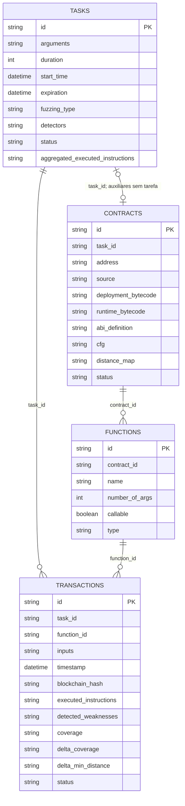
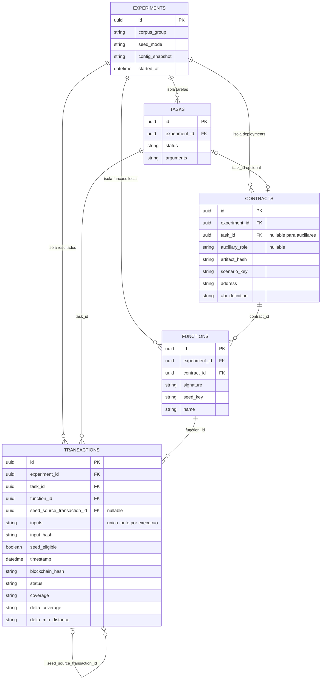
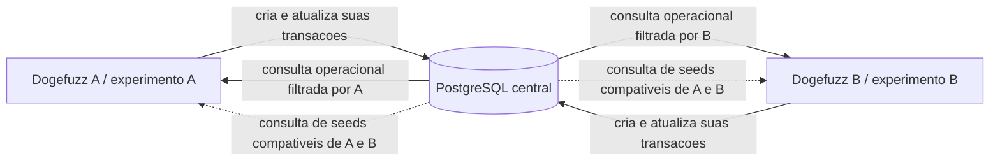

# Dogefuzz — acervo compartilhado sem dupla escrita

Data: 2026-10-04. Documento de planejamento; implementação não realizada.

Nota de referência em 2026-10-09: esta proposta de centralização operacional foi
substituída por bancos operacionais locais e acervo compartilhado somente de
seeds. O plano vigente está nos documentos [001](001-brainstorm-centralizacao-seeds.md),
[002](002-custo-centralizacao-seeds.md) e
[003](003-acompanhamento-centralizacao-seeds.md). O conteúdo abaixo é histórico;
experiment_id, migração das entidades operacionais e ausência de publicação entre
bancos não são requisitos da arquitetura vigente.

## 1. Decisão proposta

Usar **um PostgreSQL central**, com as tabelas operacionais existentes separadas
por `experiment_id`. O acervo será uma **consulta às transações concluídas**,
com filtros de compatibilidade e visibilidade. Não haverá tabela adicional
contendo uma cópia dos inputs, publicação em outro banco, fila ou serviço HTTP
de persistência no MVP.

O motivo da mudança em relação à recomendação anterior de bancos locais é a
nova exigência de reduzir trabalho e evitar dupla escrita. O código já guarda
inputs e resultados em `transactions` e já usa essas transações como seeds.
Reaproveitar esse caminho exige isolamento operacional mais amplo, mas elimina
a implementação de sincronização, cópias e recuperação entre dois bancos.

“Sem dupla escrita” significa **uma fonte persistente para cada execução de um
input**, não um único comando SQL durante toda a execução. Continuam existindo
a criação da transação e as atualizações de hash, estado e resultado. Se B
executar um input que A já executou, haverá outra transação: é outro evento
experimental, com resultado próprio, não replicação do registro de A.

Uma deduplicação física global dos inputs exigiria normalização adicional
(`inputs` + referências das transações), operações de upsert e alterações nos
mapeadores. Não é necessária para eliminar dupla escrita e fica fora do MVP.
Deduplicar candidatos durante a seleção em memória evita favorecer inputs
repetidos, preservando os registros de execução.

## 2. Premissas e entrega mínima

- Duas instâncias cooperam apenas por seeds; cada uma executa suas próprias tarefas.
- Cada processo tem um `experiment_id` diferente e seu próprio ambiente Geth,
  configuração de carteiras, portas/callbacks e diretório de trabalho.
- MVP compartilha inputs entre o mesmo artefato Solidity, ABI, configuração de
  compilação/instrumentação e cenário inicial compatível.
- Inputs dependentes de endereços locais ou de sequências de estado ficam
  excluídos do compartilhamento até haver uma política de remapeamento/replay.
  Isso pode limitar a cobertura do MVP em alguns contratos.
- A comparação usa o mesmo código e banco central em ambos os modos:
  `seed_mode=local` ou `seed_mode=shared`. Assim, a troca do SQLite por PostgreSQL
  não ocorre apenas no grupo com compartilhamento.
- Cada repetição possui seu próprio `corpus_group`, para não consumir resultados
  de outros grupos/repetições ou campanhas anteriores por acidente.
- Dados históricos são preservados nos arquivos originais; a primeira entrega
  começa com um banco novo. Importar bases antigas é um acréscimo separado.
- Não há objetivo de alta disponibilidade ou de atender clientes externos por API.

Essas premissas delimitam a estimativa. Geths já isolados são pressupostos, não
uma consequência automática de adicionar `experiment_id` ao banco.

## 3. Fluxo sem publicação separada

1. A gera inputs e cria suas transações no banco central, identificadas com seu
   experimento, como já faz hoje.
2. A envia à blockchain e atualiza a transação com resultado e estado.
3. Quando resultado e metadados necessários estão completos, a transação recebe
   `seed_eligible=true` na mesma atualização que finaliza seu resultado.
4. B solicita seeds pelo identificador estável da função e pelo grupo de corpus.
5. O repositório retorna candidatos elegíveis, incluindo os de A quando o modo
   de B permite compartilhamento. Nenhum input é copiado para outro acervo.
6. B escolhe/muta uma seed e cria sua própria transação com o input resultante,
   registrando `seed_source_transaction_id` para rastrear a origem.
7. O resultado de B é avaliado no contexto de B e pode tornar-se novo candidato.

`seed_eligible` não significa necessariamente “melhor seed”. Significa que o
registro tem um resultado utilizável e pertence ao domínio suportado. A política
de priorização é separada e deve ser explícita no protocolo experimental.

## 4. Esquemático atual

Este é um esquema lógico derivado dos quatro modelos Go. Não é uma extração do
DDL de um banco existente; as restrições realmente geradas pelo GORM precisam
ser verificadas. Os diagramas mostram campos relevantes, não todos os campos.
Os contratos auxiliares têm `TaskId` vazio, sem associação a uma tarefa normal.



Hoje, cada processo usa um arquivo SQLite e o power schedule busca transações
concluídas pelo `function_id` local. Não existe tabela explícita de seeds.

## 5. Esquemático futuro

Cinco tabelas persistentes: as quatro atuais mais `experiments`. O acervo é
uma consulta, e não uma sexta tabela. Os campos atuais que não aparecem abaixo
continuam presentes. Os nomes e tipos finais precisam ser definidos na migração.





### Regras de identidade e integridade

- `experiment_id`: fornecido pelo contexto da aplicação, não aceito livremente
  do DTO de criação. Um processo pertence a um experimento; retomada exige
  configuração explícita e não permite dois processos operacionais no mesmo ID.
- `artifact_hash`: derivado do artefato de compilação e da configuração relevante;
  não usar endereço implantado nem código com endereços variáveis como identidade.
- `signature`: assinatura ABI completa, incluindo tipos, e identidade explícita
  para fallback/receive. Não usar somente `name` ou o UUID local da função.
- `seed_key`: hash do artefato, assinatura, versão da serialização e cenário.
  O cenário identifica pressupostos de estado, instrumentação e ambiente.
- `input_hash`: hash de representação canônica dos argumentos tipados; normalizar
  representações equivalentes antes de calcular, por exemplo números e bytes.
- Manter os tipos de métricas inicialmente evita uma migração desnecessária;
  consultas/ordenação devem considerar que hoje várias métricas são strings.
- `seed_source_transaction_id`: referência à seed selecionada antes da mutação;
  pode apontar a outro experimento. Não confundir com prova de execução idêntica.
- FKs compostas `(experiment_id, task_id/function_id/contract_id)` com referências
  a pares únicos impedem relacionamentos operacionais entre experimentos. A
  relação de origem de seed é a exceção intencional. Verificar também que a
  função e a tarefa usadas numa transação pertencem ao mesmo contrato esperado.
- Auxiliares: trocar IDs globais fixos por resolução `(experiment_id, auxiliary_role)`;
  usar UUID próprio por deployment e unicidade desse par para auxiliares.
- Hash blockchain: buscar por `(experiment_id, blockchain_hash)`. Duas cadeias
  independentes podem produzir registros que não devem ser confundidos.
- Índices iniciais: tarefas `(experiment_id,status,expiration)`, transações
  `(experiment_id,task_id,status)`, `(experiment_id,blockchain_hash)`,
  `(function_id,seed_eligible,timestamp)` e funções `(seed_key,experiment_id)`.
  Ajustar com plano de consulta e carga representativa.
- Não tornar `input_hash` único em `transactions`: executar o mesmo input mais
  de uma vez é válido e produz observações distintas.
- Não apagar fontes de seeds durante uma campanha. Retenção deve considerar as
  referências de origem e a necessidade de preservar resultados para análise.

O uso de FKs compostas para integridade entre tabelas é suportado pelo PostgreSQL.
Referência: [documentação de constraints](https://www.postgresql.org/docs/current/ddl-constraints.html).

### Consulta do acervo

Uma interface de leitura `SeedRepository.FindCandidates(...)` recebe a chave
compatível, o experimento atual, o modo, grupo e limite. Implementação conceitual:

```text
transactions JOIN functions JOIN experiments
WHERE function.seed_key = chave_do_destino
  AND transaction.seed_eligible = true
  AND transaction.status = concluida
  AND (
    transaction.experiment_id = experimento_atual
    OR (
      modo_do_destino = shared
      AND experimento_da_origem.seed_mode = shared
      AND experimento_da_origem.corpus_group = grupo_do_destino
    )
  )
```

Consultas operacionais nunca usam essa exceção de visibilidade. O modo local
continua limitado à função/tarefa local correspondente, como no comportamento
de referência, evitando ampliar seu corpus para outras tarefas do próprio
experimento inadvertidamente. A consulta conceitual acima precisa dessa
restrição adicional no ramo local quando houver múltiplas tarefas por artefato.

No MVP, reservar uma fração configurada dos candidatos para seeds externas,
deduplicar a lista por `seed_key + input_hash` e manter seeds locais/predefinidas.
Metadados locais continuam orientando a seleção atual; scores da origem não
substituem métricas do destino. Limitar e ordenar candidatos explicitamente
antes de carregá-los. Sem materialized view ou worker de publicação.

## 6. Estimativa detalhada e ordem de execução

Um desenvolvedor familiarizado com Go/GORM e com o projeto. Um dia = 8 h.
Faixas incluem implementação e verificação da etapa. Total-base:
**88–144 h, ou 11–18 dias de trabalho**. Para planejamento, reservar cerca de
**15 dias**, mantendo 18 como limite superior inicial sob as premissas acima.
Não é prazo medido ou garantia. A campanha de experimentos será realizada pelo
usuário e não está incluída; preparar suporte e métricas está incluído.

| Ordem | Tarefa e entrega verificável | Locais principais | Horas |
| --- | --- | --- | ---: |
| 1 | Fechar contrato de compatibilidade, domínio do MVP, grupo de corpus, modos e campos de origem; enumerar consultas operacionais | `entities`, `pkg/dto`, `fuzz`, `config` | 4–8 |
| 2 | Adicionar driver PostgreSQL, DSN/pool, container/volume/readiness, comando único de migração e fechamento sem exclusão; adaptar SQL `strftime` | `data/connection.go`, `config`, `cmd/dogefuzz/env.go`, `infra`, `data/repo/transaction.go` | 8–12 |
| 3 | Criar `experiments`, campos adicionais, FKs/índices, assinaturas/chaves canônicas e snapshot da configuração; validar banco novo | `entities`, migrações, `pkg/mapper`, `controller/tasks.go` | 8–12 |
| 4 | Aplicar isolamento em todas as leituras/escritas operacionais, jobs, callbacks, listagens e atualização de resultados; resolver auxiliares por experimento | `data/repo/*`, `service/*`, `controller/*`, `environment/contract_pool.go`, `service/geth.go`, `service/solidity.go`, `job/*` | 24–40 |
| 5 | Integrar hash, elegibilidade e origem na criação/finalização existente; verificar erro de begin/commit; preservar API de inputs | `service/transaction.go`, `pkg/mapper/transaction.go`, processamento de resultados | 8–12 |
| 6 | Implementar consulta de candidatos, limites/deduplicação, proporção local/externa e integrar ao power schedule com modo local preservado | `pkg/interfaces`, `data/repo`, `fuzz/power_schedule.go`, estratégias greybox | 8–16 |
| 7 | Registrar configurações e métricas: origem local/externa, sementes usadas, ganho no destino e orçamento; separar grupos/repetições | DTOs, relatórios, configuração, seleção de seeds | 8–12 |
| 8 | Executar integração com dois processos/Geths, testes de isolamento e callbacks, falha/reinício do banco, compatibilidade e controles local/shared; conferir planos de consulta | testes de repositórios/serviços e roteiro multiprocesso | 16–24 |
| 9 | Documentar inicialização, operação dos modos, preservação/backup dos resultados, limitações e sequência de experimento | documentação e configuração de exemplo | 4–8 |
| | **Total** | | **88–144** |

### Dependências e marcos

**Marco 1 — banco e identidade, etapas 1–3:** uma instância funciona no novo banco,
sem compartilhar seeds. Esquema e contrato de compatibilidade definidos.

**Marco 2 — isolamento, etapa 4:** duas instâncias no mesmo banco executam somente
suas tarefas. Este marco bloqueia ativar o compartilhamento; uma fuga de escopo
contaminaria a comparação e os ambientes.

**Marco 3 — acervo sem cópia, etapas 5–6:** B obtém uma seed elegível de A pelo caminho
de leitura, preservando origem e avaliando o resultado no próprio ambiente.

**Marco 4 — experimento verificável, etapas 7–9:** local/shared executam pelo mesmo
caminho, métricas estão disponíveis e testes de isolamento/compatibilidade passam.

## 7. Impactos e tratamento

| Área | Impacto | Tratamento no MVP |
| --- | --- | --- |
| Persistência | Banco passa a ser dependência central; uma interrupção afeta ambas as instâncias | Erros explícitos, retomada controlada; sem fallback de escrita para SQLite, que reintroduziria sincronização |
| Consultas | Todo CRUD operacional passa a exigir escopo | Contexto de experimento nos repositórios e testes negativos com IDs de outro experimento |
| Setup | IDs fixos dos auxiliares causariam colisões/endereço incorreto | Resolver auxiliares por experimento e papel, incluindo todos os consumidores dessas constantes |
| Inputs | Continuam em `transactions.inputs`; representação precisa ser estável | Reutilizar serialização, canonicalizar para hash; não copiar payload para tabela de seeds |
| Fuzzing | Candidatos deixam de vir apenas do UUID local | Consulta por compatibilidade para externos, mantendo fallback local e limite do corpus |
| Scores | Delta de cobertura e distância refletem histórico/contexto da origem | Reavaliar inputs no destino; não somar resultados de A e B como se fossem um único experimento |
| API e callbacks | Um mesmo endereço/hash pode aparecer em ambientes distintos | Escopo também em consultas por hash/endereço e verificação da tarefa; callbacks separados por instância |
| Desempenho | Mais consultas/join e latência de rede; possível benefício das seeds pode ser contrabalançado pelo custo | Buscar candidatos por lote ou cache curto em memória, indexar e medir tempo/transações |
| Avaliação | Seeds externas alteram o histórico de cada execução | Guardar origem e grupo; usar várias repetições com orçamento total comparável |
| Retenção | Remover um experimento pode destruir seeds e rastreabilidade | Não excluir durante a campanha; documentar exportação/backup e política posterior |

A finalização dos registros deve tratar erros SQL e visibilidade somente após
commit. GORM documenta tanto o callback transacional quanto a verificação de
`Begin`/`Commit`: [documentação de transações](https://gorm.io/docs/transactions.html).
Isso não torna o envio ao Geth e a gravação SQL uma transação única; não repetir
envios automaticamente após um commit de resultado falhar.

## 8. O que reduz trabalho

1. Reutilizar `transactions` como acervo, sem tabela/cópia de seeds.
2. Uma conexão persistente autoritativa por processo, apontando ao mesmo banco.
3. Interface pequena de consulta; sem extrair outro módulo Go ou criar API própria.
4. Reutilizar DTOs/serialização e manter o formato dos resultados inicialmente.
5. Consultar candidatos quando necessário, sem broker, notificações ou publisher.
6. Começar com banco novo, sem importar automaticamente o histórico.
7. Limitar compartilhamento a domínio compatível e começar pela estratégia greybox
   de cobertura; generalização de endereços/estado e seleção dirigida fica depois.
8. Não implementar fila/reserva de tarefas: cada processo tem seu experimento.

Não economizar removendo filtros de isolamento, chaves de compatibilidade ou
verificação multiprocesso: são requisitos para a validade do experimento.

## 9. Critérios de aceite

- A não lista, altera, finaliza, envia nem recolhe resultados operacionais de B.
- Hash/endereço iguais em duas cadeias não cruzam registros ou callbacks.
- Auxiliares de A e B possuem registros/deployments corretamente separados.
- No modo local, B não usa seeds de A; em shared, usa candidatos compatíveis do
  grupo permitido. Seeds de controle/grupos antigos não entram por acidente.
- Inputs incompatíveis, incompletos e dependentes de cenário não suportado são
  rejeitados antes da seleção.
- Concluir uma transação torna o input consultável como seed sem outra gravação
  de payload em tabela ou banco separado.
- Consumir/mutar uma seed registra sua origem e gera resultados próprios do destino.
- A mesma seed pode ser usada pelos dois processos; não há consumo exclusivo.
- Banco indisponível causa erro identificável, sem escrita oculta em outro banco;
  retomar não apaga registros nem reenvia transações já enviadas por engano.
- Comparação local/shared mantém versão, seleção base, orçamento, número de
  workers e corpus inicial comparáveis; registra custo das consultas.

Métricas mínimas para análise: cobertura por tempo e número de transações,
tempo/transações até falha, seeds externas escolhidas, entradas externas únicas,
descendentes de seeds externas com ganho local e custo da seleção. A atribuição
causal vem da comparação entre grupos; a origem isolada não prova benefício.

## 10. Acréscimos fora da faixa-base

| Trabalho adicional | Esforço preliminar |
| --- | ---: |
| Importar uma base SQLite representativa, atribuir experimentos e validar referências | +8–16 h |
| Adaptar seleção de seeds externas para estratégias dirigidas e validar contexto de distância | +8–24 h |
| Isolar ambientes Geth ainda compartilhados | Reestimar após inspeção da infraestrutura real |
| Remapear endereços e suportar sequências/replay de estado arbitrários | Reestimar por domínio e contratos-alvo |
| Campanha científica completa e análise estatística | Planejamento separado conforme duração/repetições |

Esses acréscimos não estão embutidos em 88–144 h. Esta faixa substitui a estimativa
anterior do acervo com bancos locais: agora inclui migração da infraestrutura e
isolamento de todas as operações no banco central, mas elimina dupla escrita.

## 11. Evidências e limites da análise

Leitura estática do workspace; não foram executados aplicativos, testes ou
benchmarks nesta elaboração. Referências conferidas:

- [Modelos atuais](dogefuzz/entities/transaction.go), além de `task.go`, `contract.go` e `function.go` na mesma pasta.
- [Seleção atual de seeds](dogefuzz/fuzz/power_schedule.go): usa inputs de transações concluídas por função.
- [Repositório de transações](dogefuzz/data/repo/transaction.go): SQL `strftime`; o método de seleção recebe `limit`, mas não aplica `.Limit()` na consulta atual.
- [Repositório de tarefas](dogefuzz/data/repo/task.go): consultas de tarefas em execução sem identificador de experimento.
- [Repositório de contratos](dogefuzz/data/repo/contract.go): `FindAll` e buscas sem escopo de experimento.
- [Repositório de funções](dogefuzz/data/repo/function.go): gera UUID local.
- [Serviço de transações](dogefuzz/service/transaction.go): operações em lote com mutex e commit sem checagem explícita do resultado.
- [Pool de auxiliares](dogefuzz/environment/contract_pool.go) e [consumidores no Geth](dogefuzz/service/geth.go): dependência de IDs globais.
- [DTOs de transação](dogefuzz/pkg/dto/transaction.go) e [mapeador](dogefuzz/pkg/mapper/transaction.go): fronteira para preservar API e adicionar proveniência.

O esquema futuro é uma proposta revisável. Estimativas precisam ser ajustadas
se o domínio exigir seeds com endereços específicos, reprodução de estado ou
armazenamento histórico divergente.
