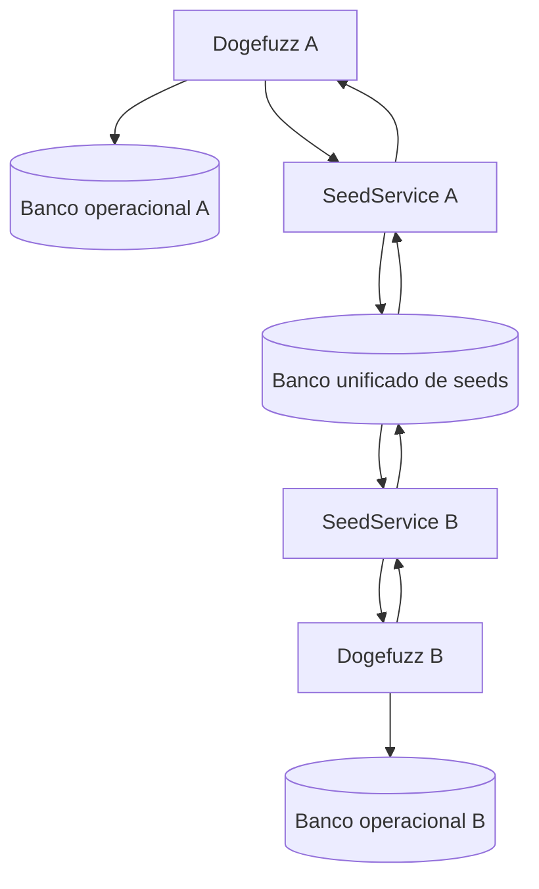
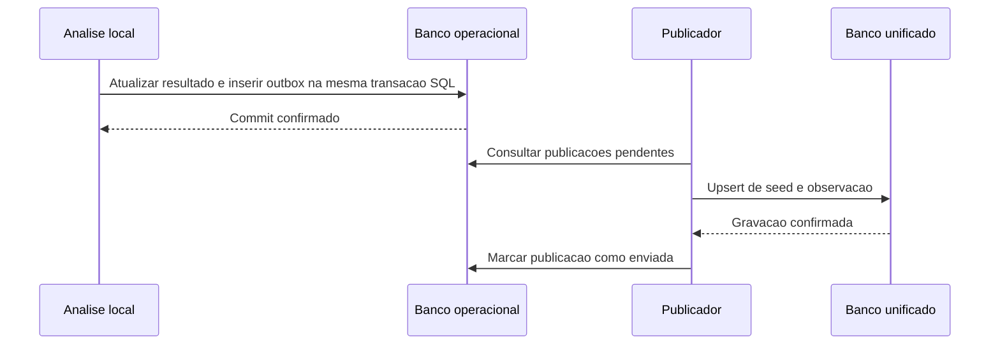

# Dogefuzz: segundo banco para seeds compartilhadas

Data: 2026-10-04. Proposta arquitetural; implementacao nao realizada.

Atualizacao de referencia em 2026-10-09: a arquitetura de bancos locais e acervo
compartilhado foi escolhida, com escopo minimo nos documentos
[001](001-brainstorm-centralizacao-seeds.md),
[002](002-custo-centralizacao-seeds.md) e
[003](003-acompanhamento-centralizacao-seeds.md). O restante deste documento registra
a proposta anterior; outbox, tres tabelas, identidade por artefato e grupos por
campanha nao sao requisitos aprovados do plano vigente. Consulte os documentos
001–003 para decisoes atuais e pendencias.

## Objetivo e relacao com os outros documentos

Permitir que execucoes paralelas e operacionalmente independentes do Dogefuzz
consultem e compartilhem entradas ja executadas para o mesmo contrato compativel.
Cada execucao conserva seu banco operacional e seu ambiente blockchain. Um
segundo banco, comum a todas, guarda o corpus de seeds reutilizaveis.

Esta proposta documenta a alternativa com duas persistencias discutida na
conversa. O [plano de acervo compartilhado](PLANO_ACERVO_COMPARTILHADO.md)
propoe outra arquitetura: um banco central unico, com isolamento por experimento
e seeds consultadas diretamente nas transacoes. As duas propostas sao
alternativas; nao devem ser interpretadas como etapas obrigatorias do mesmo plano.

O [relatorio do funcionamento atual](RELATORIO_DOGEFUZZ_BANCO_CONSULTAS_SEEDS.md)
descreve as entidades, consultas e geracao de seeds existentes.

## Arquitetura proposta

| Componente | Responsabilidade |
| --- | --- |
| Banco operacional de cada execucao | Tarefas, contratos locais, funcoes, transacoes, entradas, estados e resultados |
| Banco unificado | Seeds reutilizaveis, identidade de compatibilidade, deduplicacao e observacoes de origem |
| `SeedService` | Politica de consulta, elegibilidade e publicacao de candidatos |
| `SeedRepository` | Consultas e gravacoes no banco compartilhado, com conexao propria |
| Publicador da outbox | Enviar candidatos pendentes e repetir publicacoes apos falhas |
| `PowerSchedule` | Formar e ordenar candidatos, completar com seeds configuradas e entregar vetores ao fuzzer |

`SeedService` pode ser um componente Go dentro de cada processo. A proposta
nao exige um servidor HTTP adicional: os repositorios podem acessar o mesmo
banco compartilhado diretamente. A tecnologia desse banco depende da topologia
de execucao e deve ser definida antes da implementacao.

O compartilhamento e de candidatos a entradas. Cada processo continua executando
suas tarefas e calculando resultados no proprio Geth. Uma seed pode ser consumida
simultaneamente por varias execucoes; o corpus nao e uma fila de consumo exclusivo.

## Identidade e compatibilidade

Os UUIDs atuais de contrato e funcao identificam registros locais. Para encontrar
o mesmo contrato entre execucoes, a consulta compartilhada precisa de uma chave
estavel, independente do UUID e do endereco de deploy.

Uma chave de compatibilidade deve considerar:

- Identidade do artefato: bytecode, ABI e configuracao relevante de compilacao
  e instrumentacao, com normalizacao definida para referencias variaveis.
- Assinatura completa da funcao, como `transfer(address,uint256)`, e tratamento
  explicito de fallback e receive.
- Versao da serializacao dos argumentos.
- Cenario inicial compativel: parametros do construtor e pressupostos de estado
  e ambiente relevantes para a execucao.
- Grupo de compartilhamento da campanha, para controlar quais experimentos
  podem cooperar e evitar contaminacao entre repeticoes.

O nome do contrato ou da funcao, sozinho, nao estabelece compatibilidade.
Argumentos contendo enderecos locais podem exigir remapeamento. Entradas que
dependem de uma sequencia anterior de transacoes podem exigir replay. O MVP pode
restringir a elegibilidade aos casos suportados, ate essas politicas existirem.

## Estrutura logica do banco unificado

| Registro proposto | Campos principais |
| --- | --- |
| `corpora` | ID, grupo de compartilhamento, chave do artefato, chave do cenario e versao da serializacao |
| `seeds` | ID, corpus, assinatura da funcao, argumentos canonicos, hash dos argumentos e data de inclusao |
| `seed_observations` | ID, seed, experimento e transacao de origem, metricas observadas e data de publicacao |

Os nomes sao propostas, nao tabelas existentes. As observacoes guardam o contexto
que produziu as metricas, enquanto `seeds` identifica o vetor reutilizavel.

Uma restricao unica em `(corpus_id, function_signature, inputs_hash)` permite
deduplicar publicacoes concorrentes por meio de upsert. O hash deve ser calculado
sobre uma representacao canonica dos argumentos tipados; a versao do formato
integra a compatibilidade. A serializacao atual separada por `;` precisa de
revisao para preservar argumentos que contenham esse delimitador.

Uma chave unica de observacao por experimento e transacao de origem evita
duplicar observacoes durante repeticoes da publicacao. O banco operacional pode
guardar o ID da seed escolhida e sua origem para rastrear o uso antes da mutacao.

## Consulta e geracao de entradas

Hoje, `RequestSeeds()` consulta transacoes locais concluidas pelo `functionId`.
Na proposta, ele resolve a chave estavel e solicita candidatos ao `SeedService`.
O servico consulta o corpus compartilhado com os filtros de compatibilidade e
visibilidade da campanha.

O caminho de geracao fica assim:

1. Resolver artefato, assinatura e cenario a partir da funcao e do contrato local.
2. Consultar seeds compativeis no banco compartilhado, com limite explicito.
3. Combinar com candidatos locais conforme a politica definida e deduplicar
   vetores; isso tambem permite usar resultados locais ainda nao publicados.
4. Selecionar e ordenar candidatos segundo uma politica documentada.
5. Completar o conjunto com seeds configuradas por tipo Solidity quando necessario.
6. Escolher um vetor, desserializar pela ABI e mutar seus argumentos.
7. Gravar a nova transacao no banco operacional e executar no Geth local.

A consulta pode ocorrer por lote ou periodicamente. A frequencia determina quanto
tempo leva para uma execucao aproveitar seeds produzidas por outra. Nao ha
necessidade de notificar cada processo imediatamente a cada insercao.

O modo blackbox atual gera argumentos com os handlers e nao utiliza o power
schedule. A integracao inicial do corpus atenderia as variantes greybox;
compartilhamento no blackbox exigiria uma politica adicional explicita.

## Dupla persistencia e momento de publicacao

O vetor de argumentos aparece em dois lugares com finalidades diferentes:
no banco local, como parte de uma transacao executada; no compartilhado, como
candidato reutilizavel. Se dez transacoes locais usarem os mesmos argumentos,
o corpus pode guardar uma unica seed e varias observacoes.

A publicacao ocorre depois da analise da execucao, quando a transacao tem
resultado utilizavel e passa para `done`. A elegibilidade tambem precisa validar
compatibilidade e tipos suportados. Apenas gerar um vetor ou envia-lo ao Geth
nao o torna automaticamente um candidato validado.

Publicar depois da analise permite associar metricas e origem ao candidato.
Nao e necessario promover toda transacao concluida: a politica pode filtrar
entradas repetidas, incompativeis ou sem interesse experimental.

## Consistencia entre os bancos

As duas conexoes nao oferecem uma transacao SQL unica para a gravacao local e
a publicacao remota. Uma falha entre essas operacoes pode deixar uma execucao
concluida sem sua seed compartilhada. A proposta usa uma outbox local para
registrar publicacoes pendentes.

O publicador repete tentativas em falhas. Se cair depois do upsert e antes de
marcar a outbox, a proxima tentativa deve ser tolerada pelas chaves unicas.
Seed e observacao devem ser persistidas juntas em uma transacao do banco
compartilhado, com tratamento dos erros de commit.

A consistencia e eventual: outras execucoes veem a seed depois da publicacao.
Se o acervo ficar indisponivel, o fuzzer pode continuar com historico local e
seeds configuradas, enquanto a outbox preserva candidatos para envio posterior.
Limites de fila, intervalo de repeticao e indicadores de falha precisam ser
definidos na implementacao.

## Metricas e selecao

`DeltaCoverage` e `DeltaMinDistance` dependem do historico agregado da tarefa
que executou a entrada. Uma seed que trouxe ganho em A pode nao trazer ganho
em B. Esses valores devem permanecer associados a observacoes de origem;
nao devem ser tratados automaticamente como pontuacoes universais da seed.

A execucao consumidora reexecuta e avalia a entrada no seu contexto. A politica
pode usar observacoes externas como heuristica, manter uma parcela de exploracao
aleatoria e registrar o ganho efetivo obtido com seeds importadas. O beneficio
do compartilhamento precisa ser medido, nao presumido.

## Integracao no componente

| Ponto atual | Mudanca proposta |
| --- | --- |
| [env.go](dogefuzz/cmd/dogefuzz/env.go) e interfaces | Configurar conexao compartilhada, `SeedService`, repositorio e publicador |
| [power_schedule.go](dogefuzz/fuzz/power_schedule.go) | Consultar corpus pela chave estavel e manter complemento configurado |
| [listener de analise](dogefuzz/listener/executation_analytics.go) | Finalizar resultado e registrar candidato na outbox atomicamente |
| [service/transaction.go](dogefuzz/service/transaction.go) | Oferecer operacao que coordene a finalizacao local e a outbox |
| Modelos e migracoes | Criar outbox local e estrutura compartilhada com chaves unicas |
| Geracao e historico | Registrar origem da seed escolhida antes da mutacao |
| Encerramento e jobs | Coordenar publicador, repeticoes e fechamento das conexoes |

Os problemas atuais de limite ignorado, ordenacao por cobertura e score de
distancia descritos no relatorio de funcionamento precisam ser considerados
na integracao. Adicionar um corpus nao corrige esses comportamentos sozinho.

## Comparacao com o banco central unico

| Aspecto | Bancos locais e segundo banco de seeds | Banco central com isolamento por experimento |
| --- | --- | --- |
| Historico operacional | Permanece local a cada execucao | Fica no banco central, filtrado pelo experimento |
| Origem dos candidatos | Corpus publicado separadamente | Consulta de transacoes elegiveis |
| Copia dos argumentos | Existe entre historico local e corpus | Nao exige copia adicional para formar o acervo |
| Recuperacao de publicacao | Outbox e upsert | Nao ha publicacao entre dois bancos |
| Falha de acesso ao banco comum | Execucao pode continuar com dados locais | Depende da disponibilidade do banco operacional central |
| Esforco principal | Sincronizacao, corpus e integracao de seeds | Migracao da persistencia e isolamento de consultas operacionais |

A alternativa de dois bancos preserva a autonomia operacional local e acrescenta
um mecanismo de publicacao. A alternativa do plano existente elimina essa
publicacao, mas exige isolar corretamente todas as operacoes por experimento.

## Validacao da proposta

- Executar A e B com contratos compativeis e comprovar que B consulta seeds de A.
- Publicar a mesma entrada em paralelo e verificar seed unica e observacoes distintas.
- Interromper o publicador antes e depois do upsert e verificar recuperacao sem duplicacao.
- Indisponibilizar o corpus e verificar continuidade local e publicacao posterior.
- Rejeitar compartilhamento entre artefatos, cenarios ou grupos incompativeis.
- Verificar argumentos com delimitadores, colecoes e enderecos locais.
- Comparar execucoes com e sem compartilhamento sob o mesmo orcamento total,
  registrando cobertura, falhas, custo das consultas e ganho das seeds importadas.

Esses sao criterios para uma implementacao futura. Este documento registra
a ideia e suas decisoes propostas, sem alterar o codigo do Dogefuzz.
