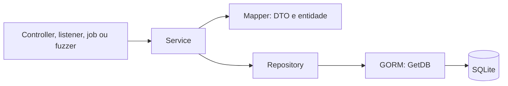
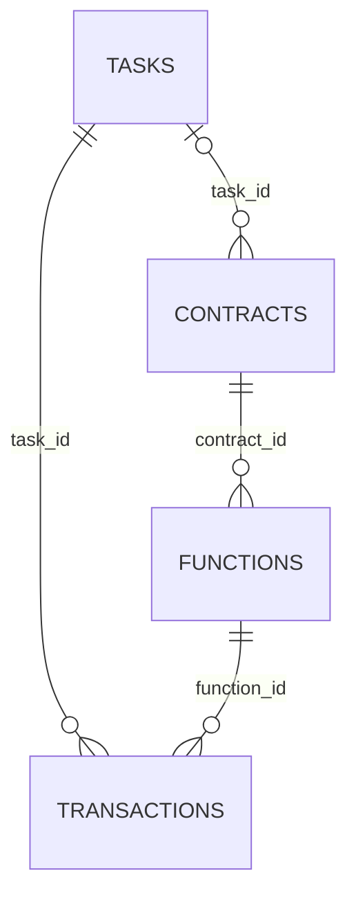
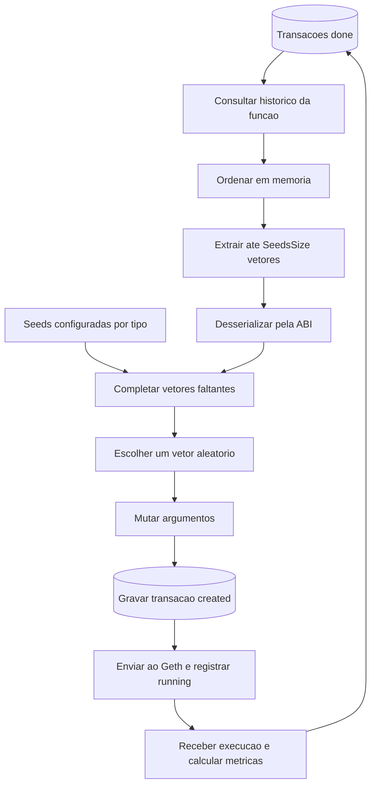

# Dogefuzz: banco de dados, consultas e seeds

Data: 2026-10-04.

## Escopo

Documentacao baseada na leitura do componente `dogefuzz` deste workspace.
Descreve a estrutura declarada nas entidades e os fluxos implementados.
Nao foi inspecionado um arquivo SQLite existente nem executado o aplicativo.
Os nomes de colunas abaixo seguem as convencoes utilizadas pelo codigo dos
repositorios; nao constituem um dump do esquema fisico.

Documentos relacionados:

- [Inicializacao do banco](RELATORIO_DOGEFUZZ_INICIALIZACAO_BANCO.md).
- [Riscos da inicializacao e do ciclo de vida](RELATORIO_DOGEFUZZ_RISCOS_BANCO.md).

## Papel do banco no componente

O SQLite guarda tarefas de fuzzing, contratos, funcoes e transacoes. Tambem
armazena as entradas enviadas, instrucoes executadas, vulnerabilidades detectadas
e metricas que orientam as proximas entradas. O deploy e a execucao dos contratos
ocorrem no Geth; o banco local registra o estado e os resultados usados pelo
Dogefuzz para coordenar esse trabalho.

A abertura utiliza GORM, solicita WAL e outros PRAGMAs e executa `AutoMigrate()`
no primeiro acesso a `DbConnection()`. O arquivo padrao e `dogefuzz.db`, relativo
ao diretorio de trabalho. O mesmo ambiente compartilha seu objeto de conexao
entre os servicos. Detalhes de abertura, migracao e encerramento estao no
relatorio de inicializacao.

O caminho normal de acesso e:



Os servicos recebem a conexao pelo ambiente, convertem DTOs com os mappers e
passam um `*gorm.DB` ao repositorio. O parametro chamado `tx` no repositorio
pode ser a conexao comum ou uma transacao SQL iniciada pelo servico. As consultas
ficam principalmente em `data/repo`; geracao, ordenacao e mutacao de seeds
ficam em `fuzz` e `pkg/solidity`.

## Estrutura atual

As quatro entidades migradas estao em [entities](dogefuzz/entities).
As associacoes Go expressam os relacionamentos abaixo. A cardinalidade entre
tarefa e contrato representa o fluxo da aplicacao; nao ha tag `unique` em
`Contract.TaskId` que, por si so, garanta um unico contrato por tarefa.



Contratos auxiliares criados no startup podem ter `TaskId` vazio. A presenca
de associacoes nas entidades nao comprova a aplicacao efetiva de todas as
restricoes de chave estrangeira no arquivo SQLite; isso exige inspecao do
esquema e das configuracoes efetivas da conexao.

### Tabela `tasks`

Fonte: [task.go](dogefuzz/entities/task.go).

| Campo Go / coluna | Tipo Go | Papel e restricao declarada |
| --- | --- | --- |
| `Id` / `id` | `string` | Chave primaria; UUID atribuido pelo repositorio |
| `Arguments` / `arguments` | `string` | Argumentos do construtor; `not null` |
| `Duration` / `duration` | `time.Duration` | Duracao configurada da tarefa |
| `StartTime` / `start_time` | `time.Time` | Inicio; `not null` |
| `DeploymentTime` / `deployment_time` | `time.Time` | Campo para tempo de deploy |
| `Expiration` / `expiration` | `time.Time` | Expiracao; `not null` |
| `Detectors` / `detectors` | `string` | Detectores selecionados; `not null` |
| `FuzzingType` / `fuzzing_type` | `common.FuzzingType` | Estrategia de fuzzing; `not null` |
| `AggregatedExecutedInstructions` / `aggregated_executed_instructions` | `string` | Uniao das instrucoes executadas pela tarefa |
| `Status` / `status` | `common.TaskStatus` | Estado da tarefa; `not null` |

`Contract` e `Transactions` sao associacoes Go. Os estados declarados da tarefa
sao `running`, `error`, `done` e `report`.

### Tabela `contracts`

Fonte: [contract.go](dogefuzz/entities/contract.go).

| Campo Go / coluna | Tipo Go | Papel e restricao declarada |
| --- | --- | --- |
| `Id` / `id` | `string` | Chave primaria; UUID ou identificador fornecido |
| `Status` / `status` | `common.ContractStatus` | `created` ou `deployed`; `not null` |
| `TaskId` / `task_id` | `string` | Vinculo com tarefa, quando aplicavel |
| `Address` / `address` | `string` | Endereco no Geth; indice declarado |
| `Source` / `source` | `string` | Codigo Solidity; `not null` |
| `DeploymentBytecode` / `deployment_bytecode` | `string` | Bytecode de deploy; `not null` |
| `RuntimeBytecode` / `runtime_bytecode` | `string` | Bytecode de execucao; `not null` |
| `AbiDefinition` / `abi_definition` | `string` | ABI usada para interpretar argumentos; `not null` |
| `Name` / `name` | `string` | Nome do contrato; `not null` |
| `CFG` / `cfg` | `string` | Grafo de fluxo de controle serializado como JSON |
| `DistanceMap` / `distance_map` | `string` | Mapa de distancias serializado como JSON |
| `TargetInstructionsFreq` / `target_instructions_freq` | `string` | Frequencia de instrucoes alvo, em decimal |

`Functions` e uma associacao Go. O CFG e o mapa de distancias sao usados na
analise das execucoes e na pontuacao de seeds das estrategias dirigidas.

### Tabela `functions`

Fonte: [function.go](dogefuzz/entities/function.go).

| Campo Go / coluna | Tipo Go | Papel e restricao declarada |
| --- | --- | --- |
| `Id` / `id` | `string` | Chave primaria; UUID atribuido pelo repositorio |
| `Name` / `name` | `string` | Nome usado na busca do metodo na ABI; indice e `not null` |
| `NumberOfArgs` / `number_of_args` | `int64` | Quantidade de argumentos; `not null` |
| `Callable` / `callable` | `bool` | Elegibilidade de chamada; `not null` |
| `Type` / `type` | `common.MethodType` | `constructor`, `fallback`, `receive` ou `method`; `not null` |
| `ContractId` / `contract_id` | `string` | Identificador do contrato; `not null` |

`Transactions` e uma associacao Go. Os tipos detalhados dos argumentos nao
estao nessa tabela: sao recuperados da ABI do contrato.

### Tabela `transactions`

Fonte: [transaction.go](dogefuzz/entities/transaction.go).

| Campo Go / coluna | Tipo Go | Papel e restricao declarada |
| --- | --- | --- |
| `Id` / `id` | `string` | Chave primaria; UUID atribuido pelo repositorio |
| `Timestamp` / `timestamp` | `time.Time` | Momento registrado na criacao; `not null` |
| `BlockchainHash` / `blockchain_hash` | `string` | Hash usado para correlacionar retornos do Geth; indice |
| `TaskId` / `task_id` | `string` | Tarefa de origem; `not null` |
| `FunctionId` / `function_id` | `string` | Funcao chamada; `not null` |
| `Inputs` / `inputs` | `string` | Vetor de argumentos serializado; `not null` |
| `DetectedWeaknesses` / `detected_weaknesses` | `string` | Vulnerabilidades detectadas |
| `ExecutedInstructions` / `executed_instructions` | `string` | Instrucoes executadas |
| `DeltaCoverage` / `delta_coverage` | `string` | Ganho de cobertura em decimal |
| `DeltaMinDistance` / `delta_min_distance` | `string` | Metrica de variacao de distancia em decimal |
| `Coverage` / `coverage` | `string` | Contagem de cobertura em decimal |
| `CriticalInstructionsHits` / `critical_instructions_hits` | `string` | Ocorrencias de instrucoes criticas em decimal |
| `Status` / `status` | `common.TransactionStatus` | Estado da transacao; `not null` |

Os estados sao `created`, `send_error`, `running`, `done` e `timeout`.
Nao existe entidade ou tabela dedicada a seeds entre os modelos migrados.
Uma seed historica e o vetor de `Inputs` de uma transacao selecionada.

### Serializacao e indices

Os [mappers](dogefuzz/pkg/mapper) transformam listas em texto separado por `;`:
argumentos da tarefa, detectores, instrucoes, vulnerabilidades e entradas das
transacoes. As metricas textuais das entidades viram `uint64` nos DTOs.
O mapper de contrato usa JSON para CFG e mapa de distancias.

Exemplo ilustrativo: os argumentos serializados `['255', 'true']` sao gravados
em `inputs` como `255;true`. O mapper recupera as strings e o handler Solidity
converte cada uma ao tipo definido pela ABI. Esse formato nao possui escape
do delimitador no mapper: um argumento textual contendo `;` pode ser dividido
incorretamente e afetar o reaproveitamento como seed.

Alem das chaves primarias, as tags declaram indices em `contracts.address`,
`functions.name` e `transactions.blockchain_hash`. Nao ha tags de indice
explicitas em `function_id`, `task_id`, `status` ou `timestamp`, usados nas
consultas de controle e de seeds. Os indices efetivos devem ser conferidos
no banco gerado.

## Gravacao e consultas

### Operacoes e transacoes SQL

Os repositorios criam registros com `Create()`. Para atualizar contratos,
tarefas e transacoes, primeiro buscam o registro por ID com `First()` e depois
usam `Model(...).Updates(entidade)`. Erros de registro inexistente sao
convertidos para `ErrNotExists` em varios desses metodos, e os servicos os
traduzem para erros de dominio.

`BulkCreate()` e `BulkUpdate()` em
[service/transaction.go](dogefuzz/service/transaction.go) utilizam um mutex,
`Begin()`, operacoes individuais, `Rollback()` em erro e `Commit()` ao final.
O mutex coordena esses dois metodos na mesma instancia de servico; os metodos
individuais nao usam esse bloqueio. Os erros de `Commit()` nao sao verificados
explicitamente. A criacao de tarefa, contrato e funcoes no controller ocorre
em chamadas separadas, sem uma transacao abrangendo todas essas etapas.

Os repositorios examinados nao fazem `Preload()` das associacoes nem oferecem
operacoes de exclusao individual. O fluxo consulta os registros relacionados
pelos identificadores e preserva o historico de transacoes.

### Mapa das consultas

| Repositorio | Consulta | Uso |
| --- | --- | --- |
| [Contract](dogefuzz/data/repo/contract.go) | Por ID, por `task_id` ou todos os contratos | Resolver contrato da tarefa, ABI e enderecos disponiveis |
| [Function](dogefuzz/data/repo/function.go) | Por ID, por `contract_id`, construtor por contrato e tipo | Escolher funcao e interpretar argumentos |
| [Task](dogefuzz/data/repo/task.go) | `running` com expiracao anterior a `Now()` | Encerrar tarefas vencidas |
| Task | `running` sem transacoes `running`, usando `NOT EXISTS` | Identificar tarefas sem execucoes em andamento |
| Task | `running` com contrato `deployed`, usando `EXISTS` | Identificar tarefas aptas a executar chamadas |
| Task | Contrato `deployed`, tarefa `running` e nenhuma transacao `running` ou contagem `<= limit` | Solicitar novos lotes de entradas |
| [Transaction](dogefuzz/data/repo/transaction.go) | Por ID, hash ou `task_id` | Correlacionar resultados e montar relatorios |
| Transaction | Transacoes concluidas por funcao, ordenadas por `timestamp` | Recuperar candidatos a seeds historicas |
| Transaction | `running` com timestamp anterior ao limiar | Marcar timeout |
| Transaction | Primeiro resultado com vulnerabilidade via `LIKE`, `strftime` e `LIMIT 1` | Calcular tempo ate detectar uma vulnerabilidade |

As consultas combinam construcao GORM (`Where`, `First`, `Find`, `Order`) e
SQL escrito em `Raw()`. Os filtros recebem parametros separados com `?` nas
consultas SQL explicitas.

O job `transactions-checker` consulta a elegibilidade a cada segundo e publica
`TaskInputRequestEvent`. `tasks-checker` e `transactions-timeout` executam a
cada cinco segundos. A consulta de pendencias usa `<= limit`: estar exatamente
no limiar ainda permite solicitar um lote. O limiar nao e uma reserva atomica
de capacidade nem garante um teto de transacoes depois de inserir o lote.

## Ciclo que alimenta o historico

1. O [controller de tarefas](dogefuzz/controller/tasks.go) compila e valida o
   contrato, cria a tarefa `running`, o contrato `created` e os registros de
   funcoes, e publica `TaskStartEvent`.
2. O [listener de deploy](dogefuzz/listener/contract_deployer.go) implanta o
   contrato, registra a transacao do construtor, obtem o CFG, calcula o mapa
   de distancias e atualiza o contrato para `deployed`.
3. O [listener de fuzzing](dogefuzz/listener/fuzzer.go) recebe uma solicitacao
   de entradas, verifica a tarefa e escolhe aleatoriamente uma funcao
   `Callable` que nao seja o construtor. Usa a mesma funcao para o lote.
4. Para cada item do lote, chama `GenerateInput()`, serializa os argumentos com
   os handlers Solidity e grava a transacao como `created` com `BulkCreate()`.
5. Envia as chamadas ao Geth com `BatchCall()`. Atualiza hash e estado para
   `running` ou registra `send_error`, por meio de `BulkUpdate()`.
6. O [controller de transacoes](dogefuzz/controller/transactions.go) recebe os
   resultados, localiza o registro pelo hash, grava instrucoes executadas ou
   vulnerabilidades e publica `InstrumentExecutionEvent` para a analise.
7. O [listener de analise](dogefuzz/listener/executation_analytics.go) calcula
   cobertura, ganho de cobertura, variacao de distancia e hits criticos.
   Atualiza a transacao para `done` e a uniao de instrucoes da tarefa.
8. As proximas solicitacoes de seeds podem recuperar os argumentos dessas
   transacoes `done`. O [reporter](dogefuzz/listener/reporter.go) tambem usa
   o historico para gerar metricas e series temporais.

`Coverage` e uma contagem baseada nos PCs retornados por `CFG.GetEdgesPCs()`;
nao e um percentual armazenado. `DeltaCoverage` mede o aumento dessa contagem
apos unir a execucao ao historico agregado da tarefa. `DeltaMinDistance` e
calculado em relacao a esse agregado, com tratamento especial quando a distancia
anterior e `MaxUint64`. Essas metricas sao calculadas em Go e persistidas;
o SQLite nao as calcula durante a selecao de seeds.

## Consulta e formacao de seeds

### Fontes

Ha duas fontes no fluxo greybox:

- Historico: vetores `Inputs` de transacoes concluidas da funcao consultada.
- Configuracao: `FuzzerConfig.Seeds`, mapa de tipo Solidity para lista de strings,
  usado para completar o conjunto quando o historico e insuficiente.

As seeds de fuzzing sao argumentos candidatos para chamadas de contrato.
Elas sao diferentes dos contratos auxiliares gravados durante o startup.

### Algoritmo de `RequestSeeds()`

Fonte: [power_schedule.go](dogefuzz/fuzz/power_schedule.go).

1. Busca a funcao pelo ID e o contrato por `ContractId`.
2. Interpreta `contract.AbiDefinition` com a biblioteca ABI do go-ethereum e
   resolve `abiDefinition.Methods[function.Name]`.
3. Solicita transacoes concluidas com
   `FindDoneTransactionsByFunctionIdAndOrderByTimestamp(functionId, 2 * SeedsSize)`.
4. Converte os registros em DTOs e reordena os candidatos em memoria conforme
   a estrategia escolhida.
5. Extrai os primeiros `SeedsSize` vetores de `Inputs`.
6. Desserializa cada argumento com o handler correspondente ao tipo da ABI.
   Se faltarem argumentos, retorna `ErrSeedsListInvalid`.
7. Se houver menos vetores que `SeedsSize`, completa cada vetor faltante
   escolhendo uma seed configurada para cada tipo de argumento.
8. Retorna `[][]interface{}`: uma lista de vetores tipados, pronta para o fuzzer.

O repositorio primeiro procura a funcao e depois monta a consulta de transacoes
com as chamadas abaixo:

```go
tx.Where("function_id", function.Id).
    Where("status", common.TRANSACTION_DONE).
    Order("timestamp").
    Find(&transactions)
```

Essa e a expressao atual do codigo, nao um SQL capturado em execucao.
Os filtros estao escritos sem `= ?`, diferentemente de outras consultas do
componente. Existe um teste de integracao que espera registros `done` da
funcao correta em ordem cronologica, mas ele nao foi executado nesta analise.

O argumento `limit` recebido pelo repositorio nao e utilizado: nao existe
`.Limit(...)` nessa consulta. Assim, a chamada com `2 * SeedsSize` nao limita
o historico carregado. O corte para `SeedsSize` acontece depois da ordenacao
em memoria. `Order("timestamp")` nao especifica ordenacao descendente; o
codigo nao solicita explicitamente as execucoes mais recentes primeiro.

### Estrategias de ordenacao

| Fuzzer | Fonte das entradas | Ordenacao atual dos candidatos |
| --- | --- | --- |
| [Blackbox](dogefuzz/fuzz/blackbox.go) | `handler.Generate()` por argumento | Nao chama `RequestSeeds()` nem reutiliza transacoes anteriores |
| [Greybox](dogefuzz/fuzz/greybox.go) | Historico e complemento configurado | `DeltaCoverage` crescente |
| [Directed greybox](dogefuzz/fuzz/directed_greybox.go) | Historico e complemento configurado | Score de hits e distancia decrescente |
| [Other directed greybox](dogefuzz/fuzz/other_directed_greybox.go) | Historico e complemento configurado | Maior valor entre hits, cobertura e distancia, em ordem decrescente |

O [orderer de cobertura](dogefuzz/fuzz/coverage_orderer.go) usa `sort.SliceStable`
com comparacao `<`. Portanto, na implementacao atual, um ganho de cobertura
menor aparece antes de um maior. A ordenacao estavel preserva a ordem anterior
dos candidatos empatados.

O [orderer dirigido](dogefuzz/fuzz/distance_orderer.go) calcula a formula:

```text
score = 0.9 * (hits / frequencia_alvo)
      + 0.1 * ((soma_distancias - DeltaMinDistance) / soma_distancias)
```

Ha uma falha visivel nessa implementacao: `maxDistance` inicia nulo, mas sua
inicializacao esta condicionada a `maxDistance != nil`. O mapa permanece nulo,
a soma fica zero e a divisao pode produzir `NaN` ou infinito, prejudicando a
comparacao dos candidatos. A formula expressa o codigo, mas nao permite
afirmar que a classificacao por distancia esteja funcionando corretamente.

O [orderer combinado](dogefuzz/fuzz/distance_coverage_orderer.go) usa o maximo
entre hits normalizados, quantidade de instrucoes executadas dividida pelo
total de instrucoes do CFG e `DeltaMinDistance / soma_distancias`, com ajustes
para o valor sentinela. Essa cobertura de pontuacao usa outra medida que a
contagem em `Transaction.Coverage`. O score e calculado em memoria, sem coluna
dedicada nem `ORDER BY` SQL para essas metricas.

### Escolha e mutacao

Depois de receber a lista, os fuzzers greybox escolhem um vetor inteiro com
`common.RandomChoice(seedsList)`. Para cada argumento, criam o handler da ABI,
chamam `SetValue()`, escolhem um mutador de `GetMutators()` e executam-no.
O resultado e uma nova entrada; ela so passa a integrar o historico quando
o listener a grava como transacao e a execucao chega ao estado `done`.

O ranking determina quais vetores entram no conjunto reduzido. A escolha
entre os vetores retornados e aleatoria, sem pesos de probabilidade ou numero
de mutacoes proporcional ao score. Nao ha deduplicacao dos vetores nessa etapa.
Alguns mutadores podem manter o valor, como `NotOp` do handler de enderecos.

Os handlers de [pkg/solidity](dogefuzz/pkg/solidity) encapsulam conversao,
geracao e mutacao por tipo. Por exemplo, `uint8` usa seeds textuais numericas
e mutadores de soma, subtracao, multiplicacao e divisao. Colecoes delegam
parte do trabalho aos handlers dos elementos.

O [SolidityService](dogefuzz/service/solidity.go) consulta todos os contratos
ao construir o contexto de cada handler, coleta enderecos nao vazios e agrega
enderecos configurados de agente e deployer, alem dos identificadores
auxiliares adicionados pelo codigo. Assim, mesmo blackbox consulta o banco
para funcao, ABI e contexto de enderecos. O reaproveitamento do historico de
entradas e especifico das variantes greybox.

### Exemplo ilustrativo

Considere uma funcao `f(uint8, bool)`, `SeedsSize = 5` e apenas duas transacoes
concluidas disponiveis. As duas fornecem vetores historicos. O power schedule
forma outros tres vetores escolhendo, para cada posicao, valores configurados
para `uint8` e `bool`. Na configuracao entregue, essas listas sao `0` e `255`,
e `true` e `false`, respectivamente. As combinacoes sao aleatorias e podem
se repetir; nao e gerado automaticamente o produto cartesiano das listas.

O fuzzer escolhe um dos cinco vetores, muta seus argumentos e o listener
serializa e grava a nova entrada. Depois da execucao e analise, a transacao
concluida pode participar da proxima consulta de seeds. Sem historico, os
cinco vetores seriam inteiramente formados pelas seeds configuradas.



## Limites e pontos de verificacao

| Ponto observado | Consequencia e verificacao sugerida |
| --- | --- |
| `limit` ignorado na consulta de seeds | Volume lido e ordenado pode crescer com todo o historico; testar um historico maior que o limite solicitado |
| Cobertura ordenada de forma crescente | A selecao inicial favorece os menores deltas; confirmar a politica desejada com candidatos de ganhos distintos |
| Mapa nulo no orderer dirigido | Score pode ser nao finito; testar o calculo com mapa de distancias conhecido |
| `Inputs` usa `;` sem escape | Strings contendo esse caractere podem perder a estrutura original; testar ida e volta de argumentos textuais |
| `SeedsSize` sem validacao explicita no fluxo | Um conjunto vazio chega a `RandomChoice()`, que usa `rand.Intn(len(slice))`; validar tamanho positivo |
| Seeds configuradas ausentes ou invalidas | Varios handlers escolhem diretamente de listas por tipo; validar listas nao vazias e valores compativeis |
| Busca do metodo por nome na ABI sem verificar existencia | Confirmar tratamento de metodos ausentes, fallback e receive |
| `Begin()` e `Commit()` sem verificacao explicita dos retornos | Uma operacao em lote pode reportar sucesso sem confirmar o commit; testar propagacao de falha |
| Atualizacao da transacao e do agregado da tarefa em chamadas separadas | Uma falha entre chamadas pode deixar a transacao `done` e o agregado desatualizado |
| Campos de consulta sem indices explicitamente declarados | Avaliar plano de consulta e volume antes de escolher indices compostos |
| Contexto Solidity consulta todos os contratos por handler | Geracao e desserializacao podem repetir leituras; medir consultas por lote |

O teste existente em
[transaction_it_test.go](dogefuzz/data/repo/transaction_it_test.go) verifica
filtro de transacoes concluidas e ordenacao por timestamp, mas usa limite 10
com apenas dois resultados esperados, sem verificar a aplicacao do limite.
Esta documentacao registra verificacoes futuras; nao afirma que esses
comportamentos tenham sido validados em execucao.
