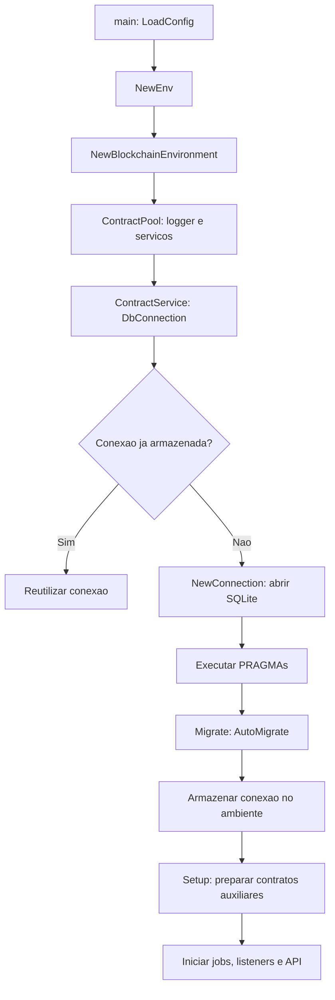

# Dogefuzz: inicializacao do banco de dados

Data da analise: 2026-10-04.

## Escopo e metodo

Analise estatica do componente `dogefuzz`, baseada no codigo presente neste
workspace. O aplicativo e os testes nao foram executados para este relatorio.
Os valores efetivos dos PRAGMAs e o esquema de um banco existente nao foram
inspecionados. Os caminhos citados sao relativos a raiz do projeto.

O componente utiliza SQLite por meio de GORM. O `go.mod` declara
`gorm.io/driver/sqlite v1.4.4` e `gorm.io/gorm v1.24.3`.

## Fluxo de inicializacao

1. `main()` carrega a configuracao com `config.LoadConfig(".")` em
   [main.go](dogefuzz/cmd/dogefuzz/main.go), linha 24.
2. `NewEnv(cfg)` armazena a configuracao. Esse construtor ainda nao abre o banco
   ([env.go](dogefuzz/cmd/dogefuzz/env.go), linha 140).
3. `NewBlockchainEnvironment(env)` solicita `ContractPool()`. O construtor do
   pool inicializa o logger e os servicos, incluindo `ContractService()`
   ([blockchain.go](dogefuzz/environment/blockchain.go), linha 13;
   [contract_pool.go](dogefuzz/environment/contract_pool.go), linha 24).
4. `NewContractService()` solicita `DbConnection()`
   ([contract.go](dogefuzz/service/contract.go), linha 20).
5. No primeiro acesso, `DbConnection()` chama `data.NewConnection()`, executa
   `Migrate()` e somente depois guarda a conexao em `e.dbConnection`
   ([env.go](dogefuzz/cmd/dogefuzz/env.go), linha 177).
6. Os acessos seguintes reutilizam a conexao armazenada. A migracao ocorre
   novamente quando um novo ambiente abre sua primeira conexao.
7. Depois da construcao do ambiente blockchain, `Setup(ctx)` prepara os
   contratos auxiliares. Scheduler, listeners e servidor sao iniciados depois.

## Configuracao e local do arquivo

O nome do arquivo e montado com `fmt.Sprintf("%s.db", cfg.DatabaseName)` em
[connection.go](dogefuzz/data/connection.go), linha 22. A configuracao entregue
no projeto define `databaseName` como `dogefuzz` em
[config.json](dogefuzz/config.json), linha 2.

| Cenario | Caminho resultante com a configuracao entregue |
| --- | --- |
| Processo iniciado em `/home/parkus/tcc/dogefuzz` | `/home/parkus/tcc/dogefuzz/dogefuzz.db` |
| Container com o Dockerfile entregue | `/app/dogefuzz.db` |
| Outro diretorio de trabalho | `<diretorio de trabalho>/dogefuzz.db` |

O caminho e relativo ao diretorio de trabalho quando `DatabaseName` e apenas um
nome. O Dockerfile define `WORKDIR /app` e copia `config.json` para esse diretorio
([Dockerfile](dogefuzz/Dockerfile), linhas 19 e 22). A existencia de armazenamento
persistente depende da configuracao de execucao do container; o Dockerfile, por
si so, nao comprova essa persistencia.

`StorageFolder` tem outro papel: fornece o diretorio ao compilador Solidity.
Ele nao participa da montagem do caminho SQLite. Seu valor padrao e
`path.Join(os.TempDir(), "dogefuzz")`
([config.go](dogefuzz/config/config.go), linha 49).

O carregador usa Viper, prefixo de ambiente `DOGEFUZZ` e `AutomaticEnv()`.
O teste de configuracao utiliza `DOGEFUZZ_DATABASENAME` para alterar o nome do
banco ([config_test.go](dogefuzz/config/config_test.go), linha 124).
Nao existe validacao explicita de `DatabaseName` em `LoadConfig()`: um nome
vazio chegaria a abertura como `.db`.

## Abertura e PRAGMAs

`NewConnection()` registra o nome do arquivo, chama `gorm.Open(sqlite.Open(...))`
e instala `DataLogger` como logger do GORM. Um erro de abertura e retornado ao
chamador. O banco pode ser criado ou aberto conforme a existencia do arquivo.

Depois da abertura, o codigo solicita as configuracoes abaixo, nesta ordem
([connection.go](dogefuzz/data/connection.go), linhas 31 a 36):

| Comando solicitado | Area configurada |
| --- | --- |
| `PRAGMA journal_mode=WAL` | Modo de journal |
| `PRAGMA page_size=32768` | Tamanho de pagina |
| `PRAGMA mmap_size=30000000000` | Limite solicitado para mapeamento de memoria |
| `PRAGMA temp_store=memory` | Armazenamento temporario |
| `PRAGMA synchronous=normal` | Politica de sincronizacao |

Esses valores sao solicitacoes do codigo. Nenhum retorno de `db.Exec()` e
checado, e nao ha consulta posterior para confirmar o valor efetivo. Portanto,
esta analise nao comprova que todos sejam aplicados em cada ambiente ou conexao.

## Criacao do esquema

`Migrate()` chama `AutoMigrate()` com quatro entidades
([connection.go](dogefuzz/data/connection.go), linha 54):

| Entidade | Conteudo principal | Declaracoes relevantes |
| --- | --- | --- |
| [Contract](dogefuzz/entities/contract.go) | Codigo, bytecode, ABI, endereco e estado do contrato | `Id` como chave primaria; indice em `Address`; associacao com funcoes |
| [Function](dogefuzz/entities/function.go) | Funcao, argumentos, tipo e contrato | `Id` como chave primaria; indice em `Name`; associacao com transacoes |
| [Task](dogefuzz/entities/task.go) | Parametros, tempos, detectores e estado da tarefa | `Id` como chave primaria; associacoes com contrato e transacoes |
| [Transaction](dogefuzz/entities/transaction.go) | Entradas, hash, cobertura e resultados | `Id` como chave primaria; indice em `BlockchainHash`; identificadores de tarefa e funcao |

Os campos tambem declaram restricoes `not null`. O esquema e derivado dessas
estruturas e das convencoes do GORM. Nao foram encontrados arquivos SQL de
migracao ou um historico versionado de migracoes no componente. As restricoes
efetivamente presentes precisam ser confirmadas no esquema SQLite gerado.

## Dados gravados durante o startup

`AutoMigrate()` cuida do esquema. O preenchimento inicial ocorre em outra etapa:
`contractPool.Setup()` percorre cinco contratos auxiliares definidos no codigo
([contract_pool.go](dogefuzz/environment/contract_pool.go), linha 34).

Para cada contrato, `deployContract()` le e compila o Solidity, procura o registro
pelo identificador fixo e cria o registro caso ele nao exista. Em seguida,
realiza o deploy no Geth e atualiza endereco e status no banco. O deploy e
executado mesmo quando o registro ja existia.

Assim, existe inicializacao de dados pela aplicacao, embora nao tenham sido
encontrados scripts SQL de seed. Uma falha de compilacao, deploy ou persistencia
pode interromper essa etapa depois de o esquema ja ter sido criado e de parte
dos contratos ter sido processada.

## Erros, encerramento e testes

Erros de abertura e de migracao provocam log e `panic` em `DbConnection()`.
Erros nos PRAGMAs nao sao propagados explicitamente.

`waitForInterrupt()` encerra listeners, scheduler e servidor, e chama
`os.Exit(0)` ([main.go](dogefuzz/cmd/dogefuzz/main.go), linha 58). Nesse fluxo
nao existe fechamento explicito da conexao SQLite nem chamada a `env.Destroy()`.
`Destroy()`, quando chamado, usa `Clean()`, que remove o arquivo principal do
banco; por isso, nao representa apenas o encerramento de uma conexao.

O ambiente de integracao abre a conexao sem executar a migracao automaticamente
([test/it/env.go](dogefuzz/test/it/env.go), linha 42). Os testes dos repositorios
chamam `Migrate()` no setup e acrescentam um UUID ao nome `test_dogefuzz` para
isolar os arquivos. No teardown, chamam `Destroy()`. A existencia desses testes
foi verificada no codigo; eles nao foram executados nesta atividade.

Os riscos e as recomendacoes estao no
[relatorio complementar](RELATORIO_DOGEFUZZ_RISCOS_BANCO.md).

O funcionamento geral, a estrutura das entidades, as consultas e o ciclo de
seeds estao no
[relatorio de banco, consultas e seeds](RELATORIO_DOGEFUZZ_BANCO_CONSULTAS_SEEDS.md).
