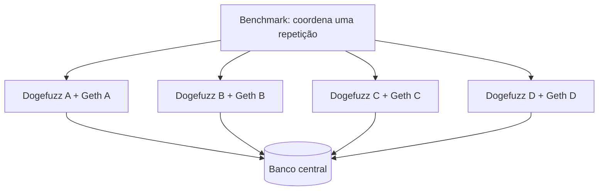

# Codex conversation

## User

quero discutir sobre o impacto da possibilidade de utilizar seeds em execucoes paralelas. por exemplo, um mesmo contrato esta sendo executado em 4 containers ao mesmo tempo. quero que as seeds possam ser compatilhadas entre as execucoes. numa possibilidade de melhor a performance.

## Assistant

Vou examinar como o projeto usa seeds e organiza as execuções, para discutirmos onde o compartilhamento entre containers poderia ajudar e quais custos ele traria.

## Activity

    $ pwd; rg --files -g 'AGENTS.md' -g '*seed*' -g '*Seed*' -g '*README*' -g '*GLOSSARY*' -g '*ADR*' -g '*docker*' -g '*compose*' -g 'pom.xml' -g 'build.gradle*'
    /home/parkus/tcc
    dogefuzz/.dockerignore
    dogefuzz/README.md
    dogefuzz/infra/docker-compose.debug.yml
    dogefuzz/infra/docker-compose.yml
    dogefuzz/infra/docker-compose.test.yml
    dogefuzz-enhanced-go-ethereum/swarm/README.md
    dogefuzz-enhanced-go-ethereum/README.md
    dogefuzz-enhanced-go-ethereum/log/README.md
    dogefuzz-enhanced-go-ethereum/log/README_ETHEREUM.md
    dogefuzz-enhanced-go-ethereum/signer/core/testdata/README.md
    dogefuzz-enhanced-go-ethereum/metrics/influxdb/README.md
    dogefuzz-enhanced-go-ethereum/metrics/README.md
    dogefuzz-enhanced-go-ethereum/cmd/ethkey/README.md
    dogefuzz-enhanced-go-ethereum/cmd/clef/README.md
    dogefuzz-enhanced-go-ethereum/tests/fuzzers/README.md
    dogefuzz-enhanced-go-ethereum/cmd/faucet/README.md
    dogefuzz-enhanced-go-ethereum/cmd/evm/README.md
    dogefuzz-enhanced-go-ethereum/tests/evm-benchmarks/README.md
    dogefuzz-enhanced-go-ethereum/crypto/ecies/README
    dogefuzz-enhanced-go-ethereum/cmd/checkpoint-admin/README.md
    dogefuzz-enhanced-go-ethereum/tests/fuzzers/bls12381/testdata/fuzz_g1_mul_seed_corpus.zip
    dogefuzz-enhanced-go-ethereum/tests/fuzzers/bls12381/testdata/fuzz_map_g2_seed_corpus.zip
    dogefuzz-enhanced-go-ethereum/tests/fuzzers/bls12381/testdata/fuzz_g2_mul_seed_corpus.zip
    dogefuzz-enhanced-go-ethereum/tests/fuzzers/bls12381/testdata/fuzz_g2_multiexp_seed_corpus.zip
    dogefuzz-enhanced-go-ethereum/tests/fuzzers/bls12381/testdata/fuzz_g1_multiexp_seed_corpus.zip
    dogefuzz-enhanced-go-ethereum/tests/fuzzers/bls12381/testdata/fuzz_g1_add_seed_corpus.zip
    dogefuzz-enhanced-go-ethereum/tests/fuzzers/bls12381/testdata/fuzz_map_g1_seed_corpus.zip
    dogefuzz-enhanced-go-ethereum/tests/fuzzers/bls12381/testdata/fuzz_pairing_seed_corpus.zip
    dogefuzz-enhanced-go-ethereum/tests/fuzzers/bls12381/testdata/fuzz_g2_add_seed_corpus.zip
    dogefuzz-enhanced-go-ethereum/cmd/devp2p/README.md
    dogefuzz-enhanced-go-ethereum/crypto/secp256k1/libsecp256k1/README.md
    dogefuzz-enhanced-go-ethereum/cmd/evm/testdata/18/README.md
    dogefuzz-enhanced-go-ethereum/accounts/keystore/testdata/keystore/README
    dogefuzz-enhanced-go-ethereum/accounts/scwallet/README.md
    dogefuzz-enhanced-go-ethereum/p2p/simulations/README.md
    dogefuzz-enhanced-go-ethereum/p2p/simulations/examples/README.md
    ✓ • 0ms

## Activity

    $ ls -a; rg --files -g AGENTS.md -g '!dogefuzz-enhanced-go-ethereum/**'; rg -n 'seed|corpus|parallel|container' dogefuzz/README.md dogefuzz/src dogefuzz/infra --glob '!*.lock'
    .
    ..
    .agents
    .aws
    .codex
    .git
    .serena
    ESQUEMA_BANCO_ATUAL_FUTURO.svg
    PLANO_ACERVO_COMPARTILHADO.md
    PROPOSTA_DOGEFUZZ_SEGUNDO_BANCO_SEEDS.md
    RELATORIO_DOGEFUZZ_BANCO_CONSULTAS_SEEDS.md
    RELATORIO_DOGEFUZZ_INICIALIZACAO_BANCO.md
    RELATORIO_DOGEFUZZ_MODULO_BANCO_ESFORCO.md
    RELATORIO_DOGEFUZZ_RISCOS_BANCO.md
    dogefuzz
    dogefuzz-enhanced-go-ethereum
    dogefuzz-vandal-api
    skills-lock.json
    rg: dogefuzz/src: No such file or directory (os error 2)
    dogefuzz/README.md:59:    "contractSource": "pragma solidity ^0.4.0;\n/*\n * This is a distributed lottery that chooses random addresses as lucky addresses. If these\n * participate, they get the jackpot: the whole balance of the contract, including the ticket\n * price. Of course one address can only win once. The owner regularly reseeds the secret\n * seed of the contract (based on which the lucky addresses are chosen), so if you did not win,\n * just wait for a reseed and try again! Contract addresses cannot play for obvious reasons.\n *\n * Jackpot chance:   1 in 8\n*/\ncontract AddressLotteryV2{\n    struct SeedComponents{\n        uint component1;\n        uint component2;\n        uint component3;\n        uint component4;\n    }\n    \n    address owner;\n    uint private secretSeed;\n    uint private lastReseed;\n    \n    uint winnerLuckyNumber = 7;\n    \n    uint public ticketPrice = 0.1 ether;\n        \n    mapping (address => bool) participated;\n\n    modifier onlyOwner() {\n        require(msg.sender == owner);\n        _;\n    }\n  \n    modifier onlyHuman() {\n        require(msg.sender == tx.origin);\n        _;\n    }\n    \n    function AddressLotteryV2() {\n        owner = msg.sender;\n        reseed(SeedComponents(12345678, 0x12345678, 0xabbaeddaacdc, 0x22222222));\n    }\n    \n    function setTicketPrice(uint newPrice) onlyOwner {\n        ticketPrice = newPrice;\n    }\n    \n    function participate() payable onlyHuman { \n        require(msg.value == ticketPrice);\n        \n        // every address can only win once, obviously\n        require(!participated[msg.sender]);\n        \n        if ( luckyNumberOfAddress(msg.sender) == winnerLuckyNumber)\n        {\n            participated[msg.sender] = true;\n            require(msg.sender.call.value(this.balance)());\n        }\n    }\n    \n    function luckyNumberOfAddress(address addr) constant returns(uint n){\n        // 1 in 8 chance\n        n = uint(keccak256(uint(addr), secretSeed)[0]) % 8;\n    }\n    \n    function reseed(SeedComponents components) internal{\n        secretSeed = uint256(keccak256(\n            components.component1,\n            components.component2,\n            components.component3,\n            components.component4\n        ));\n        lastReseed = block.number;\n    }\n    \n    function kill() onlyOwner {\n        suicide(owner);\n    }\n    \n    function forceReseed() onlyOwner{\n        SeedComponents s;\n        s.component1 = uint(msg.sender);\n        s.component2 = uint256(block.blockhash(block.number - 1));\n        s.component3 = block.number * 1337;\n        s.component4 = tx.gasprice * 7;\n        reseed(s);\n    }\n    \n    function () payable {}\n    \n    // DEBUG, DELETE BEFORE DEPLOYMENT!!\n    function _myLuckyNumber() constant returns(uint n){\n        n = luckyNumberOfAddress(msg.sender);\n    }\n}",
    dogefuzz/infra/docker-compose.test.yml:5:    container_name: dogefuzz_geth_test
    dogefuzz/infra/docker-compose.test.yml:27:    container_name: dogefuzz_vandal_test
    ✗ (2) • 0ms

## Activity

    $ rg --files dogefuzz -g '*.py' -g 'AGENTS.md'; cat PLANO_ACERVO_COMPARTILHADO.md; cat PROPOSTA_DOGEFUZZ_SEGUNDO_BANCO_SEEDS.md
    # Dogefuzz — acervo compartilhado sem dupla escrita
    
    Data: 2026-10-04. Documento de planejamento; implementação não realizada.
    
    ## 1. Decisão proposta
    
    Usar **um PostgreSQL central**, com as tabelas operacionais existentes separadas
    por `experiment_id`. O acervo será uma **consulta às transações concluídas**,
    com filtros de compatibilidade e visibilidade. Não haverá tabela adicional
    contendo uma cópia dos inputs, publicação em outro banco, fila ou serviço HTTP
    de persistência no MVP.
    
    O motivo da mudança em relação à recomendação anterior de bancos locais é a
    nova exigência de reduzir trabalho e evitar dupla escrita. O código já guarda
    inputs e resultados em `transactions` e já usa essas transações como seeds.
    Reaproveitar esse caminho exige isolamento operacional mais amplo, mas elimina
    a implementação de sincronização, cópias e recuperação entre dois bancos.
    
    “Sem dupla escrita” significa **uma fonte persistente para cada execução de um
    input**, não um único comando SQL durante toda a execução. Continuam existindo
    a criação da transação e as atualizações de hash, estado e resultado. Se B
    executar um input que A já executou, haverá outra transação: é outro evento
    experimental, com resultado próprio, não replicação do registro de A.
    
    Uma deduplicação física global dos inputs exigiria normalização adicional
    (`inputs` + referências das transações), operações de upsert e alterações nos
    mapeadores. Não é necessária para eliminar dupla escrita e fica fora do MVP.
    Deduplicar candidatos durante a seleção em memória evita favorecer inputs
    repetidos, preservando os registros de execução.
    
    ## 2. Premissas e entrega mínima
    
    - Duas instâncias cooperam apenas por seeds; cada uma executa suas próprias tarefas.
    - Cada processo tem um `experiment_id` diferente e seu próprio ambiente Geth,
      configuração de carteiras, portas/callbacks e diretório de trabalho.
    - MVP compartilha inputs entre o mesmo artefato Solidity, ABI, configuração de
      compilação/instrumentação e cenário inicial compatível.
    - Inputs dependentes de endereços locais ou de sequências de estado ficam
      excluídos do compartilhamento até haver uma política de remapeamento/replay.
      Isso pode limitar a cobertura do MVP em alguns contratos.
    - A comparação usa o mesmo código e banco central em ambos os modos:
      `seed_mode=local` ou `seed_mode=shared`. Assim, a troca do SQLite por PostgreSQL
      não ocorre apenas no grupo com compartilhamento.
    - Cada repetição possui seu próprio `corpus_group`, para não consumir resultados
      de outros grupos/repetições ou campanhas anteriores por acidente.
    - Dados históricos são preservados nos arquivos originais; a primeira entrega
      começa com um banco novo. Importar bases antigas é um acréscimo separado.
    - Não há objetivo de alta disponibilidade ou de atender clientes externos por API.
    
    Essas premissas delimitam a estimativa. Geths já isolados são pressupostos, não
    uma consequência automática de adicionar `experiment_id` ao banco.
    
    ## 3. Fluxo sem publicação separada
    
    1. A gera inputs e cria suas transações no banco central, identificadas com seu
       experimento, como já faz hoje.
    2. A envia à blockchain e atualiza a transação com resultado e estado.
    3. Quando resultado e metadados necessários estão completos, a transação recebe
       `seed_eligible=true` na mesma atualização que finaliza seu resultado.
    4. B solicita seeds pelo identificador estável da função e pelo grupo de corpus.
    5. O repositório retorna candidatos elegíveis, incluindo os de A quando o modo
       de B permite compartilhamento. Nenhum input é copiado para outro acervo.
    6. B escolhe/muta uma seed e cria sua própria transação com o input resultante,
       registrando `seed_source_transaction_id` para rastrear a origem.
    7. O resultado de B é avaliado no contexto de B e pode tornar-se novo candidato.
    
    `seed_eligible` não significa necessariamente “melhor seed”. Significa que o
    registro tem um resultado utilizável e pertence ao domínio suportado. A política
    de priorização é separada e deve ser explícita no protocolo experimental.
    
    ## 4. Esquemático atual
    
    Este é um esquema lógico derivado dos quatro modelos Go. Não é uma extração do
    DDL de um banco existente; as restrições realmente geradas pelo GORM precisam
    ser verificadas. Os diagramas mostram campos relevantes, não todos os campos.
    Os contratos auxiliares têm `TaskId` vazio, sem associação a uma tarefa normal.
    
    ```mermaid
    erDiagram
        TASKS o|--o| CONTRACTS : "task_id; auxiliares sem tarefa"
        CONTRACTS ||--o{ FUNCTIONS : "contract_id"
        TASKS ||--o{ TRANSACTIONS : "task_id"
        FUNCTIONS ||--o{ TRANSACTIONS : "function_id"
        TASKS {
            string id PK
            string arguments
            int duration
            datetime start_time
            datetime expiration
            string fuzzing_type
            string detectors
            string status
            string aggregated_executed_instructions
        }
        CONTRACTS {
            string id PK
            string task_id
            string address
            string source
            string deployment_bytecode
            string runtime_bytecode
            string abi_definition
            string cfg
            string distance_map
            string status
        }
        FUNCTIONS {
            string id PK
            string contract_id
            string name
            int number_of_args
            boolean callable
            string type
        }
        TRANSACTIONS {
            string id PK
            string task_id
            string function_id
            string inputs
            datetime timestamp
            string blockchain_hash
            string executed_instructions
            string detected_weaknesses
            string coverage
            string delta_coverage
            string delta_min_distance
            string status
        }
    ```
    
    Hoje, cada processo usa um arquivo SQLite e o power schedule busca transações
    concluídas pelo `function_id` local. Não existe tabela explícita de seeds.
    
    ## 5. Esquemático futuro
    
    Cinco tabelas persistentes: as quatro atuais mais `experiments`. O acervo é
    uma consulta, e não uma sexta tabela. Os campos atuais que não aparecem abaixo
    continuam presentes. Os nomes e tipos finais precisam ser definidos na migração.
    
    ```mermaid
    erDiagram
        EXPERIMENTS ||--o{ TASKS : "isola tarefas"
        EXPERIMENTS ||--o{ CONTRACTS : "isola deployments"
        EXPERIMENTS ||--o{ FUNCTIONS : "isola funcoes locais"
        EXPERIMENTS ||--o{ TRANSACTIONS : "isola resultados"
        TASKS o|--o| CONTRACTS : "task_id opcional"
        CONTRACTS ||--o{ FUNCTIONS : "contract_id"
        TASKS ||--o{ TRANSACTIONS : "task_id"
        FUNCTIONS ||--o{ TRANSACTIONS : "function_id"
        TRANSACTIONS o|--o{ TRANSACTIONS : "seed_source_transaction_id"
        EXPERIMENTS {
            uuid id PK
            string corpus_group
            string seed_mode
            string config_snapshot
            datetime started_at
        }
        TASKS {
            uuid id PK
            uuid experiment_id FK
            string status
            string arguments
        }
        CONTRACTS {
            uuid id PK
            uuid experiment_id FK
            uuid task_id FK "nullable para auxiliares"
            string auxiliary_role "nullable"
            string artifact_hash
            string scenario_key
            string address
            string abi_definition
        }
        FUNCTIONS {
            uuid id PK
            uuid experiment_id FK
            uuid contract_id FK
            string signature
            string seed_key
            string name
        }
        TRANSACTIONS {
            uuid id PK
            uuid experiment_id FK
            uuid task_id FK
            uuid function_id FK
            uuid seed_source_transaction_id FK "nullable"
            string inputs "unica fonte por execucao"
            string input_hash
            boolean seed_eligible
            datetime timestamp
            string blockchain_hash
            string status
            string coverage
            string delta_coverage
            string delta_min_distance
        }
    ```
    
    ```mermaid
    flowchart LR
        A[Dogefuzz A / experimento A] -->|cria e atualiza suas transacoes| DB[(PostgreSQL central)]
        B[Dogefuzz B / experimento B] -->|cria e atualiza suas transacoes| DB
        DB -->|consulta operacional filtrada por A| A
        DB -->|consulta operacional filtrada por B| B
        DB -.->|consulta de seeds compativeis de A e B| A
        DB -.->|consulta de seeds compativeis de A e B| B
    ```
    
    ### Regras de identidade e integridade
    
    - `experiment_id`: fornecido pelo contexto da aplicação, não aceito livremente
      do DTO de criação. Um processo pertence a um experimento; retomada exige
      configuração explícita e não permite dois processos operacionais no mesmo ID.
    - `artifact_hash`: derivado do artefato de compilação e da configuração relevante;
      não usar endereço implantado nem código com endereços variáveis como identidade.
    - `signature`: assinatura ABI completa, incluindo tipos, e identidade explícita
      para fallback/receive. Não usar somente `name` ou o UUID local da função.
    - `seed_key`: hash do artefato, assinatura, versão da serialização e cenário.
      O cenário identifica pressupostos de estado, instrumentação e ambiente.
    - `input_hash`: hash de representação canônica dos argumentos tipados; normalizar
      representações equivalentes antes de calcular, por exemplo números e bytes.
    - Manter os tipos de métricas inicialmente evita uma migração desnecessária;
      consultas/ordenação devem considerar que hoje várias métricas são strings.
    - `seed_source_transaction_id`: referência à seed selecionada antes da mutação;
      pode apontar a outro experimento. Não confundir com prova de execução idêntica.
    - FKs compostas `(experiment_id, task_id/function_id/contract_id)` com referências
      a pares únicos impedem relacionamentos operacionais entre experimentos. A
      relação de origem de seed é a exceção intencional. Verificar também que a
      função e a tarefa usadas numa transação pertencem ao mesmo contrato esperado.
    - Auxiliares: trocar IDs globais fixos por resolução `(experiment_id, auxiliary_role)`;
      usar UUID próprio por deployment e unicidade desse par para auxiliares.
    - Hash blockchain: buscar por `(experiment_id, blockchain_hash)`. Duas cadeias
      independentes podem produzir registros que não devem ser confundidos.
    - Índices iniciais: tarefas `(experiment_id,status,expiration)`, transações
      `(experiment_id,task_id,status)`, `(experiment_id,blockchain_hash)`,
      `(function_id,seed_eligible,timestamp)` e funções `(seed_key,experiment_id)`.
      Ajustar com plano de consulta e carga representativa.
    - Não tornar `input_hash` único em `transactions`: executar o mesmo input mais
      de uma vez é válido e produz observações distintas.
    - Não apagar fontes de seeds durante uma campanha. Retenção deve considerar as
      referências de origem e a necessidade de preservar resultados para análise.
    
    O uso de FKs compostas para integridade entre tabelas é suportado pelo PostgreSQL.
    Referência: [documentação de constraints](https://www.postgresql.org/docs/current/ddl-constraints.html).
    
    ### Consulta do acervo
    
    Uma interface de leitura `SeedRepository.FindCandidates(...)` recebe a chave
    compatível, o experimento atual, o modo, grupo e limite. Implementação conceitual:
    
    ```text
    transactions JOIN functions JOIN experiments
    WHERE function.seed_key = chave_do_destino
      AND transaction.seed_eligible = true
      AND transaction.status = concluida
      AND (
        transaction.experiment_id = experimento_atual
        OR (
          modo_do_destino = shared
          AND experimento_da_origem.seed_mode = shared
          AND experimento_da_origem.corpus_group = grupo_do_destino
        )
      )
    ```
    
    Consultas operacionais nunca usam essa exceção de visibilidade. O modo local
    continua limitado à função/tarefa local correspondente, como no comportamento
    de referência, evitando ampliar seu corpus para outras tarefas do próprio
    experimento inadvertidamente. A consulta conceitual acima precisa dessa
    restrição adicional no ramo local quando houver múltiplas tarefas por artefato.
    
    No MVP, reservar uma fração configurada dos candidatos para seeds externas,
    deduplicar a lista por `seed_key + input_hash` e manter seeds locais/predefinidas.
    Metadados locais continuam orientando a seleção atual; scores da origem não
    substituem métricas do destino. Limitar e ordenar candidatos explicitamente
    antes de carregá-los. Sem materialized view ou worker de publicação.
    
    ## 6. Estimativa detalhada e ordem de execução
    
    Um desenvolvedor familiarizado com Go/GORM e com o projeto. Um dia = 8 h.
    Faixas incluem implementação e verificação da etapa. Total-base:
    **88–144 h, ou 11–18 dias de trabalho**. Para planejamento, reservar cerca de
    **15 dias**, mantendo 18 como limite superior inicial sob as premissas acima.
    Não é prazo medido ou garantia. A campanha de experimentos será realizada pelo
    usuário e não está incluída; preparar suporte e métricas está incluído.
    
    | Ordem | Tarefa e entrega verificável | Locais principais | Horas |
    | --- | --- | --- | ---: |
    | 1 | Fechar contrato de compatibilidade, domínio do MVP, grupo de corpus, modos e campos de origem; enumerar consultas operacionais | `entities`, `pkg/dto`, `fuzz`, `config` | 4–8 |
    | 2 | Adicionar driver PostgreSQL, DSN/pool, container/volume/readiness, comando único de migração e fechamento sem exclusão; adaptar SQL `strftime` | `data/connection.go`, `config`, `cmd/dogefuzz/env.go`, `infra`, `data/repo/transaction.go` | 8–12 |
    | 3 | Criar `experiments`, campos adicionais, FKs/índices, assinaturas/chaves canônicas e snapshot da configuração; validar banco novo | `entities`, migrações, `pkg/mapper`, `controller/tasks.go` | 8–12 |
    | 4 | Aplicar isolamento em todas as leituras/escritas operacionais, jobs, callbacks, listagens e atualização de resultados; resolver auxiliares por experimento | `data/repo/*`, `service/*`, `controller/*`, `environment/contract_pool.go`, `service/geth.go`, `service/solidity.go`, `job/*` | 24–40 |
    | 5 | Integrar hash, elegibilidade e origem na criação/finalização existente; verificar erro de begin/commit; preservar API de inputs | `service/transaction.go`, `pkg/mapper/transaction.go`, processamento de resultados | 8–12 |
    | 6 | Implementar consulta de candidatos, limites/deduplicação, proporção local/externa e integrar ao power schedule com modo local preservado | `pkg/interfaces`, `data/repo`, `fuzz/power_schedule.go`, estratégias greybox | 8–16 |
    | 7 | Registrar configurações e métricas: origem local/externa, sementes usadas, ganho no destino e orçamento; separar grupos/repetições | DTOs, relatórios, configuração, seleção de seeds | 8–12 |
    | 8 | Executar integração com dois processos/Geths, testes de isolamento e callbacks, falha/reinício do banco, compatibilidade e controles local/shared; conferir planos de consulta | testes de repositórios/serviços e roteiro multiprocesso | 16–24 |
    | 9 | Documentar inicialização, operação dos modos, preservação/backup dos resultados, limitações e sequência de experimento | documentação e configuração de exemplo | 4–8 |
    | | **Total** | | **88–144** |
    
    ### Dependências e marcos
    
    **Marco 1 — banco e identidade, etapas 1–3:** uma instância funciona no novo banco,
    sem compartilhar seeds. Esquema e contrato de compatibilidade definidos.
    
    **Marco 2 — isolamento, etapa 4:** duas instâncias no mesmo banco executam somente
    suas tarefas. Este marco bloqueia ativar o compartilhamento; uma fuga de escopo
    contaminaria a comparação e os ambientes.
    
    **Marco 3 — acervo sem cópia, etapas 5–6:** B obtém uma seed elegível de A pelo caminho
    de leitura, preservando origem e avaliando o resultado no próprio ambiente.
    
    **Marco 4 — experimento verificável, etapas 7–9:** local/shared executam pelo mesmo
    caminho, métricas estão disponíveis e testes de isolamento/compatibilidade passam.
    
    ## 7. Impactos e tratamento
    
    | Área | Impacto | Tratamento no MVP |
    | --- | --- | --- |
    | Persistência | Banco passa a ser dependência central; uma interrupção afeta ambas as instâncias | Erros explícitos, retomada controlada; sem fallback de escrita para SQLite, que reintroduziria sincronização |
    | Consultas | Todo CRUD operacional passa a exigir escopo | Contexto de experimento nos repositórios e testes negativos com IDs de outro experimento |
    | Setup | IDs fixos dos auxiliares causariam colisões/endereço incorreto | Resolver auxiliares por experimento e papel, incluindo todos os consumidores dessas constantes |
    | Inputs | Continuam em `transactions.inputs`; representação precisa ser estável | Reutilizar serialização, canonicalizar para hash; não copiar payload para tabela de seeds |
    | Fuzzing | Candidatos deixam de vir apenas do UUID local | Consulta por compatibilidade para externos, mantendo fallback local e limite do corpus |
    | Scores | Delta de cobertura e distância refletem histórico/contexto da origem | Reavaliar inputs no destino; não somar resultados de A e B como se fossem um único experimento |
    | API e callbacks | Um mesmo endereço/hash pode aparecer em ambientes distintos | Escopo também em consultas por hash/endereço e verificação da tarefa; callbacks separados por instância |
    | Desempenho | Mais consultas/join e latência de rede; possível benefício das seeds pode ser contrabalançado pelo custo | Buscar candidatos por lote ou cache curto em memória, indexar e medir tempo/transações |
    | Avaliação | Seeds externas alteram o histórico de cada execução | Guardar origem e grupo; usar várias repetições com orçamento total comparável |
    | Retenção | Remover um experimento pode destruir seeds e rastreabilidade | Não excluir durante a campanha; documentar exportação/backup e política posterior |
    
    A finalização dos registros deve tratar erros SQL e visibilidade somente após
    commit. GORM documenta tanto o callback transacional quanto a verificação de
    `Begin`/`Commit`: [documentação de transações](https://gorm.io/docs/transactions.html).
    Isso não torna o envio ao Geth e a gravação SQL uma transação única; não repetir
    envios automaticamente após um commit de resultado falhar.
    
    ## 8. O que reduz trabalho
    
    1. Reutilizar `transactions` como acervo, sem tabela/cópia de seeds.
    2. Uma conexão persistente autoritativa por processo, apontando ao mesmo banco.
    3. Interface pequena de consulta; sem extrair outro módulo Go ou criar API própria.
    4. Reutilizar DTOs/serialização e manter o formato dos resultados inicialmente.
    5. Consultar candidatos quando necessário, sem broker, notificações ou publisher.
    6. Começar com banco novo, sem importar automaticamente o histórico.
    7. Limitar compartilhamento a domínio compatível e começar pela estratégia greybox
       de cobertura; generalização de endereços/estado e seleção dirigida fica depois.
    8. Não implementar fila/reserva de tarefas: cada processo tem seu experimento.
    
    Não economizar removendo filtros de isolamento, chaves de compatibilidade ou
    verificação multiprocesso: são requisitos para a validade do experimento.
    
    ## 9. Critérios de aceite
    
    - A não lista, altera, finaliza, envia nem recolhe resultados operacionais de B.
    - Hash/endereço iguais em duas cadeias não cruzam registros ou callbacks.
    - Auxiliares de A e B possuem registros/deployments corretamente separados.
    - No modo local, B não usa seeds de A; em shared, usa candidatos compatíveis do
      grupo permitido. Seeds de controle/grupos antigos não entram por acidente.
    - Inputs incompatíveis, incompletos e dependentes de cenário não suportado são
      rejeitados antes da seleção.
    - Concluir uma transação torna o input consultável como seed sem outra gravação
      de payload em tabela ou banco separado.
    - Consumir/mutar uma seed registra sua origem e gera resultados próprios do destino.
    - A mesma seed pode ser usada pelos dois processos; não há consumo exclusivo.
    - Banco indisponível causa erro identificável, sem escrita oculta em outro banco;
      retomar não apaga registros nem reenvia transações já enviadas por engano.
    - Comparação local/shared mantém versão, seleção base, orçamento, número de
      workers e corpus inicial comparáveis; registra custo das consultas.
    
    Métricas mínimas para análise: cobertura por tempo e número de transações,
    tempo/transações até falha, seeds externas escolhidas, entradas externas únicas,
    descendentes de seeds externas com ganho local e custo da seleção. A atribuição
    causal vem da comparação entre grupos; a origem isolada não prova benefício.
    
    ## 10. Acréscimos fora da faixa-base
    
    | Trabalho adicional | Esforço preliminar |
    | --- | ---: |
    | Importar uma base SQLite representativa, atribuir experimentos e validar referências | +8–16 h |
    | Adaptar seleção de seeds externas para estratégias dirigidas e validar contexto de distância | +8–24 h |
    | Isolar ambientes Geth ainda compartilhados | Reestimar após inspeção da infraestrutura real |
    | Remapear endereços e suportar sequências/replay de estado arbitrários | Reestimar por domínio e contratos-alvo |
    | Campanha científica completa e análise estatística | Planejamento separado conforme duração/repetições |
    
    Esses acréscimos não estão embutidos em 88–144 h. Esta faixa substitui a estimativa
    anterior do acervo com bancos locais: agora inclui migração da infraestrutura e
    isolamento de todas as operações no banco central, mas elimina dupla escrita.
    
    ## 11. Evidências e limites da análise
    
    Leitura estática do workspace; não foram executados aplicativos, testes ou
    benchmarks nesta elaboração. Referências conferidas:
    
    - [Modelos atuais](dogefuzz/entities/transaction.go), além de `task.go`, `contract.go` e `function.go` na mesma pasta.
    - [Seleção atual de seeds](dogefuzz/fuzz/power_schedule.go): usa inputs de transações concluídas por função.
    - [Repositório de transações](dogefuzz/data/repo/transaction.go): SQL `strftime`; o método de seleção recebe `limit`, mas não aplica `.Limit()` na consulta atual.
    - [Repositório de tarefas](dogefuzz/data/repo/task.go): consultas de tarefas em execução sem identificador de experimento.
    - [Repositório de contratos](dogefuzz/data/repo/contract.go): `FindAll` e buscas sem escopo de experimento.
    - [Repositório de funções](dogefuzz/data/repo/function.go): gera UUID local.
    - [Serviço de transações](dogefuzz/service/transaction.go): operações em lote com mutex e commit sem checagem explícita do resultado.
    - [Pool de auxiliares](dogefuzz/environment/contract_pool.go) e [consumidores no Geth](dogefuzz/service/geth.go): dependência de IDs globais.
    - [DTOs de transação](dogefuzz/pkg/dto/transaction.go) e [mapeador](dogefuzz/pkg/mapper/transaction.go): fronteira para preservar API e adicionar proveniência.
    
    O esquema futuro é uma proposta revisável. Estimativas precisam ser ajustadas
    se o domínio exigir seeds com endereços específicos, reprodução de estado ou
    armazenamento histórico divergente.
    # Dogefuzz: segundo banco para seeds compartilhadas
    
    Data: 2026-10-04. Proposta arquitetural; implementacao nao realizada.
    
    ## Objetivo e relacao com os outros documentos
    
    Permitir que execucoes paralelas e operacionalmente independentes do Dogefuzz
    consultem e compartilhem entradas ja executadas para o mesmo contrato compativel.
    Cada execucao conserva seu banco operacional e seu ambiente blockchain. Um
    segundo banco, comum a todas, guarda o corpus de seeds reutilizaveis.
    
    Esta proposta documenta a alternativa com duas persistencias discutida na
    conversa. O [plano de acervo compartilhado](PLANO_ACERVO_COMPARTILHADO.md)
    propoe outra arquitetura: um banco central unico, com isolamento por experimento
    e seeds consultadas diretamente nas transacoes. As duas propostas sao
    alternativas; nao devem ser interpretadas como etapas obrigatorias do mesmo plano.
    
    O [relatorio do funcionamento atual](RELATORIO_DOGEFUZZ_BANCO_CONSULTAS_SEEDS.md)
    descreve as entidades, consultas e geracao de seeds existentes.
    
    ## Arquitetura proposta
    
    ```mermaid
    flowchart TD
        A[Dogefuzz A] --> LA[(Banco operacional A)]
        B[Dogefuzz B] --> LB[(Banco operacional B)]
        A --> SA[SeedService A]
        B --> SB[SeedService B]
        SA --> U[(Banco unificado de seeds)]
        SB --> U
        U --> SA
        U --> SB
        SA --> A
        SB --> B
    ```
    
    | Componente | Responsabilidade |
    | --- | --- |
    | Banco operacional de cada execucao | Tarefas, contratos locais, funcoes, transacoes, entradas, estados e resultados |
    | Banco unificado | Seeds reutilizaveis, identidade de compatibilidade, deduplicacao e observacoes de origem |
    | `SeedService` | Politica de consulta, elegibilidade e publicacao de candidatos |
    | `SeedRepository` | Consultas e gravacoes no banco compartilhado, com conexao propria |
    | Publicador da outbox | Enviar candidatos pendentes e repetir publicacoes apos falhas |
    | `PowerSchedule` | Formar e ordenar candidatos, completar com seeds configuradas e entregar vetores ao fuzzer |
    
    `SeedService` pode ser um componente Go dentro de cada processo. A proposta
    nao exige um servidor HTTP adicional: os repositorios podem acessar o mesmo
    banco compartilhado diretamente. A tecnologia desse banco depende da topologia
    de execucao e deve ser definida antes da implementacao.
    
    O compartilhamento e de candidatos a entradas. Cada processo continua executando
    suas tarefas e calculando resultados no proprio Geth. Uma seed pode ser consumida
    simultaneamente por varias execucoes; o corpus nao e uma fila de consumo exclusivo.
    
    ## Identidade e compatibilidade
    
    Os UUIDs atuais de contrato e funcao identificam registros locais. Para encontrar
    o mesmo contrato entre execucoes, a consulta compartilhada precisa de uma chave
    estavel, independente do UUID e do endereco de deploy.
    
    Uma chave de compatibilidade deve considerar:
    
    - Identidade do artefato: bytecode, ABI e configuracao relevante de compilacao
      e instrumentacao, com normalizacao definida para referencias variaveis.
    - Assinatura completa da funcao, como `transfer(address,uint256)`, e tratamento
      explicito de fallback e receive.
    - Versao da serializacao dos argumentos.
    - Cenario inicial compativel: parametros do construtor e pressupostos de estado
      e ambiente relevantes para a execucao.
    - Grupo de compartilhamento da campanha, para controlar quais experimentos
      podem cooperar e evitar contaminacao entre repeticoes.
    
    O nome do contrato ou da funcao, sozinho, nao estabelece compatibilidade.
    Argumentos contendo enderecos locais podem exigir remapeamento. Entradas que
    dependem de uma sequencia anterior de transacoes podem exigir replay. O MVP pode
    restringir a elegibilidade aos casos suportados, ate essas politicas existirem.
    
    ## Estrutura logica do banco unificado
    
    | Registro proposto | Campos principais |
    | --- | --- |
    | `corpora` | ID, grupo de compartilhamento, chave do artefato, chave do cenario e versao da serializacao |
    | `seeds` | ID, corpus, assinatura da funcao, argumentos canonicos, hash dos argumentos e data de inclusao |
    | `seed_observations` | ID, seed, experimento e transacao de origem, metricas observadas e data de publicacao |
    
    Os nomes sao propostas, nao tabelas existentes. As observacoes guardam o contexto
    que produziu as metricas, enquanto `seeds` identifica o vetor reutilizavel.
    
    Uma restricao unica em `(corpus_id, function_signature, inputs_hash)` permite
    deduplicar publicacoes concorrentes por meio de upsert. O hash deve ser calculado
    sobre uma representacao canonica dos argumentos tipados; a versao do formato
    integra a compatibilidade. A serializacao atual separada por `;` precisa de
    revisao para preservar argumentos que contenham esse delimitador.
    
    Uma chave unica de observacao por experimento e transacao de origem evita
    duplicar observacoes durante repeticoes da publicacao. O banco operacional pode
    guardar o ID da seed escolhida e sua origem para rastrear o uso antes da mutacao.
    
    ## Consulta e geracao de entradas
    
    Hoje, `RequestSeeds()` consulta transacoes locais concluidas pelo `functionId`.
    Na proposta, ele resolve a chave estavel e solicita candidatos ao `SeedService`.
    O servico consulta o corpus compartilhado com os filtros de compatibilidade e
    visibilidade da campanha.
    
    O caminho de geracao fica assim:
    
    1. Resolver artefato, assinatura e cenario a partir da funcao e do contrato local.
    2. Consultar seeds compativeis no banco compartilhado, com limite explicito.
    3. Combinar com candidatos locais conforme a politica definida e deduplicar
       vetores; isso tambem permite usar resultados locais ainda nao publicados.
    4. Selecionar e ordenar candidatos segundo uma politica documentada.
    5. Completar o conjunto com seeds configuradas por tipo Solidity quando necessario.
    6. Escolher um vetor, desserializar pela ABI e mutar seus argumentos.
    7. Gravar a nova transacao no banco operacional e executar no Geth local.
    
    A consulta pode ocorrer por lote ou periodicamente. A frequencia determina quanto
    tempo leva para uma execucao aproveitar seeds produzidas por outra. Nao ha
    necessidade de notificar cada processo imediatamente a cada insercao.
    
    O modo blackbox atual gera argumentos com os handlers e nao utiliza o power
    schedule. A integracao inicial do corpus atenderia as variantes greybox;
    compartilhamento no blackbox exigiria uma politica adicional explicita.
    
    ## Dupla persistencia e momento de publicacao
    
    O vetor de argumentos aparece em dois lugares com finalidades diferentes:
    no banco local, como parte de uma transacao executada; no compartilhado, como
    candidato reutilizavel. Se dez transacoes locais usarem os mesmos argumentos,
    o corpus pode guardar uma unica seed e varias observacoes.
    
    A publicacao ocorre depois da analise da execucao, quando a transacao tem
    resultado utilizavel e passa para `done`. A elegibilidade tambem precisa validar
    compatibilidade e tipos suportados. Apenas gerar um vetor ou envia-lo ao Geth
    nao o torna automaticamente um candidato validado.
    
    Publicar depois da analise permite associar metricas e origem ao candidato.
    Nao e necessario promover toda transacao concluida: a politica pode filtrar
    entradas repetidas, incompativeis ou sem interesse experimental.
    
    ## Consistencia entre os bancos
    
    As duas conexoes nao oferecem uma transacao SQL unica para a gravacao local e
    a publicacao remota. Uma falha entre essas operacoes pode deixar uma execucao
    concluida sem sua seed compartilhada. A proposta usa uma outbox local para
    registrar publicacoes pendentes.
    
    ```mermaid
    sequenceDiagram
        participant A as Analise local
        participant L as Banco operacional
        participant P as Publicador
        participant U as Banco unificado
        A->>L: Atualizar resultado e inserir outbox na mesma transacao SQL
        L-->>A: Commit confirmado
        P->>L: Consultar publicacoes pendentes
        P->>U: Upsert de seed e observacao
        U-->>P: Gravacao confirmada
        P->>L: Marcar publicacao como enviada
    ```
    
    O publicador repete tentativas em falhas. Se cair depois do upsert e antes de
    marcar a outbox, a proxima tentativa deve ser tolerada pelas chaves unicas.
    Seed e observacao devem ser persistidas juntas em uma transacao do banco
    compartilhado, com tratamento dos erros de commit.
    
    A consistencia e eventual: outras execucoes veem a seed depois da publicacao.
    Se o acervo ficar indisponivel, o fuzzer pode continuar com historico local e
    seeds configuradas, enquanto a outbox preserva candidatos para envio posterior.
    Limites de fila, intervalo de repeticao e indicadores de falha precisam ser
    definidos na implementacao.
    
    ## Metricas e selecao
    
    `DeltaCoverage` e `DeltaMinDistance` dependem do historico agregado da tarefa
    que executou a entrada. Uma seed que trouxe ganho em A pode nao trazer ganho
    em B. Esses valores devem permanecer associados a observacoes de origem;
    nao devem ser tratados automaticamente como pontuacoes universais da seed.
    
    A execucao consumidora reexecuta e avalia a entrada no seu contexto. A politica
    pode usar observacoes externas como heuristica, manter uma parcela de exploracao
    aleatoria e registrar o ganho efetivo obtido com seeds importadas. O beneficio
    do compartilhamento precisa ser medido, nao presumido.
    
    ## Integracao no componente
    
    | Ponto atual | Mudanca proposta |
    | --- | --- |
    | [env.go](dogefuzz/cmd/dogefuzz/env.go) e interfaces | Configurar conexao compartilhada, `SeedService`, repositorio e publicador |
    | [power_schedule.go](dogefuzz/fuzz/power_schedule.go) | Consultar corpus pela chave estavel e manter complemento configurado |
    | [listener de analise](dogefuzz/listener/executation_analytics.go) | Finalizar resultado e registrar candidato na outbox atomicamente |
    | [service/transaction.go](dogefuzz/service/transaction.go) | Oferecer operacao que coordene a finalizacao local e a outbox |
    | Modelos e migracoes | Criar outbox local e estrutura compartilhada com chaves unicas |
    | Geracao e historico | Registrar origem da seed escolhida antes da mutacao |
    | Encerramento e jobs | Coordenar publicador, repeticoes e fechamento das conexoes |
    
    Os problemas atuais de limite ignorado, ordenacao por cobertura e score de
    distancia descritos no relatorio de funcionamento precisam ser considerados
    na integracao. Adicionar um corpus nao corrige esses comportamentos sozinho.
    
    ## Comparacao com o banco central unico
    
    | Aspecto | Bancos locais e segundo banco de seeds | Banco central com isolamento por experimento |
    | --- | --- | --- |
    | Historico operacional | Permanece local a cada execucao | Fica no banco central, filtrado pelo experimento |
    | Origem dos candidatos | Corpus publicado separadamente | Consulta de transacoes elegiveis |
    | Copia dos argumentos | Existe entre historico local e corpus | Nao exige copia adicional para formar o acervo |
    | Recuperacao de publicacao | Outbox e upsert | Nao ha publicacao entre dois bancos |
    | Falha de acesso ao banco comum | Execucao pode continuar com dados locais | Depende da disponibilidade do banco operacional central |
    | Esforco principal | Sincronizacao, corpus e integracao de seeds | Migracao da persistencia e isolamento de consultas operacionais |
    
    A alternativa de dois bancos preserva a autonomia operacional local e acrescenta
    um mecanismo de publicacao. A alternativa do plano existente elimina essa
    publicacao, mas exige isolar corretamente todas as operacoes por experimento.
    
    ## Validacao da proposta
    
    - Executar A e B com contratos compativeis e comprovar que B consulta seeds de A.
    - Publicar a mesma entrada em paralelo e verificar seed unica e observacoes distintas.
    - Interromper o publicador antes e depois do upsert e verificar recuperacao sem duplicacao.
    - Indisponibilizar o corpus e verificar continuidade local e publicacao posterior.
    - Rejeitar compartilhamento entre artefatos, cenarios ou grupos incompativeis.
    - Verificar argumentos com delimitadores, colecoes e enderecos locais.
    - Comparar execucoes com e sem compartilhamento sob o mesmo orcamento total,
      registrando cobertura, falhas, custo das consultas e ganho das seeds importadas.
    
    Esses sao criterios para uma implementacao futura. Este documento registra
    a ideia e suas decisoes propostas, sem alterar o codigo do Dogefuzz.
    ✓ • 0ms

## Activity

    $ cat dogefuzz/fuzz/power_schedule.go; cat dogefuzz/data/repo/transaction.go; rg -n 'RequestSeeds|Mutate|DeltaCoverage|AggregatedExecuted' dogefuzz/fuzz dogefuzz/listener; cat dogefuzz/fuzz/greybox.go
    package fuzz
    
    import (
        "errors"
        "strings"
    
        "github.com/dogefuzz/dogefuzz/config"
        "github.com/dogefuzz/dogefuzz/pkg/common"
        "github.com/dogefuzz/dogefuzz/pkg/interfaces"
        "github.com/ethereum/go-ethereum/accounts/abi"
    )
    
    var ErrInvalidStrategy = errors.New("the provided strategy is not valid")
    var ErrSeedsListInvalid = errors.New("the provided seeds list is invalid")
    
    type powerSchedule struct {
        cfg                *config.Config
        transactionService interfaces.TransactionService
        solidityService    interfaces.SolidityService
        functionService    interfaces.FunctionService
        contractService    interfaces.ContractService
    }
    
    func NewPowerSchedule(e env) *powerSchedule {
        return &powerSchedule{
            cfg:                e.Config(),
            transactionService: e.TransactionService(),
            solidityService:    e.SolidityService(),
            functionService:    e.FunctionService(),
            contractService:    e.ContractService(),
        }
    }
    
    func (s *powerSchedule) RequestSeeds(functionId string, strategy common.PowerScheduleStrategy) ([][]interface{}, error) {
        function, err := s.functionService.Get(functionId)
        if err != nil {
            return nil, err
        }
    
        contract, err := s.contractService.Get(function.ContractId)
        if err != nil {
            return nil, err
        }
    
        abiDefinition, err := abi.JSON(strings.NewReader(contract.AbiDefinition))
        if err != nil {
            return nil, err
        }
        method := abiDefinition.Methods[function.Name]
    
        transactions, err := s.transactionService.FindDoneTransactionsByFunctionIdAndOrderByTimestamp(functionId, int64(s.cfg.FuzzerConfig.SeedsSize)*2)
        if err != nil {
            return nil, err
        }
    
        orderer := buildOrderer(strategy, contract)
        orderer.OrderTransactions(transactions)
    
        seeds := make([][]string, 0)
        for idx := 0; idx < len(transactions) && idx < s.cfg.FuzzerConfig.SeedsSize; idx++ {
            seeds = append(seeds, transactions[idx].Inputs)
        }
    
        deserializedSeeds, err := s.deserializeSeedsList(method, seeds)
        if err != nil {
            return nil, err
        }
    
        if len(seeds) < s.cfg.FuzzerConfig.SeedsSize {
            deserializedSeeds, err = s.completeSeedsWithPreConfiguredSeeds(method, deserializedSeeds, s.cfg.FuzzerConfig.SeedsSize-len(seeds))
            if err != nil {
                return nil, err
            }
        }
    
        return deserializedSeeds, nil
    }
    
    func (s *powerSchedule) completeSeedsWithPreConfiguredSeeds(method abi.Method, seeds [][]interface{}, seedsAmountToBeAdded int) ([][]interface{}, error) {
        result := make([][]interface{}, len(seeds)+seedsAmountToBeAdded)
        copy(result, seeds)
        for icr := 0; icr < int(seedsAmountToBeAdded); icr++ {
            functionSeeds := make([]interface{}, len(method.Inputs))
            for inputsIdx, input := range method.Inputs {
                handler, err := s.solidityService.GetTypeHandlerWithContext(input.Type)
                if err != nil {
                    return nil, err
                }
    
                err = handler.LoadSeedsAndChooseOneRandomly(s.cfg.FuzzerConfig.Seeds)
                if err != nil {
                    return nil, err
                }
    
                functionSeeds[inputsIdx] = handler.GetValue()
            }
            result[icr+len(seeds)] = functionSeeds
        }
        return result, nil
    }
    
    func (s *powerSchedule) deserializeSeedsList(method abi.Method, seedsList [][]string) ([][]interface{}, error) {
        result := make([][]interface{}, len(seedsList))
        for seedsListIdx, seeds := range seedsList {
            deserializedSeeds := make([]interface{}, len(seeds))
            for inputsIdx, inputDefinition := range method.Inputs {
                if len(seeds) <= inputsIdx {
                    return nil, ErrSeedsListInvalid
                }
    
                handler, err := s.solidityService.GetTypeHandlerWithContext(inputDefinition.Type)
                if err != nil {
                    return nil, err
                }
    
                err = handler.Deserialize(seeds[inputsIdx])
                if err != nil {
                    return nil, err
                }
                deserializedSeeds[inputsIdx] = handler.GetValue()
            }
            result[seedsListIdx] = deserializedSeeds
        }
        return result, nil
    }
    package repo
    
    import (
        "errors"
        "time"
    
        "github.com/dogefuzz/dogefuzz/entities"
        "github.com/dogefuzz/dogefuzz/pkg/common"
        "github.com/google/uuid"
        "gorm.io/gorm"
    )
    
    type transactionRepo struct {
    }
    
    func NewTransactionRepo(e Env) *transactionRepo {
        return &transactionRepo{}
    }
    
    func (r *transactionRepo) Get(tx *gorm.DB, id string) (*entities.Transaction, error) {
        var transaction entities.Transaction
        if err := tx.First(&transaction, "id = ?", id).Error; err != nil {
            if errors.Is(err, gorm.ErrRecordNotFound) {
                return nil, ErrNotExists
            }
            return nil, err
        }
        return &transaction, nil
    }
    
    func (r *transactionRepo) Create(tx *gorm.DB, transaction *entities.Transaction) error {
        transaction.Id = uuid.NewString()
        return tx.Create(transaction).Error
    }
    
    func (r *transactionRepo) Update(tx *gorm.DB, updatedTransaction *entities.Transaction) error {
        var transaction entities.Transaction
        if err := tx.First(&transaction, "id = ?", updatedTransaction.Id).Error; err != nil {
            if errors.Is(err, gorm.ErrRecordNotFound) {
                return ErrNotExists
            }
            return err
        }
        return tx.Model(&transaction).Updates(updatedTransaction).Error
    }
    
    func (r *transactionRepo) FindByBlockchainHash(tx *gorm.DB, blockchainHash string) (*entities.Transaction, error) {
        var transaction entities.Transaction
        if err := tx.First(&transaction, "blockchain_hash = ?", blockchainHash).Error; err != nil {
            if errors.Is(err, gorm.ErrRecordNotFound) {
                return nil, ErrNotExists
            }
            return nil, err
        }
        return &transaction, nil
    }
    
    func (r *transactionRepo) FindByTaskId(tx *gorm.DB, taskId string) ([]entities.Transaction, error) {
        var transactions []entities.Transaction
        if err := tx.Where("task_id = ?", taskId).Find(&transactions).Error; err != nil {
            if errors.Is(err, gorm.ErrRecordNotFound) {
                return nil, ErrNotExists
            }
            return nil, err
        }
        return transactions, nil
    }
    
    func (r *transactionRepo) FindDoneByTaskId(tx *gorm.DB, taskId string) ([]entities.Transaction, error) {
        var transactions []entities.Transaction
        if err := tx.Where("status = ?", common.TASK_DONE).Where("task_id = ?", taskId).Find(&transactions).Error; err != nil {
            if errors.Is(err, gorm.ErrRecordNotFound) {
                return nil, ErrNotExists
            }
            return nil, err
        }
        return transactions, nil
    }
    
    func (r *transactionRepo) FindDoneTransactionsByFunctionIdAndOrderByTimestamp(tx *gorm.DB, functionId string, limit int64) ([]entities.Transaction, error) {
        var function entities.Function
        if err := tx.Where("id = ?", functionId).Find(&function).Error; err != nil {
            if errors.Is(err, gorm.ErrRecordNotFound) {
                return nil, ErrNotExists
            }
            return nil, err
        }
    
        var transactions []entities.Transaction
        if err := tx.Where("function_id", function.Id).Where("status", common.TRANSACTION_DONE).Order("timestamp").Find(&transactions).Error; err != nil {
            return nil, err
        }
        return transactions, nil
    }
    
    func (r *transactionRepo) FindRunningAndCreatedBeforeThreshold(tx *gorm.DB, dateThreshold time.Time) ([]entities.Transaction, error) {
        var transactions []entities.Transaction
        if err := tx.Where("status = ?", common.TRANSACTION_RUNNING).Where("timestamp < ?", dateThreshold).Find(&transactions).Error; err != nil {
            return nil, err
        }
        return transactions, nil
    }
    
    func (r *transactionRepo) FindTimeTakenToWeakness(tx *gorm.DB, taskId string, weaknessType common.OracleType) (uint32, error) {
        var totalTimeInSeconds uint32
        query := `
            SELECT
                strftime('%s', timestamp) - strftime('%s', (
                    SELECT MIN(timestamp)
                    FROM transactions
                    WHERE task_id = ?)
                    )
            FROM transactions
            WHERE detected_weaknesses like ? AND task_id = ?
            ORDER BY timestamp
            LIMIT 1
        `
    
        if err := tx.Raw(query, taskId, "%"+weaknessType+"%", taskId).Scan(&totalTimeInSeconds).Error; err != nil {
            return 0, err
        }
        return totalTimeInSeconds, nil
    }
    dogefuzz/listener/reporter.go:108:        Coverage:                 coverage.ComputeCoverage(contract.CFG, task.AggregatedExecutedInstructions),
    dogefuzz/listener/reporter.go:110:        MinDistance:              distance.ComputeMinDistance(contract.DistanceMap, task.AggregatedExecutedInstructions),
    dogefuzz/listener/executation_analytics.go:66:    transaction.DeltaCoverage = coverage.ComputeDeltaCoverage(contract.CFG, transaction.ExecutedInstructions, task.AggregatedExecutedInstructions)
    dogefuzz/listener/executation_analytics.go:67:    transaction.DeltaMinDistance = distance.ComputeDeltaMinDistance(contract.DistanceMap, transaction.ExecutedInstructions, task.AggregatedExecutedInstructions)
    dogefuzz/listener/executation_analytics.go:77:    l.logger.Sugar().Debugf("transaction %s has achieved additional %d%% coverage", transaction.Id, uint64(100*float64(transaction.DeltaCoverage)/float64(len(contract.CFG.GetEdgesPCs()))))
    dogefuzz/listener/executation_analytics.go:80:    task.AggregatedExecutedInstructions = common.MergeSortedSlices(transaction.ExecutedInstructions, task.AggregatedExecutedInstructions)
    dogefuzz/fuzz/directed_greybox.go:45:    seedsList, err := f.powerSchedule.RequestSeeds(functionId, common.DISTANCE_BASED_STRATEGY)
    dogefuzz/fuzz/greybox.go:45:    seedsList, err := f.powerSchedule.RequestSeeds(functionId, common.COVERAGE_BASED_STRATEGY)
    dogefuzz/fuzz/power_schedule.go:34:func (s *powerSchedule) RequestSeeds(functionId string, strategy common.PowerScheduleStrategy) ([][]interface{}, error) {
    dogefuzz/fuzz/coverage_orderer.go:18:        return transactions[i].DeltaCoverage < transactions[j].DeltaCoverage
    dogefuzz/fuzz/other_directed_greybox.go:46:    seedsList, err := f.powerSchedule.RequestSeeds(functionId, common.DISTANCE_COVERAGE_BASED_STRATEGY)
    package fuzz
    
    import (
        "strings"
    
        "github.com/dogefuzz/dogefuzz/pkg/common"
        "github.com/dogefuzz/dogefuzz/pkg/interfaces"
        "github.com/ethereum/go-ethereum/accounts/abi"
    )
    
    type greyboxFuzzer struct {
        powerSchedule interfaces.PowerSchedule
    
        solidityService interfaces.SolidityService
        functionService interfaces.FunctionService
        contractService interfaces.ContractService
    }
    
    func NewGreyboxFuzzer(e env) *greyboxFuzzer {
        return &greyboxFuzzer{
            powerSchedule:   e.PowerSchedule(),
            solidityService: e.SolidityService(),
            functionService: e.FunctionService(),
            contractService: e.ContractService(),
        }
    }
    
    func (f *greyboxFuzzer) GenerateInput(functionId string) ([]interface{}, error) {
        function, err := f.functionService.Get(functionId)
        if err != nil {
            return nil, err
        }
    
        contract, err := f.contractService.Get(function.ContractId)
        if err != nil {
            return nil, err
        }
    
        abiDefinition, err := abi.JSON(strings.NewReader(contract.AbiDefinition))
        if err != nil {
            return nil, err
        }
        method := abiDefinition.Methods[function.Name]
    
        seedsList, err := f.powerSchedule.RequestSeeds(functionId, common.COVERAGE_BASED_STRATEGY)
        if err != nil {
            return nil, err
        }
    
        chosenSeeds := common.RandomChoice(seedsList)
    
        inputs := make([]interface{}, len(method.Inputs))
        for inputsIdx, inputDefinition := range method.Inputs {
            handler, err := f.solidityService.GetTypeHandlerWithContext(inputDefinition.Type)
            if err != nil {
                return nil, err
            }
            handler.SetValue(chosenSeeds[inputsIdx])
            mutationFunction := common.RandomChoice(handler.GetMutators())
            mutationFunction()
            inputs[inputsIdx] = handler.GetValue()
        }
        return inputs, nil
    }
    ✓ • 0ms

## Activity

    Searched the web for site.aflplus.plus docs parallel fuzzing corpus synchronization diversity

## Assistant

No Dogefuzz, as seeds já são argumentos de transações concluídas que o greybox seleciona e modifica. O compartilhamento permitiria que uma descoberta de um container servisse de ponto de partida para os outros três. O ganho provável seria alcançar caminhos ou vulnerabilidades mais cedo; o custo de consultar e incorporar essas seeds também precisa entrar na avaliação.

## Assistant

**Sim, compartilhar seeds pode ajudar os quatro containers a alcançar mais cobertura e encontrar vulnerabilidades mais cedo.** A hipótese é que uma descoberta feita por um deles passe a orientar a exploração dos outros. Isso precisa ser medido; não implica um ganho proporcional ao número de containers.

No Dogefuzz, esse encaixe já existe: o [power schedule](/home/parkus/tcc/dogefuzz/fuzz/power_schedule.go) recupera argumentos de transações concluídas, e o greybox modifica esses argumentos para produzir novas entradas. Hoje, essa busca usa a identidade local da função.

Imagine que A descubra um argumento que atravessa uma condição difícil. Sem compartilhamento, B, C e D precisam chegar a esse ponto por conta própria. Com compartilhamento, podem usar a descoberta como base para novas mutações. Essa cooperação por corpus também aparece no [AFL++](https://aflplus.plus/docs/parallel_fuzzing/).

Para o seu objetivo de cobertura e falhas, vejo quatro impactos principais:

- **Descobertas se propagam:** os demais containers podem explorar variações de uma entrada promissora.
- **A exploração pode perder diversidade:** se todos priorizarem as mesmas seeds, podem concentrar esforço nos mesmos caminhos. Eu manteria uma mistura de seeds locais, externas e entradas novas.
- **O estado do contrato importa:** uma seed útil depois de um depósito em A pode falhar em B, onde esse depósito nunca aconteceu. Compartilhar argumentos não reproduz automaticamente o estado necessário.
- **Há custo de sincronização:** consultar um acervo remoto a cada entrada pode consumir parte do benefício. Buscar candidatos em lotes seria uma hipótese inicial a avaliar.

Também é importante separar **a entrada compartilhada do resultado observado**. O código calcula `DeltaCoverage` em relação ao histórico de cada tarefa. Portanto, uma seed que trouxe ganho em A precisa ser avaliada no contexto de B; sua pontuação não é universal.

A comparação mais útil seria **quatro containers independentes versus quatro containers compartilhando seeds**, com o mesmo orçamento, configuração e corpus inicial. Eu observaria cobertura conjunta ao longo do tempo, tempo até a primeira vulnerabilidade e ganhos produzidos por seeds externas. Somar as coberturas individuais contaria caminhos repetidos.

Minha hipótese inicial é que **compartilhar seeds promissoras, preservando exploração independente, tem mais potencial do que compartilhar indiscriminadamente todas as transações**. O ponto decisivo para aprofundarmos é quanto das descobertas dos seus contratos depende apenas dos argumentos e quanto depende de sequências anteriores de chamadas.

## User

ja existe um estudo sobre o caso atual, a proposta eh desenvolver esse novo caso para fazer o comparativo. por mais que as seed possua uma boa pontuacao, antes dela ser utilizada eh feito modificacoes para testar se a mutacao ajuda a cobrir mais codigo ou encontrar mais vulnerabilidades

## Assistant

Entendi: o estudo atual será a referência, e o novo caso permitirá comparar execuções independentes com execuções que compartilham seeds. A seed importada entra como base para mutação; o que será executado e avaliado é a entrada modificada. Vou conferir esse fluxo para distinguir a pontuação da origem do resultado obtido pela mutação.

## Activity

    $ cat dogefuzz/fuzz/coverage_orderer.go; cat dogefuzz/listener/execution_analytics.go; rg -n 'SeedsSize|seed|greybox|duration' dogefuzz/config dogefuzz/README.md --glob '*.go' --glob '*.yaml' --glob '*.yml' --glob '*.json'; rg --files dogefuzz | rg 'experiment|benchmark|evaluation|config|test'
    package fuzz
    
    import (
        "sort"
    
        "github.com/dogefuzz/dogefuzz/pkg/dto"
    )
    
    type coverageBasedOrderer struct {
    }
    
    func newCoverageBasedOrderer() *coverageBasedOrderer {
        return &coverageBasedOrderer{}
    }
    
    func (o *coverageBasedOrderer) OrderTransactions(transactions []*dto.TransactionDTO) {
        sort.SliceStable(transactions, func(i, j int) bool {
            return transactions[i].DeltaCoverage < transactions[j].DeltaCoverage
        })
    }
    cat: dogefuzz/listener/execution_analytics.go: No such file or directory
    dogefuzz/README.md:59:    "contractSource": "pragma solidity ^0.4.0;\n/*\n * This is a distributed lottery that chooses random addresses as lucky addresses. If these\n * participate, they get the jackpot: the whole balance of the contract, including the ticket\n * price. Of course one address can only win once. The owner regularly reseeds the secret\n * seed of the contract (based on which the lucky addresses are chosen), so if you did not win,\n * just wait for a reseed and try again! Contract addresses cannot play for obvious reasons.\n *\n * Jackpot chance:   1 in 8\n*/\ncontract AddressLotteryV2{\n    struct SeedComponents{\n        uint component1;\n        uint component2;\n        uint component3;\n        uint component4;\n    }\n    \n    address owner;\n    uint private secretSeed;\n    uint private lastReseed;\n    \n    uint winnerLuckyNumber = 7;\n    \n    uint public ticketPrice = 0.1 ether;\n        \n    mapping (address => bool) participated;\n\n    modifier onlyOwner() {\n        require(msg.sender == owner);\n        _;\n    }\n  \n    modifier onlyHuman() {\n        require(msg.sender == tx.origin);\n        _;\n    }\n    \n    function AddressLotteryV2() {\n        owner = msg.sender;\n        reseed(SeedComponents(12345678, 0x12345678, 0xabbaeddaacdc, 0x22222222));\n    }\n    \n    function setTicketPrice(uint newPrice) onlyOwner {\n        ticketPrice = newPrice;\n    }\n    \n    function participate() payable onlyHuman { \n        require(msg.value == ticketPrice);\n        \n        // every address can only win once, obviously\n        require(!participated[msg.sender]);\n        \n        if ( luckyNumberOfAddress(msg.sender) == winnerLuckyNumber)\n        {\n            participated[msg.sender] = true;\n            require(msg.sender.call.value(this.balance)());\n        }\n    }\n    \n    function luckyNumberOfAddress(address addr) constant returns(uint n){\n        // 1 in 8 chance\n        n = uint(keccak256(uint(addr), secretSeed)[0]) % 8;\n    }\n    \n    function reseed(SeedComponents components) internal{\n        secretSeed = uint256(keccak256(\n            components.component1,\n            components.component2,\n            components.component3,\n            components.component4\n        ));\n        lastReseed = block.number;\n    }\n    \n    function kill() onlyOwner {\n        suicide(owner);\n    }\n    \n    function forceReseed() onlyOwner{\n        SeedComponents s;\n        s.component1 = uint(msg.sender);\n        s.component2 = uint256(block.blockhash(block.number - 1));\n        s.component3 = block.number * 1337;\n        s.component4 = tx.gasprice * 7;\n        reseed(s);\n    }\n    \n    function () payable {}\n    \n    // DEBUG, DELETE BEFORE DEPLOYMENT!!\n    function _myLuckyNumber() constant returns(uint n){\n        n = luckyNumberOfAddress(msg.sender);\n    }\n}",
    dogefuzz/README.md:62:    "duration": "15m",
    dogefuzz/README.md:71:    "fuzzingType": "directed_greybox"
    dogefuzz/README.md:75:It will execute the contract `AddressLotteryV2` contract per 15 minutes using the `directed_greybox` fuzzing strategy. And, it will try to detect the following weaknesses:
    dogefuzz/README.md:87:- greybox
    dogefuzz/README.md:88:- directed_greybox
    dogefuzz/config/fuzzer.go:12:    SeedsSize                    int           `mapstructure:"seedsSize"`
    dogefuzz/config/fuzzer.go:13:    Seeds                        common.Seeds  `mapstructure:"seeds"`
    dogefuzz/config/config_test.go:41:            SeedsSize:           1004,
    dogefuzz/config/config_test.go:102:            SeedsSize:           1004,
    dogefuzz/job/tasks_checker_test.go
    dogefuzz/job/transactions_checker_test.go
    dogefuzz/config/config.go
    dogefuzz/config/fuzzer.go
    dogefuzz/config/reporter.go
    dogefuzz/config/vandal.go
    dogefuzz/config/config_test.go
    dogefuzz/config/geth.go
    dogefuzz/config/event.go
    dogefuzz/config/job.go
    dogefuzz/infra/docker-compose.test.yml
    dogefuzz/data/repo/contract_it_test.go
    dogefuzz/data/repo/task_it_test.go
    dogefuzz/data/repo/transaction_it_test.go
    dogefuzz/data/repo/function_it_test.go
    dogefuzz/test/env.go
    dogefuzz/test/it/config.go
    dogefuzz/test/it/env.go
    dogefuzz/test/mocks/task_input_request_topic.go
    dogefuzz/test/mocks/data_connection.go
    dogefuzz/test/mocks/contract_repo.go
    dogefuzz/test/mocks/event_bus.go
    dogefuzz/test/mocks/http_client.go
    dogefuzz/test/mocks/task_finish_topic.go
    dogefuzz/test/mocks/deployer.go
    dogefuzz/test/mocks/contract_mapper.go
    dogefuzz/test/mocks/task_service.go
    dogefuzz/test/mocks/agent.go
    dogefuzz/test/generators/config.go
    dogefuzz/test/generators/solidity.go
    dogefuzz/test/generators/common.go
    dogefuzz/test/generators/abi.go
    dogefuzz/test/generators/reporter.go
    dogefuzz/test/generators/event.go
    dogefuzz/test/generators/dto.go
    dogefuzz/test/generators/domain.go
    dogefuzz/test/resources/config.json
    dogefuzz/pkg/geth/deployer_it_test.go
    dogefuzz/pkg/geth/wallet_test.go
    dogefuzz/pkg/geth/agent_it_test.go
    dogefuzz/pkg/solc/common_test.go
    dogefuzz/pkg/solc/common_integration_test.go
    dogefuzz/pkg/solc/compiler_test.go
    dogefuzz/pkg/oracle/reentrancy_test.go
    dogefuzz/pkg/oracle/number_dependency_test.go
    dogefuzz/pkg/oracle/exception_disorder_test.go
    dogefuzz/pkg/oracle/gasless_send_test.go
    dogefuzz/pkg/oracle/delegate_test.go
    dogefuzz/pkg/oracle/timestamp_dependency_test.go
    dogefuzz/pkg/oracle/snapshot_test.go
    dogefuzz/pkg/vandal/client_it_test.go
    dogefuzz/pkg/reporter/console_test.go
    dogefuzz/pkg/reporter/webhook_test.go
    dogefuzz/pkg/common/interface_test.go
    dogefuzz/pkg/mapper/transaction_test.go
    dogefuzz/pkg/mapper/function_test.go
    dogefuzz/pkg/mapper/task_test.go
    dogefuzz/pkg/mapper/contract_test.go
    dogefuzz/pkg/solidity/int32_test.go
    dogefuzz/pkg/solidity/signed_bigint_test.go
    dogefuzz/pkg/solidity/int8_test.go
    dogefuzz/pkg/solidity/uint16_test.go
    dogefuzz/pkg/solidity/uint64_test.go
    dogefuzz/pkg/solidity/int16_test.go
    dogefuzz/pkg/solidity/uint32_test.go
    dogefuzz/pkg/solidity/usigned_bigint_test.go
    dogefuzz/pkg/solidity/bool_test.go
    dogefuzz/pkg/solidity/type_handler_test.go
    dogefuzz/pkg/solidity/uint8_test.go
    dogefuzz/pkg/solidity/int64_test.go
    dogefuzz/config.json
    dogefuzz/topic/task_start_test.go
    dogefuzz/topic/task_input_request_test.go
    dogefuzz/topic/instrument_execution_test.go
    dogefuzz/topic/task_finish_test.go
    dogefuzz/service/contract_test.go
    dogefuzz/service/geth_test.go
    ✓ • 5ms

## Assistant

Você tem razão: usar a mesma seed nos quatro containers não significa executar a mesma entrada, porque cada um aplica suas próprias mutações. O compartilhamento amplia os pontos de partida disponíveis. Ainda pode haver concentração nas mesmas regiões do contrato, mas a repetição depende também das mutações e da seleção.

Para o comparativo, faz sentido preservar a seleção e os mutadores atuais e alterar a origem dos candidatos. Assim, podemos investigar se descendentes de seeds externas trazem mais cobertura ou vulnerabilidades, registrando a seed de origem e o resultado da entrada modificada.

## Assistant

Exatamente. **O novo caso compartilha pontos de partida para mutação**, e o resultado avaliado continua sendo o da entrada modificada em cada container.

Com a escolha de manter a regra atual, a comparação fica:

| Caso atual | Novo caso |
|---|---|
| Seleciona seeds do histórico local | Seleciona seeds dos históricos dos quatro containers |
| Aplica os mutadores atuais | Aplica os mesmos mutadores |
| Avalia a entrada modificada localmente | Avalia a entrada modificada localmente |

A hipótese é que **descobertas de um container forneçam bases úteis para as mutações dos demais**, permitindo avançar mais cedo na exploração do contrato. Uma boa pontuação na origem orienta a seleção, mas não garante que a mutação produza ganho.

Para investigar esse efeito, precisamos registrar a origem da seed, a entrada produzida pela mutação e seu resultado. Isso permite observar quantas mutações derivadas de seeds externas aumentaram cobertura ou encontraram vulnerabilidades.

Minha observação anterior sobre repetição precisava desse ajuste: compartilhar a mesma seed não significa repetir o teste. Pode haver concentração em pontos de partida semelhantes, mas os containers continuam produzindo variações.

Também permanece a questão do estado: a mutação altera argumentos, mas não reproduz as chamadas anteriores que tornaram a seed útil na origem. Esse é um limite que precisamos considerar ao definir quais execuções são compatíveis para compartilhar.

## User

ok. definido isso,  quero sugestoes de como realizar esse procedimento

## Assistant

Vou comparar as formas de compartilhar seeds com a estrutura atual do Dogefuzz, considerando o esforço de implementação e como preservar a seleção e a mutação para o estudo.

## Activity

    $ cat dogefuzz/data/connection.go; cat dogefuzz/pkg/interfaces/power_schedule.go; cat dogefuzz/infra/docker-compose.yml; cat dogefuzz/entities/transaction.go; cat dogefuzz/entities/function.go
    package data
    
    import (
        "fmt"
        "os"
    
        "github.com/dogefuzz/dogefuzz/config"
        "github.com/dogefuzz/dogefuzz/entities"
        "go.uber.org/zap"
        "gorm.io/driver/sqlite"
        "gorm.io/gorm"
    )
    
    type connection struct {
        db           *gorm.DB
        databaseName string
        logger       *zap.Logger
    }
    
    func NewConnection(cfg *config.Config, logger *zap.Logger) (*connection, error) {
        logger.Info(fmt.Sprintf("Initializing database in \"%s.db\" file", cfg.DatabaseName))
        db, err := gorm.Open(sqlite.Open(fmt.Sprintf("%s.db", cfg.DatabaseName)), &gorm.Config{
            Logger: DataLogger{
                Logger: logger,
            },
        })
        if err != nil {
            return nil, err
        }
    
        db.Exec("PRAGMA journal_mode=WAL;")
    
        db.Exec("pragma page_size = 32768;")
        db.Exec("pragma mmap_size = 30000000000;")
        db.Exec("pragma temp_store = memory;")
        db.Exec("pragma synchronous = normal;")
    
        return &connection{
            db:           db,
            databaseName: cfg.DatabaseName,
            logger:       logger,
        }, nil
    }
    
    func (m *connection) Clean() error {
        m.logger.Info(fmt.Sprintf("Cleaning \"%s.db\" database file", m.databaseName))
        return os.Remove(fmt.Sprintf("%s.db", m.databaseName))
    }
    
    func (m *connection) GetDB() *gorm.DB {
        return m.db
    }
    
    func (m *connection) Migrate() error {
        m.logger.Info("migrating database...")
        return m.db.AutoMigrate(&entities.Contract{}, &entities.Function{}, &entities.Task{}, &entities.Transaction{})
    }
    cat: dogefuzz/pkg/interfaces/power_schedule.go: No such file or directory
    version: "3.9"
    
    services:
      geth:
        build: https://github.com/pamunb/dogefuzz-enhanced-go-ethereum.git#main
        environment:
          CHAIN_ID: 1900
          NODE_WALLET_ADDRESS: '0x095e7e130af11aebd04fb5fb81193bda66eefb81'
          NODE_WALLET_PRIVATE_KEY: 'f33ff13222d9141bcfe072f4c148026bf0187a3ca1f7c4063a7f3e4aff6591a5'
          NODE_WALLET_BALANCE: '20000000000000000000' # 20 ETH
          DEPLOYER_WALLET_ADDRESS: '0x149efdd75031aa34c01a01da9fb8e859c5166b49'
          DEPLOYER_WALLET_PRIVATE_KEY: '1c8d8e900c1b8c6554d995e172c3f58ebaf0e035be4f597e89aa3599cd970d9b'
          DEPLOYER_WALLET_BALANCE: '1000000000000000000000000' # 1_000_000 ETH
          AGENT_WALLET_ADDRESS: '0xae02fb2776c3e3051e25af26712b6b34b70e5266'
          AGENT_WALLET_PRIVATE_KEY: '39a7089e3f7e093b900bc8e98e6e5cba4639cd04d3e944ce1ddd2ca1595b7b87'
          AGENT_WALLET_BALANCE: '1000000000000000000000000' # 1_000_000 ETH
          NODE_PASSWORD: '123456'
          GAS_LIMIT: '800000000'
          FUZZER_HOST: ${FUZZER_HOST_VAR:-host.docker.internal}
          FUZZER_PORT: '3456'
        ports:
          - "8545:8545"
        extra_hosts:
          - "host.docker.internal:host-gateway"
      vandal:
        build: https://github.com/pamunb/dogefuzz-vandal-api.git#main
        ports:
          - "5005:5000"
    package entities
    
    import (
        "time"
    
        "github.com/dogefuzz/dogefuzz/pkg/common"
    )
    
    type Transaction struct {
        Id                       string    `gorm:"primaryKey"`
        Timestamp                time.Time `gorm:"not null"`
        BlockchainHash           string    `gorm:"index"`
        TaskId                   string    `gorm:"not null"`
        FunctionId               string    `gorm:"not null"`
        Inputs                   string    `gorm:"not null"`
        DetectedWeaknesses       string
        ExecutedInstructions     string
        DeltaCoverage            string
        DeltaMinDistance         string
        Coverage                 string
        CriticalInstructionsHits string
        Status                   common.TransactionStatus `gorm:"not null"`
    }
    package entities
    
    import "github.com/dogefuzz/dogefuzz/pkg/common"
    
    type Function struct {
        Id           string            `gorm:"primaryKey"`
        Name         string            `gorm:"index;not null"`
        NumberOfArgs int64             `gorm:"not null"`
        Callable     bool              `gorm:"not null"`
        Type         common.MethodType `gorm:"not null"`
        ContractId   string            `gorm:"not null"`
        Transactions []Transaction
    }
    ✓ • 0ms

## Activity

    Opened https://www.sqlite.org/wal.html

## Assistant

Vejo três caminhos possíveis. **Para acrescentar o compartilhamento preservando melhor o caso atual, eu começaria com bancos locais e um acervo comum de seeds.** Se evitar a cópia dos inputs for prioridade, o banco central passa a ser a alternativa mais adequada.

| Alternativa | Como funciona | Principal custo |
|---|---|---|
| **Bancos locais + acervo compartilhado** | Cada container mantém seu histórico e publica candidatos no acervo comum | Sincronização e armazenamento adicional dos inputs |
| **Banco central único** | Os quatro containers guardam suas transações no mesmo banco e consultam candidatos uns dos outros | Migrar a persistência e isolar todas as operações por execução |
| **Arquivos compartilhados** | Cada container exporta seeds e importa arquivos dos demais periodicamente | Gerenciar concorrência, formato, importação e rastreabilidade |

As duas primeiras já aparecem nos documentos do projeto: [proposta de segundo banco](/home/parkus/tcc/PROPOSTA_DOGEFUZZ_SEGUNDO_BANCO_SEEDS.md) e [plano de banco central](/home/parkus/tcc/PLANO_ACERVO_COMPARTILHADO.md). São alternativas, não etapas obrigatórias.

**Com bancos locais e um acervo comum, o procedimento seria:**

1. **Identificar o grupo cooperativo.** Os quatro containers recebem o mesmo identificador de campanha e identificadores individuais de execução. Cada repetição começa com um acervo vazio.
2. **Disponibilizar transações concluídas compatíveis.** Depois de finalizar a análise local, publicar argumentos, métricas e identificação da origem. Manter a regra acordada, sem acrescentar um filtro obrigatório de ganho.
3. **Buscar candidatos externos.** Consultar pelo contrato compatível e assinatura da função; os UUIDs locais atuais não identificam a mesma função entre containers.
4. **Integrar os candidatos à seleção existente.** Combinar históricos local e externo, mantendo tamanho do conjunto, ordenação, escolha aleatória e mutadores atuais.
5. **Executar a mutação localmente.** Registrar a origem da seed antes da mutação e avaliar a nova transação no ambiente do container consumidor.
6. **Repetir o ciclo.** A entrada modificada, depois de executada e analisada, também pode ficar disponível aos demais.

O acervo **não seria uma fila**: consultar uma seed não a remove nem impede outro container de usá-la.

Eu começaria com consultas em lotes e atualização periódica de um cache local. O intervalo seria configurável e fixado antes da comparação. Isso permite medir tanto o atraso de propagação das descobertas quanto o custo da sincronização. Para recuperar publicações após falhas, uma lista persistente de pendências local evita perder candidatos.

**Se escolher o banco central**, o fluxo de seleção e mutação seria o mesmo, mas a publicação desapareceria: uma transação concluída já estaria no lugar consultado pelos demais. Em contrapartida, tarefas, resultados, callbacks e contratos auxiliares precisariam ser isolados por execução. Também seria necessário executar o controle sem compartilhamento sobre essa mesma infraestrutura, para separar o efeito das seeds do efeito da troca de banco.

Eu evitaria simplesmente montar o SQLite operacional atual nos quatro containers. Além do isolamento que o código ainda exige, o modo WAL permite apenas um escritor por vez e não funciona em filesystem de rede. [Documentação do SQLite](https://www.sqlite.org/wal.html).

Para validar qualquer alternativa, começaria com dois containers: A conclui uma transação; B encontra a seed, seleciona, modifica e registra um resultado próprio. Depois ampliaria para quatro e compararia com o modo local, mantendo os demais parâmetros iguais.

**A decisão principal agora é onde concentrar o esforço:** preservar a persistência atual e implementar sincronização, ou centralizar a persistência e implementar isolamento. Para uma extensão focada no estudo de seeds, minha preferência inicial é a primeira.

## User

quero uma analise de centralizar a persistencia e as consequencias no compoenente de benchmark

## Assistant

Vou localizar o componente de benchmark e verificar como ele inicia as execuções, coleta resultados e separa os experimentos. Isso permitirá analisar o que muda quando a persistência passa a ser central.

## Activity

    $ rg --files -g 'AGENTS.md'; rg -n -i 'benchmark' dogefuzz --glob '!go.sum' --glob '!*.svg' --glob '!*.lock'; rg --files | rg -i 'benchmark|experiment|evaluation|runner'
    dogefuzz/pkg/vandal/client_it_test.go:49:// func (s *VandalClientIntegrationTestSuite) TestDecompile_WithBenchmarkContracts() {
    dogefuzz/pkg/geth/deployer_it_test.go:83:// func (s *GethDeployerIntegrationTestSuite) TestDeploy_WithBenchmarkContracts() {
    dogefuzz/pkg/geth/agent_it_test.go:110:// func (s *GethAgentIntegrationTestSuite) TestSend_WithBenchmarkContracts() {
    dogefuzz-benchmark/pyproject.toml
    dogefuzz-benchmark/dataset/B2_parted/sol/subdir4/0xbebbfe5b549f5db6e6c78ca97cac19d1fb03082c.sol
    dogefuzz-benchmark/dataset/B2_parted/sol/subdir4/contracts.csv
    dogefuzz-benchmark/dataset/B2_parted/sol/subdir4/0xb620cee6b52f96f3c6b253e6eea556aa2d214a99.sol
    dogefuzz-benchmark/dataset/B2_parted/sol/subdir4/0xa46edd6a9a93feec36576ee5048146870ea2c3ae.sol
    dogefuzz-benchmark/dataset/B2_parted/sol/subdir4/0xbe4041d55db380c5ae9d4a9b9703f1ed4e7e3888.sol
    dogefuzz-benchmark/dataset/B2_parted/sol/subdir4/0xb7c5c5aa4d42967efe906e1b66cb8df9cebf04f7.sol
    dogefuzz-benchmark/dataset/B2_parted/sol/subdir4/0xb11b2fed6c9354f7aa2f658d3b4d7b31d8a13b77.sol
    dogefuzz-benchmark/dataset/B2_parted/sol/subdir4/0xb0510d68f210b7db66e8c7c814f22680f2b8d1d6.sol
    dogefuzz-benchmark/dataset/B2_parted/sol/subdir4/0xb37f18af15bafb869a065b61fc83cfc44ed9cc27.sol
    dogefuzz-benchmark/dataset/B2_parted/sol/subdir4/0xbaa3de6504690efb064420d89e871c27065cdd52.sol
    dogefuzz-benchmark/dataset/B2_parted/sol/subdir4/0xaae1f51cf3339f18b6d3f3bdc75a5facd744b0b8.sol
    dogefuzz-benchmark/dataset/B2_parted/sol/subdir2/0x610495793564aed0f9c7fc48dc4c7c9151d34fd6.sol
    dogefuzz-benchmark/dataset/B2_parted/sol/subdir2/0x52d2e0f9b01101a59b38a3d05c80b7618aeed984.sol
    dogefuzz-benchmark/dataset/B2_parted/sol/subdir2/0x524960d55174d912768678d8c606b4d50b79d7b1.sol
    dogefuzz-benchmark/dataset/B2_parted/sol/subdir2/contracts.csv
    dogefuzz-benchmark/dataset/B2_parted/sol/subdir2/0x4b71ad9c1a84b9b643aa54fdd66e2dec96e8b152.sol
    dogefuzz-benchmark/dataset/B2_parted/sol/subdir2/0x70f9eddb3931491aab1aeafbc1e7f1ca2a012db4.sol
    dogefuzz-benchmark/dataset/B2_parted/sol/subdir2/0x627fa62ccbb1c1b04ffaecd72a53e37fc0e17839.sol
    dogefuzz-benchmark/dataset/B2_parted/sol/subdir2/0x4a66ad0bca2d700f11e1f2fc2c106f7d3264504c.sol
    dogefuzz-benchmark/dataset/B2_parted/sol/subdir2/0x4e73b32ed6c35f570686b89848e5f39f20ecc106.sol
    dogefuzz-benchmark/dataset/B2_parted/sol/subdir2/0x5aa88d2901c68fda244f1d0584400368d2c8e739.sol
    dogefuzz-benchmark/dataset/B2_parted/sol/subdir2/0x561eac93c92360949ab1f1403323e6db345cbf31.sol
    dogefuzz-benchmark/dataset/B2_parted/sol/subdir7/unchecked_return_value.sol
    dogefuzz-benchmark/dataset/B2_parted/sol/subdir7/reentrancy_dao.sol
    dogefuzz-benchmark/dataset/B2_parted/sol/subdir7/old_blockhash.sol
    dogefuzz-benchmark/dataset/B2_parted/sol/subdir7/reentrance.sol
    dogefuzz-benchmark/dataset/B2_parted/sol/subdir7/contracts.csv
    dogefuzz-benchmark/dataset/B2_parted/sol/subdir7/reentrancy_simple.sol
    dogefuzz-benchmark/dataset/B2_parted/sol/subdir7/reentrancy_insecure.sol
    dogefuzz-benchmark/dataset/B2_parted/sol/subdir7/mishandled.sol
    dogefuzz-benchmark/dataset/B2_parted/sol/subdir7/reentrancy_bonus.sol
    dogefuzz-benchmark/dataset/B2_parted/sol/subdir7/smart_billions.sol
    dogefuzz-benchmark/dataset/B2_parted/sol/subdir7/reentrancy_cross_function.sol
    dogefuzz-benchmark/dataset/B2_parted/sol/subdir7/simple_dao.sol
    dogefuzz-benchmark/dataset/B2_parted/sol/subdir7/contracts.csv~
    dogefuzz-benchmark/dataset/B2_parted/sol/subdir6/etheraffle.sol
    dogefuzz-benchmark/dataset/B2_parted/sol/subdir6/lottery.sol
    dogefuzz-benchmark/dataset/B2_parted/sol/subdir6/etherbank.sol
    dogefuzz-benchmark/dataset/B2_parted/sol/subdir6/contracts.csv
    dogefuzz-benchmark/dataset/B2_parted/sol/subdir6/guess_the_random_number.sol
    dogefuzz-benchmark/dataset/B2_parted/sol/subdir6/etherstore.sol
    dogefuzz-benchmark/dataset/B2_parted/sol/subdir6/lucky_doubler.sol
    dogefuzz-benchmark/dataset/B2_parted/sol/subdir6/lotto.sol
    dogefuzz-benchmark/dataset/B2_parted/sol/subdir6/blackjack.sol
    dogefuzz-benchmark/dataset/B2_parted/sol/subdir6/king_of_the_ether_throne.sol
    dogefuzz-benchmark/dataset/B2_parted/sol/subdir6/etherpot_lotto.sol
    dogefuzz-benchmark/dataset/B2_parted/sol/subdir1/0x01f8c4e3fa3edeb29e514cba738d87ce8c091d3f.sol
    dogefuzz-benchmark/dataset/B2_parted/sol/subdir1/0x3e013fc32a54c4c5b6991ba539dcd0ec4355c859.sol
    dogefuzz-benchmark/dataset/B2_parted/sol/subdir1/0x3f2ef511aa6e75231e4deafc7a3d2ecab3741de2.sol
    dogefuzz-benchmark/dataset/B2_parted/sol/subdir1/0x19cf8481ea15427a98ba3cdd6d9e14690011ab10.sol
    dogefuzz-benchmark/dataset/B2_parted/sol/subdir1/0x0cbe050f75bc8f8c2d6c0d249fea125fd6e1acc9.sol
    dogefuzz-benchmark/dataset/B2_parted/sol/subdir1/contracts.csv
    dogefuzz-benchmark/dataset/B2_parted/sol/subdir1/0x4320e6f8c05b27ab4707cd1f6d5ce6f3e4b3a5a1.sol
    dogefuzz-benchmark/dataset/B2_parted/sol/subdir1/0x2972d548497286d18e92b5fa1f8f9139e5653fd2.sol
    dogefuzz-benchmark/dataset/B2_parted/sol/subdir1/0x4051334adc52057aca763453820cb0e045076ef3.sol
    dogefuzz-benchmark/dataset/B2_parted/sol/subdir1/0x3a0e9acd953ffc0dd18d63603488846a6b8b2b01.sol
    dogefuzz-benchmark/dataset/B2_parted/sol/subdir1/0x39cfd754c85023648bf003bea2dd498c5612abfa.sol
    dogefuzz-benchmark/dataset/B2_parted/sol/subdir3/0x89c1b3807d4c67df034fffb62f3509561218d30b.sol
    dogefuzz-benchmark/dataset/B2_parted/sol/subdir3/contracts.csv
    dogefuzz-benchmark/dataset/B2_parted/sol/subdir3/0x96edbe868531bd23a6c05e9d0c424ea64fb1b78b.sol
    dogefuzz-benchmark/dataset/B2_parted/sol/subdir3/0x7a8721a9d64c74da899424c1b52acbf58ddc9782.sol
    dogefuzz-benchmark/dataset/B2_parted/sol/subdir3/0x8fd1e427396ddb511533cf9abdbebd0a7e08da35.sol
    dogefuzz-benchmark/dataset/B2_parted/sol/subdir3/0x7a4349a749e59a5736efb7826ee3496a2dfd5489.sol
    dogefuzz-benchmark/dataset/B2_parted/sol/subdir3/0x9d06cbafa865037a01d322d3f4222fa3e04e5488.sol
    dogefuzz-benchmark/dataset/B2_parted/sol/subdir3/0x84d9ec85c9c568eb332b7226a8f826d897e0a4a8.sol
    dogefuzz-benchmark/dataset/B2_parted/sol/subdir3/0xa1fceeff3acc57d257b917e30c4df661401d6431.sol
    dogefuzz-benchmark/dataset/B2_parted/sol/subdir3/0x78c2a1e91b52bca4130b6ed9edd9fbcfd4671c37.sol
    dogefuzz-benchmark/dataset/B2_parted/sol/subdir3/0x806a6bd219f162442d992bdc4ee6eba1f2c5a707.sol
    dogefuzz-enhanced-go-ethereum/les/benchmark.go
    dogefuzz-benchmark/dataset/B2_parted/sol/subdir5/0xdb1c55f6926e7d847ddf8678905ad871a68199d2.sol
    dogefuzz-benchmark/dataset/B2_parted/sol/subdir5/0xe894d54dca59cb53fe9cbc5155093605c7068220.sol
    dogefuzz-benchmark/dataset/B2_parted/sol/subdir5/contracts.csv
    dogefuzz-benchmark/dataset/B2_parted/sol/subdir5/0xe4eabdca81e31d9acbc4af76b30f532b6ed7f3bf.sol
    dogefuzz-benchmark/dataset/B2_parted/sol/subdir5/0xd2018bfaa266a9ec0a1a84b061640faa009def76.sol
    dogefuzz-benchmark/dataset/B2_parted/sol/subdir5/0xf2570186500a46986f3139f65afedc2afe4f445d.sol
    dogefuzz-benchmark/dataset/B2_parted/sol/subdir5/0xd5967fed03e85d1cce44cab284695b41bc675b5c.sol
    dogefuzz-benchmark/dataset/B2_parted/sol/subdir5/0xec329ffc97d75fe03428ae155fc7793431487f63.sol
    dogefuzz-benchmark/dataset/B2_parted/sol/subdir5/0xf29ebe930a539a60279ace72c707cba851a57707.sol
    dogefuzz-benchmark/dataset/B2_parted/sol/subdir5/0xe82f0742a71a02b9e9ffc142fdcb6eb1ed06fb87.sol
    dogefuzz-benchmark/dataset/B2_parted/sol/subdir5/0xf70d589d76eebdd7c12cc5eec99f8f6fa4233b9e.sol
    dogefuzz-enhanced-go-ethereum/cmd/evm/staterunner.go
    dogefuzz-benchmark/dataset/contractfuzzer/subdir4/Dividend.sol
    dogefuzz-benchmark/dataset/contractfuzzer/subdir4/EmojisanAuctionHouse.sol
    dogefuzz-benchmark/dataset/contractfuzzer/subdir4/ECT2Crowdsale2.sol
    dogefuzz-benchmark/dataset/contractfuzzer/subdir4/ElectionsMarketSavingsBank.sol
    dogefuzz-benchmark/dataset/contractfuzzer/subdir4/DIVXToken.sol
    dogefuzz-benchmark/dataset/contractfuzzer/subdir4/Diploma_landing_page.sol
    dogefuzz-benchmark/dataset/contractfuzzer/subdir4/DateTimeLib.sol
    dogefuzz-benchmark/dataset/contractfuzzer/subdir4/DaoCasinoToken.sol
    dogefuzz-benchmark/dataset/contractfuzzer/subdir4/DSProxy.sol
    dogefuzz-benchmark/dataset/contractfuzzer/subdir4/ElecSaleSmartContract.sol
    dogefuzz-benchmark/dataset/contractfuzzer/subdir4/Dil.sol
    dogefuzz-benchmark/dataset/contractfuzzer/subdir4/DEEX.sol
    dogefuzz-benchmark/dataset/contractfuzzer/subdir4/DropletCrowdSale.sol
    dogefuzz-benchmark/dataset/contractfuzzer/subdir4/D2GBToken.sol
    dogefuzz-benchmark/dataset/contractfuzzer/subdir4/DeveryFUND.sol
    dogefuzz-benchmark/dataset/contractfuzzer/subdir4/ERC721_token.sol
    dogefuzz-benchmark/dataset/contractfuzzer/subdir4/CTV.sol
    dogefuzz-benchmark/dataset/contractfuzzer/subdir4/DYLC_ERC20Token.sol
    dogefuzz-benchmark/dataset/contractfuzzer/subdir4/DEC15v1Contract.sol
    dogefuzz-benchmark/dataset/contractfuzzer/subdir4/DEC15Contract.sol
    dogefuzz-benchmark/dataset/contractfuzzer/subdir4/EDProxy.sol
    dogefuzz-benchmark/dataset/contractfuzzer/subdir4/EosPizzaSliceDonationraiser.sol
    dogefuzz-benchmark/dataset/contractfuzzer/subdir4/EmojisanMarketplace.sol
    dogefuzz-benchmark/dataset/contractfuzzer/subdir4/epocum.sol
    dogefuzz-benchmark/dataset/contractfuzzer/subdir4/DepositBank.sol
    dogefuzz-benchmark/dataset/contractfuzzer/subdir4/CvcProxy.sol
    dogefuzz-benchmark/dataset/contractfuzzer/subdir4/ECHO.sol
    dogefuzz-benchmark/dataset/contractfuzzer/subdir4/Dappster.sol
    dogefuzz-benchmark/dataset/contractfuzzer/subdir4/DecentralandBuyer.sol
    dogefuzz-benchmark/dataset/contractfuzzer/subdir2/BMPre_ICO.sol
    dogefuzz-benchmark/dataset/contractfuzzer/subdir2/Bob.sol
    dogefuzz-benchmark/dataset/contractfuzzer/subdir2/BurnablePaymentFactory.sol
    dogefuzz-benchmark/dataset/contractfuzzer/subdir2/BsPresale.sol
    dogefuzz-benchmark/dataset/contractfuzzer/subdir2/Cajutel.sol
    dogefuzz-benchmark/dataset/contractfuzzer/subdir2/Bitway.sol
    dogefuzz-benchmark/dataset/contractfuzzer/subdir2/BitGallery.sol
    dogefuzz-benchmark/dataset/contractfuzzer/subdir2/BlockHashRNGFallback.sol
    dogefuzz-benchmark/dataset/contractfuzzer/subdir2/BRToken.sol
    dogefuzz-benchmark/dataset/contractfuzzer/subdir2/BIAToken.sol
    dogefuzz-benchmark/dataset/contractfuzzer/subdir2/BJCToken.sol
    dogefuzz-benchmark/dataset/contractfuzzer/subdir2/Caller.sol
    dogefuzz-benchmark/dataset/contractfuzzer/subdir2/BJLToken.sol
    dogefuzz-benchmark/dataset/contractfuzzer/subdir2/BizPyramid.sol
    dogefuzz-benchmark/dataset/contractfuzzer/subdir2/CandySale.sol
    dogefuzz-benchmark/dataset/contractfuzzer/subdir2/Billiontix.sol
    dogefuzz-benchmark/dataset/contractfuzzer/subdir2/CashPokerProICO.sol
    dogefuzz-benchmark/dataset/contractfuzzer/subdir2/BriskCoin.sol
    dogefuzz-benchmark/dataset/contractfuzzer/subdir2/C2.sol
    dogefuzz-benchmark/dataset/contractfuzzer/subdir2/BlockFoodPreSale.sol
    dogefuzz-benchmark/dataset/contractfuzzer/subdir2/BurnableOpenPaymentFactory.sol
    dogefuzz-benchmark/dataset/contractfuzzer/subdir2/CBToken.sol
    dogefuzz-benchmark/dataset/contractfuzzer/subdir2/BRANDCOIN.sol
    dogefuzz-benchmark/dataset/contractfuzzer/subdir2/Bombs.sol
    dogefuzz-benchmark/dataset/contractfuzzer/subdir2/BigRisk.sol
    dogefuzz-benchmark/dataset/contractfuzzer/subdir2/BitkomSale.sol
    dogefuzz-benchmark/dataset/contractfuzzer/subdir2/BrandContest.sol
    dogefuzz-benchmark/dataset/contractfuzzer/subdir2/BillPokerPreICO.sol
    dogefuzz-benchmark/dataset/contractfuzzer/subdir2/Bounty0xPresale.sol
    dogefuzz-benchmark/dataset/contractfuzzer/subdir2/BLOCKCHAIN_DEPOSIT_BETA.sol
    dogefuzz-enhanced-go-ethereum/tests/evm-benchmarks/requirements.txt
    dogefuzz-benchmark/dataset/contractfuzzer/subdir8/PreAdsMobileToken.sol
    dogefuzz-enhanced-go-ethereum/tests/evm-benchmarks/evmbench_test.py
    dogefuzz-benchmark/dataset/contractfuzzer/subdir8/Private_Bank.sol
    dogefuzz-benchmark/dataset/contractfuzzer/subdir8/OurRoulette.sol
    dogefuzz-benchmark/dataset/contractfuzzer/subdir8/Parsec.sol
    dogefuzz-benchmark/dataset/contractfuzzer/subdir8/payrollSystem.sol
    dogefuzz-benchmark/dataset/contractfuzzer/subdir8/ObizcoinCrowdsale.sol
    dogefuzz-benchmark/dataset/contractfuzzer/subdir8/PreTGE.sol
    dogefuzz-benchmark/dataset/contractfuzzer/subdir8/MultiplicatorX4.sol
    dogefuzz-benchmark/dataset/contractfuzzer/subdir8/Payee.sol
    dogefuzz-benchmark/dataset/contractfuzzer/subdir8/Pie.sol
    dogefuzz-benchmark/dataset/contractfuzzer/subdir8/MySuperToken.sol
    dogefuzz-benchmark/dataset/contractfuzzer/subdir8/NFTHouseGame.sol
    dogefuzz-benchmark/dataset/contractfuzzer/subdir8/OZRealestatesToken.sol
    dogefuzz-benchmark/dataset/contractfuzzer/subdir8/NatCoinCrowdsale.sol
    dogefuzz-benchmark/dataset/contractfuzzer/subdir8/PIGGY_BANK.sol
    dogefuzz-benchmark/dataset/contractfuzzer/subdir8/P2PFuturesTrading.sol
    dogefuzz-benchmark/dataset/contractfuzzer/subdir8/NYX.sol
    dogefuzz-benchmark/dataset/contractfuzzer/subdir8/PreIcoCrowdsale.sol
    dogefuzz-benchmark/dataset/contractfuzzer/subdir8/PowerCoin.sol
    dogefuzz-benchmark/dataset/contractfuzzer/subdir8/NumberBoard.sol
    dogefuzz-benchmark/dataset/contractfuzzer/subdir8/NewCratePreSale.sol
    dogefuzz-benchmark/dataset/contractfuzzer/subdir8/Paramount.sol
    dogefuzz-benchmark/dataset/contractfuzzer/subdir8/PARKToken.sol
    dogefuzz-benchmark/dataset/contractfuzzer/subdir8/PotPotato.sol
    dogefuzz-benchmark/dataset/contractfuzzer/subdir8/MUSCToken.sol
    dogefuzz-benchmark/dataset/contractfuzzer/subdir8/NYXAccount.sol
    dogefuzz-benchmark/dataset/contractfuzzer/subdir8/PrayerCoin.sol
    dogefuzz-benchmark/dataset/contractfuzzer/subdir8/NexxusToken.sol
    dogefuzz-benchmark/dataset/contractfuzzer/subdir8/MultiSigStub.sol
    dogefuzz-benchmark/dataset/contractfuzzer/subdir8/MyEtherTellerEntityDB.sol
    dogefuzz-enhanced-go-ethereum/cmd/evm/runner.go
    dogefuzz-enhanced-go-ethereum/cmd/evm/blockrunner.go
    dogefuzz-enhanced-go-ethereum/tests/evm-benchmarks/Makefile
    dogefuzz-enhanced-go-ethereum/tests/evm-benchmarks/evmbench.py
    dogefuzz-enhanced-go-ethereum/tests/evm-benchmarks/README.md
    dogefuzz-enhanced-go-ethereum/tests/evm-benchmarks/benchmarks/main/blake2b_shifts.json
    dogefuzz-enhanced-go-ethereum/tests/evm-benchmarks/benchmarks/main/weierstrudel.json
    dogefuzz-enhanced-go-ethereum/tests/evm-benchmarks/benchmarks/main/sha1_divs.json
    dogefuzz-enhanced-go-ethereum/tests/evm-benchmarks/benchmarks/main/snailtracer.json
    dogefuzz-enhanced-go-ethereum/tests/evm-benchmarks/benchmarks/main/sha1_shifts.json
    dogefuzz-enhanced-go-ethereum/tests/evm-benchmarks/benchmarks/main/structarray_alloc.json
    dogefuzz-enhanced-go-ethereum/tests/evm-benchmarks/benchmarks/main/swap_math.json
    dogefuzz-enhanced-go-ethereum/tests/evm-benchmarks/benchmarks/main/blake2b_huff.json
    dogefuzz-benchmark/dataset/contractfuzzer/subdir9/SimpleAuction.sol
    dogefuzz-benchmark/dataset/contractfuzzer/subdir9/SatoshiDice.sol
    dogefuzz-benchmark/dataset/contractfuzzer/subdir9/RaffleStrangeLoop.sol
    dogefuzz-benchmark/dataset/contractfuzzer/subdir9/REALotteryWheel.sol
    dogefuzz-benchmark/dataset/contractfuzzer/subdir9/RaisingToken.sol
    dogefuzz-benchmark/dataset/contractfuzzer/subdir9/Profit1000.sol
    dogefuzz-benchmark/dataset/contractfuzzer/subdir9/ProxyCreationAndExecute.sol
    dogefuzz-benchmark/dataset/contractfuzzer/subdir9/PrivateBank.sol
    dogefuzz-benchmark/dataset/contractfuzzer/subdir9/PrivateDeposit.sol
    dogefuzz-benchmark/dataset/contractfuzzer/subdir9/proforma.sol
    dogefuzz-benchmark/dataset/contractfuzzer/subdir9/SimpleMathTest003.sol
    dogefuzz-benchmark/dataset/contractfuzzer/subdir9/SCCsale.sol
    dogefuzz-benchmark/dataset/contractfuzzer/subdir9/Saaa.sol
    dogefuzz-benchmark/dataset/contractfuzzer/subdir9/SaveData.sol
    dogefuzz-benchmark/dataset/contractfuzzer/subdir9/SafeConditionalHFTransfer.sol
    dogefuzz-benchmark/dataset/contractfuzzer/subdir9/SaintArnouldToken.sol
    dogefuzz-benchmark/dataset/contractfuzzer/subdir9/RandoCoin.sol
    dogefuzz-benchmark/dataset/contractfuzzer/subdir9/Reward.sol
    dogefuzz-benchmark/dataset/contractfuzzer/subdir9/SingularityTest20.sol
    dogefuzz-benchmark/dataset/contractfuzzer/subdir9/SmartBillions.sol
    dogefuzz-benchmark/dataset/contractfuzzer/subdir9/RiskSharingToken.sol
    dogefuzz-benchmark/dataset/contractfuzzer/subdir9/RichestTakeAll.sol
    dogefuzz-benchmark/dataset/contractfuzzer/subdir9/Remittance.sol
    dogefuzz-benchmark/dataset/contractfuzzer/subdir9/RENTCoin.sol
    dogefuzz-benchmark/dataset/contractfuzzer/subdir9/QuasacoinTokenCrowdsale.sol
    dogefuzz-benchmark/dataset/contractfuzzer/subdir9/SGCC.sol
    dogefuzz-benchmark/dataset/contractfuzzer/subdir9/RaiseFundsForACause.sol
    dogefuzz-benchmark/dataset/contractfuzzer/subdir9/ProvidencePresale.sol
    dogefuzz-benchmark/dataset/contractfuzzer/subdir9/Sacrific3d.sol
    dogefuzz-benchmark/dataset/contractfuzzer/subdir9/Protocol108.sol
    dogefuzz-enhanced-go-ethereum/tests/evm-benchmarks/benchmarks/micro/memory_grow_mload.json
    dogefuzz-enhanced-go-ethereum/tests/evm-benchmarks/benchmarks/micro/memory_grow_mstore.json
    dogefuzz-enhanced-go-ethereum/tests/evm-benchmarks/benchmarks/micro/JUMPDEST_n0.json
    dogefuzz-enhanced-go-ethereum/tests/evm-benchmarks/benchmarks/micro/loop_with_many_jumpdests.json
    dogefuzz-enhanced-go-ethereum/tests/evm-benchmarks/benchmarks/micro/signextend.json
    dogefuzz-enhanced-go-ethereum/tests/evm-benchmarks/benchmarks/micro/jump_around.json
    dogefuzz-enhanced-go-ethereum/tests/evm-benchmarks/LICENSE
    dogefuzz-benchmark/dataset/contractfuzzer/subdir7/Loan.sol
    dogefuzz-benchmark/dataset/contractfuzzer/subdir7/MultiEventsHistory.sol
    dogefuzz-benchmark/dataset/contractfuzzer/subdir7/MillionEther.sol
    dogefuzz-benchmark/dataset/contractfuzzer/subdir7/Lescovex.sol
    dogefuzz-benchmark/dataset/contractfuzzer/subdir7/MallcoinCrowdSale.sol
    dogefuzz-benchmark/dataset/contractfuzzer/subdir7/KnowledgeProxy.sol
    dogefuzz-benchmark/dataset/contractfuzzer/subdir7/LANDProxy.sol
    dogefuzz-benchmark/dataset/contractfuzzer/subdir7/LympoICO.sol
    dogefuzz-benchmark/dataset/contractfuzzer/subdir7/LaolaiManage.sol
    dogefuzz-benchmark/dataset/contractfuzzer/subdir7/MinerEdgeToken.sol
    dogefuzz-benchmark/dataset/contractfuzzer/subdir7/MoacToken.sol
    dogefuzz-benchmark/dataset/contractfuzzer/subdir7/MiCon.sol
    dogefuzz-benchmark/dataset/contractfuzzer/subdir7/MidnightCoin.sol
    dogefuzz-benchmark/dataset/contractfuzzer/subdir7/LZLCoin.sol
    dogefuzz-benchmark/dataset/contractfuzzer/subdir7/message.sol
    dogefuzz-benchmark/dataset/contractfuzzer/subdir7/LudumToken.sol
    dogefuzz-benchmark/dataset/contractfuzzer/subdir7/MarketPrice.sol
    dogefuzz-benchmark/dataset/contractfuzzer/subdir7/Matthew.sol
    dogefuzz-benchmark/dataset/contractfuzzer/subdir7/ListingsERC20.sol
    dogefuzz-benchmark/dataset/contractfuzzer/subdir7/LitmusCrowdsale.sol
    dogefuzz-benchmark/dataset/contractfuzzer/subdir7/Mattew.sol
    dogefuzz-benchmark/dataset/contractfuzzer/subdir7/Luck.sol
    dogefuzz-benchmark/dataset/contractfuzzer/subdir7/msgdata.sol
    dogefuzz-benchmark/dataset/contractfuzzer/subdir7/LeanFund.sol
    dogefuzz-benchmark/dataset/contractfuzzer/subdir7/LiteConnectToken.sol
    dogefuzz-benchmark/dataset/contractfuzzer/subdir7/MoyTokenStorage.sol
    dogefuzz-benchmark/dataset/contractfuzzer/subdir7/MarchMadness.sol
    dogefuzz-benchmark/dataset/contractfuzzer/subdir7/LOVEFoundation.sol
    dogefuzz-benchmark/dataset/contractfuzzer/subdir7/KryptoGiftsMessages.sol
    dogefuzz-benchmark/dataset/contractfuzzer/subdir7/LINKFund.sol
    dogefuzz-enhanced-go-ethereum/tests/evm-benchmarks/src/main/snailtracer.yml
    dogefuzz-enhanced-go-ethereum/tests/evm-benchmarks/src/main/blake2b_shifts.yml
    dogefuzz-enhanced-go-ethereum/tests/evm-benchmarks/src/main/blake2b_huff.yml
    dogefuzz-enhanced-go-ethereum/tests/evm-benchmarks/src/main/sha1_shifts.yml
    dogefuzz-enhanced-go-ethereum/tests/evm-benchmarks/src/main/sha1_divs.yml
    dogefuzz-enhanced-go-ethereum/tests/evm-benchmarks/src/main/structarray_alloc.yml
    dogefuzz-enhanced-go-ethereum/tests/evm-benchmarks/src/main/weierstrudel.yml
    dogefuzz-enhanced-go-ethereum/tests/evm-benchmarks/src/main/swap_math.yml
    dogefuzz-enhanced-go-ethereum/tests/evm-benchmarks/src/micro/loop_with_many_jumpdests.yml
    dogefuzz-enhanced-go-ethereum/tests/evm-benchmarks/src/micro/JUMPDEST_n0.yml
    dogefuzz-enhanced-go-ethereum/tests/evm-benchmarks/src/micro/signextend.yml
    dogefuzz-enhanced-go-ethereum/tests/evm-benchmarks/src/micro/memory_grow_mload.yml
    dogefuzz-enhanced-go-ethereum/tests/evm-benchmarks/src/micro/jump_around.yml
    dogefuzz-enhanced-go-ethereum/tests/evm-benchmarks/src/micro/memory_grow_mstore.yml
    dogefuzz-enhanced-go-ethereum/tests/evm-benchmarks/circle.yml
    dogefuzz-benchmark/dataset/contractfuzzer/subdir6/IntermediateVault.sol
    dogefuzz-benchmark/dataset/contractfuzzer/subdir6/ggbank.sol
    dogefuzz-benchmark/dataset/contractfuzzer/subdir6/HolyCoin.sol
    dogefuzz-benchmark/dataset/contractfuzzer/subdir6/GPSPresale.sol
    dogefuzz-benchmark/dataset/contractfuzzer/subdir6/Hotc.sol
    dogefuzz-benchmark/dataset/contractfuzzer/subdir6/HelpMeSave.sol
    dogefuzz-benchmark/dataset/contractfuzzer/subdir6/JobeumPresale.sol
    dogefuzz-benchmark/dataset/contractfuzzer/subdir6/IQNSecondPreICO.sol
    dogefuzz-benchmark/dataset/contractfuzzer/subdir6/IungoPresale.sol
    dogefuzz-benchmark/dataset/contractfuzzer/subdir6/HodlerInvestmentClub.sol
    dogefuzz-benchmark/dataset/contractfuzzer/subdir6/GraphenePowerToken.sol
    dogefuzz-benchmark/dataset/contractfuzzer/subdir6/IAHCToken.sol
    dogefuzz-benchmark/dataset/contractfuzzer/subdir6/HodlBox.sol
    dogefuzz-benchmark/dataset/contractfuzzer/subdir6/GGPCToken.sol
    dogefuzz-benchmark/dataset/contractfuzzer/subdir6/IPchainStandardToken.sol
    dogefuzz-benchmark/dataset/contractfuzzer/subdir6/IQNCrowdsale.sol
    dogefuzz-benchmark/dataset/contractfuzzer/subdir6/JoysoCrowdsale.sol
    dogefuzz-benchmark/dataset/contractfuzzer/subdir6/HODLerParadise.sol
    dogefuzz-benchmark/dataset/contractfuzzer/subdir6/InvitherB.sol
    dogefuzz-benchmark/dataset/contractfuzzer/subdir6/Gelios.sol
    dogefuzz-benchmark/dataset/contractfuzzer/subdir6/Honey.sol
    dogefuzz-benchmark/dataset/contractfuzzer/subdir6/HashBet.sol
    dogefuzz-benchmark/dataset/contractfuzzer/subdir6/KeberuntunganAcak.sol
    dogefuzz-benchmark/dataset/contractfuzzer/subdir6/IndaHashToken.sol
    dogefuzz-benchmark/dataset/contractfuzzer/subdir6/HFConditionalTransfer.sol
    dogefuzz-benchmark/dataset/contractfuzzer/subdir6/HashRushICO.sol
    dogefuzz-benchmark/dataset/contractfuzzer/subdir6/KiddyToys.sol
    dogefuzz-benchmark/dataset/contractfuzzer/subdir6/InkPublicPresale.sol
    dogefuzz-benchmark/dataset/contractfuzzer/subdir6/HodlContract.sol
    dogefuzz-benchmark/dataset/contractfuzzer/subdir6/HYIP.sol
    dogefuzz-benchmark/dataset/contractfuzzer/subdir1/AsaCoin.sol
    dogefuzz-benchmark/dataset/contractfuzzer/subdir1/Bank_With_Interest.sol
    dogefuzz-benchmark/dataset/contractfuzzer/subdir1/BAIC.sol
    dogefuzz-benchmark/dataset/contractfuzzer/subdir1/Bagholder.sol
    dogefuzz-benchmark/dataset/contractfuzzer/subdir1/ArtBlockToken.sol
    dogefuzz-benchmark/dataset/contractfuzzer/subdir1/APPToken.sol
    dogefuzz-benchmark/dataset/contractfuzzer/subdir1/Abt.sol
    dogefuzz-benchmark/dataset/contractfuzzer/subdir1/AmbrosusSale.sol
    dogefuzz-benchmark/dataset/contractfuzzer/subdir1/BeatOrgTokenMainSale.sol
    dogefuzz-benchmark/dataset/contractfuzzer/subdir1/BetCenter.sol
    dogefuzz-benchmark/dataset/contractfuzzer/subdir1/AddressLotteryV2.sol
    dogefuzz-benchmark/dataset/contractfuzzer/subdir1/AcjCrowdsale.sol
    dogefuzz-benchmark/dataset/contractfuzzer/subdir1/AvPresale.sol
    dogefuzz-benchmark/dataset/contractfuzzer/subdir1/Apuestas2018.sol
    dogefuzz-benchmark/dataset/contractfuzzer/subdir1/AnyContract.sol
    dogefuzz-benchmark/dataset/contractfuzzer/subdir1/Arss.sol
    dogefuzz-benchmark/dataset/contractfuzzer/subdir1/AMBROSUSFund.sol
    dogefuzz-benchmark/dataset/contractfuzzer/subdir1/B0xProxy.sol
    dogefuzz-benchmark/dataset/contractfuzzer/subdir1/BBDExchange.sol
    dogefuzz-benchmark/dataset/contractfuzzer/subdir1/AtomicSwap.sol
    dogefuzz-benchmark/dataset/contractfuzzer/subdir1/BetterAuction.sol
    dogefuzz-benchmark/dataset/contractfuzzer/subdir1/AngelCentralBank.sol
    dogefuzz-benchmark/dataset/contractfuzzer/subdir1/AnyChicken.sol
    dogefuzz-benchmark/dataset/contractfuzzer/subdir1/Arena.sol
    dogefuzz-benchmark/dataset/contractfuzzer/subdir1/BetBuyer.sol
    dogefuzz-benchmark/dataset/contractfuzzer/subdir1/Best_Bank_with_Interest.sol
    dogefuzz-benchmark/dataset/contractfuzzer/subdir1/BananaToken.sol
    dogefuzz-benchmark/dataset/contractfuzzer/subdir1/AFactory.sol
    dogefuzz-benchmark/dataset/contractfuzzer/subdir3/CryptoGoldStandardCoin.sol
    dogefuzz-benchmark/dataset/contractfuzzer/subdir3/CompetitionStore.sol
    dogefuzz-benchmark/dataset/contractfuzzer/subdir3/ClaimableCrowdsale.sol
    dogefuzz-benchmark/dataset/contractfuzzer/subdir3/CryptoCarsRent.sol
    dogefuzz-benchmark/dataset/contractfuzzer/subdir3/ConfToken.sol
    dogefuzz-benchmark/dataset/contractfuzzer/subdir3/ChangeableRateCrowdsale.sol
    dogefuzz-benchmark/dataset/contractfuzzer/subdir3/CrowdsalePre.sol
    dogefuzz-benchmark/dataset/contractfuzzer/subdir3/Ciphs.sol
    dogefuzz-benchmark/dataset/contractfuzzer/subdir3/ChronosCore.sol
    dogefuzz-benchmark/dataset/contractfuzzer/subdir3/ChristmasClub.sol
    dogefuzz-benchmark/dataset/contractfuzzer/subdir3/Coinflip.sol
    dogefuzz-benchmark/dataset/contractfuzzer/subdir3/Countdown.sol
    dogefuzz-benchmark/dataset/contractfuzzer/subdir3/CrowdSalePreICO.sol
    dogefuzz-benchmark/dataset/contractfuzzer/subdir3/ChrisCoin.sol
    dogefuzz-benchmark/dataset/contractfuzzer/subdir3/CrowdsaleTokens.sol
    dogefuzz-benchmark/dataset/contractfuzzer/subdir3/CreditDepositBank.sol
    dogefuzz-benchmark/dataset/contractfuzzer/subdir3/CryptoDuels.sol
    dogefuzz-benchmark/dataset/contractfuzzer/subdir3/CrowdSaleTRH.sol
    dogefuzz-benchmark/dataset/contractfuzzer/subdir3/CertifiedDocuments.sol
    dogefuzz-benchmark/dataset/contractfuzzer/subdir3/CryptoChamps.sol
    dogefuzz-benchmark/dataset/contractfuzzer/subdir3/CSSPresale.sol
    dogefuzz-benchmark/dataset/contractfuzzer/subdir3/CryptoPoosToken.sol
    dogefuzz-benchmark/dataset/contractfuzzer/subdir3/CHEXToken.sol
    dogefuzz-benchmark/dataset/contractfuzzer/subdir3/CTNTokenSale.sol
    dogefuzz-benchmark/dataset/contractfuzzer/subdir3/CccTokenIco.sol
    dogefuzz-benchmark/dataset/contractfuzzer/subdir3/CTCToken.sol
    dogefuzz-benchmark/dataset/contractfuzzer/subdir3/CryptoHole.sol
    dogefuzz-benchmark/dataset/contractfuzzer/subdir3/CoinCrowdICO.sol
    dogefuzz-benchmark/dataset/contractfuzzer/subdir3/ChargCoinContract.sol
    dogefuzz-benchmark/script.json.template
    dogefuzz-benchmark/Dockerfile
    dogefuzz-benchmark/README.md
    dogefuzz-benchmark/entrypoint.sh
    dogefuzz-benchmark/LICENSE
    dogefuzz-benchmark/benchmark.sh
    dogefuzz-benchmark/poetry.lock
    dogefuzz-benchmark/docker-compose.yml
    dogefuzz-benchmark/dataset/contractfuzzer/subdir10/TestQuery.sol
    dogefuzz-benchmark/dataset/contractfuzzer/subdir10/TheNextBlock.sol
    dogefuzz-benchmark/dataset/contractfuzzer/subdir10/SnovCrowdsale.sol
    dogefuzz-benchmark/dataset/contractfuzzer/subdir10/TestRegistry.sol
    dogefuzz-benchmark/dataset/contractfuzzer/subdir10/viewMessagePayable.sol
    dogefuzz-benchmark/dataset/contractfuzzer/subdir10/SpecialWallet.sol
    dogefuzz-benchmark/dataset/contractfuzzer/subdir10/TIP.sol
    dogefuzz-benchmark/dataset/contractfuzzer/subdir10/TwentyDollars.sol
    dogefuzz-benchmark/dataset/contractfuzzer/subdir10/TransferCoin.sol
    dogefuzz-benchmark/dataset/contractfuzzer/subdir10/STRIMToken.sol
    dogefuzz-benchmark/dataset/contractfuzzer/subdir10/UserWallet.sol
    dogefuzz-benchmark/dataset/contractfuzzer/subdir10/TimeCapsuleEvent.sol
    dogefuzz-benchmark/dataset/contractfuzzer/subdir10/TopKing.sol
    dogefuzz-benchmark/dataset/contractfuzzer/subdir10/SoapBox.sol
    dogefuzz-benchmark/dataset/contractfuzzer/subdir10/TransferMoney.sol
    dogefuzz-benchmark/dataset/contractfuzzer/subdir10/VeganCoin.sol
    dogefuzz-benchmark/dataset/contractfuzzer/subdir10/viewMessageNumPayable.sol
    dogefuzz-benchmark/dataset/contractfuzzer/subdir10/TheOneToken.sol
    dogefuzz-benchmark/dataset/contractfuzzer/subdir10/SpanCoin.sol
    dogefuzz-benchmark/dataset/contractfuzzer/subdir10/testeot.sol
    dogefuzz-benchmark/dataset/contractfuzzer/subdir10/TransferReg.sol
    dogefuzz-benchmark/dataset/contractfuzzer/subdir10/Store.sol
    dogefuzz-benchmark/dataset/contractfuzzer/subdir10/TrustBet.sol
    dogefuzz-benchmark/dataset/contractfuzzer/subdir10/TokenBank.sol
    dogefuzz-benchmark/dataset/contractfuzzer/subdir10/TrumpFullTermToken.sol
    dogefuzz-benchmark/dataset/contractfuzzer/subdir10/Soleau.sol
    dogefuzz-benchmark/dataset/contractfuzzer/subdir10/SpaceICOToken.sol
    dogefuzz-benchmark/dataset/contractfuzzer/subdir10/TranferInTwoPart.sol
    dogefuzz-benchmark/dataset/contractfuzzer/subdir10/TulipMania.sol
    dogefuzz-benchmark/dataset/contractfuzzer/subdir10/TUStoken.sol
    dogefuzz-benchmark/benchmark/server/__init__.py
    dogefuzz-benchmark/benchmark/server/app.py
    dogefuzz-benchmark/benchmark/shared/dogefuzz/client.py
    dogefuzz-benchmark/benchmark/shared/dogefuzz/__init__.py
    dogefuzz-benchmark/benchmark/shared/dogefuzz/exceptions.py
    dogefuzz-benchmark/dataset/contractfuzzer/subdir11/WhaleGiveaway1.sol
    dogefuzz-benchmark/benchmark/shared/dogefuzz/api.py
    dogefuzz-benchmark/dataset/contractfuzzer/subdir11/WyvernDAOProxy.sol
    dogefuzz-benchmark/benchmark/shared/testing.py
    dogefuzz-benchmark/benchmark/shared/time.py
    dogefuzz-benchmark/benchmark/shared/constants.py
    dogefuzz-benchmark/benchmark/shared/__init__.py
    dogefuzz-benchmark/benchmark/shared/exceptions.py
    dogefuzz-benchmark/benchmark/shared/utils.py
    dogefuzz-benchmark/benchmark/shared/singleton.py
    dogefuzz-benchmark/dataset/contractfuzzer/subdir11/XgoldCrowdsale.sol
    dogefuzz-benchmark/dataset/contractfuzzer/subdir11/viewMessage.sol
    dogefuzz-benchmark/dataset/contractfuzzer/subdir11/XmasCoinCrowdsale.sol
    dogefuzz-benchmark/dataset/contractfuzzer/subdir11/WolkToken.sol
    dogefuzz-benchmark/dataset/contractfuzzer/subdir11/WaterCrowdsale.sol
    dogefuzz-benchmark/dataset/contractfuzzer/subdir11/XCTCrowdSale.sol
    dogefuzz-benchmark/dataset/contractfuzzer/subdir11/XG4KCrowdFunding.sol
    dogefuzz-benchmark/dataset/contractfuzzer/subdir11/Xtime.sol
    dogefuzz-benchmark/dataset/contractfuzzer/subdir11/Who.sol
    dogefuzz-benchmark/dataset/contractfuzzer/subdir11/VZTPresale.sol
    dogefuzz-benchmark/dataset/contractfuzzer/subdir11/whoDepositV3.sol
    dogefuzz-benchmark/benchmark/config.py
    dogefuzz-benchmark/benchmark/benchmark.py
    dogefuzz-benchmark/benchmark/__init__.py
    dogefuzz-benchmark/benchmark/services/benchmark.py
    dogefuzz-benchmark/benchmark/services/queue.py
    dogefuzz-benchmark/benchmark/services/result.py
    dogefuzz-benchmark/benchmark/services/contract.py
    dogefuzz-benchmark/benchmark/services/__init__.py
    dogefuzz-benchmark/benchmark/services/drive.py
    dogefuzz-benchmark/benchmark/services/script.py
    dogefuzz-benchmark/dataset/contractfuzzer/subdir5/EthMashChain.sol
    dogefuzz-benchmark/dataset/contractfuzzer/subdir5/EthBird.sol
    dogefuzz-benchmark/dataset/contractfuzzer/subdir5/FNBToken.sol
    dogefuzz-benchmark/dataset/contractfuzzer/subdir5/EtherWhuffieManager.sol
    dogefuzz-benchmark/dataset/contractfuzzer/subdir5/FunFairSale.sol
    dogefuzz-benchmark/dataset/contractfuzzer/subdir5/EthTermDeposits.sol
    dogefuzz-benchmark/dataset/contractfuzzer/subdir5/EthMashMount.sol
    dogefuzz-benchmark/dataset/contractfuzzer/subdir5/FidgETHSpinner.sol
    dogefuzz-benchmark/dataset/contractfuzzer/subdir5/ETHLightToken.sol
    dogefuzz-benchmark/dataset/contractfuzzer/subdir5/FabricTokenFundraiser.sol
    dogefuzz-benchmark/dataset/contractfuzzer/subdir5/Freeze.sol
    dogefuzz-benchmark/dataset/contractfuzzer/subdir5/Fermat.sol
    dogefuzz-benchmark/dataset/contractfuzzer/subdir5/EthMashTower.sol
    dogefuzz-benchmark/dataset/contractfuzzer/subdir5/EtherConsole.sol
    dogefuzz-benchmark/benchmark/services/dogefuzz.py
    dogefuzz-benchmark/benchmark/services/progress.py
    dogefuzz-benchmark/dataset/contractfuzzer/subdir5/Ethsplit.sol
    dogefuzz-benchmark/dataset/contractfuzzer/subdir5/Forwarder.sol
    dogefuzz-benchmark/dataset/contractfuzzer/subdir5/EthronTokenPonzi.sol
    dogefuzz-benchmark/dataset/contractfuzzer/subdir5/EthMash.sol
    dogefuzz-benchmark/benchmark/services/server.py
    dogefuzz-benchmark/dataset/contractfuzzer/subdir5/FipsNotary.sol
    dogefuzz-benchmark/dataset/contractfuzzer/subdir5/EscrowMyEtherEntityDB.sol
    dogefuzz-benchmark/dataset/contractfuzzer/subdir5/EtherGuess.sol
    dogefuzz-benchmark/dataset/contractfuzzer/subdir5/eth666.sol
    dogefuzz-benchmark/dataset/contractfuzzer/subdir5/EtchReward.sol
    dogefuzz-benchmark/dataset/contractfuzzer/subdir5/Etheramid.sol
    dogefuzz-benchmark/dataset/contractfuzzer/subdir5/ForecasterReward.sol
    dogefuzz-benchmark/dataset/contractfuzzer/subdir5/EthereumHole.sol
    dogefuzz-benchmark/dataset/contractfuzzer/subdir5/ERH.sol
    dogefuzz-benchmark/dataset/contractfuzzer/subdir5/EtherTool.sol
    dogefuzz-benchmark/dataset/contractfuzzer/subdir5/EthCapsule.sol
    dogefuzz-benchmark/dataset/contractfuzzer/subdir5/EternalWealth.sol
    ✓ • 0ms

## Activity

    $ cat dogefuzz-benchmark/README.md dogefuzz-benchmark/benchmark.sh dogefuzz-benchmark/docker-compose.yml dogefuzz-benchmark/entrypoint.sh dogefuzz-benchmark/script.json.template; cat dogefuzz-benchmark/benchmark/services/benchmark.py dogefuzz-benchmark/benchmark/services/dogefuzz.py dogefuzz-benchmark/benchmark/services/result.py
    # DogeFuzz's Benchmark
    
    This project is a benchmark for [DogeFuzz](https://github.com/pamunb/dogefuzz) project.
    
    ## Running the benchmark using a configuration script and docker
    
    To run a benchmark using a script, copy the script.json file:
    
    ```
    cp script.json.template script.json
    ```
    
    And execute the script:
    
    ```
    benchmark.sh script <script_name>
    ```
    
    ## Running the benchmark using command line arguments and docker
    
    To run all contracts available, run the following command passing the duration, type of fuzzing, repetition times, and prefix for the result folder:
    
    ```
    benchmark.sh all <uri_or_folder> 30m directed_greybox 1 test1
    ```
    
    Available options for the type of fuzzing are (to pass multiple types, use ';' as separator):
    
    - blackbox
    - greybox
    - directed_greybox
    
    Available options for duration are:
    
    - 1m
    - 5m
    - 15m
    - 30m
    - 60m
    
    ## Running the project locally (without docker)
    This project uses Python 3.10 and [Poetry](https://python-poetry.org/) to manage its dependencies and virtual environment.
    
    To run the project using a script, execute the following commands:
    ```
    cp script.json.template script.json
    poetry run benchmark script <script_name>
    ```
    
    To run the project with all available contracts, run the following command:
    
    ```
    poetry run benchmark all <uri_or_folder> 30m directed_greybox
    ```
    #!/bin/bash
    
    
    project_name="$(date +"%Y%m%d%H%M%S")-$(hostname | tr '[:upper:]' '[:lower:]')"
    
    
    
    cleanup() {
        echo "Cleaning up..."
        docker compose -p $project_name down &>/dev/null
        docker rm -f dogefuzz_benchmark_$project_name &>/dev/null
        exit 0
    }
    
    trap 'cleanup' SIGTERM SIGKILL INT
    
    mkdir -p results
    
    echo "[1] Starting fuzzer and dependencies"
    
    docker compose -p $project_name up -d;
    
    echo "[1.1] Wait for all containers to be healthy"
    while true; do
      dogefuzz_id=$(docker ps --filter "name=$project_name-dogefuzz" -q)
      health_status=$(docker inspect --format='{{.State.Health.Status}}' $dogefuzz_id);
    
      if [ "$health_status" = "healthy" ]; then
        echo "All containers are healthy";
        break;
      fi
    
      sleep 3;
    done
    
    echo "[2] Building benchmark container image"
    docker build -t benchmark:1.0.0 --quiet .;
    
    
    dogefuzz_id=$(docker ps --filter "name=$project_name-dogefuzz" -q)
    geth_id=$(docker ps --filter "name=$project_name-geth" -q)
    
    echo "[3] Running benchmark"
    docker run \
        --rm \
        --network ${project_name}_default \
        --network-alias benchmark \
        --name dogefuzz_benchmark_$project_name \
        --init \
        -it \
        -p "5000" \
        -v "$PWD/results:/app/results" \
        -v "$PWD/dataset:/app/dataset" \
        -e DOGEFUZZ=$dogefuzz_id \
        -e GETH=$geth_id \
        -v /var/run/docker.sock:/var/run/docker.sock \
        benchmark:1.0.0 \
        $@;
    
    echo "[4] Stopping all containers"
    cleanup
    version: "3.9"
    
    services:
      geth:
        build: https://github.com/pamunb/dogefuzz-enhanced-go-ethereum.git#main
        environment:
          CHAIN_ID: 1900
          NODE_WALLET_ADDRESS: '0x095e7e130af11aebd04fb5fb81193bda66eefb81'
          NODE_WALLET_PRIVATE_KEY: 'f33ff13222d9141bcfe072f4c148026bf0187a3ca1f7c4063a7f3e4aff6591a5'
          NODE_WALLET_BALANCE: '20000000000000000000' # 20 ETH
          DEPLOYER_WALLET_ADDRESS: '0x149efdd75031aa34c01a01da9fb8e859c5166b49'
          DEPLOYER_WALLET_PRIVATE_KEY: '1c8d8e900c1b8c6554d995e172c3f58ebaf0e035be4f597e89aa3599cd970d9b'
          DEPLOYER_WALLET_BALANCE: '1000000000000000000000000' # 1_000_000 ETH
          AGENT_WALLET_ADDRESS: '0xae02fb2776c3e3051e25af26712b6b34b70e5266'
          AGENT_WALLET_PRIVATE_KEY: '39a7089e3f7e093b900bc8e98e6e5cba4639cd04d3e944ce1ddd2ca1595b7b87'
          AGENT_WALLET_BALANCE: '1000000000000000000000000' # 1_000_000 ETH
          NODE_PASSWORD: '123456'
          GAS_LIMIT: '800000000'
          FUZZER_HOST: 'dogefuzz'
          FUZZER_PORT: '3456'
        restart: on-failure
        healthcheck:
          test: ["CMD", "curl", "-X", "POST", "-H", "Content-Type: application/json", "--data", '{"jsonrpc":"2.0","method":"eth_getBlockByNumber","params":["0x1", false],"id":1}', "http://localhost:8545"]
          interval: 3s
          timeout: 10s
          retries: 10
      vandal:
        build: https://github.com/pamunb/dogefuzz-vandal-api.git#main
        restart: on-failure
      dogefuzz:
        build: https://github.com/pamunb/dogefuzz.git#main
        ports:
          - "3456"
        restart: on-failure
        environment:
          DOGEFUZZ_REPORTER_TYPE: "webhook"
          DOGEFUZZ_REPORTER_WEBHOOKENDPOINT: "http://benchmark:5000"
          DOGEFUZZ_VANDAL_ENDPOINT: "http://vandal:5000"
          DOGEFUZZ_GETH_NODEADDRESS: "http://geth:8545"
          DOGEFUZZ_FUZZER_BATCHSIZE: 1
          DOGEFUZZ_FUZZER_PENDINGTRANSACTIONSTHRESHOLD: 3
        healthcheck:
          test: ["CMD", "curl", "-f", "http://localhost:3456/ping"]
          interval: 5s
          timeout: 5s
          retries: 10
        depends_on:
          geth:
            condition: service_healthy
    
    #!/bin/bash
    set -e
    
    poetry run benchmark $@
    {
      "times": 1,
      "duration": "1m",
      "fuzzingTypes": [
        "directed_greybox"
      ],
      "contracts": [
        {
          "name": "CBToken.sol",
          "arguments": []
        },
        {
          "name": "TokenBank.sol",
          "arguments": []
        }
      ]
    }
    """
    this module contains the service that peforms operations in the benchmark
    """
    import multiprocessing
    import docker
    import os
    
    from datetime import datetime
    from time import sleep
    from docker import APIClient
    from docker.models.containers import Container
    from benchmark.services.contract import ContractService
    from benchmark.services.dogefuzz import DogefuzzService
    from benchmark.services.progress import ProgressService
    from benchmark.services.queue import QueueService
    from benchmark.services.server import ServerService
    from benchmark.shared.dogefuzz.api import TaskReport
    from benchmark.shared.exceptions import ContractNotFoundException
    from benchmark.shared.singleton import SingletonMeta
    from benchmark.shared.testing import Request
    
    
    class BenchmarkService(metaclass=SingletonMeta):
        """this class represents the service that peforms operations in the benchmark
        """
    
        def __init__(self) -> None:
            self._server_service = ServerService()
            self._progress_service = ProgressService()
            self._queue_service = QueueService()
            self._dogefuzz_service = DogefuzzService()
            self._contract_service = ContractService()
            self._docker_client = docker.from_env()
    
        def get_health(self, container: Container):
            api_client = APIClient()
            inspect_results = api_client.inspect_container(container.name)
            return inspect_results['State']['Health']['Status']
    
        def run(self, request: Request, stop: multiprocessing.Event) -> list:
            "runs the benchmark following the testing request class"
            self._server_service.start()
            self._progress_service.start()
    
            executions = {}
            for entry in request.entries:
                if stop.is_set():
                    break
    
                executions[entry.file] = {}
                for fuzzing_type in entry.fuzzing_types:
                    contract_executions = []
                    for _ in range(entry.times):
                        result = {
                            "startTime": datetime.now().strftime("%d/%m/%Y %H:%M:%S"),
                        }
    
                        contract_source = None
                        try:
                            contract_source = self._contract_service.read_contract(
                                entry)
                        except ContractNotFoundException as ex:
                            result["status"] = "error"
                            result["error"] = str(ex)
                            result["execution"] = None
                            result["endTime"] = datetime.now().strftime(
                                "%d/%m/%Y %H:%M:%S")
                            contract_executions.append(result)
                            step = 100/(len(request.entries) *
                                        len(entry.fuzzing_types)*entry.times)
                            self._progress_service.update_progress_bar(step)
                            continue
    
                        task_id = None
                        try:
                            task_id = self._dogefuzz_service.start_task(
                                entry, contract_source, fuzzing_type)
                        except Exception as ex:
                            result["status"] = "error"
                            result["error"] = str(ex)
                            result["execution"] = None
                            result["endTime"] = datetime.now().strftime(
                                "%d/%m/%Y %H:%M:%S")
                            contract_executions.append(result)
                            step = 100/(len(request.entries) *
                                        len(entry.fuzzing_types)*entry.times)
                            self._progress_service.update_progress_bar(step)
                            continue
    
                        timeout = int(entry.duration[:-1])
                        request_result = self._wait_dogefuzz_respond(
                            task_id, timeout, stop)
                        if request_result is None or request_result.task_status == "error":
                            result["status"] = "timeout"
                            result["error"] = f"timeout after {timeout} + 5 minutes or error"
                            result["execution"] = None
                            result["endTime"] = datetime.now().strftime(
                                "%d/%m/%Y %H:%M:%S")
                            contract_executions.append(result)
                            self._restart_containers()
                        else:
                            result["status"] = "success"
                            result["error"] = None
                            result["endTime"] = datetime.now().strftime(
                                "%d/%m/%Y %H:%M:%S")
                            result["execution"] = request_result.to_dict()
                            contract_executions.append(result)
    
                        step = 100/(len(request.entries) *
                                    len(entry.fuzzing_types)*entry.times)
                        self._progress_service.update_progress_bar(step)
                    executions[entry.file][fuzzing_type] = contract_executions
    
            if (int(entry.duration[:-1]) >= 10):
                self._restart_containers()
    
            self._progress_service.stop()
            self._server_service.stop()
    
            return executions
    
    
        def _restart_containers(self):
            # Restart dogefuzz and geth for the next test,
            dogefuzz_id = os.environ.get("DOGEFUZZ")
            geth_id = os.environ.get("GETH")
            container = self._docker_client.containers.get(geth_id)
            container.restart()
            while self.get_health(container) != 'healthy':
                sleep(1)
            container = self._docker_client.containers.get(dogefuzz_id)
            container.restart()
            while self.get_health(container) != 'healthy':
                sleep(1)
    
        def _wait_dogefuzz_respond(self, task_id: str, timeout: int, stop: multiprocessing.Event) -> TaskReport:
            report = None
            limit = (timeout + 5) * 60  # duration + 5 minutes
            time = 0
            while True:
                if stop.is_set():
                    break
    
                report = self._queue_service.get()
                if report is not None and report.task_id == task_id:
                    break
                sleep(5)
                time = time + 5
                if time > limit:
                    return None
            return report
    """
    this module contains the service that communicate with dogefuzz
    """
    from os.path import splitext
    
    from benchmark.config import Config
    from benchmark.shared.dogefuzz.api import StartTaskRequest
    from benchmark.shared.dogefuzz.client import DogefuzzClient
    from benchmark.shared.singleton import SingletonMeta
    from benchmark.shared.testing import Entry
    
    
    class DogefuzzService(metaclass=SingletonMeta):
        """this class represents the service that performs operations with dogefuzz
        """
    
        def __init__(self) -> None:
            self._config = Config()
            self._client = DogefuzzClient(
                self._config.dogefuzz_endpoint, self._config.dogefuzz_timeout)
    
        def start_task(self, testing_entry: Entry, contract_source: str, typ: str) -> str:
            """creates a task in dogefuzz service
            """
            filename_without_extension = splitext(testing_entry.contract)[0]
    
            request = StartTaskRequest(
                contract_source=contract_source,
                contract_name=filename_without_extension,
                arguments=testing_entry.args,
                duration=testing_entry.duration,
                fuzzing_type=typ,
                detectors=self._config.detectors,
            )
            response = self._client.start_task(request)
            return response.task_id
    """
    this module contains the service the computes the result
    """
    from benchmark.services.contract import ContractService
    from benchmark.shared.singleton import SingletonMeta
    
    class ResultService(metaclass=SingletonMeta):
        """this class represents the service the computes the result
        """
    
        def __init__(self) -> None:
            self._contract_service = ContractService()
    ✓ • 0ms

## Activity

    $ cat dogefuzz-benchmark/benchmark/services/queue.py dogefuzz-benchmark/benchmark/server/app.py dogefuzz-benchmark/benchmark/shared/dogefuzz/api.py dogefuzz-benchmark/benchmark/benchmark.py dogefuzz-benchmark/benchmark/config.py dogefuzz-benchmark/benchmark/shared/testing.py; rg -n 'Clean\(|Migrate\(|DatabaseName|FindRunning|FindByBlockchainHash|AUXILIARY|Save|report|json.dump' dogefuzz/cmd dogefuzz/data/repo dogefuzz-benchmark/benchmark/services dogefuzz/listener dogefuzz/environment
    """
    """
    from queue import Empty
    from multiprocessing import Queue
    from benchmark.shared.dogefuzz.api import TaskReport
    from benchmark.shared.singleton import SingletonMeta
    
    
    class QueueService(metaclass=SingletonMeta):
    
        def __init__(self) -> None:
            self._queue = Queue()
    
        def put(self, report: TaskReport) -> None:
            """puts report in the queue
            """
            self._queue.put(report)
    
        def is_empty(self) -> bool:
            """checks if queue is empty
            """
            return self._queue.empty()
    
        def get(self) -> TaskReport:
            """gets report from the queue
            """
            value = None
            try:
                value = self._queue.get_nowait()
            except Empty:
                return None
            return value
    """
    modules that contains the server logic
    """
    import logging
    import sys
    
    from flask import Flask, request
    
    from benchmark.services.queue import QueueService
    from benchmark.shared.dogefuzz.api import TaskReport
    
    cli = sys.modules['flask.cli']
    cli.show_server_banner = lambda *x: None
    
    app: Flask = Flask(__name__)
    app.logger.disabled = True
    log = logging.getLogger('werkzeug')
    log.disabled = True
    
    _queue_service = QueueService()
    
    
    @app.route('/dogefuzz/webhook', methods=['POST'])
    def webhook():
        """
        store webhook info
        """
        body = request.get_json()
        report = TaskReport.from_json(body)
        _queue_service.put(report)
        return '', 200
    """
    this modules contains information about the requests to the dogefuzz client
    """
    import json
    
    
    class StartTaskRequest():
        """represents the request to start the fuzzing request in dogefuzz
        """
    
        def __init__(
            self,
            contract_source: str,
            contract_name: str,
            arguments: list,
            duration: str,
            detectors: list,
            fuzzing_type: str
        ) -> None:
            self._contract_source = contract_source
            self._contract_name = contract_name
            self._arguments = arguments
            self._duration = duration
            self._detectors = detectors
            self._fuzzing_type = fuzzing_type
    
        def to_json(self) -> str:
            """serializes object to json
            """
            content = {
                "contractSource": self._contract_source,
                "contractName": self._contract_name,
                "arguments": self._arguments,
                "duration": self._duration,
                "detectors": self._detectors,
                "fuzzingType": self._fuzzing_type,
            }
            return json.dumps(content)
    
    
    class StartTaskResponse():
        """represents the response after starting a fuzzing task in dogefuzz
        """
    
        def __init__(self, task_id: str) -> None:
            self._task_id = task_id
    
        @property
        def task_id(self):
            """task_id property
            """
            return self._task_id
    
        @classmethod
        def from_json(cls, json_content: map):
            """deserializes object from json
            """
            return StartTaskResponse(task_id=json_content["taskId"])
    
    
    class TimeSeriesData():
        """represents a chart information
        """
    
        def __init__(self, x_axis: list, y_axis: list) -> None:
            self._x_axis = x_axis
            self._y_axis = y_axis
    
        @property
        def x_axis(self):
            """x_axis property
            """
            return self._x_axis
    
        @property
        def y_axis(self):
            """y_axis property
            """
            return self._y_axis
    
        def to_dict(self):
            """gets dictionary representation
            """
            return {
                "x": self._x_axis,
                "y": self._y_axis,
            }
    
        @classmethod
        def from_json(cls, json_content: map):
            """deserializes object from json
            """
            return TimeSeriesData(x_axis=json_content["x"], y_axis=json_content["y"])
    
    
    class TaskReport():
        """represents the response of the webhook when the fuzzing task finishes
        """
    
        def __init__(
            self,
            task_id: str,
            task_status: str,
            time_elapsed: str,
            contract_name: str,
            total_instructions: int,
            average_coverage: float,
            max_coverage: int,
            coverage_by_time: TimeSeriesData,
            min_distance: int,
            min_distance_by_time: TimeSeriesData,
            detected_weaknesses: list,
            time_to_weaknesses: map,
            critical_instructions_hits: int,
            instructions: map,
            instruction_hits_heat_map: map
        ) -> None:
            self._task_id = task_id
            self._task_status = task_status
            self._time_elapsed = time_elapsed
            self._contract_name = contract_name
            self._total_instructions = total_instructions
            self._average_coverage = average_coverage
            self._max_coverage = max_coverage
            self._coverage_by_time = coverage_by_time
            self._min_distance = min_distance
            self._min_distance_by_time = min_distance_by_time
            self._detected_weaknesses = detected_weaknesses
            self._time_to_weaknesses = time_to_weaknesses
            self._critical_instructions_hits = critical_instructions_hits
            self._instructions = instructions
            self._instruction_hits_heat_map = instruction_hits_heat_map
    
        @property
        def task_id(self):
            """task_id property
            """
            return self._task_id
    
        @property
        def task_status(self):
            """task_status property
            """
            return self._task_status
    
        @property
        def time_elapsed(self):
            """time_elapsed property
            """
            return self._time_elapsed
    
        @property
        def contract_name(self):
            """contract_name property
            """
            return self._contract_name
    
        @property
        def total_instructions(self):
            """total_instructions property
            """
            return self._total_instructions
    
        @property
        def average_coverage(self):
            """average_coverage property
            """
            return self._average_coverage
    
        @property
        def max_coverage(self):
            """max_coverage property
            """
            return self._max_coverage
    
        @property
        def coverage_by_time(self):
            """coverage_by_time property
            """
            return self._coverage_by_time
    
        @property
        def min_distance(self):
            """min_distance property
            """
            return self._min_distance
    
        @property
        def min_distance_by_time(self):
            """min_distance_by_time property
            """
            return self._min_distance_by_time
    
        @property
        def detected_weaknesses(self):
            """detected_weaknesses property
            """
            return self._detected_weaknesses
    
        @property
        def time_to_weaknesses(self):
            """time_to_weaknesses property
            """
            return self._time_to_weaknesses
    
        @property
        def critical_instructions_hits(self):
            """critical_instructions_hits property
            """
            return self._critical_instructions_hits
    
        @property
        def instructions(self):
            """instructions property
            """
            return self._instructions
    
        @property
        def instruction_hits_heat_map(self):
            """instruction_hits_heat_map property
            """
            return self._instruction_hits_heat_map
    
        def to_dict(self):
            """gets dictionary representation
            """
            return {
                "taskId": self._task_id,
                "taskStatus": self._task_status,
                "timeElapsed": self._time_elapsed,
                "contractName": self._contract_name,
                "totalInstructions": self._total_instructions,
                "averageCoverage": self._average_coverage,
                "maxCoverage": self._max_coverage,
                "minDistance": self._min_distance,
                "detectedWeaknesses": self._detected_weaknesses,
                "timeToWeaknesses": self._time_to_weaknesses,
                "criticalInstructionsHits": self._critical_instructions_hits,
                "coverageByTime": self._coverage_by_time.to_dict(),
                "minDistanceByTime": self._min_distance_by_time.to_dict(),
                "instructions": self._instructions,
                "instructionHitsHeatMap": self._instruction_hits_heat_map,
            }
    
        @classmethod
        def from_json(cls, json_content: map):
            """deserializes object form json
            """
            return TaskReport(
                task_id=json_content["taskId"],
                task_status=json_content["taskStatus"],
                time_elapsed=json_content["timeElapsed"],
                contract_name=json_content["contractName"],
                total_instructions=json_content["totalInstructions"],
                average_coverage=json_content["averageCoverage"],
                max_coverage=json_content["coverage"],
                coverage_by_time=TimeSeriesData.from_json(
                    json_content["coverageByTime"]),
                min_distance=json_content["minDistance"],
                min_distance_by_time=TimeSeriesData.from_json(
                    json_content["minDistanceByTime"]),
                detected_weaknesses=json_content["detectedWeaknesses"],
                time_to_weaknesses=json_content["timeToWeaknesses"],
                critical_instructions_hits=json_content["criticalInstructionsHits"],
                instructions=json_content["instructions"],
                instruction_hits_heat_map=json_content["instructionHitsHeatMap"],
            )
    """CLI moodule
    """
    import json
    import multiprocessing
    import signal
    import os
    import urllib.parse
    
    from datetime import datetime
    from benchmark.services.contract import ContractService
    from benchmark.services.benchmark import BenchmarkService
    from benchmark.services.progress import ProgressService
    from benchmark.services.drive import DriveService
    from benchmark.services.script import ScriptService
    from benchmark.shared.testing import RequestFactory
    from benchmark.config import Config
    
    stop_threads = multiprocessing.Event()
    
    
    def signal_handler(sig, frame):
        print('You pressed Ctrl+C! shuting down benchmark...')
        stop_threads.set()
    
    
    signal.signal(signal.SIGINT, signal_handler)
    
    
    class Benchmark():
        """the CLI options for benchmarking the Dogefuzz project
        """
    
        def __init__(self) -> None:
            self._benchmark_service = BenchmarkService()
            self._progress_service = ProgressService()
            self._drive_service = DriveService()
            self._contract_service = ContractService()
            self._script_service = ScriptService()
            self._config = Config()
    
        def script(self, script_name: str):
            """benchmarks based on a script file
            """
            request = self._script_service.read_testing_request_from_script(script_name)
            result = self._benchmark_service.run(request, stop_threads)
            self._write_result(result, None)
    
        def all(self, uri: str, duration: str, fuzzing_types: str, times: str, result_prefix: str):
            """benchmarks all available contracts
            """
            parsed_uri = urllib.parse.urlparse(uri)
            if parsed_uri.scheme:
                self._drive_service.download_contracts(uri)
                path = self._config.contracts_download_folder + "/" + "contracts"
                contracts = self._contract_service.list_contracts_from_contract_list()
            else:
                path = uri
                contracts_csv = os.path.join(path, "contracts.csv")
                if not os.path.exists(contracts_csv):
                    contracts = self._contract_service.list_contracts_from_folder(path)
                else:
                    contracts = self._contract_service.list_contracts_from_contract_list_folder(path)
    
            fuzzing_types_list = str(fuzzing_types).split(";")
            request = RequestFactory.from_contracts_list(
                contracts, duration, fuzzing_types_list, times, path)
    
            result = self._benchmark_service.run(request, stop_threads)
            self._write_result(result, result_prefix)
            print("SUCCESS")
    
        def generate_results(self, timestamp: str):
            """generates the results
            """
            self._progress_service.generate_results()
    
        def download_contracts(self):
            """downloads contracts from cloud
            """
            self._drive_service.download_contracts()
    
        def _write_result(self, result: list, result_prefix: str):
            """writes the result to a file
            """
            timestamp = datetime.now().timestamp()
    
            dt = datetime.fromtimestamp(timestamp)
            formatted_timestamp = dt.strftime('%Y%m%d%H%M%S')
            if result_prefix:
                folder_path = os.path.join("results", result_prefix, formatted_timestamp)
            else:
                folder_path = os.path.join("results", formatted_timestamp)
    
            os.makedirs(folder_path, exist_ok=True)
    
            with open(f"{folder_path}/result.json", "w", encoding="utf-8") as file:
                file.write(json.dumps(result, indent=4))
    """
    this module contains the class related to the project configuration
    """
    from benchmark.shared.singleton import SingletonMeta
    
    
    class Config(metaclass=SingletonMeta):
        """this class represent the configuration of the project
        """
    
        def __init__(self) -> None:
            #self.contracts_zip_url: str = "https://drive.google.com/file/d/1y43UDNO-5kRaxsvbTseuIkwYYa33K6_e/view?usp=share_link"
            self.contracts_folder: str = "dataset"
            self.contracts_download_folder: str = self.contracts_folder + "/" + ".temp"
            self.dogefuzz_endpoint: str = "http://dogefuzz:3456"
            self.dogefuzz_timeout: int = 30
            self.detectors: list = ["delegate", "exception-disorder", "gasless-send",
                                    "number-dependency", "reentrancy", "timestamp-dependency"]
    """this module contains class that will describe the testing process
    """
    import urllib.parse
    from benchmark.shared.utils import validate_duration, validate_fuzzing_types
    
    class Entry():
        """represents a single testing entry, which is a single execution of the dogefuzz
        """
    
        def __init__(self, file: str, contract: str, args: list, duration: str, fuzzing_types: list, times: int, path: str) -> None:
            self.file = file
            self.contract = contract
            self.args = args
            self.duration = duration
            self.fuzzing_types = fuzzing_types
            self.times = times
            self.path = path
    
    
    class Request():
        """represents the testing request containing the set of tests to be made
        """
    
        def __init__(self, entries: list) -> None:
            self.entries: list = entries
    
    
    class RequestFactory():
        """
        represents the factory pattern to create the Request instance
        """
    
        @classmethod
        def from_contracts_list(cls, contracts: list, duration: str, fuzzing_types: list, times: int, path: str) -> Request:
            """creates the Request class from a list of contracts
            """
            validate_duration(duration)
            validate_fuzzing_types(fuzzing_types)
    
            testing_entries = []
            for contract in contracts:
                entry = Entry(contract["file"], contract["name"], [], duration, fuzzing_types, times, path)
                testing_entries.append(entry)
            return Request(testing_entries)
    
        @classmethod
        def from_script(cls, script_content: map, contracts: list, path: str) -> Request:
            """creates the Request class from the script.json content
            """
            duration = script_content["duration"]
            fuzzing_types = script_content["fuzzingTypes"]
            times = script_content["times"]
    
            validate_duration(duration)
            validate_fuzzing_types(fuzzing_types)
    
            testing_entries = []
            if script_content.get("contracts") is None:
                for entry in contracts:
                    entry = Entry(
                        entry["file"],
                        entry["name"],
                        [],
                        duration,
                        fuzzing_types,
                        times,
                        path
                    )
                    testing_entries.append(entry)
    
            else:
                for entry in script_content["contracts"]:
                    entry = Entry(
                        entry["file"],
                        entry["name"],
                        entry["arguments"],
                        duration,
                        fuzzing_types,
                        times,
                        path
                    )
                    testing_entries.append(entry)
    
            return Request(testing_entries)
    dogefuzz/listener/reporter.go:18:type reporterListener struct {
    dogefuzz/listener/reporter.go:25:    reporterService    interfaces.ReporterService
    dogefuzz/listener/reporter.go:28:func NewReporterListener(e Env) *reporterListener {
    dogefuzz/listener/reporter.go:29:    return &reporterListener{
    dogefuzz/listener/reporter.go:36:        reporterService:    e.ReporterService(),
    dogefuzz/listener/reporter.go:40:func (l *reporterListener) Name() string { return "reporter" }
    dogefuzz/listener/reporter.go:41:func (l *reporterListener) StartListening(ctx context.Context) {
    dogefuzz/listener/reporter.go:48:func (l *reporterListener) processEvent(ctx context.Context, evt bus.TaskFinishEvent) {
    dogefuzz/listener/reporter.go:102:    report := common.TaskReport{
    dogefuzz/listener/reporter.go:119:    err = l.reporterService.SendReport(ctx, report)
    dogefuzz/listener/reporter.go:121:        l.logger.Sugar().Errorf("the report could not been sent: %v", err)
    dogefuzz/listener/reporter.go:135:    l.logger.Sugar().Infof("the execution report for the task %s was successfully sent", task.Id)
    dogefuzz/listener/reporter.go:138:func (l *reporterListener) computeCoverageByTime(cfg common.CFG, transactions []*dto.TransactionDTO) common.TimeSeriesData {
    dogefuzz/listener/reporter.go:144:func (l *reporterListener) computeMinDistanceByTime(distanceMap common.DistanceMap, transactions []*dto.TransactionDTO) common.TimeSeriesData {
    dogefuzz/listener/reporter.go:150:func (l *reporterListener) computeTimeseriesFromTransactions(transactions []*dto.TransactionDTO, computeHandler func([]string) uint64) common.TimeSeriesData {
    dogefuzz/listener/reporter.go:169:func (l *reporterListener) buildInstructionsMap(cfg common.CFG) map[string]string {
    dogefuzz/listener/reporter.go:179:func (l *reporterListener) initHeatMap(cfg common.CFG) map[string]uint64 {
    dogefuzz/listener/reporter.go:189:func (l *reporterListener) updateHeatMapWithExecutedInstructions(heatmap map[string]uint64, executedInstructions []string) map[string]uint64 {
    dogefuzz/data/repo/contract_it_test.go:29:    config.DatabaseName = config.DatabaseName + "_" + uuid.NewString()
    dogefuzz/data/repo/contract_it_test.go:31:    s.env.DbConnection().Migrate()
    dogefuzz/data/repo/task_it_test.go:32:    config.DatabaseName = config.DatabaseName + "_" + uuid.NewString()
    dogefuzz/data/repo/task_it_test.go:34:    s.env.DbConnection().Migrate()
    dogefuzz/data/repo/transaction.go:47:func (r *transactionRepo) FindByBlockchainHash(tx *gorm.DB, blockchainHash string) (*entities.Transaction, error) {
    dogefuzz/data/repo/transaction.go:96:func (r *transactionRepo) FindRunningAndCreatedBeforeThreshold(tx *gorm.DB, dateThreshold time.Time) ([]entities.Transaction, error) {
    dogefuzz/data/repo/function_it_test.go:31:    config.DatabaseName = config.DatabaseName + "_" + uuid.NewString()
    dogefuzz/data/repo/function_it_test.go:33:    s.env.DbConnection().Migrate()
    dogefuzz/data/repo/transaction_it_test.go:34:    config.DatabaseName = config.DatabaseName + "_" + uuid.NewString()
    dogefuzz/data/repo/transaction_it_test.go:36:    s.env.DbConnection().Migrate()
    dogefuzz/data/repo/transaction_it_test.go:55:    foundTransactionByBlockchainHash, err := s.repo.FindByBlockchainHash(s.env.DbConnection().GetDB(), transaction.BlockchainHash)
    dogefuzz-benchmark/benchmark/services/queue.py:14:    def put(self, report: TaskReport) -> None:
    dogefuzz-benchmark/benchmark/services/queue.py:15:        """puts report in the queue
    dogefuzz-benchmark/benchmark/services/queue.py:17:        self._queue.put(report)
    dogefuzz-benchmark/benchmark/services/queue.py:25:        """gets report from the queue
    dogefuzz-benchmark/benchmark/services/benchmark.py:137:        report = None
    dogefuzz-benchmark/benchmark/services/benchmark.py:144:            report = self._queue_service.get()
    dogefuzz-benchmark/benchmark/services/benchmark.py:145:            if report is not None and report.task_id == task_id:
    dogefuzz-benchmark/benchmark/services/benchmark.py:151:        return report
    ✓ • 0ms

## Assistant

O benchmark atual inicia uma tarefa por vez e espera seu webhook antes de continuar. Encontrei um ponto importante para o paralelismo: enquanto espera uma tarefa, ele remove da fila os relatórios recebidos de outras tarefas sem guardá-los. Para quatro execuções cooperativas, será necessário coordenar o grupo e coletar cada resultado independentemente da ordem de chegada.

## Activity

    $ rg -n 'Clean|Migrate|NewConnection|FindAll|FindRunning' dogefuzz/cmd/dogefuzz dogefuzz/data/repo/task.go dogefuzz/data/repo/contract.go; cat dogefuzz/listener/reporter.go; cat dogefuzz/environment/contract_pool.go; cat dogefuzz/data/repo/task.go
    dogefuzz/data/repo/contract.go:37:func (r *contractRepo) FindAll(tx *gorm.DB) ([]entities.Contract, error) {
    dogefuzz/cmd/dogefuzz/env.go:146:        e.dbConnection.Clean()
    dogefuzz/cmd/dogefuzz/env.go:179:        dbConnection, err := data.NewConnection(e.cfg, e.logger)
    dogefuzz/cmd/dogefuzz/env.go:184:        err = dbConnection.Migrate()
    package listener
    
    import (
        "context"
        "math"
        "sort"
        "time"
    
        "github.com/dogefuzz/dogefuzz/pkg/bus"
        "github.com/dogefuzz/dogefuzz/pkg/common"
        "github.com/dogefuzz/dogefuzz/pkg/coverage"
        "github.com/dogefuzz/dogefuzz/pkg/distance"
        "github.com/dogefuzz/dogefuzz/pkg/dto"
        "github.com/dogefuzz/dogefuzz/pkg/interfaces"
        "go.uber.org/zap"
    )
    
    type reporterListener struct {
        logger             *zap.Logger
        taskFinishTopic    interfaces.Topic[bus.TaskFinishEvent]
        transactionService interfaces.TransactionService
        taskService        interfaces.TaskService
        functionService    interfaces.FunctionService
        contractService    interfaces.ContractService
        reporterService    interfaces.ReporterService
    }
    
    func NewReporterListener(e Env) *reporterListener {
        return &reporterListener{
            logger:             e.Logger(),
            taskFinishTopic:    e.TaskFinishTopic(),
            transactionService: e.TransactionService(),
            taskService:        e.TaskService(),
            functionService:    e.FunctionService(),
            contractService:    e.ContractService(),
            reporterService:    e.ReporterService(),
        }
    }
    
    func (l *reporterListener) Name() string { return "reporter" }
    func (l *reporterListener) StartListening(ctx context.Context) {
        handler := func(evt bus.TaskFinishEvent) { l.processEvent(ctx, evt) }
        l.taskFinishTopic.Subscribe(handler)
        <-ctx.Done()
        l.taskFinishTopic.Unsubscribe(handler)
    }
    
    func (l *reporterListener) processEvent(ctx context.Context, evt bus.TaskFinishEvent) {
        l.logger.Debug("processing TaskFinishEvent...")
    
        task, err := l.taskService.Get(evt.TaskId)
        if err != nil {
            l.logger.Sugar().Errorf("task could not be retrieved: %v", err)
            return
        }
    
        contract, err := l.contractService.FindByTaskId(task.Id)
        if err != nil {
            l.logger.Sugar().Errorf("contract could not be retrieved: %v", err)
            return
        }
        if contract == nil {
            l.logger.Sugar().Errorf("no contract was found: %v", err)
            return
        }
    
        transactions, err := l.transactionService.FindDoneByTaskId(task.Id)
        if err != nil {
            l.logger.Sugar().Errorf("an error occurred when retrieving transactions of this task: %v", err)
            return
        }
    
        heatmap := l.initHeatMap(contract.CFG)
        aggregatedWeakneses := make([]string, 0)
        timeToWeaknessMap := make(map[string]uint32)
        var totalCoverage float64 = 0
        var averageCoverage float64 = 0
        var criticalInstructionsHits uint64 = 0
    
        for _, transaction := range transactions {
            l.updateHeatMapWithExecutedInstructions(heatmap, transaction.ExecutedInstructions)
            aggregatedWeakneses = append(aggregatedWeakneses, transaction.DetectedWeaknesses...)
            criticalInstructionsHits += transaction.CriticalInstructionsHits
            totalCoverage += float64(transaction.Coverage)
        }
    
        if len(transactions) == 0 || math.IsNaN(totalCoverage) {
            averageCoverage = 0.0
        } else {
            averageCoverage = totalCoverage / float64(len(transactions))
        }
    
        detectedWeaknesses := common.GetUniqueSlice(aggregatedWeakneses)
        for _, weakness := range detectedWeaknesses {
            timeToWeakness, err := l.transactionService.FindTimeTakenToWeakness(task.Id, common.OracleType(weakness))
            if err != nil {
                l.logger.Sugar().Errorf("an error occurred when retrieving transactions of this task: %v", err)
            }
            timeToWeaknessMap[weakness] = timeToWeakness
        }
    
        report := common.TaskReport{
            TaskId:                   task.Id,
            TaskStatus:               task.Status,
            TimeElapsed:              task.Expiration.Sub(task.StartTime),
            ContractName:             contract.Name,
            TotalInstructions:        uint64(len(contract.CFG.GetEdgesPCs())),
            Coverage:                 coverage.ComputeCoverage(contract.CFG, task.AggregatedExecutedInstructions),
            CoverageByTime:           l.computeCoverageByTime(contract.CFG, transactions),
            MinDistance:              distance.ComputeMinDistance(contract.DistanceMap, task.AggregatedExecutedInstructions),
            MinDistanceByTime:        l.computeMinDistanceByTime(contract.DistanceMap, transactions),
            DetectedWeaknesses:       common.GetUniqueSlice(aggregatedWeakneses),
            TimeToWeakness:           timeToWeaknessMap,
            CriticalInstructionsHits: criticalInstructionsHits,
            AverageCoverage:          averageCoverage,
            Instructions:             l.buildInstructionsMap(contract.CFG),
            InstructionHitsHeatMap:   heatmap,
        }
        err = l.reporterService.SendReport(ctx, report)
        if err != nil {
            l.logger.Sugar().Errorf("the report could not been sent: %v", err)
            return
        }
    
        if task.Status != common.TASK_DEPLOY_ERROR {
            task.Status = common.TASK_DONE
        }
    
        err = l.taskService.Update(task)
        if err != nil {
            l.logger.Sugar().Errorf("the task %s could not be updated", task.Id)
            return
        }
    
        l.logger.Sugar().Infof("the execution report for the task %s was successfully sent", task.Id)
    }
    
    func (l *reporterListener) computeCoverageByTime(cfg common.CFG, transactions []*dto.TransactionDTO) common.TimeSeriesData {
        return l.computeTimeseriesFromTransactions(transactions, func(aggregatedInstructions []string) uint64 {
            return coverage.ComputeCoverage(cfg, aggregatedInstructions)
        })
    }
    
    func (l *reporterListener) computeMinDistanceByTime(distanceMap common.DistanceMap, transactions []*dto.TransactionDTO) common.TimeSeriesData {
        return l.computeTimeseriesFromTransactions(transactions, func(aggregatedInstructions []string) uint64 {
            return distance.ComputeMinDistance(distanceMap, aggregatedInstructions)
        })
    }
    
    func (l *reporterListener) computeTimeseriesFromTransactions(transactions []*dto.TransactionDTO, computeHandler func([]string) uint64) common.TimeSeriesData {
        sort.SliceStable(transactions, func(i, j int) bool {
            return transactions[i].Timestamp.Before(transactions[j].Timestamp)
        })
    
        result := common.TimeSeriesData{
            X: make([]time.Time, 0),
            Y: make([]uint64, 0),
        }
        aggregatedExecutedInstructions := make([]string, 0)
        for _, tx := range transactions {
            result.X = append(result.X, tx.Timestamp)
            aggregatedExecutedInstructions = common.MergeSortedSlices(aggregatedExecutedInstructions, tx.ExecutedInstructions)
            result.Y = append(result.Y, computeHandler(aggregatedExecutedInstructions))
        }
    
        return result
    }
    
    func (l *reporterListener) buildInstructionsMap(cfg common.CFG) map[string]string {
        instructionsMap := make(map[string]string)
        for _, block := range cfg.Blocks {
            for pc, instruction := range block.Instructions {
                instructionsMap[pc] = instruction
            }
        }
        return instructionsMap
    }
    
    func (l *reporterListener) initHeatMap(cfg common.CFG) map[string]uint64 {
        heatmap := make(map[string]uint64)
        for _, block := range cfg.Blocks {
            for pc, _ := range block.Instructions {
                heatmap[pc] = 0
            }
        }
        return heatmap
    }
    
    func (l *reporterListener) updateHeatMapWithExecutedInstructions(heatmap map[string]uint64, executedInstructions []string) map[string]uint64 {
        for _, pc := range executedInstructions {
            if _, ok := heatmap[pc]; !ok {
                continue
            }
            heatmap[pc]++
        }
        return heatmap
    }
    package environment
    
    import (
        "context"
        "fmt"
        "os"
    
        "github.com/dogefuzz/dogefuzz/pkg/common"
        "github.com/dogefuzz/dogefuzz/pkg/dto"
        "github.com/dogefuzz/dogefuzz/pkg/interfaces"
        "go.uber.org/zap"
    )
    
    const CONTRACT_FOLDER = "./assets/contracts"
    
    type contractPool struct {
        logger             *zap.Logger
        gethService        interfaces.GethService
        contractService    interfaces.ContractService
        transactionService interfaces.TransactionService
        solidityCompiler   interfaces.SolidityCompiler
    }
    
    func NewContractPool(e env) *contractPool {
        return &contractPool{
            logger:             e.Logger(),
            gethService:        e.GethService(),
            contractService:    e.ContractService(),
            transactionService: e.TransactionService(),
            solidityCompiler:   e.SolidityCompiler(),
        }
    }
    
    func (p *contractPool) Setup(ctx context.Context) error {
        contracts := map[string]string{
            EXCEPTION_FALLBACK_CONTRACT_NAME:       EXCEPTION_FALLBACK_CONTRACT_ID,
            EXCEPTION_AGENT_CONTRACT_NAME:          EXCEPTION_AGENT_CONTRACT_ID,
            GAS_CONSUMPTION_FALLBACK_CONTRACT_NAME: GAS_CONSUMPTION_FALLBACK_CONTRACT_ID,
            GAS_CONSUMPTION_AGENT_CONTRACT_NAME:    GAS_CONSUMPTION_AGENT_CONTRACT_ID,
            REENTRANCY_AGENT_CONTRACT_NAME:         REENTRANCY_AGENT_CONTRACT_ID,
        }
    
        for name, id := range contracts {
            err := p.deployContract(ctx, name, id)
            if err != nil {
                return err
            }
        }
        return nil
    }
    
    func (p *contractPool) deployContract(ctx context.Context, contractName string, contractId string) error {
        content, err := os.ReadFile(fmt.Sprintf("%s/%s.sol", CONTRACT_FOLDER, contractName))
        if err != nil {
            return err
        }
        contractSource := string(content)
    
        compiledContract, err := p.solidityCompiler.CompileSource(contractName, contractSource)
        if err != nil {
            return err
        }
    
        contract, err := p.contractService.Find(contractId)
        if err != nil {
            return err
        }
    
        if contract == nil {
            contractDTO := dto.NewContractWithIdDTO{
                Id:                 contractId,
                TaskId:             "",
                Status:             common.CONTRACT_CREATED,
                Source:             contractSource,
                DeploymentBytecode: compiledContract.DeploymentBytecode,
                RuntimeBytecode:    compiledContract.RuntimeBytecode,
                AbiDefinition:      compiledContract.AbiDefinition,
                Name:               compiledContract.Name,
            }
            createdContract, err := p.contractService.CreateWithId(&contractDTO)
            if err != nil {
                return err
            }
            contract = createdContract
        }
    
        address, _, err := p.gethService.Deploy(ctx, compiledContract)
        if err != nil {
            return err
        }
        p.logger.Sugar().Debugf("deploying contract %s at %s", contractName, address)
    
        contract.Address = address
        contract.Status = common.CONTRACT_DEPLOYED
        err = p.contractService.Update(contract)
        if err != nil {
            return err
        }
        return nil
    }
    package repo
    
    import (
        "errors"
    
        "github.com/dogefuzz/dogefuzz/entities"
        "github.com/dogefuzz/dogefuzz/pkg/common"
        "github.com/google/uuid"
        "gorm.io/gorm"
    )
    
    type taskRepo struct {
    }
    
    func NewTaskRepo(e Env) *taskRepo {
        return &taskRepo{}
    }
    
    func (r *taskRepo) Get(tx *gorm.DB, id string) (*entities.Task, error) {
        var task entities.Task
        if err := tx.First(&task, "id = ?", id).Error; err != nil {
            if errors.Is(err, gorm.ErrRecordNotFound) {
                return nil, ErrNotExists
            }
            return nil, err
        }
        return &task, nil
    }
    
    func (r *taskRepo) Create(tx *gorm.DB, task *entities.Task) error {
        task.Id = uuid.NewString()
        return tx.Create(task).Error
    }
    
    func (r *taskRepo) Update(tx *gorm.DB, updatedTask *entities.Task) error {
        var task entities.Task
        if err := tx.First(&task, "id = ?", updatedTask.Id).Error; err != nil {
            if errors.Is(err, gorm.ErrRecordNotFound) {
                return ErrNotExists
            }
            return err
        }
        return tx.Model(&task).Updates(updatedTask).Error
    }
    
    func (r *taskRepo) FindNotFinishedTasksThatDontHaveIncompletedTransactions(tx *gorm.DB) ([]entities.Task, error) {
        var tasks []entities.Task
        if err := tx.Raw("SELECT * FROM tasks t WHERE NOT EXISTS (SELECT * FROM transactions tx WHERE tx.task_id = t.id AND tx.status = ?) AND t.status = ?", common.TRANSACTION_RUNNING, common.TASK_RUNNING).Scan(&tasks).Error; err != nil {
            return nil, err
        }
        return tasks, nil
    }
    
    func (r *taskRepo) FindNotFinishedAndExpired(tx *gorm.DB) ([]entities.Task, error) {
        var tasks []entities.Task
        if err := tx.Where("status = ?", common.TASK_RUNNING).Where("expiration < ?", common.Now()).Find(&tasks).Error; err != nil {
            return nil, err
        }
        return tasks, nil
    }
    
    func (r *taskRepo) FindNotFinishedAndHaveDeployedContract(tx *gorm.DB) ([]entities.Task, error) {
        var tasks []entities.Task
        if err := tx.Raw("SELECT * FROM tasks t WHERE EXISTS (SELECT * FROM contracts c WHERE c.task_id = t.id AND c.status = ?) AND t.status = ?", common.CONTRACT_DEPLOYED, common.TASK_RUNNING).Find(&tasks).Error; err != nil {
            return nil, err
        }
        return tasks, nil
    }
    
    func (r *taskRepo) FindNotFinishedThatHaveDeployedContractAndLimitedPendingTransactions(tx *gorm.DB, limit int) ([]entities.Task, error) {
        var tasks []entities.Task
        query := `
            SELECT *
            FROM tasks t
            WHERE
                EXISTS (SELECT *
                    FROM contracts c
                    WHERE c.task_id = t.id
                        AND c.status = ?)
                AND ((NOT EXISTS (SELECT *
                        FROM transactions tx
                        WHERE tx.task_id = t.id
                            AND tx.status = ?))
                    OR (EXISTS (SELECT *
                        FROM transactions tx
                        WHERE tx.task_id = t.id
                            AND tx.status = ?
                        GROUP BY tx.status
                        HAVING COUNT(*) <= ?)))
                AND t.status = ?`
        if err := tx.Raw(query, common.CONTRACT_DEPLOYED, common.TRANSACTION_RUNNING, common.TRANSACTION_RUNNING, limit, common.TASK_RUNNING).Find(&tasks).Error; err != nil {
            return nil, err
        }
        return tasks, nil
    }
    ✓ • 0ms

## Assistant

**Centralizar a persistência é viável e elimina a publicação de seeds em um segundo banco. Porém, o impacto ultrapassa a conexão com o banco: o Dogefuzz precisa isolar suas operações, e o benchmark precisa coordenar e avaliar grupos de execuções paralelas.**

Examinei o código atual do benchmark. A análise abaixo é estática, sem execução de testes ou medição de desempenho.

**Como o benchmark funciona hoje**

O [serviço de benchmark](/home/parkus/tcc/dogefuzz-benchmark/benchmark/services/benchmark.py) percorre contratos, estratégias e repetições sequencialmente. Para cada caso, inicia uma tarefa em um único endpoint Dogefuzz, espera o relatório por webhook e registra o resultado.

O ambiente Docker também representa uma unidade isolada: um benchmark, um Dogefuzz e um Geth. A persistência operacional fica dentro dessa unidade.

Com quatro containers cooperando, a unidade avaliada passa a ser **um grupo de quatro execuções do mesmo contrato em uma repetição**. Cada execução mantém sua tarefa e blockchain, mas pode consultar seeds das outras três.

**O que muda ao centralizar**

As transações continuariam guardando inputs e resultados. Depois de concluídas e compatíveis, poderiam ser consultadas diretamente como candidatas pelos demais containers:



Isso evita uma cópia adicional dos inputs para formar o acervo. Quando B seleciona uma seed de A, aplica a mutação e executa o resultado, cria sua própria transação: essa gravação representa um novo teste.

**Consequências concretas no benchmark**

| Área | Situação atual | Consequência da centralização com paralelismo |
|---|---|---|
| Configuração | Um endpoint Dogefuzz | Identificar quatro workers, seus endpoints e ambientes |
| Repetição | Uma tarefa aguardada por vez | Iniciar e acompanhar quatro tarefas como um grupo |
| Identificação | Resultado associado principalmente ao contrato, estratégia e tarefa | Registrar campanha, repetição, modo, worker e tarefa |
| Relatórios | Espera um `taskId` específico | Guardar relatórios de todas as tarefas, independentemente da ordem |
| Reinício | Reinicia um par Dogefuzz/Geth | Reiniciar apenas o ambiente afetado e preservar o banco comum |
| Limpeza | Ambiente local descartável | Encerrar processos sem apagar resultados ou seeds dos demais |
| Resultados | Relatórios individuais | Preservar os quatro relatórios e acrescentar a avaliação conjunta |
| Falhas | Timeout de uma tarefa | Distinguir falha individual, falha do banco e repetição incompleta |

Há um problema concreto no coletor atual: `_wait_dogefuzz_respond()` retira um relatório da fila e só o aproveita se corresponder à tarefa aguardada. **Com quatro tarefas simultâneas, relatórios das outras três podem ser descartados.** Seria necessário guardar os recebidos por identidade da tarefa e acompanhar o conjunto pendente.

Outro ponto é o reinício. Hoje, o benchmark conhece apenas um identificador Docker para Dogefuzz e outro para Geth. Essa associação precisaria existir por worker. Reiniciar um Geth também altera seu contexto de execução; conservar registros no banco não garante que seja seguro continuar a tarefa anterior.

**O requisito mais importante fica no Dogefuzz**

O banco comum não pode transformar as quatro instâncias em executoras das mesmas tarefas.

Hoje existem consultas de tarefas em execução e transações pendentes sem escopo por instância. Com o banco central, elas poderiam encontrar registros de outros containers. Isso permitiria que um processo gerasse entradas, finalizasse tarefas ou tratasse resultados pertencentes a outro.

A separação necessária seria:

- **Operações normais:** cada worker acessa apenas suas tarefas, deployments e transações.
- **Consulta de seeds:** pode acessar transações compatíveis do grupo autorizado.
- **Resultados:** cobertura e ganhos continuam sendo calculados no histórico da tarefa consumidora.

Também há contratos auxiliares com IDs fixos. No banco central, esses registros precisam ser separados por ambiente, para que um container não sobrescreva o endereço usado por outro. Buscas por hash blockchain também precisam considerar a execução de origem.

Portanto, **isolar as operações é uma condição para ativar o compartilhamento**, e não um ajuste posterior.

**Como isso afeta a validade do comparativo**

Eu separaria três casos:

| Caso | Persistência | Seeds |
|---|---|---|
| Referência histórica | Infraestrutura do estudo atual | Locais |
| Controle novo | Banco central, quatro workers | Locais |
| Caso cooperativo | Mesmo banco central, quatro workers | Compartilhadas |

O estudo existente continua sendo a referência. Entretanto, comparar somente o histórico com o novo caso mistura efeitos de compartilhamento, mudança de banco e possivelmente paralelismo. **O controle novo permite medir o efeito do compartilhamento dentro da mesma infraestrutura.**

Os quatro workers cooperativos também não devem ser tratados como quatro repetições independentes: seus resultados passam a depender das descobertas uns dos outros. Cada grupo constitui uma repetição, e grupos diferentes precisam ter corpora separados.

Na agregação, o benchmark deve preservar resultados individuais e calcular cobertura conjunta pela união das posições cobertas, com identificação compatível do código. Somar percentuais ou escolher a maior cobertura individual não representa a cobertura do grupo. Da mesma forma, quatro detecções do mesmo tipo de vulnerabilidade não demonstram quatro falhas distintas.

**Desempenho e disponibilidade**

A centralização simplifica o fluxo de dados e facilita consultar a origem das seeds e seus descendentes. Em compensação, todas as execuções passam a depender do banco comum: latência, concorrência e indisponibilidade afetam o grupo inteiro.

O benchmark deveria registrar custo de seleção, volume de transações e falhas de infraestrutura, além de cobertura e vulnerabilidades. Assim, uma piora causada pelo banco não seria confundida com menor capacidade de exploração.

Minha avaliação é que essa arquitetura faz sentido para evitar dupla persistência e reunir os resultados. **O maior esforço fica no isolamento do Dogefuzz; no benchmark, fica na coordenação dos quatro workers, coleta correta dos webhooks e avaliação por grupo.** A consulta compartilhada de seeds é apenas uma parte dessa mudança.

## User

handoff

## User

handoff

## Assistant

**Handoff — seeds compartilhadas com persistência central**

O objetivo é desenvolver um novo caso do Dogefuzz para comparar com o estudo existente: quatro containers executam o mesmo contrato em paralelo e compartilham seeds para tentar aumentar cobertura e encontrar vulnerabilidades mais cedo.

**Decisões já acordadas**

- Seeds compartilhadas são pontos de partida: cada container seleciona, modifica os argumentos e avalia a entrada resultante localmente.
- Preservar a regra atual de elegibilidade, seleção e mutação; não acrescentar filtro obrigatório de ganho.
- Cada execução mantém suas tarefas, resultados e ambiente Geth.
- A discussão atual está focada em centralizar a persistência e nas consequências para o componente de benchmark. A arquitetura ainda não foi definitivamente aprovada.

**Achados no código**

- O power schedule consulta transações concluídas pelo UUID local da função. Compartilhamento exige identidade compatível entre deployments, independente de UUID e endereço.
- A persistência atual usa SQLite. Consultas operacionais não possuem isolamento por execução.
- Contratos auxiliares usam IDs fixos; precisam ser separados por ambiente.
- Buscas por hash blockchain precisam considerar a execução de origem.
- O encerramento do Dogefuzz chama `Clean()`, que remove o banco local. A centralização exige revisar esse ciclo de vida.
- O benchmark executa tarefas sequencialmente, usando um endpoint Dogefuzz e um par Dogefuzz/Geth.
- `_wait_dogefuzz_respond()` remove relatórios da fila e descarta os que não correspondem à tarefa aguardada. Esse comportamento perde resultados em execuções paralelas.
- O benchmark exporta relatórios individuais em JSON; ainda não coordena nem agrega grupos cooperativos.

**Direção discutida**

Usar um banco central, mantendo operações normais isoladas por execução. Somente a consulta de seeds pode acessar transações compatíveis de outras execuções do mesmo grupo. Isso elimina publicação em segundo banco e cópia adicional de inputs para o acervo.

O benchmark precisará identificar campanha, repetição, modo, worker e tarefa; iniciar quatro tarefas; guardar webhooks fora de ordem; acompanhar falhas por worker; preservar resultados e produzir avaliação conjunta.

Para separar efeitos, foi sugerido comparar:

1. Referência histórica existente.
2. Quatro workers no banco central com seeds locais.
3. Mesma infraestrutura com seeds compartilhadas.

O grupo cooperativo constitui uma repetição; seus quatro workers não são repetições independentes. A cobertura conjunta deve usar união das posições cobertas, sem somar percentuais.

**Referências locais**

- [Benchmark atual](/home/parkus/tcc/dogefuzz-benchmark/benchmark/services/benchmark.py)
- [Plano de banco central](/home/parkus/tcc/PLANO_ACERVO_COMPARTILHADO.md)
- [Alternativa com segundo banco](/home/parkus/tcc/PROPOSTA_DOGEFUZZ_SEGUNDO_BANCO_SEEDS.md)

Nenhuma implementação ou alteração de arquivo foi realizada. A análise foi estática, sem testes ou benchmarks. A sessão permanece em **Plan Mode**.

Próximo passo: fechar identidade e ciclo de vida das execuções/grupos, política de início e falha dos quatro workers e formato dos resultados conjuntos antes de produzir o plano de implementação.

## User

registrar isso em um documento "001-brainstorm-banco-centralizada" para ser utilizado como referencia no futuro

## Plan

# Registrar brainstorm sobre banco centralizado

Criar `/home/parkus/tcc/001-brainstorm-banco-centralizada.md`, em português, como referência da discussão, com data de 2026-10-06.

O documento reunirá:

- Objetivo: comparar o estudo existente com quatro execuções paralelas compartilhando seeds.
- Decisões acordadas: manter seleção e mutadores atuais; compartilhar seeds como bases para mutação; avaliar resultados localmente.
- Arquitetura discutida: banco central com isolamento operacional por execução e leitura compartilhada de candidatos compatíveis.
- Impactos no Dogefuzz: identidade entre deployments, consultas operacionais, auxiliares, hashes blockchain e ciclo de vida do banco.
- Impactos no benchmark: coordenação de workers, coleta de webhooks fora de ordem, reinícios, falhas e avaliação por grupo.
- Comparativo sugerido: referência histórica, controle centralizado com seeds locais e caso centralizado com compartilhamento.
- Questões pendentes e links para o código e os documentos existentes.

Distinguir decisões confirmadas de sugestões ainda não aprovadas. Registrar que a análise foi estática, sem implementação, testes ou medições.

Validar o Markdown e a fidelidade ao handoff. A gravação será realizada quando a sessão sair do modo de planejamento.

## User

Implement the plan.

## Assistant

Vou criar o documento na raiz do projeto, distinguindo as decisões acordadas das propostas e questões pendentes.

## Activity

    $ rg --files -g AGENTS.md -g '001-brainstorm-banco-centralizada.md'; ls dogefuzz-benchmark/benchmark/services/benchmark.py dogefuzz/fuzz/power_schedule.go PLANO_ACERVO_COMPARTILHADO.md PROPOSTA_DOGEFUZZ_SEGUNDO_BANCO_SEEDS.md
    PLANO_ACERVO_COMPARTILHADO.md
    PROPOSTA_DOGEFUZZ_SEGUNDO_BANCO_SEEDS.md
    dogefuzz-benchmark/benchmark/services/benchmark.py
    dogefuzz/fuzz/power_schedule.go
    ✓ • 0ms

## Activity

    file changes: Completed · 1 changes
    Add: /home/parkus/tcc/001-brainstorm-banco-centralizada.md
    # Brainstorm — persistência centralizada e seeds compartilhadas
    
    Data: 2026-10-06.
    
    Status: registro da discussão para referência futura. A centralização é uma
    alternativa em análise, ainda não uma arquitetura definitivamente aprovada.
    Este documento não representa implementação nem plano técnico fechado.
    
    ## 1. Objetivo
    
    Já existe um estudo do comportamento atual do Dogefuzz. A proposta é desenvolver
    um novo caso em que o mesmo contrato seja executado em quatro containers ao mesmo
    tempo, permitindo compartilhar seeds entre essas execuções e comparar os resultados.
    
    O ganho de interesse é alcançar mais cobertura e encontrar vulnerabilidades mais
    cedo com os mesmos recursos de execução. Não se pressupõe aumento de transações
    por segundo nem ganho proporcional ao número de containers.
    
    ## 2. Decisões acordadas
    
    - Compartilhar seeds como pontos de partida para mutação. A entrada executada e
      avaliada é a resultante das modificações aplicadas pelo container consumidor.
    - Preservar a regra atual de elegibilidade, seleção e os mutadores, ampliando a
      origem dos candidatos para históricos de execuções compatíveis.
    - Não acrescentar um filtro obrigatório que publique apenas seeds com ganho de
      cobertura ou de distância. Isso introduziria outra mudança no comparativo.
    - Cada execução mantém suas tarefas, resultados e ambiente Geth. Compartilhar
      seeds não significa compartilhar o estado da blockchain.
    - A pontuação observada na origem não garante ganho no destino nem na mutação.
      O resultado da entrada modificada é avaliado no contexto da tarefa consumidora.
    - Uma mesma seed pode ser utilizada por vários containers; o acervo não é uma
      fila de consumo exclusivo.
    
    Usar a mesma seed nos quatro containers não implica executar o mesmo teste.
    Ainda pode haver concentração em pontos de partida semelhantes, mas o efeito
    depende da seleção e das mutações. Seu impacto deve ser medido.
    
    ## 3. Alternativa de persistência centralizada
    
    As quatro instâncias guardariam suas transações em um banco central. Transações
    concluídas e compatíveis ficariam disponíveis como candidatas para outras
    execuções autorizadas, sem publicação em um segundo banco e sem cópia adicional
    dos inputs para formar o acervo.
    
    Quando B seleciona uma seed produzida por A, modifica os argumentos e executa a
    nova entrada, B cria sua própria transação. Esse registro representa um novo
    teste, com resultado próprio, e não uma replicação do registro de A.
    
    ```mermaid
    flowchart TD
        BM[Benchmark: coordena uma repetição] --> A[Dogefuzz A + Geth A]
        BM --> B[Dogefuzz B + Geth B]
        BM --> C[Dogefuzz C + Geth C]
        BM --> D[Dogefuzz D + Geth D]
        A --> DB[(Banco central)]
        B --> DB
        C --> DB
        D --> DB
    ```
    
    A separação de acesso proposta é:
    
    - Operações normais acessam somente tarefas, deployments e transações da própria
      execução.
    - A consulta de seeds permite ler candidatos compatíveis do grupo autorizado.
    - Cobertura, ganhos e resultados continuam sendo calculados por tarefa.
    
    Isolar as operações é uma condição para ativar o compartilhamento. Apenas trocar
    a conexão do SQLite por uma conexão comum não atende a esse requisito.
    
    ## 4. Achados e impactos no Dogefuzz
    
    | Ponto atual | Consequência para a centralização |
    | --- | --- |
    | Seeds vêm de transações concluídas consultadas pelo UUID local da função | Criar identidade de compatibilidade entre deployments, independente de UUID e endereço local |
    | Persistência operacional usa SQLite | Adaptar conexão, configuração, migrações e consultas específicas do banco |
    | Consultas de tarefas em execução e transações pendentes não têm escopo por instância | Impedir que um processo execute, altere ou finalize trabalho de outro |
    | Contratos auxiliares usam IDs fixos | Separar seus registros e endereços por ambiente |
    | Busca de transação por hash blockchain não identifica a execução | Evitar cruzamento de registros entre cadeias independentes |
    | Encerramento chama `Clean()`, que remove o banco local | Preservar o banco comum ao encerrar ou reiniciar uma instância |
    | Métricas de ganho dependem do histórico da tarefa | Preservar o contexto da observação de origem e avaliar a mutação no destino |
    
    Compatibilidade não pode ser definida somente pelo nome do contrato ou da função.
    Artefato, assinatura da função e pressupostos de cenário precisam ser considerados.
    Argumentos contendo endereços locais e entradas dependentes de chamadas anteriores
    podem exigir remapeamento ou reprodução de estado. A mutação dos argumentos, por
    si só, não resolve essas dependências.
    
    Também será necessário registrar a seed de origem antes da mutação para relacionar
    o candidato selecionado, a entrada produzida e seu resultado. Essa relação permite
    analisar descendentes de seeds externas; isoladamente, ela não prova benefício causal.
    
    ## 5. Consequências no componente de benchmark
    
    O benchmark atual percorre contratos, estratégias e repetições sequencialmente.
    Inicia uma tarefa em um único endpoint Dogefuzz, espera seu relatório por webhook
    e registra o resultado. O ambiente Docker possui um par Dogefuzz/Geth.
    
    No novo caso, a unidade coordenada seria um grupo de quatro execuções do mesmo
    contrato em uma repetição.
    
    | Área | Mudança necessária |
    | --- | --- |
    | Configuração | Identificar quatro workers, endpoints e respectivos ambientes |
    | Coordenação | Iniciar e acompanhar quatro tarefas como um grupo |
    | Identificação | Relacionar campanha, repetição, modo, worker e tarefa |
    | Webhooks | Guardar todos os relatórios, independentemente da ordem de chegada |
    | Reinício | Identificar e reiniciar apenas o ambiente afetado, preservando o banco comum |
    | Limpeza | Encerrar processos sem apagar resultados ou seeds dos demais |
    | Resultados | Preservar relatórios individuais e acrescentar a avaliação conjunta |
    | Falhas | Distinguir falha individual, indisponibilidade do banco e repetição incompleta |
    
    ### Problema concreto na coleta atual
    
    `_wait_dogefuzz_respond()` retira relatórios da fila enquanto espera um `taskId`
    específico. Relatórios de outras tarefas são removidos sem serem preservados.
    Com tarefas simultâneas, isso pode perder resultados. O coletor precisa armazenar
    relatórios por identidade da tarefa e acompanhar o conjunto pendente.
    
    ### Reinício e estado
    
    O benchmark conhece hoje um identificador Docker para Dogefuzz e outro para Geth.
    Essa associação precisará existir por worker. Reiniciar um Geth também altera o
    contexto de execução: manter registros no banco central não garante que seja
    seguro continuar a tarefa anterior. A política de recuperação ainda precisa ser
    definida.
    
    O compartilhamento é responsabilidade do Dogefuzz. O benchmark coordena os casos,
    identifica os grupos e coleta os resultados; não precisa selecionar ou mutar seeds.
    
    ## 6. Comparativo sugerido
    
    Esta estrutura foi sugerida para separar o efeito do compartilhamento do efeito
    da mudança de infraestrutura; ainda não constitui um protocolo experimental fechado.
    
    | Caso | Persistência | Seeds |
    | --- | --- | --- |
    | Referência histórica | Infraestrutura do estudo existente | Locais |
    | Controle novo | Banco central, quatro workers | Locais |
    | Caso cooperativo | Mesma infraestrutura central, quatro workers | Compartilhadas |
    
    O estudo existente continua sendo a referência. Comparar somente o histórico
    com o novo caso pode misturar efeitos de compartilhamento, mudança de banco e,
    conforme o estudo anterior, paralelismo. O controle novo permite comparar os modos
    local e compartilhado na mesma infraestrutura.
    
    - Manter recursos, orçamento, configuração, corpus inicial, seleção e mutadores
      comparáveis entre controle novo e caso cooperativo.
    - Tratar o grupo cooperativo como uma repetição. Seus quatro workers não são
      quatro repetições independentes, pois suas descobertas influenciam os demais.
    - Separar corpora entre repetições e impedir uso acidental de resultados históricos
      ou de outros grupos.
    - Calcular cobertura conjunta pela união das posições cobertas, com identidade
      compatível do código. Não somar percentuais nem usar somente a maior cobertura
      individual como cobertura do grupo.
    - Preservar resultados individuais. Várias detecções do mesmo tipo não demonstram,
      por si só, vulnerabilidades distintas.
    
    Métricas discutidas: cobertura ao longo do tempo, tempo até vulnerabilidades,
    volume de transações, seeds externas utilizadas, ganhos de seus descendentes,
    custo da seleção e falhas de infraestrutura.
    
    ## 7. Benefícios, custos e questões pendentes
    
    A centralização reúne resultados e proveniência e elimina a sincronização entre
    um banco operacional e outro de seeds. Em contrapartida, latência, concorrência e
    indisponibilidade do banco comum passam a afetar todas as execuções.
    
    O maior esforço previsto no Dogefuzz está no isolamento operacional. No benchmark,
    está na coordenação dos workers, coleta correta dos webhooks e avaliação por grupo.
    Consultas em lotes ou cache local são possibilidades para reduzir custos, mas sua
    política ainda não foi definida.
    
    Antes de fechar a implementação, resolver:
    
    - Identidade e ciclo de vida de campanhas, grupos, tarefas e execuções, inclusive
      quando um processo atende várias repetições.
    - Contrato de compatibilidade e tratamento de endereços e dependências de estado.
    - Tecnologia do banco, configuração, migrações e preservação dos dados.
    - Política de início dos quatro workers e tratamento de atrasos e falhas parciais.
    - Política de reinício, recuperação, timeout e classificação de grupos incompletos.
    - Frequência de atualização de candidatos e limites das consultas.
    - Formato dos relatórios conjuntos e dados necessários para as curvas de cobertura.
    - Orçamento experimental, repetições e critérios de comparação com o estudo existente.
    
    ## 8. Referências e limites
    
    Análise estática do workspace durante a discussão. Não foram realizados testes,
    execuções de benchmark ou medições de desempenho. Não houve implementação da
    arquitetura discutida nesta etapa.
    
    - [Seleção atual de seeds](dogefuzz/fuzz/power_schedule.go).
    - [Mutação no greybox](dogefuzz/fuzz/greybox.go).
    - [Persistência atual](dogefuzz/data/connection.go).
    - [Consultas de tarefas](dogefuzz/data/repo/task.go).
    - [Consultas de transações](dogefuzz/data/repo/transaction.go).
    - [Contratos auxiliares](dogefuzz/environment/contract_pool.go).
    - [Ciclo de vida do ambiente](dogefuzz/cmd/dogefuzz/env.go).
    - [Coordenação atual do benchmark](dogefuzz-benchmark/benchmark/services/benchmark.py).
    - [Fila de relatórios](dogefuzz-benchmark/benchmark/services/queue.py).
    - [Recepção de webhooks](dogefuzz-benchmark/benchmark/server/app.py).
    - [Tipos de relatório](dogefuzz-benchmark/benchmark/shared/dogefuzz/api.py).
    - [Infraestrutura do benchmark](dogefuzz-benchmark/docker-compose.yml).
    - [Plano anterior de acervo com banco central](PLANO_ACERVO_COMPARTILHADO.md).
    - [Alternativa com segundo banco de seeds](PROPOSTA_DOGEFUZZ_SEGUNDO_BANCO_SEEDS.md).
    
    Os dois documentos arquiteturais anteriores descrevem alternativas. Não devem ser
    interpretados como etapas obrigatórias de um mesmo plano. Este brainstorm registra
    as decisões da conversa e os pontos que ainda precisam ser fechados.

## Activity

    $ python3 -c 'from pathlib import Path; import re; p=Path("001-brainstorm-banco-centralizada.md"); s=p.read_text(); links=re.findall(r"\]\(([^)]+)\)", s); missing=[x for x in links if not (p.parent / x).exists()]; assert not missing, missing; assert s.count("```") % 2 == 0; assert s.endswith("\n"); print(f"Documento verificado: {len(s.splitlines())} linhas, {len(links)} links locais válidos.")'
    Documento verificado: 209 linhas, 14 links locais válidos.
    ✓ • 0ms

## Assistant

Criado o [001-brainstorm-banco-centralizada.md](/home/parkus/tcc/001-brainstorm-banco-centralizada.md), com decisões acordadas, impactos no Dogefuzz e benchmark, comparativo sugerido e questões pendentes.

Os 14 links locais foram verificados.

## User

quero fazer uma analise do custo de implementacao e tarefas necessarias. tentar fechar uma tarefa com pontuacao media entre 5~8 nada maior que isso. considerando todos os impactos discutidos. visando a implementacao do banco cetralizado.

## Assistant

Vou revisar a estimativa existente e os pontos de mudança no Dogefuzz e no benchmark para dividir o trabalho em tarefas de até 8 pontos. Também vou distinguir o esforço de implementação do esforço para executar a campanha comparativa.

## Activity

    $ git status --short; cat dogefuzz/go.mod; cat dogefuzz-benchmark/pyproject.toml; rg --files dogefuzz-benchmark -g '*test*' -g '!dataset/**'; rg -n 'Estimativa|88|144|Marco|Horas|etapa' PLANO_ACERVO_COMPARTILHADO.md; rg -n 'Seed|TransactionService|TransactionRepo|TaskRepo|TaskReport|NewTask' dogefuzz/pkg/interfaces dogefuzz/pkg/common dogefuzz/pkg/dto dogefuzz/controller dogefuzz/config --glob '*.go'
    fatal: not a git repository (or any of the parent directories): .git
    module github.com/dogefuzz/dogefuzz
    
    go 1.19
    
    require (
        github.com/Masterminds/semver/v3 v3.1.1
        github.com/asaskevich/EventBus v0.0.0-20200907212545-49d423059eef
        github.com/brianvoe/gofakeit v3.18.0+incompatible
        github.com/brianvoe/gofakeit/v6 v6.19.0
        github.com/ethereum/go-ethereum v1.11.2
        github.com/gin-contrib/zap v0.1.0
        github.com/gin-gonic/gin v1.8.1
        github.com/google/uuid v1.3.0
        github.com/spf13/viper v1.13.0
        github.com/stretchr/testify v1.8.0
        go.uber.org/zap v1.23.0
        gorm.io/driver/sqlite v1.4.4
        gorm.io/gorm v1.24.3
    )
    
    require (
        github.com/deckarep/golang-set/v2 v2.1.0 // indirect
        github.com/goccy/go-json v0.9.7 // indirect
        go.opentelemetry.io/otel v1.10.0 // indirect
        go.opentelemetry.io/otel/trace v1.10.0 // indirect
    )
    
    require (
        github.com/StackExchange/wmi v0.0.0-20180116203802-5d049714c4a6 // indirect
        github.com/btcsuite/btcd v0.20.1-beta // indirect
        github.com/btcsuite/btcd/btcec/v2 v2.2.0 // indirect
        github.com/davecgh/go-spew v1.1.1 // indirect
        github.com/decred/dcrd/dcrec/secp256k1/v4 v4.0.1 // indirect
        github.com/fsnotify/fsnotify v1.6.0 // indirect
        github.com/gin-contrib/sse v0.1.0 // indirect
        github.com/go-ole/go-ole v1.2.1 // indirect
        github.com/go-playground/locales v0.14.0 // indirect
        github.com/go-playground/universal-translator v0.18.0 // indirect
        github.com/go-playground/validator/v10 v10.10.0 // indirect
        github.com/go-stack/stack v1.8.1 // indirect
        github.com/gorilla/websocket v1.4.2 // indirect
        github.com/hashicorp/hcl v1.0.0 // indirect
        github.com/jinzhu/inflection v1.0.0 // indirect
        github.com/jinzhu/now v1.1.5 // indirect
        github.com/json-iterator/go v1.1.12 // indirect
        github.com/leodido/go-urn v1.2.1 // indirect
        github.com/magiconair/properties v1.8.6 // indirect
        github.com/mattn/go-isatty v0.0.16 // indirect
        github.com/mattn/go-sqlite3 v1.14.16 // indirect
        github.com/mitchellh/mapstructure v1.5.0 // indirect
        github.com/modern-go/concurrent v0.0.0-20180306012644-bacd9c7ef1dd // indirect
        github.com/modern-go/reflect2 v1.0.2 // indirect
        github.com/pelletier/go-toml v1.9.5 // indirect
        github.com/pelletier/go-toml/v2 v2.0.5 // indirect
        github.com/pmezard/go-difflib v1.0.0 // indirect
        github.com/robfig/cron/v3 v3.0.1
        github.com/shirou/gopsutil v3.21.4-0.20210419000835-c7a38de76ee5+incompatible // indirect
        github.com/spf13/afero v1.8.2 // indirect
        github.com/spf13/cast v1.5.0 // indirect
        github.com/spf13/jwalterweatherman v1.1.0 // indirect
        github.com/spf13/pflag v1.0.5 // indirect
        github.com/stretchr/objx v0.4.0 // indirect
        github.com/subosito/gotenv v1.4.1 // indirect
        github.com/tklauser/go-sysconf v0.3.5 // indirect
        github.com/tklauser/numcpus v0.2.2 // indirect
        github.com/ugorji/go/codec v1.2.7 // indirect
        go.uber.org/atomic v1.9.0 // indirect
        go.uber.org/multierr v1.7.0 // indirect
        golang.org/x/crypto v0.1.0 // indirect
        golang.org/x/net v0.7.0 // indirect
        golang.org/x/sys v0.5.0 // indirect
        golang.org/x/text v0.7.0 // indirect
        google.golang.org/protobuf v1.28.1 // indirect
        gopkg.in/ini.v1 v1.67.0 // indirect
        gopkg.in/natefinch/npipe.v2 v2.0.0-20160621034901-c1b8fa8bdcce // indirect
        gopkg.in/yaml.v2 v2.4.0 // indirect
        gopkg.in/yaml.v3 v3.0.1 // indirect
    )
    [tool.poetry]
    name = "benchmark"
    version = "0.1.0"
    description = ""
    authors = ["Ismael Medeiros <ismaelmedeiros@unb.br>"]
    readme = "README.md"
    
    [tool.poetry.dependencies]
    python = "^3.10"
    fire = "0.5.0"
    python-dotenv = "^0.21.1"
    tqdm = "^4.64.1"
    flask = "^2.2.2"
    requests = "^2.28.2"
    gdown = "^4.6.3"
    docker = "^6.1.0"
    
    [build-system]
    requires = ["poetry-core"]
    build-backend = "poetry.core.masonry.api"
    
    [tool.poetry.scripts]
    benchmark = "benchmark:main"dogefuzz-benchmark/benchmark/shared/testing.py
    dogefuzz-benchmark/dataset/contractfuzzer/subdir2/BrandContest.sol
    dogefuzz-benchmark/dataset/contractfuzzer/subdir10/testeot.sol
    279:## 6. Estimativa detalhada e ordem de execução
    282:Faixas incluem implementação e verificação da etapa. Total-base:
    283:**88–144 h, ou 11–18 dias de trabalho**. Para planejamento, reservar cerca de
    288:| Ordem | Tarefa e entrega verificável | Locais principais | Horas |
    299:| | **Total** | | **88–144** |
    303:**Marco 1 — banco e identidade, etapas 1–3:** uma instância funciona no novo banco,
    306:**Marco 2 — isolamento, etapa 4:** duas instâncias no mesmo banco executam somente
    310:**Marco 3 — acervo sem cópia, etapas 5–6:** B obtém uma seed elegível de A pelo caminho
    313:**Marco 4 — experimento verificável, etapas 7–9:** local/shared executam pelo mesmo
    385:Esses acréscimos não estão embutidos em 88–144 h. Esta faixa substitui a estimativa
    404:O esquema futuro é uma proposta revisável. Estimativas precisam ser ajustadas
    dogefuzz/controller/common.go:13:    TransactionService() interfaces.TransactionService
    dogefuzz/pkg/dto/task.go:22:type NewTaskDTO struct {
    dogefuzz/config/fuzzer.go:12:    SeedsSize                    int           `mapstructure:"seedsSize"`
    dogefuzz/config/fuzzer.go:13:    Seeds                        common.Seeds  `mapstructure:"seeds"`
    dogefuzz/pkg/common/random.go:9:    rand.Seed(time.Now().UnixNano())
    dogefuzz/pkg/interfaces/solidity.go:8:    LoadSeedsAndChooseOneRandomly(seeds common.Seeds) error
    dogefuzz/pkg/interfaces/reporter.go:10:    SendOutput(ctx context.Context, report common.TaskReport) error
    dogefuzz/pkg/interfaces/repo.go:26:type TaskRepo interface {
    dogefuzz/pkg/interfaces/repo.go:36:type TransactionRepo interface {
    dogefuzz/pkg/common/types.go:86:type TaskReport struct {
    dogefuzz/pkg/common/types.go:162:type Seeds = map[TypeIdentifier][]string
    dogefuzz/config/config_test.go:41:            SeedsSize:           1004,
    dogefuzz/config/config_test.go:43:            Seeds: map[common.TypeIdentifier][]string{
    dogefuzz/config/config_test.go:87:    expectedFuzzerSeedsBool := []string{"false", "true", "false"}
    dogefuzz/config/config_test.go:102:            SeedsSize:           1004,
    dogefuzz/config/config_test.go:104:            Seeds: map[common.TypeIdentifier][]string{
    dogefuzz/config/config_test.go:105:                solidity.BOOL: expectedFuzzerSeedsBool,
    dogefuzz/config/config_test.go:126:    os.Setenv("DOGEFUZZ_FUZZER_SEEDS_BOOL", strings.Join(expectedFuzzerSeedsBool, ","))
    dogefuzz/controller/tasks.go:29:func NewTasksController(e Env) *tasksController {
    dogefuzz/controller/tasks.go:97:    taskDTO := dto.NewTaskDTO{
    dogefuzz/pkg/interfaces/mapper.go:24:    MapNewDTOToEntity(c *dto.NewTaskDTO) *entities.Task
    dogefuzz/pkg/interfaces/service.go:34:    SendReport(ctx context.Context, report common.TaskReport) error
    dogefuzz/pkg/interfaces/service.go:39:    Create(task *dto.NewTaskDTO) (*dto.TaskDTO, error)
    dogefuzz/pkg/interfaces/service.go:47:type TransactionService interface {
    dogefuzz/pkg/interfaces/fuzz.go:12:    RequestSeeds(functionId string, strategy common.PowerScheduleStrategy) ([][]interface{}, error)
    dogefuzz/controller/transactions.go:26:    transactionService       interfaces.TransactionService
    dogefuzz/controller/transactions.go:36:        transactionService:       e.TransactionService(),
    dogefuzz/pkg/common/slice.go:64:    rand.Seed(time.Now().UnixNano())
    ✓ • 0ms

## Assistant

A estimativa anterior de 88–144 horas pressupõe Geths já isolados e não detalha a adaptação do benchmark para coordenar quatro workers. Para cobrir os impactos discutidos, será necessário acrescentar coleta concorrente de relatórios, reinícios por worker e agregação dos resultados. Também não encontrei uma suíte de testes dedicada ao benchmark Python; a verificação desses fluxos precisa entrar nas tarefas.

## Activity

    $ cat dogefuzz/fuzz/distance_orderer.go dogefuzz/fuzz/distance_coverage_orderer.go dogefuzz/fuzz/coverage_orderer.go dogefuzz/pkg/mapper/transaction.go dogefuzz/service/transaction.go; cat dogefuzz/pkg/common/types.go; cat dogefuzz-benchmark/benchmark/services/server.py; sed -n '279,301p' PLANO_ACERVO_COMPARTILHADO.md
    package fuzz
    
    import (
        "math"
        "sort"
    
        "github.com/dogefuzz/dogefuzz/pkg/dto"
    )
    
    const HITS_WEIGHT = 0.9
    const DISTANCE_WEIGHT = 0.1
    
    type distanceBasedOrderer struct {
        contract *dto.ContractDTO
    }
    
    func newDistanceBasedOrderer(contract *dto.ContractDTO) *distanceBasedOrderer {
        return &distanceBasedOrderer{contract}
    }
    
    func (o *distanceBasedOrderer) OrderTransactions(transactions []*dto.TransactionDTO) {
        sort.SliceStable(transactions, func(i, j int) bool {
            return o.computeScore(transactions[i]) > o.computeScore(transactions[j])
        })
    }
    
    func (o *distanceBasedOrderer) computeScore(transaction *dto.TransactionDTO) float64 {
        var hitsPercentage float64
        if o.contract.TargetInstructionsFreq == 0 {
            hitsPercentage = 0
        } else {
            hitsPercentage = float64(transaction.CriticalInstructionsHits) / float64(o.contract.TargetInstructionsFreq)
        }
    
        var maxDistance map[string]uint32
        for _, distance := range o.contract.DistanceMap {
            if maxDistance != nil {
                maxDistance = make(map[string]uint32, 0)
                for pc := range distance {
                    maxDistance[pc] = 0
                }
            }
    
            for instr := range maxDistance {
                if val, ok := distance[instr]; ok {
                    if val != math.MaxUint32 && val > maxDistance[instr] {
                        maxDistance[instr] = val
                    }
                }
            }
        }
    
        var distanceSum int64
        for _, distance := range maxDistance {
            distanceSum += int64(distance)
        }
        distancePercentage := (float64(distanceSum) - float64(transaction.DeltaMinDistance)) / float64(distanceSum)
    
        return HITS_WEIGHT*hitsPercentage + DISTANCE_WEIGHT*distancePercentage
    }
    package fuzz
    
    import (
        "math"
        "sort"
    
        "github.com/dogefuzz/dogefuzz/pkg/dto"
    )
    
    type distanceCoverageBasedOrderer struct {
        contract *dto.ContractDTO
    }
    
    func newDistanceCoverageBasedOrderer(contract *dto.ContractDTO) *distanceCoverageBasedOrderer {
        return &distanceCoverageBasedOrderer{contract}
    }
    
    func (o *distanceCoverageBasedOrderer) OrderTransactions(transactions []*dto.TransactionDTO) {
        sort.SliceStable(transactions, func(i, j int) bool {
            return o.computeScore(transactions[i]) > o.computeScore(transactions[j])
        })
    }
    
    func (o *distanceCoverageBasedOrderer) computeScore(transaction *dto.TransactionDTO) float64 {
        return math.Max(o.computeCriticalInstructionsHits(transaction), math.Max(o.computeCoverage(transaction), o.computeDistance(transaction)))
    }
    
    func (o *distanceCoverageBasedOrderer) computeCoverage(transaction *dto.TransactionDTO) float64 {
        var totalInstructions = len(o.contract.CFG.Instructions)
        var executedInstructions = len(transaction.ExecutedInstructions)
    
        if totalInstructions != 0 {
            return float64(executedInstructions) / float64(totalInstructions)
        }
    
        return 0
    }
    
    func (o *distanceCoverageBasedOrderer) computeDistance(transaction *dto.TransactionDTO) float64 {
        var maxDistance map[string]uint32
        var distanceSum int64 = 0
        var distancePercentage float64 = 0
        var minDistance uint64 = transaction.DeltaMinDistance
    
        for _, distance := range o.contract.DistanceMap {
            if maxDistance == nil {
                maxDistance = make(map[string]uint32)
                for pc := range distance {
                    maxDistance[pc] = 0
                }
            }
    
            for instr := range maxDistance {
                if val, ok := distance[instr]; ok {
                    if val != math.MaxUint32 && val > maxDistance[instr] {
                        maxDistance[instr] = val
                    }
                }
            }
        }
    
        for _, distance := range maxDistance {
            distanceSum += int64(distance)
        }
    
        if minDistance >= uint64(math.MaxUint32) {
            minDistance -= math.MaxUint32
        }
    
        if distanceSum != 0 {
            distancePercentage = float64(minDistance) / float64(distanceSum)
        }
    
        return distancePercentage
    }
    
    func (o *distanceCoverageBasedOrderer) computeCriticalInstructionsHits(transaction *dto.TransactionDTO) float64 {
        if o.contract.TargetInstructionsFreq != 0 {
            return float64(transaction.CriticalInstructionsHits) / float64(o.contract.TargetInstructionsFreq)
        }
    
        return 0
    }
    package fuzz
    
    import (
        "sort"
    
        "github.com/dogefuzz/dogefuzz/pkg/dto"
    )
    
    type coverageBasedOrderer struct {
    }
    
    func newCoverageBasedOrderer() *coverageBasedOrderer {
        return &coverageBasedOrderer{}
    }
    
    func (o *coverageBasedOrderer) OrderTransactions(transactions []*dto.TransactionDTO) {
        sort.SliceStable(transactions, func(i, j int) bool {
            return transactions[i].DeltaCoverage < transactions[j].DeltaCoverage
        })
    }
    package mapper
    
    import (
        "strconv"
        "strings"
    
        "github.com/dogefuzz/dogefuzz/entities"
        "github.com/dogefuzz/dogefuzz/pkg/dto"
    )
    
    type transactionMapper struct{}
    
    func NewTransactionMapper() *transactionMapper {
        return &transactionMapper{}
    }
    
    func (m *transactionMapper) MapNewDTOToEntity(n *dto.NewTransactionDTO) *entities.Transaction {
        return &entities.Transaction{
            Timestamp:  n.Timestamp,
            TaskId:     n.TaskId,
            FunctionId: n.FunctionId,
            Inputs:     strings.Join(n.Inputs, ";"),
            Status:     n.Status,
        }
    }
    
    func (m *transactionMapper) MapDTOToEntity(c *dto.TransactionDTO) *entities.Transaction {
        coverage := strconv.FormatUint(c.Coverage, 10)
        deltaCoverage := strconv.FormatUint(c.DeltaCoverage, 10)
        deltaMinDistance := strconv.FormatUint(c.DeltaMinDistance, 10)
        criticalInstructionsHits := strconv.FormatUint(c.CriticalInstructionsHits, 10)
    
        return &entities.Transaction{
            Id:                       c.Id,
            Timestamp:                c.Timestamp,
            BlockchainHash:           c.BlockchainHash,
            TaskId:                   c.TaskId,
            FunctionId:               c.FunctionId,
            Inputs:                   strings.Join(c.Inputs, ";"),
            DetectedWeaknesses:       strings.Join(c.DetectedWeaknesses, ";"),
            ExecutedInstructions:     strings.Join(c.ExecutedInstructions, ";"),
            Coverage:                 coverage,
            DeltaCoverage:            deltaCoverage,
            DeltaMinDistance:         deltaMinDistance,
            CriticalInstructionsHits: criticalInstructionsHits,
            Status:                   c.Status,
        }
    }
    
    func (m *transactionMapper) MapEntityToDTO(c *entities.Transaction) *dto.TransactionDTO {
        var inputs []string
        if c.Inputs != "" {
            inputs = strings.Split(c.Inputs, ";")
        }
    
        var detectedWeaknesses []string
        if c.DetectedWeaknesses != "" {
            detectedWeaknesses = strings.Split(c.DetectedWeaknesses, ";")
        }
    
        var executedInstructions []string
        if c.ExecutedInstructions != "" {
            executedInstructions = strings.Split(c.ExecutedInstructions, ";")
        }
    
        var coverage uint64
        if c.Coverage != "" {
            val, err := strconv.ParseUint(c.Coverage, 10, 64)
            if err != nil {
                panic(err)
            }
            coverage = val
        }
    
        var deltaCoverage uint64
        if c.DeltaCoverage != "" {
            val, err := strconv.ParseUint(c.DeltaCoverage, 10, 64)
            if err != nil {
                panic(err)
            }
            deltaCoverage = val
        }
    
        var deltaMinDistance uint64
        if c.DeltaMinDistance != "" {
            val, err := strconv.ParseUint(c.DeltaMinDistance, 10, 64)
            if err != nil {
                panic(err)
            }
            deltaMinDistance = val
        }
    
        var criticalInstructionsHits uint64
        if c.CriticalInstructionsHits != "" {
            val, err := strconv.ParseUint(c.CriticalInstructionsHits, 10, 64)
            if err != nil {
                panic(err)
            }
            criticalInstructionsHits = val
        }
    
        return &dto.TransactionDTO{
            Id:                       c.Id,
            Timestamp:                c.Timestamp,
            BlockchainHash:           c.BlockchainHash,
            TaskId:                   c.TaskId,
            FunctionId:               c.FunctionId,
            Inputs:                   inputs,
            DetectedWeaknesses:       detectedWeaknesses,
            ExecutedInstructions:     executedInstructions,
            Coverage:                 coverage,
            DeltaCoverage:            deltaCoverage,
            DeltaMinDistance:         deltaMinDistance,
            CriticalInstructionsHits: criticalInstructionsHits,
            Status:                   c.Status,
        }
    }
    package service
    
    import (
        "errors"
        "sync"
        "time"
    
        "github.com/dogefuzz/dogefuzz/data/repo"
        "github.com/dogefuzz/dogefuzz/pkg/common"
        "github.com/dogefuzz/dogefuzz/pkg/dto"
        "github.com/dogefuzz/dogefuzz/pkg/interfaces"
    )
    
    var ErrTransactionNotFound = errors.New("transaction not found")
    
    type transactionService struct {
        transactionRepo   interfaces.TransactionRepo
        transactionMapper interfaces.TransactionMapper
        connection        interfaces.Connection
        mu                sync.Mutex
    }
    
    func NewTransactionService(e Env) *transactionService {
        return &transactionService{
            transactionRepo:   e.TransactionRepo(),
            transactionMapper: e.TransactionMapper(),
            connection:        e.DbConnection(),
        }
    }
    
    func (s *transactionService) Get(transactionId string) (*dto.TransactionDTO, error) {
        entity, err := s.transactionRepo.Get(s.connection.GetDB(), transactionId)
        if err != nil {
            if errors.Is(err, repo.ErrNotExists) {
                return nil, ErrTransactionNotFound
            }
            return nil, err
        }
        return s.transactionMapper.MapEntityToDTO(entity), nil
    }
    
    func (s *transactionService) Update(transaction *dto.TransactionDTO) error {
        entity := s.transactionMapper.MapDTOToEntity(transaction)
        err := s.transactionRepo.Update(s.connection.GetDB(), entity)
        if err != nil {
            if errors.Is(err, repo.ErrNotExists) {
                return ErrTransactionNotFound
            }
            return err
        }
        return nil
    }
    
    func (s *transactionService) Create(transaction *dto.NewTransactionDTO) (*dto.TransactionDTO, error) {
        entity := s.transactionMapper.MapNewDTOToEntity(transaction)
        err := s.transactionRepo.Create(s.connection.GetDB(), entity)
        if err != nil {
            return nil, err
        }
        return s.transactionMapper.MapEntityToDTO(entity), nil
    }
    
    func (s *transactionService) BulkCreate(newTransactions []*dto.NewTransactionDTO) ([]*dto.TransactionDTO, error) {
        s.mu.Lock()
        defer s.mu.Unlock()
    
        tx := s.connection.GetDB().Begin()
        trasactions := make([]*dto.TransactionDTO, len(newTransactions))
        for idx, dto := range newTransactions {
            entity := s.transactionMapper.MapNewDTOToEntity(dto)
            err := s.transactionRepo.Create(tx, entity)
            if err != nil {
                tx.Rollback()
                return nil, err
            }
            trasactions[idx] = s.transactionMapper.MapEntityToDTO(entity)
        }
        tx.Commit()
    
        return trasactions, nil
    }
    
    func (s *transactionService) BulkUpdate(updatedTransactions []*dto.TransactionDTO) error {
        s.mu.Lock()
        defer s.mu.Unlock()
    
        tx := s.connection.GetDB().Begin()
        for _, dto := range updatedTransactions {
            entity := s.transactionMapper.MapDTOToEntity(dto)
            err := s.transactionRepo.Update(tx, entity)
            if err != nil {
                tx.Rollback()
                if errors.Is(err, repo.ErrNotExists) {
                    return ErrTransactionNotFound
                }
                return err
            }
        }
        tx.Commit()
        return nil
    }
    
    func (s *transactionService) FindByHash(hash string) (*dto.TransactionDTO, error) {
        transaction, err := s.transactionRepo.FindByBlockchainHash(s.connection.GetDB(), hash)
        if err != nil {
            if errors.Is(err, repo.ErrNotExists) {
                return nil, ErrTransactionNotFound
            }
            return nil, err
        }
        return s.transactionMapper.MapEntityToDTO(transaction), nil
    }
    
    func (s *transactionService) FindByTaskId(taskId string) ([]*dto.TransactionDTO, error) {
        transactions, err := s.transactionRepo.FindByTaskId(s.connection.GetDB(), taskId)
        if err != nil {
            return nil, err
        }
        transactionDTOs := make([]*dto.TransactionDTO, len(transactions))
        for idx, transaction := range transactions {
            transactionDTOs[idx] = s.transactionMapper.MapEntityToDTO(&transaction)
        }
        return transactionDTOs, nil
    }
    
    func (s *transactionService) FindDoneByTaskId(taskId string) ([]*dto.TransactionDTO, error) {
        transactions, err := s.transactionRepo.FindDoneByTaskId(s.connection.GetDB(), taskId)
        if err != nil {
            return nil, err
        }
        transactionDTOs := make([]*dto.TransactionDTO, len(transactions))
        for idx, transaction := range transactions {
            transactionDTOs[idx] = s.transactionMapper.MapEntityToDTO(&transaction)
        }
        return transactionDTOs, nil
    }
    
    func (s *transactionService) FindDoneTransactionsByFunctionIdAndOrderByTimestamp(functionId string, limit int64) ([]*dto.TransactionDTO, error) {
        transactions, err := s.transactionRepo.FindDoneTransactionsByFunctionIdAndOrderByTimestamp(s.connection.GetDB(), functionId, limit)
        if err != nil {
            return nil, err
        }
        transactionDTOs := make([]*dto.TransactionDTO, len(transactions))
        for idx, transaction := range transactions {
            transactionDTOs[idx] = s.transactionMapper.MapEntityToDTO(&transaction)
        }
        return transactionDTOs, nil
    }
    
    func (s *transactionService) FindRunningAndCreatedBeforeThreshold(dateThreshold time.Time) ([]*dto.TransactionDTO, error) {
        transactions, err := s.transactionRepo.FindRunningAndCreatedBeforeThreshold(s.connection.GetDB(), dateThreshold)
        if err != nil {
            return nil, err
        }
        transactionDTOs := make([]*dto.TransactionDTO, len(transactions))
        for idx, transaction := range transactions {
            transactionDTOs[idx] = s.transactionMapper.MapEntityToDTO(&transaction)
        }
        return transactionDTOs, nil
    }
    
    func (s *transactionService) FindTimeTakenToWeakness(taskId string, weaknessType common.OracleType) (uint32, error) {
        timeToWeakness, err := s.transactionRepo.FindTimeTakenToWeakness(s.connection.GetDB(), taskId, weaknessType)
        if err != nil {
            return 0, err
        }
        return timeToWeakness, nil
    
    }
    package common
    
    import (
        "math/big"
        "reflect"
        "time"
    
        "github.com/ethereum/go-ethereum/common"
    )
    
    var (
        Uint8T      = reflect.TypeOf(uint8(0))
        Uint16T     = reflect.TypeOf(uint16(0))
        Uint32T     = reflect.TypeOf(uint32(0))
        Uint64T     = reflect.TypeOf(uint64(0))
        Int8T       = reflect.TypeOf(int8(0))
        Int16T      = reflect.TypeOf(int16(0))
        Int32T      = reflect.TypeOf(int32(0))
        Int64T      = reflect.TypeOf(int64(0))
        BigIntT     = reflect.TypeOf(&big.Int{})
        BoolT       = reflect.TypeOf(false)
        StringT     = reflect.TypeOf("")
        AddressT    = reflect.TypeOf(common.Address{})
        SliceT      = func(typ reflect.Type) reflect.Type { return reflect.SliceOf(typ) }
        ArrayT      = func(size int, typ reflect.Type) reflect.Type { return reflect.ArrayOf(size, typ) }
        FixedBytesT = func(size int) reflect.Type { return reflect.ArrayOf(size, reflect.TypeOf(byte(0))) }
        BytesT      = reflect.SliceOf(reflect.TypeOf(byte(0)))
    )
    
    type FuzzingType string
    
    const (
        BLACKBOX_FUZZING               FuzzingType = "blackbox"
        GREYBOX_FUZZING                FuzzingType = "greybox"
        DIRECTED_GREYBOX_FUZZING       FuzzingType = "directed_greybox"
        OTHER_DIRECTED_GREYBOX_FUZZING FuzzingType = "other_directed_greybox"
    )
    
    type ContractStatus string
    
    const (
        CONTRACT_CREATED  ContractStatus = "created"
        CONTRACT_DEPLOYED ContractStatus = "deployed"
    )
    
    type TaskStatus string
    
    const (
        TASK_RUNNING      TaskStatus = "running"
        TASK_DEPLOY_ERROR TaskStatus = "error"
        TASK_DONE         TaskStatus = "done"
        TASK_REPORT       TaskStatus = "report"
    )
    
    type TransactionStatus string
    
    const (
        TRANSACTION_CREATED    TransactionStatus = "created"
        TRANSACTION_SEND_ERROR TransactionStatus = "send_error"
        TRANSACTION_RUNNING    TransactionStatus = "running"
        TRANSACTION_DONE       TransactionStatus = "done"
        TRANSACTION_TIMEOUT    TransactionStatus = "timeout"
    )
    
    type OracleType string
    
    const (
        DELEGATE_ORACLE             OracleType = "delegate"
        EXCEPTION_DISORDER_ORACLE   OracleType = "exception-disorder"
        GASLESS_SEND_ORACLE         OracleType = "gasless-send"
        NUMBER_DEPENDENCY_ORACLE    OracleType = "number-dependency"
        REENTRANCY_ORACLE           OracleType = "reentrancy"
        TIMESTAMP_DEPENDENCY_ORACLE OracleType = "timestamp-dependency"
    )
    
    type DistanceMap map[string]map[string]uint32 // blockPC => instruction => distance
    
    type PowerScheduleStrategy string
    
    const (
        DISTANCE_BASED_STRATEGY          PowerScheduleStrategy = "distance_based"
        COVERAGE_BASED_STRATEGY          PowerScheduleStrategy = "coverage_based"
        DISTANCE_COVERAGE_BASED_STRATEGY PowerScheduleStrategy = "distance_coverage_based"
    )
    
    type TaskReport struct {
        TaskId                   string            `json:"taskId"`
        TaskStatus               TaskStatus        `json:"taskStatus"`
        TimeElapsed              time.Duration     `json:"timeElapsed"`
        ContractName             string            `json:"contractName"`
        TotalInstructions        uint64            `json:"totalInstructions"`
        Coverage                 uint64            `json:"coverage"`
        CoverageByTime           TimeSeriesData    `json:"coverageByTime"`
        MinDistance              uint64            `json:"minDistance"`
        MinDistanceByTime        TimeSeriesData    `json:"minDistanceByTime"`
        DetectedWeaknesses       []string          `json:"detectedWeaknesses"`
        TimeToWeakness           map[string]uint32 `json:"timeToWeaknesses"`
        CriticalInstructionsHits uint64            `json:"criticalInstructionsHits"`
        AverageCoverage          float64           `json:"averageCoverage"`
        Instructions             map[string]string `json:"instructions"`
        InstructionHitsHeatMap   map[string]uint64 `json:"instructionHitsHeatMap"`
    }
    
    type TimeSeriesData struct {
        X []time.Time `json:"x"`
        Y []uint64    `json:"y"`
    }
    
    type EventsSnapshot struct {
        CallFailed          bool
        Reentrancy          bool
        RepeatedCall        bool
        EtherTransfer       bool
        EtherTransferFailed bool
        CallEtherFailed     bool
        GaslessSend         bool
        Delegate            bool
        ExceptionDisorder   bool
        SendOp              bool
        CallOp              bool
        CallException       bool
        UnknowCall          bool
        StorageChanged      bool
        Timestamp           bool
        BlockHash           bool
        BlockNumber         bool
    }
    
    type TypeIdentifier string
    
    type Block struct {
        PC               string                 `json:"pc"`
        Range            BlockRange             `json:"range"`
        Predecessors     []string               `json:"predecessors"`
        Successors       []string               `json:"successors"`
        EntryStack       []string               `json:"entryStack"`
        StackPops        uint64                 `json:"stackPops"`
        StackAdditions   []string               `json:"stackAdditions"`
        ExitStack        []string               `json:"exitStack"`
        Instructions     map[string]Instruction `json:"instructions"`
        InstructionOrder []string               `json:"instructionOrder"`
    }
    
    type BlockRange struct {
        From string `json:"from"`
        To   string `json:"to"`
    }
    
    type Instruction struct {
        Op      string   `json:"op"`
        Args    []string `json:"args"`
        StackOp string   `json:"stackOp"`
    }
    
    type Function struct {
        Signature  string   `json:"signature"`
        EntryBlock string   `json:"entryBlock"`
        ExitBlock  string   `json:"exitBlock"`
        Body       []string `json:"body"`
    }
    
    type Seeds = map[TypeIdentifier][]string
    
    type ReporterType string
    
    type MethodType string
    
    const (
        CONSTRUCTOR MethodType = "constructor"
        FALLBACK    MethodType = "fallback"
        RECEIVE     MethodType = "receive"
        METHOD      MethodType = "method"
    )
    """
    this module contains the service related with HTTP server operations
    """
    from multiprocessing import Process
    from flask import Flask
    from benchmark.server.app import app
    from benchmark.shared.singleton import SingletonMeta
    
    
    class ServerService(metaclass=SingletonMeta):
        """
        this service contains operations with HTTP server
        """
    
        def __init__(self) -> None:
            self._server: Flask = app
            self._thread: Process = None
    
        def start(self) -> None:
            """
            starts the Flask server
            """
            self._thread = Process(target=self._start_server)
            self._thread.start()
    
        def stop(self) -> None:
            """
            shutdown the Flask server
            """
            self._thread.terminate()
    
        def _start_server(self):
            self._server.run(host="0.0.0.0", debug=False, use_reloader=False)
    ## 6. Estimativa detalhada e ordem de execução
    
    Um desenvolvedor familiarizado com Go/GORM e com o projeto. Um dia = 8 h.
    Faixas incluem implementação e verificação da etapa. Total-base:
    **88–144 h, ou 11–18 dias de trabalho**. Para planejamento, reservar cerca de
    **15 dias**, mantendo 18 como limite superior inicial sob as premissas acima.
    Não é prazo medido ou garantia. A campanha de experimentos será realizada pelo
    usuário e não está incluída; preparar suporte e métricas está incluído.
    
    | Ordem | Tarefa e entrega verificável | Locais principais | Horas |
    | --- | --- | --- | ---: |
    | 1 | Fechar contrato de compatibilidade, domínio do MVP, grupo de corpus, modos e campos de origem; enumerar consultas operacionais | `entities`, `pkg/dto`, `fuzz`, `config` | 4–8 |
    | 2 | Adicionar driver PostgreSQL, DSN/pool, container/volume/readiness, comando único de migração e fechamento sem exclusão; adaptar SQL `strftime` | `data/connection.go`, `config`, `cmd/dogefuzz/env.go`, `infra`, `data/repo/transaction.go` | 8–12 |
    | 3 | Criar `experiments`, campos adicionais, FKs/índices, assinaturas/chaves canônicas e snapshot da configuração; validar banco novo | `entities`, migrações, `pkg/mapper`, `controller/tasks.go` | 8–12 |
    | 4 | Aplicar isolamento em todas as leituras/escritas operacionais, jobs, callbacks, listagens e atualização de resultados; resolver auxiliares por experimento | `data/repo/*`, `service/*`, `controller/*`, `environment/contract_pool.go`, `service/geth.go`, `service/solidity.go`, `job/*` | 24–40 |
    | 5 | Integrar hash, elegibilidade e origem na criação/finalização existente; verificar erro de begin/commit; preservar API de inputs | `service/transaction.go`, `pkg/mapper/transaction.go`, processamento de resultados | 8–12 |
    | 6 | Implementar consulta de candidatos, limites/deduplicação, proporção local/externa e integrar ao power schedule com modo local preservado | `pkg/interfaces`, `data/repo`, `fuzz/power_schedule.go`, estratégias greybox | 8–16 |
    | 7 | Registrar configurações e métricas: origem local/externa, sementes usadas, ganho no destino e orçamento; separar grupos/repetições | DTOs, relatórios, configuração, seleção de seeds | 8–12 |
    | 8 | Executar integração com dois processos/Geths, testes de isolamento e callbacks, falha/reinício do banco, compatibilidade e controles local/shared; conferir planos de consulta | testes de repositórios/serviços e roteiro multiprocesso | 16–24 |
    | 9 | Documentar inicialização, operação dos modos, preservação/backup dos resultados, limitações e sequência de experimento | documentação e configuração de exemplo | 4–8 |
    | | **Total** | | **88–144** |
    
    ### Dependências e marcos
    ✓ • 0ms

## Assistant

Há dois pontos que podem ampliar bastante o custo: transportar seeds com endereços locais ou dependências de estado, e corrigir comportamentos da seleção atual. O código ordena cobertura por `DeltaCoverage` crescente, ignora o limite solicitado na consulta e tem um cálculo dirigido que pode produzir divisão por zero. Precisamos decidir como tratar esses pontos para não misturar mudanças na política de seleção com o efeito do compartilhamento.

## Plan

# Custo e tarefas — persistência centralizada

## Premissas e estimativa

A entrega inclui banco central, isolamento operacional do Dogefuzz, compartilhamento nas **três variantes greybox** e adaptação do benchmark para quatro workers.

Premissas acordadas:

- Usar banco novo; preservar os arquivos históricos sem importação.
- Compartilhar argumentos, mantendo o estado de cada Geth independente.
- Restringir compartilhamento de argumentos com endereços locais sem remapeamento.
- Preservar seleção e mutadores atuais. Correções serão documentadas como dívida técnica.
- Preparar o comparativo e suas métricas; executar a campanha científica completa fica fora desta estimativa.

**Proposta: 28 tarefas, 194 pontos, média de 6,9 pontos e nenhuma acima de 8.**

Esforço preliminar: **208–356 horas**, incluindo implementação e verificação. Para uma pessoa familiarizada com Go/GORM, Python e Docker, equivale a **26–45 dias de trabalho de 8 horas**. Não é prazo medido; disponibilidade parcial aumenta o calendário.

Pontos representam complexidade, abrangência e risco. As horas são estimadas separadamente, sem conversão fixa de pontos para tempo. Tarefas de 5 pontos têm fronteiras menores; tarefas de 8 pontos atravessam componentes ou exigem validação concorrente.

A estimativa anterior de 88–144 horas não cobria com este detalhamento o benchmark paralelo, todas as estratégias dirigidas e a avaliação conjunta.

## Backlog com entregas verificáveis

Cada tarefa inclui seus testes diretamente relacionados. As tarefas finais verificam a integração entre componentes.

### A. Banco e isolamento operacional

| ID | Tarefa e critério de conclusão | Pontos | Horas |
|---|---|---:|---:|
| 01 | **Definir identidade e ciclo de vida:** documentar campanha, repetição, worker, tarefa e grupo de corpus, incluindo troca de repetição no mesmo processo. | 5 | 4–8 |
| 02 | **Conectar ao PostgreSQL:** configurar conexão e pool; uma instância inicia, verifica disponibilidade e fecha a conexão sem excluir dados. | 5 | 6–10 |
| 03 | **Criar esquema e migração:** adicionar identificadores, campos e restrições; banco vazio é preparado por um único procedimento, antes dos workers. | 8 | 10–16 |
| 04 | **Propagar contexto operacional:** criação e mapeamento de registros recebem a identidade correta; relações entre execuções diferentes são rejeitadas. | 8 | 8–14 |
| 05 | **Isolar tarefas:** leituras, atualizações e consultas de tarefas ativas não alcançam tarefas de outro worker. | 8 | 8–14 |
| 06 | **Isolar contratos e funções:** listagens, buscas e atualizações preservam o deployment e as funções de cada execução. | 8 | 8–14 |
| 07 | **Isolar transações:** CRUD, consultas por tarefa e busca por hash distinguem execuções, inclusive com hashes iguais. | 8 | 8–14 |
| 08 | **Isolar jobs e callbacks:** geração, timeout, análise e finalização processam somente trabalho da execução responsável. | 8 | 10–16 |
| 09 | **Separar contratos auxiliares:** substituir resolução global por identidade do ambiente e papel; um worker não sobrescreve endereços de outro. | 8 | 8–14 |
| 10 | **Tratar transações SQL e encerramento:** verificar begin/commit/rollback e adaptar SQL específico do SQLite; falhas não provocam reenvio automático ao Geth. | 5 | 4–8 |

**Marco A:** dois workers usam o mesmo banco sem executar, alterar ou finalizar trabalho um do outro. Compartilhamento permanece desativado até esse marco.

### B. Seeds e integração com o fuzzing

| ID | Tarefa e critério de conclusão | Pontos | Horas |
|---|---|---:|---:|
| 11 | **Representar inputs sem ambiguidades:** preservar os argumentos dos tipos suportados, incluindo strings com delimitadores; formato persistente é versionado. | 5 | 6–10 |
| 12 | **Criar identidade de compatibilidade:** identificar artefato, assinatura, cenário e configuração dirigida; deployments compatíveis têm a mesma chave. | 8 | 8–14 |
| 13 | **Consultar candidatos local/shared:** leitura compartilhada respeita grupo, compatibilidade e conclusão; modo local permanece restrito ao histórico correspondente. | 8 | 8–14 |
| 14 | **Registrar elegibilidade e proveniência:** resultado concluído torna o candidato visível após commit; a nova transação identifica a seed escolhida antes da mutação. | 8 | 8–14 |
| 15 | **Integrar todas as variantes greybox:** consumir candidatos compartilhados preservando seleção e mutadores; novas entradas são executadas no Geth consumidor. | 8 | 8–14 |
| 16 | **Medir uso e custo das seeds:** registrar origem externa/local, seleção, descendentes com ganho e tempo gasto na consulta. | 5 | 6–10 |

**Marco B:** B seleciona uma seed de A, aplica mutação e registra seu próprio resultado. Nenhuma publicação ou cópia de payload em segundo banco é necessária.

### C. Benchmark paralelo

| ID | Tarefa e critério de conclusão | Pontos | Horas |
|---|---|---:|---:|
| 17 | **Montar infraestrutura de quatro workers:** banco persistente e quatro pares Dogefuzz/Geth, com endpoints, callbacks e readiness identificáveis. | 8 | 10–16 |
| 18 | **Ampliar configuração e tipos:** script, cliente e relatórios transportam modo e identidades; execução com um worker continua disponível. | 5 | 6–10 |
| 19 | **Coordenar uma repetição paralela:** iniciar quatro tarefas, acompanhar seus estados e registrar horários de início e término. | 8 | 10–16 |
| 20 | **Corrigir coleta concorrente de webhooks:** guardar relatórios por tarefa; chegada fora de ordem, duplicatas e callbacks atrasados não perdem resultados. | 5 | 6–10 |
| 21 | **Tratar falhas e reinícios por worker:** classificar grupos incompletos, preservar o banco e impedir retomada de tarefa sobre estado Geth incompatível. | 8 | 8–14 |
| 22 | **Persistir resultados individuais e manifestos:** exportar configuração, versão, identidades e quatro relatórios, preservando dados úteis se a execução for interrompida. | 5 | 4–8 |
| 23 | **Produzir avaliação conjunta:** calcular união de cobertura ao longo do tempo e primeiras detecções do grupo, mantendo resultados individuais e orçamento total. | 8 | 10–16 |

**Marco C:** uma repetição produz quatro resultados identificados e uma avaliação conjunta. Relatórios de outras tarefas não são descartados enquanto uma tarefa é aguardada.

### D. Validação da entrega

| ID | Tarefa e critério de conclusão | Pontos | Horas |
|---|---|---:|---:|
| 24 | **Validar isolamento multiprocesso:** dois workers, IDs externos, hashes iguais e auxiliares distintos comprovam ausência de cruzamento operacional. | 8 | 8–14 |
| 25 | **Validar compartilhamento nas estratégias:** todas as greybox respeitam modo, compatibilidade, proveniência e separação entre repetições. | 8 | 8–14 |
| 26 | **Validar falhas e carga:** indisponibilidade do banco e reinício de worker produzem estados identificáveis; medir consultas e contenção com quatro workers. | 8 | 10–16 |
| 27 | **Documentar operação e dívida técnica:** explicar migração, execução, preservação dos dados, limitações e problemas atuais da seleção. | 5 | 4–8 |
| 28 | **Executar comparativo de aceitação:** rodar casos curtos local/shared com quatro workers e conferir relatórios, métricas e isolamento de corpus. | 5 | 6–10 |

**Marco D:** entrega apta a sustentar a campanha experimental. O teste curto verifica o funcionamento; não demonstra benefício científico do compartilhamento.

## Dependências e critérios do comparativo

A sequência principal é **identidade → banco e isolamento → seeds → coordenação do benchmark → validação integrada**. Configuração, infraestrutura e coleta de webhooks do benchmark podem avançar depois de definido o contrato de identidade.

Mudanças de interfaces previstas:

- Contexto operacional nos repositórios e serviços.
- Consulta de seeds por compatibilidade e grupo autorizado.
- Proveniência preservada da seleção até a criação da transação.
- Configuração do benchmark para múltiplos endpoints e modos.
- Relatórios com identificação da execução e dados necessários à agregação temporal.

O aceite exige:

- Controle centralizado com seeds locais e caso compartilhado usando a mesma infraestrutura, estratégias e orçamento.
- Um grupo cooperativo contado como uma repetição.
- Corpus separado por repetição, sem acesso acidental ao histórico.
- Cobertura conjunta calculada por união, sem somar percentuais.
- Falhas de infraestrutura identificadas separadamente dos resultados do fuzzing.
- Métricas da origem tratadas como observações; ganhos da mutação calculados na tarefa consumidora.

## Riscos, dívida técnica e limite do custo

A faixa é maior principalmente pelo isolamento de todas as operações, pela integração das estratégias dirigidas e pela transformação do benchmark sequencial em coordenador paralelo.

Documentar como dívida técnica, sem corrigir silenciosamente:

- Limite solicitado e atualmente ignorado na consulta de transações.
- Ordenação crescente por `DeltaCoverage`, cuja intenção precisa ser revisada.
- Cálculo dirigido com risco de divisão por zero ou score não finito.

Se algum desses problemas bloquear a entrega, abrir uma tarefa separada de até 8 pontos e aplicar a correção igualmente aos dois novos modos. Registrar a mudança em relação ao estudo histórico.

Importação de SQLite, remapeamento de endereços, replay de sequências, alta disponibilidade e campanha científica completa ficam fora da faixa-base.

Para compromisso de calendário, reservar **20% de contingência além das 208–356 horas**. Essa reserva cobre descobertas de integração; não autoriza ampliar o escopo. Se uma tarefa ultrapassar 8 pontos durante o refinamento, dividi-la por comportamento verificável, sem apenas reduzir sua pontuação nominal.

## User

documentar para avalicao e futura referencia "002-custo-banco-centralizado"

## Plan

# Documentar custo do banco centralizado

Criar `/home/parkus/tcc/002-custo-banco-centralizado.md`, em português, com data de elaboração e status de **estimativa preliminar para avaliação**.

O documento registrará integralmente:

- Premissas acordadas e limites do escopo.
- Backlog de 28 tarefas, com entrega verificável, pontuação e horas.
- Total de 194 pontos, média de 6,9 e máximo de 8 por tarefa.
- Estimativa de 208–356 horas, distinguindo esforço de prazo e pontos de horas.
- Marcos, dependências e critérios de aceite.
- Impactos no Dogefuzz, nas estratégias greybox e no benchmark.
- Dívidas técnicas da seleção atual, separadas da implementação.
- Contingência de 20% e itens fora da estimativa.

Adicionar links para o brainstorm `001-brainstorm-banco-centralizada.md` e o plano anterior, explicando a diferença de escopo entre as estimativas.

Validar os totais, a estrutura Markdown e os links locais. Não alterar código ou documentos anteriores.

## User

Implement the plan.

## Assistant

Vou criar o documento com as 28 tarefas, premissas e estimativas, e conferir os totais e os links.

## Activity

    $ rg --files -g AGENTS.md -g '002-custo-banco-centralizado.md' -g '001-brainstorm-banco-centralizada.md' -g 'PLANO_ACERVO_COMPARTILHADO.md'
    PLANO_ACERVO_COMPARTILHADO.md
    001-brainstorm-banco-centralizada.md
    ✓ • 0ms

## Activity

    file changes: Completed · 1 changes
    Add: /home/parkus/tcc/002-custo-banco-centralizado.md
    # Custo e tarefas — persistência centralizada
    
    Data: 2026-10-06.
    
    Status: estimativa preliminar para avaliação e referência futura. Não representa
    prazo medido, compromisso de entrega ou implementação realizada.
    
    Este documento detalha o esforço discutido no
    [brainstorm de persistência centralizada](001-brainstorm-banco-centralizada.md).
    As premissas abaixo foram acordadas; a arquitetura continua sendo uma proposta
    em avaliação, e os contratos técnicos precisam ser refinados antes da execução.
    
    ## 1. Premissas e estimativa
    
    A entrega inclui banco central, isolamento operacional do Dogefuzz,
    compartilhamento nas três variantes greybox e adaptação do benchmark para quatro
    workers.
    
    Premissas acordadas:
    
    - Usar banco novo; preservar os arquivos históricos sem importação.
    - Compartilhar argumentos, mantendo o estado de cada Geth independente.
    - Restringir compartilhamento de argumentos com endereços locais sem remapeamento.
    - Preservar seleção e mutadores atuais. Correções serão documentadas como dívida
      técnica.
    - Preparar o comparativo e suas métricas; executar a campanha científica completa
      fica fora desta estimativa.
    
    **Proposta: 28 tarefas, 194 pontos, média de 6,9 pontos e nenhuma acima de 8.**
    
    Esforço preliminar: **208–356 horas**, incluindo implementação e verificação.
    Para uma pessoa familiarizada com Go/GORM, Python e Docker, equivale a
    **26–45 dias de trabalho de 8 horas**, arredondando o limite superior.
    Disponibilidade parcial aumenta o calendário; essas faixas não são prazos medidos.
    
    Pontos representam complexidade, abrangência e risco. As horas são estimadas
    separadamente, sem conversão fixa de pontos para tempo. Tarefas de 5 pontos têm
    fronteiras menores; tarefas de 8 pontos atravessam componentes ou exigem validação
    concorrente. Há 10 tarefas de 5 pontos e 18 de 8 pontos.
    
    O [plano anterior de acervo compartilhado](PLANO_ACERVO_COMPARTILHADO.md)
    estimava 88–144 horas, pressupunha Geths já isolados e concentrava a primeira
    integração na estratégia greybox de cobertura. A faixa atual amplia e detalha
    o escopo: todas as variantes dirigidas, infraestrutura de quatro workers,
    benchmark paralelo, coleta concorrente e avaliação conjunta. As duas estimativas
    não devem ser somadas; esta é a referência para o escopo descrito aqui.
    
    ## 2. Backlog com entregas verificáveis
    
    Cada tarefa inclui seus testes diretamente relacionados. As tarefas finais
    verificam a integração entre componentes. A divisão não pressupõe que todas as
    tarefas possam ser executadas independentemente.
    
    ### A. Banco e isolamento operacional
    
    | ID | Tarefa e critério de conclusão | Pontos | Horas |
    | --- | --- | ---: | ---: |
    | 01 | **Definir identidade e ciclo de vida:** documentar campanha, repetição, worker, tarefa e grupo de corpus, incluindo troca de repetição no mesmo processo. | 5 | 4–8 |
    | 02 | **Conectar ao PostgreSQL:** configurar conexão e pool; uma instância inicia, verifica disponibilidade e fecha a conexão sem excluir dados. | 5 | 6–10 |
    | 03 | **Criar esquema e migração:** adicionar identificadores, campos e restrições; banco vazio é preparado por um único procedimento, antes dos workers. | 8 | 10–16 |
    | 04 | **Propagar contexto operacional:** criação e mapeamento de registros recebem a identidade correta; relações entre execuções diferentes são rejeitadas. | 8 | 8–14 |
    | 05 | **Isolar tarefas:** leituras, atualizações e consultas de tarefas ativas não alcançam tarefas de outro worker. | 8 | 8–14 |
    | 06 | **Isolar contratos e funções:** listagens, buscas e atualizações preservam o deployment e as funções de cada execução. | 8 | 8–14 |
    | 07 | **Isolar transações:** CRUD, consultas por tarefa e busca por hash distinguem execuções, inclusive com hashes iguais. | 8 | 8–14 |
    | 08 | **Isolar jobs e callbacks:** geração, timeout, análise e finalização processam somente trabalho da execução responsável. | 8 | 10–16 |
    | 09 | **Separar contratos auxiliares:** substituir resolução global por identidade do ambiente e papel; um worker não sobrescreve endereços de outro. | 8 | 8–14 |
    | 10 | **Tratar transações SQL e encerramento:** verificar begin/commit/rollback e adaptar SQL específico do SQLite; falhas não provocam reenvio automático ao Geth. | 5 | 4–8 |
    
    **Marco A:** dois workers usam o mesmo banco sem executar, alterar ou finalizar
    trabalho um do outro. Compartilhamento permanece desativado até esse marco.
    
    ### B. Seeds e integração com o fuzzing
    
    | ID | Tarefa e critério de conclusão | Pontos | Horas |
    | --- | --- | ---: | ---: |
    | 11 | **Representar inputs sem ambiguidades:** preservar os argumentos dos tipos suportados, incluindo strings com delimitadores; formato persistente é versionado. | 5 | 6–10 |
    | 12 | **Criar identidade de compatibilidade:** identificar artefato, assinatura, cenário e configuração dirigida; deployments compatíveis têm a mesma chave. | 8 | 8–14 |
    | 13 | **Consultar candidatos local/shared:** leitura compartilhada respeita grupo, compatibilidade e conclusão; modo local permanece restrito ao histórico correspondente. | 8 | 8–14 |
    | 14 | **Registrar elegibilidade e proveniência:** resultado concluído torna o candidato visível após commit; a nova transação identifica a seed escolhida antes da mutação. | 8 | 8–14 |
    | 15 | **Integrar todas as variantes greybox:** consumir candidatos compartilhados preservando seleção e mutadores; novas entradas são executadas no Geth consumidor. | 8 | 8–14 |
    | 16 | **Medir uso e custo das seeds:** registrar origem externa/local, seleção, descendentes com ganho e tempo gasto na consulta. | 5 | 6–10 |
    
    **Marco B:** B seleciona uma seed de A, aplica mutação e registra seu próprio
    resultado. Nenhuma publicação ou cópia de payload em segundo banco é necessária.
    
    ### C. Benchmark paralelo
    
    | ID | Tarefa e critério de conclusão | Pontos | Horas |
    | --- | --- | ---: | ---: |
    | 17 | **Montar infraestrutura de quatro workers:** banco persistente e quatro pares Dogefuzz/Geth, com endpoints, callbacks e readiness identificáveis. | 8 | 10–16 |
    | 18 | **Ampliar configuração e tipos:** script, cliente e relatórios transportam modo e identidades; execução com um worker continua disponível. | 5 | 6–10 |
    | 19 | **Coordenar uma repetição paralela:** iniciar quatro tarefas, acompanhar seus estados e registrar horários de início e término. | 8 | 10–16 |
    | 20 | **Corrigir coleta concorrente de webhooks:** guardar relatórios por tarefa; chegada fora de ordem, duplicatas e callbacks atrasados não perdem resultados. | 5 | 6–10 |
    | 21 | **Tratar falhas e reinícios por worker:** classificar grupos incompletos, preservar o banco e impedir retomada de tarefa sobre estado Geth incompatível. | 8 | 8–14 |
    | 22 | **Persistir resultados individuais e manifestos:** exportar configuração, versão, identidades e quatro relatórios, preservando dados úteis se a execução for interrompida. | 5 | 4–8 |
    | 23 | **Produzir avaliação conjunta:** calcular união de cobertura ao longo do tempo e primeiras detecções do grupo, mantendo resultados individuais e orçamento total. | 8 | 10–16 |
    
    **Marco C:** uma repetição produz quatro resultados identificados e uma avaliação
    conjunta. Relatórios de outras tarefas não são descartados enquanto uma tarefa é
    aguardada.
    
    ### D. Validação da entrega
    
    | ID | Tarefa e critério de conclusão | Pontos | Horas |
    | --- | --- | ---: | ---: |
    | 24 | **Validar isolamento multiprocesso:** dois workers, IDs externos, hashes iguais e auxiliares distintos comprovam ausência de cruzamento operacional. | 8 | 8–14 |
    | 25 | **Validar compartilhamento nas estratégias:** todas as greybox respeitam modo, compatibilidade, proveniência e separação entre repetições. | 8 | 8–14 |
    | 26 | **Validar falhas e carga:** indisponibilidade do banco e reinício de worker produzem estados identificáveis; medir consultas e contenção com quatro workers. | 8 | 10–16 |
    | 27 | **Documentar operação e dívida técnica:** explicar migração, execução, preservação dos dados, limitações e problemas atuais da seleção. | 5 | 4–8 |
    | 28 | **Executar comparativo de aceitação:** rodar casos curtos local/shared com quatro workers e conferir relatórios, métricas e isolamento de corpus. | 5 | 6–10 |
    
    **Marco D:** entrega apta a sustentar a campanha experimental. O teste curto
    verifica o funcionamento; não demonstra benefício científico do compartilhamento.
    
    ### Totais por frente
    
    | Frente | Tarefas | Pontos | Horas |
    | --- | ---: | ---: | ---: |
    | A. Banco e isolamento operacional | 10 | 71 | 74–128 |
    | B. Seeds e integração com o fuzzing | 6 | 42 | 44–76 |
    | C. Benchmark paralelo | 7 | 47 | 54–90 |
    | D. Validação da entrega | 5 | 34 | 36–62 |
    | **Total** | **28** | **194** | **208–356** |
    
    ## 3. Dependências e interfaces
    
    A sequência principal é **identidade → banco e isolamento → seeds → coordenação
    do benchmark → validação integrada**. Configuração, infraestrutura e coleta de
    webhooks do benchmark podem avançar depois de definido o contrato de identidade.
    
    Mudanças de interfaces previstas:
    
    - Contexto operacional nos repositórios e serviços.
    - Consulta de seeds por compatibilidade e grupo autorizado.
    - Proveniência preservada da seleção até a criação da transação.
    - Configuração do benchmark para múltiplos endpoints e modos.
    - Relatórios com identificação da execução e dados necessários à agregação temporal.
    
    O benchmark coordena os casos e coleta os resultados; a seleção e a mutação de
    seeds continuam sendo responsabilidade do Dogefuzz.
    
    As tarefas 01 e 12 devem fechar os contratos de identidade e compatibilidade.
    As tarefas 19 e 21 devem definir início, acompanhamento e falhas do grupo.
    A tarefa 23 deve definir os dados e o cálculo da avaliação conjunta. Até esse
    refinamento, o backlog é uma estimativa de entregas, não uma especificação técnica
    completa de implementação.
    
    ## 4. Critérios de aceite e verificação
    
    - Controle centralizado com seeds locais e caso compartilhado usam a mesma
      infraestrutura, estratégias e orçamento.
    - Cada execução opera somente suas tarefas, deployments, transações e callbacks;
      apenas a leitura autorizada de seeds atravessa essa fronteira.
    - Um grupo cooperativo é contado como uma repetição, não como quatro repetições
      independentes.
    - O corpus é separado por repetição, sem acesso acidental ao histórico.
    - Cobertura conjunta é calculada por união, sem somar percentuais.
    - Resultados individuais são preservados, inclusive em grupos incompletos.
    - Falhas de infraestrutura são identificadas separadamente dos resultados do fuzzing.
    - Métricas da origem são tratadas como observações; ganhos da mutação são
      calculados na tarefa consumidora.
    - Webhooks fora de ordem, duplicados ou atrasados não eliminam relatórios de outras
      tarefas nem os associam à repetição errada.
    - Reinícios não apagam o banco compartilhado nem reenviam transações por engano.
    
    A validação inclui testes de repositórios e serviços, testes do coordenador e
    coletor Python, integração com dois workers e execução curta com quatro workers.
    O benchmark Python não apresentou suíte dedicada durante a inspeção; a preparação
    dos testes necessários está incluída nas tarefas relacionadas, sem criar uma
    frente adicional de testes genéricos.
    
    ## 5. Riscos, dívida técnica e limite do custo
    
    A faixa é maior principalmente pelo isolamento de todas as operações, pela
    integração das estratégias dirigidas e pela transformação do benchmark sequencial
    em coordenador paralelo. Latência, concorrência e indisponibilidade do banco comum
    passam a afetar todas as execuções.
    
    Documentar como dívida técnica, sem corrigir silenciosamente:
    
    - Limite solicitado e atualmente ignorado na consulta de transações.
    - Ordenação crescente por `DeltaCoverage`, cuja intenção precisa ser revisada.
    - Cálculo dirigido com risco de divisão por zero ou score não finito.
    
    Se algum desses problemas bloquear a entrega, abrir uma tarefa separada de até
    8 pontos e aplicar a correção igualmente aos dois novos modos. Registrar a mudança
    em relação ao estudo histórico. O custo dessas correções não está embutido na
    faixa-base; sua identificação e documentação estão na tarefa 27.
    
    Importação de SQLite, remapeamento de endereços, replay de sequências, alta
    disponibilidade e campanha científica completa ficam fora da faixa-base.
    Entradas dependentes de estado continuam sendo executadas sobre o estado local;
    não há garantia de reproduzir o caminho observado na origem. Essa limitação deve
    acompanhar a interpretação dos resultados.
    
    Para compromisso de calendário, reservar **20% de contingência além das
    208–356 horas**. Isso equivale a aproximadamente **250–428 horas** após
    arredondamento para cima. Essa reserva cobre descobertas de integração; não
    autoriza ampliar o escopo e não corresponde a pontos adicionais de backlog.
    
    Se uma tarefa ultrapassar 8 pontos durante o refinamento, dividi-la por
    comportamento verificável, sem apenas reduzir sua pontuação nominal.
    
    ## 6. Referências e limites da análise
    
    - [Brainstorm registrado](001-brainstorm-banco-centralizada.md).
    - [Plano anterior de acervo compartilhado](PLANO_ACERVO_COMPARTILHADO.md).
    - [Alternativa com segundo banco de seeds](PROPOSTA_DOGEFUZZ_SEGUNDO_BANCO_SEEDS.md).
    - [Seleção atual de seeds](dogefuzz/fuzz/power_schedule.go).
    - [Persistência atual](dogefuzz/data/connection.go).
    - [Coordenação atual do benchmark](dogefuzz-benchmark/benchmark/services/benchmark.py).
    - [Tipos dos relatórios do benchmark](dogefuzz-benchmark/benchmark/shared/dogefuzz/api.py).
    - [Infraestrutura atual do benchmark](dogefuzz-benchmark/docker-compose.yml).
    
    As estimativas resultam de análise estática e discussão de escopo. Não foram
    realizados testes, benchmarks ou medições de produtividade para calibrá-las.
    Reavaliar as faixas após o fechamento dos contratos e o primeiro marco de
    isolamento operacional.

## Activity

    $ python3 -c 'from pathlib import Path; import re; p=Path("002-custo-banco-centralizado.md"); s=p.read_text(); rows=re.findall(r"^\| (\d{2}) \| .*? \| (\d+) \| (\d+)–(\d+) \|$", s, re.M); assert len(rows)==28; pts=sum(int(r[1]) for r in rows); lo=sum(int(r[2]) for r in rows); hi=sum(int(r[3]) for r in rows); assert (pts,lo,hi)==(194,208,356), (pts,lo,hi); assert all(int(r[1]) in (5,8) for r in rows); expected=[(71,74,128),(42,44,76),(47,54,90),(34,36,62)]; ranges=[rows[:10],rows[10:16],rows[16:23],rows[23:]]; actual=[tuple(sum(int(r[j]) for r in group) for j in (1,2,3)) for group in ranges]; assert actual==expected, actual; links=re.findall(r"\]\(([^)]+)\)",s); missing=[x for x in links if not (p.parent/x).exists()]; assert not missing, missing; assert s.endswith("\n"); print(f"Verificado: {len(rows)} tarefas, {pts} pontos, {lo}–{hi} horas; subtotais corretos e {len(links)} links locais válidos.")'
    Verificado: 28 tarefas, 194 pontos, 208–356 horas; subtotais corretos e 10 links locais válidos.
    ✓ • 0ms

## Assistant

Criado o [002-custo-banco-centralizado.md](/home/parkus/tcc/002-custo-banco-centralizado.md) com tarefas, premissas, dependências, critérios de aceite e dívidas técnicas.

Validados: **28 tarefas, 194 pontos, 208–356 horas**, subtotais e links locais.

## User

as tarefas estao organizadas por ordem de execucao? no doc 002-custo-banco-centralizado.md

## Assistant

**Sim, em ordem geral de execução, mas não como uma sequência rígida de 01 a 28.**

O documento organiza o trabalho em quatro etapas:

1. Banco e isolamento operacional.
2. Seeds e integração com o fuzzing.
3. Benchmark paralelo.
4. Validação integrada.

Algumas tarefas podem avançar em paralelo. Por exemplo, configuração, infraestrutura e coleta de webhooks do benchmark podem começar após definir o contrato de identidade.

Os testes de cada tarefa devem acontecer durante sua implementação; as tarefas 24–28 complementam isso com validação integrada.

**Ainda falta explicitar as dependências por tarefa** para usar o documento como cronograma ou backlog de execução sem ambiguidades. Hoje, ele apresenta a sequência geral e os marcos.

## User

o que é necessário para iniciar as tarefas definidas?

## Assistant

**Já é possível iniciar a tarefa 01, de identidade e ciclo de vida.** Para começar a implementação do banco com segurança, precisamos fechar alguns contratos e preparar uma referência executável do comportamento atual.

As decisões principais de escopo já estão definidas: banco novo, todas as variantes greybox, argumentos compartilhados, Geths independentes e correções da seleção tratadas como dívida técnica.

Antes das alterações, precisamos:

1. **Fechar a identidade das execuções — tarefa 01.** Definir campanha, repetição, worker, tarefa e grupo de corpus; quem gera esses identificadores; e como mudam entre repetições e reinícios.
2. **Explicitar dependências no backlog.** Registrar predecessoras e critérios de início de cada tarefa. Isso evita implementar esquema, consultas e benchmark com interpretações diferentes.
3. **Verificar a referência atual.** Confirmar que Dogefuzz e benchmark iniciam, executar os testes existentes e guardar versões e configurações. Falhas anteriores devem ser distinguidas das introduzidas pela implementação.
4. **Fechar o contrato mínimo do banco — tarefas 02–03.** Definir versão do PostgreSQL, configuração da conexão, procedimento único de migração e preservação dos dados.
5. **Fechar compatibilidade antes de compartilhar — tarefa 12.** Definir como identificar o mesmo artefato, função e cenário entre containers, incluindo as restrições de endereços locais.

Minha sugestão é começar por **01 e pela verificação da referência atual**, detalhar as dependências e então avançar para **02–04**. O primeiro resultado verificável será uma instância funcionando no banco central; depois, duas instâncias corretamente isoladas.

**O compartilhamento só deve ser ativado após comprovar esse isolamento.** As definições de relatórios conjuntos e falhas do grupo podem ser refinadas enquanto essa primeira etapa avança.

## User

quero que seja gerado um documento para acompanhar as tarefas. com checkpoints para cada tarefa e para definicao necessario para a execucao das tarefas, para um controle do precisa ser  feito e do esta sendo feito

## Assistant

Vou criar um documento de acompanhamento ligado ao backlog do documento 002, com status, dependências, definições pendentes e checkpoints de conclusão para cada tarefa.

## Activity

    $ rg --files -g AGENTS.md -g '00*.md'; cat 002-custo-banco-centralizado.md
    001-brainstorm-banco-centralizada.md
    002-custo-banco-centralizado.md
    # Custo e tarefas — persistência centralizada
    
    Data: 2026-10-06.
    
    Status: estimativa preliminar para avaliação e referência futura. Não representa
    prazo medido, compromisso de entrega ou implementação realizada.
    
    Este documento detalha o esforço discutido no
    [brainstorm de persistência centralizada](001-brainstorm-banco-centralizada.md).
    As premissas abaixo foram acordadas; a arquitetura continua sendo uma proposta
    em avaliação, e os contratos técnicos precisam ser refinados antes da execução.
    
    ## 1. Premissas e estimativa
    
    A entrega inclui banco central, isolamento operacional do Dogefuzz,
    compartilhamento nas três variantes greybox e adaptação do benchmark para quatro
    workers.
    
    Premissas acordadas:
    
    - Usar banco novo; preservar os arquivos históricos sem importação.
    - Compartilhar argumentos, mantendo o estado de cada Geth independente.
    - Restringir compartilhamento de argumentos com endereços locais sem remapeamento.
    - Preservar seleção e mutadores atuais. Correções serão documentadas como dívida
      técnica.
    - Preparar o comparativo e suas métricas; executar a campanha científica completa
      fica fora desta estimativa.
    
    **Proposta: 28 tarefas, 194 pontos, média de 6,9 pontos e nenhuma acima de 8.**
    
    Esforço preliminar: **208–356 horas**, incluindo implementação e verificação.
    Para uma pessoa familiarizada com Go/GORM, Python e Docker, equivale a
    **26–45 dias de trabalho de 8 horas**, arredondando o limite superior.
    Disponibilidade parcial aumenta o calendário; essas faixas não são prazos medidos.
    
    Pontos representam complexidade, abrangência e risco. As horas são estimadas
    separadamente, sem conversão fixa de pontos para tempo. Tarefas de 5 pontos têm
    fronteiras menores; tarefas de 8 pontos atravessam componentes ou exigem validação
    concorrente. Há 10 tarefas de 5 pontos e 18 de 8 pontos.
    
    O [plano anterior de acervo compartilhado](PLANO_ACERVO_COMPARTILHADO.md)
    estimava 88–144 horas, pressupunha Geths já isolados e concentrava a primeira
    integração na estratégia greybox de cobertura. A faixa atual amplia e detalha
    o escopo: todas as variantes dirigidas, infraestrutura de quatro workers,
    benchmark paralelo, coleta concorrente e avaliação conjunta. As duas estimativas
    não devem ser somadas; esta é a referência para o escopo descrito aqui.
    
    ## 2. Backlog com entregas verificáveis
    
    Cada tarefa inclui seus testes diretamente relacionados. As tarefas finais
    verificam a integração entre componentes. A divisão não pressupõe que todas as
    tarefas possam ser executadas independentemente.
    
    ### A. Banco e isolamento operacional
    
    | ID | Tarefa e critério de conclusão | Pontos | Horas |
    | --- | --- | ---: | ---: |
    | 01 | **Definir identidade e ciclo de vida:** documentar campanha, repetição, worker, tarefa e grupo de corpus, incluindo troca de repetição no mesmo processo. | 5 | 4–8 |
    | 02 | **Conectar ao PostgreSQL:** configurar conexão e pool; uma instância inicia, verifica disponibilidade e fecha a conexão sem excluir dados. | 5 | 6–10 |
    | 03 | **Criar esquema e migração:** adicionar identificadores, campos e restrições; banco vazio é preparado por um único procedimento, antes dos workers. | 8 | 10–16 |
    | 04 | **Propagar contexto operacional:** criação e mapeamento de registros recebem a identidade correta; relações entre execuções diferentes são rejeitadas. | 8 | 8–14 |
    | 05 | **Isolar tarefas:** leituras, atualizações e consultas de tarefas ativas não alcançam tarefas de outro worker. | 8 | 8–14 |
    | 06 | **Isolar contratos e funções:** listagens, buscas e atualizações preservam o deployment e as funções de cada execução. | 8 | 8–14 |
    | 07 | **Isolar transações:** CRUD, consultas por tarefa e busca por hash distinguem execuções, inclusive com hashes iguais. | 8 | 8–14 |
    | 08 | **Isolar jobs e callbacks:** geração, timeout, análise e finalização processam somente trabalho da execução responsável. | 8 | 10–16 |
    | 09 | **Separar contratos auxiliares:** substituir resolução global por identidade do ambiente e papel; um worker não sobrescreve endereços de outro. | 8 | 8–14 |
    | 10 | **Tratar transações SQL e encerramento:** verificar begin/commit/rollback e adaptar SQL específico do SQLite; falhas não provocam reenvio automático ao Geth. | 5 | 4–8 |
    
    **Marco A:** dois workers usam o mesmo banco sem executar, alterar ou finalizar
    trabalho um do outro. Compartilhamento permanece desativado até esse marco.
    
    ### B. Seeds e integração com o fuzzing
    
    | ID | Tarefa e critério de conclusão | Pontos | Horas |
    | --- | --- | ---: | ---: |
    | 11 | **Representar inputs sem ambiguidades:** preservar os argumentos dos tipos suportados, incluindo strings com delimitadores; formato persistente é versionado. | 5 | 6–10 |
    | 12 | **Criar identidade de compatibilidade:** identificar artefato, assinatura, cenário e configuração dirigida; deployments compatíveis têm a mesma chave. | 8 | 8–14 |
    | 13 | **Consultar candidatos local/shared:** leitura compartilhada respeita grupo, compatibilidade e conclusão; modo local permanece restrito ao histórico correspondente. | 8 | 8–14 |
    | 14 | **Registrar elegibilidade e proveniência:** resultado concluído torna o candidato visível após commit; a nova transação identifica a seed escolhida antes da mutação. | 8 | 8–14 |
    | 15 | **Integrar todas as variantes greybox:** consumir candidatos compartilhados preservando seleção e mutadores; novas entradas são executadas no Geth consumidor. | 8 | 8–14 |
    | 16 | **Medir uso e custo das seeds:** registrar origem externa/local, seleção, descendentes com ganho e tempo gasto na consulta. | 5 | 6–10 |
    
    **Marco B:** B seleciona uma seed de A, aplica mutação e registra seu próprio
    resultado. Nenhuma publicação ou cópia de payload em segundo banco é necessária.
    
    ### C. Benchmark paralelo
    
    | ID | Tarefa e critério de conclusão | Pontos | Horas |
    | --- | --- | ---: | ---: |
    | 17 | **Montar infraestrutura de quatro workers:** banco persistente e quatro pares Dogefuzz/Geth, com endpoints, callbacks e readiness identificáveis. | 8 | 10–16 |
    | 18 | **Ampliar configuração e tipos:** script, cliente e relatórios transportam modo e identidades; execução com um worker continua disponível. | 5 | 6–10 |
    | 19 | **Coordenar uma repetição paralela:** iniciar quatro tarefas, acompanhar seus estados e registrar horários de início e término. | 8 | 10–16 |
    | 20 | **Corrigir coleta concorrente de webhooks:** guardar relatórios por tarefa; chegada fora de ordem, duplicatas e callbacks atrasados não perdem resultados. | 5 | 6–10 |
    | 21 | **Tratar falhas e reinícios por worker:** classificar grupos incompletos, preservar o banco e impedir retomada de tarefa sobre estado Geth incompatível. | 8 | 8–14 |
    | 22 | **Persistir resultados individuais e manifestos:** exportar configuração, versão, identidades e quatro relatórios, preservando dados úteis se a execução for interrompida. | 5 | 4–8 |
    | 23 | **Produzir avaliação conjunta:** calcular união de cobertura ao longo do tempo e primeiras detecções do grupo, mantendo resultados individuais e orçamento total. | 8 | 10–16 |
    
    **Marco C:** uma repetição produz quatro resultados identificados e uma avaliação
    conjunta. Relatórios de outras tarefas não são descartados enquanto uma tarefa é
    aguardada.
    
    ### D. Validação da entrega
    
    | ID | Tarefa e critério de conclusão | Pontos | Horas |
    | --- | --- | ---: | ---: |
    | 24 | **Validar isolamento multiprocesso:** dois workers, IDs externos, hashes iguais e auxiliares distintos comprovam ausência de cruzamento operacional. | 8 | 8–14 |
    | 25 | **Validar compartilhamento nas estratégias:** todas as greybox respeitam modo, compatibilidade, proveniência e separação entre repetições. | 8 | 8–14 |
    | 26 | **Validar falhas e carga:** indisponibilidade do banco e reinício de worker produzem estados identificáveis; medir consultas e contenção com quatro workers. | 8 | 10–16 |
    | 27 | **Documentar operação e dívida técnica:** explicar migração, execução, preservação dos dados, limitações e problemas atuais da seleção. | 5 | 4–8 |
    | 28 | **Executar comparativo de aceitação:** rodar casos curtos local/shared com quatro workers e conferir relatórios, métricas e isolamento de corpus. | 5 | 6–10 |
    
    **Marco D:** entrega apta a sustentar a campanha experimental. O teste curto
    verifica o funcionamento; não demonstra benefício científico do compartilhamento.
    
    ### Totais por frente
    
    | Frente | Tarefas | Pontos | Horas |
    | --- | ---: | ---: | ---: |
    | A. Banco e isolamento operacional | 10 | 71 | 74–128 |
    | B. Seeds e integração com o fuzzing | 6 | 42 | 44–76 |
    | C. Benchmark paralelo | 7 | 47 | 54–90 |
    | D. Validação da entrega | 5 | 34 | 36–62 |
    | **Total** | **28** | **194** | **208–356** |
    
    ## 3. Dependências e interfaces
    
    A sequência principal é **identidade → banco e isolamento → seeds → coordenação
    do benchmark → validação integrada**. Configuração, infraestrutura e coleta de
    webhooks do benchmark podem avançar depois de definido o contrato de identidade.
    
    Mudanças de interfaces previstas:
    
    - Contexto operacional nos repositórios e serviços.
    - Consulta de seeds por compatibilidade e grupo autorizado.
    - Proveniência preservada da seleção até a criação da transação.
    - Configuração do benchmark para múltiplos endpoints e modos.
    - Relatórios com identificação da execução e dados necessários à agregação temporal.
    
    O benchmark coordena os casos e coleta os resultados; a seleção e a mutação de
    seeds continuam sendo responsabilidade do Dogefuzz.
    
    As tarefas 01 e 12 devem fechar os contratos de identidade e compatibilidade.
    As tarefas 19 e 21 devem definir início, acompanhamento e falhas do grupo.
    A tarefa 23 deve definir os dados e o cálculo da avaliação conjunta. Até esse
    refinamento, o backlog é uma estimativa de entregas, não uma especificação técnica
    completa de implementação.
    
    ## 4. Critérios de aceite e verificação
    
    - Controle centralizado com seeds locais e caso compartilhado usam a mesma
      infraestrutura, estratégias e orçamento.
    - Cada execução opera somente suas tarefas, deployments, transações e callbacks;
      apenas a leitura autorizada de seeds atravessa essa fronteira.
    - Um grupo cooperativo é contado como uma repetição, não como quatro repetições
      independentes.
    - O corpus é separado por repetição, sem acesso acidental ao histórico.
    - Cobertura conjunta é calculada por união, sem somar percentuais.
    - Resultados individuais são preservados, inclusive em grupos incompletos.
    - Falhas de infraestrutura são identificadas separadamente dos resultados do fuzzing.
    - Métricas da origem são tratadas como observações; ganhos da mutação são
      calculados na tarefa consumidora.
    - Webhooks fora de ordem, duplicados ou atrasados não eliminam relatórios de outras
      tarefas nem os associam à repetição errada.
    - Reinícios não apagam o banco compartilhado nem reenviam transações por engano.
    
    A validação inclui testes de repositórios e serviços, testes do coordenador e
    coletor Python, integração com dois workers e execução curta com quatro workers.
    O benchmark Python não apresentou suíte dedicada durante a inspeção; a preparação
    dos testes necessários está incluída nas tarefas relacionadas, sem criar uma
    frente adicional de testes genéricos.
    
    ## 5. Riscos, dívida técnica e limite do custo
    
    A faixa é maior principalmente pelo isolamento de todas as operações, pela
    integração das estratégias dirigidas e pela transformação do benchmark sequencial
    em coordenador paralelo. Latência, concorrência e indisponibilidade do banco comum
    passam a afetar todas as execuções.
    
    Documentar como dívida técnica, sem corrigir silenciosamente:
    
    - Limite solicitado e atualmente ignorado na consulta de transações.
    - Ordenação crescente por `DeltaCoverage`, cuja intenção precisa ser revisada.
    - Cálculo dirigido com risco de divisão por zero ou score não finito.
    
    Se algum desses problemas bloquear a entrega, abrir uma tarefa separada de até
    8 pontos e aplicar a correção igualmente aos dois novos modos. Registrar a mudança
    em relação ao estudo histórico. O custo dessas correções não está embutido na
    faixa-base; sua identificação e documentação estão na tarefa 27.
    
    Importação de SQLite, remapeamento de endereços, replay de sequências, alta
    disponibilidade e campanha científica completa ficam fora da faixa-base.
    Entradas dependentes de estado continuam sendo executadas sobre o estado local;
    não há garantia de reproduzir o caminho observado na origem. Essa limitação deve
    acompanhar a interpretação dos resultados.
    
    Para compromisso de calendário, reservar **20% de contingência além das
    208–356 horas**. Isso equivale a aproximadamente **250–428 horas** após
    arredondamento para cima. Essa reserva cobre descobertas de integração; não
    autoriza ampliar o escopo e não corresponde a pontos adicionais de backlog.
    
    Se uma tarefa ultrapassar 8 pontos durante o refinamento, dividi-la por
    comportamento verificável, sem apenas reduzir sua pontuação nominal.
    
    ## 6. Referências e limites da análise
    
    - [Brainstorm registrado](001-brainstorm-banco-centralizada.md).
    - [Plano anterior de acervo compartilhado](PLANO_ACERVO_COMPARTILHADO.md).
    - [Alternativa com segundo banco de seeds](PROPOSTA_DOGEFUZZ_SEGUNDO_BANCO_SEEDS.md).
    - [Seleção atual de seeds](dogefuzz/fuzz/power_schedule.go).
    - [Persistência atual](dogefuzz/data/connection.go).
    - [Coordenação atual do benchmark](dogefuzz-benchmark/benchmark/services/benchmark.py).
    - [Tipos dos relatórios do benchmark](dogefuzz-benchmark/benchmark/shared/dogefuzz/api.py).
    - [Infraestrutura atual do benchmark](dogefuzz-benchmark/docker-compose.yml).
    
    As estimativas resultam de análise estática e discussão de escopo. Não foram
    realizados testes, benchmarks ou medições de produtividade para calibrá-las.
    Reavaliar as faixas após o fechamento dos contratos e o primeiro marco de
    isolamento operacional.
    ✓ • 0ms

## Activity

    file changes: Completed · 1 changes
    Add: /home/parkus/tcc/003-acompanhamento-banco-centralizado.md
    # Acompanhamento — banco centralizado
    
    Criado em: 2026-10-06. Última atualização: 2026-10-06.
    
    Referências: [brainstorm](001-brainstorm-banco-centralizada.md) e
    [backlog e estimativa](002-custo-banco-centralizado.md).
    
    Este documento controla definições, execução e evidências das 28 tarefas do
    backlog. As dependências abaixo são uma organização proposta para a execução;
    não significam que as definições técnicas já estejam fechadas.
    Nenhuma tarefa de implementação é registrada como iniciada ou concluída nesta
    versão. Criar este acompanhamento não conclui as tarefas 01 ou 27.
    
    ## 1. Como atualizar
    
    - Estados: **Pendente**, **Pronta**, **Em andamento**, **Bloqueada**,
      **Em validação** e **Concluída**.
    - Marcar como Pronta quando as predecessoras e as definições de entrada estiverem
      atendidas. A tabela é a fonte do status; os detalhes guardam checkpoints e evidências.
    - Ao iniciar, preencher responsável e data. Registrar o próximo passo no quadro
      de trabalho atual. Se houver bloqueio, explicar a causa e a ação necessária.
    - Marcar um checkpoint somente com evidência: decisão registrada, diff/PR,
      resultado de teste, log, relatório ou comando e resultado reproduzível.
    - Concluir quando todos os checkpoints estiverem atendidos, incluindo validação,
      e registrar término e horas reais. Pontos não são horas nem percentual de avanço.
    - Decisões podem ser fechadas durante a tarefa responsável, mas precisam estar
      registradas antes da implementação do comportamento correspondente.
    - Mudanças de escopo, estimativa ou dependências devem entrar no histórico.
      Se uma tarefa exceder 8 pontos, dividi-la, mantendo vínculo com o ID original.
    
    ### Trabalho atual
    
    | Campo | Situação |
    | --- | --- |
    | Tarefas em andamento | Nenhuma registrada |
    | Próximo trabalho sugerido | Refinar e iniciar 01; levantar a referência executável atual |
    | Responsável pelo acompanhamento | A definir |
    | Bloqueios atuais | Nenhum bloqueio de execução investigado; definições pendentes abaixo |
    | Concluídas | 0 de 28 |
    | Pontos concluídos | 0 de 194 |
    | Horas reais acumuladas | Não registradas |
    
    ## 2. Preparação e referência atual
    
    Estes itens organizam a entrada das tarefas; não são pontos adicionais ao backlog.
    Registrar esforço nas tarefas relacionadas. Revisar a estimativa se surgir uma
    atividade substancial que não esteja coberta.
    
    - [ ] P01 — Confirmar revisões do Dogefuzz, benchmark e Geth utilizadas no estudo atual e na nova implementação.
    - [ ] P02 — Registrar configuração, corpus inicial e relatórios históricos de referência, preservando os originais.
    - [ ] P03 — Confirmar ferramentas e dependências disponíveis para Go, Python, Docker e testes PostgreSQL.
    - [ ] P04 — Executar testes existentes e um caso curto atual; registrar comandos, resultados e falhas preexistentes.
    - [ ] P05 — Confirmar recursos disponíveis para banco e quatro pares Dogefuzz/Geth; registrar limites adotados.
    - [ ] P06 — Confirmar o escopo do documento 002 e revisar as dependências deste acompanhamento antes da execução.
    
    Evidências e pendências da preparação: —
    
    ## 3. Definições necessárias
    
    Cada definição possui responsável e registro próprios. “Pendente” indica decisão
    a fechar, não autorização negada. Os campos abaixo não escolhem políticas ainda
    não acordadas.
    
    ### D01 — Identidade e ciclo de vida
    
    Estado: Pendente. Responsável: —. Fechada em: —. Relacionada à tarefa 01.
    
    - [ ] Definir campanha, repetição, worker, tarefa, execução e grupo de corpus, com exemplos.
    - [ ] Definir quem gera e propaga os IDs e quais mudam entre repetições.
    - [ ] Definir se um processo atende várias repetições e como separa contextos e auxiliares.
    - [ ] Definir reinício, retomada e impedimento de processos concorrentes no mesmo contexto operacional.
    
    Decisão e evidência: —
    
    ### D02 — Banco e operação
    
    Estado: Pendente. Responsável: —. Fechada em: —. Relacionada às tarefas 02, 03 e 17.
    
    - [ ] Fixar versão do PostgreSQL e configuração de acesso, sem registrar senhas neste documento.
    - [ ] Definir pool, readiness, timeouts e comportamento de indisponibilidade.
    - [ ] Definir executor da migração, armazenamento persistente e encerramento sem exclusão.
    - [ ] Definir preservação/backup dos dados e ambientes separados para testes e resultados experimentais.
    
    Decisão e evidência: —
    
    ### D03 — Esquema e isolamento
    
    Estado: Pendente. Responsável: —. Fechada em: —. Relacionada às tarefas 03–10.
    
    - [ ] Definir campos de contexto, relações, restrições e índices iniciais.
    - [ ] Inventariar consultas, jobs e callbacks que exigem escopo operacional.
    - [ ] Definir identidade dos auxiliares e busca por hash/endereço em cadeias distintas.
    - [ ] Definir tratamento de erro SQL sem reenvio indevido de transações ao Geth.
    
    Decisão e evidência: —
    
    ### D04 — Formato de inputs
    
    Estado: Pendente. Responsável: —. Fechada em: —. Relacionada à tarefa 11.
    
    - [ ] Definir representação tipada/versionada e tipos suportados.
    - [ ] Definir round-trip de strings, bytes, números e coleções, inclusive delimitadores.
    - [ ] Definir preservação da interface externa e representação canônica, quando necessária à identidade do input.
    
    Decisão e evidência: —
    
    ### D05 — Compatibilidade e consulta de seeds
    
    Estado: Pendente. Responsável: —. Fechada em: —. Relacionada às tarefas 12–15.
    
    - [ ] Definir chave de artefato, assinatura ABI, cenário e configuração dirigida.
    - [ ] Definir tratamento de fallback/receive e restrição de endereços locais sem remapeamento.
    - [ ] Definir visibilidade local/shared e separação entre grupos e repetições.
    - [ ] Definir janela de consulta, atualização/cache e tratamento de entradas repetidas sem mudar silenciosamente a seleção atual.
    - [ ] Definir campos de elegibilidade e origem e seu momento de gravação.
    
    Decisão e evidência: —
    
    ### D06 — Coordenação e falhas do benchmark
    
    Estado: Pendente. Responsável: —. Fechada em: —. Relacionada às tarefas 17–22.
    
    - [ ] Definir endpoints e associação de cada worker ao seu Dogefuzz/Geth e callback.
    - [ ] Definir lançamento das quatro tarefas, readiness e tratamento de diferença entre horários de início.
    - [ ] Definir timeout, cancelamento, falha parcial, grupo incompleto e política de repetição.
    - [ ] Definir correlação, duplicatas e callbacks tardios, inclusive após reinício.
    - [ ] Definir persistência parcial dos resultados e recuperação sem assumir estado Geth preservado.
    
    Decisão e evidência: —
    
    ### D07 — Métricas, relatórios e comparação
    
    Estado: Pendente. Responsável: —. Fechada em: —. Relacionada às tarefas 16, 22, 23 e 28.
    
    - [ ] Definir métricas de uso de seeds externas, ganho dos descendentes e custo da seleção.
    - [ ] Definir identidade das posições cobertas, alinhamento temporal e dados necessários à união da cobertura.
    - [ ] Definir agrupamento das detecções sem tratar tipos repetidos como falhas distintas.
    - [ ] Definir formato individual/conjunto, manifesto e identificação de falhas de infraestrutura.
    - [ ] Fixar contratos e orçamento dos testes curtos local/shared, com condições comparáveis.
    
    Decisão e evidência: —
    
    ### D08 — Dívida técnica e preservação do comportamento
    
    Estado: Pendente. Responsável: —. Fechada em: —. Relacionada às tarefas 13, 15 e 27.
    
    - [ ] Registrar limite de consulta ignorado, ordenação crescente de cobertura e risco de score dirigido não finito.
    - [ ] Registrar como preservar seleção e mutadores no comparativo e quais diferenças são introduzidas pelo compartilhamento.
    - [ ] Se uma correção bloquear a entrega, abrir tarefa separada de até 8 pontos e aplicá-la igualmente aos dois novos modos.
    
    Decisão e evidência: —
    
    ## 4. Quadro de tarefas e dependências
    
    Predecessoras referem-se a tarefas concluídas. Definições de entrada devem estar
    fechadas para o comportamento a implementar; as tarefas de definição podem
    começar com seu próprio contrato pendente. Testes locais acompanham cada tarefa.
    Tarefas 24–26 são validações integradas, não o início de todos os testes.
    
    | ID | Tarefa | Pontos | Horas previstas | Predecessoras | Definições | Status |
    | --- | --- | ---: | --- | --- | --- | --- |
    | 01 | Identidade e ciclo de vida | 5 | 4–8 | — | Fechar D01 | Pendente |
    | 02 | Conexão PostgreSQL | 5 | 6–10 | 01 | D02 | Pendente |
    | 03 | Esquema e migração | 8 | 10–16 | 01, 02 | D03 | Pendente |
    | 04 | Contexto operacional | 8 | 8–14 | 03 | D01, D03 | Pendente |
    | 05 | Isolamento de tarefas | 8 | 8–14 | 04 | D03 | Pendente |
    | 06 | Isolamento de contratos/funções | 8 | 8–14 | 04 | D03 | Pendente |
    | 07 | Isolamento de transações | 8 | 8–14 | 05, 06 | D03 | Pendente |
    | 08 | Isolamento de jobs/callbacks | 8 | 10–16 | 05, 06, 07, 09 | D03 | Pendente |
    | 09 | Auxiliares por ambiente | 8 | 8–14 | 06 | D01, D03 | Pendente |
    | 10 | SQL, erros e encerramento | 5 | 4–8 | 02, 07 | D02, D03 | Pendente |
    | 11 | Representação de inputs | 5 | 6–10 | 01 | D04 | Pendente |
    | 12 | Identidade de compatibilidade | 8 | 8–14 | 06, 11 | Fechar D05 | Pendente |
    | 13 | Consulta local/shared | 8 | 8–14 | 12, 14 | D05, D08 | Pendente |
    | 14 | Elegibilidade e proveniência | 8 | 8–14 | 07, 10, 12 | D05 | Pendente |
    | 15 | Integração das greybox | 8 | 8–14 | 13, 14, 24 | D05, D08 | Pendente |
    | 16 | Métricas de seeds | 5 | 6–10 | 15 | D07 | Pendente |
    | 17 | Infraestrutura de quatro workers | 8 | 10–16 | 02, 04, 09, 10 | D02, D06 | Pendente |
    | 18 | Configuração e tipos do benchmark | 5 | 6–10 | 01, 04 | D01, D06 | Pendente |
    | 19 | Coordenação paralela | 8 | 10–16 | 17, 18, 20, 24 | D06 | Pendente |
    | 20 | Coleta concorrente de webhooks | 5 | 6–10 | 18 | D06 | Pendente |
    | 21 | Falhas e reinícios por worker | 8 | 8–14 | 19, 22 | D06 | Pendente |
    | 22 | Resultados individuais/manifestos | 5 | 4–8 | 18, 20 | D06, D07 | Pendente |
    | 23 | Avaliação conjunta | 8 | 10–16 | 16, 19, 22 | D07 | Pendente |
    | 24 | Validação de isolamento | 8 | 8–14 | 05, 06, 07, 08, 09, 10 | D03 | Pendente |
    | 25 | Validação das estratégias | 8 | 8–14 | 15, 16, 24 | D05, D08 | Pendente |
    | 26 | Validação de falhas/carga | 8 | 10–16 | 17, 21, 23, 25 | D02, D06, D07 | Pendente |
    | 27 | Documentação e dívida técnica | 5 | 4–8 | 23, 25, 26 | D01–D08 | Pendente |
    | 28 | Comparativo de aceitação | 5 | 6–10 | 23, 25, 26, 27 | D07 | Pendente |
    
    **Total:** 28 tarefas, 194 pontos, 208–356 horas. As dependências não são uma
    nova estimativa. A ordem numérica não é uma sequência rígida: 09 precede 08,
    14 precede 13, e 24 libera a ativação integrada do compartilhamento em 15.
    Usar ambiente de teste com dois workers para 24; essa validação não depende da
    infraestrutura completa de quatro workers da tarefa 17.
    
    ## 5. Checkpoints por tarefa
    
    Em cada tarefa, registrar responsável, início, término, horas reais, evidência,
    bloqueio e próximo passo. Usar “—” enquanto não houver informação; não confundir
    ausência de registro com zero horas.
    
    ### 01 — Identidade e ciclo de vida
    
    Responsável: — | Início: — | Término: — | Horas reais: —
    
    - [ ] Fechar D01 com exemplos de campanha, repetição, reinício e troca de contexto.
    - [ ] Documentar propagação dos IDs e proibição de misturar operações entre execuções.
    - [ ] Conferir o contrato com os fluxos do Dogefuzz e do benchmark.
    
    Evidência / bloqueio / próximo passo: —
    
    ### 02 — Conexão PostgreSQL
    
    Responsável: — | Início: — | Término: — | Horas reais: —
    
    - [ ] Fechar D02 para conexão; configurar driver, acesso, pool e readiness.
    - [ ] Demonstrar abertura, uso e fechamento da conexão por uma instância.
    - [ ] Demonstrar erro identificável com banco indisponível e preservação dos dados.
    
    Evidência / bloqueio / próximo passo: —
    
    ### 03 — Esquema e migração
    
    Responsável: — | Início: — | Término: — | Horas reais: —
    
    - [ ] Fechar D03 para o esquema; implementar contexto, relações e restrições.
    - [ ] Preparar banco vazio por procedimento único antes de iniciar workers.
    - [ ] Verificar índices, integridade e comportamento ao reaplicar a migração.
    
    Evidência / bloqueio / próximo passo: —
    
    ### 04 — Contexto operacional
    
    Responsável: — | Início: — | Término: — | Horas reais: —
    
    - [ ] Propagar contexto por criação, DTOs, mapeadores e serviços.
    - [ ] Validar associações entre tarefa, contrato, função e transação.
    - [ ] Demonstrar rejeição de relacionamentos operacionais entre execuções diferentes.
    
    Evidência / bloqueio / próximo passo: —
    
    ### 05 — Isolamento de tarefas
    
    Responsável: — | Início: — | Término: — | Horas reais: —
    
    - [ ] Aplicar escopo às leituras, atualizações e consultas de tarefas ativas.
    - [ ] Cobrir consultas SQL diretas e critérios de expiração/finalização.
    - [ ] Testar acesso com ID de outra execução e ausência de alteração externa.
    
    Evidência / bloqueio / próximo passo: —
    
    ### 06 — Isolamento de contratos e funções
    
    Responsável: — | Início: — | Término: — | Horas reais: —
    
    - [ ] Aplicar escopo em listagens, buscas, criação e atualização.
    - [ ] Preservar associação entre contrato, função e ambiente correto.
    - [ ] Testar deployments equivalentes em execuções distintas sem cruzamento.
    
    Evidência / bloqueio / próximo passo: —
    
    ### 07 — Isolamento de transações
    
    Responsável: — | Início: — | Término: — | Horas reais: —
    
    - [ ] Aplicar escopo ao CRUD e às consultas operacionais por tarefa/função.
    - [ ] Resolver hashes iguais em cadeias distintas pelo contexto correto.
    - [ ] Testar leituras e escritas com IDs externos, sem alterar seus registros.
    
    Evidência / bloqueio / próximo passo: —
    
    ### 08 — Isolamento de jobs e callbacks
    
    Responsável: — | Início: — | Término: — | Horas reais: —
    
    - [ ] Revisar geração, timeout, análise, relatório e finalização pelo inventário D03.
    - [ ] Associar callbacks e resultados à execução e tarefa corretas.
    - [ ] Demonstrar que um worker não processa trabalho operacional de outro.
    
    Evidência / bloqueio / próximo passo: —
    
    ### 09 — Auxiliares por ambiente
    
    Responsável: — | Início: — | Término: — | Horas reais: —
    
    - [ ] Resolver auxiliares por ambiente e papel, removendo dependência de registro global.
    - [ ] Atualizar todos os consumidores de IDs e endereços auxiliares.
    - [ ] Verificar deployments separados e comportamento de reinício definido em D01.
    
    Evidência / bloqueio / próximo passo: —
    
    ### 10 — SQL, erros e encerramento
    
    Responsável: — | Início: — | Término: — | Horas reais: —
    
    - [ ] Adaptar consultas específicas do SQLite, incluindo cálculo temporal.
    - [ ] Verificar begin/commit/rollback e propagação de falhas.
    - [ ] Encerrar sem excluir dados; verificar ausência de reenvio indevido ao Geth.
    
    Evidência / bloqueio / próximo passo: —
    
    ### 11 — Representação de inputs
    
    Responsável: — | Início: — | Término: — | Horas reais: —
    
    - [ ] Fechar D04 e implementar representação versionada.
    - [ ] Verificar round-trip dos tipos suportados e strings com delimitadores.
    - [ ] Conferir a interface externa e registrar qualquer mudança necessária.
    
    Evidência / bloqueio / próximo passo: —
    
    ### 12 — Identidade de compatibilidade
    
    Responsável: — | Início: — | Término: — | Horas reais: —
    
    - [ ] Fechar D05 e implementar chave independente de UUID/endereço de deployment.
    - [ ] Diferenciar artefatos, assinaturas, cenários e configurações dirigidas incompatíveis.
    - [ ] Testar equivalência entre deployments compatíveis e restrição de endereços locais.
    
    Evidência / bloqueio / próximo passo: —
    
    ### 13 — Consulta local/shared
    
    Responsável: — | Início: — | Término: — | Horas reais: —
    
    - [ ] Implementar filtros de modo, grupo, compatibilidade, conclusão e elegibilidade.
    - [ ] Preservar o escopo local e registrar a política de consulta acordada em D05/D08.
    - [ ] Testar exclusão de registros incompletos, incompatíveis e de outras repetições.
    
    Evidência / bloqueio / próximo passo: —
    
    ### 14 — Elegibilidade e proveniência
    
    Responsável: — | Início: — | Término: — | Horas reais: —
    
    - [ ] Tornar o candidato elegível na finalização com resultado utilizável, após commit.
    - [ ] Propagar identidade da seed selecionada até a nova transação antes de perder a origem na mutação.
    - [ ] Verificar rastreabilidade externa e ausência de cópia para segundo acervo persistente.
    
    Evidência / bloqueio / próximo passo: —
    
    ### 15 — Integração das greybox
    
    Responsável: — | Início: — | Término: — | Horas reais: —
    
    - [ ] Confirmar Marco A antes de ativar compartilhamento entre processos.
    - [ ] Integrar greybox, directed_greybox e other_directed_greybox preservando seleção e mutadores.
    - [ ] Demonstrar seed externa selecionada, mutação local e resultado próprio no consumidor.
    
    Evidência / bloqueio / próximo passo: —
    
    ### 16 — Métricas de seeds
    
    Responsável: — | Início: — | Término: — | Horas reais: —
    
    - [ ] Fechar a parte de D07 relativa ao uso de seeds e ao custo de seleção.
    - [ ] Registrar origem, escolhas externas e ganhos dos descendentes no contexto local.
    - [ ] Verificar consistência dos contadores e dados para os relatórios.
    
    Evidência / bloqueio / próximo passo: —
    
    ### 17 — Infraestrutura de quatro workers
    
    Responsável: — | Início: — | Término: — | Horas reais: —
    
    - [ ] Configurar banco persistente e quatro pares Dogefuzz/Geth identificados.
    - [ ] Conferir endpoints, redes, callbacks, readiness e recursos de P05.
    - [ ] Demonstrar reinício/encerramento de um ambiente sem apagar o banco comum.
    
    Evidência / bloqueio / próximo passo: —
    
    ### 18 — Configuração e tipos do benchmark
    
    Responsável: — | Início: — | Término: — | Horas reais: —
    
    - [ ] Representar workers, modo e identidades em script, cliente e relatórios.
    - [ ] Conferir o contrato de configuração com D01 e D06.
    - [ ] Verificar configuração inválida e execução com um worker.
    
    Evidência / bloqueio / próximo passo: —
    
    ### 19 — Coordenação paralela
    
    Responsável: — | Início: — | Término: — | Horas reais: —
    
    - [ ] Fechar D06 para início e acompanhamento do grupo.
    - [ ] Iniciar quatro tarefas e registrar horários e estados sem esperar uma terminar para lançar a próxima.
    - [ ] Acompanhar todas as tarefas até seus estados finais, respeitando a política acordada.
    
    Evidência / bloqueio / próximo passo: —
    
    ### 20 — Coleta concorrente de webhooks
    
    Responsável: — | Início: — | Término: — | Horas reais: —
    
    - [ ] Guardar relatórios por identidade sem descartar os de outras tarefas.
    - [ ] Tratar duplicatas, desconhecidos e callbacks atrasados conforme D06.
    - [ ] Testar quatro chegadas fora de ordem e correlação entre repetições.
    
    Evidência / bloqueio / próximo passo: —
    
    ### 21 — Falhas e reinícios por worker
    
    Responsável: — | Início: — | Término: — | Horas reais: —
    
    - [ ] Fechar D06 para timeout, cancelamento, falha parcial e repetição incompleta.
    - [ ] Reiniciar o ambiente correto sem assumir compatibilidade do estado anterior.
    - [ ] Verificar preservação de resultados parciais e classificação de falhas do banco.
    
    Evidência / bloqueio / próximo passo: —
    
    ### 22 — Resultados individuais e manifestos
    
    Responsável: — | Início: — | Término: — | Horas reais: —
    
    - [ ] Registrar configuração, versões, identidades e orçamento no manifesto.
    - [ ] Preservar relatórios individuais e persistir progresso antes do fim da campanha.
    - [ ] Verificar interrupção com resultados parciais recuperáveis e identificados.
    
    Evidência / bloqueio / próximo passo: —
    
    ### 23 — Avaliação conjunta
    
    Responsável: — | Início: — | Término: — | Horas reais: —
    
    - [ ] Fechar D07 para identidade de cobertura, tempo e detecções.
    - [ ] Calcular união de cobertura e primeiras detecções, preservando relatórios individuais.
    - [ ] Testar caminhos sobrepostos/distintos, inícios diferentes e grupo incompleto.
    
    Evidência / bloqueio / próximo passo: —
    
    ### 24 — Validação de isolamento
    
    Responsável: — | Início: — | Término: — | Horas reais: —
    
    - [ ] Executar dois processos/Geths no banco comum com compartilhamento desativado.
    - [ ] Exercitar IDs externos, hashes iguais, auxiliares, jobs e callbacks.
    - [ ] Registrar evidência do Marco A, sem cruzamento operacional.
    
    Evidência / bloqueio / próximo passo: —
    
    ### 25 — Validação das estratégias
    
    Responsável: — | Início: — | Término: — | Horas reais: —
    
    - [ ] Exercitar as três greybox em local/shared com cenários compatíveis.
    - [ ] Verificar exclusão de incompatíveis e de outras repetições.
    - [ ] Conferir proveniência, mutação, resultado consumidor e comportamento preservado.
    
    Evidência / bloqueio / próximo passo: —
    
    ### 26 — Validação de falhas e carga
    
    Responsável: — | Início: — | Término: — | Horas reais: —
    
    - [ ] Exercitar indisponibilidade do banco e reinício de um worker.
    - [ ] Medir consultas e contenção com quatro workers, registrando recursos e orçamento.
    - [ ] Conferir erros, grupos incompletos, preservação de dados e ausência de reenvios indevidos.
    
    Evidência / bloqueio / próximo passo: —
    
    ### 27 — Documentação e dívida técnica
    
    Responsável: — | Início: — | Término: — | Horas reais: —
    
    - [ ] Documentar instalação, migração, modos, preservação de dados e limitações.
    - [ ] Registrar D08 e correções separadas eventualmente necessárias.
    - [ ] Conferir roteiro operacional contra a implementação e evidências da validação.
    
    Evidência / bloqueio / próximo passo: —
    
    ### 28 — Comparativo de aceitação
    
    Responsável: — | Início: — | Término: — | Horas reais: —
    
    - [ ] Executar casos curtos local/shared com quatro workers e orçamento comparável.
    - [ ] Conferir corpus separado, resultados individuais/conjuntos, métricas e manifestos.
    - [ ] Registrar o aceite funcional e limitações, sem concluir benefício científico a partir do teste curto.
    
    Evidência / bloqueio / próximo passo: —
    
    ## 6. Checkpoints dos marcos
    
    - [ ] **Marco A:** tarefas 01–10 e 24 concluídas; dois workers isolados no banco comum. Evidência: —
    - [ ] **Marco B:** Marco A e tarefas 11–16 concluídos; origem externa, mutação e resultado próprio demonstrados. Evidência: —
    - [ ] **Marco C:** Marco A e tarefas 17–23 concluídos; quatro relatórios e avaliação conjunta sem perda de webhooks. Evidência: —
    - [ ] **Marco D:** marcos anteriores e tarefas 25–28 concluídos; entrega pronta para sustentar a campanha. Evidência: —
    
    ## 7. Histórico de execução e decisões
    
    Adicionar entradas ao alterar estado, fechar decisão, encontrar bloqueio ou revisar
    escopo. Manter a evidência detalhada na tarefa/definição correspondente.
    
    | Data | Tarefa/definição | Mudança ou decisão | Evidência / próximo passo |
    | --- | --- | --- | --- |
    | 2026-10-06 | Acompanhamento | Documento criado; 28 tarefas pendentes, sem implementação iniciada registrada | Referência: documento 002; próximo passo: preparação e tarefa 01 |
    
    ## 8. Limites e controle de escopo
    
    Banco novo, três variantes greybox, quatro Geths independentes e argumentos
    compartilhados continuam sendo as premissas. Importação de SQLite, remapeamento
    de endereços, replay, alta disponibilidade e campanha científica completa não
    entram neste acompanhamento como trabalho autorizado de implementação.
    
    O documento 002 permanece a referência das estimativas. Contingência de 20% não
    é tarefa concluída nem autorização para ampliar o escopo. Ao atualizar este
    controle, não alterar a política de seleção para melhorar resultados sem registrar
    a mudança e seu efeito nos dois modos comparados.

## Assistant

O acompanhamento inclui checkpoints para as 28 tarefas e oito grupos de definições pendentes. As dependências mostram que a ordem não é estritamente numérica: por exemplo, a validação de isolamento da tarefa 24 deve ocorrer antes de ativar o compartilhamento na tarefa 15. Todas as tarefas estão marcadas como pendentes.

## Activity

    $ python3 -c 'from pathlib import Path; import re; p=Path("003-acompanhamento-banco-centralizado.md"); s=p.read_text(); rows=re.findall(r"^\| (\d{2}) \| [^|]+ \| (\d+) \| (\d+)–(\d+) \| ([^|]+) \| [^|]+ \| Pendente \|$",s,re.M); assert len(rows)==28; assert [r[0] for r in rows]==[f"{i:02}" for i in range(1,29)]; assert tuple(sum(int(r[j]) for r in rows) for j in (1,2,3))==(194,208,356); heads=re.findall(r"^### (\d{2}) —",s,re.M); assert heads==[r[0] for r in rows]; defs=re.findall(r"^### (D\d{2}) —",s,re.M); assert defs==[f"D{i:02}" for i in range(1,9)]; graph={r[0]:re.findall(r"\d{2}",r[4]) for r in rows}; visited=set(); active=set();
        def visit(k):
         assert k in graph,k
         assert k not in active,("cycle",k)
         if k in visited:return
         active.add(k)
         for dep in graph[k]:visit(dep)
         active.remove(k);visited.add(k)
        for k in graph:visit(k)
        links=re.findall(r"\]\(([^)]+)\)",s); assert all((p.parent/x).exists() for x in links); assert len(re.findall(r"Responsável: — \| Início: — \| Término: — \| Horas reais: —",s))==28; print("Verificado: 28 tarefas, 194 pontos, 208–356 horas, 8 definições, dependências sem ciclos e links válidos.")'
    Verificado: 28 tarefas, 194 pontos, 208–356 horas, 8 definições, dependências sem ciclos e links válidos.
    ✓ • 0ms

## Assistant

Criado o [003-acompanhamento-banco-centralizado.md](/home/parkus/tcc/003-acompanhamento-banco-centralizado.md), com:

- Status e dependências das 28 tarefas.
- Checkpoints por tarefa e definição necessária.
- Campos de responsável, datas, horas reais e evidências.
- Controle de bloqueios, próximos passos e marcos.
- Histórico de execução e decisões.

Todas as tarefas começam como **pendentes**. Totais, links e dependências foram verificados.

## User

Definir campanha, repetição, worker, tarefa, execução e grupo de corpus, com exemplos.

## Assistant

Vou usar a skill de modelagem de domínio para definir os termos e conferir como eles se relacionam com o Dogefuzz e o benchmark. Vou registrar exemplos com quatro workers para deixar clara a diferença entre tarefa e execução.

## Activity

    $ cat /home/parkus/tcc/.agents/skills/domain-modeling/SKILL.md; cat dogefuzz/entities/task.go; cat dogefuzz/pkg/dto/task.go; sed -n '1,100p' 003-acompanhamento-banco-centralizado.md; rg --files -g 'GLOSSARY.md' -g '*ADR*' -g 'AGENTS.md'
    ---
    name: domain-modeling
    description: Build and sharpen a project's domain model. Use when discussing codebase terminology, writing or editing a GLOSSARY.md, or recording or editing an ADR.
    ---
    
    # Domain Modeling
    
    Actively build and sharpen the project's domain model as you design. This is the *active* discipline: challenging terms, inventing edge-case scenarios, and writing the glossary and decisions down the moment they crystallise. (Merely *reading* `GLOSSARY.md` for vocabulary is not this skill: that's a one-line habit any skill can do. This skill is for when you're changing the model, not just consuming it.)
    
    ## File structure
    
    Most repos have a single context:
    
    ```
    /
    ├── GLOSSARY.md
    ├── docs/
    │   └── adr/
    │       ├── 0001-event-sourced-orders.md
    │       └── 0002-postgres-for-write-model.md
    └── src/
    ```
    
    If a `GLOSSARY-MAP.md` exists at the root, the repo has multiple contexts. The map points to where each one lives:
    
    ```
    /
    ├── GLOSSARY-MAP.md
    ├── docs/
    │   └── adr/                          ← system-wide decisions
    ├── src/
    │   ├── ordering/
    │   │   ├── GLOSSARY.md
    │   │   └── docs/adr/                 ← context-specific decisions
    │   └── billing/
    │       ├── GLOSSARY.md
    │       └── docs/adr/
    ```
    
    Create files lazily: only when you have something to write. If no `GLOSSARY.md` exists, create one when the first term is resolved. If no `docs/adr/` exists, create it when the first ADR is needed.
    
    ## During the session
    
    ### Challenge against the glossary
    
    When the user uses a term that conflicts with the existing language in `GLOSSARY.md`, call it out immediately. "Your glossary defines 'cancellation' as X, but you seem to mean Y. Which is it?"
    
    ### Sharpen fuzzy language
    
    When the user uses vague or overloaded terms, propose a precise canonical term. "You're saying 'account': do you mean the Customer or the User? Those are different things."
    
    ### Discuss concrete scenarios
    
    When domain relationships are being discussed, stress-test them with specific scenarios. Invent scenarios that probe edge cases and force the user to be precise about the boundaries between concepts.
    
    ### Cross-reference with code
    
    When the user states how something works, check whether the code agrees. If you find a contradiction, surface it: "Your code cancels entire Orders, but you just said partial cancellation is possible. Which is right?"
    
    ### Update GLOSSARY.md inline
    
    When a term is resolved, update `GLOSSARY.md` right there. Don't batch these up: capture them as they happen. Use the format in [GLOSSARY-FORMAT.md](./GLOSSARY-FORMAT.md).
    
    `GLOSSARY.md` should be totally devoid of implementation details. Do not treat `GLOSSARY.md` as a spec, a scratch pad, or a repository for implementation decisions. It is a glossary and nothing else.
    
    ### Offer ADRs sparingly
    
    Only offer to create an ADR when all three are true:
    
    1. **Hard to reverse**: the cost of changing your mind later is meaningful
    2. **Surprising without context**: a future reader will wonder "why did they do it this way?"
    3. **The result of a real trade-off**: there were genuine alternatives and you picked one for specific reasons
    
    If any of the three is missing, skip the ADR. Use the format in [ADR-FORMAT.md](./ADR-FORMAT.md).
    package entities
    
    import (
        "time"
    
        "github.com/dogefuzz/dogefuzz/pkg/common"
    )
    
    type Task struct {
        Id                             string `gorm:"primaryKey"`
        Arguments                      string `gorm:"not null"`
        Duration                       time.Duration
        StartTime                      time.Time `gorm:"not null"`
        DeploymentTime                 time.Time
        Expiration                     time.Time          `gorm:"not null"`
        Detectors                      string             `gorm:"not null"`
        FuzzingType                    common.FuzzingType `gorm:"not null"`
        AggregatedExecutedInstructions string
        Status                         common.TaskStatus `gorm:"not null"`
        Contract                       Contract
        Transactions                   []Transaction
    }
    package dto
    
    import (
        "time"
    
        "github.com/dogefuzz/dogefuzz/pkg/common"
    )
    
    type StartTaskRequest struct {
        ContractSource string              `json:"contractSource"`
        ContractName   string              `json:"contractName"`
        Arguments      []string            `json:"arguments"`
        Duration       string              `json:"duration"`
        Detectors      []common.OracleType `json:"detectors"`
        FuzzingType    common.FuzzingType  `json:"fuzzingType"`
    }
    
    type StartTaskResponse struct {
        TaskId string `json:"taskId"`
    }
    
    type NewTaskDTO struct {
        Arguments                      []string            `json:"arguments"`
        Duration                       time.Duration       `json:"duration"`
        StartTime                      time.Time           `json:"startTime"`
        DeploymentTime                 time.Time           `json:"deploymentTime"`
        Expiration                     time.Time           `json:"expiration"`
        Detectors                      []common.OracleType `json:"detectors"`
        FuzzingType                    common.FuzzingType  `json:"fuzzingType"`
        AggregatedExecutedInstructions []string            `json:"aggregatedExecutedInstructions"`
        Status                         common.TaskStatus   `json:"status"`
    }
    
    type TaskDTO struct {
        Id                             string              `json:"id"`
        Arguments                      []string            `json:"arguments"`
        Duration                       time.Duration       `json:"duration"`
        StartTime                      time.Time           `json:"startTime"`
        DeploymentTime                 time.Time           `json:"deploymentTime"`
        Expiration                     time.Time           `json:"expiration"`
        Detectors                      []common.OracleType `json:"detectors"`
        FuzzingType                    common.FuzzingType  `json:"fuzzingType"`
        AggregatedExecutedInstructions []string            `json:"aggregatedExecutedInstructions"`
        Status                         common.TaskStatus   `json:"status"`
    }
    # Acompanhamento — banco centralizado
    
    Criado em: 2026-10-06. Última atualização: 2026-10-06.
    
    Referências: [brainstorm](001-brainstorm-banco-centralizada.md) e
    [backlog e estimativa](002-custo-banco-centralizado.md).
    
    Este documento controla definições, execução e evidências das 28 tarefas do
    backlog. As dependências abaixo são uma organização proposta para a execução;
    não significam que as definições técnicas já estejam fechadas.
    Nenhuma tarefa de implementação é registrada como iniciada ou concluída nesta
    versão. Criar este acompanhamento não conclui as tarefas 01 ou 27.
    
    ## 1. Como atualizar
    
    - Estados: **Pendente**, **Pronta**, **Em andamento**, **Bloqueada**,
      **Em validação** e **Concluída**.
    - Marcar como Pronta quando as predecessoras e as definições de entrada estiverem
      atendidas. A tabela é a fonte do status; os detalhes guardam checkpoints e evidências.
    - Ao iniciar, preencher responsável e data. Registrar o próximo passo no quadro
      de trabalho atual. Se houver bloqueio, explicar a causa e a ação necessária.
    - Marcar um checkpoint somente com evidência: decisão registrada, diff/PR,
      resultado de teste, log, relatório ou comando e resultado reproduzível.
    - Concluir quando todos os checkpoints estiverem atendidos, incluindo validação,
      e registrar término e horas reais. Pontos não são horas nem percentual de avanço.
    - Decisões podem ser fechadas durante a tarefa responsável, mas precisam estar
      registradas antes da implementação do comportamento correspondente.
    - Mudanças de escopo, estimativa ou dependências devem entrar no histórico.
      Se uma tarefa exceder 8 pontos, dividi-la, mantendo vínculo com o ID original.
    
    ### Trabalho atual
    
    | Campo | Situação |
    | --- | --- |
    | Tarefas em andamento | Nenhuma registrada |
    | Próximo trabalho sugerido | Refinar e iniciar 01; levantar a referência executável atual |
    | Responsável pelo acompanhamento | A definir |
    | Bloqueios atuais | Nenhum bloqueio de execução investigado; definições pendentes abaixo |
    | Concluídas | 0 de 28 |
    | Pontos concluídos | 0 de 194 |
    | Horas reais acumuladas | Não registradas |
    
    ## 2. Preparação e referência atual
    
    Estes itens organizam a entrada das tarefas; não são pontos adicionais ao backlog.
    Registrar esforço nas tarefas relacionadas. Revisar a estimativa se surgir uma
    atividade substancial que não esteja coberta.
    
    - [ ] P01 — Confirmar revisões do Dogefuzz, benchmark e Geth utilizadas no estudo atual e na nova implementação.
    - [ ] P02 — Registrar configuração, corpus inicial e relatórios históricos de referência, preservando os originais.
    - [ ] P03 — Confirmar ferramentas e dependências disponíveis para Go, Python, Docker e testes PostgreSQL.
    - [ ] P04 — Executar testes existentes e um caso curto atual; registrar comandos, resultados e falhas preexistentes.
    - [ ] P05 — Confirmar recursos disponíveis para banco e quatro pares Dogefuzz/Geth; registrar limites adotados.
    - [ ] P06 — Confirmar o escopo do documento 002 e revisar as dependências deste acompanhamento antes da execução.
    
    Evidências e pendências da preparação: —
    
    ## 3. Definições necessárias
    
    Cada definição possui responsável e registro próprios. “Pendente” indica decisão
    a fechar, não autorização negada. Os campos abaixo não escolhem políticas ainda
    não acordadas.
    
    ### D01 — Identidade e ciclo de vida
    
    Estado: Pendente. Responsável: —. Fechada em: —. Relacionada à tarefa 01.
    
    - [ ] Definir campanha, repetição, worker, tarefa, execução e grupo de corpus, com exemplos.
    - [ ] Definir quem gera e propaga os IDs e quais mudam entre repetições.
    - [ ] Definir se um processo atende várias repetições e como separa contextos e auxiliares.
    - [ ] Definir reinício, retomada e impedimento de processos concorrentes no mesmo contexto operacional.
    
    Decisão e evidência: —
    
    ### D02 — Banco e operação
    
    Estado: Pendente. Responsável: —. Fechada em: —. Relacionada às tarefas 02, 03 e 17.
    
    - [ ] Fixar versão do PostgreSQL e configuração de acesso, sem registrar senhas neste documento.
    - [ ] Definir pool, readiness, timeouts e comportamento de indisponibilidade.
    - [ ] Definir executor da migração, armazenamento persistente e encerramento sem exclusão.
    - [ ] Definir preservação/backup dos dados e ambientes separados para testes e resultados experimentais.
    
    Decisão e evidência: —
    
    ### D03 — Esquema e isolamento
    
    Estado: Pendente. Responsável: —. Fechada em: —. Relacionada às tarefas 03–10.
    
    - [ ] Definir campos de contexto, relações, restrições e índices iniciais.
    - [ ] Inventariar consultas, jobs e callbacks que exigem escopo operacional.
    - [ ] Definir identidade dos auxiliares e busca por hash/endereço em cadeias distintas.
    - [ ] Definir tratamento de erro SQL sem reenvio indevido de transações ao Geth.
    
    Decisão e evidência: —
    
    ### D04 — Formato de inputs
    
    Estado: Pendente. Responsável: —. Fechada em: —. Relacionada à tarefa 11.
    
    ✗ (1) • 0ms

## Activity

    $ cat /home/parkus/tcc/.agents/skills/domain-modeling/GLOSSARY-FORMAT.md; rg --files -g 'GLOSSARY*'; sed -n '205,225p' 003-acompanhamento-banco-centralizado.md; tail -25 003-acompanhamento-banco-centralizado.md
    # GLOSSARY.md Format
    
    ## Structure
    
    ```md
    # {Context Name}
    
    {One or two sentence description of what this context is and why it exists.}
    
    ## Language
    
    **Order**:
    {A one or two sentence description of the term}
    _Avoid_: Purchase, transaction
    
    **Invoice**:
    A request for payment sent to a customer after delivery.
    _Avoid_: Bill, payment request
    
    **Customer**:
    A person or organization that places orders.
    _Avoid_: Client, buyer, account
    ```
    
    ## Rules
    
    - **Be opinionated.** When multiple words exist for the same concept, pick the best one and list the others under `_Avoid_`.
    - **Keep definitions tight.** One or two sentences max. Define what it IS, not what it does.
    - **Only include terms specific to this project's context.** General programming concepts (timeouts, error types, utility patterns) don't belong even if the project uses them extensively. Before adding a term, ask: is this a concept unique to this context, or a general programming concept? Only the former belongs.
    - **Group terms under subheadings** when natural clusters emerge. If all terms belong to a single cohesive area, a flat list is fine.
    
    ## Single vs multi-context repos
    
    **Single context (most repos):** One `GLOSSARY.md` at the repo root.
    
    **Multiple contexts:** A `GLOSSARY-MAP.md` at the repo root lists the contexts, where they live, and how they relate to each other:
    
    ```md
    # Glossary Map
    
    ## Contexts
    
    - [Ordering](./src/ordering/GLOSSARY.md): receives and tracks customer orders
    - [Billing](./src/billing/GLOSSARY.md): generates invoices and processes payments
    - [Fulfillment](./src/fulfillment/GLOSSARY.md): manages warehouse picking and shipping
    
    ## Relationships
    
    - **Ordering → Fulfillment**: Ordering emits `OrderPlaced` events; Fulfillment consumes them to start picking
    - **Fulfillment → Billing**: Fulfillment emits `ShipmentDispatched` events; Billing consumes them to generate invoices
    - **Ordering ↔ Billing**: Shared types for `CustomerId` and `Money`
    ```
    
    The skill infers which structure applies:
    
    - If `GLOSSARY-MAP.md` exists, read it to find contexts
    - If only a root `GLOSSARY.md` exists, single context
    - If neither exists, create a root `GLOSSARY.md` lazily when the first term is resolved
    
    When multiple contexts exist, infer which one the current topic relates to. If unclear, ask.
    Responsável: — | Início: — | Término: — | Horas reais: —
    
    - [ ] Fechar D01 com exemplos de campanha, repetição, reinício e troca de contexto.
    - [ ] Documentar propagação dos IDs e proibição de misturar operações entre execuções.
    - [ ] Conferir o contrato com os fluxos do Dogefuzz e do benchmark.
    
    Evidência / bloqueio / próximo passo: —
    
    ### 02 — Conexão PostgreSQL
    
    Responsável: — | Início: — | Término: — | Horas reais: —
    
    - [ ] Fechar D02 para conexão; configurar driver, acesso, pool e readiness.
    - [ ] Demonstrar abertura, uso e fechamento da conexão por uma instância.
    - [ ] Demonstrar erro identificável com banco indisponível e preservação dos dados.
    
    Evidência / bloqueio / próximo passo: —
    
    ### 03 — Esquema e migração
    
    Responsável: — | Início: — | Término: — | Horas reais: —
    - [ ] **Marco A:** tarefas 01–10 e 24 concluídas; dois workers isolados no banco comum. Evidência: —
    - [ ] **Marco B:** Marco A e tarefas 11–16 concluídos; origem externa, mutação e resultado próprio demonstrados. Evidência: —
    - [ ] **Marco C:** Marco A e tarefas 17–23 concluídos; quatro relatórios e avaliação conjunta sem perda de webhooks. Evidência: —
    - [ ] **Marco D:** marcos anteriores e tarefas 25–28 concluídos; entrega pronta para sustentar a campanha. Evidência: —
    
    ## 7. Histórico de execução e decisões
    
    Adicionar entradas ao alterar estado, fechar decisão, encontrar bloqueio ou revisar
    escopo. Manter a evidência detalhada na tarefa/definição correspondente.
    
    | Data | Tarefa/definição | Mudança ou decisão | Evidência / próximo passo |
    | --- | --- | --- | --- |
    | 2026-10-06 | Acompanhamento | Documento criado; 28 tarefas pendentes, sem implementação iniciada registrada | Referência: documento 002; próximo passo: preparação e tarefa 01 |
    
    ## 8. Limites e controle de escopo
    
    Banco novo, três variantes greybox, quatro Geths independentes e argumentos
    compartilhados continuam sendo as premissas. Importação de SQLite, remapeamento
    de endereços, replay, alta disponibilidade e campanha científica completa não
    entram neste acompanhamento como trabalho autorizado de implementação.
    
    O documento 002 permanece a referência das estimativas. Contingência de 20% não
    é tarefa concluída nem autorização para ampliar o escopo. Ao atualizar este
    controle, não alterar a política de seleção para melhorar resultados sem registrar
    a mudança e seu efeito nos dois modos comparados.
    ✓ • 0ms

## Activity

    file changes: Completed · 2 changes
    Update { move_path: None }: /home/parkus/tcc/003-acompanhamento-banco-centralizado.md
    @@ -10,4 +10,5 @@
     não significam que as definições técnicas já estejam fechadas.
    -Nenhuma tarefa de implementação é registrada como iniciada ou concluída nesta
    -versão. Criar este acompanhamento não conclui as tarefas 01 ou 27.
    +A tarefa 01 está em andamento para definir o vocabulário e o ciclo de vida.
    +Nenhuma alteração de código foi iniciada neste acompanhamento. Criar o documento
    +ou definir parte dos termos não conclui as tarefas 01 ou 27.
     
    @@ -34,4 +35,4 @@
     | --- | --- |
    -| Tarefas em andamento | Nenhuma registrada |
    -| Próximo trabalho sugerido | Refinar e iniciar 01; levantar a referência executável atual |
    +| Tarefas em andamento | 01 — Identidade e ciclo de vida (definição documental) |
    +| Próximo trabalho sugerido | Definir geração/propagação de IDs, reutilização do processo e reinícios em D01; levantar a referência executável atual |
     | Responsável pelo acompanhamento | A definir |
    @@ -65,5 +66,6 @@
     
    -Estado: Pendente. Responsável: —. Fechada em: —. Relacionada à tarefa 01.
    +Estado: Em andamento. Responsável: Codex (registro documental). Fechada em: —.
    +Relacionada à tarefa 01. Vocabulário registrado no [glossário](GLOSSARY.md).
     
    -- [ ] Definir campanha, repetição, worker, tarefa, execução e grupo de corpus, com exemplos.
    +- [x] Definir campanha, repetição, worker, tarefa, execução e grupo de corpus, com exemplos.
     - [ ] Definir quem gera e propaga os IDs e quais mudam entre repetições.
    @@ -72,4 +74,51 @@
     
    -Decisão e evidência: —
    +#### Definições e exemplo de uma repetição
     
    +Uma **campanha** reúne a avaliação completa. Cada **repetição** realiza um caso
    +com contrato, cenário, estratégia, modo e orçamento fixados. Um **worker** é a
    +unidade com ambiente blockchain próprio. A **tarefa de fuzzing** é o trabalho
    +solicitado; a **execução** é sua realização concreta por esse worker nessa
    +repetição. O **grupo de corpus** delimita quais execuções podem cooperar.
    +
    +Exemplo ilustrativo: campanha `C1`, contrato `TokenBank`, cenário `S1`, estratégia
    +`greybox`, modo `shared`, duração de 10 minutos por worker e repetição `R1`.
    +Os identificadores abaixo são rótulos explicativos, não um formato de IDs escolhido.
    +
    +| Campanha | Repetição | Worker | Tarefa de fuzzing | Execução | Grupo de corpus |
    +| --- | --- | --- | --- | --- | --- |
    +| C1 | R1 | W1 | T1 | E1 | G1 |
    +| C1 | R1 | W2 | T2 | E2 | G1 |
    +| C1 | R1 | W3 | T3 | E3 | G1 |
    +| C1 | R1 | W4 | T4 | E4 | G1 |
    +
    +- C1 contém R1; R1 reúne E1–E4. Cada execução realiza sua tarefa em seu worker.
    +- T1 pede o teste do contrato; E1 é a realização desse pedido no ambiente de W1.
    +  Os termos expressam perspectivas diferentes, sem exigir tabelas distintas.
    +- G1 permite que E2 selecione uma seed de E1, a modifique e execute o novo input
    +  no Geth de W2. E2 mantém seus resultados e estado próprios.
    +- Centenas de transações dentro de E1 continuam pertencendo a uma única execução.
    +- Os quatro workers são uma repetição cooperativa, não quatro repetições independentes.
    +- Repetir o mesmo caso produz R2, novas tarefas/execuções e outro grupo G2.
    +  Resultados de G1 não entram no corpus de G2.
    +- O caso de controle `local` tem uma repetição distinta, por exemplo R3/G3,
    +  mesmo que receba o número 1 dentro da série local. Seus workers consultam
    +  apenas o próprio histórico, apesar de pertencerem ao mesmo grupo experimental.
    +
    +#### Exemplos para evitar ambiguidades
    +
    +Uma campanha com um contrato, três estratégias, dois modos e cinco repetições
    +por combinação contém 30 repetições. Com quatro workers por repetição, são 120
    +execuções planejadas. Esse cálculo é ilustrativo e não define o tamanho da campanha.
    +
    +O nome W1 pode identificar o mesmo worker em R1 e R2, mas E1 e sua execução em
    +R2 são distintas. Isso não decide ainda se o processo ou o Geth serão reutilizados.
    +
    +Uma interrupção de E1 não determina automaticamente nova repetição, nova tarefa
    +ou retomada da mesma execução. Essa política permanece nos checkpoints de
    +reinício e ciclo de vida abaixo; não inferir comportamento somente destes termos.
    +
    +Decisão e evidência: vocabulário e exemplos registrados em 2026-10-06 nesta seção
    +e no [GLOSSARY.md](GLOSSARY.md). Geração de IDs, reutilização e retomada continuam
    +pendentes; D01 ainda não está fechada.
    +
     ### D02 — Banco e operação
    @@ -161,3 +210,3 @@
     | --- | --- | ---: | --- | --- | --- | --- |
    -| 01 | Identidade e ciclo de vida | 5 | 4–8 | — | Fechar D01 | Pendente |
    +| 01 | Identidade e ciclo de vida | 5 | 4–8 | — | Fechar D01 | Em andamento |
     | 02 | Conexão PostgreSQL | 5 | 6–10 | 01 | D02 | Pendente |
    @@ -204,3 +253,3 @@
     
    -Responsável: — | Início: — | Término: — | Horas reais: —
    +Responsável: Codex (registro documental) | Início: 2026-10-06 | Término: — | Horas reais: —
     
    @@ -210,3 +259,6 @@
     
    -Evidência / bloqueio / próximo passo: —
    +Evidência / bloqueio / próximo passo: primeiro checkpoint de D01 atendido com
    +vocabulário e exemplos. Próximo passo: geração/propagação dos IDs, separação entre
    +repetições e política de reinício. Nenhum checkpoint completo da tarefa 01 foi
    +marcado como concluído.
     
    @@ -497,2 +549,3 @@
     | 2026-10-06 | Acompanhamento | Documento criado; 28 tarefas pendentes, sem implementação iniciada registrada | Referência: documento 002; próximo passo: preparação e tarefa 01 |
    +| 2026-10-06 | 01 / D01 | Iniciada definição documental; vocabulário e exemplos registrados, primeiro checkpoint de D01 atendido | GLOSSARY.md e seção D01; demais decisões de ciclo de vida pendentes |
     
    Add: /home/parkus/tcc/GLOSSARY.md
    # Dogefuzz — vocabulário experimental
    
    Termos usados para organizar o benchmark e o compartilhamento de seeds entre
    execuções. Os exemplos estão no documento de acompanhamento da implementação.
    
    ## Linguagem
    
    **Campanha**:
    Conjunto planejado de avaliações que compartilham um objetivo experimental,
    contratos-alvo e protocolo de comparação.
    _Evitar_: usar campanha para uma única tarefa ou repetição.
    
    **Repetição**:
    Uma realização de um caso experimental definido por contrato, cenário,
    estratégia, modo de seeds e orçamento, envolvendo os workers previstos para
    esse caso. É a unidade de repetição experimental; workers cooperativos dentro
    dela não são repetições independentes.
    _Evitar_: chamar cada worker de repetição.
    
    **Worker**:
    Unidade identificada que realiza o fuzzing com seu próprio ambiente blockchain
    e produz resultados locais. O mesmo worker pode participar de diferentes
    repetições, sem que elas se tornem a mesma execução.
    _Evitar_: usar worker como sinônimo de tarefa, execução ou repetição.
    
    **Tarefa de fuzzing**:
    Trabalho solicitado ao Dogefuzz para avaliar um contrato com argumentos de
    construção, duração, estratégia e detectores definidos.
    _Evitar_: confundir com tarefa de implementação do backlog.
    
    **Execução**:
    Realização concreta de uma tarefa de fuzzing por um worker em uma repetição,
    com contexto e resultados próprios. Executar uma transação é um teste dentro
    da execução, não uma nova execução experimental.
    _Evitar_: usar execução para designar uma campanha inteira ou uma transação.
    
    **Grupo de corpus**:
    Conjunto de execuções autorizado a consultar seeds umas das outras dentro
    de uma repetição. A participação no grupo não dispensa compatibilidade entre
    entradas nem obriga o modo local a compartilhar seeds.
    _Evitar_: tratar o grupo como corpus global da campanha ou fila de consumo exclusivo.

## Activity

    $ python3 -c 'from pathlib import Path; import re; p=Path("003-acompanhamento-banco-centralizado.md"); s=p.read_text(); assert s.count("- [x] Definir campanha, repetição, worker, tarefa, execução e grupo de corpus, com exemplos.")==1; rows=re.findall(r"^\| (\d{2}) \| [^|]+ \| (\d+) \| (\d+)–(\d+) \| [^|]+ \| [^|]+ \| (Pendente|Em andamento) \|$",s,re.M); assert len(rows)==28; assert sum(r[4]=="Em andamento" for r in rows)==1; assert tuple(sum(int(r[j]) for r in rows) for j in (1,2,3))==(194,208,356); assert all((p.parent/x).exists() for x in re.findall(r"\]\(([^)]+)\)",s)); g=Path("GLOSSARY.md").read_text(); assert len(re.findall(r"^\*\*[^\n]+\*\*:",g,re.M))==6; print("Verificado: seis termos, exemplos, links válidos e somente tarefa 01 em andamento; estimativas preservadas.")'
    Verificado: seis termos, exemplos, links válidos e somente tarefa 01 em andamento; estimativas preservadas.
    ✓ • 0ms

## Assistant

Definidos no [glossário](/home/parkus/tcc/GLOSSARY.md) e registrados com exemplos no [acompanhamento D01](/home/parkus/tcc/003-acompanhamento-banco-centralizado.md):

| Termo | Significado |
|---|---|
| Campanha | Conjunto completo de avaliações do estudo. |
| Repetição | Uma realização de um caso experimental com os quatro workers. |
| Worker | Unidade de fuzzing com ambiente blockchain próprio. |
| Tarefa de fuzzing | Trabalho solicitado ao Dogefuzz para avaliar um contrato. |
| Execução | Realização concreta dessa tarefa por um worker em uma repetição. |
| Grupo de corpus | Limite que autoriza compartilhar seeds entre execuções compatíveis. |

Exemplo: uma campanha contém R1; R1 reúne quatro workers, quatro tarefas e quatro execuções no grupo G1. A próxima repetição usa outro grupo, sem aproveitar seeds de R1.

O primeiro checkpoint de D01 foi marcado. A tarefa 01 permanece **em andamento**: geração de IDs, reutilização e reinícios ainda precisam ser definidos.

## User

em  dogefuzz-benchmark/datas

## User

em  dogefuzz-benchmark/dataset/B2_parted contem uma serie de contratos conhecidos, com vulnerabilidades ja conhecidas que serverm como parametro e que ja foram utilizados no experimento anterior para medir performance do componente dogefuzz

## Assistant

Vou conferir a organização do `B2_parted` e registrar esse dataset como referência do estudo anterior. Isso também ajudará a tornar os exemplos de campanha e repetição mais concretos.

## Activity

    $ rg --files dogefuzz-benchmark/dataset/B2_parted -g 'contracts.csv'; sed -n '1,18p' dogefuzz-benchmark/dataset/B2_parted/sol/subdir7/contracts.csv; sed -n '1,18p' dogefuzz-benchmark/dataset/B2_parted/sol/subdir6/contracts.csv; cat dogefuzz-benchmark/benchmark/services/contract.py; rg -n 'B2_parted|TokenBank|P02|D07|C1' 001-brainstorm-banco-centralizada.md 002-custo-banco-centralizado.md 003-acompanhamento-banco-centralizado.md
    dogefuzz-benchmark/dataset/B2_parted/sol/subdir1/contracts.csv
    dogefuzz-benchmark/dataset/B2_parted/sol/subdir2/contracts.csv
    dogefuzz-benchmark/dataset/B2_parted/sol/subdir4/contracts.csv
    dogefuzz-benchmark/dataset/B2_parted/sol/subdir5/contracts.csv
    dogefuzz-benchmark/dataset/B2_parted/sol/subdir6/contracts.csv
    dogefuzz-benchmark/dataset/B2_parted/sol/subdir3/contracts.csv
    dogefuzz-benchmark/dataset/B2_parted/sol/subdir7/contracts.csv
    mishandled.sol,SendBack,delegatecall_dangerous;exception_disorder;gasless_send,
    old_blockhash.sol,PredictTheBlockHashChallenge,timedependency;numberdependency,
    reentrance.sol,Reentrance,delegatecall_dangerous;exception_disorder;gasless_send;reentrancy,
    reentrancy_bonus.sol,Reentrancy_bonus,reentrancy,
    reentrancy_cross_function.sol,Reentrancy_cross_function,reentrancy,
    reentrancy_dao.sol,ReentrancyDAO,reentrancy,
    reentrancy_insecure.sol,Reentrancy_insecure,reentrancy,
    reentrancy_simple.sol,Reentrance,reentrancy,
    simple_dao.sol,SimpleDAO,delegatecall_dangerous;exception_disorder;gasless_send;reentrancy,
    smart_billions.sol,SmartBillions,timedependency;numberdependency,
    unchecked_return_value.sol,ReturnValue,delegatecall_dangerous;exception_disorder;gasless_send,
    blackjack.sol,BlackJack,timedependency;numberdependency,
    etheraffle.sol,Ethraffle_v4b,timedependency;numberdependency,
    etherbank.sol,EtherBank,reentrancy,
    etherpot_lotto.sol,Lotto,timedependency;numberdependency;delegatecall_dangerous;exception_disorder;gasless_send,
    etherstore.sol,EtherStore,timedependency;numberdependency;reentrancy,
    guess_the_random_number.sol,GuessTheRandomNumberChallenge,timedependency;numberdependency,
    king_of_the_ether_throne.sol,KingOfTheEtherThrone,delegatecall_dangerous;exception_disorder;gasless_send,
    lottery.sol,Lottery,timedependency;numberdependency,
    lotto.sol,Lotto,delegatecall_dangerous;exception_disorder;gasless_send,
    lucky_doubler.sol,LuckyDoubler,timedependency;numberdependency;delegatecall_dangerous;exception_disorder;gasless_send,
    import csv
    import os
    
    from benchmark.config import Config
    from benchmark.shared.exceptions import ContractNotFoundException, ContractsNotFoundException
    from benchmark.shared.testing import Entry
    
    FILE_COLUMN = 0
    NAME_COLUMN = 1
    VULNERABILITIES_COLUMN = 2
    LINK_COLUMN = 3
    
    
    class ContractService():
        """service that contains operations with the available contracts
        """
    
        def __init__(self) -> None:
            self._config = Config()
    
        def list_contracts_from_folder(self, folder: str) -> list:
            """lists the contracts from the folder
            """
            if not os.path.exists(folder):
                raise ContractsNotFoundException(
                    "the contracts were not downloaded yet. Please use the command download_contracts first")
    
            contracts = []
            contracts_dir = os.path.join(
                folder)
            for file in os.listdir(contracts_dir):
                if os.path.isfile(os.path.join(contracts_dir, file)):
                    contract = {
                        "file": file,
                        "name": os.path.splitext(file)[0],
                    }
                    contracts.append(contract)
    
            return contracts
    
        def list_contracts_from_contract_folder(self) -> list:
            """lists the contracts from the contracts/ folder
            """
            if not os.path.exists(self._config.contracts_folder):
                raise ContractsNotFoundException(
                    "the contracts were not downloaded yet. Please use the command download_contracts first")
    
            contracts = []
            contracts_dir = os.path.join(
                self._config.contracts_folder, "contracts")
            for file in os.listdir(contracts_dir):
                if os.path.isfile(os.path.join(contracts_dir, file)):
                    contracts.append(file)
    
            return contracts
    
        def list_contracts_from_contract_list_folder(self, folder: str) -> list:
            """lists the contracts from the contracts.csv file
            """
            if not os.path.exists(folder):
                raise ContractsNotFoundException(
                    "the contracts were not downloaded yet. Please use the command download_contracts first")
    
            contracts = []
            contracts_csv = os.path.join(
                folder, "contracts.csv")
            with open(contracts_csv, 'r', encoding="utf-8") as file:
                reader = csv.reader(file)
                for row in reader:
                    contract = {
                        "file": row[FILE_COLUMN],
                        "name": row[NAME_COLUMN],
                        "vulnerabilities": row[VULNERABILITIES_COLUMN].split(";"),
                        "link": row[LINK_COLUMN],
                    }
                    contracts.append(contract)
    
            return contracts
    
    
        def list_contracts_from_contract_list(self) -> list:
            """lists the contracts from the contracts.csv file
            """
            if not os.path.exists(self._config.contracts_download_folder):
                raise ContractsNotFoundException(
                    "the contracts were not downloaded yet. Please use the command download_contracts first")
    
            contracts = []
            contracts_csv = os.path.join(
                self._config.contracts_download_folder, "contracts.csv")
            with open(contracts_csv, 'r', encoding="utf-8") as file:
                reader = csv.reader(file)
                for row in reader:
                    contract = {
                        "file": row[FILE_COLUMN],
                        "name": row[NAME_COLUMN],
                        "vulnerabilities": row[VULNERABILITIES_COLUMN].split(";"),
                        "link": row[LINK_COLUMN],
                    }
                    contracts.append(contract)
    
            return contracts
    
        def read_contract(self, entry: Entry) -> str:
            """reads the contract's content
            """
            content = None
            if entry.file is None:
                contract_path = os.path.join(entry.path, entry.contract)
            else:
                contract_path = os.path.join(entry.path, entry.file)
            if not os.path.exists(contract_path):
                raise ContractNotFoundException(
                    f"the contract {entry.contract} was not found")
            with open(contract_path, 'r', encoding="utf-8") as file:
                content = file.read()
            return content
    003-acompanhamento-banco-centralizado.md:51:- [ ] P02 — Registrar configuração, corpus inicial e relatórios históricos de referência, preservando os originais.
    003-acompanhamento-banco-centralizado.md:83:Exemplo ilustrativo: campanha `C1`, contrato `TokenBank`, cenário `S1`, estratégia
    003-acompanhamento-banco-centralizado.md:89:| C1 | R1 | W1 | T1 | E1 | G1 |
    003-acompanhamento-banco-centralizado.md:90:| C1 | R1 | W2 | T2 | E2 | G1 |
    003-acompanhamento-banco-centralizado.md:91:| C1 | R1 | W3 | T3 | E3 | G1 |
    003-acompanhamento-banco-centralizado.md:92:| C1 | R1 | W4 | T4 | E4 | G1 |
    003-acompanhamento-banco-centralizado.md:94:- C1 contém R1; R1 reúne E1–E4. Cada execução realiza sua tarefa em seu worker.
    003-acompanhamento-banco-centralizado.md:180:### D07 — Métricas, relatórios e comparação
    003-acompanhamento-banco-centralizado.md:226:| 16 | Métricas de seeds | 5 | 6–10 | 15 | D07 | Pendente |
    003-acompanhamento-banco-centralizado.md:232:| 22 | Resultados individuais/manifestos | 5 | 4–8 | 18, 20 | D06, D07 | Pendente |
    003-acompanhamento-banco-centralizado.md:233:| 23 | Avaliação conjunta | 8 | 10–16 | 16, 19, 22 | D07 | Pendente |
    003-acompanhamento-banco-centralizado.md:236:| 26 | Validação de falhas/carga | 8 | 10–16 | 17, 21, 23, 25 | D02, D06, D07 | Pendente |
    003-acompanhamento-banco-centralizado.md:238:| 28 | Comparativo de aceitação | 5 | 6–10 | 23, 25, 26, 27 | D07 | Pendente |
    003-acompanhamento-banco-centralizado.md:409:- [ ] Fechar a parte de D07 relativa ao uso de seeds e ao custo de seleção.
    003-acompanhamento-banco-centralizado.md:479:- [ ] Fechar D07 para identidade de cobertura, tempo e detecções.
    ✓ • 0ms

## Activity

    $ rg -n '^contract ' dogefuzz-benchmark/dataset/B2_parted/sol/subdir7/simple_dao.sol; python3 -c 'from pathlib import Path; import csv; root=Path("dogefuzz-benchmark/dataset/B2_parted/sol"); tables=sorted(root.glob("*/contracts.csv")); rows=[(p,r) for p in tables for r in csv.reader(p.open()) if r]; missing=[str(p.parent/r[0]) for p,r in rows if not (p.parent/r[0]).is_file()]; print(f"Listas: {len(tables)}; registros: {len(rows)}; arquivos ausentes: {len(missing)}"); print("Categorias: "+", ".join(sorted({v for p,r in rows for v in r[2].split(";") if v})))'
    9:contract SimpleDAO {
    Listas: 7; registros: 71; arquivos ausentes: 0
    Categorias: delegatecall_dangerous, exception_disorder, gasless_send, numberdependency, reentrancy, timedependency
    ✓ • 0ms

## Activity

    file changes: Completed · 1 changes
    Update { move_path: None }: /home/parkus/tcc/003-acompanhamento-banco-centralizado.md
    @@ -58,2 +58,31 @@
     
    +### Dataset de referência informado
    +
    +O usuário identificou [B2_parted](dogefuzz-benchmark/dataset/B2_parted) como o
    +conjunto de contratos com vulnerabilidades conhecidas utilizado no experimento
    +anterior para avaliar o Dogefuzz. Esse uso histórico foi informado pelo usuário;
    +configurações e relatórios da campanha anterior ainda precisam ser vinculados em P02.
    +
    +Na inspeção de 2026-10-06, `B2_parted/sol` contém sete listas `contracts.csv`,
    +distribuídas em `subdir1`–`subdir7`, com 71 registros. Todos os arquivos citados
    +nessas listas estão presentes. As listas informam arquivo, nome do contrato,
    +categorias de vulnerabilidades e campo de link. Isso não equivale a validar
    +compilação, execução ou correção de cada rótulo.
    +
    +Esses rótulos serão referência de detecções esperadas. Antes da comparação,
    +preservar a versão e a seleção efetivamente usadas no estudo anterior e mapear
    +suas categorias aos detectores do Dogefuzz. Os nomes diferem em alguns casos:
    +por exemplo, `gasless_send` no dataset e `gasless-send` no componente.
    +O benchmark lê as categorias no catálogo, mas o modelo atual de requisição
    +experimental não as conserva; sua ligação com o relatório de avaliação precisa
    +ser definida nas tarefas 18, 22 e 23.
    +
    +- [x] Identificar o dataset informado como referência do estudo anterior.
    +- [ ] Vincular lista exata de contratos, revisão dos arquivos e configuração do estudo anterior.
    +- [ ] Mapear rótulos conhecidos aos detectores e registrar categorias não avaliadas.
    +- [ ] Definir uso dos resultados esperados nos relatórios local/shared, sem alterar a seleção de seeds.
    +
    +P02 permanece pendente: identificar o dataset não fecha configuração, corpus
    +inicial e relatórios históricos. Nenhuma campanha foi executada nesta inspeção.
    +
     ## 3. Definições necessárias
    @@ -82,3 +111,5 @@
     
    -Exemplo ilustrativo: campanha `C1`, contrato `TokenBank`, cenário `S1`, estratégia
    +Exemplo ilustrativo: campanha `C1`, contrato `SimpleDAO`, do arquivo
    +[simple_dao.sol](dogefuzz-benchmark/dataset/B2_parted/sol/subdir7/simple_dao.sol)
    +do dataset de referência, cenário `S1`, estratégia
     `greybox`, modo `shared`, duração de 10 minutos por worker e repetição `R1`.
    @@ -186,2 +217,3 @@
     - [ ] Definir agrupamento das detecções sem tratar tipos repetidos como falhas distintas.
    +- [ ] Mapear rótulos de B2_parted aos detectores e definir comparação entre detecções esperadas e observadas.
     - [ ] Definir formato individual/conjunto, manifesto e identificação de falhas de infraestrutura.
    @@ -550,2 +582,3 @@
     | 2026-10-06 | 01 / D01 | Iniciada definição documental; vocabulário e exemplos registrados, primeiro checkpoint de D01 atendido | GLOSSARY.md e seção D01; demais decisões de ciclo de vida pendentes |
    +| 2026-10-06 | P02 / D07 | B2_parted identificado pelo usuário como dataset do estudo anterior; catálogo conferido e exemplo atualizado para SimpleDAO | Sete listas, 71 registros e arquivos presentes; configuração histórica e mapeamento dos rótulos pendentes |
     

## Activity

    $ python3 -c 'from pathlib import Path; import re; p=Path("003-acompanhamento-banco-centralizado.md"); s=p.read_text(); missing=[x for x in re.findall(r"\]\(([^)]+)\)",s) if not (p.parent/x).exists()]; assert not missing,missing; print("Links locais verificados; dataset registrado sem concluir P02 ou D07.")'
    Links locais verificados; dataset registrado sem concluir P02 ou D07.
    ✓ • 0ms

## Assistant

Isso estabelece o **B2_parted como dataset de referência para o comparativo**. Conferi sete listas `contracts.csv`, com 71 registros e todos os arquivos citados presentes.

Registrei essa informação no [acompanhamento](/home/parkus/tcc/003-acompanhamento-banco-centralizado.md), incluindo as pendências:

- Vincular a seleção, configuração e resultados do experimento anterior.
- Mapear as vulnerabilidades conhecidas aos detectores do Dogefuzz.
- Comparar detecções esperadas e observadas nos modos local/shared.

Atualizei também o exemplo de repetição para usar `SimpleDAO`, presente nesse dataset.

## User

Definir quem gera e propaga os IDs e quais mudam entre repetições. o que precisa ser definido nesse item?

## Assistant

Esse item define **quem cria cada identificador, como ele chega aos componentes e quando deve ser substituído**. Isso evita misturar tarefas, resultados ou seeds de repetições diferentes.

Minha sugestão é:

| Identificador | Quem gera | Como é propagado | Quando muda |
|---|---|---|---|
| Campanha | Benchmark | Configuração das repetições e manifesto de resultados | Ao iniciar uma nova campanha |
| Repetição | Benchmark | Enviado aos quatro workers ao iniciar suas tarefas | A cada repetição de um caso |
| Worker | Orquestração do benchmark | Configuração do ambiente e identificação nos relatórios | Ao criar outra unidade de execução; pode permanecer entre repetições |
| Tarefa | Dogefuzz, como já ocorre | Retornado na criação e incluído nos relatórios | A cada nova tarefa solicitada |
| Execução | Benchmark | Enviado com a tarefa e retornado nos relatórios | A cada realização da tarefa por um worker |
| Grupo de corpus | Benchmark | Enviado aos quatro workers e associado às consultas de seeds | A cada repetição, separando também os modos local/shared |

Exemplo: ao passar de R1 para R2, a campanha e os workers podem permanecer iguais. **Repetição, tarefas, execuções e grupo de corpus mudam.** Assim, R2 não consulta seeds de R1.

Também precisamos fechar três regras:

- **Fonte confiável:** o contexto enviado pelo benchmark é associado à tarefa; o Dogefuzz não aceita trocar essa identidade durante atualizações.
- **Correlação:** resposta de criação, registros e webhook permitem relacionar campanha → repetição → worker → execução → tarefa.
- **Tentativas e reinícios:** se a criação falhar ou um container reiniciar, definir se é retomada ou nova execução. Essa parte depende da política de recuperação ainda pendente.

Não precisamos decidir o formato exato de todos os IDs para entender o domínio, mas precisamos escolhê-lo antes de implementar as interfaces. Os rótulos `C1`, `R1` e `E1` dos exemplos são apenas ilustrativos.

## User

pode detalhar melhor o que precisa ser definido par esse titem?

## Assistant

Esse item precisa fechar **um contrato de identidade entre benchmark, Dogefuzz e banco**. A tabela anterior indicou possíveis responsáveis, mas ainda precisamos definir o comportamento em cada situação.

As decisões são estas:

| Decisão | O que precisa ficar explícito |
|---|---|
| **Responsável pela criação** | Qual componente cria cada ID e em que momento. |
| **Formato e unicidade** | Como impedir colisões entre campanhas, processos e repetições. O número “repetição 1” sozinho não identifica uma repetição globalmente. |
| **Transporte** | Quais IDs entram na configuração do worker, na requisição de criação de tarefa, na resposta e no webhook. |
| **Persistência** | Onde guardar cada associação para recuperar a identidade após uma interrupção. |
| **Validação** | Como rejeitar uma tarefa ou atualização associada ao worker, execução ou repetição errados. |
| **Mudança de identidade** | Quais IDs permanecem e quais são novos quando começa outra repetição. |
| **Reenvio e reinício** | Como distinguir uma tentativa de comunicação repetida de uma nova execução experimental. |

**O principal ponto ainda aberto é onde colocar o contexto operacional.**

Hoje, o benchmark envia uma tarefa, e o Dogefuzz gera seu `taskId`. Precisamos escolher como adicionar campanha, repetição, execução e grupo de corpus. Minha sugestão é:

- A identidade do **worker** fica na configuração do processo Dogefuzz.
- O benchmark envia **campanha, repetição, execução e grupo de corpus** na criação da tarefa.
- O Dogefuzz valida esse contexto, gera o **ID da tarefa** e persiste a associação.
- A resposta e o relatório permitem ao benchmark identificar exatamente a execução correspondente.

Isso permite que W1 participe de várias repetições sem usar a identidade do processo como identidade do experimento.

**Também precisamos definir o comportamento para estes exemplos:**

| Situação | Regra sugerida |
|---|---|
| Quatro workers iniciam R1 | Mesma campanha, repetição e grupo; cada worker recebe execução e tarefa próprias. |
| Começa R2 do mesmo caso | Campanha e workers permanecem; repetição, grupo, execuções e tarefas são novos. |
| Muda de `local` para `shared` | Criar outra repetição e outro grupo, mesmo que ambas sejam chamadas de “repetição 1” nas respectivas séries. |
| Benchmark reenvia a criação porque não recebeu a resposta | Usar a mesma identidade da solicitação para recuperar a tarefa já criada, evitando duplicação. |
| Worker reinicia após perder o estado Geth | Não assumir continuidade da execução antiga; aplicar a política de recuperação que será definida. |
| Chega um webhook atrasado de R1 durante R2 | Associar o relatório a R1, sem incorporá-lo aos resultados de R2. |

O reenvio merece atenção: **uma falha de comunicação não significa que a tarefa deixou de ser criada**. Precisamos decidir como reconhecer a mesma solicitação — por exemplo, usando o ID da execução como chave — e o que fazer se ela for reenviada com parâmetros diferentes.

Para concluir esse checkpoint, o documento deve conter:

1. Uma tabela com responsável, momento de criação, formato, transporte e armazenamento de cada ID.
2. Uma tabela indicando quais IDs mudam entre repetições.
3. Exemplos de criação normal, reenvio e relatório atrasado.
4. A ligação com a política de reinício, identificando o que permanece pendente.

**Fechar esse item não exige implementar os campos ainda.** Exige eliminar ambiguidades suficientes para que banco, API e benchmark adotem a mesma identidade.

## User

quero discutir de forma detalhada cada item dentro deste topico, preciso de mais detalhes para tomar a decisao, seria interessante adicionar alguns exemplos

## Assistant

Vamos discutir um item por vez, com alternativas e exemplos. Começarei por quem gera os IDs, porque essa decisão orienta como eles serão transportados e armazenados. Vou conferir o fluxo atual de criação de tarefas; não vou alterar os documentos de decisão nesta etapa.

## Activity

    $ sed -n '60,135p' dogefuzz/controller/tasks.go; sed -n '20,55p' dogefuzz/data/repo/task.go; cat dogefuzz-benchmark/benchmark/services/dogefuzz.py; sed -n '60,145p' 003-acompanhamento-banco-centralizado.md
        compiledContract, err := ctrl.solidityCompiler.CompileSource(request.ContractName, request.ContractSource)
        if err != nil {
            ctrl.logger.Error("contract failed to be compiled", zap.Error(err))
            c.JSON(http.StatusBadRequest, gin.H{"error": fmt.Sprintf("contract failed to be compiled: %s", err.Error())})
            return
        }
    
        parsedABI, err := abi.JSON(strings.NewReader(compiledContract.AbiDefinition))
        if err != nil {
            ctrl.logger.Error("contract failed to be parsed", zap.Error(err))
            c.JSON(http.StatusBadRequest, gin.H{"error": fmt.Sprintf("contract failed to be parsed: %s", err.Error())})
            return
        }
    
        callableMethods := make([]abi.Method, 0)
        for _, function := range parsedABI.Methods {
            if !isMethodChangingState(function) {
                continue
            }
            callableMethods = append(callableMethods, function)
        }
        if len(callableMethods) == 0 && parsedABI.Fallback.String() == "" && parsedABI.Receive.String() == "" {
            ctrl.logger.Error("the provide contract doesn't have methods that changes the contract's state")
            c.JSON(http.StatusBadRequest, gin.H{"error": "the provide contract doesn't have methods that changes the contract's state"})
            return
        }
    
        if len(request.Arguments) > 0 {
            err = ctrl.tryValidateArgs(parsedABI, request.Arguments)
            if err != nil {
                ctrl.logger.Error("args failed to be parsed", zap.Error(err))
                c.JSON(http.StatusBadRequest, gin.H{"error": fmt.Sprintf("args failed to be parsed: %s", err.Error())})
                return
            }
        }
    
        now := common.Now()
        taskDTO := dto.NewTaskDTO{
            Arguments:   request.Arguments,
            Duration:    duration,
            StartTime:   now,
            Expiration:  now.Add(duration),
            Detectors:   common.GetUniqueSlice(request.Detectors),
            FuzzingType: request.FuzzingType,
            Status:      common.TASK_RUNNING,
        }
        task, err := ctrl.taskService.Create(&taskDTO)
        if err != nil {
            ctrl.logger.Error("task failed to be created", zap.Error(err))
            c.JSON(http.StatusUnprocessableEntity, gin.H{"error": err.Error()})
            return
        }
    
        contractDTO := dto.NewContractDTO{
            TaskId:             task.Id,
            Status:             common.CONTRACT_CREATED,
            Source:             request.ContractSource,
            DeploymentBytecode: compiledContract.DeploymentBytecode,
            RuntimeBytecode:    compiledContract.RuntimeBytecode,
            AbiDefinition:      compiledContract.AbiDefinition,
            Name:               compiledContract.Name,
        }
        contract, err := ctrl.contractService.Create(&contractDTO)
        if err != nil {
            ctrl.logger.Error("contract failed to be created", zap.Error(err))
            c.JSON(http.StatusBadRequest, gin.H{"error": err.Error()})
            return
        }
    
        err = ctrl.storeAvailableMethods(contract, parsedABI)
        if err != nil {
            ctrl.logger.Error("failed to store available methods", zap.Error(err))
            c.JSON(http.StatusUnprocessableEntity, gin.H{"error": err.Error()})
            return
        }
    
        var task entities.Task
        if err := tx.First(&task, "id = ?", id).Error; err != nil {
            if errors.Is(err, gorm.ErrRecordNotFound) {
                return nil, ErrNotExists
            }
            return nil, err
        }
        return &task, nil
    }
    
    func (r *taskRepo) Create(tx *gorm.DB, task *entities.Task) error {
        task.Id = uuid.NewString()
        return tx.Create(task).Error
    }
    
    func (r *taskRepo) Update(tx *gorm.DB, updatedTask *entities.Task) error {
        var task entities.Task
        if err := tx.First(&task, "id = ?", updatedTask.Id).Error; err != nil {
            if errors.Is(err, gorm.ErrRecordNotFound) {
                return ErrNotExists
            }
            return err
        }
        return tx.Model(&task).Updates(updatedTask).Error
    }
    
    func (r *taskRepo) FindNotFinishedTasksThatDontHaveIncompletedTransactions(tx *gorm.DB) ([]entities.Task, error) {
        var tasks []entities.Task
        if err := tx.Raw("SELECT * FROM tasks t WHERE NOT EXISTS (SELECT * FROM transactions tx WHERE tx.task_id = t.id AND tx.status = ?) AND t.status = ?", common.TRANSACTION_RUNNING, common.TASK_RUNNING).Scan(&tasks).Error; err != nil {
            return nil, err
        }
        return tasks, nil
    }
    
    func (r *taskRepo) FindNotFinishedAndExpired(tx *gorm.DB) ([]entities.Task, error) {
        var tasks []entities.Task
    """
    this module contains the service that communicate with dogefuzz
    """
    from os.path import splitext
    
    from benchmark.config import Config
    from benchmark.shared.dogefuzz.api import StartTaskRequest
    from benchmark.shared.dogefuzz.client import DogefuzzClient
    from benchmark.shared.singleton import SingletonMeta
    from benchmark.shared.testing import Entry
    
    
    class DogefuzzService(metaclass=SingletonMeta):
        """this class represents the service that performs operations with dogefuzz
        """
    
        def __init__(self) -> None:
            self._config = Config()
            self._client = DogefuzzClient(
                self._config.dogefuzz_endpoint, self._config.dogefuzz_timeout)
    
        def start_task(self, testing_entry: Entry, contract_source: str, typ: str) -> str:
            """creates a task in dogefuzz service
            """
            filename_without_extension = splitext(testing_entry.contract)[0]
    
            request = StartTaskRequest(
                contract_source=contract_source,
                contract_name=filename_without_extension,
                arguments=testing_entry.args,
                duration=testing_entry.duration,
                fuzzing_type=typ,
                detectors=self._config.detectors,
            )
            response = self._client.start_task(request)
            return response.task_id
    
    O usuário identificou [B2_parted](dogefuzz-benchmark/dataset/B2_parted) como o
    conjunto de contratos com vulnerabilidades conhecidas utilizado no experimento
    anterior para avaliar o Dogefuzz. Esse uso histórico foi informado pelo usuário;
    configurações e relatórios da campanha anterior ainda precisam ser vinculados em P02.
    
    Na inspeção de 2026-10-06, `B2_parted/sol` contém sete listas `contracts.csv`,
    distribuídas em `subdir1`–`subdir7`, com 71 registros. Todos os arquivos citados
    nessas listas estão presentes. As listas informam arquivo, nome do contrato,
    categorias de vulnerabilidades e campo de link. Isso não equivale a validar
    compilação, execução ou correção de cada rótulo.
    
    Esses rótulos serão referência de detecções esperadas. Antes da comparação,
    preservar a versão e a seleção efetivamente usadas no estudo anterior e mapear
    suas categorias aos detectores do Dogefuzz. Os nomes diferem em alguns casos:
    por exemplo, `gasless_send` no dataset e `gasless-send` no componente.
    O benchmark lê as categorias no catálogo, mas o modelo atual de requisição
    experimental não as conserva; sua ligação com o relatório de avaliação precisa
    ser definida nas tarefas 18, 22 e 23.
    
    - [x] Identificar o dataset informado como referência do estudo anterior.
    - [ ] Vincular lista exata de contratos, revisão dos arquivos e configuração do estudo anterior.
    - [ ] Mapear rótulos conhecidos aos detectores e registrar categorias não avaliadas.
    - [ ] Definir uso dos resultados esperados nos relatórios local/shared, sem alterar a seleção de seeds.
    
    P02 permanece pendente: identificar o dataset não fecha configuração, corpus
    inicial e relatórios históricos. Nenhuma campanha foi executada nesta inspeção.
    
    ## 3. Definições necessárias
    
    Cada definição possui responsável e registro próprios. “Pendente” indica decisão
    a fechar, não autorização negada. Os campos abaixo não escolhem políticas ainda
    não acordadas.
    
    ### D01 — Identidade e ciclo de vida
    
    Estado: Em andamento. Responsável: Codex (registro documental). Fechada em: —.
    Relacionada à tarefa 01. Vocabulário registrado no [glossário](GLOSSARY.md).
    
    - [x] Definir campanha, repetição, worker, tarefa, execução e grupo de corpus, com exemplos.
    - [ ] Definir quem gera e propaga os IDs e quais mudam entre repetições.
    - [ ] Definir se um processo atende várias repetições e como separa contextos e auxiliares.
    - [ ] Definir reinício, retomada e impedimento de processos concorrentes no mesmo contexto operacional.
    
    #### Definições e exemplo de uma repetição
    
    Uma **campanha** reúne a avaliação completa. Cada **repetição** realiza um caso
    com contrato, cenário, estratégia, modo e orçamento fixados. Um **worker** é a
    unidade com ambiente blockchain próprio. A **tarefa de fuzzing** é o trabalho
    solicitado; a **execução** é sua realização concreta por esse worker nessa
    repetição. O **grupo de corpus** delimita quais execuções podem cooperar.
    
    Exemplo ilustrativo: campanha `C1`, contrato `SimpleDAO`, do arquivo
    [simple_dao.sol](dogefuzz-benchmark/dataset/B2_parted/sol/subdir7/simple_dao.sol)
    do dataset de referência, cenário `S1`, estratégia
    `greybox`, modo `shared`, duração de 10 minutos por worker e repetição `R1`.
    Os identificadores abaixo são rótulos explicativos, não um formato de IDs escolhido.
    
    | Campanha | Repetição | Worker | Tarefa de fuzzing | Execução | Grupo de corpus |
    | --- | --- | --- | --- | --- | --- |
    | C1 | R1 | W1 | T1 | E1 | G1 |
    | C1 | R1 | W2 | T2 | E2 | G1 |
    | C1 | R1 | W3 | T3 | E3 | G1 |
    | C1 | R1 | W4 | T4 | E4 | G1 |
    
    - C1 contém R1; R1 reúne E1–E4. Cada execução realiza sua tarefa em seu worker.
    - T1 pede o teste do contrato; E1 é a realização desse pedido no ambiente de W1.
      Os termos expressam perspectivas diferentes, sem exigir tabelas distintas.
    - G1 permite que E2 selecione uma seed de E1, a modifique e execute o novo input
      no Geth de W2. E2 mantém seus resultados e estado próprios.
    - Centenas de transações dentro de E1 continuam pertencendo a uma única execução.
    - Os quatro workers são uma repetição cooperativa, não quatro repetições independentes.
    - Repetir o mesmo caso produz R2, novas tarefas/execuções e outro grupo G2.
      Resultados de G1 não entram no corpus de G2.
    - O caso de controle `local` tem uma repetição distinta, por exemplo R3/G3,
      mesmo que receba o número 1 dentro da série local. Seus workers consultam
      apenas o próprio histórico, apesar de pertencerem ao mesmo grupo experimental.
    
    #### Exemplos para evitar ambiguidades
    
    Uma campanha com um contrato, três estratégias, dois modos e cinco repetições
    por combinação contém 30 repetições. Com quatro workers por repetição, são 120
    execuções planejadas. Esse cálculo é ilustrativo e não define o tamanho da campanha.
    
    O nome W1 pode identificar o mesmo worker em R1 e R2, mas E1 e sua execução em
    R2 são distintas. Isso não decide ainda se o processo ou o Geth serão reutilizados.
    ✓ • 0ms

## Assistant

Vamos discutir **um item por vez**, começando por **quem gera os IDs e em que momento**. Depois passamos a formato, transporte, armazenamento, validação, mudanças entre repetições e tratamento de reenvios.

A decisão central aqui é: **quem conhece o contexto necessário para identificar cada coisa?** Gerar um código único é simples; determinar a qual campanha e repetição ele pertence é a parte importante.

**1. Campanha: quem identifica o estudo completo?**

O benchmark conhece o conjunto de contratos, estratégias, modos e repetições planejadas. Por isso, ele é o candidato natural para criar a identidade da campanha.

Exemplo:

```text
Campanha C1
Dataset: B2_parted
Estratégias: greybox e variantes dirigidas
Modos: local e shared
Repetições por caso: 5
Workers por repetição: 4
```

Há duas possibilidades:

| Alternativa | Exemplo | Consequência |
|---|---|---|
| Benchmark gera automaticamente | Ao iniciar o estudo, cria C1 | Reduz configuração manual; precisa guardar C1 para reconhecer uma retomada |
| Você fornece a identidade | Configuração contém uma campanha previamente criada | Facilita coordenar várias inicializações, mas exige impedir reutilização acidental |

**Minha sugestão:** criação automática pelo benchmark, com um nome descritivo separado, como `comparativo-b2-outubro`. O nome ajuda a leitura; a identidade distingue campanhas com nomes iguais.

Executar novamente o mesmo arquivo de configuração não deve significar automaticamente continuar C1. Uma retomada precisa ser explícita.

**2. Repetição: quem reúne as quatro execuções?**

O benchmark sabe que os quatro workers estão participando do mesmo caso experimental. O Dogefuzz individual enxerga apenas o trabalho recebido.

Exemplo:

```text
C1 / SimpleDAO / greybox / shared / repetição 1
    W1 → E1
    W2 → E2
    W3 → E3
    W4 → E4
```

**Minha sugestão:** o benchmark cria R1 antes de solicitar as quatro tarefas e envia R1 a todas.

Se cada Dogefuzz criar sua própria repetição, surgiriam quatro identidades distintas. Depois seria necessário descobrir que elas pertenciam ao mesmo grupo, acrescentando coordenação.

Também precisamos distinguir o **número apresentado ao usuário** da identidade:

```text
SimpleDAO / greybox / local  / repetição 1 → R1
SimpleDAO / greybox / shared / repetição 1 → R2
```

Ambas podem ser “repetição 1” em suas séries, mas são realizações experimentais diferentes.

**3. Worker: quem identifica a unidade que executa?**

Aqui precisamos distinguir **worker lógico** de **container concreto**.

```text
Worker W1
    Dogefuzz: container X
    Geth: container Y
```

Se X for recriado e passar a ser Z, podemos continuar chamando essa unidade de W1. Isso preserva a identificação do participante, mas não prova que seu estado foi preservado.

| Alternativa | Consequência |
|---|---|
| Usar o ID Docker como identidade do worker | Recriar o container muda a identidade; associa o estudo à infraestrutura |
| Criar uma identidade lógica | Permite relacionar W1 a diferentes containers ao longo do ciclo de vida |

**Minha sugestão:** a orquestração do benchmark atribui a identidade lógica e configura o Dogefuzz com ela. Os IDs Docker ficam como informação de infraestrutura.

W1 pode participar de R1 e R2. Suas execuções serão diferentes mesmo que o worker seja o mesmo.

**4. Tarefa: quem identifica o trabalho aceito pelo Dogefuzz?**

Hoje, o Dogefuzz gera o `taskId` ao criar o registro da tarefa.

Exemplo:

```text
Benchmark solicita avaliação de SimpleDAO a W1.
Dogefuzz cria T1.
Dogefuzz responde com T1.
```

**Minha sugestão:** preservar esse comportamento. O benchmark registra a associação de T1 com a execução solicitada.

Mover a geração do `taskId` para o benchmark também seria possível, mas mudaria a responsabilidade atual. Precisaríamos definir validação e tratamento de tarefas recebidas com IDs já existentes.

**5. Execução: precisamos de identidade antes de existir uma tarefa?**

Este é o ponto com o maior tradeoff.

Imagine:

1. O benchmark solicita uma tarefa.
2. O Dogefuzz cria T1.
3. A resposta não chega ao benchmark.

O benchmark não conhece T1. Porém, a tarefa pode estar rodando.

Há duas opções:

| Alternativa | Benefício | Custo |
|---|---|---|
| Usar somente `taskId` para identificar a execução | Menos identificadores | Precisa de outra forma de reconhecer uma solicitação cuja resposta foi perdida |
| Benchmark gera `executionId` antes da solicitação | Permite correlacionar o pedido antes e depois da criação | Exige guardar e validar a associação execução–tarefa |

**Minha sugestão:** o benchmark cria E1 antes de enviar o pedido. O Dogefuzz associa E1 a T1.

```text
Antes do pedido: benchmark conhece E1.
Depois da criação: Dogefuzz conhece E1 → T1.
Depois da resposta: benchmark conhece E1 → T1.
```

Isso fornece a identidade necessária para reconhecer reenvios. **Não resolve sozinho a duplicação:** a regra de reenvio será discutida em outro item.

**6. Grupo de corpus: quem autoriza a cooperação?**

O benchmark conhece quais execuções devem compartilhar seeds.

**Minha sugestão:** ele cria G1 para R1 e envia G1 aos quatro workers. A próxima repetição recebe outro grupo.

```text
R1 → G1 → E1, E2, E3, E4
R2 → G2 → E5, E6, E7, E8
```

Usar apenas o contrato como grupo faria R2 herdar descobertas de R1. Isso comprometeria a separação entre repetições.

Também é possível usar a própria identidade da repetição como limite do corpus, sem criar um ID separado. Essa simplificação funciona enquanto houver exatamente um grupo por repetição; um ID próprio oferece flexibilidade para subdividir a cooperação futuramente.

**Minha recomendação para este primeiro item é:** benchmark gera campanha, repetição, execução e grupo; sua orquestração atribui worker; Dogefuzz continua gerando tarefa. Ainda precisamos escolher se o grupo terá identidade própria ou usará a repetição como identidade.

## User

cada execucao do benchmark gera um relatorio sobre os contratos analisados. vamos supor que eu queira rodar 5 casos de testes para um mesmo grupo de contratos por 1 hora, para um metodo especifico, por exemplo greybox. no caso, eu executaria, 5 benchmarks distintos,  rodaria o comando de execucao 5 vezes. e, aguardaria a resposta... bom, o objetivo seria que as seeds pudessem ser aproveitadas entre as execucacoes, por uma identificacao por contrato. X contrato possui tal metodo mapeado, que possui Y parametro de entrada, e sempre que o metodo for executado em nessas 5 execucoes distintar, seria consultado se ja existe uma seed de entrada mapeada para o  metodo em execucao e utilizado, ocorrendo as avaliacoes e mutacoes que o dogefuzz realizada sobre uma seed ja armazenada.

## Assistant

Isso muda uma premissa importante: você quer que o acervo sobreviva às chamadas do benchmark e possa ser usado pelas cinco execuções do comando. Até aqui, os documentos propunham separar o corpus por repetição. Vou conferir onde essa regra aparece para ajustar o modelo à sua intenção, mantendo os relatórios de cada benchmark separados.

## Activity

    $ rg -n 'grupo|repeti|corpus|histórico' GLOSSARY.md 003-acompanhamento-banco-centralizado.md | head -55; sed -n '35,90p' dogefuzz-benchmark/benchmark/services/benchmark.py; sed -n '70,115p' dogefuzz/fuzz/power_schedule.go
    003-acompanhamento-banco-centralizado.md:29:- Mudanças de escopo, estimativa ou dependências devem entrar no histórico.
    003-acompanhamento-banco-centralizado.md:51:- [ ] P02 — Registrar configuração, corpus inicial e relatórios históricos de referência, preservando os originais.
    003-acompanhamento-banco-centralizado.md:63:anterior para avaliar o Dogefuzz. Esse uso histórico foi informado pelo usuário;
    003-acompanhamento-banco-centralizado.md:85:P02 permanece pendente: identificar o dataset não fecha configuração, corpus
    003-acompanhamento-banco-centralizado.md:86:inicial e relatórios históricos. Nenhuma campanha foi executada nesta inspeção.
    003-acompanhamento-banco-centralizado.md:99:- [x] Definir campanha, repetição, worker, tarefa, execução e grupo de corpus, com exemplos.
    003-acompanhamento-banco-centralizado.md:100:- [ ] Definir quem gera e propaga os IDs e quais mudam entre repetições.
    003-acompanhamento-banco-centralizado.md:101:- [ ] Definir se um processo atende várias repetições e como separa contextos e auxiliares.
    003-acompanhamento-banco-centralizado.md:104:#### Definições e exemplo de uma repetição
    003-acompanhamento-banco-centralizado.md:106:Uma **campanha** reúne a avaliação completa. Cada **repetição** realiza um caso
    003-acompanhamento-banco-centralizado.md:110:repetição. O **grupo de corpus** delimita quais execuções podem cooperar.
    003-acompanhamento-banco-centralizado.md:115:`greybox`, modo `shared`, duração de 10 minutos por worker e repetição `R1`.
    003-acompanhamento-banco-centralizado.md:118:| Campanha | Repetição | Worker | Tarefa de fuzzing | Execução | Grupo de corpus |
    003-acompanhamento-banco-centralizado.md:131:- Os quatro workers são uma repetição cooperativa, não quatro repetições independentes.
    003-acompanhamento-banco-centralizado.md:132:- Repetir o mesmo caso produz R2, novas tarefas/execuções e outro grupo G2.
    003-acompanhamento-banco-centralizado.md:133:  Resultados de G1 não entram no corpus de G2.
    003-acompanhamento-banco-centralizado.md:134:- O caso de controle `local` tem uma repetição distinta, por exemplo R3/G3,
    003-acompanhamento-banco-centralizado.md:136:  apenas o próprio histórico, apesar de pertencerem ao mesmo grupo experimental.
    003-acompanhamento-banco-centralizado.md:140:Uma campanha com um contrato, três estratégias, dois modos e cinco repetições
    003-acompanhamento-banco-centralizado.md:141:por combinação contém 30 repetições. Com quatro workers por repetição, são 120
    003-acompanhamento-banco-centralizado.md:147:Uma interrupção de E1 não determina automaticamente nova repetição, nova tarefa
    003-acompanhamento-banco-centralizado.md:193:- [ ] Definir visibilidade local/shared e separação entre grupos e repetições.
    003-acompanhamento-banco-centralizado.md:194:- [ ] Definir janela de consulta, atualização/cache e tratamento de entradas repetidas sem mudar silenciosamente a seleção atual.
    003-acompanhamento-banco-centralizado.md:205:- [ ] Definir timeout, cancelamento, falha parcial, grupo incompleto e política de repetição.
    003-acompanhamento-banco-centralizado.md:217:- [ ] Definir agrupamento das detecções sem tratar tipos repetidos como falhas distintas.
    003-acompanhamento-banco-centralizado.md:288:- [ ] Fechar D01 com exemplos de campanha, repetição, reinício e troca de contexto.
    003-acompanhamento-banco-centralizado.md:294:repetições e política de reinício. Nenhum checkpoint completo da tarefa 01 foi
    003-acompanhamento-banco-centralizado.md:411:- [ ] Implementar filtros de modo, grupo, compatibilidade, conclusão e elegibilidade.
    003-acompanhamento-banco-centralizado.md:413:- [ ] Testar exclusão de registros incompletos, incompatíveis e de outras repetições.
    003-acompanhamento-banco-centralizado.md:471:- [ ] Fechar D06 para início e acompanhamento do grupo.
    003-acompanhamento-banco-centralizado.md:483:- [ ] Testar quatro chegadas fora de ordem e correlação entre repetições.
    003-acompanhamento-banco-centralizado.md:491:- [ ] Fechar D06 para timeout, cancelamento, falha parcial e repetição incompleta.
    003-acompanhamento-banco-centralizado.md:513:- [ ] Testar caminhos sobrepostos/distintos, inícios diferentes e grupo incompleto.
    003-acompanhamento-banco-centralizado.md:532:- [ ] Verificar exclusão de incompatíveis e de outras repetições.
    003-acompanhamento-banco-centralizado.md:543:- [ ] Conferir erros, grupos incompletos, preservação de dados e ausência de reenvios indevidos.
    003-acompanhamento-banco-centralizado.md:562:- [ ] Conferir corpus separado, resultados individuais/conjuntos, métricas e manifestos.
    GLOSSARY.md:11:_Evitar_: usar campanha para uma única tarefa ou repetição.
    GLOSSARY.md:16:esse caso. É a unidade de repetição experimental; workers cooperativos dentro
    GLOSSARY.md:17:dela não são repetições independentes.
    GLOSSARY.md:18:_Evitar_: chamar cada worker de repetição.
    GLOSSARY.md:23:repetições, sem que elas se tornem a mesma execução.
    GLOSSARY.md:24:_Evitar_: usar worker como sinônimo de tarefa, execução ou repetição.
    GLOSSARY.md:32:Realização concreta de uma tarefa de fuzzing por um worker em uma repetição,
    GLOSSARY.md:37:**Grupo de corpus**:
    GLOSSARY.md:39:de uma repetição. A participação no grupo não dispensa compatibilidade entre
    GLOSSARY.md:41:_Evitar_: tratar o grupo como corpus global da campanha ou fila de consumo exclusivo.
        def get_health(self, container: Container):
            api_client = APIClient()
            inspect_results = api_client.inspect_container(container.name)
            return inspect_results['State']['Health']['Status']
    
        def run(self, request: Request, stop: multiprocessing.Event) -> list:
            "runs the benchmark following the testing request class"
            self._server_service.start()
            self._progress_service.start()
    
            executions = {}
            for entry in request.entries:
                if stop.is_set():
                    break
    
                executions[entry.file] = {}
                for fuzzing_type in entry.fuzzing_types:
                    contract_executions = []
                    for _ in range(entry.times):
                        result = {
                            "startTime": datetime.now().strftime("%d/%m/%Y %H:%M:%S"),
                        }
    
                        contract_source = None
                        try:
                            contract_source = self._contract_service.read_contract(
                                entry)
                        except ContractNotFoundException as ex:
                            result["status"] = "error"
                            result["error"] = str(ex)
                            result["execution"] = None
                            result["endTime"] = datetime.now().strftime(
                                "%d/%m/%Y %H:%M:%S")
                            contract_executions.append(result)
                            step = 100/(len(request.entries) *
                                        len(entry.fuzzing_types)*entry.times)
                            self._progress_service.update_progress_bar(step)
                            continue
    
                        task_id = None
                        try:
                            task_id = self._dogefuzz_service.start_task(
                                entry, contract_source, fuzzing_type)
                        except Exception as ex:
                            result["status"] = "error"
                            result["error"] = str(ex)
                            result["execution"] = None
                            result["endTime"] = datetime.now().strftime(
                                "%d/%m/%Y %H:%M:%S")
                            contract_executions.append(result)
                            step = 100/(len(request.entries) *
                                        len(entry.fuzzing_types)*entry.times)
                            self._progress_service.update_progress_bar(step)
                            continue
    
                        timeout = int(entry.duration[:-1])
            deserializedSeeds, err = s.completeSeedsWithPreConfiguredSeeds(method, deserializedSeeds, s.cfg.FuzzerConfig.SeedsSize-len(seeds))
            if err != nil {
                return nil, err
            }
        }
    
        return deserializedSeeds, nil
    }
    
    func (s *powerSchedule) completeSeedsWithPreConfiguredSeeds(method abi.Method, seeds [][]interface{}, seedsAmountToBeAdded int) ([][]interface{}, error) {
        result := make([][]interface{}, len(seeds)+seedsAmountToBeAdded)
        copy(result, seeds)
        for icr := 0; icr < int(seedsAmountToBeAdded); icr++ {
            functionSeeds := make([]interface{}, len(method.Inputs))
            for inputsIdx, input := range method.Inputs {
                handler, err := s.solidityService.GetTypeHandlerWithContext(input.Type)
                if err != nil {
                    return nil, err
                }
    
                err = handler.LoadSeedsAndChooseOneRandomly(s.cfg.FuzzerConfig.Seeds)
                if err != nil {
                    return nil, err
                }
    
                functionSeeds[inputsIdx] = handler.GetValue()
            }
            result[icr+len(seeds)] = functionSeeds
        }
        return result, nil
    }
    
    func (s *powerSchedule) deserializeSeedsList(method abi.Method, seedsList [][]string) ([][]interface{}, error) {
        result := make([][]interface{}, len(seedsList))
        for seedsListIdx, seeds := range seedsList {
            deserializedSeeds := make([]interface{}, len(seeds))
            for inputsIdx, inputDefinition := range method.Inputs {
                if len(seeds) <= inputsIdx {
                    return nil, ErrSeedsListInvalid
                }
    
                handler, err := s.solidityService.GetTypeHandlerWithContext(inputDefinition.Type)
                if err != nil {
                    return nil, err
                }
    
    ✓ • 0ms

## Assistant

As cinco chamadas do benchmark devem compartilhar seeds quando executadas em paralelo, em sequência, ou nas duas situações?
- Nas duas situações
- Somente em paralelo
- Somente em sequência

O acervo deve ser limitado às cinco chamadas participantes do mesmo estudo, ou continuar disponível para benchmarks futuros do mesmo contrato?
- Limitado ao mesmo estudo
- Persistente para benchmarks futuros

## Assistant

**Agora o objetivo ficou mais claro: cinco chamadas distintas do benchmark devem usar um acervo comum, organizado por contrato e função, enquanto cada chamada mantém seu próprio relatório.**

Isso corrige a separação que eu havia proposto: **o corpus não deve ser obrigatoriamente novo a cada chamada ou repetição**. Ele precisa permanecer acessível às execuções que você deseja conectar.

**Como funcionaria no seu exemplo**

Você inicia cinco benchmarks sobre o mesmo conjunto de contratos, usando `greybox`, com uma hora por contrato:

```text
Benchmark B1 → relatório próprio ─┐
Benchmark B2 → relatório próprio ─┤
Benchmark B3 → relatório próprio ─┼→ Banco central / acervo comum
Benchmark B4 → relatório próprio ─┤
Benchmark B5 → relatório próprio ─┘
```

Considere um contrato X com a função:

```solidity
withdraw(uint256 amount)
```

O procedimento seria:

1. B1 executa uma entrada, por exemplo `amount = 100`, e guarda a transação e seu resultado.
2. Essa entrada concluída fica disponível como candidata para a função `withdraw(uint256)` do contrato X.
3. Quando B2 precisa gerar argumentos para essa função, consulta também o histórico compartilhado.
4. O Dogefuzz seleciona uma seed conforme sua política atual.
5. Aplica uma mutação, por exemplo produzindo `amount = 101`.
6. Executa essa nova entrada no ambiente de B2 e avalia cobertura e vulnerabilidades.
7. Guarda o resultado de B2, que poderá fornecer outro candidato aos demais benchmarks.

As cinco chamadas podem produzir novas bases de mutação. **Ter uma seed disponível não significa que ela será necessariamente escolhida**: ela entra no conjunto de candidatos da seleção atual.

**A identificação precisa representar a função completa**

Sua ideia de mapear contrato, método e parâmetros é o caminho. Entretanto, quantidade de parâmetros sozinha não distingue funções:

```solidity
test(uint256 value)
test(address recipient)
```

As duas têm um argumento, mas exigem seeds diferentes. Portanto, a consulta deve usar a assinatura completa, incluindo os tipos.

Também precisamos identificar o contrato pelo artefato compatível, e não apenas pelo nome ou endereço implantado. Dois arquivos podem declarar `SimpleDAO` com implementações diferentes; o mesmo contrato pode ter endereços diferentes nas cinco blockchains.

Uma chave conceitual seria:

```text
Acervo autorizado
  → contrato/artefato compatível
    → cenário compatível
      → assinatura da função
        → entradas concluídas disponíveis
```

O cenário continua relevante: uma entrada útil após um depósito em B1 pode não produzir o mesmo caminho em B2. O compartilhamento fornece argumentos; a avaliação continua ocorrendo sobre o estado local.

**O que isso muda nas identidades discutidas**

Cada chamada precisa de uma identidade própria para organizar seu relatório. Cada tarefa continua associada ao benchmark que a criou. Porém, **essas identidades não podem limitar automaticamente a leitura das seeds ao próprio benchmark**.

Assim, temos duas fronteiras distintas:

| Fronteira | Finalidade |
|---|---|
| Identidade da execução do benchmark | Separar tarefas, resultados e relatórios |
| Identidade do acervo compartilhado | Determinar quais históricos podem fornecer seeds |

Também significa que não precisamos obrigatoriamente de um único benchmark coordenando quatro workers. Cinco chamadas independentes podem cooperar pelo banco central. Isso exige revisar as tarefas do documento 002 que pressupõem um coordenador único.

Para fechar esse modelo, deixei duas perguntas: se a cooperação deve funcionar em paralelo e em sequência, e se o acervo termina com esse estudo ou permanece disponível para benchmarks futuros. Essas escolhas determinam o ciclo de vida do corpus e como interpretar o comparativo.

## User

a cooperacao deve funcionar para as das situacoes, o proprio dogefuzzz posssui meio de lidar caso nao exista seeds suficientes. e, por enquanto, o acervo de seeds permanece disponivel, pensarei no futuro se isso eh valido, mas pode-se ter um meio de "zerar" o banco de dados via script...

## Assistant

Fica definido: as chamadas do benchmark compartilharão seeds tanto em paralelo quanto em sequência, e o acervo continuará disponível para chamadas futuras. Vou atualizar os documentos para retirar a separação obrigatória do corpus por repetição. Também registrarei o script de limpeza como trabalho futuro, sem apagar dados ou implementar o reset agora.

## Activity

    $ cat GLOSSARY.md; sed -n '1,80p' 001-brainstorm-banco-centralizada.md; sed -n '105,165p' 003-acompanhamento-banco-centralizado.md; sed -n '195,275p' 003-acompanhamento-banco-centralizado.md; sed -n '550,615p' 003-acompanhamento-banco-centralizado.md
    # Dogefuzz — vocabulário experimental
    
    Termos usados para organizar o benchmark e o compartilhamento de seeds entre
    execuções. Os exemplos estão no documento de acompanhamento da implementação.
    
    ## Linguagem
    
    **Campanha**:
    Conjunto planejado de avaliações que compartilham um objetivo experimental,
    contratos-alvo e protocolo de comparação.
    _Evitar_: usar campanha para uma única tarefa ou repetição.
    
    **Repetição**:
    Uma realização de um caso experimental definido por contrato, cenário,
    estratégia, modo de seeds e orçamento, envolvendo os workers previstos para
    esse caso. É a unidade de repetição experimental; workers cooperativos dentro
    dela não são repetições independentes.
    _Evitar_: chamar cada worker de repetição.
    
    **Worker**:
    Unidade identificada que realiza o fuzzing com seu próprio ambiente blockchain
    e produz resultados locais. O mesmo worker pode participar de diferentes
    repetições, sem que elas se tornem a mesma execução.
    _Evitar_: usar worker como sinônimo de tarefa, execução ou repetição.
    
    **Tarefa de fuzzing**:
    Trabalho solicitado ao Dogefuzz para avaliar um contrato com argumentos de
    construção, duração, estratégia e detectores definidos.
    _Evitar_: confundir com tarefa de implementação do backlog.
    
    **Execução**:
    Realização concreta de uma tarefa de fuzzing por um worker em uma repetição,
    com contexto e resultados próprios. Executar uma transação é um teste dentro
    da execução, não uma nova execução experimental.
    _Evitar_: usar execução para designar uma campanha inteira ou uma transação.
    
    **Grupo de corpus**:
    Conjunto de execuções autorizado a consultar seeds umas das outras dentro
    de uma repetição. A participação no grupo não dispensa compatibilidade entre
    entradas nem obriga o modo local a compartilhar seeds.
    _Evitar_: tratar o grupo como corpus global da campanha ou fila de consumo exclusivo.
    # Brainstorm — persistência centralizada e seeds compartilhadas
    
    Data: 2026-10-06.
    
    Status: registro da discussão para referência futura. A centralização é uma
    alternativa em análise, ainda não uma arquitetura definitivamente aprovada.
    Este documento não representa implementação nem plano técnico fechado.
    
    ## 1. Objetivo
    
    Já existe um estudo do comportamento atual do Dogefuzz. A proposta é desenvolver
    um novo caso em que o mesmo contrato seja executado em quatro containers ao mesmo
    tempo, permitindo compartilhar seeds entre essas execuções e comparar os resultados.
    
    O ganho de interesse é alcançar mais cobertura e encontrar vulnerabilidades mais
    cedo com os mesmos recursos de execução. Não se pressupõe aumento de transações
    por segundo nem ganho proporcional ao número de containers.
    
    ## 2. Decisões acordadas
    
    - Compartilhar seeds como pontos de partida para mutação. A entrada executada e
      avaliada é a resultante das modificações aplicadas pelo container consumidor.
    - Preservar a regra atual de elegibilidade, seleção e os mutadores, ampliando a
      origem dos candidatos para históricos de execuções compatíveis.
    - Não acrescentar um filtro obrigatório que publique apenas seeds com ganho de
      cobertura ou de distância. Isso introduziria outra mudança no comparativo.
    - Cada execução mantém suas tarefas, resultados e ambiente Geth. Compartilhar
      seeds não significa compartilhar o estado da blockchain.
    - A pontuação observada na origem não garante ganho no destino nem na mutação.
      O resultado da entrada modificada é avaliado no contexto da tarefa consumidora.
    - Uma mesma seed pode ser utilizada por vários containers; o acervo não é uma
      fila de consumo exclusivo.
    
    Usar a mesma seed nos quatro containers não implica executar o mesmo teste.
    Ainda pode haver concentração em pontos de partida semelhantes, mas o efeito
    depende da seleção e das mutações. Seu impacto deve ser medido.
    
    ## 3. Alternativa de persistência centralizada
    
    As quatro instâncias guardariam suas transações em um banco central. Transações
    concluídas e compatíveis ficariam disponíveis como candidatas para outras
    execuções autorizadas, sem publicação em um segundo banco e sem cópia adicional
    dos inputs para formar o acervo.
    
    Quando B seleciona uma seed produzida por A, modifica os argumentos e executa a
    nova entrada, B cria sua própria transação. Esse registro representa um novo
    teste, com resultado próprio, e não uma replicação do registro de A.
    
    ```mermaid
    flowchart TD
        BM[Benchmark: coordena uma repetição] --> A[Dogefuzz A + Geth A]
        BM --> B[Dogefuzz B + Geth B]
        BM --> C[Dogefuzz C + Geth C]
        BM --> D[Dogefuzz D + Geth D]
        A --> DB[(Banco central)]
        B --> DB
        C --> DB
        D --> DB
    ```
    
    A separação de acesso proposta é:
    
    - Operações normais acessam somente tarefas, deployments e transações da própria
      execução.
    - A consulta de seeds permite ler candidatos compatíveis do grupo autorizado.
    - Cobertura, ganhos e resultados continuam sendo calculados por tarefa.
    
    Isolar as operações é uma condição para ativar o compartilhamento. Apenas trocar
    a conexão do SQLite por uma conexão comum não atende a esse requisito.
    
    ## 4. Achados e impactos no Dogefuzz
    
    | Ponto atual | Consequência para a centralização |
    | --- | --- |
    | Seeds vêm de transações concluídas consultadas pelo UUID local da função | Criar identidade de compatibilidade entre deployments, independente de UUID e endereço local |
    | Persistência operacional usa SQLite | Adaptar conexão, configuração, migrações e consultas específicas do banco |
    | Consultas de tarefas em execução e transações pendentes não têm escopo por instância | Impedir que um processo execute, altere ou finalize trabalho de outro |
    | Contratos auxiliares usam IDs fixos | Separar seus registros e endereços por ambiente |
    | Busca de transação por hash blockchain não identifica a execução | Evitar cruzamento de registros entre cadeias independentes |
    | Encerramento chama `Clean()`, que remove o banco local | Preservar o banco comum ao encerrar ou reiniciar uma instância |
    
    Uma **campanha** reúne a avaliação completa. Cada **repetição** realiza um caso
    com contrato, cenário, estratégia, modo e orçamento fixados. Um **worker** é a
    unidade com ambiente blockchain próprio. A **tarefa de fuzzing** é o trabalho
    solicitado; a **execução** é sua realização concreta por esse worker nessa
    repetição. O **grupo de corpus** delimita quais execuções podem cooperar.
    
    Exemplo ilustrativo: campanha `C1`, contrato `SimpleDAO`, do arquivo
    [simple_dao.sol](dogefuzz-benchmark/dataset/B2_parted/sol/subdir7/simple_dao.sol)
    do dataset de referência, cenário `S1`, estratégia
    `greybox`, modo `shared`, duração de 10 minutos por worker e repetição `R1`.
    Os identificadores abaixo são rótulos explicativos, não um formato de IDs escolhido.
    
    | Campanha | Repetição | Worker | Tarefa de fuzzing | Execução | Grupo de corpus |
    | --- | --- | --- | --- | --- | --- |
    | C1 | R1 | W1 | T1 | E1 | G1 |
    | C1 | R1 | W2 | T2 | E2 | G1 |
    | C1 | R1 | W3 | T3 | E3 | G1 |
    | C1 | R1 | W4 | T4 | E4 | G1 |
    
    - C1 contém R1; R1 reúne E1–E4. Cada execução realiza sua tarefa em seu worker.
    - T1 pede o teste do contrato; E1 é a realização desse pedido no ambiente de W1.
      Os termos expressam perspectivas diferentes, sem exigir tabelas distintas.
    - G1 permite que E2 selecione uma seed de E1, a modifique e execute o novo input
      no Geth de W2. E2 mantém seus resultados e estado próprios.
    - Centenas de transações dentro de E1 continuam pertencendo a uma única execução.
    - Os quatro workers são uma repetição cooperativa, não quatro repetições independentes.
    - Repetir o mesmo caso produz R2, novas tarefas/execuções e outro grupo G2.
      Resultados de G1 não entram no corpus de G2.
    - O caso de controle `local` tem uma repetição distinta, por exemplo R3/G3,
      mesmo que receba o número 1 dentro da série local. Seus workers consultam
      apenas o próprio histórico, apesar de pertencerem ao mesmo grupo experimental.
    
    #### Exemplos para evitar ambiguidades
    
    Uma campanha com um contrato, três estratégias, dois modos e cinco repetições
    por combinação contém 30 repetições. Com quatro workers por repetição, são 120
    execuções planejadas. Esse cálculo é ilustrativo e não define o tamanho da campanha.
    
    O nome W1 pode identificar o mesmo worker em R1 e R2, mas E1 e sua execução em
    R2 são distintas. Isso não decide ainda se o processo ou o Geth serão reutilizados.
    
    Uma interrupção de E1 não determina automaticamente nova repetição, nova tarefa
    ou retomada da mesma execução. Essa política permanece nos checkpoints de
    reinício e ciclo de vida abaixo; não inferir comportamento somente destes termos.
    
    Decisão e evidência: vocabulário e exemplos registrados em 2026-10-06 nesta seção
    e no [GLOSSARY.md](GLOSSARY.md). Geração de IDs, reutilização e retomada continuam
    pendentes; D01 ainda não está fechada.
    
    ### D02 — Banco e operação
    
    Estado: Pendente. Responsável: —. Fechada em: —. Relacionada às tarefas 02, 03 e 17.
    
    - [ ] Fixar versão do PostgreSQL e configuração de acesso, sem registrar senhas neste documento.
    - [ ] Definir pool, readiness, timeouts e comportamento de indisponibilidade.
    - [ ] Definir executor da migração, armazenamento persistente e encerramento sem exclusão.
    - [ ] Definir preservação/backup dos dados e ambientes separados para testes e resultados experimentais.
    
    Decisão e evidência: —
    
    - [ ] Definir campos de elegibilidade e origem e seu momento de gravação.
    
    Decisão e evidência: —
    
    ### D06 — Coordenação e falhas do benchmark
    
    Estado: Pendente. Responsável: —. Fechada em: —. Relacionada às tarefas 17–22.
    
    - [ ] Definir endpoints e associação de cada worker ao seu Dogefuzz/Geth e callback.
    - [ ] Definir lançamento das quatro tarefas, readiness e tratamento de diferença entre horários de início.
    - [ ] Definir timeout, cancelamento, falha parcial, grupo incompleto e política de repetição.
    - [ ] Definir correlação, duplicatas e callbacks tardios, inclusive após reinício.
    - [ ] Definir persistência parcial dos resultados e recuperação sem assumir estado Geth preservado.
    
    Decisão e evidência: —
    
    ### D07 — Métricas, relatórios e comparação
    
    Estado: Pendente. Responsável: —. Fechada em: —. Relacionada às tarefas 16, 22, 23 e 28.
    
    - [ ] Definir métricas de uso de seeds externas, ganho dos descendentes e custo da seleção.
    - [ ] Definir identidade das posições cobertas, alinhamento temporal e dados necessários à união da cobertura.
    - [ ] Definir agrupamento das detecções sem tratar tipos repetidos como falhas distintas.
    - [ ] Mapear rótulos de B2_parted aos detectores e definir comparação entre detecções esperadas e observadas.
    - [ ] Definir formato individual/conjunto, manifesto e identificação de falhas de infraestrutura.
    - [ ] Fixar contratos e orçamento dos testes curtos local/shared, com condições comparáveis.
    
    Decisão e evidência: —
    
    ### D08 — Dívida técnica e preservação do comportamento
    
    Estado: Pendente. Responsável: —. Fechada em: —. Relacionada às tarefas 13, 15 e 27.
    
    - [ ] Registrar limite de consulta ignorado, ordenação crescente de cobertura e risco de score dirigido não finito.
    - [ ] Registrar como preservar seleção e mutadores no comparativo e quais diferenças são introduzidas pelo compartilhamento.
    - [ ] Se uma correção bloquear a entrega, abrir tarefa separada de até 8 pontos e aplicá-la igualmente aos dois novos modos.
    
    Decisão e evidência: —
    
    ## 4. Quadro de tarefas e dependências
    
    Predecessoras referem-se a tarefas concluídas. Definições de entrada devem estar
    fechadas para o comportamento a implementar; as tarefas de definição podem
    começar com seu próprio contrato pendente. Testes locais acompanham cada tarefa.
    Tarefas 24–26 são validações integradas, não o início de todos os testes.
    
    | ID | Tarefa | Pontos | Horas previstas | Predecessoras | Definições | Status |
    | --- | --- | ---: | --- | --- | --- | --- |
    | 01 | Identidade e ciclo de vida | 5 | 4–8 | — | Fechar D01 | Em andamento |
    | 02 | Conexão PostgreSQL | 5 | 6–10 | 01 | D02 | Pendente |
    | 03 | Esquema e migração | 8 | 10–16 | 01, 02 | D03 | Pendente |
    | 04 | Contexto operacional | 8 | 8–14 | 03 | D01, D03 | Pendente |
    | 05 | Isolamento de tarefas | 8 | 8–14 | 04 | D03 | Pendente |
    | 06 | Isolamento de contratos/funções | 8 | 8–14 | 04 | D03 | Pendente |
    | 07 | Isolamento de transações | 8 | 8–14 | 05, 06 | D03 | Pendente |
    | 08 | Isolamento de jobs/callbacks | 8 | 10–16 | 05, 06, 07, 09 | D03 | Pendente |
    | 09 | Auxiliares por ambiente | 8 | 8–14 | 06 | D01, D03 | Pendente |
    | 10 | SQL, erros e encerramento | 5 | 4–8 | 02, 07 | D02, D03 | Pendente |
    | 11 | Representação de inputs | 5 | 6–10 | 01 | D04 | Pendente |
    | 12 | Identidade de compatibilidade | 8 | 8–14 | 06, 11 | Fechar D05 | Pendente |
    | 13 | Consulta local/shared | 8 | 8–14 | 12, 14 | D05, D08 | Pendente |
    | 14 | Elegibilidade e proveniência | 8 | 8–14 | 07, 10, 12 | D05 | Pendente |
    | 15 | Integração das greybox | 8 | 8–14 | 13, 14, 24 | D05, D08 | Pendente |
    | 16 | Métricas de seeds | 5 | 6–10 | 15 | D07 | Pendente |
    | 17 | Infraestrutura de quatro workers | 8 | 10–16 | 02, 04, 09, 10 | D02, D06 | Pendente |
    | 18 | Configuração e tipos do benchmark | 5 | 6–10 | 01, 04 | D01, D06 | Pendente |
    | 19 | Coordenação paralela | 8 | 10–16 | 17, 18, 20, 24 | D06 | Pendente |
    | 20 | Coleta concorrente de webhooks | 5 | 6–10 | 18 | D06 | Pendente |
    | 21 | Falhas e reinícios por worker | 8 | 8–14 | 19, 22 | D06 | Pendente |
    | 22 | Resultados individuais/manifestos | 5 | 4–8 | 18, 20 | D06, D07 | Pendente |
    | 23 | Avaliação conjunta | 8 | 10–16 | 16, 19, 22 | D07 | Pendente |
    | 24 | Validação de isolamento | 8 | 8–14 | 05, 06, 07, 08, 09, 10 | D03 | Pendente |
    | 25 | Validação das estratégias | 8 | 8–14 | 15, 16, 24 | D05, D08 | Pendente |
    | 26 | Validação de falhas/carga | 8 | 10–16 | 17, 21, 23, 25 | D02, D06, D07 | Pendente |
    | 27 | Documentação e dívida técnica | 5 | 4–8 | 23, 25, 26 | D01–D08 | Pendente |
    | 28 | Comparativo de aceitação | 5 | 6–10 | 23, 25, 26, 27 | D07 | Pendente |
    
    **Total:** 28 tarefas, 194 pontos, 208–356 horas. As dependências não são uma
    nova estimativa. A ordem numérica não é uma sequência rígida: 09 precede 08,
    14 precede 13, e 24 libera a ativação integrada do compartilhamento em 15.
    Usar ambiente de teste com dois workers para 24; essa validação não depende da
    
    - [ ] Documentar instalação, migração, modos, preservação de dados e limitações.
    - [ ] Registrar D08 e correções separadas eventualmente necessárias.
    - [ ] Conferir roteiro operacional contra a implementação e evidências da validação.
    
    Evidência / bloqueio / próximo passo: —
    
    ### 28 — Comparativo de aceitação
    
    Responsável: — | Início: — | Término: — | Horas reais: —
    
    - [ ] Executar casos curtos local/shared com quatro workers e orçamento comparável.
    - [ ] Conferir corpus separado, resultados individuais/conjuntos, métricas e manifestos.
    - [ ] Registrar o aceite funcional e limitações, sem concluir benefício científico a partir do teste curto.
    
    Evidência / bloqueio / próximo passo: —
    
    ## 6. Checkpoints dos marcos
    
    - [ ] **Marco A:** tarefas 01–10 e 24 concluídas; dois workers isolados no banco comum. Evidência: —
    - [ ] **Marco B:** Marco A e tarefas 11–16 concluídos; origem externa, mutação e resultado próprio demonstrados. Evidência: —
    - [ ] **Marco C:** Marco A e tarefas 17–23 concluídos; quatro relatórios e avaliação conjunta sem perda de webhooks. Evidência: —
    - [ ] **Marco D:** marcos anteriores e tarefas 25–28 concluídos; entrega pronta para sustentar a campanha. Evidência: —
    
    ## 7. Histórico de execução e decisões
    
    Adicionar entradas ao alterar estado, fechar decisão, encontrar bloqueio ou revisar
    escopo. Manter a evidência detalhada na tarefa/definição correspondente.
    
    | Data | Tarefa/definição | Mudança ou decisão | Evidência / próximo passo |
    | --- | --- | --- | --- |
    | 2026-10-06 | Acompanhamento | Documento criado; 28 tarefas pendentes, sem implementação iniciada registrada | Referência: documento 002; próximo passo: preparação e tarefa 01 |
    | 2026-10-06 | 01 / D01 | Iniciada definição documental; vocabulário e exemplos registrados, primeiro checkpoint de D01 atendido | GLOSSARY.md e seção D01; demais decisões de ciclo de vida pendentes |
    | 2026-10-06 | P02 / D07 | B2_parted identificado pelo usuário como dataset do estudo anterior; catálogo conferido e exemplo atualizado para SimpleDAO | Sete listas, 71 registros e arquivos presentes; configuração histórica e mapeamento dos rótulos pendentes |
    
    ## 8. Limites e controle de escopo
    
    Banco novo, três variantes greybox, quatro Geths independentes e argumentos
    compartilhados continuam sendo as premissas. Importação de SQLite, remapeamento
    de endereços, replay, alta disponibilidade e campanha científica completa não
    entram neste acompanhamento como trabalho autorizado de implementação.
    
    O documento 002 permanece a referência das estimativas. Contingência de 20% não
    é tarefa concluída nem autorização para ampliar o escopo. Ao atualizar este
    controle, não alterar a política de seleção para melhorar resultados sem registrar
    a mudança e seu efeito nos dois modos comparados.
    ✓ • 0ms

## Activity

    $ rg -n 'Atualização de escopo|Revisão de escopo|Execução do benchmark|Última atualização' GLOSSARY.md 001-brainstorm-banco-centralizada.md 002-custo-banco-centralizado.md 003-acompanhamento-banco-centralizado.md
    003-acompanhamento-banco-centralizado.md:3:Criado em: 2026-10-06. Última atualização: 2026-10-06.
    ✓ • 0ms

## Activity

    file changes: Completed · 4 changes
    Update { move_path: None }: /home/parkus/tcc/001-brainstorm-banco-centralizada.md
    @@ -8,2 +8,20 @@
     
    +## Atualização de escopo — 2026-10-07
    +
    +O usuário esclareceu que chamadas independentes do benchmark devem compartilhar
    +seeds tanto em paralelo quanto em sequência. O acervo permanece disponível para
    +chamadas futuras e é consultado por contrato/artefato e assinatura de função
    +compatíveis. Cada benchmark mantém seu próprio relatório e contexto operacional.
    +Na falta de candidatos suficientes, preservar o complemento já existente no Dogefuzz.
    +
    +Essa decisão substitui as propostas abaixo de corpus obrigatoriamente separado
    +por repetição e de coordenador único para quatro workers. A coordenação única e
    +a avaliação conjunta deixam de ser requisitos obrigatórios desta etapa. O restante
    +do texto registra o brainstorm original, sujeito a essa atualização.
    +
    +Foi sugerido um script explícito para zerar o banco no futuro. Escopo da limpeza,
    +condições de uso e implementação ainda precisam ser definidos. Não foi executada
    +limpeza nem implementado script. Ver detalhes no
    +[acompanhamento atualizado](003-acompanhamento-banco-centralizado.md).
    +
     ## 1. Objetivo
    Update { move_path: None }: /home/parkus/tcc/002-custo-banco-centralizado.md
    @@ -7,2 +7,25 @@
     
    +## Revisão de escopo — 2026-10-07
    +
    +A intenção foi refinada: chamadas independentes do benchmark compartilham seeds
    +em paralelo e em sequência, com acervo persistente para chamadas futuras e
    +relatórios próprios. O corpus não deve ser obrigatoriamente separado por repetição.
    +Preservar o complemento de seeds já existente quando os candidatos forem insuficientes.
    +
    +O backlog e os totais abaixo ficam preservados como **estimativa do escopo anterior**.
    +Precisam ser reestimados antes de serem usados como compromisso do escopo atualizado:
    +
    +- Rever 01 e 12–16 para identidade operacional separada do acervo persistente.
    +- Adaptar 17–22 para múltiplas chamadas independentes, roteamento de relatórios,
    +  preservação do banco e reinício de cada ambiente.
    +- Coordenação central da tarefa 19 e agregação conjunta da tarefa 23 não são
    +  requisitos obrigatórios; avaliar sua retirada ou manutenção como opcionais.
    +- Rever 25–28 para reuso entre repetições, validação paralela/sequencial e registro
    +  das condições iniciais do corpus no comparativo.
    +- Orçar separadamente eventual script de reset, ainda sem escopo fechado.
    +
    +As regras posteriores de exclusão de seeds de outras repetições e avaliação
    +obrigatória por grupo são históricas e estão substituídas por esta decisão.
    +Referência operacional atual: [documento 003](003-acompanhamento-banco-centralizado.md).
    +
     Este documento detalha o esforço discutido no
    Update { move_path: None }: /home/parkus/tcc/003-acompanhamento-banco-centralizado.md
    @@ -2,3 +2,3 @@
     
    -Criado em: 2026-10-06. Última atualização: 2026-10-06.
    +Criado em: 2026-10-06. Última atualização: 2026-10-07.
     
    @@ -14,2 +14,19 @@
     
    +### Decisão de escopo vigente — 2026-10-07
    +
    +- [x] Compartilhar seeds entre chamadas independentes do benchmark em paralelo.
    +- [x] Compartilhar seeds entre chamadas independentes do benchmark em sequência.
    +- [x] Manter o acervo disponível para chamadas futuras, sem reset automático por repetição ou campanha.
    +- [x] Preservar seleção, mutação e complemento de candidatos insuficientes já existentes no Dogefuzz.
    +- [x] Manter tarefas, ambientes e relatórios próprios de cada chamada.
    +- [ ] Reavaliar backlog, dependências e estimativas para esse escopo; coordenador único e relatório conjunto não são obrigatórios.
    +- [ ] Definir eventual script explícito de reset: banco inteiro ou somente elegibilidade/acervo, preservação dos relatórios e execução sem workers ativos.
    +
    +O grupo de corpus passa a ser independente da repetição. Sua forma de configuração
    +e a necessidade de um ID próprio ainda serão discutidas. Compatibilidade de
    +contrato/artefato, função e cenário continua necessária.
    +Não foi implementado reset nem executada limpeza. Como o acervo é uma consulta
    +às transações, zerar todo o banco também apaga histórico operacional e proveniência;
    +o alcance do script precisa ser definido antes de sua implementação.
    +
     ## 1. Como atualizar
    @@ -131,8 +148,14 @@
     - Os quatro workers são uma repetição cooperativa, não quatro repetições independentes.
    -- Repetir o mesmo caso produz R2, novas tarefas/execuções e outro grupo G2.
    -  Resultados de G1 não entram no corpus de G2.
    -- O caso de controle `local` tem uma repetição distinta, por exemplo R3/G3,
    -  mesmo que receba o número 1 dentro da série local. Seus workers consultam
    -  apenas o próprio histórico, apesar de pertencerem ao mesmo grupo experimental.
    +- Repetir o mesmo caso produz R2 e novas tarefas/execuções, mas pode manter G1.
    +  Seeds compatíveis de R1 continuam disponíveis em R2 e em chamadas futuras.
    +- O caso de controle `local` tem identidade própria e consulta apenas seu histórico
    +  correspondente. A identidade da repetição não é a chave de busca do acervo shared.
     
    +O exemplo de quatro workers coordenados acima permanece ilustrativo. Não é um
    +requisito: cinco comandos independentes sobre B2_parted, com `greybox` e uma hora
    +por contrato, podem usar o mesmo acervo e produzir cinco relatórios próprios.
    +Se forem sequenciais, a segunda chamada já pode usar descobertas da primeira;
    +se paralelos, cada uma vê candidatos concluídos conforme ficam disponíveis.
    +Uma chamada futura também pode aproveitar o acervo compatível existente.
    +
     #### Exemplos para evitar ambiguidades
    @@ -162,2 +185,3 @@
     - [ ] Definir preservação/backup dos dados e ambientes separados para testes e resultados experimentais.
    +- [ ] Definir escopo do reset explícito e registrar condições iniciais do corpus antes/depois da limpeza.
     
    @@ -192,3 +216,3 @@
     - [ ] Definir tratamento de fallback/receive e restrição de endereços locais sem remapeamento.
    -- [ ] Definir visibilidade local/shared e separação entre grupos e repetições.
    +- [ ] Definir visibilidade local/shared e configuração do acervo, permitindo reuso entre repetições e campanhas.
     - [ ] Definir janela de consulta, atualização/cache e tratamento de entradas repetidas sem mudar silenciosamente a seleção atual.
    @@ -203,3 +227,3 @@
     - [ ] Definir endpoints e associação de cada worker ao seu Dogefuzz/Geth e callback.
    -- [ ] Definir lançamento das quatro tarefas, readiness e tratamento de diferença entre horários de início.
    +- [ ] Definir chamadas independentes, readiness e associação de cada chamada ao seu ambiente; coordenação única é opcional.
     - [ ] Definir timeout, cancelamento, falha parcial, grupo incompleto e política de repetição.
    @@ -220,2 +244,3 @@
     - [ ] Fixar contratos e orçamento dos testes curtos local/shared, com condições comparáveis.
    +- [ ] Registrar se cada teste começou com acervo vazio ou acumulado; comparações sequenciais não presumem condições iniciais iguais.
     
    @@ -235,2 +260,7 @@
     
    +**Revisão pendente:** esta tabela mantém os IDs, pontos e dependências do backlog
    +original para rastreabilidade. Não representa ainda o cronograma do escopo revisado.
    +Rever especialmente 17–23 e seus dependentes; 19 e 23 são opcionais enquanto não
    +houver outra decisão. Nenhuma tarefa foi removida ou reestimada automaticamente.
    +
     Predecessoras referem-se a tarefas concluídas. Definições de entrada devem estar
    @@ -412,3 +442,3 @@
     - [ ] Preservar o escopo local e registrar a política de consulta acordada em D05/D08.
    -- [ ] Testar exclusão de registros incompletos, incompatíveis e de outras repetições.
    +- [ ] Excluir incompletos/incompatíveis e demonstrar reuso autorizado entre repetições e chamadas futuras.
     
    @@ -531,3 +561,3 @@
     - [ ] Exercitar as três greybox em local/shared com cenários compatíveis.
    -- [ ] Verificar exclusão de incompatíveis e de outras repetições.
    +- [ ] Verificar exclusão de incompatíveis e inclusão de seeds compatíveis de chamadas anteriores.
     - [ ] Conferir proveniência, mutação, resultado consumidor e comportamento preservado.
    @@ -560,4 +590,4 @@
     
    -- [ ] Executar casos curtos local/shared com quatro workers e orçamento comparável.
    -- [ ] Conferir corpus separado, resultados individuais/conjuntos, métricas e manifestos.
    +- [ ] Executar casos curtos local/shared em chamadas independentes, em paralelo e em sequência, com orçamento documentado.
    +- [ ] Conferir acervo persistente, relatórios próprios, métricas e manifestos, incluindo a condição inicial do corpus.
     - [ ] Registrar o aceite funcional e limitações, sem concluir benefício científico a partir do teste curto.
    @@ -568,2 +598,6 @@
     
    +Os marcos C/D abaixo dependem do backlog original e precisam ser revisados para
    +chamadas independentes. Não exigir coordenação central ou agregação conjunta
    +para concluir o compartilhamento persistente apenas por constarem no exemplo anterior.
    +
     - [ ] **Marco A:** tarefas 01–10 e 24 concluídas; dois workers isolados no banco comum. Evidência: —
    @@ -583,2 +617,3 @@
     | 2026-10-06 | P02 / D07 | B2_parted identificado pelo usuário como dataset do estudo anterior; catálogo conferido e exemplo atualizado para SimpleDAO | Sete listas, 71 registros e arquivos presentes; configuração histórica e mapeamento dos rótulos pendentes |
    +| 2026-10-07 | Escopo / D01 / D05 | Acordado reuso de seeds em chamadas paralelas e sequenciais, com acervo disponível para chamadas futuras | Corpus não muda obrigatoriamente por repetição; revisão do backlog e escopo do reset pendentes |
     
    @@ -586,4 +621,5 @@
     
    -Banco novo, três variantes greybox, quatro Geths independentes e argumentos
    -compartilhados continuam sendo as premissas. Importação de SQLite, remapeamento
    +Banco inicialmente novo, três variantes greybox, ambientes Geth independentes e
    +argumentos compartilhados continuam sendo as premissas. O número de chamadas não
    +fica limitado a quatro; o exemplo informado usa cinco. Importação de SQLite, remapeamento
     de endereços, replay, alta disponibilidade e campanha científica completa não
    @@ -591,3 +627,4 @@
     
    -O documento 002 permanece a referência das estimativas. Contingência de 20% não
    +O documento 002 preserva a estimativa anterior, a revisar para o novo escopo.
    +Contingência de 20% não
     é tarefa concluída nem autorização para ampliar o escopo. Ao atualizar este
    Update { move_path: None }: /home/parkus/tcc/GLOSSARY.md
    @@ -14,5 +14,4 @@
     Uma realização de um caso experimental definido por contrato, cenário,
    -estratégia, modo de seeds e orçamento, envolvendo os workers previstos para
    -esse caso. É a unidade de repetição experimental; workers cooperativos dentro
    -dela não são repetições independentes.
    +estratégia, modo de seeds e orçamento. Repetições que utilizam um acervo
    +compartilhado acumulado podem influenciar-se e não pressupõem corpus inicial vazio.
     _Evitar_: chamar cada worker de repetição.
    @@ -37,5 +36,10 @@
     **Grupo de corpus**:
    -Conjunto de execuções autorizado a consultar seeds umas das outras dentro
    -de uma repetição. A participação no grupo não dispensa compatibilidade entre
    -entradas nem obriga o modo local a compartilhar seeds.
    -_Evitar_: tratar o grupo como corpus global da campanha ou fila de consumo exclusivo.
    +Domínio de compartilhamento de seeds compatíveis que pode abranger diferentes
    +repetições, chamadas do benchmark e campanhas, em paralelo ou em sequência.
    +A participação no grupo não dispensa compatibilidade nem obriga o modo local a compartilhar.
    +_Evitar_: vincular sua duração obrigatoriamente a uma repetição ou tratá-lo como fila de consumo exclusivo.
    +
    +**Execução do benchmark**:
    +Uma chamada do benchmark que avalia o conjunto de contratos solicitado e gera
    +seu próprio relatório, contendo as execuções das tarefas de fuzzing desse conjunto.
    +_Evitar_: confundir com uma única execução de tarefa de fuzzing.

## Activity

    $ python3 -c 'from pathlib import Path; import re; names=["GLOSSARY.md","001-brainstorm-banco-centralizada.md","002-custo-banco-centralizado.md","003-acompanhamento-banco-centralizado.md"]; missing=[]
        for name in names:
         p=Path(name);s=p.read_text();assert s.endswith("\n"),name;assert s.count("```")%2==0,name
         for link in re.findall(r"\]\(([^)]+)\)",s):
          if not (p.parent/link).exists():missing.append((name,link))
        assert not missing,missing
        s=Path(names[3]).read_text();assert "Última atualização: 2026-10-07" in s;assert "sem reset automático" in s
        print("Quatro documentos verificados: links válidos, decisão persistente registrada e backlog anterior identificado como sujeito a revisão.")'
    Quatro documentos verificados: links válidos, decisão persistente registrada e backlog anterior identificado como sujeito a revisão.
    ✓ • 0ms

## Assistant

**Definido: o acervo será persistente e compartilhado entre chamadas independentes do benchmark, em paralelo ou em sequência.**

Exemplo:

- B1 descobre uma entrada para `SimpleDAO.withdraw(uint256)`.
- B2, simultâneo ou posterior, pode selecioná-la e aplicar suas mutações.
- B6, executado futuramente, também pode aproveitar entradas compatíveis armazenadas.
- Cada benchmark mantém suas tarefas, estado Geth e relatório próprios.

Quando faltarem seeds, será preservado o complemento que o Dogefuzz já realiza.

Isso separa duas identidades: **a execução identifica o trabalho e seu relatório; o acervo identifica a fonte compartilhada de candidatos**. Iniciar outra execução não deve zerar o acervo.

Atualizei o [acompanhamento](/home/parkus/tcc/003-acompanhamento-banco-centralizado.md), o glossário e as referências anteriores. O backlog ficou sinalizado para revisão: coordenador único e relatório conjunto deixam de ser obrigatórios.

O script de reset ficou como definição pendente. Precisamos escolher entre apagar todo o banco — incluindo histórico e proveniência — ou apenas retirar entradas do acervo. Nenhuma limpeza foi executada.

## User

com isso o que ainda precisa ser definido para o D01?

## Assistant

**D01 ainda precisa fechar a identidade operacional e seu ciclo de vida.** Já sabemos que o acervo persiste entre chamadas; agora precisamos definir como distinguir o trabalho de cada benchmark sem impedir o compartilhamento.

O que já está definido:

- Vocabulário de campanha, repetição, worker, tarefa e execução.
- Cada chamada do benchmark produz seu próprio relatório.
- Chamadas paralelas, sequenciais e futuras podem aproveitar o acervo.
- Iniciar outra chamada não implica trocar ou zerar o acervo.

Restam estas decisões:

| Item pendente | O que precisamos escolher | Exemplo |
|---|---|---|
| **Quem cria os IDs** | Confirmar os responsáveis propostos e identificar também cada chamada do benchmark | O benchmark cria B1; o Dogefuzz cria T1 para uma tarefa de B1 |
| **Quais IDs realmente precisamos** | Decidir se execução de tarefa terá ID próprio ou será identificada pelo `taskId`; se campanha será obrigatória | B1 analisa 71 contratos, produzindo várias tarefas; B1 não pode ser confundido com uma delas |
| **Como os IDs são propagados** | Definir o contexto enviado na criação, retornado na resposta e incluído no relatório | O relatório de T1 precisa permitir associá-lo a B1, mesmo chegando depois do início de B2 |
| **Quais identidades mudam** | Definir o que permanece entre chamadas e repetições | B2 recebe nova identidade; pode usar os mesmos workers e o mesmo acervo de B1 |
| **Como o processo atende novas tarefas** | Definir se um Dogefuzz atende várias chamadas e como separa seus contextos | W1 termina uma tarefa de B1 e começa outra de B2 sem misturar históricos operacionais |
| **Como tratar reenvios e reinícios** | Distinguir solicitação repetida, retomada e nova execução | Uma resposta perdida não deve causar duas tarefas; perder o estado Geth não pode significar retomada automática |
| **Como impedir dupla responsabilidade** | Garantir que dois processos não operem o mesmo contexto como se fossem seu único responsável | W1 e W2 podem compartilhar seeds, mas não finalizar a mesma tarefa |

**A primeira decisão a discutir é o conjunto mínimo de IDs.** Com sua explicação, a identidade da **chamada do benchmark** passa a ser essencial:

```text
Chamada B1 → tarefas T1, T2, T3… → relatório de B1
Chamada B2 → tarefas T4, T5, T6… → relatório de B2

B1 e B2 consultam o mesmo acervo compatível.
```

Ainda não está decidido se precisamos acrescentar um `executionId` para cada tarefa. Ele pode ajudar a reconhecer um pedido antes de o Dogefuzz responder com o `taskId`, mas também pode ser substituído por uma identidade específica da solicitação. Precisamos escolher uma solução, sem criar identificadores redundantes.

Minha sugestão é fechar D01 nesta ordem:

1. IDs mínimos e quem os gera.
2. Propagação e associações.
3. Mudanças entre chamadas e reutilização dos workers.
4. Reenvio, reinício e responsabilidade exclusiva.

**Compatibilidade das seeds pertence a D05; alcance do reset pertence a D02.** Esses pontos não precisam ser resolvidos para fechar o vocabulário operacional de D01, embora devam ser coerentes com ele.

## User

como feito isso na estrutura atual?

## Assistant

Vou verificar como o benchmark e o Dogefuzz identificam tarefas, containers e relatórios hoje, e como lidam com repetições, reenvios e reinícios.

## Activity

    $ cat dogefuzz-benchmark/benchmark/shared/dogefuzz/client.py; cat dogefuzz-benchmark/benchmark/benchmark.py; cat dogefuzz-benchmark/benchmark/services/benchmark.py; cat dogefuzz-benchmark/benchmark.sh
    """
    this module contains logic of the client to the dogefuzz api
    """
    import requests
    
    from benchmark.shared.dogefuzz.api import StartTaskRequest, StartTaskResponse
    from benchmark.shared.dogefuzz.exceptions import RequestFailedException
    
    
    class DogefuzzClient():
        """this class represents a class that communicates with dogefuzz api
        """
    
        def __init__(self, endpoint: str, timeout: int) -> None:
            self._endpoint = endpoint
            self._timeout = timeout
    
        def start_task(self, req: StartTaskRequest) -> StartTaskResponse:
            """sends the request to dogefuzz to start fuzzing
            """
            payload = req.to_json()
            res = requests.post(f"{self._endpoint}/tasks",
                                data=payload, timeout=self._timeout)
            if res.status_code != 200:
                raise RequestFailedException(
                    f"not valid response {res.status_code}")
            body_content = res.json()
            return StartTaskResponse.from_json(body_content)
    """CLI moodule
    """
    import json
    import multiprocessing
    import signal
    import os
    import urllib.parse
    
    from datetime import datetime
    from benchmark.services.contract import ContractService
    from benchmark.services.benchmark import BenchmarkService
    from benchmark.services.progress import ProgressService
    from benchmark.services.drive import DriveService
    from benchmark.services.script import ScriptService
    from benchmark.shared.testing import RequestFactory
    from benchmark.config import Config
    
    stop_threads = multiprocessing.Event()
    
    
    def signal_handler(sig, frame):
        print('You pressed Ctrl+C! shuting down benchmark...')
        stop_threads.set()
    
    
    signal.signal(signal.SIGINT, signal_handler)
    
    
    class Benchmark():
        """the CLI options for benchmarking the Dogefuzz project
        """
    
        def __init__(self) -> None:
            self._benchmark_service = BenchmarkService()
            self._progress_service = ProgressService()
            self._drive_service = DriveService()
            self._contract_service = ContractService()
            self._script_service = ScriptService()
            self._config = Config()
    
        def script(self, script_name: str):
            """benchmarks based on a script file
            """
            request = self._script_service.read_testing_request_from_script(script_name)
            result = self._benchmark_service.run(request, stop_threads)
            self._write_result(result, None)
    
        def all(self, uri: str, duration: str, fuzzing_types: str, times: str, result_prefix: str):
            """benchmarks all available contracts
            """
            parsed_uri = urllib.parse.urlparse(uri)
            if parsed_uri.scheme:
                self._drive_service.download_contracts(uri)
                path = self._config.contracts_download_folder + "/" + "contracts"
                contracts = self._contract_service.list_contracts_from_contract_list()
            else:
                path = uri
                contracts_csv = os.path.join(path, "contracts.csv")
                if not os.path.exists(contracts_csv):
                    contracts = self._contract_service.list_contracts_from_folder(path)
                else:
                    contracts = self._contract_service.list_contracts_from_contract_list_folder(path)
    
            fuzzing_types_list = str(fuzzing_types).split(";")
            request = RequestFactory.from_contracts_list(
                contracts, duration, fuzzing_types_list, times, path)
    
            result = self._benchmark_service.run(request, stop_threads)
            self._write_result(result, result_prefix)
            print("SUCCESS")
    
        def generate_results(self, timestamp: str):
            """generates the results
            """
            self._progress_service.generate_results()
    
        def download_contracts(self):
            """downloads contracts from cloud
            """
            self._drive_service.download_contracts()
    
        def _write_result(self, result: list, result_prefix: str):
            """writes the result to a file
            """
            timestamp = datetime.now().timestamp()
    
            dt = datetime.fromtimestamp(timestamp)
            formatted_timestamp = dt.strftime('%Y%m%d%H%M%S')
            if result_prefix:
                folder_path = os.path.join("results", result_prefix, formatted_timestamp)
            else:
                folder_path = os.path.join("results", formatted_timestamp)
    
            os.makedirs(folder_path, exist_ok=True)
    
            with open(f"{folder_path}/result.json", "w", encoding="utf-8") as file:
                file.write(json.dumps(result, indent=4))
    """
    this module contains the service that peforms operations in the benchmark
    """
    import multiprocessing
    import docker
    import os
    
    from datetime import datetime
    from time import sleep
    from docker import APIClient
    from docker.models.containers import Container
    from benchmark.services.contract import ContractService
    from benchmark.services.dogefuzz import DogefuzzService
    from benchmark.services.progress import ProgressService
    from benchmark.services.queue import QueueService
    from benchmark.services.server import ServerService
    from benchmark.shared.dogefuzz.api import TaskReport
    from benchmark.shared.exceptions import ContractNotFoundException
    from benchmark.shared.singleton import SingletonMeta
    from benchmark.shared.testing import Request
    
    
    class BenchmarkService(metaclass=SingletonMeta):
        """this class represents the service that peforms operations in the benchmark
        """
    
        def __init__(self) -> None:
            self._server_service = ServerService()
            self._progress_service = ProgressService()
            self._queue_service = QueueService()
            self._dogefuzz_service = DogefuzzService()
            self._contract_service = ContractService()
            self._docker_client = docker.from_env()
    
        def get_health(self, container: Container):
            api_client = APIClient()
            inspect_results = api_client.inspect_container(container.name)
            return inspect_results['State']['Health']['Status']
    
        def run(self, request: Request, stop: multiprocessing.Event) -> list:
            "runs the benchmark following the testing request class"
            self._server_service.start()
            self._progress_service.start()
    
            executions = {}
            for entry in request.entries:
                if stop.is_set():
                    break
    
                executions[entry.file] = {}
                for fuzzing_type in entry.fuzzing_types:
                    contract_executions = []
                    for _ in range(entry.times):
                        result = {
                            "startTime": datetime.now().strftime("%d/%m/%Y %H:%M:%S"),
                        }
    
                        contract_source = None
                        try:
                            contract_source = self._contract_service.read_contract(
                                entry)
                        except ContractNotFoundException as ex:
                            result["status"] = "error"
                            result["error"] = str(ex)
                            result["execution"] = None
                            result["endTime"] = datetime.now().strftime(
                                "%d/%m/%Y %H:%M:%S")
                            contract_executions.append(result)
                            step = 100/(len(request.entries) *
                                        len(entry.fuzzing_types)*entry.times)
                            self._progress_service.update_progress_bar(step)
                            continue
    
                        task_id = None
                        try:
                            task_id = self._dogefuzz_service.start_task(
                                entry, contract_source, fuzzing_type)
                        except Exception as ex:
                            result["status"] = "error"
                            result["error"] = str(ex)
                            result["execution"] = None
                            result["endTime"] = datetime.now().strftime(
                                "%d/%m/%Y %H:%M:%S")
                            contract_executions.append(result)
                            step = 100/(len(request.entries) *
                                        len(entry.fuzzing_types)*entry.times)
                            self._progress_service.update_progress_bar(step)
                            continue
    
                        timeout = int(entry.duration[:-1])
                        request_result = self._wait_dogefuzz_respond(
                            task_id, timeout, stop)
                        if request_result is None or request_result.task_status == "error":
                            result["status"] = "timeout"
                            result["error"] = f"timeout after {timeout} + 5 minutes or error"
                            result["execution"] = None
                            result["endTime"] = datetime.now().strftime(
                                "%d/%m/%Y %H:%M:%S")
                            contract_executions.append(result)
                            self._restart_containers()
                        else:
                            result["status"] = "success"
                            result["error"] = None
                            result["endTime"] = datetime.now().strftime(
                                "%d/%m/%Y %H:%M:%S")
                            result["execution"] = request_result.to_dict()
                            contract_executions.append(result)
    
                        step = 100/(len(request.entries) *
                                    len(entry.fuzzing_types)*entry.times)
                        self._progress_service.update_progress_bar(step)
                    executions[entry.file][fuzzing_type] = contract_executions
    
            if (int(entry.duration[:-1]) >= 10):
                self._restart_containers()
    
            self._progress_service.stop()
            self._server_service.stop()
    
            return executions
    
    
        def _restart_containers(self):
            # Restart dogefuzz and geth for the next test,
            dogefuzz_id = os.environ.get("DOGEFUZZ")
            geth_id = os.environ.get("GETH")
            container = self._docker_client.containers.get(geth_id)
            container.restart()
            while self.get_health(container) != 'healthy':
                sleep(1)
            container = self._docker_client.containers.get(dogefuzz_id)
            container.restart()
            while self.get_health(container) != 'healthy':
                sleep(1)
    
        def _wait_dogefuzz_respond(self, task_id: str, timeout: int, stop: multiprocessing.Event) -> TaskReport:
            report = None
            limit = (timeout + 5) * 60  # duration + 5 minutes
            time = 0
            while True:
                if stop.is_set():
                    break
    
                report = self._queue_service.get()
                if report is not None and report.task_id == task_id:
                    break
                sleep(5)
                time = time + 5
                if time > limit:
                    return None
            return report
    #!/bin/bash
    
    
    project_name="$(date +"%Y%m%d%H%M%S")-$(hostname | tr '[:upper:]' '[:lower:]')"
    
    
    
    cleanup() {
        echo "Cleaning up..."
        docker compose -p $project_name down &>/dev/null
        docker rm -f dogefuzz_benchmark_$project_name &>/dev/null
        exit 0
    }
    
    trap 'cleanup' SIGTERM SIGKILL INT
    
    mkdir -p results
    
    echo "[1] Starting fuzzer and dependencies"
    
    docker compose -p $project_name up -d;
    
    echo "[1.1] Wait for all containers to be healthy"
    while true; do
      dogefuzz_id=$(docker ps --filter "name=$project_name-dogefuzz" -q)
      health_status=$(docker inspect --format='{{.State.Health.Status}}' $dogefuzz_id);
    
      if [ "$health_status" = "healthy" ]; then
        echo "All containers are healthy";
        break;
      fi
    
      sleep 3;
    done
    
    echo "[2] Building benchmark container image"
    docker build -t benchmark:1.0.0 --quiet .;
    
    
    dogefuzz_id=$(docker ps --filter "name=$project_name-dogefuzz" -q)
    geth_id=$(docker ps --filter "name=$project_name-geth" -q)
    
    echo "[3] Running benchmark"
    docker run \
        --rm \
        --network ${project_name}_default \
        --network-alias benchmark \
        --name dogefuzz_benchmark_$project_name \
        --init \
        -it \
        -p "5000" \
        -v "$PWD/results:/app/results" \
        -v "$PWD/dataset:/app/dataset" \
        -e DOGEFUZZ=$dogefuzz_id \
        -e GETH=$geth_id \
        -v /var/run/docker.sock:/var/run/docker.sock \
        benchmark:1.0.0 \
        $@;
    
    echo "[4] Stopping all containers"
    cleanup
    ✓ • 0ms

## Activity

    $ cat dogefuzz/data/repo/task.go; cat dogefuzz/data/repo/contract.go; cat dogefuzz/data/repo/function.go; sed -n '135,205p' dogefuzz/cmd/dogefuzz/env.go; cat dogefuzz-benchmark/benchmark/shared/testing.py; sed -n '1,90p' dogefuzz-benchmark/benchmark/shared/dogefuzz/api.py
    package repo
    
    import (
        "errors"
    
        "github.com/dogefuzz/dogefuzz/entities"
        "github.com/dogefuzz/dogefuzz/pkg/common"
        "github.com/google/uuid"
        "gorm.io/gorm"
    )
    
    type taskRepo struct {
    }
    
    func NewTaskRepo(e Env) *taskRepo {
        return &taskRepo{}
    }
    
    func (r *taskRepo) Get(tx *gorm.DB, id string) (*entities.Task, error) {
        var task entities.Task
        if err := tx.First(&task, "id = ?", id).Error; err != nil {
            if errors.Is(err, gorm.ErrRecordNotFound) {
                return nil, ErrNotExists
            }
            return nil, err
        }
        return &task, nil
    }
    
    func (r *taskRepo) Create(tx *gorm.DB, task *entities.Task) error {
        task.Id = uuid.NewString()
        return tx.Create(task).Error
    }
    
    func (r *taskRepo) Update(tx *gorm.DB, updatedTask *entities.Task) error {
        var task entities.Task
        if err := tx.First(&task, "id = ?", updatedTask.Id).Error; err != nil {
            if errors.Is(err, gorm.ErrRecordNotFound) {
                return ErrNotExists
            }
            return err
        }
        return tx.Model(&task).Updates(updatedTask).Error
    }
    
    func (r *taskRepo) FindNotFinishedTasksThatDontHaveIncompletedTransactions(tx *gorm.DB) ([]entities.Task, error) {
        var tasks []entities.Task
        if err := tx.Raw("SELECT * FROM tasks t WHERE NOT EXISTS (SELECT * FROM transactions tx WHERE tx.task_id = t.id AND tx.status = ?) AND t.status = ?", common.TRANSACTION_RUNNING, common.TASK_RUNNING).Scan(&tasks).Error; err != nil {
            return nil, err
        }
        return tasks, nil
    }
    
    func (r *taskRepo) FindNotFinishedAndExpired(tx *gorm.DB) ([]entities.Task, error) {
        var tasks []entities.Task
        if err := tx.Where("status = ?", common.TASK_RUNNING).Where("expiration < ?", common.Now()).Find(&tasks).Error; err != nil {
            return nil, err
        }
        return tasks, nil
    }
    
    func (r *taskRepo) FindNotFinishedAndHaveDeployedContract(tx *gorm.DB) ([]entities.Task, error) {
        var tasks []entities.Task
        if err := tx.Raw("SELECT * FROM tasks t WHERE EXISTS (SELECT * FROM contracts c WHERE c.task_id = t.id AND c.status = ?) AND t.status = ?", common.CONTRACT_DEPLOYED, common.TASK_RUNNING).Find(&tasks).Error; err != nil {
            return nil, err
        }
        return tasks, nil
    }
    
    func (r *taskRepo) FindNotFinishedThatHaveDeployedContractAndLimitedPendingTransactions(tx *gorm.DB, limit int) ([]entities.Task, error) {
        var tasks []entities.Task
        query := `
            SELECT *
            FROM tasks t
            WHERE
                EXISTS (SELECT *
                    FROM contracts c
                    WHERE c.task_id = t.id
                        AND c.status = ?)
                AND ((NOT EXISTS (SELECT *
                        FROM transactions tx
                        WHERE tx.task_id = t.id
                            AND tx.status = ?))
                    OR (EXISTS (SELECT *
                        FROM transactions tx
                        WHERE tx.task_id = t.id
                            AND tx.status = ?
                        GROUP BY tx.status
                        HAVING COUNT(*) <= ?)))
                AND t.status = ?`
        if err := tx.Raw(query, common.CONTRACT_DEPLOYED, common.TRANSACTION_RUNNING, common.TRANSACTION_RUNNING, limit, common.TASK_RUNNING).Find(&tasks).Error; err != nil {
            return nil, err
        }
        return tasks, nil
    }
    package repo
    
    import (
        "errors"
    
        "github.com/dogefuzz/dogefuzz/entities"
        "github.com/google/uuid"
        "gorm.io/gorm"
    )
    
    type contractRepo struct {
    }
    
    func NewContractRepo(e Env) *contractRepo {
        return &contractRepo{}
    }
    
    func (r *contractRepo) Create(tx *gorm.DB, contract *entities.Contract) error {
        if contract.Id == "" {
            contract.Id = uuid.NewString()
        }
    
        return tx.Create(contract).Error
    }
    
    func (r *contractRepo) Update(tx *gorm.DB, updatedContract *entities.Contract) error {
        var contract entities.Contract
        if err := tx.First(&contract, "id = ?", updatedContract.Id).Error; err != nil {
            if errors.Is(err, gorm.ErrRecordNotFound) {
                return ErrNotExists
            }
            return err
        }
        return tx.Model(&contract).Updates(updatedContract).Error
    }
    
    func (r *contractRepo) FindAll(tx *gorm.DB) ([]entities.Contract, error) {
        var contracts []entities.Contract
        if err := tx.Find(&contracts).Error; err != nil {
            return nil, err
        }
        return contracts, nil
    }
    
    func (r *contractRepo) Find(tx *gorm.DB, id string) (*entities.Contract, error) {
        var contract entities.Contract
        if err := tx.First(&contract, "id = ?", id).Error; err != nil {
            if errors.Is(err, gorm.ErrRecordNotFound) {
                return nil, ErrNotExists
            }
            return nil, err
        }
        return &contract, nil
    }
    
    func (r *contractRepo) FindByTaskId(tx *gorm.DB, taskId string) (*entities.Contract, error) {
        var contract entities.Contract
        if err := tx.Where("task_id = ?", taskId).First(&contract).Error; err != nil {
            if errors.Is(err, gorm.ErrRecordNotFound) {
                return nil, ErrNotExists
            }
            return nil, err
        }
        return &contract, nil
    }
    package repo
    
    import (
        "errors"
    
        "github.com/dogefuzz/dogefuzz/entities"
        "github.com/dogefuzz/dogefuzz/pkg/common"
        "github.com/google/uuid"
        "gorm.io/gorm"
    )
    
    type functionRepo struct {
    }
    
    func NewFunctionRepo(e Env) *functionRepo {
        return &functionRepo{}
    }
    
    func (r *functionRepo) Get(tx *gorm.DB, id string) (*entities.Function, error) {
        var function entities.Function
        if err := tx.First(&function, "id = ?", id).Error; err != nil {
            if errors.Is(err, gorm.ErrRecordNotFound) {
                return nil, ErrNotExists
            }
            return nil, err
        }
        return &function, nil
    }
    
    func (r *functionRepo) Create(tx *gorm.DB, function *entities.Function) error {
        function.Id = uuid.NewString()
        return tx.Create(function).Error
    }
    
    func (r *functionRepo) FindByContractId(tx *gorm.DB, contractId string) ([]entities.Function, error) {
        var functions []entities.Function
        if err := tx.Where("contract_id = ?", contractId).Find(&functions).Error; err != nil {
            return nil, err
        }
        return functions, nil
    }
    
    func (r *functionRepo) FindConstructorByContractId(tx *gorm.DB, contractId string) (*entities.Function, error) {
        var function entities.Function
        if err := tx.Where("type = ?", common.CONSTRUCTOR).Where("contract_id = ?", contractId).First(&function).Error; err != nil {
            return nil, err
        }
        return &function, nil
    }
        directedGreyboxFuzzer      interfaces.Fuzzer
        otherDirectedGreyboxFuzzer interfaces.Fuzzer
        powerSchedule              interfaces.PowerSchedule
    }
    
    func NewEnv(cfg *config.Config) *env {
        return &env{cfg: cfg}
    }
    
    func (e *env) Destroy() {
        if e.dbConnection != nil {
            e.dbConnection.Clean()
        }
        if e.dbConnection != nil {
            e.logger.Sync()
        }
    }
    
    func (e *env) Config() *config.Config {
        return e.cfg
    }
    
    func (e *env) Logger() *zap.Logger {
        if e.logger == nil {
            logger, err := initLogger()
            if err != nil {
                log.Panicf("Error while loading zap logger: %s", err)
                return nil
            }
    
            e.logger = logger
        }
        return e.logger
    }
    
    func (e *env) Client() interfaces.HttpClient {
        if e.client == nil {
            e.client = new(http.Client)
        }
        return e.client
    }
    
    func (e *env) DbConnection() interfaces.Connection {
        if e.dbConnection == nil {
            dbConnection, err := data.NewConnection(e.cfg, e.logger)
            if err != nil {
                e.logger.Error(fmt.Sprintf("Error while initializing database manager: %s", err))
                panic(err)
            }
            err = dbConnection.Migrate()
            if err != nil {
                e.logger.Error(fmt.Sprintf("Error while migrating database: %s", err))
                panic(err)
            }
            e.dbConnection = dbConnection
        }
        return e.dbConnection
    }
    
    func (e *env) EventBus() interfaces.EventBus {
        if e.eventBus == nil {
            e.eventBus = bus.NewMemoryEventBus()
        }
        return e.eventBus
    }
    
    func (e *env) SolidityCompiler() interfaces.SolidityCompiler {
        if e.solidityCompiler == nil {
            e.solidityCompiler = solc.NewSolidityCompiler(e.Config().StorageFolder)
        }
        return e.solidityCompiler
    """this module contains class that will describe the testing process
    """
    import urllib.parse
    from benchmark.shared.utils import validate_duration, validate_fuzzing_types
    
    class Entry():
        """represents a single testing entry, which is a single execution of the dogefuzz
        """
    
        def __init__(self, file: str, contract: str, args: list, duration: str, fuzzing_types: list, times: int, path: str) -> None:
            self.file = file
            self.contract = contract
            self.args = args
            self.duration = duration
            self.fuzzing_types = fuzzing_types
            self.times = times
            self.path = path
    
    
    class Request():
        """represents the testing request containing the set of tests to be made
        """
    
        def __init__(self, entries: list) -> None:
            self.entries: list = entries
    
    
    class RequestFactory():
        """
        represents the factory pattern to create the Request instance
        """
    
        @classmethod
        def from_contracts_list(cls, contracts: list, duration: str, fuzzing_types: list, times: int, path: str) -> Request:
            """creates the Request class from a list of contracts
            """
            validate_duration(duration)
            validate_fuzzing_types(fuzzing_types)
    
            testing_entries = []
            for contract in contracts:
                entry = Entry(contract["file"], contract["name"], [], duration, fuzzing_types, times, path)
                testing_entries.append(entry)
            return Request(testing_entries)
    
        @classmethod
        def from_script(cls, script_content: map, contracts: list, path: str) -> Request:
            """creates the Request class from the script.json content
            """
            duration = script_content["duration"]
            fuzzing_types = script_content["fuzzingTypes"]
            times = script_content["times"]
    
            validate_duration(duration)
            validate_fuzzing_types(fuzzing_types)
    
            testing_entries = []
            if script_content.get("contracts") is None:
                for entry in contracts:
                    entry = Entry(
                        entry["file"],
                        entry["name"],
                        [],
                        duration,
                        fuzzing_types,
                        times,
                        path
                    )
                    testing_entries.append(entry)
    
            else:
                for entry in script_content["contracts"]:
                    entry = Entry(
                        entry["file"],
                        entry["name"],
                        entry["arguments"],
                        duration,
                        fuzzing_types,
                        times,
                        path
                    )
                    testing_entries.append(entry)
    
            return Request(testing_entries)
    """
    this modules contains information about the requests to the dogefuzz client
    """
    import json
    
    
    class StartTaskRequest():
        """represents the request to start the fuzzing request in dogefuzz
        """
    
        def __init__(
            self,
            contract_source: str,
            contract_name: str,
            arguments: list,
            duration: str,
            detectors: list,
            fuzzing_type: str
        ) -> None:
            self._contract_source = contract_source
            self._contract_name = contract_name
            self._arguments = arguments
            self._duration = duration
            self._detectors = detectors
            self._fuzzing_type = fuzzing_type
    
        def to_json(self) -> str:
            """serializes object to json
            """
            content = {
                "contractSource": self._contract_source,
                "contractName": self._contract_name,
                "arguments": self._arguments,
                "duration": self._duration,
                "detectors": self._detectors,
                "fuzzingType": self._fuzzing_type,
            }
            return json.dumps(content)
    
    
    class StartTaskResponse():
        """represents the response after starting a fuzzing task in dogefuzz
        """
    
        def __init__(self, task_id: str) -> None:
            self._task_id = task_id
    
        @property
        def task_id(self):
            """task_id property
            """
            return self._task_id
    
        @classmethod
        def from_json(cls, json_content: map):
            """deserializes object from json
            """
            return StartTaskResponse(task_id=json_content["taskId"])
    
    
    class TimeSeriesData():
        """represents a chart information
        """
    
        def __init__(self, x_axis: list, y_axis: list) -> None:
            self._x_axis = x_axis
            self._y_axis = y_axis
    
        @property
        def x_axis(self):
            """x_axis property
            """
            return self._x_axis
    
        @property
        def y_axis(self):
            """y_axis property
            """
            return self._y_axis
    
        def to_dict(self):
            """gets dictionary representation
            """
            return {
                "x": self._x_axis,
                "y": self._y_axis,
            }
    
        @classmethod
        def from_json(cls, json_content: map):
    ✓ • 0ms

## Assistant

**Hoje, a identidade principal é o `taskId`, gerado pelo Dogefuzz. A separação entre chamadas do benchmark depende principalmente dos ambientes Docker e dos arquivos de resultado, sem uma identidade experimental compartilhada no banco.**

O funcionamento atual é este:

| Conceito discutido | Como aparece hoje |
|---|---|
| Campanha | Não possui ID próprio no modelo inspecionado. |
| Chamada do benchmark | O script cria um nome de projeto Docker com data/hora e hostname. O relatório fica em uma pasta com timestamp. |
| Repetição | É uma passagem pelo laço `times`; não possui ID próprio. |
| Worker | É identificado operacionalmente pelos containers Dogefuzz/Geth. Não há `workerId` no modelo experimental. |
| Tarefa | Possui UUID gerado pelo Dogefuzz. |
| Execução da tarefa | É acompanhada pelo próprio `taskId`, sem `executionId` separado. |
| Grupo de corpus | Não existe atualmente. |

**1. Cada comando cria seu próprio ambiente**

O [benchmark.sh](/home/parkus/tcc/dogefuzz-benchmark/benchmark.sh) gera um `project_name`, inicia o projeto Docker Compose e executa o container do benchmark na rede desse projeto.

Ele também passa os identificadores dos containers Dogefuzz e Geth ao benchmark, usados para reiniciá-los quando necessário.

Portanto, ao executar o comando cinco vezes, você normalmente terá cinco ambientes distintos. Essa separação de infraestrutura é o que mantém as execuções operacionais apartadas hoje.

O nome do projeto Docker não é enviado como identidade da execução nas tarefas do Dogefuzz.

**2. O benchmark solicita uma tarefa e recebe sua identidade**

Para cada contrato, estratégia e repetição, o benchmark envia:

```text
Código e nome do contrato
Argumentos do construtor
Duração
Estratégia de fuzzing
Detectores
```

Não envia campanha, repetição, worker ou grupo de corpus.

O Dogefuzz cria a tarefa e gera um UUID em [task.go](/home/parkus/tcc/dogefuzz/data/repo/task.go:33). A resposta devolve esse identificador como `taskId`.

```text
Benchmark solicita SimpleDAO
    → Dogefuzz cria tarefa T1
    → Benchmark recebe T1
    → Benchmark espera o relatório de T1
```

Contratos, funções e transações também recebem suas próprias identidades locais.

**3. A repetição é representada pela posição no relatório**

No [serviço de benchmark](/home/parkus/tcc/dogefuzz-benchmark/benchmark/services/benchmark.py), existe um laço sobre `entry.times`. Cada passagem cria outra tarefa e acrescenta um resultado à lista daquele contrato e estratégia.

Assim, estas situações são diferentes:

```text
Um comando com times=5:
    cinco tarefas por contrato/estratégia, executadas sequencialmente;
    um arquivo de resultado ao final.

Cinco comandos com times=1:
    cinco chamadas independentes;
    cada uma produz seu arquivo de resultado.
```

Não há um ID persistido que conecte essas cinco chamadas como participantes do mesmo estudo.

**4. A resposta é correlacionada pelo `taskId`**

O relatório recebido por webhook contém o ID da tarefa. O benchmark compara esse ID com o da tarefa que está aguardando.

Cada chamada possui seu receptor no próprio ambiente. Isso permite preservar relatórios separados nas suas cinco chamadas; compartilhar o banco não exige necessariamente reunir todos os webhooks em um único receptor.

Ao final, [benchmark.py](/home/parkus/tcc/dogefuzz-benchmark/benchmark/benchmark.py) escreve `result.json`, organizado por contrato, estratégia e lista de resultados.

**5. As seeds são consultadas pela função local**

Este é o ponto central para sua mudança.

Hoje, o power schedule consulta transações concluídas pelo `functionId` local. Ao criar outra tarefa para o mesmo contrato, são criados novos registros de contrato e função.

```text
Benchmark B1: SimpleDAO.withdraw → função F1
Benchmark B2: SimpleDAO.withdraw → função F2

Consulta de B2 por F2 não encontra transações de F1.
```

**Centralizar o banco, sozinho, não conecta essas seeds.** Precisamos acrescentar uma identidade compatível de contrato e assinatura da função, mantendo os IDs locais para as operações normais.

**6. Reenvios e reinícios não possuem um contrato de identidade**

O cliente atual faz a solicitação HTTP sem chave de identificação do pedido. Se a tarefa for criada e a resposta se perder, não há mecanismo explícito para reconhecer um reenvio como o mesmo pedido.

O benchmark reinicia seus containers em determinados casos, mas não possui um protocolo explícito de retomada da execução experimental.

Para D01, portanto, podemos **preservar o `taskId` atual** e decidir quais identidades adicionais são necessárias para identificar a chamada do benchmark, isolar suas operações no banco central e reconhecer solicitações repetidas. A identidade compartilhada de contrato/função será definida em D05.

## User

no caso, vamos manter o mais simples possivel. quero focar apenas em um metodo de compartilhar as seeds entre as execucoes. supondo, que a execucao do modo como estar hoje eh suficiente. para identificar a seed, um caminho pode ser associa-la ao contrato, metodo e identidicadores do metodos

## Assistant

Vou registrar essa simplificação: preservar a execução e os relatórios atuais e concentrar a mudança na identificação e consulta das seeds. Os UUIDs locais continuam identificando os registros; a busca compartilhada precisa reconhecer o mesmo contrato e a mesma função entre execuções.

## Activity

    $ sed -n '1,65p' 003-acompanhamento-banco-centralizado.md; sed -n '1,46p' 002-custo-banco-centralizado.md; cat GLOSSARY.md
    # Acompanhamento — banco centralizado
    
    Criado em: 2026-10-06. Última atualização: 2026-10-07.
    
    Referências: [brainstorm](001-brainstorm-banco-centralizada.md) e
    [backlog e estimativa](002-custo-banco-centralizado.md).
    
    Este documento controla definições, execução e evidências das 28 tarefas do
    backlog. As dependências abaixo são uma organização proposta para a execução;
    não significam que as definições técnicas já estejam fechadas.
    A tarefa 01 está em andamento para definir o vocabulário e o ciclo de vida.
    Nenhuma alteração de código foi iniciada neste acompanhamento. Criar o documento
    ou definir parte dos termos não conclui as tarefas 01 ou 27.
    
    ### Decisão de escopo vigente — 2026-10-07
    
    - [x] Compartilhar seeds entre chamadas independentes do benchmark em paralelo.
    - [x] Compartilhar seeds entre chamadas independentes do benchmark em sequência.
    - [x] Manter o acervo disponível para chamadas futuras, sem reset automático por repetição ou campanha.
    - [x] Preservar seleção, mutação e complemento de candidatos insuficientes já existentes no Dogefuzz.
    - [x] Manter tarefas, ambientes e relatórios próprios de cada chamada.
    - [ ] Reavaliar backlog, dependências e estimativas para esse escopo; coordenador único e relatório conjunto não são obrigatórios.
    - [ ] Definir eventual script explícito de reset: banco inteiro ou somente elegibilidade/acervo, preservação dos relatórios e execução sem workers ativos.
    
    O grupo de corpus passa a ser independente da repetição. Sua forma de configuração
    e a necessidade de um ID próprio ainda serão discutidas. Compatibilidade de
    contrato/artefato, função e cenário continua necessária.
    Não foi implementado reset nem executada limpeza. Como o acervo é uma consulta
    às transações, zerar todo o banco também apaga histórico operacional e proveniência;
    o alcance do script precisa ser definido antes de sua implementação.
    
    ## 1. Como atualizar
    
    - Estados: **Pendente**, **Pronta**, **Em andamento**, **Bloqueada**,
      **Em validação** e **Concluída**.
    - Marcar como Pronta quando as predecessoras e as definições de entrada estiverem
      atendidas. A tabela é a fonte do status; os detalhes guardam checkpoints e evidências.
    - Ao iniciar, preencher responsável e data. Registrar o próximo passo no quadro
      de trabalho atual. Se houver bloqueio, explicar a causa e a ação necessária.
    - Marcar um checkpoint somente com evidência: decisão registrada, diff/PR,
      resultado de teste, log, relatório ou comando e resultado reproduzível.
    - Concluir quando todos os checkpoints estiverem atendidos, incluindo validação,
      e registrar término e horas reais. Pontos não são horas nem percentual de avanço.
    - Decisões podem ser fechadas durante a tarefa responsável, mas precisam estar
      registradas antes da implementação do comportamento correspondente.
    - Mudanças de escopo, estimativa ou dependências devem entrar no histórico.
      Se uma tarefa exceder 8 pontos, dividi-la, mantendo vínculo com o ID original.
    
    ### Trabalho atual
    
    | Campo | Situação |
    | --- | --- |
    | Tarefas em andamento | 01 — Identidade e ciclo de vida (definição documental) |
    | Próximo trabalho sugerido | Definir geração/propagação de IDs, reutilização do processo e reinícios em D01; levantar a referência executável atual |
    | Responsável pelo acompanhamento | A definir |
    | Bloqueios atuais | Nenhum bloqueio de execução investigado; definições pendentes abaixo |
    | Concluídas | 0 de 28 |
    | Pontos concluídos | 0 de 194 |
    | Horas reais acumuladas | Não registradas |
    
    ## 2. Preparação e referência atual
    
    Estes itens organizam a entrada das tarefas; não são pontos adicionais ao backlog.
    Registrar esforço nas tarefas relacionadas. Revisar a estimativa se surgir uma
    atividade substancial que não esteja coberta.
    # Custo e tarefas — persistência centralizada
    
    Data: 2026-10-06.
    
    Status: estimativa preliminar para avaliação e referência futura. Não representa
    prazo medido, compromisso de entrega ou implementação realizada.
    
    ## Revisão de escopo — 2026-10-07
    
    A intenção foi refinada: chamadas independentes do benchmark compartilham seeds
    em paralelo e em sequência, com acervo persistente para chamadas futuras e
    relatórios próprios. O corpus não deve ser obrigatoriamente separado por repetição.
    Preservar o complemento de seeds já existente quando os candidatos forem insuficientes.
    
    O backlog e os totais abaixo ficam preservados como **estimativa do escopo anterior**.
    Precisam ser reestimados antes de serem usados como compromisso do escopo atualizado:
    
    - Rever 01 e 12–16 para identidade operacional separada do acervo persistente.
    - Adaptar 17–22 para múltiplas chamadas independentes, roteamento de relatórios,
      preservação do banco e reinício de cada ambiente.
    - Coordenação central da tarefa 19 e agregação conjunta da tarefa 23 não são
      requisitos obrigatórios; avaliar sua retirada ou manutenção como opcionais.
    - Rever 25–28 para reuso entre repetições, validação paralela/sequencial e registro
      das condições iniciais do corpus no comparativo.
    - Orçar separadamente eventual script de reset, ainda sem escopo fechado.
    
    As regras posteriores de exclusão de seeds de outras repetições e avaliação
    obrigatória por grupo são históricas e estão substituídas por esta decisão.
    Referência operacional atual: [documento 003](003-acompanhamento-banco-centralizado.md).
    
    Este documento detalha o esforço discutido no
    [brainstorm de persistência centralizada](001-brainstorm-banco-centralizada.md).
    As premissas abaixo foram acordadas; a arquitetura continua sendo uma proposta
    em avaliação, e os contratos técnicos precisam ser refinados antes da execução.
    
    ## 1. Premissas e estimativa
    
    A entrega inclui banco central, isolamento operacional do Dogefuzz,
    compartilhamento nas três variantes greybox e adaptação do benchmark para quatro
    workers.
    
    Premissas acordadas:
    
    - Usar banco novo; preservar os arquivos históricos sem importação.
    - Compartilhar argumentos, mantendo o estado de cada Geth independente.
    - Restringir compartilhamento de argumentos com endereços locais sem remapeamento.
    # Dogefuzz — vocabulário experimental
    
    Termos usados para organizar o benchmark e o compartilhamento de seeds entre
    execuções. Os exemplos estão no documento de acompanhamento da implementação.
    
    ## Linguagem
    
    **Campanha**:
    Conjunto planejado de avaliações que compartilham um objetivo experimental,
    contratos-alvo e protocolo de comparação.
    _Evitar_: usar campanha para uma única tarefa ou repetição.
    
    **Repetição**:
    Uma realização de um caso experimental definido por contrato, cenário,
    estratégia, modo de seeds e orçamento. Repetições que utilizam um acervo
    compartilhado acumulado podem influenciar-se e não pressupõem corpus inicial vazio.
    _Evitar_: chamar cada worker de repetição.
    
    **Worker**:
    Unidade identificada que realiza o fuzzing com seu próprio ambiente blockchain
    e produz resultados locais. O mesmo worker pode participar de diferentes
    repetições, sem que elas se tornem a mesma execução.
    _Evitar_: usar worker como sinônimo de tarefa, execução ou repetição.
    
    **Tarefa de fuzzing**:
    Trabalho solicitado ao Dogefuzz para avaliar um contrato com argumentos de
    construção, duração, estratégia e detectores definidos.
    _Evitar_: confundir com tarefa de implementação do backlog.
    
    **Execução**:
    Realização concreta de uma tarefa de fuzzing por um worker em uma repetição,
    com contexto e resultados próprios. Executar uma transação é um teste dentro
    da execução, não uma nova execução experimental.
    _Evitar_: usar execução para designar uma campanha inteira ou uma transação.
    
    **Grupo de corpus**:
    Domínio de compartilhamento de seeds compatíveis que pode abranger diferentes
    repetições, chamadas do benchmark e campanhas, em paralelo ou em sequência.
    A participação no grupo não dispensa compatibilidade nem obriga o modo local a compartilhar.
    _Evitar_: vincular sua duração obrigatoriamente a uma repetição ou tratá-lo como fila de consumo exclusivo.
    
    **Execução do benchmark**:
    Uma chamada do benchmark que avalia o conjunto de contratos solicitado e gera
    seu próprio relatório, contendo as execuções das tarefas de fuzzing desse conjunto.
    _Evitar_: confundir com uma única execução de tarefa de fuzzing.
    ✓ • 0ms

## Activity

    file changes: Completed · 4 changes
    Update { move_path: None }: /home/parkus/tcc/001-brainstorm-banco-centralizada.md
    @@ -16,2 +16,8 @@
     
    +O usuário também definiu a prioridade de manter a execução atual e limitar as
    +mudanças ao necessário para compartilhar seeds, identificadas por contrato e
    +função compatíveis. Novos IDs experimentais e nova orquestração não são exigências.
    +Se toda a persistência operacional for centralizada, o isolamento entre instâncias
    +continua sendo necessário para preservar a execução atual.
    +
     Essa decisão substitui as propostas abaixo de corpus obrigatoriamente separado
    Update { move_path: None }: /home/parkus/tcc/002-custo-banco-centralizado.md
    @@ -14,2 +14,9 @@
     
    +Refinamento adicional: manter o fluxo atual de execução e relatório, sem exigir
    +novos IDs experimentais nem nova orquestração apenas para compartilhar seeds.
    +O foco passa a ser identificação estável de contrato/função, consulta do acervo
    +e integração com o fuzzing. Caso toda a persistência operacional seja centralizada,
    +o isolamento mínimo continua necessário. Não usar a estimativa original para
    +esse escopo simplificado sem refazer a decomposição.
    +
     O backlog e os totais abaixo ficam preservados como **estimativa do escopo anterior**.
    Update { move_path: None }: /home/parkus/tcc/003-acompanhamento-banco-centralizado.md
    @@ -21,2 +21,3 @@
     - [x] Manter tarefas, ambientes e relatórios próprios de cada chamada.
    +- [x] Priorizar mudança mínima: manter o fluxo atual do benchmark e os IDs locais existentes, concentrando a implementação no compartilhamento de seeds.
     - [ ] Reavaliar backlog, dependências e estimativas para esse escopo; coordenador único e relatório conjunto não são obrigatórios.
    @@ -25,4 +26,17 @@
     O grupo de corpus passa a ser independente da repetição. Sua forma de configuração
    -e a necessidade de um ID próprio ainda serão discutidas. Compatibilidade de
    +e a necessidade de um ID próprio não são requisitos confirmados. Compatibilidade de
     contrato/artefato, função e cenário continua necessária.
    +
    +O usuário sugeriu identificar candidatos por contrato, método e seus
    +identificadores. A forma concreta da chave será fechada em D05. Não utilizar o
    +UUID local de função como identidade compartilhada: novos deployments geram
    +novos UUIDs. A proposta é combinar identidade estável do contrato com assinatura
    +ABI completa da função, incluindo tipos de argumentos. Quantidade de parâmetros
    +ou nome do método isolados não distinguem todas as funções.
    +
    +Não exigir novos IDs de campanha, repetição, worker ou execução apenas para
    +consultar seeds. Se todas as tabelas operacionais forem centralizadas, ainda será
    +necessário escolher um isolamento mínimo que preserve o comportamento atual.
    +A chave compartilhada da função não substitui esse isolamento. A decisão de
    +armazenamento permanece pendente; não foi escolhida arquitetura de segundo banco.
     Não foi implementado reset nem executada limpeza. Como o acervo é uma consulta
    @@ -53,3 +67,3 @@
     | Tarefas em andamento | 01 — Identidade e ciclo de vida (definição documental) |
    -| Próximo trabalho sugerido | Definir geração/propagação de IDs, reutilização do processo e reinícios em D01; levantar a referência executável atual |
    +| Próximo trabalho sugerido | Fechar chave contrato/função em D05 e isolamento mínimo em D03; revisar D01/backlog para preservar o fluxo atual |
     | Responsável pelo acompanhamento | A definir |
    @@ -115,2 +129,8 @@
     
    +**Refinamento de 2026-10-07:** as propostas de novos IDs abaixo não são exigências
    +do escopo simplificado. Preservar o taskId e os demais IDs atuais; fechar somente
    +as associações adicionais necessárias à persistência escolhida. As regras de
    +novas campanhas, retomadas e orquestração não devem ampliar o fluxo do benchmark
    +sem uma necessidade concreta do compartilhamento.
    +
     - [x] Definir campanha, repetição, worker, tarefa, execução e grupo de corpus, com exemplos.
    @@ -618,2 +638,3 @@
     | 2026-10-07 | Escopo / D01 / D05 | Acordado reuso de seeds em chamadas paralelas e sequenciais, com acervo disponível para chamadas futuras | Corpus não muda obrigatoriamente por repetição; revisão do backlog e escopo do reset pendentes |
    +| 2026-10-07 | Escopo / D01 / D03 / D05 | Solicitada implementação mínima preservando fluxo e IDs atuais; foco em identificar e consultar seeds por contrato/função | Chave compartilhada e isolamento mínimo ainda a definir; novos IDs experimentais não são requisitos confirmados |
     
    Update { move_path: None }: /home/parkus/tcc/GLOSSARY.md
    @@ -45 +45,6 @@
     _Evitar_: confundir com uma única execução de tarefa de fuzzing.
    +
    +**Identidade compartilhada da função**:
    +Identidade que reconhece a mesma função de um contrato compatível entre diferentes
    +execuções, considerando sua assinatura e os tipos dos argumentos.
    +_Evitar_: confundir com o identificador local da função ou usar somente o número de parâmetros.

## Activity

    $ python3 -c 'from pathlib import Path; import re; names=["001-brainstorm-banco-centralizada.md","002-custo-banco-centralizado.md","003-acompanhamento-banco-centralizado.md","GLOSSARY.md"]; missing=[(n,x) for n in names for x in re.findall(r"\]\(([^)]+)\)",Path(n).read_text()) if not (Path(n).parent/x).exists()]; assert not missing,missing; print("Documentos atualizados e links verificados; nenhuma alteração de código.")'
    Documentos atualizados e links verificados; nenhuma alteração de código.
    ✓ • 0ms

## Assistant

**Sim. Podemos manter o funcionamento atual e acrescentar uma identidade compartilhada para localizar as seeds.** Não precisamos criar IDs de campanha e repetição só para isso.

A identificação teria dois níveis:

| Identificação | Uso |
|---|---|
| IDs locais atuais | Identificar tarefas, deployments, funções e transações de cada execução |
| Chave compartilhada | Reconhecer o mesmo contrato e a mesma função entre execuções |

Exemplo:

```text
Execução A: contrato local C1, função local F1
Execução B: contrato local C2, função local F2

Ambas representam:
    mesmo artefato de SimpleDAO
    função withdraw(uint256)
```

Embora F1 e F2 sejam diferentes, a chave compartilhada permite que B consulte entradas produzidas por A. Depois disso, continuam a seleção, a mutação e a avaliação atuais do Dogefuzz.

**O nome da função e a quantidade de parâmetros não bastam.** Por exemplo, `test(uint256)` e `test(address)` têm um argumento, mas precisam de seeds distintas. Por isso, sugiro usar:

```text
identidade estável do contrato + assinatura completa da função
```

Ainda precisamos definir como calcular a identidade do contrato. O nome sozinho pode identificar implementações diferentes.

Se todas as tabelas operacionais forem colocadas no mesmo banco, também será necessário um isolamento mínimo para que uma instância continue processando apenas suas tarefas. Isso é separado da chave usada para compartilhar seeds.

Registrei a simplificação nos documentos. O próximo ponto concreto é **fechar a chave de contrato e função em D05**, preservando os IDs e o fluxo atuais.

## User

o meio de identificacao deve o mais eficiente possivel, visando conseguir identificar cada metodo de um contrato de maneira unica, se isso for um identidade estável do contrato + assinatura completa da função, que seja utilizado

## Assistant

Vou registrar a chave compartilhada como identidade estável do contrato + assinatura ABI completa da função. A consulta poderá usar essa chave indexada, mantendo os UUIDs locais para identificar os registros de cada execução.

## Activity

    $ sed -n '205,235p' 003-acompanhamento-banco-centralizado.md; cat dogefuzz/entities/contract.go; rg -n '\.Sig\b|\.ID\b|MethodById|GetFunctionSignature|signature' dogefuzz/controller/tasks.go dogefuzz/service/solidity.go dogefuzz/pkg/solc dogefuzz/pkg/common --glob '*.go'; tail -13 GLOSSARY.md
    - [ ] Definir preservação/backup dos dados e ambientes separados para testes e resultados experimentais.
    - [ ] Definir escopo do reset explícito e registrar condições iniciais do corpus antes/depois da limpeza.
    
    Decisão e evidência: —
    
    ### D03 — Esquema e isolamento
    
    Estado: Pendente. Responsável: —. Fechada em: —. Relacionada às tarefas 03–10.
    
    - [ ] Definir campos de contexto, relações, restrições e índices iniciais.
    - [ ] Inventariar consultas, jobs e callbacks que exigem escopo operacional.
    - [ ] Definir identidade dos auxiliares e busca por hash/endereço em cadeias distintas.
    - [ ] Definir tratamento de erro SQL sem reenvio indevido de transações ao Geth.
    
    Decisão e evidência: —
    
    ### D04 — Formato de inputs
    
    Estado: Pendente. Responsável: —. Fechada em: —. Relacionada à tarefa 11.
    
    - [ ] Definir representação tipada/versionada e tipos suportados.
    - [ ] Definir round-trip de strings, bytes, números e coleções, inclusive delimitadores.
    - [ ] Definir preservação da interface externa e representação canônica, quando necessária à identidade do input.
    
    Decisão e evidência: —
    
    ### D05 — Compatibilidade e consulta de seeds
    
    Estado: Pendente. Responsável: —. Fechada em: —. Relacionada às tarefas 12–15.
    
    - [ ] Definir chave de artefato, assinatura ABI, cenário e configuração dirigida.
    package entities
    
    import "github.com/dogefuzz/dogefuzz/pkg/common"
    
    type Contract struct {
        Id                     string                `gorm:"primaryKey"`
        Status                 common.ContractStatus `gorm:"not null"`
        TaskId                 string
        Address                string `gorm:"index"`
        Source                 string `gorm:"not null"`
        DeploymentBytecode     string `gorm:"not null"`
        RuntimeBytecode        string `gorm:"not null"`
        AbiDefinition          string `gorm:"not null"`
        Name                   string `gorm:"not null"`
        CFG                    string
        DistanceMap            string
        TargetInstructionsFreq string
        Functions              []Function
    }
    dogefuzz/pkg/common/types.go:156:    Signature  string   `json:"signature"`
    repetições, chamadas do benchmark e campanhas, em paralelo ou em sequência.
    A participação no grupo não dispensa compatibilidade nem obriga o modo local a compartilhar.
    _Evitar_: vincular sua duração obrigatoriamente a uma repetição ou tratá-lo como fila de consumo exclusivo.
    
    **Execução do benchmark**:
    Uma chamada do benchmark que avalia o conjunto de contratos solicitado e gera
    seu próprio relatório, contendo as execuções das tarefas de fuzzing desse conjunto.
    _Evitar_: confundir com uma única execução de tarefa de fuzzing.
    
    **Identidade compartilhada da função**:
    Identidade que reconhece a mesma função de um contrato compatível entre diferentes
    execuções, considerando sua assinatura e os tipos dos argumentos.
    _Evitar_: confundir com o identificador local da função ou usar somente o número de parâmetros.
    ✓ • 0ms

## Activity

    file changes: Completed · 2 changes
    Update { move_path: None }: /home/parkus/tcc/003-acompanhamento-banco-centralizado.md
    @@ -29,4 +29,5 @@
     
    -O usuário sugeriu identificar candidatos por contrato, método e seus
    -identificadores. A forma concreta da chave será fechada em D05. Não utilizar o
    +O usuário confirmou a identificação por identidade estável do contrato e
    +assinatura ABI completa da função. A definição do conteúdo da identidade do
    +contrato será fechada em D05. Não utilizar o
     UUID local de função como identidade compartilhada: novos deployments geram
    @@ -232,5 +233,7 @@
     
    -Estado: Pendente. Responsável: —. Fechada em: —. Relacionada às tarefas 12–15.
    +Estado: Em andamento (definição documental). Responsável: Codex (registro).
    +Fechada em: —. Relacionada às tarefas 12–15; implementação ainda não iniciada.
     
    -- [ ] Definir chave de artefato, assinatura ABI, cenário e configuração dirigida.
    +- [x] Adotar identidade estável do contrato + assinatura ABI completa como chave compartilhada da função.
    +- [ ] Definir quais dados e normalização compõem a identidade estável do contrato, cenário e configuração dirigida.
     - [ ] Definir tratamento de fallback/receive e restrição de endereços locais sem remapeamento.
    @@ -240,4 +243,33 @@
     
    -Decisão e evidência: —
    +#### Identificação acordada — 2026-10-07
     
    +Usar a combinação `(identidade_estavel_contrato, assinatura_abi_completa)` para
    +reconhecer a função entre execuções. A assinatura usa nome e tipos canônicos dos
    +argumentos, sem depender dos nomes dos parâmetros, do UUID local ou do endereço
    +de deployment. Quantidade de parâmetros isolada não define a identidade.
    +
    +Exemplos:
    +
    +| Contrato estável | Assinatura | Resultado |
    +| --- | --- | --- |
    +| H1 | withdraw(uint256) | Mesma função compartilhada nos deployments compatíveis de H1 |
    +| H1 | withdraw(address) | Função diferente, mesmo nome e mesma quantidade de argumentos |
    +| H2 | withdraw(uint256) | Função de outro contrato/artefato; não usar o corpus de H1 automaticamente |
    +
    +Para eficiência, calcular a identidade estável e extrair a assinatura uma vez ao
    +preparar o contrato/função, persistir a associação com os registros locais e
    +consultar por igualdade usando índice composto. Não comparar todo o código ou
    +reprocessar a ABI a cada seleção de seed. Os IDs locais continuam sendo usados
    +nas operações normais. Não impor uma nova tabela ou um segundo hash somente
    +para representar essa combinação.
    +
    +A representação e o algoritmo da identidade estável do contrato ainda precisam
    +ser definidos. Cenário, serialização e configuração dirigida são condições de
    +compatibilidade adicionais a fechar; a identificação da função não prova que os
    +estados dos Geths sejam equivalentes. O índice e as consultas serão implementados
    +nas tarefas pertinentes; nenhum ganho de desempenho foi medido nesta decisão.
    +
    +Decisão e evidência: combinação confirmada pelo usuário e registrada em
    +2026-10-07 nesta seção e no glossário. D05 permanece parcialmente aberta.
    +
     ### D06 — Coordenação e falhas do benchmark
    @@ -639,2 +671,3 @@
     | 2026-10-07 | Escopo / D01 / D03 / D05 | Solicitada implementação mínima preservando fluxo e IDs atuais; foco em identificar e consultar seeds por contrato/função | Chave compartilhada e isolamento mínimo ainda a definir; novos IDs experimentais não são requisitos confirmados |
    +| 2026-10-07 | D05 | Confirmada chave compartilhada: identidade estável do contrato + assinatura ABI completa | Registro em D05/GLOSSARY.md; conteúdo da identidade do contrato e demais filtros ainda pendentes |
     
    Update { move_path: None }: /home/parkus/tcc/GLOSSARY.md
    @@ -47,4 +47,4 @@
     **Identidade compartilhada da função**:
    -Identidade que reconhece a mesma função de um contrato compatível entre diferentes
    -execuções, considerando sua assinatura e os tipos dos argumentos.
    +Combinação da identidade estável do contrato com a assinatura ABI completa da
    +função, incluindo os tipos dos argumentos, que reconhece a mesma função entre execuções.
     _Evitar_: confundir com o identificador local da função ou usar somente o número de parâmetros.

## Activity

    $ python3 -c 'from pathlib import Path; import re; p=Path("003-acompanhamento-banco-centralizado.md"); s=p.read_text(); assert "- [x] Adotar identidade estável" in s; assert all((p.parent/x).exists() for x in re.findall(r"\]\(([^)]+)\)",s)); print("Decisão D05 e exemplos registrados; links verificados.")'
    Decisão D05 e exemplos registrados; links verificados.
    ✓ • 0ms

## Assistant

**Definido: usaremos identidade estável do contrato + assinatura ABI completa da função.**

Exemplo:

```text
H1 + withdraw(uint256) → mesma função entre execuções
H1 + withdraw(address) → outra função
H2 + withdraw(uint256) → função de outro contrato
```

Para tornar a consulta eficiente:

- Calcular a identidade do contrato uma vez.
- Extrair e armazenar a assinatura quando a função for cadastrada.
- Consultar por igualdade com índice composto.
- Manter os UUIDs atuais nas operações locais.

Registrei a decisão em [D05](/home/parkus/tcc/003-acompanhamento-banco-centralizado.md) e no glossário.

**Ainda falta definir como gerar a identidade estável do contrato**: quais dados entram no cálculo para reconhecer o mesmo artefato entre execuções e distinguir versões diferentes.

## User

**Ainda falta definir como gerar a identidade estável do contrato** o que isso significa?

## Assistant

Significa definir **como reconhecer que dois registros representam o mesmo contrato**, mesmo que tenham UUIDs e endereços de deployment diferentes.

Imagine duas execuções:

```text
Benchmark A → SimpleDAO → UUID C1 → endereço 0x111…
Benchmark B → SimpleDAO → UUID C2 → endereço 0x222…
```

C1 e C2 identificam deployments distintos. Para compartilhar seeds, precisamos de uma identidade comum baseada no conteúdo do contrato.

**O nome sozinho não basta.** Você pode ter dois arquivos chamados `SimpleDAO.sol`, mas um deles conter uma correção:

```text
Versão original → possui uma vulnerabilidade
Versão modificada → vulnerabilidade corrigida
```

Se usarmos apenas `SimpleDAO`, as duas versões seriam tratadas como iguais.

Uma solução é calcular um **hash**, uma identificação derivada do conteúdo:

```text
Mesmo conteúdo → mesma identificação
Conteúdo diferente → identificação diferente
```

Precisamos escolher qual conteúdo usar:

| Opção | Vantagem | Consequência |
|---|---|---|
| Código-fonte | Simples; reconhece o mesmo arquivo entre benchmarks | Comentários e espaços diferentes também mudam a identidade |
| Bytecode compilado | Identifica o artefato produzido pelo compilador | Depende da compilação e de possíveis referências variáveis |
| Código-fonte + configuração de compilação | Distingue o mesmo código compilado com configurações diferentes | Exige registrar quais configurações entram no cálculo |

**Para seu caso, começaria com o hash do código-fonte exato mais a configuração de compilação relevante.** Os contratos do `B2_parted` são arquivos conhecidos, usados repetidamente. Essa abordagem evita normalizações complexas e distingue alterações no código ou na compilação.

A chave da função ficaria, conceitualmente:

```text
hash(código-fonte + configuração de compilação)
    + withdraw(uint256)
```

Os endereços implantados e os UUIDs locais não entram nesse cálculo.

Há um detalhe adicional: se um arquivo declarar vários contratos, precisamos incluir o **nome do contrato selecionado**. Assim, duas declarações do mesmo arquivo não recebem a mesma identidade.

Essa identidade reconhece o contrato e sua função; ela não garante que os estados das duas blockchains sejam iguais.

## User

identificar por codigo fonte acredito ja ser efetivo o suficiente

## Assistant

Vou registrar o hash do código-fonte como identidade estável. Para arquivos com várias declarações, o nome do contrato selecionado também precisará compor a identificação.

## Activity

    $ sed -n '260,310p' 003-acompanhamento-banco-centralizado.md; tail -18 GLOSSARY.md; sed -n '20,40p' 003-acompanhamento-banco-centralizado.md
    preparar o contrato/função, persistir a associação com os registros locais e
    consultar por igualdade usando índice composto. Não comparar todo o código ou
    reprocessar a ABI a cada seleção de seed. Os IDs locais continuam sendo usados
    nas operações normais. Não impor uma nova tabela ou um segundo hash somente
    para representar essa combinação.
    
    A representação e o algoritmo da identidade estável do contrato ainda precisam
    ser definidos. Cenário, serialização e configuração dirigida são condições de
    compatibilidade adicionais a fechar; a identificação da função não prova que os
    estados dos Geths sejam equivalentes. O índice e as consultas serão implementados
    nas tarefas pertinentes; nenhum ganho de desempenho foi medido nesta decisão.
    
    Decisão e evidência: combinação confirmada pelo usuário e registrada em
    2026-10-07 nesta seção e no glossário. D05 permanece parcialmente aberta.
    
    ### D06 — Coordenação e falhas do benchmark
    
    Estado: Pendente. Responsável: —. Fechada em: —. Relacionada às tarefas 17–22.
    
    - [ ] Definir endpoints e associação de cada worker ao seu Dogefuzz/Geth e callback.
    - [ ] Definir chamadas independentes, readiness e associação de cada chamada ao seu ambiente; coordenação única é opcional.
    - [ ] Definir timeout, cancelamento, falha parcial, grupo incompleto e política de repetição.
    - [ ] Definir correlação, duplicatas e callbacks tardios, inclusive após reinício.
    - [ ] Definir persistência parcial dos resultados e recuperação sem assumir estado Geth preservado.
    
    Decisão e evidência: —
    
    ### D07 — Métricas, relatórios e comparação
    
    Estado: Pendente. Responsável: —. Fechada em: —. Relacionada às tarefas 16, 22, 23 e 28.
    
    - [ ] Definir métricas de uso de seeds externas, ganho dos descendentes e custo da seleção.
    - [ ] Definir identidade das posições cobertas, alinhamento temporal e dados necessários à união da cobertura.
    - [ ] Definir agrupamento das detecções sem tratar tipos repetidos como falhas distintas.
    - [ ] Mapear rótulos de B2_parted aos detectores e definir comparação entre detecções esperadas e observadas.
    - [ ] Definir formato individual/conjunto, manifesto e identificação de falhas de infraestrutura.
    - [ ] Fixar contratos e orçamento dos testes curtos local/shared, com condições comparáveis.
    - [ ] Registrar se cada teste começou com acervo vazio ou acumulado; comparações sequenciais não presumem condições iniciais iguais.
    
    Decisão e evidência: —
    
    ### D08 — Dívida técnica e preservação do comportamento
    
    Estado: Pendente. Responsável: —. Fechada em: —. Relacionada às tarefas 13, 15 e 27.
    
    - [ ] Registrar limite de consulta ignorado, ordenação crescente de cobertura e risco de score dirigido não finito.
    - [ ] Registrar como preservar seleção e mutadores no comparativo e quais diferenças são introduzidas pelo compartilhamento.
    - [ ] Se uma correção bloquear a entrega, abrir tarefa separada de até 8 pontos e aplicá-la igualmente aos dois novos modos.
    
    Decisão e evidência: —
    
    da execução, não uma nova execução experimental.
    _Evitar_: usar execução para designar uma campanha inteira ou uma transação.
    
    **Grupo de corpus**:
    Domínio de compartilhamento de seeds compatíveis que pode abranger diferentes
    repetições, chamadas do benchmark e campanhas, em paralelo ou em sequência.
    A participação no grupo não dispensa compatibilidade nem obriga o modo local a compartilhar.
    _Evitar_: vincular sua duração obrigatoriamente a uma repetição ou tratá-lo como fila de consumo exclusivo.
    
    **Execução do benchmark**:
    Uma chamada do benchmark que avalia o conjunto de contratos solicitado e gera
    seu próprio relatório, contendo as execuções das tarefas de fuzzing desse conjunto.
    _Evitar_: confundir com uma única execução de tarefa de fuzzing.
    
    **Identidade compartilhada da função**:
    Combinação da identidade estável do contrato com a assinatura ABI completa da
    função, incluindo os tipos dos argumentos, que reconhece a mesma função entre execuções.
    _Evitar_: confundir com o identificador local da função ou usar somente o número de parâmetros.
    - [x] Preservar seleção, mutação e complemento de candidatos insuficientes já existentes no Dogefuzz.
    - [x] Manter tarefas, ambientes e relatórios próprios de cada chamada.
    - [x] Priorizar mudança mínima: manter o fluxo atual do benchmark e os IDs locais existentes, concentrando a implementação no compartilhamento de seeds.
    - [ ] Reavaliar backlog, dependências e estimativas para esse escopo; coordenador único e relatório conjunto não são obrigatórios.
    - [ ] Definir eventual script explícito de reset: banco inteiro ou somente elegibilidade/acervo, preservação dos relatórios e execução sem workers ativos.
    
    O grupo de corpus passa a ser independente da repetição. Sua forma de configuração
    e a necessidade de um ID próprio não são requisitos confirmados. Compatibilidade de
    contrato/artefato, função e cenário continua necessária.
    
    O usuário confirmou a identificação por identidade estável do contrato e
    assinatura ABI completa da função. A definição do conteúdo da identidade do
    contrato será fechada em D05. Não utilizar o
    UUID local de função como identidade compartilhada: novos deployments geram
    novos UUIDs. A proposta é combinar identidade estável do contrato com assinatura
    ABI completa da função, incluindo tipos de argumentos. Quantidade de parâmetros
    ou nome do método isolados não distinguem todas as funções.
    
    Não exigir novos IDs de campanha, repetição, worker ou execução apenas para
    consultar seeds. Se todas as tabelas operacionais forem centralizadas, ainda será
    necessário escolher um isolamento mínimo que preserve o comportamento atual.
    ✓ • 0ms

## Activity

    file changes: Completed · 2 changes
    Update { move_path: None }: /home/parkus/tcc/003-acompanhamento-banco-centralizado.md
    @@ -31,3 +31,4 @@
     assinatura ABI completa da função. A definição do conteúdo da identidade do
    -contrato será fechada em D05. Não utilizar o
    +contrato foi simplificada para código-fonte, com nome da declaração selecionada
    +quando houver várias declarações no mesmo arquivo; ver D05. Não utilizar o
     UUID local de função como identidade compartilhada: novos deployments geram
    @@ -237,3 +238,4 @@
     - [x] Adotar identidade estável do contrato + assinatura ABI completa como chave compartilhada da função.
    -- [ ] Definir quais dados e normalização compõem a identidade estável do contrato, cenário e configuração dirigida.
    +- [x] Usar o código-fonte exato como base da identidade estável; distinguir declarações pelo nome do contrato selecionado.
    +- [ ] Definir os filtros adicionais necessários de cenário, serialização e configuração dirigida sem ampliar a identidade básica acordada.
     - [ ] Definir tratamento de fallback/receive e restrição de endereços locais sem remapeamento.
    @@ -265,10 +267,37 @@
     
    -A representação e o algoritmo da identidade estável do contrato ainda precisam
    -ser definidos. Cenário, serialização e configuração dirigida são condições de
    -compatibilidade adicionais a fechar; a identificação da função não prova que os
    -estados dos Geths sejam equivalentes. O índice e as consultas serão implementados
    -nas tarefas pertinentes; nenhum ganho de desempenho foi medido nesta decisão.
    +#### Identidade pelo código-fonte — 2026-10-07
    +
    +O usuário escolheu código-fonte como base suficiente para esta etapa. Adotar
    +SHA-256 como padrão técnico de cálculo, sobre os bytes UTF-8 exatos do campo
    +`contractSource` recebido pelo Dogefuzz, antes de compilação ou instrumentação.
    +Calcular uma vez ao cadastrar o contrato e armazenar o resultado em formato fixo.
    +Não remover comentários, espaços ou normalizar quebras de linha.
    +
    +A identidade do contrato é a combinação `(source_hash, contract_name)`.
    +O nome seleciona a declaração dentro do código: um arquivo pode conter, por
    +exemplo, `Token` e `Vault`, ambos com a função `withdraw(uint256)`. O hash do
    +arquivo sozinho não separa essas duas declarações.
    +
    +A chave de consulta da função fica:
    +
    +```text
    +(source_hash, contract_name, function_signature)
    +```
    +
    +- Mesmo código-fonte, mesma declaração e mesma assinatura: mesma chave entre execuções.
    +- Mudança no código, inclusive comentário ou espaço: outra chave.
    +- Mesmo arquivo, outra declaração: outra identidade de contrato.
    +- Mesmo contrato, outra assinatura ABI: outra identidade de função.
    +- UUID local e endereço de deployment não participam da chave.
    +- Bytecode e configuração de compilação não compõem a identidade básica nesta etapa.
    +
    +Cenário, serialização e configuração dirigida são condições de compatibilidade
    +adicionais a fechar; a identificação da função não prova que os estados dos Geths
    +sejam equivalentes. O índice e as consultas serão implementados nas tarefas
    +pertinentes; nenhum ganho de desempenho foi medido nesta decisão.
     
     Decisão e evidência: combinação confirmada pelo usuário e registrada em
    -2026-10-07 nesta seção e no glossário. D05 permanece parcialmente aberta.
    +2026-10-07 nesta seção e no glossário; base em código-fonte também confirmada pelo
    +usuário. SHA-256 e ausência de normalização são os padrões técnicos registrados
    +para concretizar a escolha. D05 permanece parcialmente aberta.
     
    @@ -672,2 +701,3 @@
     | 2026-10-07 | D05 | Confirmada chave compartilhada: identidade estável do contrato + assinatura ABI completa | Registro em D05/GLOSSARY.md; conteúdo da identidade do contrato e demais filtros ainda pendentes |
    +| 2026-10-07 | D05 | Confirmado código-fonte como base da identidade; registrado padrão SHA-256 do texto exato e nome da declaração selecionada | Chave: source_hash + contract_name + function_signature; filtros adicionais ainda pendentes |
     
    Update { move_path: None }: /home/parkus/tcc/GLOSSARY.md
    @@ -50 +50,6 @@
     _Evitar_: confundir com o identificador local da função ou usar somente o número de parâmetros.
    +
    +**Identidade estável do contrato**:
    +Identidade baseada no código-fonte exato e na declaração de contrato selecionada,
    +que reconhece o mesmo contrato entre deployments distintos.
    +_Evitar_: usar somente nome do arquivo, endereço de deployment ou identificador local do registro.

## Activity

    $ python3 -c 'from pathlib import Path; import re; p=Path("003-acompanhamento-banco-centralizado.md"); s=p.read_text(); assert "(source_hash, contract_name, function_signature)" in s; assert all((p.parent/x).exists() for x in re.findall(r"\]\(([^)]+)\)",s)); print("Identidade por código-fonte registrada; links verificados.")'
    Identidade por código-fonte registrada; links verificados.
    ✓ • 0ms

## Assistant

**Definido: usaremos o código-fonte como base da identidade.**

A chave para buscar seeds será:

```text
SHA-256(código-fonte) + nome do contrato + assinatura da função
```

O nome distingue contratos declarados no mesmo arquivo. A assinatura distingue funções como `withdraw(uint256)` e `withdraw(address)`.

O hash será calculado uma vez e armazenado. Usaremos o texto exato: alterações em comentários ou espaços também produzirão outra identidade.

Registrei a definição no [acompanhamento D05](/home/parkus/tcc/003-acompanhamento-banco-centralizado.md).

## User

revisar e atualizar os docs 001, 002 e 003 com o que foi discutido

## Assistant

Vou revisar os três documentos para que reflitam o escopo atual: fluxo do benchmark preservado, acervo persistente entre chamadas e identificação das seeds por código-fonte, contrato e assinatura da função. Também vou revisar as tarefas e estimativas que ainda pressupõem um coordenador único.

## Activity

    $ cat 001-brainstorm-banco-centralizada.md; cat 002-custo-banco-centralizado.md; cat 003-acompanhamento-banco-centralizado.md
    # Brainstorm — persistência centralizada e seeds compartilhadas
    
    Data: 2026-10-06.
    
    Status: registro da discussão para referência futura. A centralização é uma
    alternativa em análise, ainda não uma arquitetura definitivamente aprovada.
    Este documento não representa implementação nem plano técnico fechado.
    
    ## Atualização de escopo — 2026-10-07
    
    O usuário esclareceu que chamadas independentes do benchmark devem compartilhar
    seeds tanto em paralelo quanto em sequência. O acervo permanece disponível para
    chamadas futuras e é consultado por contrato/artefato e assinatura de função
    compatíveis. Cada benchmark mantém seu próprio relatório e contexto operacional.
    Na falta de candidatos suficientes, preservar o complemento já existente no Dogefuzz.
    
    O usuário também definiu a prioridade de manter a execução atual e limitar as
    mudanças ao necessário para compartilhar seeds, identificadas por contrato e
    função compatíveis. Novos IDs experimentais e nova orquestração não são exigências.
    Se toda a persistência operacional for centralizada, o isolamento entre instâncias
    continua sendo necessário para preservar a execução atual.
    
    Essa decisão substitui as propostas abaixo de corpus obrigatoriamente separado
    por repetição e de coordenador único para quatro workers. A coordenação única e
    a avaliação conjunta deixam de ser requisitos obrigatórios desta etapa. O restante
    do texto registra o brainstorm original, sujeito a essa atualização.
    
    Foi sugerido um script explícito para zerar o banco no futuro. Escopo da limpeza,
    condições de uso e implementação ainda precisam ser definidos. Não foi executada
    limpeza nem implementado script. Ver detalhes no
    [acompanhamento atualizado](003-acompanhamento-banco-centralizado.md).
    
    ## 1. Objetivo
    
    Já existe um estudo do comportamento atual do Dogefuzz. A proposta é desenvolver
    um novo caso em que o mesmo contrato seja executado em quatro containers ao mesmo
    tempo, permitindo compartilhar seeds entre essas execuções e comparar os resultados.
    
    O ganho de interesse é alcançar mais cobertura e encontrar vulnerabilidades mais
    cedo com os mesmos recursos de execução. Não se pressupõe aumento de transações
    por segundo nem ganho proporcional ao número de containers.
    
    ## 2. Decisões acordadas
    
    - Compartilhar seeds como pontos de partida para mutação. A entrada executada e
      avaliada é a resultante das modificações aplicadas pelo container consumidor.
    - Preservar a regra atual de elegibilidade, seleção e os mutadores, ampliando a
      origem dos candidatos para históricos de execuções compatíveis.
    - Não acrescentar um filtro obrigatório que publique apenas seeds com ganho de
      cobertura ou de distância. Isso introduziria outra mudança no comparativo.
    - Cada execução mantém suas tarefas, resultados e ambiente Geth. Compartilhar
      seeds não significa compartilhar o estado da blockchain.
    - A pontuação observada na origem não garante ganho no destino nem na mutação.
      O resultado da entrada modificada é avaliado no contexto da tarefa consumidora.
    - Uma mesma seed pode ser utilizada por vários containers; o acervo não é uma
      fila de consumo exclusivo.
    
    Usar a mesma seed nos quatro containers não implica executar o mesmo teste.
    Ainda pode haver concentração em pontos de partida semelhantes, mas o efeito
    depende da seleção e das mutações. Seu impacto deve ser medido.
    
    ## 3. Alternativa de persistência centralizada
    
    As quatro instâncias guardariam suas transações em um banco central. Transações
    concluídas e compatíveis ficariam disponíveis como candidatas para outras
    execuções autorizadas, sem publicação em um segundo banco e sem cópia adicional
    dos inputs para formar o acervo.
    
    Quando B seleciona uma seed produzida por A, modifica os argumentos e executa a
    nova entrada, B cria sua própria transação. Esse registro representa um novo
    teste, com resultado próprio, e não uma replicação do registro de A.
    
    ```mermaid
    flowchart TD
        BM[Benchmark: coordena uma repetição] --> A[Dogefuzz A + Geth A]
        BM --> B[Dogefuzz B + Geth B]
        BM --> C[Dogefuzz C + Geth C]
        BM --> D[Dogefuzz D + Geth D]
        A --> DB[(Banco central)]
        B --> DB
        C --> DB
        D --> DB
    ```
    
    A separação de acesso proposta é:
    
    - Operações normais acessam somente tarefas, deployments e transações da própria
      execução.
    - A consulta de seeds permite ler candidatos compatíveis do grupo autorizado.
    - Cobertura, ganhos e resultados continuam sendo calculados por tarefa.
    
    Isolar as operações é uma condição para ativar o compartilhamento. Apenas trocar
    a conexão do SQLite por uma conexão comum não atende a esse requisito.
    
    ## 4. Achados e impactos no Dogefuzz
    
    | Ponto atual | Consequência para a centralização |
    | --- | --- |
    | Seeds vêm de transações concluídas consultadas pelo UUID local da função | Criar identidade de compatibilidade entre deployments, independente de UUID e endereço local |
    | Persistência operacional usa SQLite | Adaptar conexão, configuração, migrações e consultas específicas do banco |
    | Consultas de tarefas em execução e transações pendentes não têm escopo por instância | Impedir que um processo execute, altere ou finalize trabalho de outro |
    | Contratos auxiliares usam IDs fixos | Separar seus registros e endereços por ambiente |
    | Busca de transação por hash blockchain não identifica a execução | Evitar cruzamento de registros entre cadeias independentes |
    | Encerramento chama `Clean()`, que remove o banco local | Preservar o banco comum ao encerrar ou reiniciar uma instância |
    | Métricas de ganho dependem do histórico da tarefa | Preservar o contexto da observação de origem e avaliar a mutação no destino |
    
    Compatibilidade não pode ser definida somente pelo nome do contrato ou da função.
    Artefato, assinatura da função e pressupostos de cenário precisam ser considerados.
    Argumentos contendo endereços locais e entradas dependentes de chamadas anteriores
    podem exigir remapeamento ou reprodução de estado. A mutação dos argumentos, por
    si só, não resolve essas dependências.
    
    Também será necessário registrar a seed de origem antes da mutação para relacionar
    o candidato selecionado, a entrada produzida e seu resultado. Essa relação permite
    analisar descendentes de seeds externas; isoladamente, ela não prova benefício causal.
    
    ## 5. Consequências no componente de benchmark
    
    O benchmark atual percorre contratos, estratégias e repetições sequencialmente.
    Inicia uma tarefa em um único endpoint Dogefuzz, espera seu relatório por webhook
    e registra o resultado. O ambiente Docker possui um par Dogefuzz/Geth.
    
    No novo caso, a unidade coordenada seria um grupo de quatro execuções do mesmo
    contrato em uma repetição.
    
    | Área | Mudança necessária |
    | --- | --- |
    | Configuração | Identificar quatro workers, endpoints e respectivos ambientes |
    | Coordenação | Iniciar e acompanhar quatro tarefas como um grupo |
    | Identificação | Relacionar campanha, repetição, modo, worker e tarefa |
    | Webhooks | Guardar todos os relatórios, independentemente da ordem de chegada |
    | Reinício | Identificar e reiniciar apenas o ambiente afetado, preservando o banco comum |
    | Limpeza | Encerrar processos sem apagar resultados ou seeds dos demais |
    | Resultados | Preservar relatórios individuais e acrescentar a avaliação conjunta |
    | Falhas | Distinguir falha individual, indisponibilidade do banco e repetição incompleta |
    
    ### Problema concreto na coleta atual
    
    `_wait_dogefuzz_respond()` retira relatórios da fila enquanto espera um `taskId`
    específico. Relatórios de outras tarefas são removidos sem serem preservados.
    Com tarefas simultâneas, isso pode perder resultados. O coletor precisa armazenar
    relatórios por identidade da tarefa e acompanhar o conjunto pendente.
    
    ### Reinício e estado
    
    O benchmark conhece hoje um identificador Docker para Dogefuzz e outro para Geth.
    Essa associação precisará existir por worker. Reiniciar um Geth também altera o
    contexto de execução: manter registros no banco central não garante que seja
    seguro continuar a tarefa anterior. A política de recuperação ainda precisa ser
    definida.
    
    O compartilhamento é responsabilidade do Dogefuzz. O benchmark coordena os casos,
    identifica os grupos e coleta os resultados; não precisa selecionar ou mutar seeds.
    
    ## 6. Comparativo sugerido
    
    Esta estrutura foi sugerida para separar o efeito do compartilhamento do efeito
    da mudança de infraestrutura; ainda não constitui um protocolo experimental fechado.
    
    | Caso | Persistência | Seeds |
    | --- | --- | --- |
    | Referência histórica | Infraestrutura do estudo existente | Locais |
    | Controle novo | Banco central, quatro workers | Locais |
    | Caso cooperativo | Mesma infraestrutura central, quatro workers | Compartilhadas |
    
    O estudo existente continua sendo a referência. Comparar somente o histórico
    com o novo caso pode misturar efeitos de compartilhamento, mudança de banco e,
    conforme o estudo anterior, paralelismo. O controle novo permite comparar os modos
    local e compartilhado na mesma infraestrutura.
    
    - Manter recursos, orçamento, configuração, corpus inicial, seleção e mutadores
      comparáveis entre controle novo e caso cooperativo.
    - Tratar o grupo cooperativo como uma repetição. Seus quatro workers não são
      quatro repetições independentes, pois suas descobertas influenciam os demais.
    - Separar corpora entre repetições e impedir uso acidental de resultados históricos
      ou de outros grupos.
    - Calcular cobertura conjunta pela união das posições cobertas, com identidade
      compatível do código. Não somar percentuais nem usar somente a maior cobertura
      individual como cobertura do grupo.
    - Preservar resultados individuais. Várias detecções do mesmo tipo não demonstram,
      por si só, vulnerabilidades distintas.
    
    Métricas discutidas: cobertura ao longo do tempo, tempo até vulnerabilidades,
    volume de transações, seeds externas utilizadas, ganhos de seus descendentes,
    custo da seleção e falhas de infraestrutura.
    
    ## 7. Benefícios, custos e questões pendentes
    
    A centralização reúne resultados e proveniência e elimina a sincronização entre
    um banco operacional e outro de seeds. Em contrapartida, latência, concorrência e
    indisponibilidade do banco comum passam a afetar todas as execuções.
    
    O maior esforço previsto no Dogefuzz está no isolamento operacional. No benchmark,
    está na coordenação dos workers, coleta correta dos webhooks e avaliação por grupo.
    Consultas em lotes ou cache local são possibilidades para reduzir custos, mas sua
    política ainda não foi definida.
    
    Antes de fechar a implementação, resolver:
    
    - Identidade e ciclo de vida de campanhas, grupos, tarefas e execuções, inclusive
      quando um processo atende várias repetições.
    - Contrato de compatibilidade e tratamento de endereços e dependências de estado.
    - Tecnologia do banco, configuração, migrações e preservação dos dados.
    - Política de início dos quatro workers e tratamento de atrasos e falhas parciais.
    - Política de reinício, recuperação, timeout e classificação de grupos incompletos.
    - Frequência de atualização de candidatos e limites das consultas.
    - Formato dos relatórios conjuntos e dados necessários para as curvas de cobertura.
    - Orçamento experimental, repetições e critérios de comparação com o estudo existente.
    
    ## 8. Referências e limites
    
    Análise estática do workspace durante a discussão. Não foram realizados testes,
    execuções de benchmark ou medições de desempenho. Não houve implementação da
    arquitetura discutida nesta etapa.
    
    - [Seleção atual de seeds](dogefuzz/fuzz/power_schedule.go).
    - [Mutação no greybox](dogefuzz/fuzz/greybox.go).
    - [Persistência atual](dogefuzz/data/connection.go).
    - [Consultas de tarefas](dogefuzz/data/repo/task.go).
    - [Consultas de transações](dogefuzz/data/repo/transaction.go).
    - [Contratos auxiliares](dogefuzz/environment/contract_pool.go).
    - [Ciclo de vida do ambiente](dogefuzz/cmd/dogefuzz/env.go).
    - [Coordenação atual do benchmark](dogefuzz-benchmark/benchmark/services/benchmark.py).
    - [Fila de relatórios](dogefuzz-benchmark/benchmark/services/queue.py).
    - [Recepção de webhooks](dogefuzz-benchmark/benchmark/server/app.py).
    - [Tipos de relatório](dogefuzz-benchmark/benchmark/shared/dogefuzz/api.py).
    - [Infraestrutura do benchmark](dogefuzz-benchmark/docker-compose.yml).
    - [Plano anterior de acervo com banco central](PLANO_ACERVO_COMPARTILHADO.md).
    - [Alternativa com segundo banco de seeds](PROPOSTA_DOGEFUZZ_SEGUNDO_BANCO_SEEDS.md).
    
    Os dois documentos arquiteturais anteriores descrevem alternativas. Não devem ser
    interpretados como etapas obrigatórias de um mesmo plano. Este brainstorm registra
    as decisões da conversa e os pontos que ainda precisam ser fechados.
    # Custo e tarefas — persistência centralizada
    
    Data: 2026-10-06.
    
    Status: estimativa preliminar para avaliação e referência futura. Não representa
    prazo medido, compromisso de entrega ou implementação realizada.
    
    ## Revisão de escopo — 2026-10-07
    
    A intenção foi refinada: chamadas independentes do benchmark compartilham seeds
    em paralelo e em sequência, com acervo persistente para chamadas futuras e
    relatórios próprios. O corpus não deve ser obrigatoriamente separado por repetição.
    Preservar o complemento de seeds já existente quando os candidatos forem insuficientes.
    
    Refinamento adicional: manter o fluxo atual de execução e relatório, sem exigir
    novos IDs experimentais nem nova orquestração apenas para compartilhar seeds.
    O foco passa a ser identificação estável de contrato/função, consulta do acervo
    e integração com o fuzzing. Caso toda a persistência operacional seja centralizada,
    o isolamento mínimo continua necessário. Não usar a estimativa original para
    esse escopo simplificado sem refazer a decomposição.
    
    O backlog e os totais abaixo ficam preservados como **estimativa do escopo anterior**.
    Precisam ser reestimados antes de serem usados como compromisso do escopo atualizado:
    
    - Rever 01 e 12–16 para identidade operacional separada do acervo persistente.
    - Adaptar 17–22 para múltiplas chamadas independentes, roteamento de relatórios,
      preservação do banco e reinício de cada ambiente.
    - Coordenação central da tarefa 19 e agregação conjunta da tarefa 23 não são
      requisitos obrigatórios; avaliar sua retirada ou manutenção como opcionais.
    - Rever 25–28 para reuso entre repetições, validação paralela/sequencial e registro
      das condições iniciais do corpus no comparativo.
    - Orçar separadamente eventual script de reset, ainda sem escopo fechado.
    
    As regras posteriores de exclusão de seeds de outras repetições e avaliação
    obrigatória por grupo são históricas e estão substituídas por esta decisão.
    Referência operacional atual: [documento 003](003-acompanhamento-banco-centralizado.md).
    
    Este documento detalha o esforço discutido no
    [brainstorm de persistência centralizada](001-brainstorm-banco-centralizada.md).
    As premissas abaixo foram acordadas; a arquitetura continua sendo uma proposta
    em avaliação, e os contratos técnicos precisam ser refinados antes da execução.
    
    ## 1. Premissas e estimativa
    
    A entrega inclui banco central, isolamento operacional do Dogefuzz,
    compartilhamento nas três variantes greybox e adaptação do benchmark para quatro
    workers.
    
    Premissas acordadas:
    
    - Usar banco novo; preservar os arquivos históricos sem importação.
    - Compartilhar argumentos, mantendo o estado de cada Geth independente.
    - Restringir compartilhamento de argumentos com endereços locais sem remapeamento.
    - Preservar seleção e mutadores atuais. Correções serão documentadas como dívida
      técnica.
    - Preparar o comparativo e suas métricas; executar a campanha científica completa
      fica fora desta estimativa.
    
    **Proposta: 28 tarefas, 194 pontos, média de 6,9 pontos e nenhuma acima de 8.**
    
    Esforço preliminar: **208–356 horas**, incluindo implementação e verificação.
    Para uma pessoa familiarizada com Go/GORM, Python e Docker, equivale a
    **26–45 dias de trabalho de 8 horas**, arredondando o limite superior.
    Disponibilidade parcial aumenta o calendário; essas faixas não são prazos medidos.
    
    Pontos representam complexidade, abrangência e risco. As horas são estimadas
    separadamente, sem conversão fixa de pontos para tempo. Tarefas de 5 pontos têm
    fronteiras menores; tarefas de 8 pontos atravessam componentes ou exigem validação
    concorrente. Há 10 tarefas de 5 pontos e 18 de 8 pontos.
    
    O [plano anterior de acervo compartilhado](PLANO_ACERVO_COMPARTILHADO.md)
    estimava 88–144 horas, pressupunha Geths já isolados e concentrava a primeira
    integração na estratégia greybox de cobertura. A faixa atual amplia e detalha
    o escopo: todas as variantes dirigidas, infraestrutura de quatro workers,
    benchmark paralelo, coleta concorrente e avaliação conjunta. As duas estimativas
    não devem ser somadas; esta é a referência para o escopo descrito aqui.
    
    ## 2. Backlog com entregas verificáveis
    
    Cada tarefa inclui seus testes diretamente relacionados. As tarefas finais
    verificam a integração entre componentes. A divisão não pressupõe que todas as
    tarefas possam ser executadas independentemente.
    
    ### A. Banco e isolamento operacional
    
    | ID | Tarefa e critério de conclusão | Pontos | Horas |
    | --- | --- | ---: | ---: |
    | 01 | **Definir identidade e ciclo de vida:** documentar campanha, repetição, worker, tarefa e grupo de corpus, incluindo troca de repetição no mesmo processo. | 5 | 4–8 |
    | 02 | **Conectar ao PostgreSQL:** configurar conexão e pool; uma instância inicia, verifica disponibilidade e fecha a conexão sem excluir dados. | 5 | 6–10 |
    | 03 | **Criar esquema e migração:** adicionar identificadores, campos e restrições; banco vazio é preparado por um único procedimento, antes dos workers. | 8 | 10–16 |
    | 04 | **Propagar contexto operacional:** criação e mapeamento de registros recebem a identidade correta; relações entre execuções diferentes são rejeitadas. | 8 | 8–14 |
    | 05 | **Isolar tarefas:** leituras, atualizações e consultas de tarefas ativas não alcançam tarefas de outro worker. | 8 | 8–14 |
    | 06 | **Isolar contratos e funções:** listagens, buscas e atualizações preservam o deployment e as funções de cada execução. | 8 | 8–14 |
    | 07 | **Isolar transações:** CRUD, consultas por tarefa e busca por hash distinguem execuções, inclusive com hashes iguais. | 8 | 8–14 |
    | 08 | **Isolar jobs e callbacks:** geração, timeout, análise e finalização processam somente trabalho da execução responsável. | 8 | 10–16 |
    | 09 | **Separar contratos auxiliares:** substituir resolução global por identidade do ambiente e papel; um worker não sobrescreve endereços de outro. | 8 | 8–14 |
    | 10 | **Tratar transações SQL e encerramento:** verificar begin/commit/rollback e adaptar SQL específico do SQLite; falhas não provocam reenvio automático ao Geth. | 5 | 4–8 |
    
    **Marco A:** dois workers usam o mesmo banco sem executar, alterar ou finalizar
    trabalho um do outro. Compartilhamento permanece desativado até esse marco.
    
    ### B. Seeds e integração com o fuzzing
    
    | ID | Tarefa e critério de conclusão | Pontos | Horas |
    | --- | --- | ---: | ---: |
    | 11 | **Representar inputs sem ambiguidades:** preservar os argumentos dos tipos suportados, incluindo strings com delimitadores; formato persistente é versionado. | 5 | 6–10 |
    | 12 | **Criar identidade de compatibilidade:** identificar artefato, assinatura, cenário e configuração dirigida; deployments compatíveis têm a mesma chave. | 8 | 8–14 |
    | 13 | **Consultar candidatos local/shared:** leitura compartilhada respeita grupo, compatibilidade e conclusão; modo local permanece restrito ao histórico correspondente. | 8 | 8–14 |
    | 14 | **Registrar elegibilidade e proveniência:** resultado concluído torna o candidato visível após commit; a nova transação identifica a seed escolhida antes da mutação. | 8 | 8–14 |
    | 15 | **Integrar todas as variantes greybox:** consumir candidatos compartilhados preservando seleção e mutadores; novas entradas são executadas no Geth consumidor. | 8 | 8–14 |
    | 16 | **Medir uso e custo das seeds:** registrar origem externa/local, seleção, descendentes com ganho e tempo gasto na consulta. | 5 | 6–10 |
    
    **Marco B:** B seleciona uma seed de A, aplica mutação e registra seu próprio
    resultado. Nenhuma publicação ou cópia de payload em segundo banco é necessária.
    
    ### C. Benchmark paralelo
    
    | ID | Tarefa e critério de conclusão | Pontos | Horas |
    | --- | --- | ---: | ---: |
    | 17 | **Montar infraestrutura de quatro workers:** banco persistente e quatro pares Dogefuzz/Geth, com endpoints, callbacks e readiness identificáveis. | 8 | 10–16 |
    | 18 | **Ampliar configuração e tipos:** script, cliente e relatórios transportam modo e identidades; execução com um worker continua disponível. | 5 | 6–10 |
    | 19 | **Coordenar uma repetição paralela:** iniciar quatro tarefas, acompanhar seus estados e registrar horários de início e término. | 8 | 10–16 |
    | 20 | **Corrigir coleta concorrente de webhooks:** guardar relatórios por tarefa; chegada fora de ordem, duplicatas e callbacks atrasados não perdem resultados. | 5 | 6–10 |
    | 21 | **Tratar falhas e reinícios por worker:** classificar grupos incompletos, preservar o banco e impedir retomada de tarefa sobre estado Geth incompatível. | 8 | 8–14 |
    | 22 | **Persistir resultados individuais e manifestos:** exportar configuração, versão, identidades e quatro relatórios, preservando dados úteis se a execução for interrompida. | 5 | 4–8 |
    | 23 | **Produzir avaliação conjunta:** calcular união de cobertura ao longo do tempo e primeiras detecções do grupo, mantendo resultados individuais e orçamento total. | 8 | 10–16 |
    
    **Marco C:** uma repetição produz quatro resultados identificados e uma avaliação
    conjunta. Relatórios de outras tarefas não são descartados enquanto uma tarefa é
    aguardada.
    
    ### D. Validação da entrega
    
    | ID | Tarefa e critério de conclusão | Pontos | Horas |
    | --- | --- | ---: | ---: |
    | 24 | **Validar isolamento multiprocesso:** dois workers, IDs externos, hashes iguais e auxiliares distintos comprovam ausência de cruzamento operacional. | 8 | 8–14 |
    | 25 | **Validar compartilhamento nas estratégias:** todas as greybox respeitam modo, compatibilidade, proveniência e separação entre repetições. | 8 | 8–14 |
    | 26 | **Validar falhas e carga:** indisponibilidade do banco e reinício de worker produzem estados identificáveis; medir consultas e contenção com quatro workers. | 8 | 10–16 |
    | 27 | **Documentar operação e dívida técnica:** explicar migração, execução, preservação dos dados, limitações e problemas atuais da seleção. | 5 | 4–8 |
    | 28 | **Executar comparativo de aceitação:** rodar casos curtos local/shared com quatro workers e conferir relatórios, métricas e isolamento de corpus. | 5 | 6–10 |
    
    **Marco D:** entrega apta a sustentar a campanha experimental. O teste curto
    verifica o funcionamento; não demonstra benefício científico do compartilhamento.
    
    ### Totais por frente
    
    | Frente | Tarefas | Pontos | Horas |
    | --- | ---: | ---: | ---: |
    | A. Banco e isolamento operacional | 10 | 71 | 74–128 |
    | B. Seeds e integração com o fuzzing | 6 | 42 | 44–76 |
    | C. Benchmark paralelo | 7 | 47 | 54–90 |
    | D. Validação da entrega | 5 | 34 | 36–62 |
    | **Total** | **28** | **194** | **208–356** |
    
    ## 3. Dependências e interfaces
    
    A sequência principal é **identidade → banco e isolamento → seeds → coordenação
    do benchmark → validação integrada**. Configuração, infraestrutura e coleta de
    webhooks do benchmark podem avançar depois de definido o contrato de identidade.
    
    Mudanças de interfaces previstas:
    
    - Contexto operacional nos repositórios e serviços.
    - Consulta de seeds por compatibilidade e grupo autorizado.
    - Proveniência preservada da seleção até a criação da transação.
    - Configuração do benchmark para múltiplos endpoints e modos.
    - Relatórios com identificação da execução e dados necessários à agregação temporal.
    
    O benchmark coordena os casos e coleta os resultados; a seleção e a mutação de
    seeds continuam sendo responsabilidade do Dogefuzz.
    
    As tarefas 01 e 12 devem fechar os contratos de identidade e compatibilidade.
    As tarefas 19 e 21 devem definir início, acompanhamento e falhas do grupo.
    A tarefa 23 deve definir os dados e o cálculo da avaliação conjunta. Até esse
    refinamento, o backlog é uma estimativa de entregas, não uma especificação técnica
    completa de implementação.
    
    ## 4. Critérios de aceite e verificação
    
    - Controle centralizado com seeds locais e caso compartilhado usam a mesma
      infraestrutura, estratégias e orçamento.
    - Cada execução opera somente suas tarefas, deployments, transações e callbacks;
      apenas a leitura autorizada de seeds atravessa essa fronteira.
    - Um grupo cooperativo é contado como uma repetição, não como quatro repetições
      independentes.
    - O corpus é separado por repetição, sem acesso acidental ao histórico.
    - Cobertura conjunta é calculada por união, sem somar percentuais.
    - Resultados individuais são preservados, inclusive em grupos incompletos.
    - Falhas de infraestrutura são identificadas separadamente dos resultados do fuzzing.
    - Métricas da origem são tratadas como observações; ganhos da mutação são
      calculados na tarefa consumidora.
    - Webhooks fora de ordem, duplicados ou atrasados não eliminam relatórios de outras
      tarefas nem os associam à repetição errada.
    - Reinícios não apagam o banco compartilhado nem reenviam transações por engano.
    
    A validação inclui testes de repositórios e serviços, testes do coordenador e
    coletor Python, integração com dois workers e execução curta com quatro workers.
    O benchmark Python não apresentou suíte dedicada durante a inspeção; a preparação
    dos testes necessários está incluída nas tarefas relacionadas, sem criar uma
    frente adicional de testes genéricos.
    
    ## 5. Riscos, dívida técnica e limite do custo
    
    A faixa é maior principalmente pelo isolamento de todas as operações, pela
    integração das estratégias dirigidas e pela transformação do benchmark sequencial
    em coordenador paralelo. Latência, concorrência e indisponibilidade do banco comum
    passam a afetar todas as execuções.
    
    Documentar como dívida técnica, sem corrigir silenciosamente:
    
    - Limite solicitado e atualmente ignorado na consulta de transações.
    - Ordenação crescente por `DeltaCoverage`, cuja intenção precisa ser revisada.
    - Cálculo dirigido com risco de divisão por zero ou score não finito.
    
    Se algum desses problemas bloquear a entrega, abrir uma tarefa separada de até
    8 pontos e aplicar a correção igualmente aos dois novos modos. Registrar a mudança
    em relação ao estudo histórico. O custo dessas correções não está embutido na
    faixa-base; sua identificação e documentação estão na tarefa 27.
    
    Importação de SQLite, remapeamento de endereços, replay de sequências, alta
    disponibilidade e campanha científica completa ficam fora da faixa-base.
    Entradas dependentes de estado continuam sendo executadas sobre o estado local;
    não há garantia de reproduzir o caminho observado na origem. Essa limitação deve
    acompanhar a interpretação dos resultados.
    
    Para compromisso de calendário, reservar **20% de contingência além das
    208–356 horas**. Isso equivale a aproximadamente **250–428 horas** após
    arredondamento para cima. Essa reserva cobre descobertas de integração; não
    autoriza ampliar o escopo e não corresponde a pontos adicionais de backlog.
    
    Se uma tarefa ultrapassar 8 pontos durante o refinamento, dividi-la por
    comportamento verificável, sem apenas reduzir sua pontuação nominal.
    
    ## 6. Referências e limites da análise
    
    - [Brainstorm registrado](001-brainstorm-banco-centralizada.md).
    - [Plano anterior de acervo compartilhado](PLANO_ACERVO_COMPARTILHADO.md).
    - [Alternativa com segundo banco de seeds](PROPOSTA_DOGEFUZZ_SEGUNDO_BANCO_SEEDS.md).
    - [Seleção atual de seeds](dogefuzz/fuzz/power_schedule.go).
    - [Persistência atual](dogefuzz/data/connection.go).
    - [Coordenação atual do benchmark](dogefuzz-benchmark/benchmark/services/benchmark.py).
    - [Tipos dos relatórios do benchmark](dogefuzz-benchmark/benchmark/shared/dogefuzz/api.py).
    - [Infraestrutura atual do benchmark](dogefuzz-benchmark/docker-compose.yml).
    
    As estimativas resultam de análise estática e discussão de escopo. Não foram
    realizados testes, benchmarks ou medições de produtividade para calibrá-las.
    Reavaliar as faixas após o fechamento dos contratos e o primeiro marco de
    isolamento operacional.
    # Acompanhamento — banco centralizado
    
    Criado em: 2026-10-06. Última atualização: 2026-10-07.
    
    Referências: [brainstorm](001-brainstorm-banco-centralizada.md) e
    [backlog e estimativa](002-custo-banco-centralizado.md).
    
    Este documento controla definições, execução e evidências das 28 tarefas do
    backlog. As dependências abaixo são uma organização proposta para a execução;
    não significam que as definições técnicas já estejam fechadas.
    A tarefa 01 está em andamento para definir o vocabulário e o ciclo de vida.
    Nenhuma alteração de código foi iniciada neste acompanhamento. Criar o documento
    ou definir parte dos termos não conclui as tarefas 01 ou 27.
    
    ### Decisão de escopo vigente — 2026-10-07
    
    - [x] Compartilhar seeds entre chamadas independentes do benchmark em paralelo.
    - [x] Compartilhar seeds entre chamadas independentes do benchmark em sequência.
    - [x] Manter o acervo disponível para chamadas futuras, sem reset automático por repetição ou campanha.
    - [x] Preservar seleção, mutação e complemento de candidatos insuficientes já existentes no Dogefuzz.
    - [x] Manter tarefas, ambientes e relatórios próprios de cada chamada.
    - [x] Priorizar mudança mínima: manter o fluxo atual do benchmark e os IDs locais existentes, concentrando a implementação no compartilhamento de seeds.
    - [ ] Reavaliar backlog, dependências e estimativas para esse escopo; coordenador único e relatório conjunto não são obrigatórios.
    - [ ] Definir eventual script explícito de reset: banco inteiro ou somente elegibilidade/acervo, preservação dos relatórios e execução sem workers ativos.
    
    O grupo de corpus passa a ser independente da repetição. Sua forma de configuração
    e a necessidade de um ID próprio não são requisitos confirmados. Compatibilidade de
    contrato/artefato, função e cenário continua necessária.
    
    O usuário confirmou a identificação por identidade estável do contrato e
    assinatura ABI completa da função. A definição do conteúdo da identidade do
    contrato foi simplificada para código-fonte, com nome da declaração selecionada
    quando houver várias declarações no mesmo arquivo; ver D05. Não utilizar o
    UUID local de função como identidade compartilhada: novos deployments geram
    novos UUIDs. A proposta é combinar identidade estável do contrato com assinatura
    ABI completa da função, incluindo tipos de argumentos. Quantidade de parâmetros
    ou nome do método isolados não distinguem todas as funções.
    
    Não exigir novos IDs de campanha, repetição, worker ou execução apenas para
    consultar seeds. Se todas as tabelas operacionais forem centralizadas, ainda será
    necessário escolher um isolamento mínimo que preserve o comportamento atual.
    A chave compartilhada da função não substitui esse isolamento. A decisão de
    armazenamento permanece pendente; não foi escolhida arquitetura de segundo banco.
    Não foi implementado reset nem executada limpeza. Como o acervo é uma consulta
    às transações, zerar todo o banco também apaga histórico operacional e proveniência;
    o alcance do script precisa ser definido antes de sua implementação.
    
    ## 1. Como atualizar
    
    - Estados: **Pendente**, **Pronta**, **Em andamento**, **Bloqueada**,
      **Em validação** e **Concluída**.
    - Marcar como Pronta quando as predecessoras e as definições de entrada estiverem
      atendidas. A tabela é a fonte do status; os detalhes guardam checkpoints e evidências.
    - Ao iniciar, preencher responsável e data. Registrar o próximo passo no quadro
      de trabalho atual. Se houver bloqueio, explicar a causa e a ação necessária.
    - Marcar um checkpoint somente com evidência: decisão registrada, diff/PR,
      resultado de teste, log, relatório ou comando e resultado reproduzível.
    - Concluir quando todos os checkpoints estiverem atendidos, incluindo validação,
      e registrar término e horas reais. Pontos não são horas nem percentual de avanço.
    - Decisões podem ser fechadas durante a tarefa responsável, mas precisam estar
      registradas antes da implementação do comportamento correspondente.
    - Mudanças de escopo, estimativa ou dependências devem entrar no histórico.
      Se uma tarefa exceder 8 pontos, dividi-la, mantendo vínculo com o ID original.
    
    ### Trabalho atual
    
    | Campo | Situação |
    | --- | --- |
    | Tarefas em andamento | 01 — Identidade e ciclo de vida (definição documental) |
    | Próximo trabalho sugerido | Fechar chave contrato/função em D05 e isolamento mínimo em D03; revisar D01/backlog para preservar o fluxo atual |
    | Responsável pelo acompanhamento | A definir |
    | Bloqueios atuais | Nenhum bloqueio de execução investigado; definições pendentes abaixo |
    | Concluídas | 0 de 28 |
    | Pontos concluídos | 0 de 194 |
    | Horas reais acumuladas | Não registradas |
    
    ## 2. Preparação e referência atual
    
    Estes itens organizam a entrada das tarefas; não são pontos adicionais ao backlog.
    Registrar esforço nas tarefas relacionadas. Revisar a estimativa se surgir uma
    atividade substancial que não esteja coberta.
    
    - [ ] P01 — Confirmar revisões do Dogefuzz, benchmark e Geth utilizadas no estudo atual e na nova implementação.
    - [ ] P02 — Registrar configuração, corpus inicial e relatórios históricos de referência, preservando os originais.
    - [ ] P03 — Confirmar ferramentas e dependências disponíveis para Go, Python, Docker e testes PostgreSQL.
    - [ ] P04 — Executar testes existentes e um caso curto atual; registrar comandos, resultados e falhas preexistentes.
    - [ ] P05 — Confirmar recursos disponíveis para banco e quatro pares Dogefuzz/Geth; registrar limites adotados.
    - [ ] P06 — Confirmar o escopo do documento 002 e revisar as dependências deste acompanhamento antes da execução.
    
    Evidências e pendências da preparação: —
    
    ### Dataset de referência informado
    
    O usuário identificou [B2_parted](dogefuzz-benchmark/dataset/B2_parted) como o
    conjunto de contratos com vulnerabilidades conhecidas utilizado no experimento
    anterior para avaliar o Dogefuzz. Esse uso histórico foi informado pelo usuário;
    configurações e relatórios da campanha anterior ainda precisam ser vinculados em P02.
    
    Na inspeção de 2026-10-06, `B2_parted/sol` contém sete listas `contracts.csv`,
    distribuídas em `subdir1`–`subdir7`, com 71 registros. Todos os arquivos citados
    nessas listas estão presentes. As listas informam arquivo, nome do contrato,
    categorias de vulnerabilidades e campo de link. Isso não equivale a validar
    compilação, execução ou correção de cada rótulo.
    
    Esses rótulos serão referência de detecções esperadas. Antes da comparação,
    preservar a versão e a seleção efetivamente usadas no estudo anterior e mapear
    suas categorias aos detectores do Dogefuzz. Os nomes diferem em alguns casos:
    por exemplo, `gasless_send` no dataset e `gasless-send` no componente.
    O benchmark lê as categorias no catálogo, mas o modelo atual de requisição
    experimental não as conserva; sua ligação com o relatório de avaliação precisa
    ser definida nas tarefas 18, 22 e 23.
    
    - [x] Identificar o dataset informado como referência do estudo anterior.
    - [ ] Vincular lista exata de contratos, revisão dos arquivos e configuração do estudo anterior.
    - [ ] Mapear rótulos conhecidos aos detectores e registrar categorias não avaliadas.
    - [ ] Definir uso dos resultados esperados nos relatórios local/shared, sem alterar a seleção de seeds.
    
    P02 permanece pendente: identificar o dataset não fecha configuração, corpus
    inicial e relatórios históricos. Nenhuma campanha foi executada nesta inspeção.
    
    ## 3. Definições necessárias
    
    Cada definição possui responsável e registro próprios. “Pendente” indica decisão
    a fechar, não autorização negada. Os campos abaixo não escolhem políticas ainda
    não acordadas.
    
    ### D01 — Identidade e ciclo de vida
    
    Estado: Em andamento. Responsável: Codex (registro documental). Fechada em: —.
    Relacionada à tarefa 01. Vocabulário registrado no [glossário](GLOSSARY.md).
    
    **Refinamento de 2026-10-07:** as propostas de novos IDs abaixo não são exigências
    do escopo simplificado. Preservar o taskId e os demais IDs atuais; fechar somente
    as associações adicionais necessárias à persistência escolhida. As regras de
    novas campanhas, retomadas e orquestração não devem ampliar o fluxo do benchmark
    sem uma necessidade concreta do compartilhamento.
    
    - [x] Definir campanha, repetição, worker, tarefa, execução e grupo de corpus, com exemplos.
    - [ ] Definir quem gera e propaga os IDs e quais mudam entre repetições.
    - [ ] Definir se um processo atende várias repetições e como separa contextos e auxiliares.
    - [ ] Definir reinício, retomada e impedimento de processos concorrentes no mesmo contexto operacional.
    
    #### Definições e exemplo de uma repetição
    
    Uma **campanha** reúne a avaliação completa. Cada **repetição** realiza um caso
    com contrato, cenário, estratégia, modo e orçamento fixados. Um **worker** é a
    unidade com ambiente blockchain próprio. A **tarefa de fuzzing** é o trabalho
    solicitado; a **execução** é sua realização concreta por esse worker nessa
    repetição. O **grupo de corpus** delimita quais execuções podem cooperar.
    
    Exemplo ilustrativo: campanha `C1`, contrato `SimpleDAO`, do arquivo
    [simple_dao.sol](dogefuzz-benchmark/dataset/B2_parted/sol/subdir7/simple_dao.sol)
    do dataset de referência, cenário `S1`, estratégia
    `greybox`, modo `shared`, duração de 10 minutos por worker e repetição `R1`.
    Os identificadores abaixo são rótulos explicativos, não um formato de IDs escolhido.
    
    | Campanha | Repetição | Worker | Tarefa de fuzzing | Execução | Grupo de corpus |
    | --- | --- | --- | --- | --- | --- |
    | C1 | R1 | W1 | T1 | E1 | G1 |
    | C1 | R1 | W2 | T2 | E2 | G1 |
    | C1 | R1 | W3 | T3 | E3 | G1 |
    | C1 | R1 | W4 | T4 | E4 | G1 |
    
    - C1 contém R1; R1 reúne E1–E4. Cada execução realiza sua tarefa em seu worker.
    - T1 pede o teste do contrato; E1 é a realização desse pedido no ambiente de W1.
      Os termos expressam perspectivas diferentes, sem exigir tabelas distintas.
    - G1 permite que E2 selecione uma seed de E1, a modifique e execute o novo input
      no Geth de W2. E2 mantém seus resultados e estado próprios.
    - Centenas de transações dentro de E1 continuam pertencendo a uma única execução.
    - Os quatro workers são uma repetição cooperativa, não quatro repetições independentes.
    - Repetir o mesmo caso produz R2 e novas tarefas/execuções, mas pode manter G1.
      Seeds compatíveis de R1 continuam disponíveis em R2 e em chamadas futuras.
    - O caso de controle `local` tem identidade própria e consulta apenas seu histórico
      correspondente. A identidade da repetição não é a chave de busca do acervo shared.
    
    O exemplo de quatro workers coordenados acima permanece ilustrativo. Não é um
    requisito: cinco comandos independentes sobre B2_parted, com `greybox` e uma hora
    por contrato, podem usar o mesmo acervo e produzir cinco relatórios próprios.
    Se forem sequenciais, a segunda chamada já pode usar descobertas da primeira;
    se paralelos, cada uma vê candidatos concluídos conforme ficam disponíveis.
    Uma chamada futura também pode aproveitar o acervo compatível existente.
    
    #### Exemplos para evitar ambiguidades
    
    Uma campanha com um contrato, três estratégias, dois modos e cinco repetições
    por combinação contém 30 repetições. Com quatro workers por repetição, são 120
    execuções planejadas. Esse cálculo é ilustrativo e não define o tamanho da campanha.
    
    O nome W1 pode identificar o mesmo worker em R1 e R2, mas E1 e sua execução em
    R2 são distintas. Isso não decide ainda se o processo ou o Geth serão reutilizados.
    
    Uma interrupção de E1 não determina automaticamente nova repetição, nova tarefa
    ou retomada da mesma execução. Essa política permanece nos checkpoints de
    reinício e ciclo de vida abaixo; não inferir comportamento somente destes termos.
    
    Decisão e evidência: vocabulário e exemplos registrados em 2026-10-06 nesta seção
    e no [GLOSSARY.md](GLOSSARY.md). Geração de IDs, reutilização e retomada continuam
    pendentes; D01 ainda não está fechada.
    
    ### D02 — Banco e operação
    
    Estado: Pendente. Responsável: —. Fechada em: —. Relacionada às tarefas 02, 03 e 17.
    
    - [ ] Fixar versão do PostgreSQL e configuração de acesso, sem registrar senhas neste documento.
    - [ ] Definir pool, readiness, timeouts e comportamento de indisponibilidade.
    - [ ] Definir executor da migração, armazenamento persistente e encerramento sem exclusão.
    - [ ] Definir preservação/backup dos dados e ambientes separados para testes e resultados experimentais.
    - [ ] Definir escopo do reset explícito e registrar condições iniciais do corpus antes/depois da limpeza.
    
    Decisão e evidência: —
    
    ### D03 — Esquema e isolamento
    
    Estado: Pendente. Responsável: —. Fechada em: —. Relacionada às tarefas 03–10.
    
    - [ ] Definir campos de contexto, relações, restrições e índices iniciais.
    - [ ] Inventariar consultas, jobs e callbacks que exigem escopo operacional.
    - [ ] Definir identidade dos auxiliares e busca por hash/endereço em cadeias distintas.
    - [ ] Definir tratamento de erro SQL sem reenvio indevido de transações ao Geth.
    
    Decisão e evidência: —
    
    ### D04 — Formato de inputs
    
    Estado: Pendente. Responsável: —. Fechada em: —. Relacionada à tarefa 11.
    
    - [ ] Definir representação tipada/versionada e tipos suportados.
    - [ ] Definir round-trip de strings, bytes, números e coleções, inclusive delimitadores.
    - [ ] Definir preservação da interface externa e representação canônica, quando necessária à identidade do input.
    
    Decisão e evidência: —
    
    ### D05 — Compatibilidade e consulta de seeds
    
    Estado: Em andamento (definição documental). Responsável: Codex (registro).
    Fechada em: —. Relacionada às tarefas 12–15; implementação ainda não iniciada.
    
    - [x] Adotar identidade estável do contrato + assinatura ABI completa como chave compartilhada da função.
    - [x] Usar o código-fonte exato como base da identidade estável; distinguir declarações pelo nome do contrato selecionado.
    - [ ] Definir os filtros adicionais necessários de cenário, serialização e configuração dirigida sem ampliar a identidade básica acordada.
    - [ ] Definir tratamento de fallback/receive e restrição de endereços locais sem remapeamento.
    - [ ] Definir visibilidade local/shared e configuração do acervo, permitindo reuso entre repetições e campanhas.
    - [ ] Definir janela de consulta, atualização/cache e tratamento de entradas repetidas sem mudar silenciosamente a seleção atual.
    - [ ] Definir campos de elegibilidade e origem e seu momento de gravação.
    
    #### Identificação acordada — 2026-10-07
    
    Usar a combinação `(identidade_estavel_contrato, assinatura_abi_completa)` para
    reconhecer a função entre execuções. A assinatura usa nome e tipos canônicos dos
    argumentos, sem depender dos nomes dos parâmetros, do UUID local ou do endereço
    de deployment. Quantidade de parâmetros isolada não define a identidade.
    
    Exemplos:
    
    | Contrato estável | Assinatura | Resultado |
    | --- | --- | --- |
    | H1 | withdraw(uint256) | Mesma função compartilhada nos deployments compatíveis de H1 |
    | H1 | withdraw(address) | Função diferente, mesmo nome e mesma quantidade de argumentos |
    | H2 | withdraw(uint256) | Função de outro contrato/artefato; não usar o corpus de H1 automaticamente |
    
    Para eficiência, calcular a identidade estável e extrair a assinatura uma vez ao
    preparar o contrato/função, persistir a associação com os registros locais e
    consultar por igualdade usando índice composto. Não comparar todo o código ou
    reprocessar a ABI a cada seleção de seed. Os IDs locais continuam sendo usados
    nas operações normais. Não impor uma nova tabela ou um segundo hash somente
    para representar essa combinação.
    
    #### Identidade pelo código-fonte — 2026-10-07
    
    O usuário escolheu código-fonte como base suficiente para esta etapa. Adotar
    SHA-256 como padrão técnico de cálculo, sobre os bytes UTF-8 exatos do campo
    `contractSource` recebido pelo Dogefuzz, antes de compilação ou instrumentação.
    Calcular uma vez ao cadastrar o contrato e armazenar o resultado em formato fixo.
    Não remover comentários, espaços ou normalizar quebras de linha.
    
    A identidade do contrato é a combinação `(source_hash, contract_name)`.
    O nome seleciona a declaração dentro do código: um arquivo pode conter, por
    exemplo, `Token` e `Vault`, ambos com a função `withdraw(uint256)`. O hash do
    arquivo sozinho não separa essas duas declarações.
    
    A chave de consulta da função fica:
    
    ```text
    (source_hash, contract_name, function_signature)
    ```
    
    - Mesmo código-fonte, mesma declaração e mesma assinatura: mesma chave entre execuções.
    - Mudança no código, inclusive comentário ou espaço: outra chave.
    - Mesmo arquivo, outra declaração: outra identidade de contrato.
    - Mesmo contrato, outra assinatura ABI: outra identidade de função.
    - UUID local e endereço de deployment não participam da chave.
    - Bytecode e configuração de compilação não compõem a identidade básica nesta etapa.
    
    Cenário, serialização e configuração dirigida são condições de compatibilidade
    adicionais a fechar; a identificação da função não prova que os estados dos Geths
    sejam equivalentes. O índice e as consultas serão implementados nas tarefas
    pertinentes; nenhum ganho de desempenho foi medido nesta decisão.
    
    Decisão e evidência: combinação confirmada pelo usuário e registrada em
    2026-10-07 nesta seção e no glossário; base em código-fonte também confirmada pelo
    usuário. SHA-256 e ausência de normalização são os padrões técnicos registrados
    para concretizar a escolha. D05 permanece parcialmente aberta.
    
    ### D06 — Coordenação e falhas do benchmark
    
    Estado: Pendente. Responsável: —. Fechada em: —. Relacionada às tarefas 17–22.
    
    - [ ] Definir endpoints e associação de cada worker ao seu Dogefuzz/Geth e callback.
    - [ ] Definir chamadas independentes, readiness e associação de cada chamada ao seu ambiente; coordenação única é opcional.
    - [ ] Definir timeout, cancelamento, falha parcial, grupo incompleto e política de repetição.
    - [ ] Definir correlação, duplicatas e callbacks tardios, inclusive após reinício.
    - [ ] Definir persistência parcial dos resultados e recuperação sem assumir estado Geth preservado.
    
    Decisão e evidência: —
    
    ### D07 — Métricas, relatórios e comparação
    
    Estado: Pendente. Responsável: —. Fechada em: —. Relacionada às tarefas 16, 22, 23 e 28.
    
    - [ ] Definir métricas de uso de seeds externas, ganho dos descendentes e custo da seleção.
    - [ ] Definir identidade das posições cobertas, alinhamento temporal e dados necessários à união da cobertura.
    - [ ] Definir agrupamento das detecções sem tratar tipos repetidos como falhas distintas.
    - [ ] Mapear rótulos de B2_parted aos detectores e definir comparação entre detecções esperadas e observadas.
    - [ ] Definir formato individual/conjunto, manifesto e identificação de falhas de infraestrutura.
    - [ ] Fixar contratos e orçamento dos testes curtos local/shared, com condições comparáveis.
    - [ ] Registrar se cada teste começou com acervo vazio ou acumulado; comparações sequenciais não presumem condições iniciais iguais.
    
    Decisão e evidência: —
    
    ### D08 — Dívida técnica e preservação do comportamento
    
    Estado: Pendente. Responsável: —. Fechada em: —. Relacionada às tarefas 13, 15 e 27.
    
    - [ ] Registrar limite de consulta ignorado, ordenação crescente de cobertura e risco de score dirigido não finito.
    - [ ] Registrar como preservar seleção e mutadores no comparativo e quais diferenças são introduzidas pelo compartilhamento.
    - [ ] Se uma correção bloquear a entrega, abrir tarefa separada de até 8 pontos e aplicá-la igualmente aos dois novos modos.
    
    Decisão e evidência: —
    
    ## 4. Quadro de tarefas e dependências
    
    **Revisão pendente:** esta tabela mantém os IDs, pontos e dependências do backlog
    original para rastreabilidade. Não representa ainda o cronograma do escopo revisado.
    Rever especialmente 17–23 e seus dependentes; 19 e 23 são opcionais enquanto não
    houver outra decisão. Nenhuma tarefa foi removida ou reestimada automaticamente.
    
    Predecessoras referem-se a tarefas concluídas. Definições de entrada devem estar
    fechadas para o comportamento a implementar; as tarefas de definição podem
    começar com seu próprio contrato pendente. Testes locais acompanham cada tarefa.
    Tarefas 24–26 são validações integradas, não o início de todos os testes.
    
    | ID | Tarefa | Pontos | Horas previstas | Predecessoras | Definições | Status |
    | --- | --- | ---: | --- | --- | --- | --- |
    | 01 | Identidade e ciclo de vida | 5 | 4–8 | — | Fechar D01 | Em andamento |
    | 02 | Conexão PostgreSQL | 5 | 6–10 | 01 | D02 | Pendente |
    | 03 | Esquema e migração | 8 | 10–16 | 01, 02 | D03 | Pendente |
    | 04 | Contexto operacional | 8 | 8–14 | 03 | D01, D03 | Pendente |
    | 05 | Isolamento de tarefas | 8 | 8–14 | 04 | D03 | Pendente |
    | 06 | Isolamento de contratos/funções | 8 | 8–14 | 04 | D03 | Pendente |
    | 07 | Isolamento de transações | 8 | 8–14 | 05, 06 | D03 | Pendente |
    | 08 | Isolamento de jobs/callbacks | 8 | 10–16 | 05, 06, 07, 09 | D03 | Pendente |
    | 09 | Auxiliares por ambiente | 8 | 8–14 | 06 | D01, D03 | Pendente |
    | 10 | SQL, erros e encerramento | 5 | 4–8 | 02, 07 | D02, D03 | Pendente |
    | 11 | Representação de inputs | 5 | 6–10 | 01 | D04 | Pendente |
    | 12 | Identidade de compatibilidade | 8 | 8–14 | 06, 11 | Fechar D05 | Pendente |
    | 13 | Consulta local/shared | 8 | 8–14 | 12, 14 | D05, D08 | Pendente |
    | 14 | Elegibilidade e proveniência | 8 | 8–14 | 07, 10, 12 | D05 | Pendente |
    | 15 | Integração das greybox | 8 | 8–14 | 13, 14, 24 | D05, D08 | Pendente |
    | 16 | Métricas de seeds | 5 | 6–10 | 15 | D07 | Pendente |
    | 17 | Infraestrutura de quatro workers | 8 | 10–16 | 02, 04, 09, 10 | D02, D06 | Pendente |
    | 18 | Configuração e tipos do benchmark | 5 | 6–10 | 01, 04 | D01, D06 | Pendente |
    | 19 | Coordenação paralela | 8 | 10–16 | 17, 18, 20, 24 | D06 | Pendente |
    | 20 | Coleta concorrente de webhooks | 5 | 6–10 | 18 | D06 | Pendente |
    | 21 | Falhas e reinícios por worker | 8 | 8–14 | 19, 22 | D06 | Pendente |
    | 22 | Resultados individuais/manifestos | 5 | 4–8 | 18, 20 | D06, D07 | Pendente |
    | 23 | Avaliação conjunta | 8 | 10–16 | 16, 19, 22 | D07 | Pendente |
    | 24 | Validação de isolamento | 8 | 8–14 | 05, 06, 07, 08, 09, 10 | D03 | Pendente |
    | 25 | Validação das estratégias | 8 | 8–14 | 15, 16, 24 | D05, D08 | Pendente |
    | 26 | Validação de falhas/carga | 8 | 10–16 | 17, 21, 23, 25 | D02, D06, D07 | Pendente |
    | 27 | Documentação e dívida técnica | 5 | 4–8 | 23, 25, 26 | D01–D08 | Pendente |
    | 28 | Comparativo de aceitação | 5 | 6–10 | 23, 25, 26, 27 | D07 | Pendente |
    
    **Total:** 28 tarefas, 194 pontos, 208–356 horas. As dependências não são uma
    nova estimativa. A ordem numérica não é uma sequência rígida: 09 precede 08,
    14 precede 13, e 24 libera a ativação integrada do compartilhamento em 15.
    Usar ambiente de teste com dois workers para 24; essa validação não depende da
    infraestrutura completa de quatro workers da tarefa 17.
    
    ## 5. Checkpoints por tarefa
    
    Em cada tarefa, registrar responsável, início, término, horas reais, evidência,
    bloqueio e próximo passo. Usar “—” enquanto não houver informação; não confundir
    ausência de registro com zero horas.
    
    ### 01 — Identidade e ciclo de vida
    
    Responsável: Codex (registro documental) | Início: 2026-10-06 | Término: — | Horas reais: —
    
    - [ ] Fechar D01 com exemplos de campanha, repetição, reinício e troca de contexto.
    - [ ] Documentar propagação dos IDs e proibição de misturar operações entre execuções.
    - [ ] Conferir o contrato com os fluxos do Dogefuzz e do benchmark.
    
    Evidência / bloqueio / próximo passo: primeiro checkpoint de D01 atendido com
    vocabulário e exemplos. Próximo passo: geração/propagação dos IDs, separação entre
    repetições e política de reinício. Nenhum checkpoint completo da tarefa 01 foi
    marcado como concluído.
    
    ### 02 — Conexão PostgreSQL
    
    Responsável: — | Início: — | Término: — | Horas reais: —
    
    - [ ] Fechar D02 para conexão; configurar driver, acesso, pool e readiness.
    - [ ] Demonstrar abertura, uso e fechamento da conexão por uma instância.
    - [ ] Demonstrar erro identificável com banco indisponível e preservação dos dados.
    
    Evidência / bloqueio / próximo passo: —
    
    ### 03 — Esquema e migração
    
    Responsável: — | Início: — | Término: — | Horas reais: —
    
    - [ ] Fechar D03 para o esquema; implementar contexto, relações e restrições.
    - [ ] Preparar banco vazio por procedimento único antes de iniciar workers.
    - [ ] Verificar índices, integridade e comportamento ao reaplicar a migração.
    
    Evidência / bloqueio / próximo passo: —
    
    ### 04 — Contexto operacional
    
    Responsável: — | Início: — | Término: — | Horas reais: —
    
    - [ ] Propagar contexto por criação, DTOs, mapeadores e serviços.
    - [ ] Validar associações entre tarefa, contrato, função e transação.
    - [ ] Demonstrar rejeição de relacionamentos operacionais entre execuções diferentes.
    
    Evidência / bloqueio / próximo passo: —
    
    ### 05 — Isolamento de tarefas
    
    Responsável: — | Início: — | Término: — | Horas reais: —
    
    - [ ] Aplicar escopo às leituras, atualizações e consultas de tarefas ativas.
    - [ ] Cobrir consultas SQL diretas e critérios de expiração/finalização.
    - [ ] Testar acesso com ID de outra execução e ausência de alteração externa.
    
    Evidência / bloqueio / próximo passo: —
    
    ### 06 — Isolamento de contratos e funções
    
    Responsável: — | Início: — | Término: — | Horas reais: —
    
    - [ ] Aplicar escopo em listagens, buscas, criação e atualização.
    - [ ] Preservar associação entre contrato, função e ambiente correto.
    - [ ] Testar deployments equivalentes em execuções distintas sem cruzamento.
    
    Evidência / bloqueio / próximo passo: —
    
    ### 07 — Isolamento de transações
    
    Responsável: — | Início: — | Término: — | Horas reais: —
    
    - [ ] Aplicar escopo ao CRUD e às consultas operacionais por tarefa/função.
    - [ ] Resolver hashes iguais em cadeias distintas pelo contexto correto.
    - [ ] Testar leituras e escritas com IDs externos, sem alterar seus registros.
    
    Evidência / bloqueio / próximo passo: —
    
    ### 08 — Isolamento de jobs e callbacks
    
    Responsável: — | Início: — | Término: — | Horas reais: —
    
    - [ ] Revisar geração, timeout, análise, relatório e finalização pelo inventário D03.
    - [ ] Associar callbacks e resultados à execução e tarefa corretas.
    - [ ] Demonstrar que um worker não processa trabalho operacional de outro.
    
    Evidência / bloqueio / próximo passo: —
    
    ### 09 — Auxiliares por ambiente
    
    Responsável: — | Início: — | Término: — | Horas reais: —
    
    - [ ] Resolver auxiliares por ambiente e papel, removendo dependência de registro global.
    - [ ] Atualizar todos os consumidores de IDs e endereços auxiliares.
    - [ ] Verificar deployments separados e comportamento de reinício definido em D01.
    
    Evidência / bloqueio / próximo passo: —
    
    ### 10 — SQL, erros e encerramento
    
    Responsável: — | Início: — | Término: — | Horas reais: —
    
    - [ ] Adaptar consultas específicas do SQLite, incluindo cálculo temporal.
    - [ ] Verificar begin/commit/rollback e propagação de falhas.
    - [ ] Encerrar sem excluir dados; verificar ausência de reenvio indevido ao Geth.
    
    Evidência / bloqueio / próximo passo: —
    
    ### 11 — Representação de inputs
    
    Responsável: — | Início: — | Término: — | Horas reais: —
    
    - [ ] Fechar D04 e implementar representação versionada.
    - [ ] Verificar round-trip dos tipos suportados e strings com delimitadores.
    - [ ] Conferir a interface externa e registrar qualquer mudança necessária.
    
    Evidência / bloqueio / próximo passo: —
    
    ### 12 — Identidade de compatibilidade
    
    Responsável: — | Início: — | Término: — | Horas reais: —
    
    - [ ] Fechar D05 e implementar chave independente de UUID/endereço de deployment.
    - [ ] Diferenciar artefatos, assinaturas, cenários e configurações dirigidas incompatíveis.
    - [ ] Testar equivalência entre deployments compatíveis e restrição de endereços locais.
    
    Evidência / bloqueio / próximo passo: —
    
    ### 13 — Consulta local/shared
    
    Responsável: — | Início: — | Término: — | Horas reais: —
    
    - [ ] Implementar filtros de modo, grupo, compatibilidade, conclusão e elegibilidade.
    - [ ] Preservar o escopo local e registrar a política de consulta acordada em D05/D08.
    - [ ] Excluir incompletos/incompatíveis e demonstrar reuso autorizado entre repetições e chamadas futuras.
    
    Evidência / bloqueio / próximo passo: —
    
    ### 14 — Elegibilidade e proveniência
    
    Responsável: — | Início: — | Término: — | Horas reais: —
    
    - [ ] Tornar o candidato elegível na finalização com resultado utilizável, após commit.
    - [ ] Propagar identidade da seed selecionada até a nova transação antes de perder a origem na mutação.
    - [ ] Verificar rastreabilidade externa e ausência de cópia para segundo acervo persistente.
    
    Evidência / bloqueio / próximo passo: —
    
    ### 15 — Integração das greybox
    
    Responsável: — | Início: — | Término: — | Horas reais: —
    
    - [ ] Confirmar Marco A antes de ativar compartilhamento entre processos.
    - [ ] Integrar greybox, directed_greybox e other_directed_greybox preservando seleção e mutadores.
    - [ ] Demonstrar seed externa selecionada, mutação local e resultado próprio no consumidor.
    
    Evidência / bloqueio / próximo passo: —
    
    ### 16 — Métricas de seeds
    
    Responsável: — | Início: — | Término: — | Horas reais: —
    
    - [ ] Fechar a parte de D07 relativa ao uso de seeds e ao custo de seleção.
    - [ ] Registrar origem, escolhas externas e ganhos dos descendentes no contexto local.
    - [ ] Verificar consistência dos contadores e dados para os relatórios.
    
    Evidência / bloqueio / próximo passo: —
    
    ### 17 — Infraestrutura de quatro workers
    
    Responsável: — | Início: — | Término: — | Horas reais: —
    
    - [ ] Configurar banco persistente e quatro pares Dogefuzz/Geth identificados.
    - [ ] Conferir endpoints, redes, callbacks, readiness e recursos de P05.
    - [ ] Demonstrar reinício/encerramento de um ambiente sem apagar o banco comum.
    
    Evidência / bloqueio / próximo passo: —
    
    ### 18 — Configuração e tipos do benchmark
    
    Responsável: — | Início: — | Término: — | Horas reais: —
    
    - [ ] Representar workers, modo e identidades em script, cliente e relatórios.
    - [ ] Conferir o contrato de configuração com D01 e D06.
    - [ ] Verificar configuração inválida e execução com um worker.
    
    Evidência / bloqueio / próximo passo: —
    
    ### 19 — Coordenação paralela
    
    Responsável: — | Início: — | Término: — | Horas reais: —
    
    - [ ] Fechar D06 para início e acompanhamento do grupo.
    - [ ] Iniciar quatro tarefas e registrar horários e estados sem esperar uma terminar para lançar a próxima.
    - [ ] Acompanhar todas as tarefas até seus estados finais, respeitando a política acordada.
    
    Evidência / bloqueio / próximo passo: —
    
    ### 20 — Coleta concorrente de webhooks
    
    Responsável: — | Início: — | Término: — | Horas reais: —
    
    - [ ] Guardar relatórios por identidade sem descartar os de outras tarefas.
    - [ ] Tratar duplicatas, desconhecidos e callbacks atrasados conforme D06.
    - [ ] Testar quatro chegadas fora de ordem e correlação entre repetições.
    
    Evidência / bloqueio / próximo passo: —
    
    ### 21 — Falhas e reinícios por worker
    
    Responsável: — | Início: — | Término: — | Horas reais: —
    
    - [ ] Fechar D06 para timeout, cancelamento, falha parcial e repetição incompleta.
    - [ ] Reiniciar o ambiente correto sem assumir compatibilidade do estado anterior.
    - [ ] Verificar preservação de resultados parciais e classificação de falhas do banco.
    
    Evidência / bloqueio / próximo passo: —
    
    ### 22 — Resultados individuais e manifestos
    
    Responsável: — | Início: — | Término: — | Horas reais: —
    
    - [ ] Registrar configuração, versões, identidades e orçamento no manifesto.
    - [ ] Preservar relatórios individuais e persistir progresso antes do fim da campanha.
    - [ ] Verificar interrupção com resultados parciais recuperáveis e identificados.
    
    Evidência / bloqueio / próximo passo: —
    
    ### 23 — Avaliação conjunta
    
    Responsável: — | Início: — | Término: — | Horas reais: —
    
    - [ ] Fechar D07 para identidade de cobertura, tempo e detecções.
    - [ ] Calcular união de cobertura e primeiras detecções, preservando relatórios individuais.
    - [ ] Testar caminhos sobrepostos/distintos, inícios diferentes e grupo incompleto.
    
    Evidência / bloqueio / próximo passo: —
    
    ### 24 — Validação de isolamento
    
    Responsável: — | Início: — | Término: — | Horas reais: —
    
    - [ ] Executar dois processos/Geths no banco comum com compartilhamento desativado.
    - [ ] Exercitar IDs externos, hashes iguais, auxiliares, jobs e callbacks.
    - [ ] Registrar evidência do Marco A, sem cruzamento operacional.
    
    Evidência / bloqueio / próximo passo: —
    
    ### 25 — Validação das estratégias
    
    Responsável: — | Início: — | Término: — | Horas reais: —
    
    - [ ] Exercitar as três greybox em local/shared com cenários compatíveis.
    - [ ] Verificar exclusão de incompatíveis e inclusão de seeds compatíveis de chamadas anteriores.
    - [ ] Conferir proveniência, mutação, resultado consumidor e comportamento preservado.
    
    Evidência / bloqueio / próximo passo: —
    
    ### 26 — Validação de falhas e carga
    
    Responsável: — | Início: — | Término: — | Horas reais: —
    
    - [ ] Exercitar indisponibilidade do banco e reinício de um worker.
    - [ ] Medir consultas e contenção com quatro workers, registrando recursos e orçamento.
    - [ ] Conferir erros, grupos incompletos, preservação de dados e ausência de reenvios indevidos.
    
    Evidência / bloqueio / próximo passo: —
    
    ### 27 — Documentação e dívida técnica
    
    Responsável: — | Início: — | Término: — | Horas reais: —
    
    - [ ] Documentar instalação, migração, modos, preservação de dados e limitações.
    - [ ] Registrar D08 e correções separadas eventualmente necessárias.
    - [ ] Conferir roteiro operacional contra a implementação e evidências da validação.
    
    Evidência / bloqueio / próximo passo: —
    
    ### 28 — Comparativo de aceitação
    
    Responsável: — | Início: — | Término: — | Horas reais: —
    
    - [ ] Executar casos curtos local/shared em chamadas independentes, em paralelo e em sequência, com orçamento documentado.
    - [ ] Conferir acervo persistente, relatórios próprios, métricas e manifestos, incluindo a condição inicial do corpus.
    - [ ] Registrar o aceite funcional e limitações, sem concluir benefício científico a partir do teste curto.
    
    Evidência / bloqueio / próximo passo: —
    
    ## 6. Checkpoints dos marcos
    
    Os marcos C/D abaixo dependem do backlog original e precisam ser revisados para
    chamadas independentes. Não exigir coordenação central ou agregação conjunta
    para concluir o compartilhamento persistente apenas por constarem no exemplo anterior.
    
    - [ ] **Marco A:** tarefas 01–10 e 24 concluídas; dois workers isolados no banco comum. Evidência: —
    - [ ] **Marco B:** Marco A e tarefas 11–16 concluídos; origem externa, mutação e resultado próprio demonstrados. Evidência: —
    - [ ] **Marco C:** Marco A e tarefas 17–23 concluídos; quatro relatórios e avaliação conjunta sem perda de webhooks. Evidência: —
    - [ ] **Marco D:** marcos anteriores e tarefas 25–28 concluídos; entrega pronta para sustentar a campanha. Evidência: —
    
    ## 7. Histórico de execução e decisões
    
    Adicionar entradas ao alterar estado, fechar decisão, encontrar bloqueio ou revisar
    escopo. Manter a evidência detalhada na tarefa/definição correspondente.
    
    | Data | Tarefa/definição | Mudança ou decisão | Evidência / próximo passo |
    | --- | --- | --- | --- |
    | 2026-10-06 | Acompanhamento | Documento criado; 28 tarefas pendentes, sem implementação iniciada registrada | Referência: documento 002; próximo passo: preparação e tarefa 01 |
    | 2026-10-06 | 01 / D01 | Iniciada definição documental; vocabulário e exemplos registrados, primeiro checkpoint de D01 atendido | GLOSSARY.md e seção D01; demais decisões de ciclo de vida pendentes |
    | 2026-10-06 | P02 / D07 | B2_parted identificado pelo usuário como dataset do estudo anterior; catálogo conferido e exemplo atualizado para SimpleDAO | Sete listas, 71 registros e arquivos presentes; configuração histórica e mapeamento dos rótulos pendentes |
    | 2026-10-07 | Escopo / D01 / D05 | Acordado reuso de seeds em chamadas paralelas e sequenciais, com acervo disponível para chamadas futuras | Corpus não muda obrigatoriamente por repetição; revisão do backlog e escopo do reset pendentes |
    | 2026-10-07 | Escopo / D01 / D03 / D05 | Solicitada implementação mínima preservando fluxo e IDs atuais; foco em identificar e consultar seeds por contrato/função | Chave compartilhada e isolamento mínimo ainda a definir; novos IDs experimentais não são requisitos confirmados |
    | 2026-10-07 | D05 | Confirmada chave compartilhada: identidade estável do contrato + assinatura ABI completa | Registro em D05/GLOSSARY.md; conteúdo da identidade do contrato e demais filtros ainda pendentes |
    | 2026-10-07 | D05 | Confirmado código-fonte como base da identidade; registrado padrão SHA-256 do texto exato e nome da declaração selecionada | Chave: source_hash + contract_name + function_signature; filtros adicionais ainda pendentes |
    
    ## 8. Limites e controle de escopo
    
    Banco inicialmente novo, três variantes greybox, ambientes Geth independentes e
    argumentos compartilhados continuam sendo as premissas. O número de chamadas não
    fica limitado a quatro; o exemplo informado usa cinco. Importação de SQLite, remapeamento
    de endereços, replay, alta disponibilidade e campanha científica completa não
    entram neste acompanhamento como trabalho autorizado de implementação.
    
    O documento 002 preserva a estimativa anterior, a revisar para o novo escopo.
    Contingência de 20% não
    é tarefa concluída nem autorização para ampliar o escopo. Ao atualizar este
    controle, não alterar a política de seleção para melhorar resultados sem registrar
    a mudança e seu efeito nos dois modos comparados.
    ✓ • 0ms

## Activity

    $ sed -n '85,210p' 003-acompanhamento-banco-centralizado.md; sed -n '235,280p' 003-acompanhamento-banco-centralizado.md; rg --files -g AGENTS.md
    - [ ] P03 — Confirmar ferramentas e dependências disponíveis para Go, Python, Docker e testes PostgreSQL.
    - [ ] P04 — Executar testes existentes e um caso curto atual; registrar comandos, resultados e falhas preexistentes.
    - [ ] P05 — Confirmar recursos disponíveis para banco e quatro pares Dogefuzz/Geth; registrar limites adotados.
    - [ ] P06 — Confirmar o escopo do documento 002 e revisar as dependências deste acompanhamento antes da execução.
    
    Evidências e pendências da preparação: —
    
    ### Dataset de referência informado
    
    O usuário identificou [B2_parted](dogefuzz-benchmark/dataset/B2_parted) como o
    conjunto de contratos com vulnerabilidades conhecidas utilizado no experimento
    anterior para avaliar o Dogefuzz. Esse uso histórico foi informado pelo usuário;
    configurações e relatórios da campanha anterior ainda precisam ser vinculados em P02.
    
    Na inspeção de 2026-10-06, `B2_parted/sol` contém sete listas `contracts.csv`,
    distribuídas em `subdir1`–`subdir7`, com 71 registros. Todos os arquivos citados
    nessas listas estão presentes. As listas informam arquivo, nome do contrato,
    categorias de vulnerabilidades e campo de link. Isso não equivale a validar
    compilação, execução ou correção de cada rótulo.
    
    Esses rótulos serão referência de detecções esperadas. Antes da comparação,
    preservar a versão e a seleção efetivamente usadas no estudo anterior e mapear
    suas categorias aos detectores do Dogefuzz. Os nomes diferem em alguns casos:
    por exemplo, `gasless_send` no dataset e `gasless-send` no componente.
    O benchmark lê as categorias no catálogo, mas o modelo atual de requisição
    experimental não as conserva; sua ligação com o relatório de avaliação precisa
    ser definida nas tarefas 18, 22 e 23.
    
    - [x] Identificar o dataset informado como referência do estudo anterior.
    - [ ] Vincular lista exata de contratos, revisão dos arquivos e configuração do estudo anterior.
    - [ ] Mapear rótulos conhecidos aos detectores e registrar categorias não avaliadas.
    - [ ] Definir uso dos resultados esperados nos relatórios local/shared, sem alterar a seleção de seeds.
    
    P02 permanece pendente: identificar o dataset não fecha configuração, corpus
    inicial e relatórios históricos. Nenhuma campanha foi executada nesta inspeção.
    
    ## 3. Definições necessárias
    
    Cada definição possui responsável e registro próprios. “Pendente” indica decisão
    a fechar, não autorização negada. Os campos abaixo não escolhem políticas ainda
    não acordadas.
    
    ### D01 — Identidade e ciclo de vida
    
    Estado: Em andamento. Responsável: Codex (registro documental). Fechada em: —.
    Relacionada à tarefa 01. Vocabulário registrado no [glossário](GLOSSARY.md).
    
    **Refinamento de 2026-10-07:** as propostas de novos IDs abaixo não são exigências
    do escopo simplificado. Preservar o taskId e os demais IDs atuais; fechar somente
    as associações adicionais necessárias à persistência escolhida. As regras de
    novas campanhas, retomadas e orquestração não devem ampliar o fluxo do benchmark
    sem uma necessidade concreta do compartilhamento.
    
    - [x] Definir campanha, repetição, worker, tarefa, execução e grupo de corpus, com exemplos.
    - [ ] Definir quem gera e propaga os IDs e quais mudam entre repetições.
    - [ ] Definir se um processo atende várias repetições e como separa contextos e auxiliares.
    - [ ] Definir reinício, retomada e impedimento de processos concorrentes no mesmo contexto operacional.
    
    #### Definições e exemplo de uma repetição
    
    Uma **campanha** reúne a avaliação completa. Cada **repetição** realiza um caso
    com contrato, cenário, estratégia, modo e orçamento fixados. Um **worker** é a
    unidade com ambiente blockchain próprio. A **tarefa de fuzzing** é o trabalho
    solicitado; a **execução** é sua realização concreta por esse worker nessa
    repetição. O **grupo de corpus** delimita quais execuções podem cooperar.
    
    Exemplo ilustrativo: campanha `C1`, contrato `SimpleDAO`, do arquivo
    [simple_dao.sol](dogefuzz-benchmark/dataset/B2_parted/sol/subdir7/simple_dao.sol)
    do dataset de referência, cenário `S1`, estratégia
    `greybox`, modo `shared`, duração de 10 minutos por worker e repetição `R1`.
    Os identificadores abaixo são rótulos explicativos, não um formato de IDs escolhido.
    
    | Campanha | Repetição | Worker | Tarefa de fuzzing | Execução | Grupo de corpus |
    | --- | --- | --- | --- | --- | --- |
    | C1 | R1 | W1 | T1 | E1 | G1 |
    | C1 | R1 | W2 | T2 | E2 | G1 |
    | C1 | R1 | W3 | T3 | E3 | G1 |
    | C1 | R1 | W4 | T4 | E4 | G1 |
    
    - C1 contém R1; R1 reúne E1–E4. Cada execução realiza sua tarefa em seu worker.
    - T1 pede o teste do contrato; E1 é a realização desse pedido no ambiente de W1.
      Os termos expressam perspectivas diferentes, sem exigir tabelas distintas.
    - G1 permite que E2 selecione uma seed de E1, a modifique e execute o novo input
      no Geth de W2. E2 mantém seus resultados e estado próprios.
    - Centenas de transações dentro de E1 continuam pertencendo a uma única execução.
    - Os quatro workers são uma repetição cooperativa, não quatro repetições independentes.
    - Repetir o mesmo caso produz R2 e novas tarefas/execuções, mas pode manter G1.
      Seeds compatíveis de R1 continuam disponíveis em R2 e em chamadas futuras.
    - O caso de controle `local` tem identidade própria e consulta apenas seu histórico
      correspondente. A identidade da repetição não é a chave de busca do acervo shared.
    
    O exemplo de quatro workers coordenados acima permanece ilustrativo. Não é um
    requisito: cinco comandos independentes sobre B2_parted, com `greybox` e uma hora
    por contrato, podem usar o mesmo acervo e produzir cinco relatórios próprios.
    Se forem sequenciais, a segunda chamada já pode usar descobertas da primeira;
    se paralelos, cada uma vê candidatos concluídos conforme ficam disponíveis.
    Uma chamada futura também pode aproveitar o acervo compatível existente.
    
    #### Exemplos para evitar ambiguidades
    
    Uma campanha com um contrato, três estratégias, dois modos e cinco repetições
    por combinação contém 30 repetições. Com quatro workers por repetição, são 120
    execuções planejadas. Esse cálculo é ilustrativo e não define o tamanho da campanha.
    
    O nome W1 pode identificar o mesmo worker em R1 e R2, mas E1 e sua execução em
    R2 são distintas. Isso não decide ainda se o processo ou o Geth serão reutilizados.
    
    Uma interrupção de E1 não determina automaticamente nova repetição, nova tarefa
    ou retomada da mesma execução. Essa política permanece nos checkpoints de
    reinício e ciclo de vida abaixo; não inferir comportamento somente destes termos.
    
    Decisão e evidência: vocabulário e exemplos registrados em 2026-10-06 nesta seção
    e no [GLOSSARY.md](GLOSSARY.md). Geração de IDs, reutilização e retomada continuam
    pendentes; D01 ainda não está fechada.
    
    ### D02 — Banco e operação
    
    Estado: Pendente. Responsável: —. Fechada em: —. Relacionada às tarefas 02, 03 e 17.
    
    - [ ] Fixar versão do PostgreSQL e configuração de acesso, sem registrar senhas neste documento.
    - [ ] Definir pool, readiness, timeouts e comportamento de indisponibilidade.
    - [ ] Definir executor da migração, armazenamento persistente e encerramento sem exclusão.
    - [ ] Definir preservação/backup dos dados e ambientes separados para testes e resultados experimentais.
    - [ ] Definir escopo do reset explícito e registrar condições iniciais do corpus antes/depois da limpeza.
    
    Decisão e evidência: —
    Estado: Em andamento (definição documental). Responsável: Codex (registro).
    Fechada em: —. Relacionada às tarefas 12–15; implementação ainda não iniciada.
    
    - [x] Adotar identidade estável do contrato + assinatura ABI completa como chave compartilhada da função.
    - [x] Usar o código-fonte exato como base da identidade estável; distinguir declarações pelo nome do contrato selecionado.
    - [ ] Definir os filtros adicionais necessários de cenário, serialização e configuração dirigida sem ampliar a identidade básica acordada.
    - [ ] Definir tratamento de fallback/receive e restrição de endereços locais sem remapeamento.
    - [ ] Definir visibilidade local/shared e configuração do acervo, permitindo reuso entre repetições e campanhas.
    - [ ] Definir janela de consulta, atualização/cache e tratamento de entradas repetidas sem mudar silenciosamente a seleção atual.
    - [ ] Definir campos de elegibilidade e origem e seu momento de gravação.
    
    #### Identificação acordada — 2026-10-07
    
    Usar a combinação `(identidade_estavel_contrato, assinatura_abi_completa)` para
    reconhecer a função entre execuções. A assinatura usa nome e tipos canônicos dos
    argumentos, sem depender dos nomes dos parâmetros, do UUID local ou do endereço
    de deployment. Quantidade de parâmetros isolada não define a identidade.
    
    Exemplos:
    
    | Contrato estável | Assinatura | Resultado |
    | --- | --- | --- |
    | H1 | withdraw(uint256) | Mesma função compartilhada nos deployments compatíveis de H1 |
    | H1 | withdraw(address) | Função diferente, mesmo nome e mesma quantidade de argumentos |
    | H2 | withdraw(uint256) | Função de outro contrato/artefato; não usar o corpus de H1 automaticamente |
    
    Para eficiência, calcular a identidade estável e extrair a assinatura uma vez ao
    preparar o contrato/função, persistir a associação com os registros locais e
    consultar por igualdade usando índice composto. Não comparar todo o código ou
    reprocessar a ABI a cada seleção de seed. Os IDs locais continuam sendo usados
    nas operações normais. Não impor uma nova tabela ou um segundo hash somente
    para representar essa combinação.
    
    #### Identidade pelo código-fonte — 2026-10-07
    
    O usuário escolheu código-fonte como base suficiente para esta etapa. Adotar
    SHA-256 como padrão técnico de cálculo, sobre os bytes UTF-8 exatos do campo
    `contractSource` recebido pelo Dogefuzz, antes de compilação ou instrumentação.
    Calcular uma vez ao cadastrar o contrato e armazenar o resultado em formato fixo.
    Não remover comentários, espaços ou normalizar quebras de linha.
    
    A identidade do contrato é a combinação `(source_hash, contract_name)`.
    O nome seleciona a declaração dentro do código: um arquivo pode conter, por
    exemplo, `Token` e `Vault`, ambos com a função `withdraw(uint256)`. O hash do
    arquivo sozinho não separa essas duas declarações.
    
    ✗ (1) • 0ms

## Assistant

A principal inconsistência está no corpo dos documentos: eles ainda exigem corpus separado por repetição, quatro workers coordenados e relatório conjunto. Vou substituir essas regras pelo escopo acordado, preservar os IDs das tarefas para rastreabilidade e retirar a coordenação central e a agregação do caminho obrigatório. O isolamento operacional continuará necessário caso todas as tabelas sejam centralizadas.

## Activity

    $ cat 001-brainstorm-banco-centralizada.md
    # Brainstorm — persistência centralizada e seeds compartilhadas
    
    Data: 2026-10-06.
    
    Status: registro da discussão para referência futura. A centralização é uma
    alternativa em análise, ainda não uma arquitetura definitivamente aprovada.
    Este documento não representa implementação nem plano técnico fechado.
    
    ## Atualização de escopo — 2026-10-07
    
    O usuário esclareceu que chamadas independentes do benchmark devem compartilhar
    seeds tanto em paralelo quanto em sequência. O acervo permanece disponível para
    chamadas futuras e é consultado por contrato/artefato e assinatura de função
    compatíveis. Cada benchmark mantém seu próprio relatório e contexto operacional.
    Na falta de candidatos suficientes, preservar o complemento já existente no Dogefuzz.
    
    O usuário também definiu a prioridade de manter a execução atual e limitar as
    mudanças ao necessário para compartilhar seeds, identificadas por contrato e
    função compatíveis. Novos IDs experimentais e nova orquestração não são exigências.
    Se toda a persistência operacional for centralizada, o isolamento entre instâncias
    continua sendo necessário para preservar a execução atual.
    
    Essa decisão substitui as propostas abaixo de corpus obrigatoriamente separado
    por repetição e de coordenador único para quatro workers. A coordenação única e
    a avaliação conjunta deixam de ser requisitos obrigatórios desta etapa. O restante
    do texto registra o brainstorm original, sujeito a essa atualização.
    
    Foi sugerido um script explícito para zerar o banco no futuro. Escopo da limpeza,
    condições de uso e implementação ainda precisam ser definidos. Não foi executada
    limpeza nem implementado script. Ver detalhes no
    [acompanhamento atualizado](003-acompanhamento-banco-centralizado.md).
    
    ## 1. Objetivo
    
    Já existe um estudo do comportamento atual do Dogefuzz. A proposta é desenvolver
    um novo caso em que o mesmo contrato seja executado em quatro containers ao mesmo
    tempo, permitindo compartilhar seeds entre essas execuções e comparar os resultados.
    
    O ganho de interesse é alcançar mais cobertura e encontrar vulnerabilidades mais
    cedo com os mesmos recursos de execução. Não se pressupõe aumento de transações
    por segundo nem ganho proporcional ao número de containers.
    
    ## 2. Decisões acordadas
    
    - Compartilhar seeds como pontos de partida para mutação. A entrada executada e
      avaliada é a resultante das modificações aplicadas pelo container consumidor.
    - Preservar a regra atual de elegibilidade, seleção e os mutadores, ampliando a
      origem dos candidatos para históricos de execuções compatíveis.
    - Não acrescentar um filtro obrigatório que publique apenas seeds com ganho de
      cobertura ou de distância. Isso introduziria outra mudança no comparativo.
    - Cada execução mantém suas tarefas, resultados e ambiente Geth. Compartilhar
      seeds não significa compartilhar o estado da blockchain.
    - A pontuação observada na origem não garante ganho no destino nem na mutação.
      O resultado da entrada modificada é avaliado no contexto da tarefa consumidora.
    - Uma mesma seed pode ser utilizada por vários containers; o acervo não é uma
      fila de consumo exclusivo.
    
    Usar a mesma seed nos quatro containers não implica executar o mesmo teste.
    Ainda pode haver concentração em pontos de partida semelhantes, mas o efeito
    depende da seleção e das mutações. Seu impacto deve ser medido.
    
    ## 3. Alternativa de persistência centralizada
    
    As quatro instâncias guardariam suas transações em um banco central. Transações
    concluídas e compatíveis ficariam disponíveis como candidatas para outras
    execuções autorizadas, sem publicação em um segundo banco e sem cópia adicional
    dos inputs para formar o acervo.
    
    Quando B seleciona uma seed produzida por A, modifica os argumentos e executa a
    nova entrada, B cria sua própria transação. Esse registro representa um novo
    teste, com resultado próprio, e não uma replicação do registro de A.
    
    ```mermaid
    flowchart TD
        BM[Benchmark: coordena uma repetição] --> A[Dogefuzz A + Geth A]
        BM --> B[Dogefuzz B + Geth B]
        BM --> C[Dogefuzz C + Geth C]
        BM --> D[Dogefuzz D + Geth D]
        A --> DB[(Banco central)]
        B --> DB
        C --> DB
        D --> DB
    ```
    
    A separação de acesso proposta é:
    
    - Operações normais acessam somente tarefas, deployments e transações da própria
      execução.
    - A consulta de seeds permite ler candidatos compatíveis do grupo autorizado.
    - Cobertura, ganhos e resultados continuam sendo calculados por tarefa.
    
    Isolar as operações é uma condição para ativar o compartilhamento. Apenas trocar
    a conexão do SQLite por uma conexão comum não atende a esse requisito.
    
    ## 4. Achados e impactos no Dogefuzz
    
    | Ponto atual | Consequência para a centralização |
    | --- | --- |
    | Seeds vêm de transações concluídas consultadas pelo UUID local da função | Criar identidade de compatibilidade entre deployments, independente de UUID e endereço local |
    | Persistência operacional usa SQLite | Adaptar conexão, configuração, migrações e consultas específicas do banco |
    | Consultas de tarefas em execução e transações pendentes não têm escopo por instância | Impedir que um processo execute, altere ou finalize trabalho de outro |
    | Contratos auxiliares usam IDs fixos | Separar seus registros e endereços por ambiente |
    | Busca de transação por hash blockchain não identifica a execução | Evitar cruzamento de registros entre cadeias independentes |
    | Encerramento chama `Clean()`, que remove o banco local | Preservar o banco comum ao encerrar ou reiniciar uma instância |
    | Métricas de ganho dependem do histórico da tarefa | Preservar o contexto da observação de origem e avaliar a mutação no destino |
    
    Compatibilidade não pode ser definida somente pelo nome do contrato ou da função.
    Artefato, assinatura da função e pressupostos de cenário precisam ser considerados.
    Argumentos contendo endereços locais e entradas dependentes de chamadas anteriores
    podem exigir remapeamento ou reprodução de estado. A mutação dos argumentos, por
    si só, não resolve essas dependências.
    
    Também será necessário registrar a seed de origem antes da mutação para relacionar
    o candidato selecionado, a entrada produzida e seu resultado. Essa relação permite
    analisar descendentes de seeds externas; isoladamente, ela não prova benefício causal.
    
    ## 5. Consequências no componente de benchmark
    
    O benchmark atual percorre contratos, estratégias e repetições sequencialmente.
    Inicia uma tarefa em um único endpoint Dogefuzz, espera seu relatório por webhook
    e registra o resultado. O ambiente Docker possui um par Dogefuzz/Geth.
    
    No novo caso, a unidade coordenada seria um grupo de quatro execuções do mesmo
    contrato em uma repetição.
    
    | Área | Mudança necessária |
    | --- | --- |
    | Configuração | Identificar quatro workers, endpoints e respectivos ambientes |
    | Coordenação | Iniciar e acompanhar quatro tarefas como um grupo |
    | Identificação | Relacionar campanha, repetição, modo, worker e tarefa |
    | Webhooks | Guardar todos os relatórios, independentemente da ordem de chegada |
    | Reinício | Identificar e reiniciar apenas o ambiente afetado, preservando o banco comum |
    | Limpeza | Encerrar processos sem apagar resultados ou seeds dos demais |
    | Resultados | Preservar relatórios individuais e acrescentar a avaliação conjunta |
    | Falhas | Distinguir falha individual, indisponibilidade do banco e repetição incompleta |
    
    ### Problema concreto na coleta atual
    
    `_wait_dogefuzz_respond()` retira relatórios da fila enquanto espera um `taskId`
    específico. Relatórios de outras tarefas são removidos sem serem preservados.
    Com tarefas simultâneas, isso pode perder resultados. O coletor precisa armazenar
    relatórios por identidade da tarefa e acompanhar o conjunto pendente.
    
    ### Reinício e estado
    
    O benchmark conhece hoje um identificador Docker para Dogefuzz e outro para Geth.
    Essa associação precisará existir por worker. Reiniciar um Geth também altera o
    contexto de execução: manter registros no banco central não garante que seja
    seguro continuar a tarefa anterior. A política de recuperação ainda precisa ser
    definida.
    
    O compartilhamento é responsabilidade do Dogefuzz. O benchmark coordena os casos,
    identifica os grupos e coleta os resultados; não precisa selecionar ou mutar seeds.
    
    ## 6. Comparativo sugerido
    
    Esta estrutura foi sugerida para separar o efeito do compartilhamento do efeito
    da mudança de infraestrutura; ainda não constitui um protocolo experimental fechado.
    
    | Caso | Persistência | Seeds |
    | --- | --- | --- |
    | Referência histórica | Infraestrutura do estudo existente | Locais |
    | Controle novo | Banco central, quatro workers | Locais |
    | Caso cooperativo | Mesma infraestrutura central, quatro workers | Compartilhadas |
    
    O estudo existente continua sendo a referência. Comparar somente o histórico
    com o novo caso pode misturar efeitos de compartilhamento, mudança de banco e,
    conforme o estudo anterior, paralelismo. O controle novo permite comparar os modos
    local e compartilhado na mesma infraestrutura.
    
    - Manter recursos, orçamento, configuração, corpus inicial, seleção e mutadores
      comparáveis entre controle novo e caso cooperativo.
    - Tratar o grupo cooperativo como uma repetição. Seus quatro workers não são
      quatro repetições independentes, pois suas descobertas influenciam os demais.
    - Separar corpora entre repetições e impedir uso acidental de resultados históricos
      ou de outros grupos.
    - Calcular cobertura conjunta pela união das posições cobertas, com identidade
      compatível do código. Não somar percentuais nem usar somente a maior cobertura
      individual como cobertura do grupo.
    - Preservar resultados individuais. Várias detecções do mesmo tipo não demonstram,
      por si só, vulnerabilidades distintas.
    
    Métricas discutidas: cobertura ao longo do tempo, tempo até vulnerabilidades,
    volume de transações, seeds externas utilizadas, ganhos de seus descendentes,
    custo da seleção e falhas de infraestrutura.
    
    ## 7. Benefícios, custos e questões pendentes
    
    A centralização reúne resultados e proveniência e elimina a sincronização entre
    um banco operacional e outro de seeds. Em contrapartida, latência, concorrência e
    indisponibilidade do banco comum passam a afetar todas as execuções.
    
    O maior esforço previsto no Dogefuzz está no isolamento operacional. No benchmark,
    está na coordenação dos workers, coleta correta dos webhooks e avaliação por grupo.
    Consultas em lotes ou cache local são possibilidades para reduzir custos, mas sua
    política ainda não foi definida.
    
    Antes de fechar a implementação, resolver:
    
    - Identidade e ciclo de vida de campanhas, grupos, tarefas e execuções, inclusive
      quando um processo atende várias repetições.
    - Contrato de compatibilidade e tratamento de endereços e dependências de estado.
    - Tecnologia do banco, configuração, migrações e preservação dos dados.
    - Política de início dos quatro workers e tratamento de atrasos e falhas parciais.
    - Política de reinício, recuperação, timeout e classificação de grupos incompletos.
    - Frequência de atualização de candidatos e limites das consultas.
    - Formato dos relatórios conjuntos e dados necessários para as curvas de cobertura.
    - Orçamento experimental, repetições e critérios de comparação com o estudo existente.
    
    ## 8. Referências e limites
    
    Análise estática do workspace durante a discussão. Não foram realizados testes,
    execuções de benchmark ou medições de desempenho. Não houve implementação da
    arquitetura discutida nesta etapa.
    
    - [Seleção atual de seeds](dogefuzz/fuzz/power_schedule.go).
    - [Mutação no greybox](dogefuzz/fuzz/greybox.go).
    - [Persistência atual](dogefuzz/data/connection.go).
    - [Consultas de tarefas](dogefuzz/data/repo/task.go).
    - [Consultas de transações](dogefuzz/data/repo/transaction.go).
    - [Contratos auxiliares](dogefuzz/environment/contract_pool.go).
    - [Ciclo de vida do ambiente](dogefuzz/cmd/dogefuzz/env.go).
    - [Coordenação atual do benchmark](dogefuzz-benchmark/benchmark/services/benchmark.py).
    - [Fila de relatórios](dogefuzz-benchmark/benchmark/services/queue.py).
    - [Recepção de webhooks](dogefuzz-benchmark/benchmark/server/app.py).
    - [Tipos de relatório](dogefuzz-benchmark/benchmark/shared/dogefuzz/api.py).
    - [Infraestrutura do benchmark](dogefuzz-benchmark/docker-compose.yml).
    - [Plano anterior de acervo com banco central](PLANO_ACERVO_COMPARTILHADO.md).
    - [Alternativa com segundo banco de seeds](PROPOSTA_DOGEFUZZ_SEGUNDO_BANCO_SEEDS.md).
    
    Os dois documentos arquiteturais anteriores descrevem alternativas. Não devem ser
    interpretados como etapas obrigatórias de um mesmo plano. Este brainstorm registra
    as decisões da conversa e os pontos que ainda precisam ser fechados.
    ✓ • 0ms

## Activity

    $ cat 002-custo-banco-centralizado.md
    # Custo e tarefas — persistência centralizada
    
    Data: 2026-10-06.
    
    Status: estimativa preliminar para avaliação e referência futura. Não representa
    prazo medido, compromisso de entrega ou implementação realizada.
    
    ## Revisão de escopo — 2026-10-07
    
    A intenção foi refinada: chamadas independentes do benchmark compartilham seeds
    em paralelo e em sequência, com acervo persistente para chamadas futuras e
    relatórios próprios. O corpus não deve ser obrigatoriamente separado por repetição.
    Preservar o complemento de seeds já existente quando os candidatos forem insuficientes.
    
    Refinamento adicional: manter o fluxo atual de execução e relatório, sem exigir
    novos IDs experimentais nem nova orquestração apenas para compartilhar seeds.
    O foco passa a ser identificação estável de contrato/função, consulta do acervo
    e integração com o fuzzing. Caso toda a persistência operacional seja centralizada,
    o isolamento mínimo continua necessário. Não usar a estimativa original para
    esse escopo simplificado sem refazer a decomposição.
    
    O backlog e os totais abaixo ficam preservados como **estimativa do escopo anterior**.
    Precisam ser reestimados antes de serem usados como compromisso do escopo atualizado:
    
    - Rever 01 e 12–16 para identidade operacional separada do acervo persistente.
    - Adaptar 17–22 para múltiplas chamadas independentes, roteamento de relatórios,
      preservação do banco e reinício de cada ambiente.
    - Coordenação central da tarefa 19 e agregação conjunta da tarefa 23 não são
      requisitos obrigatórios; avaliar sua retirada ou manutenção como opcionais.
    - Rever 25–28 para reuso entre repetições, validação paralela/sequencial e registro
      das condições iniciais do corpus no comparativo.
    - Orçar separadamente eventual script de reset, ainda sem escopo fechado.
    
    As regras posteriores de exclusão de seeds de outras repetições e avaliação
    obrigatória por grupo são históricas e estão substituídas por esta decisão.
    Referência operacional atual: [documento 003](003-acompanhamento-banco-centralizado.md).
    
    Este documento detalha o esforço discutido no
    [brainstorm de persistência centralizada](001-brainstorm-banco-centralizada.md).
    As premissas abaixo foram acordadas; a arquitetura continua sendo uma proposta
    em avaliação, e os contratos técnicos precisam ser refinados antes da execução.
    
    ## 1. Premissas e estimativa
    
    A entrega inclui banco central, isolamento operacional do Dogefuzz,
    compartilhamento nas três variantes greybox e adaptação do benchmark para quatro
    workers.
    
    Premissas acordadas:
    
    - Usar banco novo; preservar os arquivos históricos sem importação.
    - Compartilhar argumentos, mantendo o estado de cada Geth independente.
    - Restringir compartilhamento de argumentos com endereços locais sem remapeamento.
    - Preservar seleção e mutadores atuais. Correções serão documentadas como dívida
      técnica.
    - Preparar o comparativo e suas métricas; executar a campanha científica completa
      fica fora desta estimativa.
    
    **Proposta: 28 tarefas, 194 pontos, média de 6,9 pontos e nenhuma acima de 8.**
    
    Esforço preliminar: **208–356 horas**, incluindo implementação e verificação.
    Para uma pessoa familiarizada com Go/GORM, Python e Docker, equivale a
    **26–45 dias de trabalho de 8 horas**, arredondando o limite superior.
    Disponibilidade parcial aumenta o calendário; essas faixas não são prazos medidos.
    
    Pontos representam complexidade, abrangência e risco. As horas são estimadas
    separadamente, sem conversão fixa de pontos para tempo. Tarefas de 5 pontos têm
    fronteiras menores; tarefas de 8 pontos atravessam componentes ou exigem validação
    concorrente. Há 10 tarefas de 5 pontos e 18 de 8 pontos.
    
    O [plano anterior de acervo compartilhado](PLANO_ACERVO_COMPARTILHADO.md)
    estimava 88–144 horas, pressupunha Geths já isolados e concentrava a primeira
    integração na estratégia greybox de cobertura. A faixa atual amplia e detalha
    o escopo: todas as variantes dirigidas, infraestrutura de quatro workers,
    benchmark paralelo, coleta concorrente e avaliação conjunta. As duas estimativas
    não devem ser somadas; esta é a referência para o escopo descrito aqui.
    
    ## 2. Backlog com entregas verificáveis
    
    Cada tarefa inclui seus testes diretamente relacionados. As tarefas finais
    verificam a integração entre componentes. A divisão não pressupõe que todas as
    tarefas possam ser executadas independentemente.
    
    ### A. Banco e isolamento operacional
    
    | ID | Tarefa e critério de conclusão | Pontos | Horas |
    | --- | --- | ---: | ---: |
    | 01 | **Definir identidade e ciclo de vida:** documentar campanha, repetição, worker, tarefa e grupo de corpus, incluindo troca de repetição no mesmo processo. | 5 | 4–8 |
    | 02 | **Conectar ao PostgreSQL:** configurar conexão e pool; uma instância inicia, verifica disponibilidade e fecha a conexão sem excluir dados. | 5 | 6–10 |
    | 03 | **Criar esquema e migração:** adicionar identificadores, campos e restrições; banco vazio é preparado por um único procedimento, antes dos workers. | 8 | 10–16 |
    | 04 | **Propagar contexto operacional:** criação e mapeamento de registros recebem a identidade correta; relações entre execuções diferentes são rejeitadas. | 8 | 8–14 |
    | 05 | **Isolar tarefas:** leituras, atualizações e consultas de tarefas ativas não alcançam tarefas de outro worker. | 8 | 8–14 |
    | 06 | **Isolar contratos e funções:** listagens, buscas e atualizações preservam o deployment e as funções de cada execução. | 8 | 8–14 |
    | 07 | **Isolar transações:** CRUD, consultas por tarefa e busca por hash distinguem execuções, inclusive com hashes iguais. | 8 | 8–14 |
    | 08 | **Isolar jobs e callbacks:** geração, timeout, análise e finalização processam somente trabalho da execução responsável. | 8 | 10–16 |
    | 09 | **Separar contratos auxiliares:** substituir resolução global por identidade do ambiente e papel; um worker não sobrescreve endereços de outro. | 8 | 8–14 |
    | 10 | **Tratar transações SQL e encerramento:** verificar begin/commit/rollback e adaptar SQL específico do SQLite; falhas não provocam reenvio automático ao Geth. | 5 | 4–8 |
    
    **Marco A:** dois workers usam o mesmo banco sem executar, alterar ou finalizar
    trabalho um do outro. Compartilhamento permanece desativado até esse marco.
    
    ### B. Seeds e integração com o fuzzing
    
    | ID | Tarefa e critério de conclusão | Pontos | Horas |
    | --- | --- | ---: | ---: |
    | 11 | **Representar inputs sem ambiguidades:** preservar os argumentos dos tipos suportados, incluindo strings com delimitadores; formato persistente é versionado. | 5 | 6–10 |
    | 12 | **Criar identidade de compatibilidade:** identificar artefato, assinatura, cenário e configuração dirigida; deployments compatíveis têm a mesma chave. | 8 | 8–14 |
    | 13 | **Consultar candidatos local/shared:** leitura compartilhada respeita grupo, compatibilidade e conclusão; modo local permanece restrito ao histórico correspondente. | 8 | 8–14 |
    | 14 | **Registrar elegibilidade e proveniência:** resultado concluído torna o candidato visível após commit; a nova transação identifica a seed escolhida antes da mutação. | 8 | 8–14 |
    | 15 | **Integrar todas as variantes greybox:** consumir candidatos compartilhados preservando seleção e mutadores; novas entradas são executadas no Geth consumidor. | 8 | 8–14 |
    | 16 | **Medir uso e custo das seeds:** registrar origem externa/local, seleção, descendentes com ganho e tempo gasto na consulta. | 5 | 6–10 |
    
    **Marco B:** B seleciona uma seed de A, aplica mutação e registra seu próprio
    resultado. Nenhuma publicação ou cópia de payload em segundo banco é necessária.
    
    ### C. Benchmark paralelo
    
    | ID | Tarefa e critério de conclusão | Pontos | Horas |
    | --- | --- | ---: | ---: |
    | 17 | **Montar infraestrutura de quatro workers:** banco persistente e quatro pares Dogefuzz/Geth, com endpoints, callbacks e readiness identificáveis. | 8 | 10–16 |
    | 18 | **Ampliar configuração e tipos:** script, cliente e relatórios transportam modo e identidades; execução com um worker continua disponível. | 5 | 6–10 |
    | 19 | **Coordenar uma repetição paralela:** iniciar quatro tarefas, acompanhar seus estados e registrar horários de início e término. | 8 | 10–16 |
    | 20 | **Corrigir coleta concorrente de webhooks:** guardar relatórios por tarefa; chegada fora de ordem, duplicatas e callbacks atrasados não perdem resultados. | 5 | 6–10 |
    | 21 | **Tratar falhas e reinícios por worker:** classificar grupos incompletos, preservar o banco e impedir retomada de tarefa sobre estado Geth incompatível. | 8 | 8–14 |
    | 22 | **Persistir resultados individuais e manifestos:** exportar configuração, versão, identidades e quatro relatórios, preservando dados úteis se a execução for interrompida. | 5 | 4–8 |
    | 23 | **Produzir avaliação conjunta:** calcular união de cobertura ao longo do tempo e primeiras detecções do grupo, mantendo resultados individuais e orçamento total. | 8 | 10–16 |
    
    **Marco C:** uma repetição produz quatro resultados identificados e uma avaliação
    conjunta. Relatórios de outras tarefas não são descartados enquanto uma tarefa é
    aguardada.
    
    ### D. Validação da entrega
    
    | ID | Tarefa e critério de conclusão | Pontos | Horas |
    | --- | --- | ---: | ---: |
    | 24 | **Validar isolamento multiprocesso:** dois workers, IDs externos, hashes iguais e auxiliares distintos comprovam ausência de cruzamento operacional. | 8 | 8–14 |
    | 25 | **Validar compartilhamento nas estratégias:** todas as greybox respeitam modo, compatibilidade, proveniência e separação entre repetições. | 8 | 8–14 |
    | 26 | **Validar falhas e carga:** indisponibilidade do banco e reinício de worker produzem estados identificáveis; medir consultas e contenção com quatro workers. | 8 | 10–16 |
    | 27 | **Documentar operação e dívida técnica:** explicar migração, execução, preservação dos dados, limitações e problemas atuais da seleção. | 5 | 4–8 |
    | 28 | **Executar comparativo de aceitação:** rodar casos curtos local/shared com quatro workers e conferir relatórios, métricas e isolamento de corpus. | 5 | 6–10 |
    
    **Marco D:** entrega apta a sustentar a campanha experimental. O teste curto
    verifica o funcionamento; não demonstra benefício científico do compartilhamento.
    
    ### Totais por frente
    
    | Frente | Tarefas | Pontos | Horas |
    | --- | ---: | ---: | ---: |
    | A. Banco e isolamento operacional | 10 | 71 | 74–128 |
    | B. Seeds e integração com o fuzzing | 6 | 42 | 44–76 |
    | C. Benchmark paralelo | 7 | 47 | 54–90 |
    | D. Validação da entrega | 5 | 34 | 36–62 |
    | **Total** | **28** | **194** | **208–356** |
    
    ## 3. Dependências e interfaces
    
    A sequência principal é **identidade → banco e isolamento → seeds → coordenação
    do benchmark → validação integrada**. Configuração, infraestrutura e coleta de
    webhooks do benchmark podem avançar depois de definido o contrato de identidade.
    
    Mudanças de interfaces previstas:
    
    - Contexto operacional nos repositórios e serviços.
    - Consulta de seeds por compatibilidade e grupo autorizado.
    - Proveniência preservada da seleção até a criação da transação.
    - Configuração do benchmark para múltiplos endpoints e modos.
    - Relatórios com identificação da execução e dados necessários à agregação temporal.
    
    O benchmark coordena os casos e coleta os resultados; a seleção e a mutação de
    seeds continuam sendo responsabilidade do Dogefuzz.
    
    As tarefas 01 e 12 devem fechar os contratos de identidade e compatibilidade.
    As tarefas 19 e 21 devem definir início, acompanhamento e falhas do grupo.
    A tarefa 23 deve definir os dados e o cálculo da avaliação conjunta. Até esse
    refinamento, o backlog é uma estimativa de entregas, não uma especificação técnica
    completa de implementação.
    
    ## 4. Critérios de aceite e verificação
    
    - Controle centralizado com seeds locais e caso compartilhado usam a mesma
      infraestrutura, estratégias e orçamento.
    - Cada execução opera somente suas tarefas, deployments, transações e callbacks;
      apenas a leitura autorizada de seeds atravessa essa fronteira.
    - Um grupo cooperativo é contado como uma repetição, não como quatro repetições
      independentes.
    - O corpus é separado por repetição, sem acesso acidental ao histórico.
    - Cobertura conjunta é calculada por união, sem somar percentuais.
    - Resultados individuais são preservados, inclusive em grupos incompletos.
    - Falhas de infraestrutura são identificadas separadamente dos resultados do fuzzing.
    - Métricas da origem são tratadas como observações; ganhos da mutação são
      calculados na tarefa consumidora.
    - Webhooks fora de ordem, duplicados ou atrasados não eliminam relatórios de outras
      tarefas nem os associam à repetição errada.
    - Reinícios não apagam o banco compartilhado nem reenviam transações por engano.
    
    A validação inclui testes de repositórios e serviços, testes do coordenador e
    coletor Python, integração com dois workers e execução curta com quatro workers.
    O benchmark Python não apresentou suíte dedicada durante a inspeção; a preparação
    dos testes necessários está incluída nas tarefas relacionadas, sem criar uma
    frente adicional de testes genéricos.
    
    ## 5. Riscos, dívida técnica e limite do custo
    
    A faixa é maior principalmente pelo isolamento de todas as operações, pela
    integração das estratégias dirigidas e pela transformação do benchmark sequencial
    em coordenador paralelo. Latência, concorrência e indisponibilidade do banco comum
    passam a afetar todas as execuções.
    
    Documentar como dívida técnica, sem corrigir silenciosamente:
    
    - Limite solicitado e atualmente ignorado na consulta de transações.
    - Ordenação crescente por `DeltaCoverage`, cuja intenção precisa ser revisada.
    - Cálculo dirigido com risco de divisão por zero ou score não finito.
    
    Se algum desses problemas bloquear a entrega, abrir uma tarefa separada de até
    8 pontos e aplicar a correção igualmente aos dois novos modos. Registrar a mudança
    em relação ao estudo histórico. O custo dessas correções não está embutido na
    faixa-base; sua identificação e documentação estão na tarefa 27.
    
    Importação de SQLite, remapeamento de endereços, replay de sequências, alta
    disponibilidade e campanha científica completa ficam fora da faixa-base.
    Entradas dependentes de estado continuam sendo executadas sobre o estado local;
    não há garantia de reproduzir o caminho observado na origem. Essa limitação deve
    acompanhar a interpretação dos resultados.
    
    Para compromisso de calendário, reservar **20% de contingência além das
    208–356 horas**. Isso equivale a aproximadamente **250–428 horas** após
    arredondamento para cima. Essa reserva cobre descobertas de integração; não
    autoriza ampliar o escopo e não corresponde a pontos adicionais de backlog.
    
    Se uma tarefa ultrapassar 8 pontos durante o refinamento, dividi-la por
    comportamento verificável, sem apenas reduzir sua pontuação nominal.
    
    ## 6. Referências e limites da análise
    
    - [Brainstorm registrado](001-brainstorm-banco-centralizada.md).
    - [Plano anterior de acervo compartilhado](PLANO_ACERVO_COMPARTILHADO.md).
    - [Alternativa com segundo banco de seeds](PROPOSTA_DOGEFUZZ_SEGUNDO_BANCO_SEEDS.md).
    - [Seleção atual de seeds](dogefuzz/fuzz/power_schedule.go).
    - [Persistência atual](dogefuzz/data/connection.go).
    - [Coordenação atual do benchmark](dogefuzz-benchmark/benchmark/services/benchmark.py).
    - [Tipos dos relatórios do benchmark](dogefuzz-benchmark/benchmark/shared/dogefuzz/api.py).
    - [Infraestrutura atual do benchmark](dogefuzz-benchmark/docker-compose.yml).
    
    As estimativas resultam de análise estática e discussão de escopo. Não foram
    realizados testes, benchmarks ou medições de produtividade para calibrá-las.
    Reavaliar as faixas após o fechamento dos contratos e o primeiro marco de
    isolamento operacional.
    ✓ • 0ms

## Activity

    $ cat 003-acompanhamento-banco-centralizado.md
    # Acompanhamento — banco centralizado
    
    Criado em: 2026-10-06. Última atualização: 2026-10-07.
    
    Referências: [brainstorm](001-brainstorm-banco-centralizada.md) e
    [backlog e estimativa](002-custo-banco-centralizado.md).
    
    Este documento controla definições, execução e evidências das 28 tarefas do
    backlog. As dependências abaixo são uma organização proposta para a execução;
    não significam que as definições técnicas já estejam fechadas.
    A tarefa 01 está em andamento para definir o vocabulário e o ciclo de vida.
    Nenhuma alteração de código foi iniciada neste acompanhamento. Criar o documento
    ou definir parte dos termos não conclui as tarefas 01 ou 27.
    
    ### Decisão de escopo vigente — 2026-10-07
    
    - [x] Compartilhar seeds entre chamadas independentes do benchmark em paralelo.
    - [x] Compartilhar seeds entre chamadas independentes do benchmark em sequência.
    - [x] Manter o acervo disponível para chamadas futuras, sem reset automático por repetição ou campanha.
    - [x] Preservar seleção, mutação e complemento de candidatos insuficientes já existentes no Dogefuzz.
    - [x] Manter tarefas, ambientes e relatórios próprios de cada chamada.
    - [x] Priorizar mudança mínima: manter o fluxo atual do benchmark e os IDs locais existentes, concentrando a implementação no compartilhamento de seeds.
    - [ ] Reavaliar backlog, dependências e estimativas para esse escopo; coordenador único e relatório conjunto não são obrigatórios.
    - [ ] Definir eventual script explícito de reset: banco inteiro ou somente elegibilidade/acervo, preservação dos relatórios e execução sem workers ativos.
    
    O grupo de corpus passa a ser independente da repetição. Sua forma de configuração
    e a necessidade de um ID próprio não são requisitos confirmados. Compatibilidade de
    contrato/artefato, função e cenário continua necessária.
    
    O usuário confirmou a identificação por identidade estável do contrato e
    assinatura ABI completa da função. A definição do conteúdo da identidade do
    contrato foi simplificada para código-fonte, com nome da declaração selecionada
    quando houver várias declarações no mesmo arquivo; ver D05. Não utilizar o
    UUID local de função como identidade compartilhada: novos deployments geram
    novos UUIDs. A proposta é combinar identidade estável do contrato com assinatura
    ABI completa da função, incluindo tipos de argumentos. Quantidade de parâmetros
    ou nome do método isolados não distinguem todas as funções.
    
    Não exigir novos IDs de campanha, repetição, worker ou execução apenas para
    consultar seeds. Se todas as tabelas operacionais forem centralizadas, ainda será
    necessário escolher um isolamento mínimo que preserve o comportamento atual.
    A chave compartilhada da função não substitui esse isolamento. A decisão de
    armazenamento permanece pendente; não foi escolhida arquitetura de segundo banco.
    Não foi implementado reset nem executada limpeza. Como o acervo é uma consulta
    às transações, zerar todo o banco também apaga histórico operacional e proveniência;
    o alcance do script precisa ser definido antes de sua implementação.
    
    ## 1. Como atualizar
    
    - Estados: **Pendente**, **Pronta**, **Em andamento**, **Bloqueada**,
      **Em validação** e **Concluída**.
    - Marcar como Pronta quando as predecessoras e as definições de entrada estiverem
      atendidas. A tabela é a fonte do status; os detalhes guardam checkpoints e evidências.
    - Ao iniciar, preencher responsável e data. Registrar o próximo passo no quadro
      de trabalho atual. Se houver bloqueio, explicar a causa e a ação necessária.
    - Marcar um checkpoint somente com evidência: decisão registrada, diff/PR,
      resultado de teste, log, relatório ou comando e resultado reproduzível.
    - Concluir quando todos os checkpoints estiverem atendidos, incluindo validação,
      e registrar término e horas reais. Pontos não são horas nem percentual de avanço.
    - Decisões podem ser fechadas durante a tarefa responsável, mas precisam estar
      registradas antes da implementação do comportamento correspondente.
    - Mudanças de escopo, estimativa ou dependências devem entrar no histórico.
      Se uma tarefa exceder 8 pontos, dividi-la, mantendo vínculo com o ID original.
    
    ### Trabalho atual
    
    | Campo | Situação |
    | --- | --- |
    | Tarefas em andamento | 01 — Identidade e ciclo de vida (definição documental) |
    | Próximo trabalho sugerido | Fechar chave contrato/função em D05 e isolamento mínimo em D03; revisar D01/backlog para preservar o fluxo atual |
    | Responsável pelo acompanhamento | A definir |
    | Bloqueios atuais | Nenhum bloqueio de execução investigado; definições pendentes abaixo |
    | Concluídas | 0 de 28 |
    | Pontos concluídos | 0 de 194 |
    | Horas reais acumuladas | Não registradas |
    
    ## 2. Preparação e referência atual
    
    Estes itens organizam a entrada das tarefas; não são pontos adicionais ao backlog.
    Registrar esforço nas tarefas relacionadas. Revisar a estimativa se surgir uma
    atividade substancial que não esteja coberta.
    
    - [ ] P01 — Confirmar revisões do Dogefuzz, benchmark e Geth utilizadas no estudo atual e na nova implementação.
    - [ ] P02 — Registrar configuração, corpus inicial e relatórios históricos de referência, preservando os originais.
    - [ ] P03 — Confirmar ferramentas e dependências disponíveis para Go, Python, Docker e testes PostgreSQL.
    - [ ] P04 — Executar testes existentes e um caso curto atual; registrar comandos, resultados e falhas preexistentes.
    - [ ] P05 — Confirmar recursos disponíveis para banco e quatro pares Dogefuzz/Geth; registrar limites adotados.
    - [ ] P06 — Confirmar o escopo do documento 002 e revisar as dependências deste acompanhamento antes da execução.
    
    Evidências e pendências da preparação: —
    
    ### Dataset de referência informado
    
    O usuário identificou [B2_parted](dogefuzz-benchmark/dataset/B2_parted) como o
    conjunto de contratos com vulnerabilidades conhecidas utilizado no experimento
    anterior para avaliar o Dogefuzz. Esse uso histórico foi informado pelo usuário;
    configurações e relatórios da campanha anterior ainda precisam ser vinculados em P02.
    
    Na inspeção de 2026-10-06, `B2_parted/sol` contém sete listas `contracts.csv`,
    distribuídas em `subdir1`–`subdir7`, com 71 registros. Todos os arquivos citados
    nessas listas estão presentes. As listas informam arquivo, nome do contrato,
    categorias de vulnerabilidades e campo de link. Isso não equivale a validar
    compilação, execução ou correção de cada rótulo.
    
    Esses rótulos serão referência de detecções esperadas. Antes da comparação,
    preservar a versão e a seleção efetivamente usadas no estudo anterior e mapear
    suas categorias aos detectores do Dogefuzz. Os nomes diferem em alguns casos:
    por exemplo, `gasless_send` no dataset e `gasless-send` no componente.
    O benchmark lê as categorias no catálogo, mas o modelo atual de requisição
    experimental não as conserva; sua ligação com o relatório de avaliação precisa
    ser definida nas tarefas 18, 22 e 23.
    
    - [x] Identificar o dataset informado como referência do estudo anterior.
    - [ ] Vincular lista exata de contratos, revisão dos arquivos e configuração do estudo anterior.
    - [ ] Mapear rótulos conhecidos aos detectores e registrar categorias não avaliadas.
    - [ ] Definir uso dos resultados esperados nos relatórios local/shared, sem alterar a seleção de seeds.
    
    P02 permanece pendente: identificar o dataset não fecha configuração, corpus
    inicial e relatórios históricos. Nenhuma campanha foi executada nesta inspeção.
    
    ## 3. Definições necessárias
    
    Cada definição possui responsável e registro próprios. “Pendente” indica decisão
    a fechar, não autorização negada. Os campos abaixo não escolhem políticas ainda
    não acordadas.
    
    ### D01 — Identidade e ciclo de vida
    
    Estado: Em andamento. Responsável: Codex (registro documental). Fechada em: —.
    Relacionada à tarefa 01. Vocabulário registrado no [glossário](GLOSSARY.md).
    
    **Refinamento de 2026-10-07:** as propostas de novos IDs abaixo não são exigências
    do escopo simplificado. Preservar o taskId e os demais IDs atuais; fechar somente
    as associações adicionais necessárias à persistência escolhida. As regras de
    novas campanhas, retomadas e orquestração não devem ampliar o fluxo do benchmark
    sem uma necessidade concreta do compartilhamento.
    
    - [x] Definir campanha, repetição, worker, tarefa, execução e grupo de corpus, com exemplos.
    - [ ] Definir quem gera e propaga os IDs e quais mudam entre repetições.
    - [ ] Definir se um processo atende várias repetições e como separa contextos e auxiliares.
    - [ ] Definir reinício, retomada e impedimento de processos concorrentes no mesmo contexto operacional.
    
    #### Definições e exemplo de uma repetição
    
    Uma **campanha** reúne a avaliação completa. Cada **repetição** realiza um caso
    com contrato, cenário, estratégia, modo e orçamento fixados. Um **worker** é a
    unidade com ambiente blockchain próprio. A **tarefa de fuzzing** é o trabalho
    solicitado; a **execução** é sua realização concreta por esse worker nessa
    repetição. O **grupo de corpus** delimita quais execuções podem cooperar.
    
    Exemplo ilustrativo: campanha `C1`, contrato `SimpleDAO`, do arquivo
    [simple_dao.sol](dogefuzz-benchmark/dataset/B2_parted/sol/subdir7/simple_dao.sol)
    do dataset de referência, cenário `S1`, estratégia
    `greybox`, modo `shared`, duração de 10 minutos por worker e repetição `R1`.
    Os identificadores abaixo são rótulos explicativos, não um formato de IDs escolhido.
    
    | Campanha | Repetição | Worker | Tarefa de fuzzing | Execução | Grupo de corpus |
    | --- | --- | --- | --- | --- | --- |
    | C1 | R1 | W1 | T1 | E1 | G1 |
    | C1 | R1 | W2 | T2 | E2 | G1 |
    | C1 | R1 | W3 | T3 | E3 | G1 |
    | C1 | R1 | W4 | T4 | E4 | G1 |
    
    - C1 contém R1; R1 reúne E1–E4. Cada execução realiza sua tarefa em seu worker.
    - T1 pede o teste do contrato; E1 é a realização desse pedido no ambiente de W1.
      Os termos expressam perspectivas diferentes, sem exigir tabelas distintas.
    - G1 permite que E2 selecione uma seed de E1, a modifique e execute o novo input
      no Geth de W2. E2 mantém seus resultados e estado próprios.
    - Centenas de transações dentro de E1 continuam pertencendo a uma única execução.
    - Os quatro workers são uma repetição cooperativa, não quatro repetições independentes.
    - Repetir o mesmo caso produz R2 e novas tarefas/execuções, mas pode manter G1.
      Seeds compatíveis de R1 continuam disponíveis em R2 e em chamadas futuras.
    - O caso de controle `local` tem identidade própria e consulta apenas seu histórico
      correspondente. A identidade da repetição não é a chave de busca do acervo shared.
    
    O exemplo de quatro workers coordenados acima permanece ilustrativo. Não é um
    requisito: cinco comandos independentes sobre B2_parted, com `greybox` e uma hora
    por contrato, podem usar o mesmo acervo e produzir cinco relatórios próprios.
    Se forem sequenciais, a segunda chamada já pode usar descobertas da primeira;
    se paralelos, cada uma vê candidatos concluídos conforme ficam disponíveis.
    Uma chamada futura também pode aproveitar o acervo compatível existente.
    
    #### Exemplos para evitar ambiguidades
    
    Uma campanha com um contrato, três estratégias, dois modos e cinco repetições
    por combinação contém 30 repetições. Com quatro workers por repetição, são 120
    execuções planejadas. Esse cálculo é ilustrativo e não define o tamanho da campanha.
    
    O nome W1 pode identificar o mesmo worker em R1 e R2, mas E1 e sua execução em
    R2 são distintas. Isso não decide ainda se o processo ou o Geth serão reutilizados.
    
    Uma interrupção de E1 não determina automaticamente nova repetição, nova tarefa
    ou retomada da mesma execução. Essa política permanece nos checkpoints de
    reinício e ciclo de vida abaixo; não inferir comportamento somente destes termos.
    
    Decisão e evidência: vocabulário e exemplos registrados em 2026-10-06 nesta seção
    e no [GLOSSARY.md](GLOSSARY.md). Geração de IDs, reutilização e retomada continuam
    pendentes; D01 ainda não está fechada.
    
    ### D02 — Banco e operação
    
    Estado: Pendente. Responsável: —. Fechada em: —. Relacionada às tarefas 02, 03 e 17.
    
    - [ ] Fixar versão do PostgreSQL e configuração de acesso, sem registrar senhas neste documento.
    - [ ] Definir pool, readiness, timeouts e comportamento de indisponibilidade.
    - [ ] Definir executor da migração, armazenamento persistente e encerramento sem exclusão.
    - [ ] Definir preservação/backup dos dados e ambientes separados para testes e resultados experimentais.
    - [ ] Definir escopo do reset explícito e registrar condições iniciais do corpus antes/depois da limpeza.
    
    Decisão e evidência: —
    
    ### D03 — Esquema e isolamento
    
    Estado: Pendente. Responsável: —. Fechada em: —. Relacionada às tarefas 03–10.
    
    - [ ] Definir campos de contexto, relações, restrições e índices iniciais.
    - [ ] Inventariar consultas, jobs e callbacks que exigem escopo operacional.
    - [ ] Definir identidade dos auxiliares e busca por hash/endereço em cadeias distintas.
    - [ ] Definir tratamento de erro SQL sem reenvio indevido de transações ao Geth.
    
    Decisão e evidência: —
    
    ### D04 — Formato de inputs
    
    Estado: Pendente. Responsável: —. Fechada em: —. Relacionada à tarefa 11.
    
    - [ ] Definir representação tipada/versionada e tipos suportados.
    - [ ] Definir round-trip de strings, bytes, números e coleções, inclusive delimitadores.
    - [ ] Definir preservação da interface externa e representação canônica, quando necessária à identidade do input.
    
    Decisão e evidência: —
    
    ### D05 — Compatibilidade e consulta de seeds
    
    Estado: Em andamento (definição documental). Responsável: Codex (registro).
    Fechada em: —. Relacionada às tarefas 12–15; implementação ainda não iniciada.
    
    - [x] Adotar identidade estável do contrato + assinatura ABI completa como chave compartilhada da função.
    - [x] Usar o código-fonte exato como base da identidade estável; distinguir declarações pelo nome do contrato selecionado.
    - [ ] Definir os filtros adicionais necessários de cenário, serialização e configuração dirigida sem ampliar a identidade básica acordada.
    - [ ] Definir tratamento de fallback/receive e restrição de endereços locais sem remapeamento.
    - [ ] Definir visibilidade local/shared e configuração do acervo, permitindo reuso entre repetições e campanhas.
    - [ ] Definir janela de consulta, atualização/cache e tratamento de entradas repetidas sem mudar silenciosamente a seleção atual.
    - [ ] Definir campos de elegibilidade e origem e seu momento de gravação.
    
    #### Identificação acordada — 2026-10-07
    
    Usar a combinação `(identidade_estavel_contrato, assinatura_abi_completa)` para
    reconhecer a função entre execuções. A assinatura usa nome e tipos canônicos dos
    argumentos, sem depender dos nomes dos parâmetros, do UUID local ou do endereço
    de deployment. Quantidade de parâmetros isolada não define a identidade.
    
    Exemplos:
    
    | Contrato estável | Assinatura | Resultado |
    | --- | --- | --- |
    | H1 | withdraw(uint256) | Mesma função compartilhada nos deployments compatíveis de H1 |
    | H1 | withdraw(address) | Função diferente, mesmo nome e mesma quantidade de argumentos |
    | H2 | withdraw(uint256) | Função de outro contrato/artefato; não usar o corpus de H1 automaticamente |
    
    Para eficiência, calcular a identidade estável e extrair a assinatura uma vez ao
    preparar o contrato/função, persistir a associação com os registros locais e
    consultar por igualdade usando índice composto. Não comparar todo o código ou
    reprocessar a ABI a cada seleção de seed. Os IDs locais continuam sendo usados
    nas operações normais. Não impor uma nova tabela ou um segundo hash somente
    para representar essa combinação.
    
    #### Identidade pelo código-fonte — 2026-10-07
    
    O usuário escolheu código-fonte como base suficiente para esta etapa. Adotar
    SHA-256 como padrão técnico de cálculo, sobre os bytes UTF-8 exatos do campo
    `contractSource` recebido pelo Dogefuzz, antes de compilação ou instrumentação.
    Calcular uma vez ao cadastrar o contrato e armazenar o resultado em formato fixo.
    Não remover comentários, espaços ou normalizar quebras de linha.
    
    A identidade do contrato é a combinação `(source_hash, contract_name)`.
    O nome seleciona a declaração dentro do código: um arquivo pode conter, por
    exemplo, `Token` e `Vault`, ambos com a função `withdraw(uint256)`. O hash do
    arquivo sozinho não separa essas duas declarações.
    
    A chave de consulta da função fica:
    
    ```text
    (source_hash, contract_name, function_signature)
    ```
    
    - Mesmo código-fonte, mesma declaração e mesma assinatura: mesma chave entre execuções.
    - Mudança no código, inclusive comentário ou espaço: outra chave.
    - Mesmo arquivo, outra declaração: outra identidade de contrato.
    - Mesmo contrato, outra assinatura ABI: outra identidade de função.
    - UUID local e endereço de deployment não participam da chave.
    - Bytecode e configuração de compilação não compõem a identidade básica nesta etapa.
    
    Cenário, serialização e configuração dirigida são condições de compatibilidade
    adicionais a fechar; a identificação da função não prova que os estados dos Geths
    sejam equivalentes. O índice e as consultas serão implementados nas tarefas
    pertinentes; nenhum ganho de desempenho foi medido nesta decisão.
    
    Decisão e evidência: combinação confirmada pelo usuário e registrada em
    2026-10-07 nesta seção e no glossário; base em código-fonte também confirmada pelo
    usuário. SHA-256 e ausência de normalização são os padrões técnicos registrados
    para concretizar a escolha. D05 permanece parcialmente aberta.
    
    ### D06 — Coordenação e falhas do benchmark
    
    Estado: Pendente. Responsável: —. Fechada em: —. Relacionada às tarefas 17–22.
    
    - [ ] Definir endpoints e associação de cada worker ao seu Dogefuzz/Geth e callback.
    - [ ] Definir chamadas independentes, readiness e associação de cada chamada ao seu ambiente; coordenação única é opcional.
    - [ ] Definir timeout, cancelamento, falha parcial, grupo incompleto e política de repetição.
    - [ ] Definir correlação, duplicatas e callbacks tardios, inclusive após reinício.
    - [ ] Definir persistência parcial dos resultados e recuperação sem assumir estado Geth preservado.
    
    Decisão e evidência: —
    
    ### D07 — Métricas, relatórios e comparação
    
    Estado: Pendente. Responsável: —. Fechada em: —. Relacionada às tarefas 16, 22, 23 e 28.
    
    - [ ] Definir métricas de uso de seeds externas, ganho dos descendentes e custo da seleção.
    - [ ] Definir identidade das posições cobertas, alinhamento temporal e dados necessários à união da cobertura.
    - [ ] Definir agrupamento das detecções sem tratar tipos repetidos como falhas distintas.
    - [ ] Mapear rótulos de B2_parted aos detectores e definir comparação entre detecções esperadas e observadas.
    - [ ] Definir formato individual/conjunto, manifesto e identificação de falhas de infraestrutura.
    - [ ] Fixar contratos e orçamento dos testes curtos local/shared, com condições comparáveis.
    - [ ] Registrar se cada teste começou com acervo vazio ou acumulado; comparações sequenciais não presumem condições iniciais iguais.
    
    Decisão e evidência: —
    
    ### D08 — Dívida técnica e preservação do comportamento
    
    Estado: Pendente. Responsável: —. Fechada em: —. Relacionada às tarefas 13, 15 e 27.
    
    - [ ] Registrar limite de consulta ignorado, ordenação crescente de cobertura e risco de score dirigido não finito.
    - [ ] Registrar como preservar seleção e mutadores no comparativo e quais diferenças são introduzidas pelo compartilhamento.
    - [ ] Se uma correção bloquear a entrega, abrir tarefa separada de até 8 pontos e aplicá-la igualmente aos dois novos modos.
    
    Decisão e evidência: —
    
    ## 4. Quadro de tarefas e dependências
    
    **Revisão pendente:** esta tabela mantém os IDs, pontos e dependências do backlog
    original para rastreabilidade. Não representa ainda o cronograma do escopo revisado.
    Rever especialmente 17–23 e seus dependentes; 19 e 23 são opcionais enquanto não
    houver outra decisão. Nenhuma tarefa foi removida ou reestimada automaticamente.
    
    Predecessoras referem-se a tarefas concluídas. Definições de entrada devem estar
    fechadas para o comportamento a implementar; as tarefas de definição podem
    começar com seu próprio contrato pendente. Testes locais acompanham cada tarefa.
    Tarefas 24–26 são validações integradas, não o início de todos os testes.
    
    | ID | Tarefa | Pontos | Horas previstas | Predecessoras | Definições | Status |
    | --- | --- | ---: | --- | --- | --- | --- |
    | 01 | Identidade e ciclo de vida | 5 | 4–8 | — | Fechar D01 | Em andamento |
    | 02 | Conexão PostgreSQL | 5 | 6–10 | 01 | D02 | Pendente |
    | 03 | Esquema e migração | 8 | 10–16 | 01, 02 | D03 | Pendente |
    | 04 | Contexto operacional | 8 | 8–14 | 03 | D01, D03 | Pendente |
    | 05 | Isolamento de tarefas | 8 | 8–14 | 04 | D03 | Pendente |
    | 06 | Isolamento de contratos/funções | 8 | 8–14 | 04 | D03 | Pendente |
    | 07 | Isolamento de transações | 8 | 8–14 | 05, 06 | D03 | Pendente |
    | 08 | Isolamento de jobs/callbacks | 8 | 10–16 | 05, 06, 07, 09 | D03 | Pendente |
    | 09 | Auxiliares por ambiente | 8 | 8–14 | 06 | D01, D03 | Pendente |
    | 10 | SQL, erros e encerramento | 5 | 4–8 | 02, 07 | D02, D03 | Pendente |
    | 11 | Representação de inputs | 5 | 6–10 | 01 | D04 | Pendente |
    | 12 | Identidade de compatibilidade | 8 | 8–14 | 06, 11 | Fechar D05 | Pendente |
    | 13 | Consulta local/shared | 8 | 8–14 | 12, 14 | D05, D08 | Pendente |
    | 14 | Elegibilidade e proveniência | 8 | 8–14 | 07, 10, 12 | D05 | Pendente |
    | 15 | Integração das greybox | 8 | 8–14 | 13, 14, 24 | D05, D08 | Pendente |
    | 16 | Métricas de seeds | 5 | 6–10 | 15 | D07 | Pendente |
    | 17 | Infraestrutura de quatro workers | 8 | 10–16 | 02, 04, 09, 10 | D02, D06 | Pendente |
    | 18 | Configuração e tipos do benchmark | 5 | 6–10 | 01, 04 | D01, D06 | Pendente |
    | 19 | Coordenação paralela | 8 | 10–16 | 17, 18, 20, 24 | D06 | Pendente |
    | 20 | Coleta concorrente de webhooks | 5 | 6–10 | 18 | D06 | Pendente |
    | 21 | Falhas e reinícios por worker | 8 | 8–14 | 19, 22 | D06 | Pendente |
    | 22 | Resultados individuais/manifestos | 5 | 4–8 | 18, 20 | D06, D07 | Pendente |
    | 23 | Avaliação conjunta | 8 | 10–16 | 16, 19, 22 | D07 | Pendente |
    | 24 | Validação de isolamento | 8 | 8–14 | 05, 06, 07, 08, 09, 10 | D03 | Pendente |
    | 25 | Validação das estratégias | 8 | 8–14 | 15, 16, 24 | D05, D08 | Pendente |
    | 26 | Validação de falhas/carga | 8 | 10–16 | 17, 21, 23, 25 | D02, D06, D07 | Pendente |
    | 27 | Documentação e dívida técnica | 5 | 4–8 | 23, 25, 26 | D01–D08 | Pendente |
    | 28 | Comparativo de aceitação | 5 | 6–10 | 23, 25, 26, 27 | D07 | Pendente |
    
    **Total:** 28 tarefas, 194 pontos, 208–356 horas. As dependências não são uma
    nova estimativa. A ordem numérica não é uma sequência rígida: 09 precede 08,
    14 precede 13, e 24 libera a ativação integrada do compartilhamento em 15.
    Usar ambiente de teste com dois workers para 24; essa validação não depende da
    infraestrutura completa de quatro workers da tarefa 17.
    
    ## 5. Checkpoints por tarefa
    
    Em cada tarefa, registrar responsável, início, término, horas reais, evidência,
    bloqueio e próximo passo. Usar “—” enquanto não houver informação; não confundir
    ausência de registro com zero horas.
    
    ### 01 — Identidade e ciclo de vida
    
    Responsável: Codex (registro documental) | Início: 2026-10-06 | Término: — | Horas reais: —
    
    - [ ] Fechar D01 com exemplos de campanha, repetição, reinício e troca de contexto.
    - [ ] Documentar propagação dos IDs e proibição de misturar operações entre execuções.
    - [ ] Conferir o contrato com os fluxos do Dogefuzz e do benchmark.
    
    Evidência / bloqueio / próximo passo: primeiro checkpoint de D01 atendido com
    vocabulário e exemplos. Próximo passo: geração/propagação dos IDs, separação entre
    repetições e política de reinício. Nenhum checkpoint completo da tarefa 01 foi
    marcado como concluído.
    
    ### 02 — Conexão PostgreSQL
    
    Responsável: — | Início: — | Término: — | Horas reais: —
    
    - [ ] Fechar D02 para conexão; configurar driver, acesso, pool e readiness.
    - [ ] Demonstrar abertura, uso e fechamento da conexão por uma instância.
    - [ ] Demonstrar erro identificável com banco indisponível e preservação dos dados.
    
    Evidência / bloqueio / próximo passo: —
    
    ### 03 — Esquema e migração
    
    Responsável: — | Início: — | Término: — | Horas reais: —
    
    - [ ] Fechar D03 para o esquema; implementar contexto, relações e restrições.
    - [ ] Preparar banco vazio por procedimento único antes de iniciar workers.
    - [ ] Verificar índices, integridade e comportamento ao reaplicar a migração.
    
    Evidência / bloqueio / próximo passo: —
    
    ### 04 — Contexto operacional
    
    Responsável: — | Início: — | Término: — | Horas reais: —
    
    - [ ] Propagar contexto por criação, DTOs, mapeadores e serviços.
    - [ ] Validar associações entre tarefa, contrato, função e transação.
    - [ ] Demonstrar rejeição de relacionamentos operacionais entre execuções diferentes.
    
    Evidência / bloqueio / próximo passo: —
    
    ### 05 — Isolamento de tarefas
    
    Responsável: — | Início: — | Término: — | Horas reais: —
    
    - [ ] Aplicar escopo às leituras, atualizações e consultas de tarefas ativas.
    - [ ] Cobrir consultas SQL diretas e critérios de expiração/finalização.
    - [ ] Testar acesso com ID de outra execução e ausência de alteração externa.
    
    Evidência / bloqueio / próximo passo: —
    
    ### 06 — Isolamento de contratos e funções
    
    Responsável: — | Início: — | Término: — | Horas reais: —
    
    - [ ] Aplicar escopo em listagens, buscas, criação e atualização.
    - [ ] Preservar associação entre contrato, função e ambiente correto.
    - [ ] Testar deployments equivalentes em execuções distintas sem cruzamento.
    
    Evidência / bloqueio / próximo passo: —
    
    ### 07 — Isolamento de transações
    
    Responsável: — | Início: — | Término: — | Horas reais: —
    
    - [ ] Aplicar escopo ao CRUD e às consultas operacionais por tarefa/função.
    - [ ] Resolver hashes iguais em cadeias distintas pelo contexto correto.
    - [ ] Testar leituras e escritas com IDs externos, sem alterar seus registros.
    
    Evidência / bloqueio / próximo passo: —
    
    ### 08 — Isolamento de jobs e callbacks
    
    Responsável: — | Início: — | Término: — | Horas reais: —
    
    - [ ] Revisar geração, timeout, análise, relatório e finalização pelo inventário D03.
    - [ ] Associar callbacks e resultados à execução e tarefa corretas.
    - [ ] Demonstrar que um worker não processa trabalho operacional de outro.
    
    Evidência / bloqueio / próximo passo: —
    
    ### 09 — Auxiliares por ambiente
    
    Responsável: — | Início: — | Término: — | Horas reais: —
    
    - [ ] Resolver auxiliares por ambiente e papel, removendo dependência de registro global.
    - [ ] Atualizar todos os consumidores de IDs e endereços auxiliares.
    - [ ] Verificar deployments separados e comportamento de reinício definido em D01.
    
    Evidência / bloqueio / próximo passo: —
    
    ### 10 — SQL, erros e encerramento
    
    Responsável: — | Início: — | Término: — | Horas reais: —
    
    - [ ] Adaptar consultas específicas do SQLite, incluindo cálculo temporal.
    - [ ] Verificar begin/commit/rollback e propagação de falhas.
    - [ ] Encerrar sem excluir dados; verificar ausência de reenvio indevido ao Geth.
    
    Evidência / bloqueio / próximo passo: —
    
    ### 11 — Representação de inputs
    
    Responsável: — | Início: — | Término: — | Horas reais: —
    
    - [ ] Fechar D04 e implementar representação versionada.
    - [ ] Verificar round-trip dos tipos suportados e strings com delimitadores.
    - [ ] Conferir a interface externa e registrar qualquer mudança necessária.
    
    Evidência / bloqueio / próximo passo: —
    
    ### 12 — Identidade de compatibilidade
    
    Responsável: — | Início: — | Término: — | Horas reais: —
    
    - [ ] Fechar D05 e implementar chave independente de UUID/endereço de deployment.
    - [ ] Diferenciar artefatos, assinaturas, cenários e configurações dirigidas incompatíveis.
    - [ ] Testar equivalência entre deployments compatíveis e restrição de endereços locais.
    
    Evidência / bloqueio / próximo passo: —
    
    ### 13 — Consulta local/shared
    
    Responsável: — | Início: — | Término: — | Horas reais: —
    
    - [ ] Implementar filtros de modo, grupo, compatibilidade, conclusão e elegibilidade.
    - [ ] Preservar o escopo local e registrar a política de consulta acordada em D05/D08.
    - [ ] Excluir incompletos/incompatíveis e demonstrar reuso autorizado entre repetições e chamadas futuras.
    
    Evidência / bloqueio / próximo passo: —
    
    ### 14 — Elegibilidade e proveniência
    
    Responsável: — | Início: — | Término: — | Horas reais: —
    
    - [ ] Tornar o candidato elegível na finalização com resultado utilizável, após commit.
    - [ ] Propagar identidade da seed selecionada até a nova transação antes de perder a origem na mutação.
    - [ ] Verificar rastreabilidade externa e ausência de cópia para segundo acervo persistente.
    
    Evidência / bloqueio / próximo passo: —
    
    ### 15 — Integração das greybox
    
    Responsável: — | Início: — | Término: — | Horas reais: —
    
    - [ ] Confirmar Marco A antes de ativar compartilhamento entre processos.
    - [ ] Integrar greybox, directed_greybox e other_directed_greybox preservando seleção e mutadores.
    - [ ] Demonstrar seed externa selecionada, mutação local e resultado próprio no consumidor.
    
    Evidência / bloqueio / próximo passo: —
    
    ### 16 — Métricas de seeds
    
    Responsável: — | Início: — | Término: — | Horas reais: —
    
    - [ ] Fechar a parte de D07 relativa ao uso de seeds e ao custo de seleção.
    - [ ] Registrar origem, escolhas externas e ganhos dos descendentes no contexto local.
    - [ ] Verificar consistência dos contadores e dados para os relatórios.
    
    Evidência / bloqueio / próximo passo: —
    
    ### 17 — Infraestrutura de quatro workers
    
    Responsável: — | Início: — | Término: — | Horas reais: —
    
    - [ ] Configurar banco persistente e quatro pares Dogefuzz/Geth identificados.
    - [ ] Conferir endpoints, redes, callbacks, readiness e recursos de P05.
    - [ ] Demonstrar reinício/encerramento de um ambiente sem apagar o banco comum.
    
    Evidência / bloqueio / próximo passo: —
    
    ### 18 — Configuração e tipos do benchmark
    
    Responsável: — | Início: — | Término: — | Horas reais: —
    
    - [ ] Representar workers, modo e identidades em script, cliente e relatórios.
    - [ ] Conferir o contrato de configuração com D01 e D06.
    - [ ] Verificar configuração inválida e execução com um worker.
    
    Evidência / bloqueio / próximo passo: —
    
    ### 19 — Coordenação paralela
    
    Responsável: — | Início: — | Término: — | Horas reais: —
    
    - [ ] Fechar D06 para início e acompanhamento do grupo.
    - [ ] Iniciar quatro tarefas e registrar horários e estados sem esperar uma terminar para lançar a próxima.
    - [ ] Acompanhar todas as tarefas até seus estados finais, respeitando a política acordada.
    
    Evidência / bloqueio / próximo passo: —
    
    ### 20 — Coleta concorrente de webhooks
    
    Responsável: — | Início: — | Término: — | Horas reais: —
    
    - [ ] Guardar relatórios por identidade sem descartar os de outras tarefas.
    - [ ] Tratar duplicatas, desconhecidos e callbacks atrasados conforme D06.
    - [ ] Testar quatro chegadas fora de ordem e correlação entre repetições.
    
    Evidência / bloqueio / próximo passo: —
    
    ### 21 — Falhas e reinícios por worker
    
    Responsável: — | Início: — | Término: — | Horas reais: —
    
    - [ ] Fechar D06 para timeout, cancelamento, falha parcial e repetição incompleta.
    - [ ] Reiniciar o ambiente correto sem assumir compatibilidade do estado anterior.
    - [ ] Verificar preservação de resultados parciais e classificação de falhas do banco.
    
    Evidência / bloqueio / próximo passo: —
    
    ### 22 — Resultados individuais e manifestos
    
    Responsável: — | Início: — | Término: — | Horas reais: —
    
    - [ ] Registrar configuração, versões, identidades e orçamento no manifesto.
    - [ ] Preservar relatórios individuais e persistir progresso antes do fim da campanha.
    - [ ] Verificar interrupção com resultados parciais recuperáveis e identificados.
    
    Evidência / bloqueio / próximo passo: —
    
    ### 23 — Avaliação conjunta
    
    Responsável: — | Início: — | Término: — | Horas reais: —
    
    - [ ] Fechar D07 para identidade de cobertura, tempo e detecções.
    - [ ] Calcular união de cobertura e primeiras detecções, preservando relatórios individuais.
    - [ ] Testar caminhos sobrepostos/distintos, inícios diferentes e grupo incompleto.
    
    Evidência / bloqueio / próximo passo: —
    
    ### 24 — Validação de isolamento
    
    Responsável: — | Início: — | Término: — | Horas reais: —
    
    - [ ] Executar dois processos/Geths no banco comum com compartilhamento desativado.
    - [ ] Exercitar IDs externos, hashes iguais, auxiliares, jobs e callbacks.
    - [ ] Registrar evidência do Marco A, sem cruzamento operacional.
    
    Evidência / bloqueio / próximo passo: —
    
    ### 25 — Validação das estratégias
    
    Responsável: — | Início: — | Término: — | Horas reais: —
    
    - [ ] Exercitar as três greybox em local/shared com cenários compatíveis.
    - [ ] Verificar exclusão de incompatíveis e inclusão de seeds compatíveis de chamadas anteriores.
    - [ ] Conferir proveniência, mutação, resultado consumidor e comportamento preservado.
    
    Evidência / bloqueio / próximo passo: —
    
    ### 26 — Validação de falhas e carga
    
    Responsável: — | Início: — | Término: — | Horas reais: —
    
    - [ ] Exercitar indisponibilidade do banco e reinício de um worker.
    - [ ] Medir consultas e contenção com quatro workers, registrando recursos e orçamento.
    - [ ] Conferir erros, grupos incompletos, preservação de dados e ausência de reenvios indevidos.
    
    Evidência / bloqueio / próximo passo: —
    
    ### 27 — Documentação e dívida técnica
    
    Responsável: — | Início: — | Término: — | Horas reais: —
    
    - [ ] Documentar instalação, migração, modos, preservação de dados e limitações.
    - [ ] Registrar D08 e correções separadas eventualmente necessárias.
    - [ ] Conferir roteiro operacional contra a implementação e evidências da validação.
    
    Evidência / bloqueio / próximo passo: —
    
    ### 28 — Comparativo de aceitação
    
    Responsável: — | Início: — | Término: — | Horas reais: —
    
    - [ ] Executar casos curtos local/shared em chamadas independentes, em paralelo e em sequência, com orçamento documentado.
    - [ ] Conferir acervo persistente, relatórios próprios, métricas e manifestos, incluindo a condição inicial do corpus.
    - [ ] Registrar o aceite funcional e limitações, sem concluir benefício científico a partir do teste curto.
    
    Evidência / bloqueio / próximo passo: —
    
    ## 6. Checkpoints dos marcos
    
    Os marcos C/D abaixo dependem do backlog original e precisam ser revisados para
    chamadas independentes. Não exigir coordenação central ou agregação conjunta
    para concluir o compartilhamento persistente apenas por constarem no exemplo anterior.
    
    - [ ] **Marco A:** tarefas 01–10 e 24 concluídas; dois workers isolados no banco comum. Evidência: —
    - [ ] **Marco B:** Marco A e tarefas 11–16 concluídos; origem externa, mutação e resultado próprio demonstrados. Evidência: —
    - [ ] **Marco C:** Marco A e tarefas 17–23 concluídos; quatro relatórios e avaliação conjunta sem perda de webhooks. Evidência: —
    - [ ] **Marco D:** marcos anteriores e tarefas 25–28 concluídos; entrega pronta para sustentar a campanha. Evidência: —
    
    ## 7. Histórico de execução e decisões
    
    Adicionar entradas ao alterar estado, fechar decisão, encontrar bloqueio ou revisar
    escopo. Manter a evidência detalhada na tarefa/definição correspondente.
    
    | Data | Tarefa/definição | Mudança ou decisão | Evidência / próximo passo |
    | --- | --- | --- | --- |
    | 2026-10-06 | Acompanhamento | Documento criado; 28 tarefas pendentes, sem implementação iniciada registrada | Referência: documento 002; próximo passo: preparação e tarefa 01 |
    | 2026-10-06 | 01 / D01 | Iniciada definição documental; vocabulário e exemplos registrados, primeiro checkpoint de D01 atendido | GLOSSARY.md e seção D01; demais decisões de ciclo de vida pendentes |
    | 2026-10-06 | P02 / D07 | B2_parted identificado pelo usuário como dataset do estudo anterior; catálogo conferido e exemplo atualizado para SimpleDAO | Sete listas, 71 registros e arquivos presentes; configuração histórica e mapeamento dos rótulos pendentes |
    | 2026-10-07 | Escopo / D01 / D05 | Acordado reuso de seeds em chamadas paralelas e sequenciais, com acervo disponível para chamadas futuras | Corpus não muda obrigatoriamente por repetição; revisão do backlog e escopo do reset pendentes |
    | 2026-10-07 | Escopo / D01 / D03 / D05 | Solicitada implementação mínima preservando fluxo e IDs atuais; foco em identificar e consultar seeds por contrato/função | Chave compartilhada e isolamento mínimo ainda a definir; novos IDs experimentais não são requisitos confirmados |
    | 2026-10-07 | D05 | Confirmada chave compartilhada: identidade estável do contrato + assinatura ABI completa | Registro em D05/GLOSSARY.md; conteúdo da identidade do contrato e demais filtros ainda pendentes |
    | 2026-10-07 | D05 | Confirmado código-fonte como base da identidade; registrado padrão SHA-256 do texto exato e nome da declaração selecionada | Chave: source_hash + contract_name + function_signature; filtros adicionais ainda pendentes |
    
    ## 8. Limites e controle de escopo
    
    Banco inicialmente novo, três variantes greybox, ambientes Geth independentes e
    argumentos compartilhados continuam sendo as premissas. O número de chamadas não
    fica limitado a quatro; o exemplo informado usa cinco. Importação de SQLite, remapeamento
    de endereços, replay, alta disponibilidade e campanha científica completa não
    entram neste acompanhamento como trabalho autorizado de implementação.
    
    O documento 002 preserva a estimativa anterior, a revisar para o novo escopo.
    Contingência de 20% não
    é tarefa concluída nem autorização para ampliar o escopo. Ao atualizar este
    controle, não alterar a política de seleção para melhorar resultados sem registrar
    a mudança e seu efeito nos dois modos comparados.
    ✓ • 0ms

## Activity

    file changes: Completed · 1 changes
    Update { move_path: None }: /home/parkus/tcc/001-brainstorm-banco-centralizada.md
    @@ -1,233 +1,183 @@
    -# Brainstorm — persistência centralizada e seeds compartilhadas
    +# Brainstorm — banco centralizado e seeds compartilhadas
     
    -Data: 2026-10-06.
    +Criado em: 2026-10-06. Revisado em: 2026-10-07.
     
    -Status: registro da discussão para referência futura. A centralização é uma
    -alternativa em análise, ainda não uma arquitetura definitivamente aprovada.
    -Este documento não representa implementação nem plano técnico fechado.
    +Status: decisões de escopo consolidadas; detalhes de persistência e compatibilidade
    +ainda em definição. Nenhuma implementação ou medição de desempenho realizada.
     
    -## Atualização de escopo — 2026-10-07
    +## 1. Objetivo e referência
     
    -O usuário esclareceu que chamadas independentes do benchmark devem compartilhar
    -seeds tanto em paralelo quanto em sequência. O acervo permanece disponível para
    -chamadas futuras e é consultado por contrato/artefato e assinatura de função
    -compatíveis. Cada benchmark mantém seu próprio relatório e contexto operacional.
    -Na falta de candidatos suficientes, preservar o complemento já existente no Dogefuzz.
    +Compartilhar seeds entre chamadas independentes do benchmark, preservando o fluxo
    +atual de execução, seleção, mutação e relatório do Dogefuzz. A cooperação deve
    +funcionar tanto em paralelo quanto em sequência. O acervo permanece disponível
    +para chamadas futuras, sem limpeza automática ao encerrar uma chamada ou repetição.
     
    -O usuário também definiu a prioridade de manter a execução atual e limitar as
    -mudanças ao necessário para compartilhar seeds, identificadas por contrato e
    -função compatíveis. Novos IDs experimentais e nova orquestração não são exigências.
    -Se toda a persistência operacional for centralizada, o isolamento entre instâncias
    -continua sendo necessário para preservar a execução atual.
    +O objetivo experimental é investigar cobertura e descoberta de vulnerabilidades.
    +O estudo anterior é a referência; aumento de transações por segundo não é
    +pressuposto nem consequência garantida do compartilhamento.
     
    -Essa decisão substitui as propostas abaixo de corpus obrigatoriamente separado
    -por repetição e de coordenador único para quatro workers. A coordenação única e
    -a avaliação conjunta deixam de ser requisitos obrigatórios desta etapa. O restante
    -do texto registra o brainstorm original, sujeito a essa atualização.
    +O usuário identificou [B2_parted](dogefuzz-benchmark/dataset/B2_parted) como dataset
    +de contratos com vulnerabilidades conhecidas utilizado no experimento anterior.
    +A inspeção encontrou sete listas `contracts.csv`, com 71 registros e todos os
    +arquivos citados presentes. Ainda falta vincular configuração, seleção exata,
    +versões e relatórios históricos. Os rótulos precisam ser mapeados aos detectores.
     
    -Foi sugerido um script explícito para zerar o banco no futuro. Escopo da limpeza,
    -condições de uso e implementação ainda precisam ser definidos. Não foi executada
    -limpeza nem implementado script. Ver detalhes no
    -[acompanhamento atualizado](003-acompanhamento-banco-centralizado.md).
    -
    -## 1. Objetivo
    +Exemplo: executar cinco vezes o benchmark sobre o mesmo conjunto de contratos,
    +com `greybox` e uma hora por contrato. Cada chamada gera seu relatório. As cinco
    +podem usar entradas descobertas pelas demais; uma sexta chamada futura também pode
    +aproveitar o acervo existente. Cinco chamadas independentes são diferentes de
    +uma chamada com cinco repetições internas, embora ambos os casos possam reutilizar seeds.
     
    -Já existe um estudo do comportamento atual do Dogefuzz. A proposta é desenvolver
    -um novo caso em que o mesmo contrato seja executado em quatro containers ao mesmo
    -tempo, permitindo compartilhar seeds entre essas execuções e comparar os resultados.
    -
    -O ganho de interesse é alcançar mais cobertura e encontrar vulnerabilidades mais
    -cedo com os mesmos recursos de execução. Não se pressupõe aumento de transações
    -por segundo nem ganho proporcional ao número de containers.
    -
     ## 2. Decisões acordadas
     
    -- Compartilhar seeds como pontos de partida para mutação. A entrada executada e
    -  avaliada é a resultante das modificações aplicadas pelo container consumidor.
    -- Preservar a regra atual de elegibilidade, seleção e os mutadores, ampliando a
    -  origem dos candidatos para históricos de execuções compatíveis.
    -- Não acrescentar um filtro obrigatório que publique apenas seeds com ganho de
    -  cobertura ou de distância. Isso introduziria outra mudança no comparativo.
    -- Cada execução mantém suas tarefas, resultados e ambiente Geth. Compartilhar
    -  seeds não significa compartilhar o estado da blockchain.
    -- A pontuação observada na origem não garante ganho no destino nem na mutação.
    -  O resultado da entrada modificada é avaliado no contexto da tarefa consumidora.
    -- Uma mesma seed pode ser utilizada por vários containers; o acervo não é uma
    -  fila de consumo exclusivo.
    -
    -Usar a mesma seed nos quatro containers não implica executar o mesmo teste.
    -Ainda pode haver concentração em pontos de partida semelhantes, mas o efeito
    -depende da seleção e das mutações. Seu impacto deve ser medido.
    +- Manter comandos, laços sequenciais e relatórios próprios do benchmark.
    +- Preservar taskId e os demais UUIDs locais; não exigir novos IDs de campanha,
    +  repetição ou execução somente para compartilhar seeds.
    +- Compartilhar pontos de partida para mutação. O consumidor executa a entrada
    +  modificada e calcula seu resultado no próprio contexto.
    +- Manter seleção e mutadores atuais nas três variantes greybox; não acrescentar
    +  filtro obrigatório de publicação apenas por ganho.
    +- Preservar o complemento atual quando os candidatos forem insuficientes.
    +- Manter Geths independentes. Argumentos compartilhados não reproduzem estado.
    +- Usar acervo persistente entre chamadas/repetições, incluindo benchmarks futuros.
    +- Permitir uso da mesma seed por várias execuções; o acervo não é fila exclusiva.
    +- Separar correções da seleção como dívida técnica, aplicando eventual correção
    +  bloqueadora igualmente aos modos usados no comparativo.
    +- Iniciar a nova persistência sem importar SQLite histórico.
    +- Deixar remapeamento de endereços, replay e campanha científica completa fora
    +  desta primeira entrega.
     
    -## 3. Alternativa de persistência centralizada
    +Coordenador único de quatro workers, início sincronizado e relatório conjunto
    +não são requisitos. Quatro ou cinco containers são exemplos, não limite fixo.
     
    -As quatro instâncias guardariam suas transações em um banco central. Transações
    -concluídas e compatíveis ficariam disponíveis como candidatas para outras
    -execuções autorizadas, sem publicação em um segundo banco e sem cópia adicional
    -dos inputs para formar o acervo.
    +## 3. Identificação das seeds
     
    -Quando B seleciona uma seed produzida por A, modifica os argumentos e executa a
    -nova entrada, B cria sua própria transação. Esse registro representa um novo
    -teste, com resultado próprio, e não uma replicação do registro de A.
    +A chave compartilhada da função será:
     
    -```mermaid
    -flowchart TD
    -    BM[Benchmark: coordena uma repetição] --> A[Dogefuzz A + Geth A]
    -    BM --> B[Dogefuzz B + Geth B]
    -    BM --> C[Dogefuzz C + Geth C]
    -    BM --> D[Dogefuzz D + Geth D]
    -    A --> DB[(Banco central)]
    -    B --> DB
    -    C --> DB
    -    D --> DB
    +```text
    +(source_hash, contract_name, function_signature)
     ```
    -
    -A separação de acesso proposta é:
     
    -- Operações normais acessam somente tarefas, deployments e transações da própria
    -  execução.
    -- A consulta de seeds permite ler candidatos compatíveis do grupo autorizado.
    -- Cobertura, ganhos e resultados continuam sendo calculados por tarefa.
    -
    -Isolar as operações é uma condição para ativar o compartilhamento. Apenas trocar
    -a conexão do SQLite por uma conexão comum não atende a esse requisito.
    +- `source_hash`: SHA-256 dos bytes UTF-8 exatos de `contractSource`, antes de
    +  compilação/instrumentação. É um padrão técnico registrado para concretizar
    +  a escolha de código-fonte feita pelo usuário.
    +- `contract_name`: declaração selecionada. Um mesmo arquivo pode conter vários
    +  contratos com funções de assinaturas iguais.
    +- `function_signature`: nome da função e tipos canônicos dos argumentos na ABI;
    +  não depende dos nomes dos parâmetros.
     
    -## 4. Achados e impactos no Dogefuzz
    +Calcular hash e assinatura uma vez no cadastro, armazená-los e consultar por
    +igualdade com índice composto. Não comparar fontes completas a cada seleção.
     
    -| Ponto atual | Consequência para a centralização |
    +| Exemplo | Compartilhamento |
     | --- | --- |
    -| Seeds vêm de transações concluídas consultadas pelo UUID local da função | Criar identidade de compatibilidade entre deployments, independente de UUID e endereço local |
    -| Persistência operacional usa SQLite | Adaptar conexão, configuração, migrações e consultas específicas do banco |
    -| Consultas de tarefas em execução e transações pendentes não têm escopo por instância | Impedir que um processo execute, altere ou finalize trabalho de outro |
    -| Contratos auxiliares usam IDs fixos | Separar seus registros e endereços por ambiente |
    -| Busca de transação por hash blockchain não identifica a execução | Evitar cruzamento de registros entre cadeias independentes |
    -| Encerramento chama `Clean()`, que remove o banco local | Preservar o banco comum ao encerrar ou reiniciar uma instância |
    -| Métricas de ganho dependem do histórico da tarefa | Preservar o contexto da observação de origem e avaliar a mutação no destino |
    +| Mesmo texto, mesma declaração, mesma assinatura em outro deployment | Mesma chave, embora os UUIDs e endereços sejam diferentes |
    +| Mesmo contrato, withdraw(uint256) e withdraw(address) | Chaves diferentes |
    +| Mesmo arquivo, declarações Token e Vault | Contratos diferentes |
    +| Alteração no código, inclusive espaços, comentários ou quebras de linha | Outro hash |
     
    -Compatibilidade não pode ser definida somente pelo nome do contrato ou da função.
    -Artefato, assinatura da função e pressupostos de cenário precisam ser considerados.
    -Argumentos contendo endereços locais e entradas dependentes de chamadas anteriores
    -podem exigir remapeamento ou reprodução de estado. A mutação dos argumentos, por
    -si só, não resolve essas dependências.
    +Não normalizar o fonte nesta etapa. Endereço, UUID, bytecode e configuração de
    +compilação não entram na identidade básica. A chave identifica a função; filtros
    +de compatibilidade de serialização, cenário, endereços locais e métricas dirigidas
    +ainda precisam ser fechados. Não confundir fonte igual com estados Geth iguais.
     
    -Também será necessário registrar a seed de origem antes da mutação para relacionar
    -o candidato selecionado, a entrada produzida e seu resultado. Essa relação permite
    -analisar descendentes de seeds externas; isoladamente, ela não prova benefício causal.
    +## 4. Persistência e fluxo
     
    -## 5. Consequências no componente de benchmark
    +A proposta em avaliação é uma persistência central, inicialmente PostgreSQL,
    +reutilizando inputs de transações concluídas como acervo. Não há publicação em
    +segundo banco nem cópia adicional de payload somente para formar o corpus.
     
    -O benchmark atual percorre contratos, estratégias e repetições sequencialmente.
    -Inicia uma tarefa em um único endpoint Dogefuzz, espera seu relatório por webhook
    -e registra o resultado. O ambiente Docker possui um par Dogefuzz/Geth.
    +```mermaid
    +flowchart LR
    +    B1[Benchmark B1] --> D1[Dogefuzz A + Geth A]
    +    B2[Benchmark B2] --> D2[Dogefuzz B + Geth B]
    +    BN[Benchmark futuro] --> DN[Dogefuzz N + Geth N]
    +    D1 --> DB[(Banco central persistente)]
    +    D2 --> DB
    +    DN --> DB
    +    D1 --> R1[Relatório de B1]
    +    D2 --> R2[Relatório de B2]
    +    DN --> RN[Relatório próprio]
    +```
     
    -No novo caso, a unidade coordenada seria um grupo de quatro execuções do mesmo
    -contrato em uma repetição.
    +1. A cria e executa uma transação e conclui sua análise.
    +2. Após commit, sua entrada fica disponível se atender à compatibilidade suportada.
    +3. B consulta candidatos pela chave da função, incluindo históricos de outras chamadas.
    +4. O Dogefuzz seleciona e modifica a seed usando seu fluxo atual.
    +5. B grava uma nova transação e avalia o resultado no próprio Geth.
    +6. A entrada de B pode tornar-se outra candidata depois de concluída.
     
    -| Área | Mudança necessária |
    -| --- | --- |
    -| Configuração | Identificar quatro workers, endpoints e respectivos ambientes |
    -| Coordenação | Iniciar e acompanhar quatro tarefas como um grupo |
    -| Identificação | Relacionar campanha, repetição, modo, worker e tarefa |
    -| Webhooks | Guardar todos os relatórios, independentemente da ordem de chegada |
    -| Reinício | Identificar e reiniciar apenas o ambiente afetado, preservando o banco comum |
    -| Limpeza | Encerrar processos sem apagar resultados ou seeds dos demais |
    -| Resultados | Preservar relatórios individuais e acrescentar a avaliação conjunta |
    -| Falhas | Distinguir falha individual, indisponibilidade do banco e repetição incompleta |
    +A nova transação é outro teste, não uma cópia da observação de A.
    +Delta de cobertura/distância da origem não é garantia de ganho no consumidor.
     
    -### Problema concreto na coleta atual
    +Se todas as tabelas operacionais forem centralizadas, isolamento mínimo continua
    +obrigatório. Leituras, escritas, jobs e callbacks normais só podem operar trabalho
    +da instância responsável; a leitura de seeds é a exceção compartilhada.
    +Ainda falta escolher como representar esse escopo, sem impor uma nova hierarquia
    +experimental ao benchmark.
     
    -`_wait_dogefuzz_respond()` retira relatórios da fila enquanto espera um `taskId`
    -específico. Relatórios de outras tarefas são removidos sem serem preservados.
    -Com tarefas simultâneas, isso pode perder resultados. O coletor precisa armazenar
    -relatórios por identidade da tarefa e acompanhar o conjunto pendente.
    +Auxiliares com IDs fixos, buscas por hash blockchain e remoção do banco no
    +encerramento precisam ser adaptados. Centralizar apenas a conexão não resolve esses pontos.
     
    -### Reinício e estado
    +## 5. Impacto mínimo no benchmark e no comparativo
     
    -O benchmark conhece hoje um identificador Docker para Dogefuzz e outro para Geth.
    -Essa associação precisará existir por worker. Reiniciar um Geth também altera o
    -contexto de execução: manter registros no banco central não garante que seja
    -seguro continuar a tarefa anterior. A política de recuperação ainda precisa ser
    -definida.
    -
    -O compartilhamento é responsabilidade do Dogefuzz. O benchmark coordena os casos,
    -identifica os grupos e coleta os resultados; não precisa selecionar ou mutar seeds.
    -
    -## 6. Comparativo sugerido
    +Manter uma instância de benchmark associada ao próprio par Dogefuzz/Geth,
    +endpoint e receptor de relatórios. Ajustar acesso ao banco comum e contexto
    +operacional mínimo, preservando a criação de tarefas e correlação por taskId.
     
    -Esta estrutura foi sugerida para separar o efeito do compartilhamento do efeito
    -da mudança de infraestrutura; ainda não constitui um protocolo experimental fechado.
    -
    -| Caso | Persistência | Seeds |
    -| --- | --- | --- |
    -| Referência histórica | Infraestrutura do estudo existente | Locais |
    -| Controle novo | Banco central, quatro workers | Locais |
    -| Caso cooperativo | Mesma infraestrutura central, quatro workers | Compartilhadas |
    -
    -O estudo existente continua sendo a referência. Comparar somente o histórico
    -com o novo caso pode misturar efeitos de compartilhamento, mudança de banco e,
    -conforme o estudo anterior, paralelismo. O controle novo permite comparar os modos
    -local e compartilhado na mesma infraestrutura.
    -
    -- Manter recursos, orçamento, configuração, corpus inicial, seleção e mutadores
    -  comparáveis entre controle novo e caso cooperativo.
    -- Tratar o grupo cooperativo como uma repetição. Seus quatro workers não são
    -  quatro repetições independentes, pois suas descobertas influenciam os demais.
    -- Separar corpora entre repetições e impedir uso acidental de resultados históricos
    -  ou de outros grupos.
    -- Calcular cobertura conjunta pela união das posições cobertas, com identidade
    -  compatível do código. Não somar percentuais nem usar somente a maior cobertura
    -  individual como cobertura do grupo.
    -- Preservar resultados individuais. Várias detecções do mesmo tipo não demonstram,
    -  por si só, vulnerabilidades distintas.
    +Validar encerramento/reinício de uma chamada sem apagar dados ou afetar outra.
    +Metadados mínimos de avaliação podem registrar configuração, versões, modo,
    +origem das seeds e condição inicial do acervo, sem exigir relatório conjunto.
     
    -Métricas discutidas: cobertura ao longo do tempo, tempo até vulnerabilidades,
    -volume de transações, seeds externas utilizadas, ganhos de seus descendentes,
    -custo da seleção e falhas de infraestrutura.
    +O coletor atual descarta relatórios cujo taskId difere do aguardado. Isso foi
    +identificado como limitação, mas não justifica adicionar coleta concorrente em
    +um coordenador único que deixou de ser requisito. Registrar como dívida técnica;
    +se bloquear o fluxo preservado, tratar separadamente.
     
    -## 7. Benefícios, custos e questões pendentes
    +| Caso discutido | Uso |
    +| --- | --- |
    +| Estudo histórico com B2_parted | Referência dos resultados existentes |
    +| Novo modo local sobre a persistência central | Controle para separar mudança de banco do compartilhamento |
    +| Novo modo shared na mesma infraestrutura | Avaliar reuso de seeds entre chamadas |
     
    -A centralização reúne resultados e proveniência e elimina a sincronização entre
    -um banco operacional e outro de seeds. Em contrapartida, latência, concorrência e
    -indisponibilidade do banco comum passam a afetar todas as execuções.
    +O protocolo científico ainda não foi fechado. Registrar corpus inicialmente
    +vazio ou acumulado, ordem das chamadas, orçamento e recursos. Chamadas shared
    +que trocam seeds ou herdam corpus não são repetições independentes com a mesma
    +condição inicial. Não resetar automaticamente para forçar essa condição.
     
    -O maior esforço previsto no Dogefuzz está no isolamento operacional. No benchmark,
    -está na coordenação dos workers, coleta correta dos webhooks e avaliação por grupo.
    -Consultas em lotes ou cache local são possibilidades para reduzir custos, mas sua
    -política ainda não foi definida.
    +Preservar curvas e detecções individuais. União de cobertura e relatório conjunto
    +podem ser avaliados futuramente, sem fazer parte do fluxo obrigatório atual.
     
    -Antes de fechar a implementação, resolver:
    +## 6. Pendências e limites
     
    -- Identidade e ciclo de vida de campanhas, grupos, tarefas e execuções, inclusive
    -  quando um processo atende várias repetições.
    -- Contrato de compatibilidade e tratamento de endereços e dependências de estado.
    -- Tecnologia do banco, configuração, migrações e preservação dos dados.
    -- Política de início dos quatro workers e tratamento de atrasos e falhas parciais.
    -- Política de reinício, recuperação, timeout e classificação de grupos incompletos.
    -- Frequência de atualização de candidatos e limites das consultas.
    -- Formato dos relatórios conjuntos e dados necessários para as curvas de cobertura.
    -- Orçamento experimental, repetições e critérios de comparação com o estudo existente.
    +- Escopo operacional mínimo e estratégia de isolamento no banco central.
    +- Versão/configuração do banco, migração única, preservação e comportamento de falha.
    +- Representação dos inputs e filtros adicionais à chave compartilhada.
    +- Fallback/receive, endereços locais e compatibilidade das variantes dirigidas.
    +- Janela/atualização de candidatos e tratamento de repetidos sem alterar seleção.
    +- Elegibilidade na finalização, origem da seed e métricas mínimas.
    +- Roteamento de relatórios próprios e configuração das chamadas independentes.
    +- Protocolo de avaliação usando B2_parted e vínculo com os resultados anteriores.
    +- Eventual script de reset: banco inteiro ou apenas acervo/elegibilidade. Apagar
    +  todo o banco também apaga histórico e proveniência. Escopo ainda não escolhido.
     
    -## 8. Referências e limites
    +Nenhum script de limpeza foi implementado ou executado. Problemas de limite de
    +consulta, ordenação de cobertura e score dirigido continuam como dívida técnica.
     
    -Análise estática do workspace durante a discussão. Não foram realizados testes,
    -execuções de benchmark ou medições de desempenho. Não houve implementação da
    -arquitetura discutida nesta etapa.
    +## 7. Referências e histórico
     
    -- [Seleção atual de seeds](dogefuzz/fuzz/power_schedule.go).
    -- [Mutação no greybox](dogefuzz/fuzz/greybox.go).
    +- [Custos revisados](002-custo-banco-centralizado.md).
    +- [Acompanhamento e decisões](003-acompanhamento-banco-centralizado.md).
    +- [Vocabulário](GLOSSARY.md).
    +- [Seleção de seeds](dogefuzz/fuzz/power_schedule.go).
    +- [Mutação greybox](dogefuzz/fuzz/greybox.go).
     - [Persistência atual](dogefuzz/data/connection.go).
    -- [Consultas de tarefas](dogefuzz/data/repo/task.go).
    -- [Consultas de transações](dogefuzz/data/repo/transaction.go).
    -- [Contratos auxiliares](dogefuzz/environment/contract_pool.go).
    -- [Ciclo de vida do ambiente](dogefuzz/cmd/dogefuzz/env.go).
    -- [Coordenação atual do benchmark](dogefuzz-benchmark/benchmark/services/benchmark.py).
    -- [Fila de relatórios](dogefuzz-benchmark/benchmark/services/queue.py).
    -- [Recepção de webhooks](dogefuzz-benchmark/benchmark/server/app.py).
    -- [Tipos de relatório](dogefuzz-benchmark/benchmark/shared/dogefuzz/api.py).
    -- [Infraestrutura do benchmark](dogefuzz-benchmark/docker-compose.yml).
    -- [Plano anterior de acervo com banco central](PLANO_ACERVO_COMPARTILHADO.md).
    -- [Alternativa com segundo banco de seeds](PROPOSTA_DOGEFUZZ_SEGUNDO_BANCO_SEEDS.md).
    +- [Benchmark atual](dogefuzz-benchmark/benchmark/services/benchmark.py).
    +- [Plano anterior mais amplo](PLANO_ACERVO_COMPARTILHADO.md).
    +- [Alternativa de segundo banco](PROPOSTA_DOGEFUZZ_SEGUNDO_BANCO_SEEDS.md).
     
    -Os dois documentos arquiteturais anteriores descrevem alternativas. Não devem ser
    -interpretados como etapas obrigatórias de um mesmo plano. Este brainstorm registra
    -as decisões da conversa e os pontos que ainda precisam ser fechados.
    +Em 2026-10-06, discutiu-se coordenação de quatro workers e separação por repetição.
    +Em 2026-10-07, o usuário refinou o escopo para chamadas independentes, acervo
    +persistente, fluxo atual preservado e identificação por código-fonte/assinatura.
    +Esta revisão substitui os requisitos anteriores; os documentos arquiteturais
    +anteriores não são etapas obrigatórias. A análise permanece estática.

## Activity

    file changes: Completed · 1 changes
    Update { move_path: None }: /home/parkus/tcc/002-custo-banco-centralizado.md
    @@ -1,83 +1,71 @@
    -# Custo e tarefas — persistência centralizada
    +# Custo e tarefas — banco centralizado
     
    -Data: 2026-10-06.
    +Criado em: 2026-10-06. Revisado em: 2026-10-07.
     
    -Status: estimativa preliminar para avaliação e referência futura. Não representa
    -prazo medido, compromisso de entrega ou implementação realizada.
    +Status: estimativa preliminar revisada para o escopo simplificado. As horas
    +resultam de análise estática, sem medição de produtividade ou compromisso de prazo.
     
    -## Revisão de escopo — 2026-10-07
    +Referências: [brainstorm consolidado](001-brainstorm-banco-centralizada.md) e
    +[acompanhamento](003-acompanhamento-banco-centralizado.md).
     
    -A intenção foi refinada: chamadas independentes do benchmark compartilham seeds
    -em paralelo e em sequência, com acervo persistente para chamadas futuras e
    -relatórios próprios. O corpus não deve ser obrigatoriamente separado por repetição.
    -Preservar o complemento de seeds já existente quando os candidatos forem insuficientes.
    +## 1. Escopo e premissas
     
    -Refinamento adicional: manter o fluxo atual de execução e relatório, sem exigir
    -novos IDs experimentais nem nova orquestração apenas para compartilhar seeds.
    -O foco passa a ser identificação estável de contrato/função, consulta do acervo
    -e integração com o fuzzing. Caso toda a persistência operacional seja centralizada,
    -o isolamento mínimo continua necessário. Não usar a estimativa original para
    -esse escopo simplificado sem refazer a decomposição.
    +Compartilhar seeds entre chamadas independentes do benchmark, em paralelo,
    +sequencialmente e em chamadas futuras. Preservar comandos, execução sequencial
    +interna, taskId, relatórios individuais, seleção, mutadores e complemento atual
    +para candidatos insuficientes.
     
    -O backlog e os totais abaixo ficam preservados como **estimativa do escopo anterior**.
    -Precisam ser reestimados antes de serem usados como compromisso do escopo atualizado:
    +A chave compartilhada é
    +`(SHA-256(contractSource exato), contract_name, function_signature)`.
    +Hash e assinatura são calculados no cadastro, armazenados e indexados. Os UUIDs
    +locais continuam identificando registros operacionais.
     
    -- Rever 01 e 12–16 para identidade operacional separada do acervo persistente.
    -- Adaptar 17–22 para múltiplas chamadas independentes, roteamento de relatórios,
    -  preservação do banco e reinício de cada ambiente.
    -- Coordenação central da tarefa 19 e agregação conjunta da tarefa 23 não são
    -  requisitos obrigatórios; avaliar sua retirada ou manutenção como opcionais.
    -- Rever 25–28 para reuso entre repetições, validação paralela/sequencial e registro
    -  das condições iniciais do corpus no comparativo.
    -- Orçar separadamente eventual script de reset, ainda sem escopo fechado.
    +A estimativa considera centralização de todas as tabelas operacionais em
    +PostgreSQL, com isolamento mínimo por instância/contexto. A forma desse isolamento
    +ainda precisa ser definida; a estimativa inclui essa definição e implementação.
    +Escolher outra arquitetura de persistência exige reestimativa.
     
    -As regras posteriores de exclusão de seeds de outras repetições e avaliação
    -obrigatória por grupo são históricas e estão substituídas por esta decisão.
    -Referência operacional atual: [documento 003](003-acompanhamento-banco-centralizado.md).
    +Outras premissas:
     
    -Este documento detalha o esforço discutido no
    -[brainstorm de persistência centralizada](001-brainstorm-banco-centralizada.md).
    -As premissas abaixo foram acordadas; a arquitetura continua sendo uma proposta
    -em avaliação, e os contratos técnicos precisam ser refinados antes da execução.
    -
    -## 1. Premissas e estimativa
    -
    -A entrega inclui banco central, isolamento operacional do Dogefuzz,
    -compartilhamento nas três variantes greybox e adaptação do benchmark para quatro
    -workers.
    +- Banco inicialmente novo, sem importação de SQLite histórico.
    +- Geth próprio por chamada; banco e acervo sobrevivem ao encerramento.
    +- Três variantes greybox, sem novo filtro obrigatório de candidatos por ganho.
    +- Código-fonte exato, sem normalização; bytecode/configuração de compilação não
    +  integram a identidade básica nesta etapa.
    +- Compartilhamento de argumentos; remapeamento de endereços e replay ficam fora.
    +- Novos IDs de campanha/repetição/execução não são requisitos por si só.
    +- Cinco chamadas são o exemplo atual; não há limite fixo de quatro workers.
    +- Usar B2_parted como referência informada pelo usuário e preparar testes curtos;
    +  campanha científica completa e análise estatística ficam fora.
    +- Correções da seleção permanecem como dívida técnica separada.
     
    -Premissas acordadas:
    +## 2. Estimativa revisada
     
    -- Usar banco novo; preservar os arquivos históricos sem importação.
    -- Compartilhar argumentos, mantendo o estado de cada Geth independente.
    -- Restringir compartilhamento de argumentos com endereços locais sem remapeamento.
    -- Preservar seleção e mutadores atuais. Correções serão documentadas como dívida
    -  técnica.
    -- Preparar o comparativo e suas métricas; executar a campanha científica completa
    -  fica fora desta estimativa.
    +**25 tarefas ativas, 164 pontos, média de 6,6 pontos; nenhuma acima de 8.**
     
    -**Proposta: 28 tarefas, 194 pontos, média de 6,9 pontos e nenhuma acima de 8.**
    +Esforço: **158–284 horas**, incluindo implementação e verificação.
    +Equivale a aproximadamente **20–36 dias de 8 horas**, arredondados para cima,
    +para uma pessoa familiarizada com Go/GORM, Python e Docker. Disponibilidade parcial
    +aumenta o calendário.
     
    -Esforço preliminar: **208–356 horas**, incluindo implementação e verificação.
    -Para uma pessoa familiarizada com Go/GORM, Python e Docker, equivale a
    -**26–45 dias de trabalho de 8 horas**, arredondando o limite superior.
    -Disponibilidade parcial aumenta o calendário; essas faixas não são prazos medidos.
    +Pontos são relativos à complexidade e risco, sem conversão fixa para horas.
    +Com 20% de contingência, reservar aproximadamente **190–341 horas**. A reserva
    +não autoriza ampliar o escopo nem corresponde a tarefas adicionais.
     
    -Pontos representam complexidade, abrangência e risco. As horas são estimadas
    -separadamente, sem conversão fixa de pontos para tempo. Tarefas de 5 pontos têm
    -fronteiras menores; tarefas de 8 pontos atravessam componentes ou exigem validação
    -concorrente. Há 10 tarefas de 5 pontos e 18 de 8 pontos.
    +| Frente | Tarefas | Pontos | Horas |
    +| --- | ---: | ---: | ---: |
    +| A. Banco e isolamento operacional | 10 | 71 | 68–122 |
    +| B. Identificação e compartilhamento de seeds | 6 | 39 | 38–68 |
    +| C. Integração com chamadas independentes | 4 | 20 | 18–34 |
    +| D. Validação e documentação | 5 | 34 | 34–60 |
    +| **Total** | **25** | **164** | **158–284** |
     
    -O [plano anterior de acervo compartilhado](PLANO_ACERVO_COMPARTILHADO.md)
    -estimava 88–144 horas, pressupunha Geths já isolados e concentrava a primeira
    -integração na estratégia greybox de cobertura. A faixa atual amplia e detalha
    -o escopo: todas as variantes dirigidas, infraestrutura de quatro workers,
    -benchmark paralelo, coleta concorrente e avaliação conjunta. As duas estimativas
    -não devem ser somadas; esta é a referência para o escopo descrito aqui.
    +As faixas continuam condicionadas ao isolamento e aos filtros de compatibilidade
    +que serão fechados. Não presumem que centralizar a conexão basta para compartilhar seeds.
     
    -## 2. Backlog com entregas verificáveis
    +## 3. Backlog ativo
     
    -Cada tarefa inclui seus testes diretamente relacionados. As tarefas finais
    -verificam a integração entre componentes. A divisão não pressupõe que todas as
    -tarefas possam ser executadas independentemente.
    +Os IDs originais foram preservados para rastreabilidade. Cada tarefa inclui
    +testes relacionados; a frente D complementa com integração. A ordem numérica
    +não é rígida: ver predecessoras no documento 003.
     
    @@ -85,164 +73,130 @@
     
    -| ID | Tarefa e critério de conclusão | Pontos | Horas |
    +| ID | Tarefa e entrega verificável | Pontos | Horas |
     | --- | --- | ---: | ---: |
    -| 01 | **Definir identidade e ciclo de vida:** documentar campanha, repetição, worker, tarefa e grupo de corpus, incluindo troca de repetição no mesmo processo. | 5 | 4–8 |
    -| 02 | **Conectar ao PostgreSQL:** configurar conexão e pool; uma instância inicia, verifica disponibilidade e fecha a conexão sem excluir dados. | 5 | 6–10 |
    -| 03 | **Criar esquema e migração:** adicionar identificadores, campos e restrições; banco vazio é preparado por um único procedimento, antes dos workers. | 8 | 10–16 |
    -| 04 | **Propagar contexto operacional:** criação e mapeamento de registros recebem a identidade correta; relações entre execuções diferentes são rejeitadas. | 8 | 8–14 |
    -| 05 | **Isolar tarefas:** leituras, atualizações e consultas de tarefas ativas não alcançam tarefas de outro worker. | 8 | 8–14 |
    -| 06 | **Isolar contratos e funções:** listagens, buscas e atualizações preservam o deployment e as funções de cada execução. | 8 | 8–14 |
    -| 07 | **Isolar transações:** CRUD, consultas por tarefa e busca por hash distinguem execuções, inclusive com hashes iguais. | 8 | 8–14 |
    -| 08 | **Isolar jobs e callbacks:** geração, timeout, análise e finalização processam somente trabalho da execução responsável. | 8 | 10–16 |
    -| 09 | **Separar contratos auxiliares:** substituir resolução global por identidade do ambiente e papel; um worker não sobrescreve endereços de outro. | 8 | 8–14 |
    -| 10 | **Tratar transações SQL e encerramento:** verificar begin/commit/rollback e adaptar SQL específico do SQLite; falhas não provocam reenvio automático ao Geth. | 5 | 4–8 |
    +| 01 | **Isolamento mínimo e ciclo de vida:** Confirmar os IDs atuais e documentar o escopo operacional mínimo, sem exigir IDs de campanha ou repetição. Conferir o contrato com os fluxos atuais; registrar as decisões ainda necessárias. | 5 | 4–8 |
    +| 02 | **Conexão PostgreSQL:** Configurar driver, acesso, pool e readiness para uma instância. Verificar erro identificável na indisponibilidade e fechamento sem apagar dados. | 5 | 6–10 |
    +| 03 | **Esquema e migração:** Adicionar campos de identidade compartilhada, contexto mínimo e restrições. Verificar índices, integridade e reaplicação da migração. | 8 | 8–14 |
    +| 04 | **Contexto operacional mínimo:** Propagar somente o contexto necessário ao isolamento nos serviços e mapeadores. Rejeitar associações operacionais entre contextos distintos. | 8 | 6–12 |
    +| 05 | **Isolamento de tarefas:** Aplicar isolamento a leituras, atualizações e consultas de tarefas ativas. Testar IDs externos sem leitura ou alteração indevida. | 8 | 8–14 |
    +| 06 | **Isolamento de contratos e funções:** Isolar cadastro, busca, listagem e atualização de registros locais. Verificar deployments equivalentes em instâncias diferentes sem cruzamento operacional. | 8 | 8–14 |
    +| 07 | **Isolamento de transações:** Isolar CRUD e consultas operacionais por tarefa/função. Verificar que somente a consulta compartilhada de seeds atravessa a fronteira. | 8 | 8–14 |
    +| 08 | **Isolamento de jobs e callbacks:** Revisar geração, timeout, análise e finalização pelo inventário de operações. Demonstrar que um processo não executa ou finaliza tarefas de outro. | 8 | 8–14 |
    +| 09 | **Auxiliares por ambiente:** Resolver auxiliares pelo contexto operacional e papel, evitando registro global compartilhado. Testar instâncias distintas e encerramento/reinício conforme contrato mínimo. | 8 | 8–14 |
    +| 10 | **SQL, erros e encerramento:** Adaptar SQL específico do SQLite, incluindo cálculo temporal. Preservar o banco no encerramento e impedir reenvio indevido ao Geth. | 5 | 4–8 |
     
    -**Marco A:** dois workers usam o mesmo banco sem executar, alterar ou finalizar
    -trabalho um do outro. Compartilhamento permanece desativado até esse marco.
    +**Marco A:** duas instâncias operam no banco comum sem cruzamento de tarefas,
    +deployments, auxiliares, transações ou callbacks, com compartilhamento desativado.
     
    -### B. Seeds e integração com o fuzzing
    +### B. Identificação e compartilhamento de seeds
     
    -| ID | Tarefa e critério de conclusão | Pontos | Horas |
    +| ID | Tarefa e entrega verificável | Pontos | Horas |
     | --- | --- | ---: | ---: |
    -| 11 | **Representar inputs sem ambiguidades:** preservar os argumentos dos tipos suportados, incluindo strings com delimitadores; formato persistente é versionado. | 5 | 6–10 |
    -| 12 | **Criar identidade de compatibilidade:** identificar artefato, assinatura, cenário e configuração dirigida; deployments compatíveis têm a mesma chave. | 8 | 8–14 |
    -| 13 | **Consultar candidatos local/shared:** leitura compartilhada respeita grupo, compatibilidade e conclusão; modo local permanece restrito ao histórico correspondente. | 8 | 8–14 |
    -| 14 | **Registrar elegibilidade e proveniência:** resultado concluído torna o candidato visível após commit; a nova transação identifica a seed escolhida antes da mutação. | 8 | 8–14 |
    -| 15 | **Integrar todas as variantes greybox:** consumir candidatos compartilhados preservando seleção e mutadores; novas entradas são executadas no Geth consumidor. | 8 | 8–14 |
    -| 16 | **Medir uso e custo das seeds:** registrar origem externa/local, seleção, descendentes com ganho e tempo gasto na consulta. | 5 | 6–10 |
    +| 11 | **Representação de inputs:** Definir representação suficiente para os tipos suportados sem ambiguidade. Preservar interface externa e registrar a versão do formato, se necessária. | 5 | 6–10 |
    +| 12 | **Chave compartilhada da função:** Calcular SHA-256 do código-fonte exato e persistir nome da declaração selecionada. Testar iguais/diferentes fontes, múltiplas declarações e funções sobrecarregadas; indexar a consulta. | 5 | 4–8 |
    +| 13 | **Consulta local/shared:** Consultar candidatos concluídos pela chave source_hash + contract_name + function_signature. Demonstrar consulta de seeds de outra chamada e de chamadas anteriores, excluindo incompletas/incompatíveis. | 8 | 8–14 |
    +| 14 | **Conclusão, elegibilidade e origem:** Disponibilizar o input somente com resultado utilizável e commit confirmado, sem filtro obrigatório de ganho. Verificar rastreabilidade e ausência de cópia para segundo acervo persistente. | 8 | 8–14 |
    +| 15 | **Integração das três greybox:** Confirmar Marco A e integrar greybox, directed_greybox e other_directed_greybox. Demonstrar mutação de seed externa e resultado próprio no Geth consumidor. | 8 | 8–14 |
    +| 16 | **Métricas mínimas de uso de seeds:** Definir dados mínimos de origem, ganho local de descendentes e custo da seleção. Verificar consistência dos dados e preservação das métricas atuais. | 5 | 4–8 |
     
    -**Marco B:** B seleciona uma seed de A, aplica mutação e registra seu próprio
    -resultado. Nenhuma publicação ou cópia de payload em segundo banco é necessária.
    +**Marco B:** uma chamada encontra uma seed externa pela chave, aplica mutação,
    +avalia resultado próprio e usa o complemento atual quando necessário.
     
    -### C. Benchmark paralelo
    +### C. Integração com chamadas independentes
     
    -| ID | Tarefa e critério de conclusão | Pontos | Horas |
    +| ID | Tarefa e entrega verificável | Pontos | Horas |
     | --- | --- | ---: | ---: |
    -| 17 | **Montar infraestrutura de quatro workers:** banco persistente e quatro pares Dogefuzz/Geth, com endpoints, callbacks e readiness identificáveis. | 8 | 10–16 |
    -| 18 | **Ampliar configuração e tipos:** script, cliente e relatórios transportam modo e identidades; execução com um worker continua disponível. | 5 | 6–10 |
    -| 19 | **Coordenar uma repetição paralela:** iniciar quatro tarefas, acompanhar seus estados e registrar horários de início e término. | 8 | 10–16 |
    -| 20 | **Corrigir coleta concorrente de webhooks:** guardar relatórios por tarefa; chegada fora de ordem, duplicatas e callbacks atrasados não perdem resultados. | 5 | 6–10 |
    -| 21 | **Tratar falhas e reinícios por worker:** classificar grupos incompletos, preservar o banco e impedir retomada de tarefa sobre estado Geth incompatível. | 8 | 8–14 |
    -| 22 | **Persistir resultados individuais e manifestos:** exportar configuração, versão, identidades e quatro relatórios, preservando dados úteis se a execução for interrompida. | 5 | 4–8 |
    -| 23 | **Produzir avaliação conjunta:** calcular união de cobertura ao longo do tempo e primeiras detecções do grupo, mantendo resultados individuais e orçamento total. | 8 | 10–16 |
    +| 17 | **Banco comum e chamadas independentes:** Permitir que projetos Docker independentes alcancem o banco persistente. Validar readiness e encerramento de uma chamada sem remover o banco comum. | 5 | 6–10 |
    +| 18 | **Configuração mínima do benchmark:** Expor somente configuração necessária ao banco, isolamento e modo local/shared. Validar chamadas independentes sem novos IDs experimentais obrigatórios. | 5 | 4–8 |
    +| 21 | **Reinício e falhas no fluxo atual:** Verificar reinício do par pertencente à chamada e efeitos no banco persistente. Demonstrar que falha de uma chamada não encerra nem altera tarefas de outra. | 5 | 4–8 |
    +| 22 | **Relatórios próprios e metadados mínimos:** Preservar estrutura atual de relatório por chamada. Verificar roteamento de cada relatório e caminhos distintos para salvar resultados concorrentes. | 5 | 4–8 |
     
    -**Marco C:** uma repetição produz quatro resultados identificados e uma avaliação
    -conjunta. Relatórios de outras tarefas não são descartados enquanto uma tarefa é
    -aguardada.
    +**Marco C:** chamadas independentes usam o mesmo banco e mantêm seus endpoints,
    +Geths e relatórios; encerramento/reinício de uma não apaga o acervo de outra.
     
    -### D. Validação da entrega
    +### D. Validação e documentação
     
    -| ID | Tarefa e critério de conclusão | Pontos | Horas |
    +| ID | Tarefa e entrega verificável | Pontos | Horas |
     | --- | --- | ---: | ---: |
    -| 24 | **Validar isolamento multiprocesso:** dois workers, IDs externos, hashes iguais e auxiliares distintos comprovam ausência de cruzamento operacional. | 8 | 8–14 |
    -| 25 | **Validar compartilhamento nas estratégias:** todas as greybox respeitam modo, compatibilidade, proveniência e separação entre repetições. | 8 | 8–14 |
    -| 26 | **Validar falhas e carga:** indisponibilidade do banco e reinício de worker produzem estados identificáveis; medir consultas e contenção com quatro workers. | 8 | 10–16 |
    -| 27 | **Documentar operação e dívida técnica:** explicar migração, execução, preservação dos dados, limitações e problemas atuais da seleção. | 5 | 4–8 |
    -| 28 | **Executar comparativo de aceitação:** rodar casos curtos local/shared com quatro workers e conferir relatórios, métricas e isolamento de corpus. | 5 | 6–10 |
    +| 24 | **Validação de isolamento multiprocesso:** Executar dois processos/Geths no banco comum com compartilhamento desativado. Registrar evidência do Marco A; usar fixture de dois processos sem depender de 17. | 8 | 8–14 |
    +| 25 | **Validação das estratégias e do reuso:** Exercitar três greybox nos modos local/shared. Demonstrar reuso de chamadas anteriores sem reset por repetição. | 8 | 8–14 |
    +| 26 | **Validação de falhas e carga:** Exercitar indisponibilidade do banco e reinício de uma instância. Verificar persistência, erros identificáveis e ausência de processamento cruzado ou reenvios indevidos. | 8 | 8–14 |
    +| 27 | **Operação e dívida técnica:** Documentar banco, migração, modos, reuso do acervo e limitações. Conferir roteiro e registrar reset como pendente, sem implementar limpeza não definida. | 5 | 4–8 |
    +| 28 | **Comparativo curto de aceitação:** Executar chamadas independentes em paralelo e em sequência sobre contratos selecionados de B2_parted. Registrar orçamento e corpus inicial; não inferir ganho científico a partir do teste curto. | 5 | 6–10 |
     
    -**Marco D:** entrega apta a sustentar a campanha experimental. O teste curto
    -verifica o funcionamento; não demonstra benefício científico do compartilhamento.
    +**Marco D:** testes paralelos e sequenciais demonstram reuso persistente e
    +relatórios próprios. O aceite funcional não demonstra ganho científico.
     
    -### Totais por frente
    +## 4. Tarefas retiradas do caminho obrigatório
     
    -| Frente | Tarefas | Pontos | Horas |
    -| --- | ---: | ---: | ---: |
    -| A. Banco e isolamento operacional | 10 | 71 | 74–128 |
    -| B. Seeds e integração com o fuzzing | 6 | 42 | 44–76 |
    -| C. Benchmark paralelo | 7 | 47 | 54–90 |
    -| D. Validação da entrega | 5 | 34 | 36–62 |
    -| **Total** | **28** | **194** | **208–356** |
    +| ID original | Tarefa anterior | Tratamento atual |
    +| --- | --- | --- |
    +| 19 | Coordenador paralelo único | Fora do escopo; o usuário executa chamadas independentes |
    +| 20 | Coletor central concorrente de webhooks | Fora do escopo; preservar receptor por chamada e registrar limitação atual como dívida técnica |
    +| 23 | Agregação e relatório conjunto | Fora do escopo; cada chamada continua produzindo seu relatório |
     
    -## 3. Dependências e interfaces
    +Essas tarefas não estão concluídas nem somam pontos/horas da faixa revisada.
    +Só retornam ao backlog por nova decisão. Verificar roteamento de relatórios
    +continua incluído nas tarefas 18/22; isso não exige um coletor global.
     
    -A sequência principal é **identidade → banco e isolamento → seeds → coordenação
    -do benchmark → validação integrada**. Configuração, infraestrutura e coleta de
    -webhooks do benchmark podem avançar depois de definido o contrato de identidade.
    -
    -Mudanças de interfaces previstas:
    +A estimativa original era **28 tarefas, 194 pontos, 208–356 horas**, para uma
    +arquitetura mais ampla. Esta revisão substitui aquela referência, sem somar as
    +faixas. A redução também considera simplificação de identidade, infraestrutura,
    +reinício e metadados; não é apenas a subtração das três tarefas.
     
    -- Contexto operacional nos repositórios e serviços.
    -- Consulta de seeds por compatibilidade e grupo autorizado.
    -- Proveniência preservada da seleção até a criação da transação.
    -- Configuração do benchmark para múltiplos endpoints e modos.
    -- Relatórios com identificação da execução e dados necessários à agregação temporal.
    -
    -O benchmark coordena os casos e coleta os resultados; a seleção e a mutação de
    -seeds continuam sendo responsabilidade do Dogefuzz.
    +O [plano anterior](PLANO_ACERVO_COMPARTILHADO.md), de 88–144 horas, tinha outras
    +premissas, incluindo foco inicial em greybox de cobertura. Não representa o
    +escopo completo deste backlog e não foi alterado nesta revisão.
     
    -As tarefas 01 e 12 devem fechar os contratos de identidade e compatibilidade.
    -As tarefas 19 e 21 devem definir início, acompanhamento e falhas do grupo.
    -A tarefa 23 deve definir os dados e o cálculo da avaliação conjunta. Até esse
    -refinamento, o backlog é uma estimativa de entregas, não uma especificação técnica
    -completa de implementação.
    +## 5. Dependências, aceite e questões abertas
     
    -## 4. Critérios de aceite e verificação
    +Sequência: **isolamento mínimo → banco/esquema → operações isoladas → consulta
    +de seeds → integração → validação entre chamadas**.
     
    -- Controle centralizado com seeds locais e caso compartilhado usam a mesma
    -  infraestrutura, estratégias e orçamento.
    -- Cada execução opera somente suas tarefas, deployments, transações e callbacks;
    -  apenas a leitura autorizada de seeds atravessa essa fronteira.
    -- Um grupo cooperativo é contado como uma repetição, não como quatro repetições
    -  independentes.
    -- O corpus é separado por repetição, sem acesso acidental ao histórico.
    -- Cobertura conjunta é calculada por união, sem somar percentuais.
    -- Resultados individuais são preservados, inclusive em grupos incompletos.
    -- Falhas de infraestrutura são identificadas separadamente dos resultados do fuzzing.
    -- Métricas da origem são tratadas como observações; ganhos da mutação são
    -  calculados na tarefa consumidora.
    -- Webhooks fora de ordem, duplicados ou atrasados não eliminam relatórios de outras
    -  tarefas nem os associam à repetição errada.
    -- Reinícios não apagam o banco compartilhado nem reenviam transações por engano.
    +A configuração do benchmark pode avançar em paralelo após o contrato operacional.
    +Tarefa 24 verifica o isolamento e libera integração compartilhada na tarefa 15.
    +Não exigir um coordenador único ou relatório conjunto para concluir a entrega.
     
    -A validação inclui testes de repositórios e serviços, testes do coordenador e
    -coletor Python, integração com dois workers e execução curta com quatro workers.
    -O benchmark Python não apresentou suíte dedicada durante a inspeção; a preparação
    -dos testes necessários está incluída nas tarefas relacionadas, sem criar uma
    -frente adicional de testes genéricos.
    +Interfaces mínimas previstas:
     
    -## 5. Riscos, dívida técnica e limite do custo
    +- Identidade estável do contrato e assinatura persistidas nos modelos locais.
    +- Consulta de seeds por chave compartilhada, com modo local/shared.
    +- Contexto interno necessário ao isolamento, sem novos IDs experimentais obrigatórios.
    +- Origem da seed preservada até a nova transação.
    +- Configuração de acesso ao banco comum e metadados mínimos de avaliação.
     
    -A faixa é maior principalmente pelo isolamento de todas as operações, pela
    -integração das estratégias dirigidas e pela transformação do benchmark sequencial
    -em coordenador paralelo. Latência, concorrência e indisponibilidade do banco comum
    -passam a afetar todas as execuções.
    +O aceite exige operação isolada, reuso entre chamadas paralelas/sequenciais,
    +persistência em chamada futura, mutação e avaliação local, fallback atual para
    +seeds insuficientes e relatórios separados.
     
    -Documentar como dívida técnica, sem corrigir silenciosamente:
    +Ainda fechar: mecanismo de isolamento, configuração/migração, formato dos inputs,
    +filtros adicionais de cenário e variantes dirigidas, fallback/receive, janela
    +de candidatos e detalhes das métricas. D01/D05 parcialmente discutidas não
    +equivalem a implementação ou definição completa.
     
    -- Limite solicitado e atualmente ignorado na consulta de transações.
    -- Ordenação crescente por `DeltaCoverage`, cuja intenção precisa ser revisada.
    -- Cálculo dirigido com risco de divisão por zero ou score não finito.
    +No comparativo, manter orçamento e recursos documentados e registrar se o
    +acervo começou vazio ou acumulado. Não impor corpus novo a cada repetição.
    +Chamadas que herdam ou trocam seeds não têm independência experimental presumida.
     
    -Se algum desses problemas bloquear a entrega, abrir uma tarefa separada de até
    -8 pontos e aplicar a correção igualmente aos dois novos modos. Registrar a mudança
    -em relação ao estudo histórico. O custo dessas correções não está embutido na
    -faixa-base; sua identificação e documentação estão na tarefa 27.
    +## 6. Dívida técnica e itens fora da faixa
     
    -Importação de SQLite, remapeamento de endereços, replay de sequências, alta
    -disponibilidade e campanha científica completa ficam fora da faixa-base.
    -Entradas dependentes de estado continuam sendo executadas sobre o estado local;
    -não há garantia de reproduzir o caminho observado na origem. Essa limitação deve
    -acompanhar a interpretação dos resultados.
    +Registrar sem corrigir silenciosamente:
     
    -Para compromisso de calendário, reservar **20% de contingência além das
    -208–356 horas**. Isso equivale a aproximadamente **250–428 horas** após
    -arredondamento para cima. Essa reserva cobre descobertas de integração; não
    -autoriza ampliar o escopo e não corresponde a pontos adicionais de backlog.
    +- Limite ignorado na consulta atual de transações.
    +- Ordenação crescente por DeltaCoverage, cuja intenção precisa ser revisada.
    +- Risco de divisão por zero/score não finito na seleção dirigida.
    +- Descarte de webhook de tarefa diferente da aguardada no coletor atual.
     
    -Se uma tarefa ultrapassar 8 pontos durante o refinamento, dividi-la por
    -comportamento verificável, sem apenas reduzir sua pontuação nominal.
    +Se algum problema bloquear o escopo preservado, abrir tarefa separada de até
    +8 pontos e aplicar correções de política igualmente aos dois modos comparados.
    +Identificar e documentar essas dívidas está incluído; corrigi-las não está.
     
    -## 6. Referências e limites da análise
    +Eventual script explícito de reset permanece **pendente de definição e orçamento**.
    +Não incluir limpeza automática. Apagar todo o banco elimina histórico e origem
    +das seeds; limpar somente o acervo depende da forma escolhida de elegibilidade.
    +Não foi implementado script nem realizada limpeza.
     
    -- [Brainstorm registrado](001-brainstorm-banco-centralizada.md).
    -- [Plano anterior de acervo compartilhado](PLANO_ACERVO_COMPARTILHADO.md).
    -- [Alternativa com segundo banco de seeds](PROPOSTA_DOGEFUZZ_SEGUNDO_BANCO_SEEDS.md).
    -- [Seleção atual de seeds](dogefuzz/fuzz/power_schedule.go).
    -- [Persistência atual](dogefuzz/data/connection.go).
    -- [Coordenação atual do benchmark](dogefuzz-benchmark/benchmark/services/benchmark.py).
    -- [Tipos dos relatórios do benchmark](dogefuzz-benchmark/benchmark/shared/dogefuzz/api.py).
    -- [Infraestrutura atual do benchmark](dogefuzz-benchmark/docker-compose.yml).
    +Importação histórica, replay, remapeamento, alta disponibilidade, coordenador
    +único, relatório conjunto e campanha científica completa ficam fora da faixa.
     
    -As estimativas resultam de análise estática e discussão de escopo. Não foram
    -realizados testes, benchmarks ou medições de produtividade para calibrá-las.
    -Reavaliar as faixas após o fechamento dos contratos e o primeiro marco de
    -isolamento operacional.
    +Reavaliar custos após a tarefa 01 e o Marco A. Se uma tarefa superar 8 pontos,
    +dividi-la por comportamento verificável, preservando seu vínculo histórico.

## Activity

    file changes: Completed · 1 changes
    Update { move_path: None }: /home/parkus/tcc/003-acompanhamento-banco-centralizado.md
    @@ -2,65 +2,30 @@
     
    -Criado em: 2026-10-06. Última atualização: 2026-10-07.
    -
    -Referências: [brainstorm](001-brainstorm-banco-centralizada.md) e
    -[backlog e estimativa](002-custo-banco-centralizado.md).
    -
    -Este documento controla definições, execução e evidências das 28 tarefas do
    -backlog. As dependências abaixo são uma organização proposta para a execução;
    -não significam que as definições técnicas já estejam fechadas.
    -A tarefa 01 está em andamento para definir o vocabulário e o ciclo de vida.
    -Nenhuma alteração de código foi iniciada neste acompanhamento. Criar o documento
    -ou definir parte dos termos não conclui as tarefas 01 ou 27.
    -
    -### Decisão de escopo vigente — 2026-10-07
    -
    -- [x] Compartilhar seeds entre chamadas independentes do benchmark em paralelo.
    -- [x] Compartilhar seeds entre chamadas independentes do benchmark em sequência.
    -- [x] Manter o acervo disponível para chamadas futuras, sem reset automático por repetição ou campanha.
    -- [x] Preservar seleção, mutação e complemento de candidatos insuficientes já existentes no Dogefuzz.
    -- [x] Manter tarefas, ambientes e relatórios próprios de cada chamada.
    -- [x] Priorizar mudança mínima: manter o fluxo atual do benchmark e os IDs locais existentes, concentrando a implementação no compartilhamento de seeds.
    -- [ ] Reavaliar backlog, dependências e estimativas para esse escopo; coordenador único e relatório conjunto não são obrigatórios.
    -- [ ] Definir eventual script explícito de reset: banco inteiro ou somente elegibilidade/acervo, preservação dos relatórios e execução sem workers ativos.
    +Criado em: 2026-10-06. Última revisão: 2026-10-07.
     
    -O grupo de corpus passa a ser independente da repetição. Sua forma de configuração
    -e a necessidade de um ID próprio não são requisitos confirmados. Compatibilidade de
    -contrato/artefato, função e cenário continua necessária.
    +Referências: [brainstorm](001-brainstorm-banco-centralizada.md),
    +[custos revisados](002-custo-banco-centralizado.md) e [vocabulário](GLOSSARY.md).
     
    -O usuário confirmou a identificação por identidade estável do contrato e
    -assinatura ABI completa da função. A definição do conteúdo da identidade do
    -contrato foi simplificada para código-fonte, com nome da declaração selecionada
    -quando houver várias declarações no mesmo arquivo; ver D05. Não utilizar o
    -UUID local de função como identidade compartilhada: novos deployments geram
    -novos UUIDs. A proposta é combinar identidade estável do contrato com assinatura
    -ABI completa da função, incluindo tipos de argumentos. Quantidade de parâmetros
    -ou nome do método isolados não distinguem todas as funções.
    +Controle das **25 tarefas ativas** do escopo simplificado. IDs 19, 20 e 23 ficam
    +registrados fora do escopo, sem serem contados como concluídos. O documento de
    +custos e este controle usam os mesmos IDs, pontos e horas.
     
    -Não exigir novos IDs de campanha, repetição, worker ou execução apenas para
    -consultar seeds. Se todas as tabelas operacionais forem centralizadas, ainda será
    -necessário escolher um isolamento mínimo que preserve o comportamento atual.
    -A chave compartilhada da função não substitui esse isolamento. A decisão de
    -armazenamento permanece pendente; não foi escolhida arquitetura de segundo banco.
    -Não foi implementado reset nem executada limpeza. Como o acervo é uma consulta
    -às transações, zerar todo o banco também apaga histórico operacional e proveniência;
    -o alcance do script precisa ser definido antes de sua implementação.
    +A tarefa 01 está em andamento para definição documental. D05 está parcialmente
    +definida. Nenhum código de centralização, compartilhamento ou reset foi
    +implementado; discutir uma definição não conclui sua implementação.
     
    -## 1. Como atualizar
    +## 1. Uso e situação atual
     
    -- Estados: **Pendente**, **Pronta**, **Em andamento**, **Bloqueada**,
    -  **Em validação** e **Concluída**.
    -- Marcar como Pronta quando as predecessoras e as definições de entrada estiverem
    -  atendidas. A tabela é a fonte do status; os detalhes guardam checkpoints e evidências.
    -- Ao iniciar, preencher responsável e data. Registrar o próximo passo no quadro
    -  de trabalho atual. Se houver bloqueio, explicar a causa e a ação necessária.
    -- Marcar um checkpoint somente com evidência: decisão registrada, diff/PR,
    -  resultado de teste, log, relatório ou comando e resultado reproduzível.
    -- Concluir quando todos os checkpoints estiverem atendidos, incluindo validação,
    -  e registrar término e horas reais. Pontos não são horas nem percentual de avanço.
    -- Decisões podem ser fechadas durante a tarefa responsável, mas precisam estar
    -  registradas antes da implementação do comportamento correspondente.
    -- Mudanças de escopo, estimativa ou dependências devem entrar no histórico.
    -  Se uma tarefa exceder 8 pontos, dividi-la, mantendo vínculo com o ID original.
    +Estados: **Pendente**, **Pronta**, **Em andamento**, **Bloqueada**,
    +**Em validação**, **Concluída** e **Fora do escopo**.
     
    -### Trabalho atual
    +- A tabela é a fonte do status; os detalhes registram checkpoints e evidências.
    +- Uma tarefa fica Pronta quando suas predecessoras e definições de entrada
    +  estiverem atendidas. A tarefa responsável pode fechar sua própria definição.
    +- Registrar responsável, datas, horas reais, bloqueio e próximo passo ao atualizar.
    +- Marcar checkpoint com evidência: decisão registrada, diff/PR, teste, log,
    +  relatório ou comando e resultado reproduzível.
    +- Concluir somente após todos os checkpoints, inclusive a verificação relacionada.
    +- Atualizar o histórico quando mudar status, dependência ou escopo.
    +- Se ultrapassar 8 pontos, dividir por comportamento verificável e manter vínculo
    +  com o ID original. Pontos não são horas nem percentual de avanço.
     
    @@ -68,53 +33,55 @@
     | --- | --- |
    -| Tarefas em andamento | 01 — Identidade e ciclo de vida (definição documental) |
    -| Próximo trabalho sugerido | Fechar chave contrato/função em D05 e isolamento mínimo em D03; revisar D01/backlog para preservar o fluxo atual |
    +| Em andamento | 01 — Isolamento mínimo e ciclo de vida, em definição documental |
    +| Próximo passo | Escolher isolamento operacional mínimo em D01/D03; fechar filtros e consulta em D05 |
     | Responsável pelo acompanhamento | A definir |
    -| Bloqueios atuais | Nenhum bloqueio de execução investigado; definições pendentes abaixo |
    -| Concluídas | 0 de 28 |
    -| Pontos concluídos | 0 de 194 |
    -| Horas reais acumuladas | Não registradas |
    +| Bloqueios | Nenhum bloqueio de execução investigado; definições pendentes abaixo |
    +| Concluídas | 0 de 25 tarefas ativas |
    +| Pontos concluídos | 0 de 164 |
    +| Horas reais | Não registradas |
    +| Fora do escopo | 19, 20 e 23; não são tarefas concluídas |
     
    -## 2. Preparação e referência atual
    +### Decisões vigentes
     
    -Estes itens organizam a entrada das tarefas; não são pontos adicionais ao backlog.
    -Registrar esforço nas tarefas relacionadas. Revisar a estimativa se surgir uma
    -atividade substancial que não esteja coberta.
    +- [x] Cooperação entre chamadas independentes, em paralelo e em sequência.
    +- [x] Acervo disponível para chamadas futuras, sem reset automático por repetição.
    +- [x] Preservar comandos, execução interna e relatórios próprios do benchmark.
    +- [x] Preservar UUIDs locais, seleção, mutadores e complemento atual para seeds insuficientes.
    +- [x] Sem coordenador único, relatório conjunto ou novos IDs experimentais obrigatórios.
    +- [x] Chave compartilhada: SHA-256 do fonte exato + contrato selecionado + assinatura ABI completa.
    +- [x] Fonte sem normalização; UUID/endereço/bytecode/configuração de compilação fora da identidade básica.
    +- [x] Isolamento operacional continua necessário ao centralizar tabelas comuns.
    +- [ ] Fechar configuração, isolamento, representação, compatibilidade adicional e consulta.
    +- [ ] Definir e orçar eventual script explícito de reset; nenhuma limpeza executada.
     
    -- [ ] P01 — Confirmar revisões do Dogefuzz, benchmark e Geth utilizadas no estudo atual e na nova implementação.
    -- [ ] P02 — Registrar configuração, corpus inicial e relatórios históricos de referência, preservando os originais.
    -- [ ] P03 — Confirmar ferramentas e dependências disponíveis para Go, Python, Docker e testes PostgreSQL.
    -- [ ] P04 — Executar testes existentes e um caso curto atual; registrar comandos, resultados e falhas preexistentes.
    -- [ ] P05 — Confirmar recursos disponíveis para banco e quatro pares Dogefuzz/Geth; registrar limites adotados.
    -- [ ] P06 — Confirmar o escopo do documento 002 e revisar as dependências deste acompanhamento antes da execução.
    +## 2. Preparação e referência
     
    -Evidências e pendências da preparação: —
    +Itens de preparação não são pontos adicionais; registrar esforço nas tarefas
    +relacionadas. Reestimar se aparecer trabalho substancial não coberto.
     
    -### Dataset de referência informado
    +- [ ] P01 — Confirmar revisões do Dogefuzz, benchmark e Geth do estudo anterior e da implementação.
    +- [ ] P02 — Vincular seleção de contratos, configuração, corpus inicial e relatórios históricos, preservando os originais.
    +- [ ] P03 — Confirmar ferramentas/dependências Go, Python, Docker e PostgreSQL para verificação.
    +- [ ] P04 — Executar testes existentes e um caso curto atual; registrar falhas preexistentes.
    +- [ ] P05 — Confirmar recursos para chamadas independentes e banco comum; usar duas inicialmente e cinco no exemplo de validação.
    +- [x] P06 — Revisar documentos e dependências para o escopo simplificado, mantendo estimativas preliminares.
     
    -O usuário identificou [B2_parted](dogefuzz-benchmark/dataset/B2_parted) como o
    -conjunto de contratos com vulnerabilidades conhecidas utilizado no experimento
    -anterior para avaliar o Dogefuzz. Esse uso histórico foi informado pelo usuário;
    -configurações e relatórios da campanha anterior ainda precisam ser vinculados em P02.
    +Evidência de P06: revisão consolidada de 001/002/003 em 2026-10-07.
    +Evidências e pendências restantes: —
     
    -Na inspeção de 2026-10-06, `B2_parted/sol` contém sete listas `contracts.csv`,
    -distribuídas em `subdir1`–`subdir7`, com 71 registros. Todos os arquivos citados
    -nessas listas estão presentes. As listas informam arquivo, nome do contrato,
    -categorias de vulnerabilidades e campo de link. Isso não equivale a validar
    -compilação, execução ou correção de cada rótulo.
    +### B2_parted como referência
     
    -Esses rótulos serão referência de detecções esperadas. Antes da comparação,
    -preservar a versão e a seleção efetivamente usadas no estudo anterior e mapear
    -suas categorias aos detectores do Dogefuzz. Os nomes diferem em alguns casos:
    -por exemplo, `gasless_send` no dataset e `gasless-send` no componente.
    -O benchmark lê as categorias no catálogo, mas o modelo atual de requisição
    -experimental não as conserva; sua ligação com o relatório de avaliação precisa
    -ser definida nas tarefas 18, 22 e 23.
    +O usuário informou que [B2_parted](dogefuzz-benchmark/dataset/B2_parted) contém
    +contratos com vulnerabilidades conhecidas usados no experimento anterior.
    +Na inspeção de 2026-10-06, B2_parted/sol possui sete listas contracts.csv,
    +com 71 registros; todos os arquivos citados estão presentes. Isso não valida
    +compilação, execução ou correção dos rótulos.
     
    -- [x] Identificar o dataset informado como referência do estudo anterior.
    -- [ ] Vincular lista exata de contratos, revisão dos arquivos e configuração do estudo anterior.
    -- [ ] Mapear rótulos conhecidos aos detectores e registrar categorias não avaliadas.
    -- [ ] Definir uso dos resultados esperados nos relatórios local/shared, sem alterar a seleção de seeds.
    +- [x] Identificar o dataset de referência informado pelo usuário.
    +- [ ] Vincular revisão, seleção exata, configuração e relatórios do estudo anterior.
    +- [ ] Mapear rótulos do catálogo aos detectores, por exemplo gasless_send → gasless-send.
    +- [ ] Definir como usar esperado/observado na avaliação, sem exigir novo relatório conjunto.
     
    -P02 permanece pendente: identificar o dataset não fecha configuração, corpus
    -inicial e relatórios históricos. Nenhuma campanha foi executada nesta inspeção.
    +O catálogo lê categorias, mas o modelo atual da requisição não as conserva.
    +Seu uso na análise deve ser definido em D07; não alterar esse fluxo sem necessidade.
    +P02 permanece pendente.
     
    @@ -122,88 +89,54 @@
     
    -Cada definição possui responsável e registro próprios. “Pendente” indica decisão
    -a fechar, não autorização negada. Os campos abaixo não escolhem políticas ainda
    -não acordadas.
    -
    -### D01 — Identidade e ciclo de vida
    +### D01 — Identidade operacional e ciclo de vida mínimo
     
     Estado: Em andamento. Responsável: Codex (registro documental). Fechada em: —.
    -Relacionada à tarefa 01. Vocabulário registrado no [glossário](GLOSSARY.md).
    -
    -**Refinamento de 2026-10-07:** as propostas de novos IDs abaixo não são exigências
    -do escopo simplificado. Preservar o taskId e os demais IDs atuais; fechar somente
    -as associações adicionais necessárias à persistência escolhida. As regras de
    -novas campanhas, retomadas e orquestração não devem ampliar o fluxo do benchmark
    -sem uma necessidade concreta do compartilhamento.
    -
    -- [x] Definir campanha, repetição, worker, tarefa, execução e grupo de corpus, com exemplos.
    -- [ ] Definir quem gera e propaga os IDs e quais mudam entre repetições.
    -- [ ] Definir se um processo atende várias repetições e como separa contextos e auxiliares.
    -- [ ] Definir reinício, retomada e impedimento de processos concorrentes no mesmo contexto operacional.
    -
    -#### Definições e exemplo de uma repetição
    -
    -Uma **campanha** reúne a avaliação completa. Cada **repetição** realiza um caso
    -com contrato, cenário, estratégia, modo e orçamento fixados. Um **worker** é a
    -unidade com ambiente blockchain próprio. A **tarefa de fuzzing** é o trabalho
    -solicitado; a **execução** é sua realização concreta por esse worker nessa
    -repetição. O **grupo de corpus** delimita quais execuções podem cooperar.
    -
    -Exemplo ilustrativo: campanha `C1`, contrato `SimpleDAO`, do arquivo
    -[simple_dao.sol](dogefuzz-benchmark/dataset/B2_parted/sol/subdir7/simple_dao.sol)
    -do dataset de referência, cenário `S1`, estratégia
    -`greybox`, modo `shared`, duração de 10 minutos por worker e repetição `R1`.
    -Os identificadores abaixo são rótulos explicativos, não um formato de IDs escolhido.
    +Relacionada às tarefas 01 e 04. Não exigir hierarquia experimental nova.
     
    -| Campanha | Repetição | Worker | Tarefa de fuzzing | Execução | Grupo de corpus |
    -| --- | --- | --- | --- | --- | --- |
    -| C1 | R1 | W1 | T1 | E1 | G1 |
    -| C1 | R1 | W2 | T2 | E2 | G1 |
    -| C1 | R1 | W3 | T3 | E3 | G1 |
    -| C1 | R1 | W4 | T4 | E4 | G1 |
    +- [x] Definir os termos e distinguir chamada do benchmark de execução de uma tarefa.
    +- [x] Preservar taskId e UUIDs locais gerados pelo Dogefuzz; resposta e webhook continuam correlacionados por taskId.
    +- [x] Definir que o acervo não depende da identidade da chamada ou repetição.
    +- [ ] Escolher identidade/contexto técnico mínimo para isolar instâncias no banco comum, em conjunto com D03.
    +- [ ] Definir validade desse contexto entre tarefas, encerramento e reinício.
    +- [ ] Definir separação de auxiliares e impedimento de processos operando indevidamente o mesmo contexto.
     
    -- C1 contém R1; R1 reúne E1–E4. Cada execução realiza sua tarefa em seu worker.
    -- T1 pede o teste do contrato; E1 é a realização desse pedido no ambiente de W1.
    -  Os termos expressam perspectivas diferentes, sem exigir tabelas distintas.
    -- G1 permite que E2 selecione uma seed de E1, a modifique e execute o novo input
    -  no Geth de W2. E2 mantém seus resultados e estado próprios.
    -- Centenas de transações dentro de E1 continuam pertencendo a uma única execução.
    -- Os quatro workers são uma repetição cooperativa, não quatro repetições independentes.
    -- Repetir o mesmo caso produz R2 e novas tarefas/execuções, mas pode manter G1.
    -  Seeds compatíveis de R1 continuam disponíveis em R2 e em chamadas futuras.
    -- O caso de controle `local` tem identidade própria e consulta apenas seu histórico
    -  correspondente. A identidade da repetição não é a chave de busca do acervo shared.
    +Exemplo ilustrativo: cinco comandos B1–B5 sobre B2_parted, com greybox e uma hora
    +por contrato. Cada comando tem seu ambiente e relatório; os rótulos B1–B5 não
    +exigem novo campo na API. Para SimpleDAO, o Dogefuzz de B1 cria T1, o de B2 cria
    +T2 e assim por diante. Todos podem consultar seeds pela mesma chave da função.
     
    -O exemplo de quatro workers coordenados acima permanece ilustrativo. Não é um
    -requisito: cinco comandos independentes sobre B2_parted, com `greybox` e uma hora
    -por contrato, podem usar o mesmo acervo e produzir cinco relatórios próprios.
    -Se forem sequenciais, a segunda chamada já pode usar descobertas da primeira;
    -se paralelos, cada uma vê candidatos concluídos conforme ficam disponíveis.
    -Uma chamada futura também pode aproveitar o acervo compatível existente.
    +As chamadas podem começar juntas ou em sequência. Outra chamada B6 pode usar
    +as entradas já concluídas. Centenas de transações de T1 continuam sendo testes
    +daquela tarefa. O encerramento de B1 não encerra o acervo.
     
    -#### Exemplos para evitar ambiguidades
    +| Conceito | Uso nesta etapa |
    +| --- | --- |
    +| Campanha | Organização do estudo, sem novo ID obrigatório |
    +| Repetição | Reexecução de um caso; não implica corpus novo |
    +| Worker | Ambiente executor associado à chamada |
    +| Tarefa | Trabalho do contrato identificado pelo taskId atual |
    +| Execução de tarefa | Realização da tarefa, sem executionId adicional obrigatório |
    +| Execução do benchmark | Chamada que percorre contratos e gera relatório próprio |
    +| Grupo de corpus | Conceito de acesso ao acervo; ID separado não é requisito |
     
    -Uma campanha com um contrato, três estratégias, dois modos e cinco repetições
    -por combinação contém 30 repetições. Com quatro workers por repetição, são 120
    -execuções planejadas. Esse cálculo é ilustrativo e não define o tamanho da campanha.
    +Não incluir protocolo novo de reenvio idempotente ou retomada automática só para
    +compartilhar seeds. O fluxo atual é a referência; a centralização deve preservar
    +sua separação operacional. Se uma limitação impedir a entrega, registrar necessidade
    +e estimativa separadamente.
     
    -O nome W1 pode identificar o mesmo worker em R1 e R2, mas E1 e sua execução em
    -R2 são distintas. Isso não decide ainda se o processo ou o Geth serão reutilizados.
    +Evidência: código atual inspecionado, vocabulário e decisões da conversa registrados.
    +D01 não está integralmente fechada porque o mecanismo de isolamento ainda falta.
     
    -Uma interrupção de E1 não determina automaticamente nova repetição, nova tarefa
    -ou retomada da mesma execução. Essa política permanece nos checkpoints de
    -reinício e ciclo de vida abaixo; não inferir comportamento somente destes termos.
    +### D02 — Banco, migração e preservação
     
    -Decisão e evidência: vocabulário e exemplos registrados em 2026-10-06 nesta seção
    -e no [GLOSSARY.md](GLOSSARY.md). Geração de IDs, reutilização e retomada continuam
    -pendentes; D01 ainda não está fechada.
    +Estado: Pendente. Responsável: —. Fechada em: —. Tarefas 02, 03, 10 e 17.
     
    -### D02 — Banco e operação
    +- [ ] Fixar versão PostgreSQL, acesso, pool, readiness e timeouts, sem registrar senhas aqui.
    +- [ ] Definir executor único da migração e armazenamento persistente.
    +- [ ] Definir indisponibilidade, fechamento sem exclusão e preservação/backup.
    +- [ ] Separar banco de testes dos resultados experimentais.
    +- [ ] Definir alcance do eventual reset: banco inteiro ou acervo/elegibilidade, com condições de uso e orçamento.
     
    -Estado: Pendente. Responsável: —. Fechada em: —. Relacionada às tarefas 02, 03 e 17.
    -
    -- [ ] Fixar versão do PostgreSQL e configuração de acesso, sem registrar senhas neste documento.
    -- [ ] Definir pool, readiness, timeouts e comportamento de indisponibilidade.
    -- [ ] Definir executor da migração, armazenamento persistente e encerramento sem exclusão.
    -- [ ] Definir preservação/backup dos dados e ambientes separados para testes e resultados experimentais.
    -- [ ] Definir escopo do reset explícito e registrar condições iniciais do corpus antes/depois da limpeza.
    +Apagar todo o banco remove histórico e proveniência. O acervo proposto é leitura
    +das transações; não existe necessariamente uma tabela de seeds para truncar.
    +Não foi autorizado nem executado um reset concreto.
     
    @@ -211,10 +144,12 @@
     
    -### D03 — Esquema e isolamento
    +### D03 — Esquema e isolamento mínimo
     
    -Estado: Pendente. Responsável: —. Fechada em: —. Relacionada às tarefas 03–10.
    +Estado: Pendente. Responsável: —. Fechada em: —. Tarefas 01 e 03–10.
     
    -- [ ] Definir campos de contexto, relações, restrições e índices iniciais.
    -- [ ] Inventariar consultas, jobs e callbacks que exigem escopo operacional.
    -- [ ] Definir identidade dos auxiliares e busca por hash/endereço em cadeias distintas.
    -- [ ] Definir tratamento de erro SQL sem reenvio indevido de transações ao Geth.
    +- [ ] Escolher isolamento por contexto/filtros ou outra organização da persistência; comparar custo sem impor novos IDs experimentais.
    +- [ ] Definir campos, relações, restrições e índices para o mecanismo escolhido.
    +- [ ] Inventariar todas as consultas, jobs e callbacks que operam registros locais.
    +- [ ] Definir auxiliares e busca por hash/endereço em cadeias distintas.
    +- [ ] Definir exceção de leitura shared sem permitir escrita em tarefas externas.
    +- [ ] Definir erro SQL sem reenvio indevido ao Geth.
     
    @@ -222,9 +157,10 @@
     
    -### D04 — Formato de inputs
    +### D04 — Representação de inputs
     
    -Estado: Pendente. Responsável: —. Fechada em: —. Relacionada à tarefa 11.
    +Estado: Pendente. Responsável: —. Fechada em: —. Tarefas 11, 13 e 14.
     
    -- [ ] Definir representação tipada/versionada e tipos suportados.
    -- [ ] Definir round-trip de strings, bytes, números e coleções, inclusive delimitadores.
    -- [ ] Definir preservação da interface externa e representação canônica, quando necessária à identidade do input.
    +- [ ] Definir formato suficiente para tipos suportados, com versão se necessária.
    +- [ ] Verificar números, bytes, strings e coleções, incluindo delimitadores.
    +- [ ] Preservar interface externa e definir rejeição de entradas incompatíveis.
    +- [ ] Decidir representação canônica somente se necessária a identificação/deduplicação do input.
     
    @@ -232,96 +168,74 @@
     
    -### D05 — Compatibilidade e consulta de seeds
    +### D05 — Identidade e consulta de seeds
     
    -Estado: Em andamento (definição documental). Responsável: Codex (registro).
    -Fechada em: —. Relacionada às tarefas 12–15; implementação ainda não iniciada.
    +Estado: Em andamento, em definição documental. Responsável: Codex (registro).
    +Fechada em: —. Tarefas 12–15; implementação ainda não iniciada.
     
    -- [x] Adotar identidade estável do contrato + assinatura ABI completa como chave compartilhada da função.
    -- [x] Usar o código-fonte exato como base da identidade estável; distinguir declarações pelo nome do contrato selecionado.
    -- [ ] Definir os filtros adicionais necessários de cenário, serialização e configuração dirigida sem ampliar a identidade básica acordada.
    -- [ ] Definir tratamento de fallback/receive e restrição de endereços locais sem remapeamento.
    -- [ ] Definir visibilidade local/shared e configuração do acervo, permitindo reuso entre repetições e campanhas.
    -- [ ] Definir janela de consulta, atualização/cache e tratamento de entradas repetidas sem mudar silenciosamente a seleção atual.
    -- [ ] Definir campos de elegibilidade e origem e seu momento de gravação.
    +- [x] Adotar código-fonte como base da identidade estável.
    +- [x] Distinguir declarações no mesmo fonte pelo nome do contrato selecionado.
    +- [x] Usar assinatura ABI completa da função com tipos canônicos.
    +- [x] Calcular uma vez, persistir e consultar por igualdade com índice composto.
    +- [x] Permitir reuso em paralelo, em sequência e em chamadas futuras.
    +- [x] Manter seleção/mutação/complemento atuais, sem filtro obrigatório de ganho.
    +- [ ] Fechar filtros adicionais de serialização, cenário e configuração dirigida.
    +- [ ] Definir fallback/receive e restrição de endereços locais sem remapeamento.
    +- [ ] Definir janela de candidatos, atualização/cache e tratamento de repetidos sem mudar silenciosamente a seleção.
    +- [ ] Definir finalização/elegibilidade e gravação da transação de origem.
     
    -#### Identificação acordada — 2026-10-07
    +A chave é:
     
    -Usar a combinação `(identidade_estavel_contrato, assinatura_abi_completa)` para
    -reconhecer a função entre execuções. A assinatura usa nome e tipos canônicos dos
    -argumentos, sem depender dos nomes dos parâmetros, do UUID local ou do endereço
    -de deployment. Quantidade de parâmetros isolada não define a identidade.
    +```text
    +(source_hash, contract_name, function_signature)
    +```
     
    -Exemplos:
    +Padrão técnico registrado: SHA-256 sobre bytes UTF-8 exatos de contractSource,
    +antes de compilação/instrumentação, sem remover comentários, espaços ou normalizar
    +quebras de linha. Armazenar em formato fixo; detalhes de armazenamento serão
    +fechados com D03. Bytecode e configuração de compilação não entram na chave básica.
     
    -| Contrato estável | Assinatura | Resultado |
    -| --- | --- | --- |
    -| H1 | withdraw(uint256) | Mesma função compartilhada nos deployments compatíveis de H1 |
    -| H1 | withdraw(address) | Função diferente, mesmo nome e mesma quantidade de argumentos |
    -| H2 | withdraw(uint256) | Função de outro contrato/artefato; não usar o corpus de H1 automaticamente |
    +| Exemplo | Resultado |
    +| --- | --- |
    +| Mesmo fonte, SimpleDAO e withdraw(uint256), UUIDs/endereços distintos | Mesma chave |
    +| Mesmo fonte/contrato, withdraw(address) | Outra função |
    +| Mesmo fonte, declarações Token e Vault com withdraw(uint256) | Outro contrato |
    +| Fonte alterado, inclusive comentário ou espaço | Outro source_hash |
     
    -Para eficiência, calcular a identidade estável e extrair a assinatura uma vez ao
    -preparar o contrato/função, persistir a associação com os registros locais e
    -consultar por igualdade usando índice composto. Não comparar todo o código ou
    -reprocessar a ABI a cada seleção de seed. Os IDs locais continuam sendo usados
    -nas operações normais. Não impor uma nova tabela ou um segundo hash somente
    -para representar essa combinação.
    +A chave é compatibilidade de identidade, não prova de estado Geth equivalente.
    +Serialização, cenário e métricas dirigidas podem precisar de filtros adicionais.
    +Não recalcular fonte/ABI em cada seleção nem impor segundo hash/tabela só para
    +representar a combinação.
     
    -#### Identidade pelo código-fonte — 2026-10-07
    +Evidência: código-fonte e combinação confirmados pelo usuário em 2026-10-07.
    +SHA-256 e ausência de normalização foram registrados como padrão técnico.
    +D05 permanece parcialmente aberta.
     
    -O usuário escolheu código-fonte como base suficiente para esta etapa. Adotar
    -SHA-256 como padrão técnico de cálculo, sobre os bytes UTF-8 exatos do campo
    -`contractSource` recebido pelo Dogefuzz, antes de compilação ou instrumentação.
    -Calcular uma vez ao cadastrar o contrato e armazenar o resultado em formato fixo.
    -Não remover comentários, espaços ou normalizar quebras de linha.
    +### D06 — Integração mínima com o benchmark
     
    -A identidade do contrato é a combinação `(source_hash, contract_name)`.
    -O nome seleciona a declaração dentro do código: um arquivo pode conter, por
    -exemplo, `Token` e `Vault`, ambos com a função `withdraw(uint256)`. O hash do
    -arquivo sozinho não separa essas duas declarações.
    +Estado: Pendente. Responsável: —. Fechada em: —. Tarefas 17, 18, 21 e 22.
     
    -A chave de consulta da função fica:
    +- [x] Preservar comandos independentes e laços sequenciais internos.
    +- [x] Preservar ambiente, endpoint/receptor e relatório próprios por chamada.
    +- [ ] Definir acesso das chamadas ao banco comum e configuração operacional mínima.
    +- [ ] Conferir roteamento por taskId e associação dos containers existentes.
    +- [ ] Definir efeitos mínimos de timeout/reinício, sem nova retomada automática.
    +- [ ] Validar caminhos de saída para não sobrescrever relatórios concorrentes.
     
    -```text
    -(source_hash, contract_name, function_signature)
    -```
    +Sem coordenador único de cinco chamadas, lançamento sincronizado ou classificação
    +obrigatória de grupo conjunto. O benchmark não seleciona nem muta seeds.
     
    -- Mesmo código-fonte, mesma declaração e mesma assinatura: mesma chave entre execuções.
    -- Mudança no código, inclusive comentário ou espaço: outra chave.
    -- Mesmo arquivo, outra declaração: outra identidade de contrato.
    -- Mesmo contrato, outra assinatura ABI: outra identidade de função.
    -- UUID local e endereço de deployment não participam da chave.
    -- Bytecode e configuração de compilação não compõem a identidade básica nesta etapa.
    -
    -Cenário, serialização e configuração dirigida são condições de compatibilidade
    -adicionais a fechar; a identificação da função não prova que os estados dos Geths
    -sejam equivalentes. O índice e as consultas serão implementados nas tarefas
    -pertinentes; nenhum ganho de desempenho foi medido nesta decisão.
    -
    -Decisão e evidência: combinação confirmada pelo usuário e registrada em
    -2026-10-07 nesta seção e no glossário; base em código-fonte também confirmada pelo
    -usuário. SHA-256 e ausência de normalização são os padrões técnicos registrados
    -para concretizar a escolha. D05 permanece parcialmente aberta.
    -
    -### D06 — Coordenação e falhas do benchmark
    -
    -Estado: Pendente. Responsável: —. Fechada em: —. Relacionada às tarefas 17–22.
    -
    -- [ ] Definir endpoints e associação de cada worker ao seu Dogefuzz/Geth e callback.
    -- [ ] Definir chamadas independentes, readiness e associação de cada chamada ao seu ambiente; coordenação única é opcional.
    -- [ ] Definir timeout, cancelamento, falha parcial, grupo incompleto e política de repetição.
    -- [ ] Definir correlação, duplicatas e callbacks tardios, inclusive após reinício.
    -- [ ] Definir persistência parcial dos resultados e recuperação sem assumir estado Geth preservado.
    +Decisão e evidência: fluxo preservado acordado; configuração e validação pendentes.
     
    -Decisão e evidência: —
    +### D07 — Métricas e avaliação individual
     
    -### D07 — Métricas, relatórios e comparação
    +Estado: Pendente. Responsável: —. Fechada em: —. Tarefas 16, 22 e 28.
     
    -Estado: Pendente. Responsável: —. Fechada em: —. Relacionada às tarefas 16, 22, 23 e 28.
    +- [ ] Definir métricas mínimas de origem externa, ganho local de descendentes e custo de seleção.
    +- [ ] Registrar fonte/configuração/versões e corpus inicialmente vazio ou acumulado.
    +- [ ] Mapear rótulos de B2_parted aos detectores e definir avaliação esperado/observado.
    +- [ ] Fixar contratos e orçamento dos testes curtos local/shared.
    +- [ ] Definir metadados mínimos sem exigir novo relatório conjunto.
    +- [ ] Registrar influência de chamadas anteriores e concorrentes na interpretação dos resultados.
     
    -- [ ] Definir métricas de uso de seeds externas, ganho dos descendentes e custo da seleção.
    -- [ ] Definir identidade das posições cobertas, alinhamento temporal e dados necessários à união da cobertura.
    -- [ ] Definir agrupamento das detecções sem tratar tipos repetidos como falhas distintas.
    -- [ ] Mapear rótulos de B2_parted aos detectores e definir comparação entre detecções esperadas e observadas.
    -- [ ] Definir formato individual/conjunto, manifesto e identificação de falhas de infraestrutura.
    -- [ ] Fixar contratos e orçamento dos testes curtos local/shared, com condições comparáveis.
    -- [ ] Registrar se cada teste começou com acervo vazio ou acumulado; comparações sequenciais não presumem condições iniciais iguais.
    +Não pressupor repetições independentes nem mesmo corpus inicial quando há reuso.
    +Agregação/união de cobertura pode ser trabalho futuro, fora do caminho obrigatório.
     
    @@ -329,9 +243,10 @@
     
    -### D08 — Dívida técnica e preservação do comportamento
    +### D08 — Dívida técnica e preservação da seleção
     
    -Estado: Pendente. Responsável: —. Fechada em: —. Relacionada às tarefas 13, 15 e 27.
    +Estado: Pendente. Responsável: —. Fechada em: —. Tarefas 13, 15 e 27.
     
    -- [ ] Registrar limite de consulta ignorado, ordenação crescente de cobertura e risco de score dirigido não finito.
    -- [ ] Registrar como preservar seleção e mutadores no comparativo e quais diferenças são introduzidas pelo compartilhamento.
    -- [ ] Se uma correção bloquear a entrega, abrir tarefa separada de até 8 pontos e aplicá-la igualmente aos dois novos modos.
    +- [ ] Registrar limite ignorado, ordenação crescente de DeltaCoverage e risco de score dirigido não finito.
    +- [ ] Registrar descarte de webhook de tarefa diferente da aguardada no coletor atual.
    +- [ ] Documentar comportamento preservado e mudanças mínimas introduzidas pelo compartilhamento.
    +- [ ] Se algum problema bloquear o escopo, abrir correção separada de até 8 pontos e aplicar mudança de política igualmente aos modos comparados.
     
    @@ -341,11 +256,6 @@
     
    -**Revisão pendente:** esta tabela mantém os IDs, pontos e dependências do backlog
    -original para rastreabilidade. Não representa ainda o cronograma do escopo revisado.
    -Rever especialmente 17–23 e seus dependentes; 19 e 23 são opcionais enquanto não
    -houver outra decisão. Nenhuma tarefa foi removida ou reestimada automaticamente.
    -
    -Predecessoras referem-se a tarefas concluídas. Definições de entrada devem estar
    -fechadas para o comportamento a implementar; as tarefas de definição podem
    -começar com seu próprio contrato pendente. Testes locais acompanham cada tarefa.
    -Tarefas 24–26 são validações integradas, não o início de todos os testes.
    +Estimativa revisada: **25 tarefas ativas, 164 pontos, 158–284 horas**.
    +Predecessoras são tarefas concluídas. Definições precisam estar fechadas para o
    +comportamento implementado; podem ser tratadas durante a própria tarefa responsável.
    +Os testes relacionados são realizados junto à implementação, não apenas no fim.
     
    @@ -353,10 +263,10 @@
     | --- | --- | ---: | --- | --- | --- | --- |
    -| 01 | Identidade e ciclo de vida | 5 | 4–8 | — | Fechar D01 | Em andamento |
    +| 01 | Isolamento mínimo e ciclo de vida | 5 | 4–8 | — | D01, D03 | Em andamento |
     | 02 | Conexão PostgreSQL | 5 | 6–10 | 01 | D02 | Pendente |
    -| 03 | Esquema e migração | 8 | 10–16 | 01, 02 | D03 | Pendente |
    -| 04 | Contexto operacional | 8 | 8–14 | 03 | D01, D03 | Pendente |
    +| 03 | Esquema e migração | 8 | 8–14 | 01, 02 | D03 | Pendente |
    +| 04 | Contexto operacional mínimo | 8 | 6–12 | 03 | D01, D03 | Pendente |
     | 05 | Isolamento de tarefas | 8 | 8–14 | 04 | D03 | Pendente |
    -| 06 | Isolamento de contratos/funções | 8 | 8–14 | 04 | D03 | Pendente |
    +| 06 | Isolamento de contratos e funções | 8 | 8–14 | 04 | D03 | Pendente |
     | 07 | Isolamento de transações | 8 | 8–14 | 05, 06 | D03 | Pendente |
    -| 08 | Isolamento de jobs/callbacks | 8 | 10–16 | 05, 06, 07, 09 | D03 | Pendente |
    +| 08 | Isolamento de jobs e callbacks | 8 | 8–14 | 05, 06, 07, 09 | D03, D06 | Pendente |
     | 09 | Auxiliares por ambiente | 8 | 8–14 | 06 | D01, D03 | Pendente |
    @@ -364,44 +274,45 @@
     | 11 | Representação de inputs | 5 | 6–10 | 01 | D04 | Pendente |
    -| 12 | Identidade de compatibilidade | 8 | 8–14 | 06, 11 | Fechar D05 | Pendente |
    -| 13 | Consulta local/shared | 8 | 8–14 | 12, 14 | D05, D08 | Pendente |
    -| 14 | Elegibilidade e proveniência | 8 | 8–14 | 07, 10, 12 | D05 | Pendente |
    -| 15 | Integração das greybox | 8 | 8–14 | 13, 14, 24 | D05, D08 | Pendente |
    -| 16 | Métricas de seeds | 5 | 6–10 | 15 | D07 | Pendente |
    -| 17 | Infraestrutura de quatro workers | 8 | 10–16 | 02, 04, 09, 10 | D02, D06 | Pendente |
    -| 18 | Configuração e tipos do benchmark | 5 | 6–10 | 01, 04 | D01, D06 | Pendente |
    -| 19 | Coordenação paralela | 8 | 10–16 | 17, 18, 20, 24 | D06 | Pendente |
    -| 20 | Coleta concorrente de webhooks | 5 | 6–10 | 18 | D06 | Pendente |
    -| 21 | Falhas e reinícios por worker | 8 | 8–14 | 19, 22 | D06 | Pendente |
    -| 22 | Resultados individuais/manifestos | 5 | 4–8 | 18, 20 | D06, D07 | Pendente |
    -| 23 | Avaliação conjunta | 8 | 10–16 | 16, 19, 22 | D07 | Pendente |
    -| 24 | Validação de isolamento | 8 | 8–14 | 05, 06, 07, 08, 09, 10 | D03 | Pendente |
    -| 25 | Validação das estratégias | 8 | 8–14 | 15, 16, 24 | D05, D08 | Pendente |
    -| 26 | Validação de falhas/carga | 8 | 10–16 | 17, 21, 23, 25 | D02, D06, D07 | Pendente |
    -| 27 | Documentação e dívida técnica | 5 | 4–8 | 23, 25, 26 | D01–D08 | Pendente |
    -| 28 | Comparativo de aceitação | 5 | 6–10 | 23, 25, 26, 27 | D07 | Pendente |
    +| 12 | Chave compartilhada da função | 5 | 4–8 | 06 | D05 | Pendente |
    +| 13 | Consulta local/shared | 8 | 8–14 | 11, 12, 14 | D04, D05, D08 | Pendente |
    +| 14 | Conclusão, elegibilidade e origem | 8 | 8–14 | 07, 10, 11, 12 | D04, D05 | Pendente |
    +| 15 | Integração das três greybox | 8 | 8–14 | 13, 14, 24 | D05, D08 | Pendente |
    +| 16 | Métricas mínimas de uso de seeds | 5 | 4–8 | 15 | D07 | Pendente |
    +| 17 | Banco comum e chamadas independentes | 5 | 6–10 | 02, 04, 09, 10 | D02, D06 | Pendente |
    +| 18 | Configuração mínima do benchmark | 5 | 4–8 | 04, 17 | D01, D06 | Pendente |
    +| 21 | Reinício e falhas no fluxo atual | 5 | 4–8 | 18 | D02, D06 | Pendente |
    +| 22 | Relatórios próprios e metadados mínimos | 5 | 4–8 | 16, 18 | D06, D07 | Pendente |
    +| 24 | Validação de isolamento multiprocesso | 8 | 8–14 | 05, 06, 07, 08, 09, 10 | D03, D06 | Pendente |
    +| 25 | Validação das estratégias e do reuso | 8 | 8–14 | 15, 16, 24 | D04, D05, D08 | Pendente |
    +| 26 | Validação de falhas e carga | 8 | 8–14 | 17, 21, 22, 25 | D02, D06, D07 | Pendente |
    +| 27 | Operação e dívida técnica | 5 | 4–8 | 22, 25, 26 | D01–D08 | Pendente |
    +| 28 | Comparativo curto de aceitação | 5 | 6–10 | 22, 25, 26, 27 | D07 | Pendente |
    +
    +09 precede 08; 14 precede 13; 24 libera compartilhamento integrado em 15.
    +A fixture de dois processos para 24 não depende da infraestrutura de múltiplas
    +chamadas da tarefa 17. Configuração das chamadas pode avançar depois do contrato
    +operacional, enquanto o compartilhamento é desenvolvido.
    +
    +| ID preservado | Trabalho | Status |
    +| --- | --- | --- |
    +| 19 | Coordenador paralelo único | Fora do escopo |
    +| 20 | Coletor central concorrente | Fora do escopo; limitação do coletor atual registrada em D08 |
    +| 23 | Relatório e agregação conjuntos | Fora do escopo |
     
    -**Total:** 28 tarefas, 194 pontos, 208–356 horas. As dependências não são uma
    -nova estimativa. A ordem numérica não é uma sequência rígida: 09 precede 08,
    -14 precede 13, e 24 libera a ativação integrada do compartilhamento em 15.
    -Usar ambiente de teste com dois workers para 24; essa validação não depende da
    -infraestrutura completa de quatro workers da tarefa 17.
    +Não somar pontos/horas dessas três tarefas nem marcá-las como concluídas.
    +Eventual reset não tem tarefa pontuada ainda; definir/orçar antes de incluí-lo.
     
    -## 5. Checkpoints por tarefa
    +## 5. Checkpoints por tarefa ativa
     
    -Em cada tarefa, registrar responsável, início, término, horas reais, evidência,
    -bloqueio e próximo passo. Usar “—” enquanto não houver informação; não confundir
    -ausência de registro com zero horas.
    +Registrar responsável, início, término, horas reais, evidência, bloqueio e próximo
    +passo. “—” significa ausência de registro, não zero horas.
     
    -### 01 — Identidade e ciclo de vida
    +### 01 — Isolamento mínimo e ciclo de vida
     
    -Responsável: Codex (registro documental) | Início: 2026-10-06 | Término: — | Horas reais: —
    +Responsável: Codex (definição documental) | Início: 2026-10-06 | Término: — | Horas reais: —
     
    -- [ ] Fechar D01 com exemplos de campanha, repetição, reinício e troca de contexto.
    -- [ ] Documentar propagação dos IDs e proibição de misturar operações entre execuções.
    -- [ ] Conferir o contrato com os fluxos do Dogefuzz e do benchmark.
    +- [ ] Confirmar os IDs atuais e documentar o escopo operacional mínimo, sem exigir IDs de campanha ou repetição.
    +- [ ] Definir separação entre instâncias, auxiliares e comportamento do banco no encerramento/reinício.
    +- [ ] Conferir o contrato com os fluxos atuais; registrar as decisões ainda necessárias.
     
    -Evidência / bloqueio / próximo passo: primeiro checkpoint de D01 atendido com
    -vocabulário e exemplos. Próximo passo: geração/propagação dos IDs, separação entre
    -repetições e política de reinício. Nenhum checkpoint completo da tarefa 01 foi
    -marcado como concluído.
    +Evidência / bloqueio / próximo passo: vocabulário e simplificação registrados em D01/D05. Ainda escolher isolamento mínimo e fechar ciclo de vida; nenhum checkpoint integral da tarefa está concluído.
     
    @@ -411,5 +322,5 @@
     
    -- [ ] Fechar D02 para conexão; configurar driver, acesso, pool e readiness.
    -- [ ] Demonstrar abertura, uso e fechamento da conexão por uma instância.
    -- [ ] Demonstrar erro identificável com banco indisponível e preservação dos dados.
    +- [ ] Configurar driver, acesso, pool e readiness para uma instância.
    +- [ ] Demonstrar abertura, uso e fechamento da conexão.
    +- [ ] Verificar erro identificável na indisponibilidade e fechamento sem apagar dados.
     
    @@ -421,5 +332,5 @@
     
    -- [ ] Fechar D03 para o esquema; implementar contexto, relações e restrições.
    -- [ ] Preparar banco vazio por procedimento único antes de iniciar workers.
    -- [ ] Verificar índices, integridade e comportamento ao reaplicar a migração.
    +- [ ] Adicionar campos de identidade compartilhada, contexto mínimo e restrições.
    +- [ ] Preparar banco vazio por procedimento único antes das instâncias.
    +- [ ] Verificar índices, integridade e reaplicação da migração.
     
    @@ -427,3 +338,3 @@
     
    -### 04 — Contexto operacional
    +### 04 — Contexto operacional mínimo
     
    @@ -431,5 +342,5 @@
     
    -- [ ] Propagar contexto por criação, DTOs, mapeadores e serviços.
    -- [ ] Validar associações entre tarefa, contrato, função e transação.
    -- [ ] Demonstrar rejeição de relacionamentos operacionais entre execuções diferentes.
    +- [ ] Propagar somente o contexto necessário ao isolamento nos serviços e mapeadores.
    +- [ ] Preservar os IDs locais e o formato de criação de tarefas sempre que possível.
    +- [ ] Rejeitar associações operacionais entre contextos distintos.
     
    @@ -441,5 +352,5 @@
     
    -- [ ] Aplicar escopo às leituras, atualizações e consultas de tarefas ativas.
    -- [ ] Cobrir consultas SQL diretas e critérios de expiração/finalização.
    -- [ ] Testar acesso com ID de outra execução e ausência de alteração externa.
    +- [ ] Aplicar isolamento a leituras, atualizações e consultas de tarefas ativas.
    +- [ ] Cobrir SQL direto, expiração e critérios de finalização.
    +- [ ] Testar IDs externos sem leitura ou alteração indevida.
     
    @@ -451,5 +362,5 @@
     
    -- [ ] Aplicar escopo em listagens, buscas, criação e atualização.
    -- [ ] Preservar associação entre contrato, função e ambiente correto.
    -- [ ] Testar deployments equivalentes em execuções distintas sem cruzamento.
    +- [ ] Isolar cadastro, busca, listagem e atualização de registros locais.
    +- [ ] Preservar associação entre contrato, função e ambiente.
    +- [ ] Verificar deployments equivalentes em instâncias diferentes sem cruzamento operacional.
     
    @@ -461,5 +372,5 @@
     
    -- [ ] Aplicar escopo ao CRUD e às consultas operacionais por tarefa/função.
    -- [ ] Resolver hashes iguais em cadeias distintas pelo contexto correto.
    -- [ ] Testar leituras e escritas com IDs externos, sem alterar seus registros.
    +- [ ] Isolar CRUD e consultas operacionais por tarefa/função.
    +- [ ] Distinguir hashes iguais em cadeias diferentes pelo contexto.
    +- [ ] Verificar que somente a consulta compartilhada de seeds atravessa a fronteira.
     
    @@ -471,5 +382,5 @@
     
    -- [ ] Revisar geração, timeout, análise, relatório e finalização pelo inventário D03.
    -- [ ] Associar callbacks e resultados à execução e tarefa corretas.
    -- [ ] Demonstrar que um worker não processa trabalho operacional de outro.
    +- [ ] Revisar geração, timeout, análise e finalização pelo inventário de operações.
    +- [ ] Associar callbacks à instância e tarefa corretas.
    +- [ ] Demonstrar que um processo não executa ou finaliza tarefas de outro.
     
    @@ -481,5 +392,5 @@
     
    -- [ ] Resolver auxiliares por ambiente e papel, removendo dependência de registro global.
    -- [ ] Atualizar todos os consumidores de IDs e endereços auxiliares.
    -- [ ] Verificar deployments separados e comportamento de reinício definido em D01.
    +- [ ] Resolver auxiliares pelo contexto operacional e papel, evitando registro global compartilhado.
    +- [ ] Atualizar consumidores de IDs/endereços auxiliares.
    +- [ ] Testar instâncias distintas e encerramento/reinício conforme contrato mínimo.
     
    @@ -491,5 +402,5 @@
     
    -- [ ] Adaptar consultas específicas do SQLite, incluindo cálculo temporal.
    +- [ ] Adaptar SQL específico do SQLite, incluindo cálculo temporal.
     - [ ] Verificar begin/commit/rollback e propagação de falhas.
    -- [ ] Encerrar sem excluir dados; verificar ausência de reenvio indevido ao Geth.
    +- [ ] Preservar o banco no encerramento e impedir reenvio indevido ao Geth.
     
    @@ -501,5 +412,5 @@
     
    -- [ ] Fechar D04 e implementar representação versionada.
    -- [ ] Verificar round-trip dos tipos suportados e strings com delimitadores.
    -- [ ] Conferir a interface externa e registrar qualquer mudança necessária.
    +- [ ] Definir representação suficiente para os tipos suportados sem ambiguidade.
    +- [ ] Testar round-trip e strings com delimitadores.
    +- [ ] Preservar interface externa e registrar a versão do formato, se necessária.
     
    @@ -507,3 +418,3 @@
     
    -### 12 — Identidade de compatibilidade
    +### 12 — Chave compartilhada da função
     
    @@ -511,5 +422,5 @@
     
    -- [ ] Fechar D05 e implementar chave independente de UUID/endereço de deployment.
    -- [ ] Diferenciar artefatos, assinaturas, cenários e configurações dirigidas incompatíveis.
    -- [ ] Testar equivalência entre deployments compatíveis e restrição de endereços locais.
    +- [ ] Calcular SHA-256 do código-fonte exato e persistir nome da declaração selecionada.
    +- [ ] Extrair assinatura ABI completa e associar a chave aos UUIDs locais.
    +- [ ] Testar iguais/diferentes fontes, múltiplas declarações e funções sobrecarregadas; indexar a consulta.
     
    @@ -521,5 +432,5 @@
     
    -- [ ] Implementar filtros de modo, grupo, compatibilidade, conclusão e elegibilidade.
    -- [ ] Preservar o escopo local e registrar a política de consulta acordada em D05/D08.
    -- [ ] Excluir incompletos/incompatíveis e demonstrar reuso autorizado entre repetições e chamadas futuras.
    +- [ ] Consultar candidatos concluídos pela chave source_hash + contract_name + function_signature.
    +- [ ] Preservar modo local, seleção atual e regras adicionais de compatibilidade acordadas.
    +- [ ] Demonstrar consulta de seeds de outra chamada e de chamadas anteriores, excluindo incompletas/incompatíveis.
     
    @@ -527,3 +438,3 @@
     
    -### 14 — Elegibilidade e proveniência
    +### 14 — Conclusão, elegibilidade e origem
     
    @@ -531,5 +442,5 @@
     
    -- [ ] Tornar o candidato elegível na finalização com resultado utilizável, após commit.
    -- [ ] Propagar identidade da seed selecionada até a nova transação antes de perder a origem na mutação.
    -- [ ] Verificar rastreabilidade externa e ausência de cópia para segundo acervo persistente.
    +- [ ] Disponibilizar o input somente com resultado utilizável e commit confirmado, sem filtro obrigatório de ganho.
    +- [ ] Registrar a transação de origem selecionada antes da mutação.
    +- [ ] Verificar rastreabilidade e ausência de cópia para segundo acervo persistente.
     
    @@ -537,3 +448,3 @@
     
    -### 15 — Integração das greybox
    +### 15 — Integração das três greybox
     
    @@ -541,5 +452,5 @@
     
    -- [ ] Confirmar Marco A antes de ativar compartilhamento entre processos.
    -- [ ] Integrar greybox, directed_greybox e other_directed_greybox preservando seleção e mutadores.
    -- [ ] Demonstrar seed externa selecionada, mutação local e resultado próprio no consumidor.
    +- [ ] Confirmar Marco A e integrar greybox, directed_greybox e other_directed_greybox.
    +- [ ] Preservar escolha, mutadores e complemento de seeds insuficientes.
    +- [ ] Demonstrar mutação de seed externa e resultado próprio no Geth consumidor.
     
    @@ -547,3 +458,3 @@
     
    -### 16 — Métricas de seeds
    +### 16 — Métricas mínimas de uso de seeds
     
    @@ -551,5 +462,5 @@
     
    -- [ ] Fechar a parte de D07 relativa ao uso de seeds e ao custo de seleção.
    -- [ ] Registrar origem, escolhas externas e ganhos dos descendentes no contexto local.
    -- [ ] Verificar consistência dos contadores e dados para os relatórios.
    +- [ ] Definir dados mínimos de origem, ganho local de descendentes e custo da seleção.
    +- [ ] Registrar uso externo e condição inicial do acervo sem criar relatório conjunto obrigatório.
    +- [ ] Verificar consistência dos dados e preservação das métricas atuais.
     
    @@ -557,3 +468,3 @@
     
    -### 17 — Infraestrutura de quatro workers
    +### 17 — Banco comum e chamadas independentes
     
    @@ -561,5 +472,5 @@
     
    -- [ ] Configurar banco persistente e quatro pares Dogefuzz/Geth identificados.
    -- [ ] Conferir endpoints, redes, callbacks, readiness e recursos de P05.
    -- [ ] Demonstrar reinício/encerramento de um ambiente sem apagar o banco comum.
    +- [ ] Permitir que projetos Docker independentes alcancem o banco persistente.
    +- [ ] Preservar um par Dogefuzz/Geth e rede/callback próprios por chamada.
    +- [ ] Validar readiness e encerramento de uma chamada sem remover o banco comum.
     
    @@ -567,3 +478,3 @@
     
    -### 18 — Configuração e tipos do benchmark
    +### 18 — Configuração mínima do benchmark
     
    @@ -571,5 +482,5 @@
     
    -- [ ] Representar workers, modo e identidades em script, cliente e relatórios.
    -- [ ] Conferir o contrato de configuração com D01 e D06.
    -- [ ] Verificar configuração inválida e execução com um worker.
    +- [ ] Expor somente configuração necessária ao banco, isolamento e modo local/shared.
    +- [ ] Manter comando, laços sequenciais e taskId atual; não exigir coordenador de múltiplos endpoints.
    +- [ ] Validar chamadas independentes sem novos IDs experimentais obrigatórios.
     
    @@ -577,3 +488,3 @@
     
    -### 19 — Coordenação paralela
    +### 21 — Reinício e falhas no fluxo atual
     
    @@ -581,5 +492,5 @@
     
    -- [ ] Fechar D06 para início e acompanhamento do grupo.
    -- [ ] Iniciar quatro tarefas e registrar horários e estados sem esperar uma terminar para lançar a próxima.
    -- [ ] Acompanhar todas as tarefas até seus estados finais, respeitando a política acordada.
    +- [ ] Verificar reinício do par pertencente à chamada e efeitos no banco persistente.
    +- [ ] Manter tratamento atual de timeout/erro sem implementar retomada experimental automática.
    +- [ ] Demonstrar que falha de uma chamada não encerra nem altera tarefas de outra.
     
    @@ -587,3 +498,3 @@
     
    -### 20 — Coleta concorrente de webhooks
    +### 22 — Relatórios próprios e metadados mínimos
     
    @@ -591,5 +502,5 @@
     
    -- [ ] Guardar relatórios por identidade sem descartar os de outras tarefas.
    -- [ ] Tratar duplicatas, desconhecidos e callbacks atrasados conforme D06.
    -- [ ] Testar quatro chegadas fora de ordem e correlação entre repetições.
    +- [ ] Preservar estrutura atual de relatório por chamada.
    +- [ ] Associar versões, configuração e condição inicial do corpus em metadados mínimos de avaliação.
    +- [ ] Verificar roteamento de cada relatório e caminhos distintos para salvar resultados concorrentes.
     
    @@ -597,33 +508,3 @@
     
    -### 21 — Falhas e reinícios por worker
    -
    -Responsável: — | Início: — | Término: — | Horas reais: —
    -
    -- [ ] Fechar D06 para timeout, cancelamento, falha parcial e repetição incompleta.
    -- [ ] Reiniciar o ambiente correto sem assumir compatibilidade do estado anterior.
    -- [ ] Verificar preservação de resultados parciais e classificação de falhas do banco.
    -
    -Evidência / bloqueio / próximo passo: —
    -
    -### 22 — Resultados individuais e manifestos
    -
    -Responsável: — | Início: — | Término: — | Horas reais: —
    -
    -- [ ] Registrar configuração, versões, identidades e orçamento no manifesto.
    -- [ ] Preservar relatórios individuais e persistir progresso antes do fim da campanha.
    -- [ ] Verificar interrupção com resultados parciais recuperáveis e identificados.
    -
    -Evidência / bloqueio / próximo passo: —
    -
    -### 23 — Avaliação conjunta
    -
    -Responsável: — | Início: — | Término: — | Horas reais: —
    -
    -- [ ] Fechar D07 para identidade de cobertura, tempo e detecções.
    -- [ ] Calcular união de cobertura e primeiras detecções, preservando relatórios individuais.
    -- [ ] Testar caminhos sobrepostos/distintos, inícios diferentes e grupo incompleto.
    -
    -Evidência / bloqueio / próximo passo: —
    -
    -### 24 — Validação de isolamento
    +### 24 — Validação de isolamento multiprocesso
     
    @@ -633,3 +514,3 @@
     - [ ] Exercitar IDs externos, hashes iguais, auxiliares, jobs e callbacks.
    -- [ ] Registrar evidência do Marco A, sem cruzamento operacional.
    +- [ ] Registrar evidência do Marco A; usar fixture de dois processos sem depender de 17.
     
    @@ -637,3 +518,3 @@
     
    -### 25 — Validação das estratégias
    +### 25 — Validação das estratégias e do reuso
     
    @@ -641,5 +522,5 @@
     
    -- [ ] Exercitar as três greybox em local/shared com cenários compatíveis.
    -- [ ] Verificar exclusão de incompatíveis e inclusão de seeds compatíveis de chamadas anteriores.
    -- [ ] Conferir proveniência, mutação, resultado consumidor e comportamento preservado.
    +- [ ] Exercitar três greybox nos modos local/shared.
    +- [ ] Verificar chave, compatibilidade, proveniência e complemento de seeds.
    +- [ ] Demonstrar reuso de chamadas anteriores sem reset por repetição.
     
    @@ -651,5 +532,5 @@
     
    -- [ ] Exercitar indisponibilidade do banco e reinício de um worker.
    -- [ ] Medir consultas e contenção com quatro workers, registrando recursos e orçamento.
    -- [ ] Conferir erros, grupos incompletos, preservação de dados e ausência de reenvios indevidos.
    +- [ ] Exercitar indisponibilidade do banco e reinício de uma instância.
    +- [ ] Medir consultas e contenção com várias chamadas independentes, registrando recursos.
    +- [ ] Verificar persistência, erros identificáveis e ausência de processamento cruzado ou reenvios indevidos.
     
    @@ -657,3 +538,3 @@
     
    -### 27 — Documentação e dívida técnica
    +### 27 — Operação e dívida técnica
     
    @@ -661,5 +542,5 @@
     
    -- [ ] Documentar instalação, migração, modos, preservação de dados e limitações.
    -- [ ] Registrar D08 e correções separadas eventualmente necessárias.
    -- [ ] Conferir roteiro operacional contra a implementação e evidências da validação.
    +- [ ] Documentar banco, migração, modos, reuso do acervo e limitações.
    +- [ ] Registrar dívidas de seleção/scores e do coletor atual sem corrigi-las silenciosamente.
    +- [ ] Conferir roteiro e registrar reset como pendente, sem implementar limpeza não definida.
     
    @@ -667,3 +548,3 @@
     
    -### 28 — Comparativo de aceitação
    +### 28 — Comparativo curto de aceitação
     
    @@ -671,5 +552,5 @@
     
    -- [ ] Executar casos curtos local/shared em chamadas independentes, em paralelo e em sequência, com orçamento documentado.
    -- [ ] Conferir acervo persistente, relatórios próprios, métricas e manifestos, incluindo a condição inicial do corpus.
    -- [ ] Registrar o aceite funcional e limitações, sem concluir benefício científico a partir do teste curto.
    +- [ ] Executar chamadas independentes em paralelo e em sequência sobre contratos selecionados de B2_parted.
    +- [ ] Demonstrar seeds externas, persistência após encerramento e relatórios próprios em local/shared.
    +- [ ] Registrar orçamento e corpus inicial; não inferir ganho científico a partir do teste curto.
     
    @@ -679,10 +560,8 @@
     
    -Os marcos C/D abaixo dependem do backlog original e precisam ser revisados para
    -chamadas independentes. Não exigir coordenação central ou agregação conjunta
    -para concluir o compartilhamento persistente apenas por constarem no exemplo anterior.
    +- [ ] **Marco A:** 01–10 e 24 concluídas; duas instâncias isoladas no banco comum. Evidência: —
    +- [ ] **Marco B:** Marco A e 11–16 concluídos; chave, seleção externa, mutação local e complemento demonstrados. Evidência: —
    +- [ ] **Marco C:** 17, 18, 21 e 22 concluídas; chamadas independentes e relatórios próprios com banco persistente. Evidência: —
    +- [ ] **Marco D:** marcos anteriores e 25–28 concluídos; compartilhamento validado em paralelo, sequência e chamada futura. Evidência: —
     
    -- [ ] **Marco A:** tarefas 01–10 e 24 concluídas; dois workers isolados no banco comum. Evidência: —
    -- [ ] **Marco B:** Marco A e tarefas 11–16 concluídos; origem externa, mutação e resultado próprio demonstrados. Evidência: —
    -- [ ] **Marco C:** Marco A e tarefas 17–23 concluídos; quatro relatórios e avaliação conjunta sem perda de webhooks. Evidência: —
    -- [ ] **Marco D:** marcos anteriores e tarefas 25–28 concluídos; entrega pronta para sustentar a campanha. Evidência: —
    +Nenhum marco requer tarefas 19, 20 ou 23.
     
    @@ -690,2 +569,6 @@
     
    +O histórico anterior é preservado para rastreabilidade; menções a quatro workers,
    +corpus separado e totais anteriores descrevem o estado daquela data, não requisitos
    +vigentes. A revisão atual substitui o corpo anterior dos documentos.
    +
     Adicionar entradas ao alterar estado, fechar decisão, encontrar bloqueio ou revisar
    @@ -703,14 +586,15 @@
     
    -## 8. Limites e controle de escopo
    +| 2026-10-07 | Revisão 001/002/003 | Consolidado escopo mínimo, acervo persistente e chave por fonte/contrato/assinatura; retiradas 19/20/23 do caminho obrigatório | Backlog revisado: 25 tarefas, 164 pontos, 158–284 horas; nenhum código implementado |
    +
    +## 8. Controle de escopo
    +
    +Inicializar banco novo sem importar histórico. Preservar comandos, taskId,
    +relatórios, seleção e mutadores. Geths independentes; centralizar persistência
    +sem permitir que uma instância processe tarefas de outra.
     
    -Banco inicialmente novo, três variantes greybox, ambientes Geth independentes e
    -argumentos compartilhados continuam sendo as premissas. O número de chamadas não
    -fica limitado a quatro; o exemplo informado usa cinco. Importação de SQLite, remapeamento
    -de endereços, replay, alta disponibilidade e campanha científica completa não
    -entram neste acompanhamento como trabalho autorizado de implementação.
    +Não criar IDs experimentais, coordenador central, relatório conjunto, replay,
    +remapeamento ou alta disponibilidade sem nova decisão. Reset explícito permanece
    +pendente, sem limpeza executada. Campanha científica completa está fora desta entrega.
     
    -O documento 002 preserva a estimativa anterior, a revisar para o novo escopo.
    -Contingência de 20% não
    -é tarefa concluída nem autorização para ampliar o escopo. Ao atualizar este
    -controle, não alterar a política de seleção para melhorar resultados sem registrar
    -a mudança e seu efeito nos dois modos comparados.
    +Custos revisados estão no documento 002. Contingência de 20% cobre incerteza de
    +integração; não amplia o escopo. Reavaliar após D01/D03 e o Marco A.

## Assistant

Os documentos agora apresentam o escopo atual no corpo do texto. O backlog revisado tem 25 tarefas ativas: as tarefas 19, 20 e 23 ficaram fora do caminho obrigatório, com os IDs preservados para rastreabilidade. A nova estimativa preliminar é de 158–284 horas; vou conferir os totais, as dependências e a correspondência entre os documentos 002 e 003.

## Activity

    $ python3 - <<'PY'
        from pathlib import Path
        import re
        names=['001-brainstorm-banco-centralizada.md','002-custo-banco-centralizado.md','003-acompanhamento-banco-centralizado.md']
        for name in names:
            p=Path(name); s=p.read_text()
            assert s.endswith('\n'), name
            assert s.count('```') % 2 == 0, name
            for target in re.findall(r'\]\(([^)]+)\)',s):
                assert (p.parent/target).exists(),(name,target)
        cost=Path(names[1]).read_text()
        track=Path(names[2]).read_text()
        cr=re.findall(r'^\| (\d{2}) \| [^|]+ \| (\d+) \| (\d+)–(\d+) \|$',cost,re.M)
        tr=re.findall(r'^\| (\d{2}) \| [^|]+ \| (\d+) \| (\d+)–(\d+) \| ([^|]+) \| [^|]+ \| (Pendente|Em andamento) \|$',track,re.M)
        assert len(cr)==len(tr)==25,(len(cr),len(tr))
        assert {r[0]:r[1:4] for r in cr}=={r[0]:r[1:4] for r in tr}
        assert tuple(sum(int(r[j]) for r in cr) for j in (1,2,3))==(164,158,284)
        assert all(int(r[1]) in (5,8) for r in cr)
        assert set(re.findall(r'^### (\d{2}) —',track,re.M))=={r[0] for r in tr}
        assert {r[0] for r in tr}=={f'{i:02}' for i in range(1,29)}-{'19','20','23'}
        assert sum(r[5]=='Em andamento' for r in tr)==1
        graph={r[0]:re.findall(r'\d{2}',r[4]) for r in tr}
        active=set();done=set()
        def visit(k):
            assert k in graph,('dependencia fora do escopo',k)
            assert k not in active,('ciclo',k)
            if k in done:return
            active.add(k)
            for dep in graph[k]:visit(dep)
            active.remove(k);done.add(k)
        for key in graph:visit(key)
        expected=[(10,71,68,122),(6,39,38,68),(4,20,18,34),(5,34,34,60)]
        parts=[cr[:10],cr[10:16],cr[16:20],cr[20:]]
        actual=[(len(part),*(sum(int(r[j]) for r in part) for j in (1,2,3))) for part in parts]
        assert actual==expected,actual
        for name in names:
            s=Path(name).read_text()
            assert 'function_signature' in s,name
        print('Verificado: 25 tarefas consistentes, 164 pontos, 158–284 horas; subtotais, links e dependencias sem ciclos.')
        PY
    Verificado: 25 tarefas consistentes, 164 pontos, 158–284 horas; subtotais, links e dependencias sem ciclos.
    ✓ • 0ms

## Activity

    $ sed -n '/## 7. Histórico/,/## 8. Controle/p' 003-acompanhamento-banco-centralizado.md; rg -n 'quatro|grupo|corpus novo|separad|coordenador|194|208|revisar|reestim' 001-brainstorm-banco-centralizada.md 002-custo-banco-centralizado.md 003-acompanhamento-banco-centralizado.md
    ## 7. Histórico de execução e decisões
    
    O histórico anterior é preservado para rastreabilidade; menções a quatro workers,
    corpus separado e totais anteriores descrevem o estado daquela data, não requisitos
    vigentes. A revisão atual substitui o corpo anterior dos documentos.
    
    Adicionar entradas ao alterar estado, fechar decisão, encontrar bloqueio ou revisar
    escopo. Manter a evidência detalhada na tarefa/definição correspondente.
    
    | Data | Tarefa/definição | Mudança ou decisão | Evidência / próximo passo |
    | --- | --- | --- | --- |
    | 2026-10-06 | Acompanhamento | Documento criado; 28 tarefas pendentes, sem implementação iniciada registrada | Referência: documento 002; próximo passo: preparação e tarefa 01 |
    | 2026-10-06 | 01 / D01 | Iniciada definição documental; vocabulário e exemplos registrados, primeiro checkpoint de D01 atendido | GLOSSARY.md e seção D01; demais decisões de ciclo de vida pendentes |
    | 2026-10-06 | P02 / D07 | B2_parted identificado pelo usuário como dataset do estudo anterior; catálogo conferido e exemplo atualizado para SimpleDAO | Sete listas, 71 registros e arquivos presentes; configuração histórica e mapeamento dos rótulos pendentes |
    | 2026-10-07 | Escopo / D01 / D05 | Acordado reuso de seeds em chamadas paralelas e sequenciais, com acervo disponível para chamadas futuras | Corpus não muda obrigatoriamente por repetição; revisão do backlog e escopo do reset pendentes |
    | 2026-10-07 | Escopo / D01 / D03 / D05 | Solicitada implementação mínima preservando fluxo e IDs atuais; foco em identificar e consultar seeds por contrato/função | Chave compartilhada e isolamento mínimo ainda a definir; novos IDs experimentais não são requisitos confirmados |
    | 2026-10-07 | D05 | Confirmada chave compartilhada: identidade estável do contrato + assinatura ABI completa | Registro em D05/GLOSSARY.md; conteúdo da identidade do contrato e demais filtros ainda pendentes |
    | 2026-10-07 | D05 | Confirmado código-fonte como base da identidade; registrado padrão SHA-256 do texto exato e nome da declaração selecionada | Chave: source_hash + contract_name + function_signature; filtros adicionais ainda pendentes |
    
    | 2026-10-07 | Revisão 001/002/003 | Consolidado escopo mínimo, acervo persistente e chave por fonte/contrato/assinatura; retiradas 19/20/23 do caminho obrigatório | Backlog revisado: 25 tarefas, 164 pontos, 158–284 horas; nenhum código implementado |
    
    ## 8. Controle de escopo
    003-acompanhamento-banco-centralizado.md:49:- [x] Sem coordenador único, relatório conjunto ou novos IDs experimentais obrigatórios.
    003-acompanhamento-banco-centralizado.md:114:| Repetição | Reexecução de um caso; não implica corpus novo |
    003-acompanhamento-banco-centralizado.md:119:| Grupo de corpus | Conceito de acesso ao acervo; ID separado não é requisito |
    003-acompanhamento-banco-centralizado.md:124:e estimativa separadamente.
    003-acompanhamento-banco-centralizado.md:223:Sem coordenador único de cinco chamadas, lançamento sincronizado ou classificação
    003-acompanhamento-banco-centralizado.md:224:obrigatória de grupo conjunto. O benchmark não seleciona nem muta seeds.
    003-acompanhamento-banco-centralizado.md:251:- [ ] Se algum problema bloquear o escopo, abrir correção separada de até 8 pontos e aplicar mudança de política igualmente aos modos comparados.
    003-acompanhamento-banco-centralizado.md:484:- [ ] Manter comando, laços sequenciais e taskId atual; não exigir coordenador de múltiplos endpoints.
    003-acompanhamento-banco-centralizado.md:570:O histórico anterior é preservado para rastreabilidade; menções a quatro workers,
    003-acompanhamento-banco-centralizado.md:571:corpus separado e totais anteriores descrevem o estado daquela data, não requisitos
    003-acompanhamento-banco-centralizado.md:574:Adicionar entradas ao alterar estado, fechar decisão, encontrar bloqueio ou revisar
    003-acompanhamento-banco-centralizado.md:595:Não criar IDs experimentais, coordenador central, relatório conjunto, replay,
    002-custo-banco-centralizado.md:26:Escolher outra arquitetura de persistência exige reestimativa.
    002-custo-banco-centralizado.md:37:- Cinco chamadas são o exemplo atual; não há limite fixo de quatro workers.
    002-custo-banco-centralizado.md:40:- Correções da seleção permanecem como dívida técnica separada.
    002-custo-banco-centralizado.md:141:A estimativa original era **28 tarefas, 194 pontos, 208–356 horas**, para uma
    002-custo-banco-centralizado.md:157:Não exigir um coordenador único ou relatório conjunto para concluir a entrega.
    002-custo-banco-centralizado.md:169:seeds insuficientes e relatórios separados.
    002-custo-banco-centralizado.md:177:acervo começou vazio ou acumulado. Não impor corpus novo a cada repetição.
    002-custo-banco-centralizado.md:189:Se algum problema bloquear o escopo preservado, abrir tarefa separada de até
    002-custo-banco-centralizado.md:198:Importação histórica, replay, remapeamento, alta disponibilidade, coordenador
    001-brainstorm-banco-centralizada.md:50:Coordenador único de quatro workers, início sincronizado e relatório conjunto
    001-brainstorm-banco-centralizada.md:134:um coordenador único que deixou de ser requisito. Registrar como dívida técnica;
    001-brainstorm-banco-centralizada.md:135:se bloquear o fluxo preservado, tratar separadamente.
    001-brainstorm-banco-centralizada.md:179:Em 2026-10-06, discutiu-se coordenação de quatro workers e separação por repetição.
    ✓ • 0ms

## Activity

    file changes: Completed · 1 changes
    Update { move_path: None }: /home/parkus/tcc/003-acompanhamento-banco-centralizado.md
    @@ -585,3 +585,2 @@
     | 2026-10-07 | D05 | Confirmado código-fonte como base da identidade; registrado padrão SHA-256 do texto exato e nome da declaração selecionada | Chave: source_hash + contract_name + function_signature; filtros adicionais ainda pendentes |
    -
     | 2026-10-07 | Revisão 001/002/003 | Consolidado escopo mínimo, acervo persistente e chave por fonte/contrato/assinatura; retiradas 19/20/23 do caminho obrigatório | Backlog revisado: 25 tarefas, 164 pontos, 158–284 horas; nenhum código implementado |

## Activity

    $ python3 -c 'from pathlib import Path; import re; s=Path("003-acompanhamento-banco-centralizado.md").read_text(); h=s.split("## 7. Histórico de execução e decisões")[1].split("## 8. Controle de escopo")[0]; assert not re.search(r"\|\n\n\|",h); print("Histórico preservado em uma única tabela Markdown; revisão concluída.")'
    Histórico preservado em uma única tabela Markdown; revisão concluída.
    ✓ • 0ms

## Assistant

Atualizados os três documentos:

- [001 — Brainstorm](/home/parkus/tcc/001-brainstorm-banco-centralizada.md): decisões atuais consolidadas, substituindo regras antigas.
- [002 — Custos](/home/parkus/tcc/002-custo-banco-centralizado.md): **25 tarefas ativas, 164 pontos e 158–284 horas**, como estimativa preliminar revisada.
- [003 — Acompanhamento](/home/parkus/tcc/003-acompanhamento-banco-centralizado.md): checkpoints, dependências e pendências alinhados.

Todos refletem o acervo persistente, chamadas independentes, fluxo atual preservado e chave por fonte + contrato + assinatura. Histórico mantido; totais, links e dependências verificados.

## User

handoff

## Assistant

**Handoff — banco centralizado e seeds compartilhadas**

O objetivo é implementar um meio simples de compartilhar seeds entre chamadas independentes do benchmark, preservando o funcionamento atual do Dogefuzz.

**Decisões confirmadas**

- Compartilhamento em paralelo, em sequência e entre chamadas futuras.
- Acervo persistente, sem reset automático por chamada ou repetição.
- Cada benchmark mantém seu ambiente Geth, tarefas e relatório próprios.
- Preservar comandos, laços internos, UUIDs locais, seleção, mutadores e complemento atual quando faltarem seeds.
- Não exigir novos IDs experimentais, coordenador único ou relatório conjunto.
- Compartilhar argumentos como bases para mutação; avaliar a entrada modificada no contexto consumidor.
- Identificação compartilhada:

```text
(source_hash, contract_name, function_signature)
```

`source_hash` usa SHA-256 do código-fonte UTF-8 exato recebido, antes da compilação/instrumentação, sem normalização. O nome distingue declarações no mesmo arquivo; a assinatura ABI inclui os tipos canônicos dos argumentos. Calcular uma vez, armazenar e indexar.

**Documentação atual**

- [001 — Brainstorm](/home/parkus/tcc/001-brainstorm-banco-centralizada.md): escopo e decisões consolidados.
- [002 — Custos](/home/parkus/tcc/002-custo-banco-centralizado.md): **25 tarefas ativas, 164 pontos, 158–284 horas**, estimativa preliminar revisada.
- [003 — Acompanhamento](/home/parkus/tcc/003-acompanhamento-banco-centralizado.md): definições D01–D08, checkpoints, dependências e histórico.
- [Glossário](/home/parkus/tcc/GLOSSARY.md): vocabulário experimental.

Os IDs das tarefas foram preservados. **19, 20 e 23 estão fora do escopo**, referentes a coordenador paralelo, coletor central concorrente e relatório conjunto.

**Referência experimental**

O usuário informou que `dogefuzz-benchmark/dataset/B2_parted` foi utilizado no estudo anterior. Foram identificadas sete listas com 71 registros e todos os arquivos citados presentes. Configurações, versões, seleção exata e relatórios históricos ainda precisam ser vinculados.

**Pendências principais**

- D01/D03: escolher isolamento operacional mínimo para centralizar as tabelas sem permitir processamento cruzado.
- D02: configuração PostgreSQL, migração e preservação.
- D04/D05: representação de inputs, filtros adicionais de compatibilidade, fallback/receive, endereços locais, janela de candidatos e elegibilidade.
- D06/D07: configuração mínima das chamadas e metadados de avaliação.
- Eventual script de reset: alcance e orçamento ainda indefinidos; nenhuma limpeza realizada.

A estimativa pressupõe centralização das tabelas operacionais em PostgreSQL. O mecanismo de isolamento ainda não foi escolhido.

**Estado do trabalho**

Somente documentação foi alterada. Nenhuma implementação, teste de aplicação ou benchmark foi executado. Tarefa 01 em andamento documental; D05 parcialmente definida; **0 de 25 tarefas concluídas**.

Totais, correspondência entre 002/003, links e dependências sem ciclos foram verificados. Próximo passo: fechar o isolamento mínimo em D01/D03, preservando a prioridade de simplicidade.

## User

o que ainda falta ser definido para o inicio da primeira tarefa?

## Assistant

Vou conferir os checkpoints atuais da tarefa 01 para separar o que falta para iniciá-la do que deve ser definido durante sua execução.

## Activity

    $ sed -n '/### D01 /,/### D02 /p' 003-acompanhamento-banco-centralizado.md; sed -n '/### D03 /,/### D04 /p' 003-acompanhamento-banco-centralizado.md; sed -n '/### 01 /,/### 02 /p' 003-acompanhamento-banco-centralizado.md
    ### D01 — Identidade operacional e ciclo de vida mínimo
    
    Estado: Em andamento. Responsável: Codex (registro documental). Fechada em: —.
    Relacionada às tarefas 01 e 04. Não exigir hierarquia experimental nova.
    
    - [x] Definir os termos e distinguir chamada do benchmark de execução de uma tarefa.
    - [x] Preservar taskId e UUIDs locais gerados pelo Dogefuzz; resposta e webhook continuam correlacionados por taskId.
    - [x] Definir que o acervo não depende da identidade da chamada ou repetição.
    - [ ] Escolher identidade/contexto técnico mínimo para isolar instâncias no banco comum, em conjunto com D03.
    - [ ] Definir validade desse contexto entre tarefas, encerramento e reinício.
    - [ ] Definir separação de auxiliares e impedimento de processos operando indevidamente o mesmo contexto.
    
    Exemplo ilustrativo: cinco comandos B1–B5 sobre B2_parted, com greybox e uma hora
    por contrato. Cada comando tem seu ambiente e relatório; os rótulos B1–B5 não
    exigem novo campo na API. Para SimpleDAO, o Dogefuzz de B1 cria T1, o de B2 cria
    T2 e assim por diante. Todos podem consultar seeds pela mesma chave da função.
    
    As chamadas podem começar juntas ou em sequência. Outra chamada B6 pode usar
    as entradas já concluídas. Centenas de transações de T1 continuam sendo testes
    daquela tarefa. O encerramento de B1 não encerra o acervo.
    
    | Conceito | Uso nesta etapa |
    | --- | --- |
    | Campanha | Organização do estudo, sem novo ID obrigatório |
    | Repetição | Reexecução de um caso; não implica corpus novo |
    | Worker | Ambiente executor associado à chamada |
    | Tarefa | Trabalho do contrato identificado pelo taskId atual |
    | Execução de tarefa | Realização da tarefa, sem executionId adicional obrigatório |
    | Execução do benchmark | Chamada que percorre contratos e gera relatório próprio |
    | Grupo de corpus | Conceito de acesso ao acervo; ID separado não é requisito |
    
    Não incluir protocolo novo de reenvio idempotente ou retomada automática só para
    compartilhar seeds. O fluxo atual é a referência; a centralização deve preservar
    sua separação operacional. Se uma limitação impedir a entrega, registrar necessidade
    e estimativa separadamente.
    
    Evidência: código atual inspecionado, vocabulário e decisões da conversa registrados.
    D01 não está integralmente fechada porque o mecanismo de isolamento ainda falta.
    
    ### D02 — Banco, migração e preservação
    ### D03 — Esquema e isolamento mínimo
    
    Estado: Pendente. Responsável: —. Fechada em: —. Tarefas 01 e 03–10.
    
    - [ ] Escolher isolamento por contexto/filtros ou outra organização da persistência; comparar custo sem impor novos IDs experimentais.
    - [ ] Definir campos, relações, restrições e índices para o mecanismo escolhido.
    - [ ] Inventariar todas as consultas, jobs e callbacks que operam registros locais.
    - [ ] Definir auxiliares e busca por hash/endereço em cadeias distintas.
    - [ ] Definir exceção de leitura shared sem permitir escrita em tarefas externas.
    - [ ] Definir erro SQL sem reenvio indevido ao Geth.
    
    Decisão e evidência: —
    
    ### D04 — Representação de inputs
    ### 01 — Isolamento mínimo e ciclo de vida
    
    Responsável: Codex (definição documental) | Início: 2026-10-06 | Término: — | Horas reais: —
    
    - [ ] Confirmar os IDs atuais e documentar o escopo operacional mínimo, sem exigir IDs de campanha ou repetição.
    - [ ] Definir separação entre instâncias, auxiliares e comportamento do banco no encerramento/reinício.
    - [ ] Conferir o contrato com os fluxos atuais; registrar as decisões ainda necessárias.
    
    Evidência / bloqueio / próximo passo: vocabulário e simplificação registrados em D01/D05. Ainda escolher isolamento mínimo e fechar ciclo de vida; nenhum checkpoint integral da tarefa está concluído.
    
    ### 02 — Conexão PostgreSQL
    ✓ • 0ms

## Assistant

**Não falta uma definição prévia para iniciar a tarefa 01: ela já está em andamento documental.** Seu objetivo é justamente fechar o isolamento mínimo e o ciclo de vida antes da implementação.

Para concluí-la, precisamos decidir:

| Decisão | Pergunta concreta |
|---|---|
| **Isolamento operacional** | Como cada Dogefuzz identifica suas tarefas no banco comum, sem processar as de outro? |
| **Duração do contexto** | Essa identificação permanece durante todas as tarefas de uma chamada do benchmark? O que acontece após reinício? |
| **Contratos auxiliares** | Como cada instância mantém seus próprios registros e endereços auxiliares? |
| **Encerramento e reinício** | Como preservar banco e seeds sem assumir que o estado anterior do Geth continua válido? |
| **Responsabilidade exclusiva** | Como impedir dois processos de operar indevidamente o mesmo contexto? |

O principal ponto para discutir agora é **o mecanismo de isolamento**. Há duas alternativas a comparar:

- **Tabelas comuns com um identificador técnico de instância:** operações normais filtram por instância; a consulta de seeds atravessa esse filtro.
- **Separação por esquema no banco:** cada instância mantém suas tabelas operacionais separadas; a leitura compartilhada precisa reunir os candidatos.

A escolha deve considerar simplicidade, quantidade de alterações e custo da consulta compartilhada.

Não precisamos definir novamente a identidade das seeds: **fonte + nome do contrato + assinatura da função já está acordado**. Também não precisamos fechar todos os índices, métricas ou o script de reset para concluir a tarefa 01; esses detalhes pertencem às tarefas seguintes.

## User

quais os trade-off entre os mecanismos de isolamento?

## Assistant

Vou comparar as duas opções considerando o código atual: o esforço para isolar as operações e o custo de consultar seeds produzidas por outras instâncias. Também vou conferir os detalhes de schemas e consultas no PostgreSQL.

## Activity

    $ cat dogefuzz/data/repo/task.go; cat dogefuzz/data/repo/transaction.go; cat dogefuzz/data/connection.go; sed -n '1,100p' dogefuzz/environment/contract_pool.go
    package repo
    
    import (
        "errors"
    
        "github.com/dogefuzz/dogefuzz/entities"
        "github.com/dogefuzz/dogefuzz/pkg/common"
        "github.com/google/uuid"
        "gorm.io/gorm"
    )
    
    type taskRepo struct {
    }
    
    func NewTaskRepo(e Env) *taskRepo {
        return &taskRepo{}
    }
    
    func (r *taskRepo) Get(tx *gorm.DB, id string) (*entities.Task, error) {
        var task entities.Task
        if err := tx.First(&task, "id = ?", id).Error; err != nil {
            if errors.Is(err, gorm.ErrRecordNotFound) {
                return nil, ErrNotExists
            }
            return nil, err
        }
        return &task, nil
    }
    
    func (r *taskRepo) Create(tx *gorm.DB, task *entities.Task) error {
        task.Id = uuid.NewString()
        return tx.Create(task).Error
    }
    
    func (r *taskRepo) Update(tx *gorm.DB, updatedTask *entities.Task) error {
        var task entities.Task
        if err := tx.First(&task, "id = ?", updatedTask.Id).Error; err != nil {
            if errors.Is(err, gorm.ErrRecordNotFound) {
                return ErrNotExists
            }
            return err
        }
        return tx.Model(&task).Updates(updatedTask).Error
    }
    
    func (r *taskRepo) FindNotFinishedTasksThatDontHaveIncompletedTransactions(tx *gorm.DB) ([]entities.Task, error) {
        var tasks []entities.Task
        if err := tx.Raw("SELECT * FROM tasks t WHERE NOT EXISTS (SELECT * FROM transactions tx WHERE tx.task_id = t.id AND tx.status = ?) AND t.status = ?", common.TRANSACTION_RUNNING, common.TASK_RUNNING).Scan(&tasks).Error; err != nil {
            return nil, err
        }
        return tasks, nil
    }
    
    func (r *taskRepo) FindNotFinishedAndExpired(tx *gorm.DB) ([]entities.Task, error) {
        var tasks []entities.Task
        if err := tx.Where("status = ?", common.TASK_RUNNING).Where("expiration < ?", common.Now()).Find(&tasks).Error; err != nil {
            return nil, err
        }
        return tasks, nil
    }
    
    func (r *taskRepo) FindNotFinishedAndHaveDeployedContract(tx *gorm.DB) ([]entities.Task, error) {
        var tasks []entities.Task
        if err := tx.Raw("SELECT * FROM tasks t WHERE EXISTS (SELECT * FROM contracts c WHERE c.task_id = t.id AND c.status = ?) AND t.status = ?", common.CONTRACT_DEPLOYED, common.TASK_RUNNING).Find(&tasks).Error; err != nil {
            return nil, err
        }
        return tasks, nil
    }
    
    func (r *taskRepo) FindNotFinishedThatHaveDeployedContractAndLimitedPendingTransactions(tx *gorm.DB, limit int) ([]entities.Task, error) {
        var tasks []entities.Task
        query := `
            SELECT *
            FROM tasks t
            WHERE
                EXISTS (SELECT *
                    FROM contracts c
                    WHERE c.task_id = t.id
                        AND c.status = ?)
                AND ((NOT EXISTS (SELECT *
                        FROM transactions tx
                        WHERE tx.task_id = t.id
                            AND tx.status = ?))
                    OR (EXISTS (SELECT *
                        FROM transactions tx
                        WHERE tx.task_id = t.id
                            AND tx.status = ?
                        GROUP BY tx.status
                        HAVING COUNT(*) <= ?)))
                AND t.status = ?`
        if err := tx.Raw(query, common.CONTRACT_DEPLOYED, common.TRANSACTION_RUNNING, common.TRANSACTION_RUNNING, limit, common.TASK_RUNNING).Find(&tasks).Error; err != nil {
            return nil, err
        }
        return tasks, nil
    }
    package repo
    
    import (
        "errors"
        "time"
    
        "github.com/dogefuzz/dogefuzz/entities"
        "github.com/dogefuzz/dogefuzz/pkg/common"
        "github.com/google/uuid"
        "gorm.io/gorm"
    )
    
    type transactionRepo struct {
    }
    
    func NewTransactionRepo(e Env) *transactionRepo {
        return &transactionRepo{}
    }
    
    func (r *transactionRepo) Get(tx *gorm.DB, id string) (*entities.Transaction, error) {
        var transaction entities.Transaction
        if err := tx.First(&transaction, "id = ?", id).Error; err != nil {
            if errors.Is(err, gorm.ErrRecordNotFound) {
                return nil, ErrNotExists
            }
            return nil, err
        }
        return &transaction, nil
    }
    
    func (r *transactionRepo) Create(tx *gorm.DB, transaction *entities.Transaction) error {
        transaction.Id = uuid.NewString()
        return tx.Create(transaction).Error
    }
    
    func (r *transactionRepo) Update(tx *gorm.DB, updatedTransaction *entities.Transaction) error {
        var transaction entities.Transaction
        if err := tx.First(&transaction, "id = ?", updatedTransaction.Id).Error; err != nil {
            if errors.Is(err, gorm.ErrRecordNotFound) {
                return ErrNotExists
            }
            return err
        }
        return tx.Model(&transaction).Updates(updatedTransaction).Error
    }
    
    func (r *transactionRepo) FindByBlockchainHash(tx *gorm.DB, blockchainHash string) (*entities.Transaction, error) {
        var transaction entities.Transaction
        if err := tx.First(&transaction, "blockchain_hash = ?", blockchainHash).Error; err != nil {
            if errors.Is(err, gorm.ErrRecordNotFound) {
                return nil, ErrNotExists
            }
            return nil, err
        }
        return &transaction, nil
    }
    
    func (r *transactionRepo) FindByTaskId(tx *gorm.DB, taskId string) ([]entities.Transaction, error) {
        var transactions []entities.Transaction
        if err := tx.Where("task_id = ?", taskId).Find(&transactions).Error; err != nil {
            if errors.Is(err, gorm.ErrRecordNotFound) {
                return nil, ErrNotExists
            }
            return nil, err
        }
        return transactions, nil
    }
    
    func (r *transactionRepo) FindDoneByTaskId(tx *gorm.DB, taskId string) ([]entities.Transaction, error) {
        var transactions []entities.Transaction
        if err := tx.Where("status = ?", common.TASK_DONE).Where("task_id = ?", taskId).Find(&transactions).Error; err != nil {
            if errors.Is(err, gorm.ErrRecordNotFound) {
                return nil, ErrNotExists
            }
            return nil, err
        }
        return transactions, nil
    }
    
    func (r *transactionRepo) FindDoneTransactionsByFunctionIdAndOrderByTimestamp(tx *gorm.DB, functionId string, limit int64) ([]entities.Transaction, error) {
        var function entities.Function
        if err := tx.Where("id = ?", functionId).Find(&function).Error; err != nil {
            if errors.Is(err, gorm.ErrRecordNotFound) {
                return nil, ErrNotExists
            }
            return nil, err
        }
    
        var transactions []entities.Transaction
        if err := tx.Where("function_id", function.Id).Where("status", common.TRANSACTION_DONE).Order("timestamp").Find(&transactions).Error; err != nil {
            return nil, err
        }
        return transactions, nil
    }
    
    func (r *transactionRepo) FindRunningAndCreatedBeforeThreshold(tx *gorm.DB, dateThreshold time.Time) ([]entities.Transaction, error) {
        var transactions []entities.Transaction
        if err := tx.Where("status = ?", common.TRANSACTION_RUNNING).Where("timestamp < ?", dateThreshold).Find(&transactions).Error; err != nil {
            return nil, err
        }
        return transactions, nil
    }
    
    func (r *transactionRepo) FindTimeTakenToWeakness(tx *gorm.DB, taskId string, weaknessType common.OracleType) (uint32, error) {
        var totalTimeInSeconds uint32
        query := `
            SELECT
                strftime('%s', timestamp) - strftime('%s', (
                    SELECT MIN(timestamp)
                    FROM transactions
                    WHERE task_id = ?)
                    )
            FROM transactions
            WHERE detected_weaknesses like ? AND task_id = ?
            ORDER BY timestamp
            LIMIT 1
        `
    
        if err := tx.Raw(query, taskId, "%"+weaknessType+"%", taskId).Scan(&totalTimeInSeconds).Error; err != nil {
            return 0, err
        }
        return totalTimeInSeconds, nil
    }
    package data
    
    import (
        "fmt"
        "os"
    
        "github.com/dogefuzz/dogefuzz/config"
        "github.com/dogefuzz/dogefuzz/entities"
        "go.uber.org/zap"
        "gorm.io/driver/sqlite"
        "gorm.io/gorm"
    )
    
    type connection struct {
        db           *gorm.DB
        databaseName string
        logger       *zap.Logger
    }
    
    func NewConnection(cfg *config.Config, logger *zap.Logger) (*connection, error) {
        logger.Info(fmt.Sprintf("Initializing database in \"%s.db\" file", cfg.DatabaseName))
        db, err := gorm.Open(sqlite.Open(fmt.Sprintf("%s.db", cfg.DatabaseName)), &gorm.Config{
            Logger: DataLogger{
                Logger: logger,
            },
        })
        if err != nil {
            return nil, err
        }
    
        db.Exec("PRAGMA journal_mode=WAL;")
    
        db.Exec("pragma page_size = 32768;")
        db.Exec("pragma mmap_size = 30000000000;")
        db.Exec("pragma temp_store = memory;")
        db.Exec("pragma synchronous = normal;")
    
        return &connection{
            db:           db,
            databaseName: cfg.DatabaseName,
            logger:       logger,
        }, nil
    }
    
    func (m *connection) Clean() error {
        m.logger.Info(fmt.Sprintf("Cleaning \"%s.db\" database file", m.databaseName))
        return os.Remove(fmt.Sprintf("%s.db", m.databaseName))
    }
    
    func (m *connection) GetDB() *gorm.DB {
        return m.db
    }
    
    func (m *connection) Migrate() error {
        m.logger.Info("migrating database...")
        return m.db.AutoMigrate(&entities.Contract{}, &entities.Function{}, &entities.Task{}, &entities.Transaction{})
    }
    package environment
    
    import (
        "context"
        "fmt"
        "os"
    
        "github.com/dogefuzz/dogefuzz/pkg/common"
        "github.com/dogefuzz/dogefuzz/pkg/dto"
        "github.com/dogefuzz/dogefuzz/pkg/interfaces"
        "go.uber.org/zap"
    )
    
    const CONTRACT_FOLDER = "./assets/contracts"
    
    type contractPool struct {
        logger             *zap.Logger
        gethService        interfaces.GethService
        contractService    interfaces.ContractService
        transactionService interfaces.TransactionService
        solidityCompiler   interfaces.SolidityCompiler
    }
    
    func NewContractPool(e env) *contractPool {
        return &contractPool{
            logger:             e.Logger(),
            gethService:        e.GethService(),
            contractService:    e.ContractService(),
            transactionService: e.TransactionService(),
            solidityCompiler:   e.SolidityCompiler(),
        }
    }
    
    func (p *contractPool) Setup(ctx context.Context) error {
        contracts := map[string]string{
            EXCEPTION_FALLBACK_CONTRACT_NAME:       EXCEPTION_FALLBACK_CONTRACT_ID,
            EXCEPTION_AGENT_CONTRACT_NAME:          EXCEPTION_AGENT_CONTRACT_ID,
            GAS_CONSUMPTION_FALLBACK_CONTRACT_NAME: GAS_CONSUMPTION_FALLBACK_CONTRACT_ID,
            GAS_CONSUMPTION_AGENT_CONTRACT_NAME:    GAS_CONSUMPTION_AGENT_CONTRACT_ID,
            REENTRANCY_AGENT_CONTRACT_NAME:         REENTRANCY_AGENT_CONTRACT_ID,
        }
    
        for name, id := range contracts {
            err := p.deployContract(ctx, name, id)
            if err != nil {
                return err
            }
        }
        return nil
    }
    
    func (p *contractPool) deployContract(ctx context.Context, contractName string, contractId string) error {
        content, err := os.ReadFile(fmt.Sprintf("%s/%s.sol", CONTRACT_FOLDER, contractName))
        if err != nil {
            return err
        }
        contractSource := string(content)
    
        compiledContract, err := p.solidityCompiler.CompileSource(contractName, contractSource)
        if err != nil {
            return err
        }
    
        contract, err := p.contractService.Find(contractId)
        if err != nil {
            return err
        }
    
        if contract == nil {
            contractDTO := dto.NewContractWithIdDTO{
                Id:                 contractId,
                TaskId:             "",
                Status:             common.CONTRACT_CREATED,
                Source:             contractSource,
                DeploymentBytecode: compiledContract.DeploymentBytecode,
                RuntimeBytecode:    compiledContract.RuntimeBytecode,
                AbiDefinition:      compiledContract.AbiDefinition,
                Name:               compiledContract.Name,
            }
            createdContract, err := p.contractService.CreateWithId(&contractDTO)
            if err != nil {
                return err
            }
            contract = createdContract
        }
    
        address, _, err := p.gethService.Deploy(ctx, compiledContract)
        if err != nil {
            return err
        }
        p.logger.Sugar().Debugf("deploying contract %s at %s", contractName, address)
    
        contract.Address = address
        contract.Status = common.CONTRACT_DEPLOYED
        err = p.contractService.Update(contract)
        if err != nil {
            return err
        }
        return nil
    }
    ✓ • 0ms

## Activity

    Opened https://www.postgresql.org/docs/current/ddl-schemas.html

## Assistant

**O tradeoff principal é onde concentrar a complexidade:** tabelas comuns exigem mais alterações nas operações atuais; schemas separados preservam melhor essas operações, mas tornam o compartilhamento persistente de seeds mais trabalhoso.

Para o seu objetivo — acervo comum entre chamadas atuais e futuras — **minha preferência é tabelas comuns com um identificador técnico de instância**. Isso não exige criar campanha, repetição ou uma nova coordenação no benchmark.

| Aspecto | Tabelas comuns + contexto de instância | Schema por instância |
|---|---|---|
| Operações normais | Filtrar registros da própria instância | Consultar as tabelas do próprio schema |
| Consulta compartilhada de seeds | Uma consulta sobre as tabelas comuns | Consultar e combinar históricos de vários schemas |
| Alteração no código atual | Maior, especialmente nos repositórios e SQL direto | Potencialmente menor nas consultas operacionais |
| Migrações | Um conjunto de tabelas | Aplicar alterações a cada schema preservado |
| Contratos auxiliares com IDs fixos | Precisam ser separados por contexto | Podem repetir o ID em schemas distintos |
| Acervo histórico crescente | Mais registros nas mesmas tabelas | Mais schemas e tabelas para administrar |
| Risco mais relevante | Esquecer um filtro operacional | Consultar o schema errado ou omitir um histórico |
| Isolamento efetivo | Depende de filtros e restrições | Depende da configuração e das permissões |

**Como funcionariam as tabelas comuns**

Cada processo Dogefuzz recebe um contexto técnico, por exemplo `instance_id`. Ele acompanha suas tarefas, contratos, funções e transações.

```text
tasks
    T1 → instância A
    T2 → instância B
```

Uma consulta operacional seria:

```sql
SELECT *
FROM tasks
WHERE instance_id = :instancia_atual
  AND status = 'running';
```

Já a consulta de seeds pode atravessar os contextos, procurando transações concluídas pela chave acordada:

```text
source_hash + contract_name + function_signature
```

A instância B pode ler um candidato produzido por A, mas continua criando e atualizando apenas suas próprias transações.

A vantagem é que **o acervo permanece em um único caminho de consulta**, independentemente de quantas chamadas anteriores existam. Índices compostos podem apoiar buscas por contexto e pela chave compartilhada; sua ordem deve acompanhar os filtros utilizados. [Documentação de índices do PostgreSQL](https://www.postgresql.org/docs/current/indexes-multicolumn.html).

O custo está no código atual. Há consultas SQL diretas de tarefas ativas sem contexto. Todas precisam ser revisadas; um filtro genérico no GORM não deve ser presumido suficiente para cobrir SQL escrito manualmente. Também precisamos impedir relações operacionais entre contextos diferentes.

Exemplo do risco: A busca tarefas `running`, esquece `instance_id` e encontra T2. Pode tentar executar trabalho de B no Geth de A. Por isso, testes de isolamento fazem parte da implementação.

**Como funcionariam os schemas separados**

Cada instância teria suas próprias tabelas dentro do mesmo banco:

```text
instancia_a.tasks
instancia_a.transactions

instancia_b.tasks
instancia_b.transactions
```

O PostgreSQL permite tabelas com os mesmos nomes em schemas diferentes. Uma conexão pode resolver nomes sem qualificação usando `search_path`. Schemas, porém, não constituem uma barreira rígida: o acesso também depende das permissões. [Documentação de schemas](https://www.postgresql.org/docs/current/ddl-schemas.html).

Isso se aproxima do isolamento atual por arquivo SQLite. Uma consulta como “buscar tarefas em execução” pode continuar consultando somente `tasks`, desde que **todas as conexões do pool estejam corretamente configuradas** para o schema correspondente.

Os auxiliares com IDs fixos também deixam de colidir entre schemas.

A dificuldade aparece no seu acervo persistente:

```text
B1 deixou seeds no schema A.
B2 deixou seeds no schema B.
B6 precisa encontrar candidatos nos dois.
```

Precisamos descobrir os schemas disponíveis, consultar seus contratos/funções/transações e combinar os candidatos. Uma view ou consulta gerada pode fazer isso, mas sua manutenção passa a acompanhar a criação dos schemas e a evolução do banco.

Como você deseja preservar resultados para chamadas futuras, os schemas antigos não podem simplesmente desaparecer. Isso aumenta o trabalho de migração e consulta ao longo do tempo.

**Sobre desempenho e isolamento**

Não há evidência medida de que uma opção será mais rápida no Dogefuzz. Schemas continuam usando o mesmo servidor e recursos; não eliminam contenção por CPU, disco ou conexões.

Nas tabelas comuns, podemos acrescentar políticas de segurança por linha para reforçar o isolamento. Entretanto, isso exige configurar papéis e políticas, além de prever a leitura compartilhada de seeds. Eu não começaria por essa camada sem necessidade concreta. [Documentação de segurança por linha](https://www.postgresql.org/docs/current/ddl-rowsecurity.html).

**Minha recomendação é usar tabelas comuns**, porque simplifica justamente a parte que você quer desenvolver: consultar um acervo persistente entre muitas chamadas.

O identificador técnico teria uma finalidade restrita: dizer **“estes registros operacionais pertencem a esta instância”**. Os `taskId` atuais continuam válidos, o benchmark continua executando como hoje e o compartilhamento continua usando a chave de contrato/função.

Schemas seriam mais atraentes se a prioridade fosse reduzir mudanças nas consultas locais e aceitar uma camada adicional para reunir o corpus histórico.

## User

**tabelas comuns com um identificador técnico de instância**

## Assistant

Vou registrar a escolha de tabelas comuns com `instance_id` para separar as operações de cada Dogefuzz. A consulta compartilhada de seeds poderá ler candidatos de outras instâncias pela chave já definida, sem alterar seus registros.

## Activity

    $ sed -n '88,153p' 003-acompanhamento-banco-centralizado.md; sed -n '145,175p' 003-acompanhamento-banco-centralizado.md; sed -n '18,32p' 002-custo-banco-centralizado.md; sed -n '100,121p' 001-brainstorm-banco-centralizada.md; tail -25 003-acompanhamento-banco-centralizado.md
    ## 3. Definições necessárias
    
    ### D01 — Identidade operacional e ciclo de vida mínimo
    
    Estado: Em andamento. Responsável: Codex (registro documental). Fechada em: —.
    Relacionada às tarefas 01 e 04. Não exigir hierarquia experimental nova.
    
    - [x] Definir os termos e distinguir chamada do benchmark de execução de uma tarefa.
    - [x] Preservar taskId e UUIDs locais gerados pelo Dogefuzz; resposta e webhook continuam correlacionados por taskId.
    - [x] Definir que o acervo não depende da identidade da chamada ou repetição.
    - [ ] Escolher identidade/contexto técnico mínimo para isolar instâncias no banco comum, em conjunto com D03.
    - [ ] Definir validade desse contexto entre tarefas, encerramento e reinício.
    - [ ] Definir separação de auxiliares e impedimento de processos operando indevidamente o mesmo contexto.
    
    Exemplo ilustrativo: cinco comandos B1–B5 sobre B2_parted, com greybox e uma hora
    por contrato. Cada comando tem seu ambiente e relatório; os rótulos B1–B5 não
    exigem novo campo na API. Para SimpleDAO, o Dogefuzz de B1 cria T1, o de B2 cria
    T2 e assim por diante. Todos podem consultar seeds pela mesma chave da função.
    
    As chamadas podem começar juntas ou em sequência. Outra chamada B6 pode usar
    as entradas já concluídas. Centenas de transações de T1 continuam sendo testes
    daquela tarefa. O encerramento de B1 não encerra o acervo.
    
    | Conceito | Uso nesta etapa |
    | --- | --- |
    | Campanha | Organização do estudo, sem novo ID obrigatório |
    | Repetição | Reexecução de um caso; não implica corpus novo |
    | Worker | Ambiente executor associado à chamada |
    | Tarefa | Trabalho do contrato identificado pelo taskId atual |
    | Execução de tarefa | Realização da tarefa, sem executionId adicional obrigatório |
    | Execução do benchmark | Chamada que percorre contratos e gera relatório próprio |
    | Grupo de corpus | Conceito de acesso ao acervo; ID separado não é requisito |
    
    Não incluir protocolo novo de reenvio idempotente ou retomada automática só para
    compartilhar seeds. O fluxo atual é a referência; a centralização deve preservar
    sua separação operacional. Se uma limitação impedir a entrega, registrar necessidade
    e estimativa separadamente.
    
    Evidência: código atual inspecionado, vocabulário e decisões da conversa registrados.
    D01 não está integralmente fechada porque o mecanismo de isolamento ainda falta.
    
    ### D02 — Banco, migração e preservação
    
    Estado: Pendente. Responsável: —. Fechada em: —. Tarefas 02, 03, 10 e 17.
    
    - [ ] Fixar versão PostgreSQL, acesso, pool, readiness e timeouts, sem registrar senhas aqui.
    - [ ] Definir executor único da migração e armazenamento persistente.
    - [ ] Definir indisponibilidade, fechamento sem exclusão e preservação/backup.
    - [ ] Separar banco de testes dos resultados experimentais.
    - [ ] Definir alcance do eventual reset: banco inteiro ou acervo/elegibilidade, com condições de uso e orçamento.
    
    Apagar todo o banco remove histórico e proveniência. O acervo proposto é leitura
    das transações; não existe necessariamente uma tabela de seeds para truncar.
    Não foi autorizado nem executado um reset concreto.
    
    Decisão e evidência: —
    
    ### D03 — Esquema e isolamento mínimo
    
    Estado: Pendente. Responsável: —. Fechada em: —. Tarefas 01 e 03–10.
    
    - [ ] Escolher isolamento por contexto/filtros ou outra organização da persistência; comparar custo sem impor novos IDs experimentais.
    - [ ] Definir campos, relações, restrições e índices para o mecanismo escolhido.
    - [ ] Inventariar todas as consultas, jobs e callbacks que operam registros locais.
    - [ ] Definir auxiliares e busca por hash/endereço em cadeias distintas.
    - [ ] Definir exceção de leitura shared sem permitir escrita em tarefas externas.
    ### D03 — Esquema e isolamento mínimo
    
    Estado: Pendente. Responsável: —. Fechada em: —. Tarefas 01 e 03–10.
    
    - [ ] Escolher isolamento por contexto/filtros ou outra organização da persistência; comparar custo sem impor novos IDs experimentais.
    - [ ] Definir campos, relações, restrições e índices para o mecanismo escolhido.
    - [ ] Inventariar todas as consultas, jobs e callbacks que operam registros locais.
    - [ ] Definir auxiliares e busca por hash/endereço em cadeias distintas.
    - [ ] Definir exceção de leitura shared sem permitir escrita em tarefas externas.
    - [ ] Definir erro SQL sem reenvio indevido ao Geth.
    
    Decisão e evidência: —
    
    ### D04 — Representação de inputs
    
    Estado: Pendente. Responsável: —. Fechada em: —. Tarefas 11, 13 e 14.
    
    - [ ] Definir formato suficiente para tipos suportados, com versão se necessária.
    - [ ] Verificar números, bytes, strings e coleções, incluindo delimitadores.
    - [ ] Preservar interface externa e definir rejeição de entradas incompatíveis.
    - [ ] Decidir representação canônica somente se necessária a identificação/deduplicação do input.
    
    Decisão e evidência: —
    
    ### D05 — Identidade e consulta de seeds
    
    Estado: Em andamento, em definição documental. Responsável: Codex (registro).
    Fechada em: —. Tarefas 12–15; implementação ainda não iniciada.
    
    - [x] Adotar código-fonte como base da identidade estável.
    - [x] Distinguir declarações no mesmo fonte pelo nome do contrato selecionado.
    A chave compartilhada é
    `(SHA-256(contractSource exato), contract_name, function_signature)`.
    Hash e assinatura são calculados no cadastro, armazenados e indexados. Os UUIDs
    locais continuam identificando registros operacionais.
    
    A estimativa considera centralização de todas as tabelas operacionais em
    PostgreSQL, com isolamento mínimo por instância/contexto. A forma desse isolamento
    ainda precisa ser definida; a estimativa inclui essa definição e implementação.
    Escolher outra arquitetura de persistência exige reestimativa.
    
    Outras premissas:
    
    - Banco inicialmente novo, sem importação de SQLite histórico.
    - Geth próprio por chamada; banco e acervo sobrevivem ao encerramento.
    - Três variantes greybox, sem novo filtro obrigatório de candidatos por ganho.
        DN --> RN[Relatório próprio]
    ```
    
    1. A cria e executa uma transação e conclui sua análise.
    2. Após commit, sua entrada fica disponível se atender à compatibilidade suportada.
    3. B consulta candidatos pela chave da função, incluindo históricos de outras chamadas.
    4. O Dogefuzz seleciona e modifica a seed usando seu fluxo atual.
    5. B grava uma nova transação e avalia o resultado no próprio Geth.
    6. A entrada de B pode tornar-se outra candidata depois de concluída.
    
    A nova transação é outro teste, não uma cópia da observação de A.
    Delta de cobertura/distância da origem não é garantia de ganho no consumidor.
    
    Se todas as tabelas operacionais forem centralizadas, isolamento mínimo continua
    obrigatório. Leituras, escritas, jobs e callbacks normais só podem operar trabalho
    da instância responsável; a leitura de seeds é a exceção compartilhada.
    Ainda falta escolher como representar esse escopo, sem impor uma nova hierarquia
    experimental ao benchmark.
    
    Auxiliares com IDs fixos, buscas por hash blockchain e remoção do banco no
    encerramento precisam ser adaptados. Centralizar apenas a conexão não resolve esses pontos.
    
    escopo. Manter a evidência detalhada na tarefa/definição correspondente.
    
    | Data | Tarefa/definição | Mudança ou decisão | Evidência / próximo passo |
    | --- | --- | --- | --- |
    | 2026-10-06 | Acompanhamento | Documento criado; 28 tarefas pendentes, sem implementação iniciada registrada | Referência: documento 002; próximo passo: preparação e tarefa 01 |
    | 2026-10-06 | 01 / D01 | Iniciada definição documental; vocabulário e exemplos registrados, primeiro checkpoint de D01 atendido | GLOSSARY.md e seção D01; demais decisões de ciclo de vida pendentes |
    | 2026-10-06 | P02 / D07 | B2_parted identificado pelo usuário como dataset do estudo anterior; catálogo conferido e exemplo atualizado para SimpleDAO | Sete listas, 71 registros e arquivos presentes; configuração histórica e mapeamento dos rótulos pendentes |
    | 2026-10-07 | Escopo / D01 / D05 | Acordado reuso de seeds em chamadas paralelas e sequenciais, com acervo disponível para chamadas futuras | Corpus não muda obrigatoriamente por repetição; revisão do backlog e escopo do reset pendentes |
    | 2026-10-07 | Escopo / D01 / D03 / D05 | Solicitada implementação mínima preservando fluxo e IDs atuais; foco em identificar e consultar seeds por contrato/função | Chave compartilhada e isolamento mínimo ainda a definir; novos IDs experimentais não são requisitos confirmados |
    | 2026-10-07 | D05 | Confirmada chave compartilhada: identidade estável do contrato + assinatura ABI completa | Registro em D05/GLOSSARY.md; conteúdo da identidade do contrato e demais filtros ainda pendentes |
    | 2026-10-07 | D05 | Confirmado código-fonte como base da identidade; registrado padrão SHA-256 do texto exato e nome da declaração selecionada | Chave: source_hash + contract_name + function_signature; filtros adicionais ainda pendentes |
    | 2026-10-07 | Revisão 001/002/003 | Consolidado escopo mínimo, acervo persistente e chave por fonte/contrato/assinatura; retiradas 19/20/23 do caminho obrigatório | Backlog revisado: 25 tarefas, 164 pontos, 158–284 horas; nenhum código implementado |
    
    ## 8. Controle de escopo
    
    Inicializar banco novo sem importar histórico. Preservar comandos, taskId,
    relatórios, seleção e mutadores. Geths independentes; centralizar persistência
    sem permitir que uma instância processe tarefas de outra.
    
    Não criar IDs experimentais, coordenador central, relatório conjunto, replay,
    remapeamento ou alta disponibilidade sem nova decisão. Reset explícito permanece
    pendente, sem limpeza executada. Campanha científica completa está fora desta entrega.
    
    Custos revisados estão no documento 002. Contingência de 20% cobre incerteza de
    integração; não amplia o escopo. Reavaliar após D01/D03 e o Marco A.
    ✓ • 0ms

## User

registrar, tambem, o impacto que essa escolha ira gerar

## Assistant

Vou incluir os impactos no modelo de dados, consultas, jobs, callbacks, auxiliares e testes de isolamento. A estimativa já considerava tabelas centralizadas com isolamento por contexto; vou manter os números e registrar as tarefas afetadas.

## User

e o motivo de nao ter sido escolhido a outra opcao

## Activity

    file changes: Completed · 3 changes
    Update { move_path: None }: /home/parkus/tcc/001-brainstorm-banco-centralizada.md
    @@ -2,3 +2,3 @@
     
    -Criado em: 2026-10-06. Revisado em: 2026-10-07.
    +Criado em: 2026-10-06. Revisado em: 2026-10-08.
     
    @@ -112,7 +112,14 @@
     
    -Se todas as tabelas operacionais forem centralizadas, isolamento mínimo continua
    -obrigatório. Leituras, escritas, jobs e callbacks normais só podem operar trabalho
    -da instância responsável; a leitura de seeds é a exceção compartilhada.
    -Ainda falta escolher como representar esse escopo, sem impor uma nova hierarquia
    -experimental ao benchmark.
    +Em 2026-10-08, o usuário escolheu **tabelas comuns com um identificador técnico
    +de instância (`instance_id`)**. Leituras, escritas, jobs e callbacks normais só
    +podem operar registros da instância responsável; a leitura de seeds é a exceção
    +compartilhada. Não criar um schema operacional separado para cada chamada.
    +
    +`instance_id` identifica propriedade operacional, não compatibilidade de seed.
    +A consulta shared usa a chave de fonte/contrato/função já acordada e pode ler
    +inputs concluídos de outras instâncias, sem modificar seus registros. A seleção
    +e mutação geram uma nova transação pertencente ao consumidor.
    +
    +Ainda definir geração, propagação e validade de `instance_id` em encerramento e
    +reinício. Esse contexto técnico não exige IDs de campanha, repetição ou execução.
     
    @@ -121,2 +128,38 @@
     
    +### Impactos e motivo da escolha
    +
    +| Área | Impacto de tabelas comuns + instance_id |
    +| --- | --- |
    +| Modelo de dados | Registrar o contexto operacional e preservar relações entre tarefa, contrato, função e transação da mesma instância |
    +| Consultas | Revisar CRUD, listagens e SQL direto; operações normais precisam de filtro de instância |
    +| Jobs e callbacks | Impedir que um processo encontre, execute, analise ou finalize trabalho externo |
    +| Auxiliares | Resolver registros/endereço por instância e papel, evitando colisões dos IDs globais atuais |
    +| Hash blockchain | Considerar instância na busca; cadeias independentes podem produzir hashes coincidentes |
    +| Seeds | Uma consulta central pela chave compartilhada, com exceção explícita de leitura e sem escrita externa |
    +| Migrações e índices | Um conjunto comum de tabelas; definir restrições e índices de contexto e de consulta de seeds |
    +| Verificação | Testes negativos com IDs externos, hashes iguais e auxiliares distintos; comprovar ausência de processamento cruzado |
    +
    +A escolha concentra mais trabalho inicial nos repositórios e serviços, mas
    +mantém simples o acervo persistente entre chamadas atuais e futuras. Há um
    +caminho de consulta, sem descobrir e combinar históricos de schemas distintos.
    +
    +A alternativa de **schema por instância** poderia preservar mais consultas locais
    +sem filtros e permitir IDs auxiliares iguais em namespaces diferentes. Entretanto,
    +exigiria criar/preservar schemas, aplicar migrações em cada um e resolver a consulta
    +de seeds sobre históricos distribuídos. Uma view ou consulta gerada poderia reunir
    +esses históricos, acrescentando manutenção conforme os schemas surgem ou mudam.
    +Por isso não foi escolhida para esta etapa, cujo foco é o compartilhamento simples
    +e duradouro. Isso não significa que schemas sejam uma alternativa inválida.
    +
    +O custo aceito é a revisão abrangente das operações: esquecer um filtro pode
    +misturar trabalho entre instâncias. Restrições de integridade e testes fazem parte
    +da implementação; filtros de aplicação não devem ser descritos como garantia
    +automática de isolamento. O detalhe dessas restrições ainda está em D03.
    +
    +Não há medição que demonstre uma opção mais rápida no Dogefuzz. Schemas no mesmo
    +banco também compartilham recursos do servidor; a escolha não estabelece vantagem
    +de CPU, disco ou conexões. Referências:
    +[schemas PostgreSQL](https://www.postgresql.org/docs/current/ddl-schemas.html) e
    +[índices compostos](https://www.postgresql.org/docs/current/indexes-multicolumn.html).
    +
     ## 5. Impacto mínimo no benchmark e no comparativo
    @@ -152,3 +195,3 @@
     
    -- Escopo operacional mínimo e estratégia de isolamento no banco central.
    +- Geração, propagação e ciclo de vida do instance_id; filtros e integridade do isolamento escolhido.
     - Versão/configuração do banco, migração única, preservação e comportamento de falha.
    @@ -183 +226,3 @@
     anteriores não são etapas obrigatórias. A análise permanece estática.
    +Em 2026-10-08, foram escolhidas tabelas comuns com instance_id e registrados seus
    +impactos e o motivo de não adotar schemas separados nesta etapa.
    Update { move_path: None }: /home/parkus/tcc/002-custo-banco-centralizado.md
    @@ -2,3 +2,3 @@
     
    -Criado em: 2026-10-06. Revisado em: 2026-10-07.
    +Criado em: 2026-10-06. Revisado em: 2026-10-08.
     
    @@ -23,6 +23,31 @@
     A estimativa considera centralização de todas as tabelas operacionais em
    -PostgreSQL, com isolamento mínimo por instância/contexto. A forma desse isolamento
    -ainda precisa ser definida; a estimativa inclui essa definição e implementação.
    +PostgreSQL, com **tabelas comuns e instance_id**, escolha confirmada em 2026-10-08.
    +Geração/ciclo de vida do contexto, filtros, restrições e índices ainda precisam
    +ser definidos; a estimativa inclui essa definição e implementação.
     Escolher outra arquitetura de persistência exige reestimativa.
     
    +### Impacto da escolha no backlog
    +
    +| Tarefas | Impacto |
    +| --- | --- |
    +| 01 e 04 | Fechar ciclo de vida e propagar instance_id sem exigir novos IDs experimentais |
    +| 03 | Acrescentar contexto, integridade de relações e índices nas tabelas comuns |
    +| 05–08 | Revisar todas as operações normais, inclusive SQL direto, jobs e callbacks |
    +| 09 | Separar auxiliares por instância e papel |
    +| 07 e 10 | Distinguir hashes por contexto e preservar dados no encerramento |
    +| 13–15 | Permitir leitura compartilhada pela chave de função sem autorizar operações externas |
    +| 17 e 18 | Configurar o contexto de cada instância e o acesso ao banco comum |
    +| 24–28 | Demonstrar isolamento e reuso do corpus em chamadas independentes |
    +
    +A revisão inicial das operações é mais abrangente que configurar um schema
    +privado para cada instância. Em contrapartida, há um conjunto de tabelas e uma
    +consulta central de seeds. Schemas separados não foram escolhidos porque
    +distribuiriam o histórico persistente e acrescentariam descoberta/combinação de
    +schemas e migrações por schema ao acervo entre chamadas futuras.
    +
    +Os pontos e horas desta revisão já consideram isolamento em tabelas centralizadas;
    +não foram aumentados ou reduzidos somente pela confirmação da escolha. Refazer
    +a estimativa se o inventário de consultas ou as restrições trouxerem trabalho
    +além das premissas. Não há benchmark de desempenho das alternativas.
    +
     Outras premissas:
    @@ -62,4 +87,5 @@
     
    -As faixas continuam condicionadas ao isolamento e aos filtros de compatibilidade
    -que serão fechados. Não presumem que centralizar a conexão basta para compartilhar seeds.
    +As faixas continuam condicionadas aos detalhes do isolamento por instance_id e
    +aos filtros de compatibilidade que serão fechados. Não presumem que centralizar
    +a conexão basta para compartilhar seeds.
     
    @@ -170,3 +196,4 @@
     
    -Ainda fechar: mecanismo de isolamento, configuração/migração, formato dos inputs,
    +Ainda fechar: geração e ciclo de vida do instance_id, filtros/restrições,
    +configuração/migração, formato dos inputs,
     filtros adicionais de cenário e variantes dirigidas, fallback/receive, janela
    Update { move_path: None }: /home/parkus/tcc/003-acompanhamento-banco-centralizado.md
    @@ -2,3 +2,3 @@
     
    -Criado em: 2026-10-06. Última revisão: 2026-10-07.
    +Criado em: 2026-10-06. Última revisão: 2026-10-08.
     
    @@ -34,3 +34,3 @@
     | Em andamento | 01 — Isolamento mínimo e ciclo de vida, em definição documental |
    -| Próximo passo | Escolher isolamento operacional mínimo em D01/D03; fechar filtros e consulta em D05 |
    +| Próximo passo | Definir geração/ciclo de vida de instance_id em D01 e filtros/restrições em D03; fechar consulta em D05 |
     | Responsável pelo acompanhamento | A definir |
    @@ -52,2 +52,3 @@
     - [x] Isolamento operacional continua necessário ao centralizar tabelas comuns.
    +- [x] Adotar tabelas comuns com instance_id; schema por instância não será usado nesta etapa.
     - [ ] Fechar configuração, isolamento, representação, compatibilidade adicional e consulta.
    @@ -97,3 +98,4 @@
     - [x] Definir que o acervo não depende da identidade da chamada ou repetição.
    -- [ ] Escolher identidade/contexto técnico mínimo para isolar instâncias no banco comum, em conjunto com D03.
    +- [x] Escolher identidade/contexto técnico mínimo: instance_id em tabelas comuns, em conjunto com D03.
    +- [ ] Definir quem gera e propaga instance_id, sem novos IDs de campanha ou repetição.
     - [ ] Definir validade desse contexto entre tarefas, encerramento e reinício.

## Activity

    file changes: Completed · 2 changes
    Update { move_path: None }: /home/parkus/tcc/003-acompanhamento-banco-centralizado.md
    @@ -128,3 +128,4 @@
     Evidência: código atual inspecionado, vocabulário e decisões da conversa registrados.
    -D01 não está integralmente fechada porque o mecanismo de isolamento ainda falta.
    +D01 não está integralmente fechada: tabelas comuns com instance_id já foram
    +escolhidas, mas geração, propagação e ciclo de vida do contexto ainda faltam.
     
    @@ -148,5 +149,7 @@
     
    -Estado: Pendente. Responsável: —. Fechada em: —. Tarefas 01 e 03–10.
    +Estado: Em andamento (definição documental). Responsável: Codex (registro).
    +Fechada em: —. Tarefas 01 e 03–10; nenhum código implementado.
     
    -- [ ] Escolher isolamento por contexto/filtros ou outra organização da persistência; comparar custo sem impor novos IDs experimentais.
    +- [x] Escolher tabelas comuns com instance_id, sem schema operacional por instância.
    +- [x] Definir a fronteira: operações normais restritas à instância, leitura shared de seeds permitida entre instâncias compatíveis.
     - [ ] Definir campos, relações, restrições e índices para o mecanismo escolhido.
    @@ -157,4 +160,48 @@
     
    -Decisão e evidência: —
    +#### Decisão, impactos e alternativa não escolhida — 2026-10-08
    +
    +O usuário confirmou tabelas comuns com identificador técnico de instância.
    +Exemplo ilustrativo:
    +
    +| Registro | Contexto | Operação permitida |
    +| --- | --- | --- |
    +| Tarefa T1 | A | Processo de A executa/atualiza T1 |
    +| Tarefa T2 | B | Processo de B executa/atualiza T2 |
    +| Seed concluída de T1 | A | Processo de B pode ler a entrada compatível e criar sua própria transação |
    +
    +instance_id define propriedade operacional; não entra na chave compartilhada
    +source_hash + contract_name + function_signature para limitar o modo shared.
    +Os UUIDs atuais continuam identificando cada registro. O contexto vem da
    +configuração/aplicação conforme D01, não de alterações livres dos registros.
    +A forma exata de geração e propagação ainda não está definida.
    +
    +Impactos a verificar nas tarefas:
    +
    +- [ ] Aplicar contexto e filtros a CRUD, listagens e SQL direto, sem confiar que um filtro genérico cobre todos os caminhos.
    +- [ ] Preservar relações operacionais da mesma instância por validação/restrições adequadas.
    +- [ ] Resolver auxiliares por instância/papel e buscas blockchain por instância/hash.
    +- [ ] Isolar jobs, callbacks, análise e finalização; centralizar leitura shared somente no caminho de seeds.
    +- [ ] Definir índices operacionais e índice da chave de seeds; validar plano de consulta sob carga representativa.
    +- [ ] Testar acesso com IDs externos e comprovar que esquecer/contornar o contexto não permite processamento cruzado nos caminhos implementados.
    +
    +A vantagem escolhida é manter uma consulta sobre um acervo persistente central
    +e um conjunto comum de tabelas/migrações. O custo aceito é revisar muitos pontos
    +do código atual e testar ausência de filtros, sobretudo nos SQLs diretos.
    +
    +Schemas separados poderiam preservar mais consultas locais e permitir auxiliares
    +com IDs iguais em namespaces diferentes. Foram descartados para esta etapa
    +porque o reuso de histórico entre chamadas futuras exigiria descobrir/reunir
    +schemas preservados e manter migrações em cada um. Views ou SQL gerado poderiam
    +resolver a leitura, mas acrescentariam manutenção ao foco principal de compartilhar seeds.
    +Schemas também exigiriam configurar corretamente conexões/permissões; sua existência
    +isolada não impediria acesso cruzado.
    +
    +Não há medição de superioridade de desempenho entre as alternativas. Ambas
    +usariam o mesmo servidor PostgreSQL e seus recursos. As 158–284 horas permanecem
    +preliminares: já incluem isolamento das tabelas comuns, mas serão reavaliadas
    +após inventário das operações e detalhamento de integridade.
     
    +Decisão e evidência: escolha confirmada pelo usuário em 2026-10-08, impactos
    +registrados nesta seção e nos documentos 001/002. D03 continua parcialmente aberta.
    +
     ### D04 — Representação de inputs
    @@ -318,3 +365,5 @@
     
    -Evidência / bloqueio / próximo passo: vocabulário e simplificação registrados em D01/D05. Ainda escolher isolamento mínimo e fechar ciclo de vida; nenhum checkpoint integral da tarefa está concluído.
    +Evidência / bloqueio / próximo passo: vocabulário e simplificação registrados;
    +tabelas comuns com instance_id confirmadas em D01/D03. Ainda definir geração,
    +propagação e ciclo de vida; nenhum checkpoint integral da tarefa está concluído.
     
    @@ -588,2 +637,3 @@
     | 2026-10-07 | Revisão 001/002/003 | Consolidado escopo mínimo, acervo persistente e chave por fonte/contrato/assinatura; retiradas 19/20/23 do caminho obrigatório | Backlog revisado: 25 tarefas, 164 pontos, 158–284 horas; nenhum código implementado |
    +| 2026-10-08 | D01 / D03 | Escolhidas tabelas comuns com instance_id; impactos e motivo de não usar schemas separados documentados | Geração/ciclo de vida e restrições ainda pendentes; estimativa mantida, nenhum código implementado |
     
    Update { move_path: None }: /home/parkus/tcc/GLOSSARY.md
    @@ -55 +55,7 @@
     _Evitar_: usar somente nome do arquivo, endereço de deployment ou identificador local do registro.
    +
    +**Contexto de instância**:
    +Identidade técnica da instância responsável por seus registros operacionais,
    +separando tarefas, deployments e resultados no banco comum. Não limita por si só
    +o compartilhamento de seeds compatíveis entre instâncias.
    +_Evitar_: confundir com campanha, repetição ou identidade compartilhada da função.

## Activity

    $ sed -n '130,248p' 003-acompanhamento-banco-centralizado.md; python3 - <<'PY'
        from pathlib import Path
        import re
        names=['001-brainstorm-banco-centralizada.md','002-custo-banco-centralizado.md','003-acompanhamento-banco-centralizado.md','GLOSSARY.md']
        for name in names:
         p=Path(name);s=p.read_text();assert s.endswith('\n')
         for target in re.findall(r'\]\(([^)]+)\)',s):
          if not target.startswith(('https://','http://')):assert (p.parent/target).exists(),(name,target)
        a=Path(names[1]).read_text();b=Path(names[2]).read_text()
        ra=re.findall(r'^\| (\d{2}) \| [^|]+ \| (\d+) \| (\d+)–(\d+) \|$',a,re.M)
        rb=re.findall(r'^\| (\d{2}) \| [^|]+ \| (\d+) \| (\d+)–(\d+) \| [^|]+ \| [^|]+ \| (Pendente|Em andamento) \|$',b,re.M)
        assert len(ra)==len(rb)==25
        assert {r[0]:r[1:4] for r in ra}=={r[0]:r[1:4] for r in rb}
        assert tuple(sum(int(r[j]) for r in ra) for j in (1,2,3))==(164,158,284)
        section=b.split('### D03 —')[1].split('### D04 —')[0]
        assert 'Schemas separados' in section and '[x] Escolher tabelas comuns' in section
        assert 'mecanismo de isolamento ainda falta' not in b
        print('Verificado: decisao/impactos em D03, links validos e estimativas preservadas (25 tarefas, 164 pontos, 158–284 horas).')
        PY
    escolhidas, mas geração, propagação e ciclo de vida do contexto ainda faltam.
    
    ### D02 — Banco, migração e preservação
    
    Estado: Pendente. Responsável: —. Fechada em: —. Tarefas 02, 03, 10 e 17.
    
    - [ ] Fixar versão PostgreSQL, acesso, pool, readiness e timeouts, sem registrar senhas aqui.
    - [ ] Definir executor único da migração e armazenamento persistente.
    - [ ] Definir indisponibilidade, fechamento sem exclusão e preservação/backup.
    - [ ] Separar banco de testes dos resultados experimentais.
    - [ ] Definir alcance do eventual reset: banco inteiro ou acervo/elegibilidade, com condições de uso e orçamento.
    
    Apagar todo o banco remove histórico e proveniência. O acervo proposto é leitura
    das transações; não existe necessariamente uma tabela de seeds para truncar.
    Não foi autorizado nem executado um reset concreto.
    
    Decisão e evidência: —
    
    ### D03 — Esquema e isolamento mínimo
    
    Estado: Em andamento (definição documental). Responsável: Codex (registro).
    Fechada em: —. Tarefas 01 e 03–10; nenhum código implementado.
    
    - [x] Escolher tabelas comuns com instance_id, sem schema operacional por instância.
    - [x] Definir a fronteira: operações normais restritas à instância, leitura shared de seeds permitida entre instâncias compatíveis.
    - [ ] Definir campos, relações, restrições e índices para o mecanismo escolhido.
    - [ ] Inventariar todas as consultas, jobs e callbacks que operam registros locais.
    - [ ] Definir auxiliares e busca por hash/endereço em cadeias distintas.
    - [ ] Definir exceção de leitura shared sem permitir escrita em tarefas externas.
    - [ ] Definir erro SQL sem reenvio indevido ao Geth.
    
    #### Decisão, impactos e alternativa não escolhida — 2026-10-08
    
    O usuário confirmou tabelas comuns com identificador técnico de instância.
    Exemplo ilustrativo:
    
    | Registro | Contexto | Operação permitida |
    | --- | --- | --- |
    | Tarefa T1 | A | Processo de A executa/atualiza T1 |
    | Tarefa T2 | B | Processo de B executa/atualiza T2 |
    | Seed concluída de T1 | A | Processo de B pode ler a entrada compatível e criar sua própria transação |
    
    instance_id define propriedade operacional; não entra na chave compartilhada
    source_hash + contract_name + function_signature para limitar o modo shared.
    Os UUIDs atuais continuam identificando cada registro. O contexto vem da
    configuração/aplicação conforme D01, não de alterações livres dos registros.
    A forma exata de geração e propagação ainda não está definida.
    
    Impactos a verificar nas tarefas:
    
    - [ ] Aplicar contexto e filtros a CRUD, listagens e SQL direto, sem confiar que um filtro genérico cobre todos os caminhos.
    - [ ] Preservar relações operacionais da mesma instância por validação/restrições adequadas.
    - [ ] Resolver auxiliares por instância/papel e buscas blockchain por instância/hash.
    - [ ] Isolar jobs, callbacks, análise e finalização; centralizar leitura shared somente no caminho de seeds.
    - [ ] Definir índices operacionais e índice da chave de seeds; validar plano de consulta sob carga representativa.
    - [ ] Testar acesso com IDs externos e comprovar que esquecer/contornar o contexto não permite processamento cruzado nos caminhos implementados.
    
    A vantagem escolhida é manter uma consulta sobre um acervo persistente central
    e um conjunto comum de tabelas/migrações. O custo aceito é revisar muitos pontos
    do código atual e testar ausência de filtros, sobretudo nos SQLs diretos.
    
    Schemas separados poderiam preservar mais consultas locais e permitir auxiliares
    com IDs iguais em namespaces diferentes. Foram descartados para esta etapa
    porque o reuso de histórico entre chamadas futuras exigiria descobrir/reunir
    schemas preservados e manter migrações em cada um. Views ou SQL gerado poderiam
    resolver a leitura, mas acrescentariam manutenção ao foco principal de compartilhar seeds.
    Schemas também exigiriam configurar corretamente conexões/permissões; sua existência
    isolada não impediria acesso cruzado.
    
    Não há medição de superioridade de desempenho entre as alternativas. Ambas
    usariam o mesmo servidor PostgreSQL e seus recursos. As 158–284 horas permanecem
    preliminares: já incluem isolamento das tabelas comuns, mas serão reavaliadas
    após inventário das operações e detalhamento de integridade.
    
    Decisão e evidência: escolha confirmada pelo usuário em 2026-10-08, impactos
    registrados nesta seção e nos documentos 001/002. D03 continua parcialmente aberta.
    
    ### D04 — Representação de inputs
    
    Estado: Pendente. Responsável: —. Fechada em: —. Tarefas 11, 13 e 14.
    
    - [ ] Definir formato suficiente para tipos suportados, com versão se necessária.
    - [ ] Verificar números, bytes, strings e coleções, incluindo delimitadores.
    - [ ] Preservar interface externa e definir rejeição de entradas incompatíveis.
    - [ ] Decidir representação canônica somente se necessária a identificação/deduplicação do input.
    
    Decisão e evidência: —
    
    ### D05 — Identidade e consulta de seeds
    
    Estado: Em andamento, em definição documental. Responsável: Codex (registro).
    Fechada em: —. Tarefas 12–15; implementação ainda não iniciada.
    
    - [x] Adotar código-fonte como base da identidade estável.
    - [x] Distinguir declarações no mesmo fonte pelo nome do contrato selecionado.
    - [x] Usar assinatura ABI completa da função com tipos canônicos.
    - [x] Calcular uma vez, persistir e consultar por igualdade com índice composto.
    - [x] Permitir reuso em paralelo, em sequência e em chamadas futuras.
    - [x] Manter seleção/mutação/complemento atuais, sem filtro obrigatório de ganho.
    - [ ] Fechar filtros adicionais de serialização, cenário e configuração dirigida.
    - [ ] Definir fallback/receive e restrição de endereços locais sem remapeamento.
    - [ ] Definir janela de candidatos, atualização/cache e tratamento de repetidos sem mudar silenciosamente a seleção.
    - [ ] Definir finalização/elegibilidade e gravação da transação de origem.
    
    A chave é:
    
    ```text
    (source_hash, contract_name, function_signature)
    ```
    
    Padrão técnico registrado: SHA-256 sobre bytes UTF-8 exatos de contractSource,
    antes de compilação/instrumentação, sem remover comentários, espaços ou normalizar
    quebras de linha. Armazenar em formato fixo; detalhes de armazenamento serão
    fechados com D03. Bytecode e configuração de compilação não entram na chave básica.
    
    | Exemplo | Resultado |
    | --- | --- |
    | Mesmo fonte, SimpleDAO e withdraw(uint256), UUIDs/endereços distintos | Mesma chave |
    | Mesmo fonte/contrato, withdraw(address) | Outra função |
    Verificado: decisao/impactos em D03, links validos e estimativas preservadas (25 tarefas, 164 pontos, 158–284 horas).
    ✓ • 0ms

## Assistant

Registrado nos documentos [001](/home/parkus/tcc/001-brainstorm-banco-centralizada.md), [002](/home/parkus/tcc/002-custo-banco-centralizado.md) e [003](/home/parkus/tcc/003-acompanhamento-banco-centralizado.md):

- **Escolha:** tabelas comuns com `instance_id`.
- **Impactos:** filtros operacionais, integridade das relações, auxiliares, callbacks, índices e testes de isolamento.
- **Motivo para descartar schemas separados:** acrescentariam manutenção e combinação dos históricos para consultar o acervo persistente.
- **Custo aceito:** revisar as operações atuais para evitar processamento cruzado.

A estimativa permanece **158–284 horas**. Ainda falta definir geração, propagação e ciclo de vida do `instance_id`.

## User

quais sao as opcoes para esta definicao?

## Assistant

Precisamos escolher **quem gera o `instance_id`, quanto tempo ele permanece válido e como chega às operações do Dogefuzz**.

Há três opções principais:

| Opção | Quem gera | Quando muda | Principal tradeoff |
|---|---|---|---|
| **Por inicialização do Dogefuzz** | O próprio Dogefuzz gera um UUID ao iniciar | A cada reinício do processo | Mais simples; não permite continuar automaticamente o contexto anterior |
| **Por chamada do benchmark** | O script de inicialização gera e passa por configuração | A cada novo comando do benchmark | Mantém a identidade durante reinícios, mas exige tratar o estado anterior |
| **Configurado manualmente** | Você fornece um ID na configuração | Quando você altera a configuração | Oferece controle, mas facilita reutilização acidental entre processos |

**1. Gerado pelo Dogefuzz a cada inicialização**

Ao iniciar, o processo cria uma identidade e a mantém em memória durante toda sua vida:

```text
Dogefuzz inicia → instance_id A
    tarefa T1 → A
    tarefa T2 → A
    tarefa T3 → A

Dogefuzz reinicia → instance_id B
    novas tarefas → B
```

Todas as tarefas desse processo usam A. O ID não muda a cada contrato ou transação.

As operações normais do processo reiniciado consultam B. Os registros de A permanecem no banco e suas transações concluídas continuam disponíveis como seeds compartilhadas.

**Vantagens:**

- Não exige modificar o benchmark para gerar e transportar esse ID.
- Processos distintos recebem contextos distintos.
- O reinício não faz o processo encontrar automaticamente tarefas antigas como se fossem novas responsabilidades.
- Combina com a decisão de não implementar retomada automática.

**Consequência:** tarefas que estavam em andamento em A não são retomadas por B. Precisamos definir como registrar ou identificar essas tarefas interrompidas; elas não devem aparecer como concluídas apenas porque o processo reiniciou.

**2. Gerado uma vez por chamada do benchmark**

O script gera um UUID antes de iniciar o ambiente e o entrega ao Dogefuzz por variável de ambiente:

```text
Comando do benchmark B1 → instance_id A
    Dogefuzz inicia → A
    Dogefuzz reinicia → continua A

Outro comando B2 → instance_id B
```

Isso representa melhor a duração da chamada do benchmark, mesmo quando seu container reinicia.

**Vantagens:**

- Mantém todos os registros da chamada sob o mesmo contexto.
- Facilita localizar seu histórico operacional.
- O processo não precisa gerar outro ID no reinício.

**Consequência:** continuar com A **não garante continuidade do Geth**. Se a blockchain for reinicializada, o Dogefuzz pode encontrar tarefas e deployments antigos cujo estado já não existe. Precisamos tratar esses registros antes de continuar as operações.

A identidade ficaria mais estável, mas o ciclo de reinício seria mais trabalhoso.

**3. Identidade fornecida manualmente**

Você configura algo como:

```text
DOGEFUZZ_INSTANCE_ID=instancia-teste-01
```

É útil para ambientes controlados, porém duas chamadas podem receber o mesmo valor. Nesse caso, ambas enxergariam o mesmo contexto operacional.

Seria necessário impedir uso simultâneo da mesma identidade e definir quando reutilizá-la. **Eu evitaria essa opção como padrão** para seu caso.

**Como propagar o ID nas três opções**

A propagação pode permanecer interna:

```text
Inicialização/configuração
    → contexto da aplicação
    → serviços e repositórios
    → registros e filtros SQL
```

O benchmark continua enviando a tarefa como hoje. O Dogefuzz atribui o contexto; não precisamos adicionar `instance_id` ao pedido público de criação só para compartilhar seeds.

**Minha recomendação, visando simplicidade, é a primeira opção: UUID gerado pelo Dogefuzz a cada inicialização.** Ela preserva o benchmark e mantém o acervo histórico disponível. O custo aceito é não retomar tarefas antigas automaticamente — comportamento que já está fora do escopo.

O ponto a decidir junto dela é: **como identificar tarefas interrompidas após um reinício**, preservando suas transações concluídas para o acervo.

## User

sera gerado pelo dogefuzz a cada inicializacao. acredito que corresponde a algo analogo ao que ja ocorre atualmente. verificar se, de fato, eh feito assim

## Assistant

Vou verificar se o Dogefuzz já gera uma identidade por inicialização ou se o comportamento atual é apenas equivalente por usar um banco local. Depois registrarei a decisão.

## Activity

    $ rg -n 'uuid|Instance|instance|DatabaseName|Destroy|NewEnv|NewConnection' dogefuzz/cmd dogefuzz/config dogefuzz/data dogefuzz/environment --glob '*.go'; cat dogefuzz/cmd/dogefuzz/main.go; cat dogefuzz/cmd/dogefuzz/env.go | head -160; cat dogefuzz/config/config.go; cat dogefuzz/data/connection.go; cat dogefuzz/entrypoint.sh
    dogefuzz/data/connection.go:20:func NewConnection(cfg *config.Config, logger *zap.Logger) (*connection, error) {
    dogefuzz/data/connection.go:21:    logger.Info(fmt.Sprintf("Initializing database in \"%s.db\" file", cfg.DatabaseName))
    dogefuzz/data/connection.go:22:    db, err := gorm.Open(sqlite.Open(fmt.Sprintf("%s.db", cfg.DatabaseName)), &gorm.Config{
    dogefuzz/data/connection.go:40:        databaseName: cfg.DatabaseName,
    dogefuzz/config/config.go:16:    DatabaseName   string         `mapstructure:"databaseName"`
    dogefuzz/data/repo/task.go:8:    "github.com/google/uuid"
    dogefuzz/data/repo/task.go:31:    task.Id = uuid.NewString()
    dogefuzz/data/repo/task_it_test.go:12:    "github.com/google/uuid"
    dogefuzz/data/repo/task_it_test.go:32:    config.DatabaseName = config.DatabaseName + "_" + uuid.NewString()
    dogefuzz/data/repo/task_it_test.go:33:    s.env = it.NewEnv(&config)
    dogefuzz/data/repo/task_it_test.go:41:    s.env.Destroy()
    dogefuzz/data/repo/contract.go:7:    "github.com/google/uuid"
    dogefuzz/data/repo/contract.go:20:        contract.Id = uuid.NewString()
    dogefuzz/data/repo/transaction.go:9:    "github.com/google/uuid"
    dogefuzz/data/repo/transaction.go:32:    transaction.Id = uuid.NewString()
    dogefuzz/config/config_test.go:29:        DatabaseName:  "<databaseName>",
    dogefuzz/config/config_test.go:67:    assert.Equal(s.T(), expectedConfig.DatabaseName, cfg.DatabaseName)
    dogefuzz/config/config_test.go:85:    expectedDatabaseName := "<newDatabaseName>"
    dogefuzz/config/config_test.go:90:        DatabaseName:  expectedDatabaseName,
    dogefuzz/config/config_test.go:124:    os.Setenv("DOGEFUZZ_DATABASENAME", expectedDatabaseName)
    dogefuzz/config/config_test.go:132:    assert.Equal(s.T(), expectedConfig.DatabaseName, cfg.DatabaseName)
    dogefuzz/data/repo/function_it_test.go:13:    "github.com/google/uuid"
    dogefuzz/data/repo/function_it_test.go:31:    config.DatabaseName = config.DatabaseName + "_" + uuid.NewString()
    dogefuzz/data/repo/function_it_test.go:32:    s.env = it.NewEnv(&config)
    dogefuzz/data/repo/function_it_test.go:38:    s.env.Destroy()
    dogefuzz/data/repo/function.go:8:    "github.com/google/uuid"
    dogefuzz/data/repo/function.go:31:    function.Id = uuid.NewString()
    dogefuzz/data/repo/contract_it_test.go:11:    "github.com/google/uuid"
    dogefuzz/data/repo/contract_it_test.go:29:    config.DatabaseName = config.DatabaseName + "_" + uuid.NewString()
    dogefuzz/data/repo/contract_it_test.go:30:    s.env = it.NewEnv(&config)
    dogefuzz/data/repo/contract_it_test.go:36:    s.env.Destroy()
    dogefuzz/data/repo/transaction_it_test.go:15:    "github.com/google/uuid"
    dogefuzz/data/repo/transaction_it_test.go:34:    config.DatabaseName = config.DatabaseName + "_" + uuid.NewString()
    dogefuzz/data/repo/transaction_it_test.go:35:    s.env = it.NewEnv(&config)
    dogefuzz/data/repo/transaction_it_test.go:42:    s.env.Destroy()
    package main
    
    import (
        "context"
        "flag"
        "log"
        "os"
        "os/signal"
        "syscall"
        "time"
    
        "github.com/dogefuzz/dogefuzz/api"
        "github.com/dogefuzz/dogefuzz/config"
        "github.com/dogefuzz/dogefuzz/environment"
        "github.com/dogefuzz/dogefuzz/job"
        "github.com/dogefuzz/dogefuzz/listener"
        "github.com/dogefuzz/dogefuzz/pkg/interfaces"
    )
    
    func main() {
        flag.Parse()
        ctx := context.Background()
    
        cfg, err := config.LoadConfig(".")
        if err != nil {
            log.Fatalf("Couldn't load config: %v", err)
            panic(err)
        }
    
        env := NewEnv(cfg)
    
        // Start environment
        blockchainEnvironment := environment.NewBlockchainEnvironment(env)
        err = blockchainEnvironment.Setup(ctx)
        if err != nil {
            log.Fatalf("Couldn't start environemnt: %v", err)
            panic(err)
        }
    
        // Run job scheduler
        scheduler := job.NewJobScheduler(env)
        scheduler.Start()
    
        // Run listener manager
        listenerManager := listener.NewManager(env)
        listenerManager.Start()
    
        // Run server
        server := api.NewServer(env)
        if err = server.Start(); err != nil {
            log.Fatalf("Couldn't start server: %v", err)
            panic(err)
        }
    
        waitForInterrupt(server, scheduler, listenerManager)
    }
    
    func waitForInterrupt(svr interfaces.Server, scheduler interfaces.Scheduler, manager interfaces.Manager) {
        c := make(chan os.Signal, 1)
        signal.Notify(c, os.Interrupt, syscall.SIGTERM)
        <-c
    
        manager.Shutdown()
        log.Println("shutting down listener manager")
    
        ctx := scheduler.Shutdown()
        <-ctx.Done()
        log.Println("shutting down job scheduler")
    
        ctx, cancel := context.WithTimeout(context.Background(), 5*time.Second)
        defer cancel()
        if err := svr.Shutdown(ctx); err != nil {
            log.Fatal("server Shutdown error", err)
        }
        <-ctx.Done()
        log.Println("shutting down server")
    
        os.Exit(0)
    }
    package main
    
    import (
        "fmt"
        "log"
        "net/http"
    
        "github.com/dogefuzz/dogefuzz/config"
        "github.com/dogefuzz/dogefuzz/controller"
        "github.com/dogefuzz/dogefuzz/data"
        "github.com/dogefuzz/dogefuzz/data/repo"
        "github.com/dogefuzz/dogefuzz/environment"
        "github.com/dogefuzz/dogefuzz/fuzz"
        "github.com/dogefuzz/dogefuzz/job"
        "github.com/dogefuzz/dogefuzz/listener"
        "github.com/dogefuzz/dogefuzz/pkg/bus"
        "github.com/dogefuzz/dogefuzz/pkg/geth"
        "github.com/dogefuzz/dogefuzz/pkg/interfaces"
        "github.com/dogefuzz/dogefuzz/pkg/mapper"
        "github.com/dogefuzz/dogefuzz/pkg/solc"
        "github.com/dogefuzz/dogefuzz/service"
        "github.com/dogefuzz/dogefuzz/topic"
        "go.uber.org/zap"
    )
    
    type Env interface {
        Logger() *zap.Logger
        Client() interfaces.HttpClient
        Config() *config.Config
        DbConnection() interfaces.Connection
        EventBus() interfaces.EventBus
        SolidityCompiler() interfaces.SolidityCompiler
        Deployer() interfaces.Deployer
        Agent() interfaces.Agent
        ContractPool() interfaces.ContractPool
    
        ContractMapper() interfaces.ContractMapper
        TransactionMapper() interfaces.TransactionMapper
        TaskMapper() interfaces.TaskMapper
        FunctionMapper() interfaces.FunctionMapper
    
        TaskRepo() interfaces.TaskRepo
        TransactionRepo() interfaces.TransactionRepo
        ContractRepo() interfaces.ContractRepo
        FunctionRepo() interfaces.FunctionRepo
    
        ContractService() interfaces.ContractService
        TransactionService() interfaces.TransactionService
        TaskService() interfaces.TaskService
        FunctionService() interfaces.FunctionService
        GethService() interfaces.GethService
        VandalService() interfaces.VandalService
        ReporterService() interfaces.ReporterService
        SolidityService() interfaces.SolidityService
    
        ContractsController() interfaces.ContractsController
        TasksController() interfaces.TasksController
        TransactionsController() interfaces.TransactionsController
        PingController() interfaces.PingController
    
        InstrumentExecutionTopic() interfaces.Topic[bus.InstrumentExecutionEvent]
        TaskFinishTopic() interfaces.Topic[bus.TaskFinishEvent]
        TaskInputRequestTopic() interfaces.Topic[bus.TaskInputRequestEvent]
        TaskStartTopic() interfaces.Topic[bus.TaskStartEvent]
    
        ContractDeployerListener() interfaces.Listener
        ExecutionAnalyticsListener() interfaces.Listener
        FuzzerListener() interfaces.Listener
        ReporterListener() interfaces.Listener
    
        TasksCheckerJob() interfaces.CronJob
        TransactionsCheckerJob() interfaces.CronJob
        TransactionsTimeoutCheckerJob() interfaces.CronJob
    
        FuzzerLeader() interfaces.FuzzerLeader
        BlackboxFuzzer() interfaces.Fuzzer
        GreyboxFuzzer() interfaces.Fuzzer
        DirectedGreyboxFuzzer() interfaces.Fuzzer
        OtherDirectedGreyboxFuzzer() interfaces.Fuzzer
        PowerSchedule() interfaces.PowerSchedule
    }
    
    type env struct {
        cfg              *config.Config
        logger           *zap.Logger
        client           interfaces.HttpClient
        dbConnection     interfaces.Connection
        eventBus         interfaces.EventBus
        solidityCompiler interfaces.SolidityCompiler
        deployer         interfaces.Deployer
        agent            interfaces.Agent
        contractPool     interfaces.ContractPool
    
        contractMapper    interfaces.ContractMapper
        transactionMapper interfaces.TransactionMapper
        taskMapper        interfaces.TaskMapper
        functionMapper    interfaces.FunctionMapper
    
        taskRepo        interfaces.TaskRepo
        transactionRepo interfaces.TransactionRepo
        contractRepo    interfaces.ContractRepo
        functionRepo    interfaces.FunctionRepo
    
        contractService    interfaces.ContractService
        transactionService interfaces.TransactionService
        taskService        interfaces.TaskService
        functionService    interfaces.FunctionService
        gethService        interfaces.GethService
        vandalService      interfaces.VandalService
        reporterService    interfaces.ReporterService
        solidityService    interfaces.SolidityService
    
        contractsController    interfaces.ContractsController
        tasksController        interfaces.TasksController
        transactionsController interfaces.TransactionsController
        pingController         interfaces.PingController
    
        instrumentExecutionTopic interfaces.Topic[bus.InstrumentExecutionEvent]
        taskFinishTopic          interfaces.Topic[bus.TaskFinishEvent]
        taskInputRequestTopic    interfaces.Topic[bus.TaskInputRequestEvent]
        taskStartTopic           interfaces.Topic[bus.TaskStartEvent]
    
        contractDeployerListener   interfaces.Listener
        executionAnalyticsListener interfaces.Listener
        fuzzerListener             interfaces.Listener
        reporterListener           interfaces.Listener
    
        tasksCheckerJob               interfaces.CronJob
        transactionsCheckerJob        interfaces.CronJob
        transactionsTimeoutCheckerJob interfaces.CronJob
    
        fuzzerLeader               interfaces.FuzzerLeader
        blackboxFuzzer             interfaces.Fuzzer
        greyboxFuzzer              interfaces.Fuzzer
        directedGreyboxFuzzer      interfaces.Fuzzer
        otherDirectedGreyboxFuzzer interfaces.Fuzzer
        powerSchedule              interfaces.PowerSchedule
    }
    
    func NewEnv(cfg *config.Config) *env {
        return &env{cfg: cfg}
    }
    
    func (e *env) Destroy() {
        if e.dbConnection != nil {
            e.dbConnection.Clean()
        }
        if e.dbConnection != nil {
            e.logger.Sync()
        }
    }
    
    func (e *env) Config() *config.Config {
        return e.cfg
    }
    
    func (e *env) Logger() *zap.Logger {
        if e.logger == nil {
            logger, err := initLogger()
            if err != nil {
    package config
    
    import (
        "errors"
        "os"
        "path"
        "strings"
    
        "github.com/spf13/viper"
    )
    
    var ErrConfigNotFound = errors.New("the config file was not found")
    
    type Config struct {
        StorageFolder  string         `mapstructure:"storageFolder"`
        DatabaseName   string         `mapstructure:"databaseName"`
        ServerPort     int            `mapstructure:"serverPort"`
        GethConfig     GethConfig     `mapstructure:"geth"`
        FuzzerConfig   FuzzerConfig   `mapstructure:"fuzzer"`
        VandalConfig   VandalConfig   `mapstructure:"vandal"`
        JobConfig      JobConfig      `mapstructure:"job"`
        EventConfig    EventConfig    `mapstructure:"event"`
        ReporterConfig ReporterConfig `mapstructure:"reporter"`
    }
    
    func LoadConfig(configPath string) (*Config, error) {
        viper.AddConfigPath(configPath)
        viper.SetConfigName("config")
        viper.SetConfigType("json")
    
        viper.SetEnvPrefix("dogefuzz")
        viper.SetEnvKeyReplacer(strings.NewReplacer(".", "_"))
        viper.AutomaticEnv()
    
        err := viper.ReadInConfig()
        if err != nil {
            if _, ok := err.(viper.ConfigFileNotFoundError); ok {
                return nil, ErrConfigNotFound
            }
            return nil, err
        }
    
        var cfg Config
        err = viper.Unmarshal(&cfg)
        if err != nil {
            return nil, err
        }
    
        if cfg.StorageFolder == "" {
            cfg.StorageFolder = path.Join(os.TempDir(), "dogefuzz")
        }
    
        return &cfg, nil
    }
    package data
    
    import (
        "fmt"
        "os"
    
        "github.com/dogefuzz/dogefuzz/config"
        "github.com/dogefuzz/dogefuzz/entities"
        "go.uber.org/zap"
        "gorm.io/driver/sqlite"
        "gorm.io/gorm"
    )
    
    type connection struct {
        db           *gorm.DB
        databaseName string
        logger       *zap.Logger
    }
    
    func NewConnection(cfg *config.Config, logger *zap.Logger) (*connection, error) {
        logger.Info(fmt.Sprintf("Initializing database in \"%s.db\" file", cfg.DatabaseName))
        db, err := gorm.Open(sqlite.Open(fmt.Sprintf("%s.db", cfg.DatabaseName)), &gorm.Config{
            Logger: DataLogger{
                Logger: logger,
            },
        })
        if err != nil {
            return nil, err
        }
    
        db.Exec("PRAGMA journal_mode=WAL;")
    
        db.Exec("pragma page_size = 32768;")
        db.Exec("pragma mmap_size = 30000000000;")
        db.Exec("pragma temp_store = memory;")
        db.Exec("pragma synchronous = normal;")
    
        return &connection{
            db:           db,
            databaseName: cfg.DatabaseName,
            logger:       logger,
        }, nil
    }
    
    func (m *connection) Clean() error {
        m.logger.Info(fmt.Sprintf("Cleaning \"%s.db\" database file", m.databaseName))
        return os.Remove(fmt.Sprintf("%s.db", m.databaseName))
    }
    
    func (m *connection) GetDB() *gorm.DB {
        return m.db
    }
    
    func (m *connection) Migrate() error {
        m.logger.Info("migrating database...")
        return m.db.AutoMigrate(&entities.Contract{}, &entities.Function{}, &entities.Task{}, &entities.Transaction{})
    }
    cat: dogefuzz/entrypoint.sh: No such file or directory
    ✗ (1) • 23ms

## Activity

    $ rg --files dogefuzz | rg 'Dockerfile|entrypoint|config.json$'; cat dogefuzz/Dockerfile; rg -n 'databaseName|Destroy\(|\.Clean\(|os.Remove|RemoveAll' dogefuzz --glob '*.go' --glob '*.json'; cat dogefuzz-benchmark/docker-compose.yml; sed -n '95,119p' 003-acompanhamento-banco-centralizado.md; sed -n '110,124p' 001-brainstorm-banco-centralizada.md
    dogefuzz/test/resources/config.json
    dogefuzz/config.json
    dogefuzz/Dockerfile
    dogefuzz/Dockerfile.debug
    FROM golang:1.19-alpine3.17 as builder
    
    RUN apk add build-base
    
    WORKDIR /app
    
    ADD . .
    
    RUN go build ./cmd/dogefuzz
    
    
    FROM alpine:3.17
    
    RUN apk add curl
    
    # https://stackoverflow.com/questions/66963068/docker-alpine-executable-binary-not-found-even-if-in-path
    RUN apk add gcompat
    
    WORKDIR /app
    
    COPY --from=builder /app/dogefuzz .
    COPY config.json .
    
    RUN mkdir assets
    COPY assets/ ./assets/
    
    EXPOSE 3456
    
    CMD ["/app/dogefuzz"]
    dogefuzz/test/resources/config.json:2:  "databaseName": "<databaseName>",
    dogefuzz/config.json:2:  "databaseName": "dogefuzz",
    dogefuzz/config/config.go:16:    DatabaseName   string         `mapstructure:"databaseName"`
    dogefuzz/config/config_test.go:29:        DatabaseName:  "<databaseName>",
    dogefuzz/data/repo/contract_it_test.go:36:    s.env.Destroy()
    dogefuzz/data/connection.go:16:    databaseName string
    dogefuzz/data/connection.go:40:        databaseName: cfg.DatabaseName,
    dogefuzz/data/connection.go:46:    m.logger.Info(fmt.Sprintf("Cleaning \"%s.db\" database file", m.databaseName))
    dogefuzz/data/connection.go:47:    return os.Remove(fmt.Sprintf("%s.db", m.databaseName))
    dogefuzz/data/repo/task_it_test.go:41:    s.env.Destroy()
    dogefuzz/data/repo/transaction_it_test.go:42:    s.env.Destroy()
    dogefuzz/data/repo/function_it_test.go:38:    s.env.Destroy()
    dogefuzz/test/it/env.go:22:func (e *Env) Destroy() {
    dogefuzz/test/it/env.go:24:        e.dbConnection.Clean()
    dogefuzz/pkg/reporter/file.go:21:        err := os.Remove(r.outputFile)
    version: "3.9"
    
    services:
      geth:
        build: https://github.com/pamunb/dogefuzz-enhanced-go-ethereum.git#main
        environment:
          CHAIN_ID: 1900
          NODE_WALLET_ADDRESS: '0x095e7e130af11aebd04fb5fb81193bda66eefb81'
          NODE_WALLET_PRIVATE_KEY: 'f33ff13222d9141bcfe072f4c148026bf0187a3ca1f7c4063a7f3e4aff6591a5'
          NODE_WALLET_BALANCE: '20000000000000000000' # 20 ETH
          DEPLOYER_WALLET_ADDRESS: '0x149efdd75031aa34c01a01da9fb8e859c5166b49'
          DEPLOYER_WALLET_PRIVATE_KEY: '1c8d8e900c1b8c6554d995e172c3f58ebaf0e035be4f597e89aa3599cd970d9b'
          DEPLOYER_WALLET_BALANCE: '1000000000000000000000000' # 1_000_000 ETH
          AGENT_WALLET_ADDRESS: '0xae02fb2776c3e3051e25af26712b6b34b70e5266'
          AGENT_WALLET_PRIVATE_KEY: '39a7089e3f7e093b900bc8e98e6e5cba4639cd04d3e944ce1ddd2ca1595b7b87'
          AGENT_WALLET_BALANCE: '1000000000000000000000000' # 1_000_000 ETH
          NODE_PASSWORD: '123456'
          GAS_LIMIT: '800000000'
          FUZZER_HOST: 'dogefuzz'
          FUZZER_PORT: '3456'
        restart: on-failure
        healthcheck:
          test: ["CMD", "curl", "-X", "POST", "-H", "Content-Type: application/json", "--data", '{"jsonrpc":"2.0","method":"eth_getBlockByNumber","params":["0x1", false],"id":1}', "http://localhost:8545"]
          interval: 3s
          timeout: 10s
          retries: 10
      vandal:
        build: https://github.com/pamunb/dogefuzz-vandal-api.git#main
        restart: on-failure
      dogefuzz:
        build: https://github.com/pamunb/dogefuzz.git#main
        ports:
          - "3456"
        restart: on-failure
        environment:
          DOGEFUZZ_REPORTER_TYPE: "webhook"
          DOGEFUZZ_REPORTER_WEBHOOKENDPOINT: "http://benchmark:5000"
          DOGEFUZZ_VANDAL_ENDPOINT: "http://vandal:5000"
          DOGEFUZZ_GETH_NODEADDRESS: "http://geth:8545"
          DOGEFUZZ_FUZZER_BATCHSIZE: 1
          DOGEFUZZ_FUZZER_PENDINGTRANSACTIONSTHRESHOLD: 3
        healthcheck:
          test: ["CMD", "curl", "-f", "http://localhost:3456/ping"]
          interval: 5s
          timeout: 5s
          retries: 10
        depends_on:
          geth:
            condition: service_healthy
    
    
    - [x] Definir os termos e distinguir chamada do benchmark de execução de uma tarefa.
    - [x] Preservar taskId e UUIDs locais gerados pelo Dogefuzz; resposta e webhook continuam correlacionados por taskId.
    - [x] Definir que o acervo não depende da identidade da chamada ou repetição.
    - [x] Escolher identidade/contexto técnico mínimo: instance_id em tabelas comuns, em conjunto com D03.
    - [ ] Definir quem gera e propaga instance_id, sem novos IDs de campanha ou repetição.
    - [ ] Definir validade desse contexto entre tarefas, encerramento e reinício.
    - [ ] Definir separação de auxiliares e impedimento de processos operando indevidamente o mesmo contexto.
    
    Exemplo ilustrativo: cinco comandos B1–B5 sobre B2_parted, com greybox e uma hora
    por contrato. Cada comando tem seu ambiente e relatório; os rótulos B1–B5 não
    exigem novo campo na API. Para SimpleDAO, o Dogefuzz de B1 cria T1, o de B2 cria
    T2 e assim por diante. Todos podem consultar seeds pela mesma chave da função.
    
    As chamadas podem começar juntas ou em sequência. Outra chamada B6 pode usar
    as entradas já concluídas. Centenas de transações de T1 continuam sendo testes
    daquela tarefa. O encerramento de B1 não encerra o acervo.
    
    | Conceito | Uso nesta etapa |
    | --- | --- |
    | Campanha | Organização do estudo, sem novo ID obrigatório |
    | Repetição | Reexecução de um caso; não implica corpus novo |
    | Worker | Ambiente executor associado à chamada |
    | Tarefa | Trabalho do contrato identificado pelo taskId atual |
    | Execução de tarefa | Realização da tarefa, sem executionId adicional obrigatório |
    A nova transação é outro teste, não uma cópia da observação de A.
    Delta de cobertura/distância da origem não é garantia de ganho no consumidor.
    
    Em 2026-10-08, o usuário escolheu **tabelas comuns com um identificador técnico
    de instância (`instance_id`)**. Leituras, escritas, jobs e callbacks normais só
    podem operar registros da instância responsável; a leitura de seeds é a exceção
    compartilhada. Não criar um schema operacional separado para cada chamada.
    
    `instance_id` identifica propriedade operacional, não compatibilidade de seed.
    A consulta shared usa a chave de fonte/contrato/função já acordada e pode ler
    inputs concluídos de outras instâncias, sem modificar seus registros. A seleção
    e mutação geram uma nova transação pertencente ao consumidor.
    
    Ainda definir geração, propagação e validade de `instance_id` em encerramento e
    reinício. Esse contexto técnico não exige IDs de campanha, repetição ou execução.
    ✓ • 71ms

## Assistant

O comportamento atual é análogo no isolamento, mas não na geração do ID: não existe um identificador por inicialização. O Dogefuzz abre o SQLite com nome configurado; os UUIDs são gerados ao cadastrar tarefas, contratos, funções e transações.

Também encontrei uma distinção importante: `Destroy()` pode remover o SQLite, mas o fluxo normal de encerramento em `main.go` não o chama. Portanto, um reinício do mesmo container pode reabrir o banco anterior. Vou registrar essa correção junto da decisão de gerar um novo UUID por inicialização.

## Activity

    file changes: Completed · 3 changes
    Update { move_path: None }: /home/parkus/tcc/001-brainstorm-banco-centralizada.md
    @@ -122,4 +122,11 @@
     
    -Ainda definir geração, propagação e validade de `instance_id` em encerramento e
    -reinício. Esse contexto técnico não exige IDs de campanha, repetição ou execução.
    +O usuário definiu que o próprio Dogefuzz gera um UUID uma única vez a cada
    +inicialização. O contexto fica constante durante a vida do processo, inclusive
    +entre tarefas; reiniciar o processo, mesmo no mesmo container, gera outro UUID.
    +Propagar internamente pelo contexto da aplicação, sem exigir mudança no pedido
    +do benchmark. A definição está registrada; geração e propagação não foram implementadas.
    +
    +Registros antigos e seeds concluídas permanecem no banco. O processo novo não
    +retoma operações do instance_id anterior. Ainda definir tratamento das tarefas
    +interrompidas e separação dos auxiliares. Não apagar histórico por encerrar processo.
     
    @@ -128,2 +135,10 @@
     
    +Verificação do comportamento atual em 2026-10-08: não existe instance_id nem UUID
    +gerado em NewEnv. O banco usa o DatabaseName configurado; UUIDs são criados por
    +registro nos repositórios. Destroy/Clean possuem remoção do SQLite, mas o fluxo
    +normal de main/waitForInterrupt não chama Destroy. Um reinício do mesmo container
    +pode reabrir o arquivo existente; projetos Docker separados possuem arquivos
    +locais separados e sua remoção descarta o armazenamento sem volume persistente.
    +Logo, o isolamento atual é por armazenamento/ambiente, não por ID de inicialização.
    +
     ### Impactos e motivo da escolha
    @@ -195,3 +210,3 @@
     
    -- Geração, propagação e ciclo de vida do instance_id; filtros e integridade do isolamento escolhido.
    +- Tratamento de tarefas interrompidas, auxiliares, filtros e integridade do isolamento escolhido.
     - Versão/configuração do banco, migração única, preservação e comportamento de falha.
    Update { move_path: None }: /home/parkus/tcc/002-custo-banco-centralizado.md
    @@ -24,4 +24,6 @@
     PostgreSQL, com **tabelas comuns e instance_id**, escolha confirmada em 2026-10-08.
    -Geração/ciclo de vida do contexto, filtros, restrições e índices ainda precisam
    -ser definidos; a estimativa inclui essa definição e implementação.
    +O próprio Dogefuzz gera um UUID por inicialização, constante entre tarefas e
    +novo a cada reinício. Propagação interna, filtros, restrições e índices precisam
    +ser implementados; tratamento de interrupções e auxiliares ainda precisa ser
    +fechado. A estimativa inclui essas definições e implementação.
     Escolher outra arquitetura de persistência exige reestimativa.
    @@ -32,3 +34,3 @@
     | --- | --- |
    -| 01 e 04 | Fechar ciclo de vida e propagar instance_id sem exigir novos IDs experimentais |
    +| 01 e 04 | Gerar UUID no bootstrap e propagar internamente; fechar tratamento de interrupções/auxiliares sem novos IDs experimentais |
     | 03 | Acrescentar contexto, integridade de relações e índices nas tabelas comuns |
    @@ -196,3 +198,3 @@
     
    -Ainda fechar: geração e ciclo de vida do instance_id, filtros/restrições,
    +Ainda fechar: tratamento de interrupções e auxiliares, filtros/restrições,
     configuração/migração, formato dos inputs,
    Update { move_path: None }: /home/parkus/tcc/003-acompanhamento-banco-centralizado.md
    @@ -34,3 +34,3 @@
     | Em andamento | 01 — Isolamento mínimo e ciclo de vida, em definição documental |
    -| Próximo passo | Definir geração/ciclo de vida de instance_id em D01 e filtros/restrições em D03; fechar consulta em D05 |
    +| Próximo passo | Definir tarefas interrompidas/auxiliares em D01 e filtros/restrições em D03; fechar consulta em D05 |
     | Responsável pelo acompanhamento | A definir |
    @@ -53,2 +53,3 @@
     - [x] Adotar tabelas comuns com instance_id; schema por instância não será usado nesta etapa.
    +- [x] Gerar instance_id no próprio Dogefuzz uma única vez por inicialização; manter entre tarefas e gerar outro no reinício.
     - [ ] Fechar configuração, isolamento, representação, compatibilidade adicional e consulta.
    @@ -99,4 +100,5 @@
     - [x] Escolher identidade/contexto técnico mínimo: instance_id em tabelas comuns, em conjunto com D03.
    -- [ ] Definir quem gera e propaga instance_id, sem novos IDs de campanha ou repetição.
    -- [ ] Definir validade desse contexto entre tarefas, encerramento e reinício.
    +- [x] Definir geração no próprio Dogefuzz e propagação interna pelo contexto da aplicação, sem novos IDs experimentais no pedido do benchmark.
    +- [x] Definir validade: uma inicialização do processo; mesmo ID entre tarefas e novo UUID no reinício.
    +- [ ] Definir tratamento/identificação de tarefas interrompidas do contexto anterior, sem retomada automática.
     - [ ] Definir separação de auxiliares e impedimento de processos operando indevidamente o mesmo contexto.
    @@ -127,6 +129,39 @@
     
    -Evidência: código atual inspecionado, vocabulário e decisões da conversa registrados.
    -D01 não está integralmente fechada: tabelas comuns com instance_id já foram
    -escolhidas, mas geração, propagação e ciclo de vida do contexto ainda faltam.
    +#### Geração por inicialização e verificação do comportamento atual
    +
    +Decisão de 2026-10-08: o Dogefuzz gera um UUID uma única vez no bootstrap, antes
    +de preparar auxiliares, jobs, listeners e API. Mantém o ID no contexto da aplicação
    +e o propaga internamente a serviços/repositórios. Não gerar UUID ao criar cada
    +serviço, acessar uma conexão ou iniciar nova tarefa. Não exigir ID fornecido
    +manualmente nem transportar esse contexto como campo livre do pedido público.
    +
    +```text
    +Processo inicia: instance_id A → tarefas T1, T2 e T3 pertencem a A
    +Processo reinicia: instance_id B → novas tarefas pertencem a B
    +Banco mantém A e B; seeds concluídas de A continuam consultáveis em shared
    +```
    +
    +A geração por inicialização é nova implementação. A inspeção estática encontrou:
    +
    +- main cria NewEnv(cfg); NewEnv apenas guarda a configuração, sem gerar UUID.
    +- A conexão abre DatabaseName.db; o nome padrão é dogefuzz, não um ID aleatório de inicialização.
    +- UUIDs atuais são criados por tarefa, contrato, função e transação nos repositórios.
    +- O benchmark.sh cria projetos Docker separados, isolando arquivos locais entre chamadas.
    +- Destroy chama Clean, que remove o SQLite; porém main/waitForInterrupt não chama Destroy no encerramento normal.
    +- Docker restart pode conservar o SQLite do mesmo container. Não presumir banco novo em todo reinício.
    +
    +Portanto, a analogia é o isolamento do ambiente, não uma geração existente de
    +identidade por inicialização. O novo ID separará contextos dentro do banco comum.
    +Não apagar o contexto anterior nem retomar suas tarefas automaticamente; preservar
    +transações concluídas como candidatos. Ainda definir como identificar tarefas
    +interrompidas e tratar registros auxiliares.
     
    +Evidência: [main](dogefuzz/cmd/dogefuzz/main.go),
    +[NewEnv/Destroy](dogefuzz/cmd/dogefuzz/env.go),
    +[conexão SQLite](dogefuzz/data/connection.go),
    +[configuração padrão](dogefuzz/config.json) e
    +[script do benchmark](dogefuzz-benchmark/benchmark.sh), inspecionados em 2026-10-08.
    +Nenhum processo foi iniciado para esta verificação. D01 continua parcialmente
    +aberta; geração/propagação por inicialização ainda não foi implementada.
    +
     ### D02 — Banco, migração e preservação
    @@ -175,3 +210,4 @@
     configuração/aplicação conforme D01, não de alterações livres dos registros.
    -A forma exata de geração e propagação ainda não está definida.
    +A geração por inicialização e propagação interna foram definidas em D01;
    +integração nos modelos e restrições ainda precisa ser implementada.
     
    @@ -365,5 +401,6 @@
     
    -Evidência / bloqueio / próximo passo: vocabulário e simplificação registrados;
    -tabelas comuns com instance_id confirmadas em D01/D03. Ainda definir geração,
    -propagação e ciclo de vida; nenhum checkpoint integral da tarefa está concluído.
    +Evidência / bloqueio / próximo passo: tabelas comuns e UUID por inicialização
    +confirmados; comportamento atual verificado estaticamente em D01. Ainda fechar
    +tratamento de tarefas interrompidas e auxiliares; nenhum checkpoint integral
    +da tarefa está concluído.
     
    @@ -638,2 +675,3 @@
     | 2026-10-08 | D01 / D03 | Escolhidas tabelas comuns com instance_id; impactos e motivo de não usar schemas separados documentados | Geração/ciclo de vida e restrições ainda pendentes; estimativa mantida, nenhum código implementado |
    +| 2026-10-08 | D01 | Escolhida geração de UUID pelo Dogefuzz a cada inicialização; verificado que hoje só há UUIDs por registro e isolamento por SQLite/ambiente | NewEnv não gera ID e main não chama Destroy; interrupções/auxiliares pendentes, nenhum código implementado |
     

## Activity

    $ python3 - <<'PY'
        from pathlib import Path
        import re
        for name in ['001-brainstorm-banco-centralizada.md','002-custo-banco-centralizado.md','003-acompanhamento-banco-centralizado.md']:
         p=Path(name);s=p.read_text()
         for target in re.findall(r'\]\(([^)]+)\)',s):
          if not target.startswith(('https://','http://')):assert (p.parent/target).exists(),(name,target)
        s=Path('003-acompanhamento-banco-centralizado.md').read_text()
        assert '[x] Definir validade: uma inicialização' in s
        assert 'main/waitForInterrupt não chama Destroy' in s
        print('Decisão e evidências registradas nos três documentos; links locais verificados.')
        PY
    Decisão e evidências registradas nos três documentos; links locais verificados.
    ✓ • 0ms

## Assistant

**Verifiquei: hoje não existe um ID gerado por inicialização.** A analogia é com o isolamento do ambiente.

Atualmente:

- [NewEnv](/home/parkus/tcc/dogefuzz/cmd/dogefuzz/env.go) apenas guarda a configuração.
- O Dogefuzz abre o SQLite pelo nome configurado, normalmente `dogefuzz.db`.
- UUIDs são gerados por tarefa, contrato, função e transação.
- Cada chamada Docker do benchmark tem seu próprio armazenamento local.

Um detalhe importante: o encerramento normal não chama `Destroy()`. Portanto, **reiniciar o mesmo container pode reabrir o banco anterior**, sem criar um contexto novo.

A decisão registrada será:

```text
Dogefuzz inicia → UUID A, mantido entre todas as tarefas
Dogefuzz reinicia → UUID B
Seeds concluídas de A permanecem disponíveis
```

Atualizei os documentos 001, 002 e 003. Ainda falta definir o tratamento das tarefas interrompidas e dos auxiliares. A verificação foi estática; nenhum código foi implementado.

## User

opcoes para definicao dessa etapa

## Assistant

Vou conferir como o código atual finaliza tarefas e prepara auxiliares, para comparar opções que preservem esse fluxo. O ponto principal é decidir o destino dos registros do processo anterior quando o novo recebe outro `instance_id`.

## Activity

    $ cat dogefuzz/job/tasks_checker.go; cat dogefuzz/job/transactions_timeout_checker.go; cat dogefuzz/environment/blockchain.go; rg -n 'TASK_|TRANSACTION_|_CONTRACT_ID|contractService.Get|contractService.Find' dogefuzz/pkg/common/types.go dogefuzz/service/geth.go dogefuzz/environment/contract_pool.go dogefuzz/environment/constants.go --glob '*.go'
    package job
    
    import (
        "github.com/dogefuzz/dogefuzz/pkg/bus"
        "github.com/dogefuzz/dogefuzz/pkg/common"
        "github.com/dogefuzz/dogefuzz/pkg/interfaces"
        "go.uber.org/zap"
    )
    
    type tasksCheckerJob struct {
        logger          *zap.Logger
        taskService     interfaces.TaskService
        taskFinishTopic interfaces.Topic[bus.TaskFinishEvent]
    }
    
    func NewTasksCheckerJob(e Env) *tasksCheckerJob {
        return &tasksCheckerJob{
            logger:          e.Logger(),
            taskService:     e.TaskService(),
            taskFinishTopic: e.TaskFinishTopic(),
        }
    }
    
    func (j *tasksCheckerJob) Id() string         { return "tasks-checker" }
    func (j *tasksCheckerJob) CronConfig() string { return "*/5 * * * * *" }
    
    func (j *tasksCheckerJob) Handler() {
        tasks, err := j.taskService.FindNotFinishedAndExpired()
        if err != nil {
            j.logger.Sugar().Errorf("an error occured when retrieving tasks to be finished: %v", err)
            return
        }
    
        for _, task := range tasks {
            task.Status = common.TASK_DONE
            err = j.taskService.Update(task)
            if err != nil {
                j.logger.Sugar().Errorf("an error occured when storing completed tasks to be finished: %v", err)
                return
            }
        }
    
        for _, task := range tasks {
            j.taskFinishTopic.Publish(bus.TaskFinishEvent{TaskId: task.Id})
        }
    }
    package job
    
    import (
        "time"
    
        "github.com/dogefuzz/dogefuzz/config"
        "github.com/dogefuzz/dogefuzz/pkg/bus"
        "github.com/dogefuzz/dogefuzz/pkg/common"
        "github.com/dogefuzz/dogefuzz/pkg/interfaces"
        "go.uber.org/zap"
    )
    
    type transactionsTimeoutCheckerJob struct {
        cfg                   *config.Config
        logger                *zap.Logger
        transactionService    interfaces.TransactionService
        taskInputRequestTopic interfaces.Topic[bus.TaskInputRequestEvent]
    }
    
    func NewTransactionsTimeoutCheckerJob(e Env) *transactionsTimeoutCheckerJob {
        return &transactionsTimeoutCheckerJob{
            cfg:                   e.Config(),
            logger:                e.Logger(),
            transactionService:    e.TransactionService(),
            taskInputRequestTopic: e.TaskInputRequestTopic(),
        }
    }
    
    func (j *transactionsTimeoutCheckerJob) Id() string         { return "transactions-timeout" }
    func (j *transactionsTimeoutCheckerJob) CronConfig() string { return "*/5 * * * * *" }
    
    func (j *transactionsTimeoutCheckerJob) Handler() {
        now := common.Now()
        threshold := now.Add(-1 * j.cfg.FuzzerConfig.TransactionTimeout)
        transactions, err := j.transactionService.FindRunningAndCreatedBeforeThreshold(threshold)
        if err != nil {
            j.logger.Sugar().Errorf("an error occured when retrieving transactions that are still running and expired: %v", err)
            return
        }
    
        if len(transactions) == 0 {
            return
        }
    
        for _, transaction := range transactions {
            transaction.Status = common.TRANSACTION_TIMEOUT
        }
    
        maxRetries := 5
        var bulk_err error
        for retries := 0; retries < maxRetries; retries++ {
            bulk_err = j.transactionService.BulkUpdate(transactions)
            if err != nil {
                time.Sleep(100 * time.Millisecond)
                continue
            }
            return
        }
        j.logger.Sugar().Warnf("an error occured when updating transactions: %v", bulk_err)
    }
    package environment
    
    import (
        "context"
    
        "github.com/dogefuzz/dogefuzz/pkg/interfaces"
    )
    
    type blockchainEnvironment struct {
        contractPool interfaces.ContractPool
    }
    
    func NewBlockchainEnvironment(e env) *blockchainEnvironment {
        return &blockchainEnvironment{
            contractPool: e.ContractPool(),
        }
    }
    
    func (e *blockchainEnvironment) Setup(ctx context.Context) error {
        return e.contractPool.Setup(ctx)
    }
    dogefuzz/environment/constants.go:4:    EXCEPTION_FALLBACK_CONTRACT_ID       = "c177bdb1-c5cc-4af8-aba8-6b4c50701147"
    dogefuzz/environment/constants.go:5:    EXCEPTION_AGENT_CONTRACT_ID          = "4860837d-81cf-4517-808d-b4e58713d2a1"
    dogefuzz/environment/constants.go:6:    GAS_CONSUMPTION_FALLBACK_CONTRACT_ID = "97675f81-087d-4214-95ff-76d626aa9013"
    dogefuzz/environment/constants.go:7:    GAS_CONSUMPTION_AGENT_CONTRACT_ID    = "17a80096-2b46-4223-8e01-eb6203d80e57"
    dogefuzz/environment/constants.go:8:    REENTRANCY_AGENT_CONTRACT_ID         = "ccf483bd-f065-42e7-9ca1-7b5c5d36bb2c"
    dogefuzz/service/geth.go:156:    return s.sendToContractViaAgentContract(ctx, environment.EXCEPTION_AGENT_CONTRACT_ID, wallet, contract, functionName, value, args)
    dogefuzz/service/geth.go:160:    return s.sendToContractViaAgentContract(ctx, environment.GAS_CONSUMPTION_AGENT_CONTRACT_ID, wallet, contract, functionName, value, args)
    dogefuzz/service/geth.go:164:    return s.sendToContractViaAgentContract(ctx, environment.REENTRANCY_AGENT_CONTRACT_ID, wallet, contract, functionName, value, args)
    dogefuzz/service/geth.go:200:    return s.transferViaContractViaAgentContract(ctx, environment.EXCEPTION_AGENT_CONTRACT_ID, wallet, contract, value)
    dogefuzz/service/geth.go:204:    return s.transferViaContractViaAgentContract(ctx, environment.GAS_CONSUMPTION_AGENT_CONTRACT_ID, wallet, contract, value)
    dogefuzz/service/geth.go:208:    return s.transferViaContractViaAgentContract(ctx, environment.REENTRANCY_AGENT_CONTRACT_ID, wallet, contract, value)
    dogefuzz/environment/contract_pool.go:36:        EXCEPTION_FALLBACK_CONTRACT_NAME:       EXCEPTION_FALLBACK_CONTRACT_ID,
    dogefuzz/environment/contract_pool.go:37:        EXCEPTION_AGENT_CONTRACT_NAME:          EXCEPTION_AGENT_CONTRACT_ID,
    dogefuzz/environment/contract_pool.go:38:        GAS_CONSUMPTION_FALLBACK_CONTRACT_NAME: GAS_CONSUMPTION_FALLBACK_CONTRACT_ID,
    dogefuzz/environment/contract_pool.go:39:        GAS_CONSUMPTION_AGENT_CONTRACT_NAME:    GAS_CONSUMPTION_AGENT_CONTRACT_ID,
    dogefuzz/environment/contract_pool.go:40:        REENTRANCY_AGENT_CONTRACT_NAME:         REENTRANCY_AGENT_CONTRACT_ID,
    dogefuzz/environment/contract_pool.go:64:    contract, err := p.contractService.Find(contractId)
    dogefuzz/pkg/common/types.go:49:    TASK_RUNNING      TaskStatus = "running"
    dogefuzz/pkg/common/types.go:50:    TASK_DEPLOY_ERROR TaskStatus = "error"
    dogefuzz/pkg/common/types.go:51:    TASK_DONE         TaskStatus = "done"
    dogefuzz/pkg/common/types.go:52:    TASK_REPORT       TaskStatus = "report"
    dogefuzz/pkg/common/types.go:58:    TRANSACTION_CREATED    TransactionStatus = "created"
    dogefuzz/pkg/common/types.go:59:    TRANSACTION_SEND_ERROR TransactionStatus = "send_error"
    dogefuzz/pkg/common/types.go:60:    TRANSACTION_RUNNING    TransactionStatus = "running"
    dogefuzz/pkg/common/types.go:61:    TRANSACTION_DONE       TransactionStatus = "done"
    dogefuzz/pkg/common/types.go:62:    TRANSACTION_TIMEOUT    TransactionStatus = "timeout"
    ✓ • 0ms

## Assistant

Há duas decisões separadas: **o destino das tarefas do processo anterior** e **como preparar os contratos auxiliares do novo processo**.

**1. Tarefas interrompidas**

Depois de um reinício:

```text
Processo anterior → instance_id A → tarefa T1 estava running
Processo novo    → instance_id B → novas tarefas pertencem a B
```

As opções são:

| Opção | Comportamento | Benefício | Custo ou limitação |
|---|---|---|---|
| **Preservar os registros sem retomada** | B não altera nem executa tarefas de A | Implementação mais simples; preserva histórico | T1 pode continuar com status `running`, embora seu processo tenha terminado |
| **Marcar interrupção no encerramento normal** | A marca seu trabalho pendente antes de sair | Histórico representa melhor o encerramento | Exige tratamento de shutdown e status; não cobre queda abrupta |
| **Detectar processos inativos** | Registrar atividade periódica e identificar contextos abandonados | Cobre também falhas abruptas | Acrescenta heartbeat, expiração e regras de recuperação |

Na primeira opção, a tarefa incompleta permanece registrada, mas **não volta ao fluxo operacional**, porque todos os jobs de B filtram pelo contexto B.

As transações de A que já estavam concluídas continuam disponíveis como seeds. As incompletas ficam excluídas da consulta compartilhada.

Exemplo:

```text
T1 / A
    transação X → done    → pode fornecer seed
    transação Y → running → não fornece seed

Reinício: B não retoma T1 nem reenvia Y.
```

Essa opção tem uma limitação explícita: o status antigo não comprova que o processo ainda esteja ativo. Também não podemos marcar automaticamente toda instância diferente de B como interrompida — outras podem estar executando normalmente.

**Minha recomendação para a primeira entrega:** preservar os registros e não retomar. Documentar a limitação do status e deixar a detecção de processos abandonados para uma evolução.

**2. Contratos auxiliares**

Os auxiliares são contratos usados pelos detectores, como agentes de reentrância. Hoje, o Dogefuzz já realiza seu deployment durante a preparação do ambiente, mas guarda seus registros com IDs globais fixos.

Com tabelas comuns, precisamos impedir que duas instâncias sobrescrevam o endereço uma da outra.

| Opção | Comportamento | Benefício | Custo ou limitação |
|---|---|---|---|
| **Criar auxiliares próprios a cada inicialização** | B prepara seus deployments e registros | Próximo do setup atual; não depende do estado anterior | Novos registros e deployments por inicialização |
| **Reutilizar auxiliares anteriores** | B procura deployments que continuam válidos | Pode reduzir trabalho de preparação | Exige identificar o Geth e validar endereço, bytecode e estado |
| **Criar sob demanda** | Deployment ocorre quando um detector precisa | Evita preparar auxiliares não utilizados | Acrescenta inicialização durante o fuzzing e controle de concorrência |

A primeira opção ficaria assim:

```text
Instância A:
    agente de reentrância → registro próprio → endereço no Geth A

Instância B:
    agente de reentrância → outro registro → endereço no Geth B
```

O **papel** do auxiliar permanece igual, como `reentrancy_agent`; o registro e o contexto são próprios. O serviço resolve o auxiliar pela instância atual e pelo papel, em vez de depender de um único registro global.

**Minha recomendação:** criar auxiliares próprios a cada inicialização. O código atual já faz deployment no setup; a principal mudança é separar os registros e atualizar seus consumidores.

**A combinação mais simples seria:**

- Novo UUID a cada inicialização.
- Tarefas antigas preservadas, sem retomada ou reenvio.
- Apenas transações concluídas entram no acervo.
- Auxiliares próprios do novo contexto, preparados no startup.
- Histórico permanece no banco até uma limpeza explícita futura.

Isso mantém o foco no compartilhamento de seeds e evita acrescentar um mecanismo de recuperação de execuções nesta etapa.

## User

presevar os registros sem retomada

## Assistant

Vou registrar a decisão: preservar os registros do contexto anterior, sem retomar tarefas nem reenviar transações. As entradas concluídas continuam disponíveis como seeds; as incompletas ficam excluídas. A escolha sobre os auxiliares permanece pendente.

## Activity

    $ rg -n 'interromp|retoma|auxiliares|instance_id|UUID' 001-brainstorm-banco-centralizada.md 002-custo-banco-centralizado.md 003-acompanhamento-banco-centralizado.md
    003-acompanhamento-banco-centralizado.md:35:| Próximo passo | Definir tarefas interrompidas/auxiliares em D01 e filtros/restrições em D03; fechar consulta em D05 |
    003-acompanhamento-banco-centralizado.md:48:- [x] Preservar UUIDs locais, seleção, mutadores e complemento atual para seeds insuficientes.
    003-acompanhamento-banco-centralizado.md:51:- [x] Fonte sem normalização; UUID/endereço/bytecode/configuração de compilação fora da identidade básica.
    003-acompanhamento-banco-centralizado.md:53:- [x] Adotar tabelas comuns com instance_id; schema por instância não será usado nesta etapa.
    003-acompanhamento-banco-centralizado.md:54:- [x] Gerar instance_id no próprio Dogefuzz uma única vez por inicialização; manter entre tarefas e gerar outro no reinício.
    003-acompanhamento-banco-centralizado.md:98:- [x] Preservar taskId e UUIDs locais gerados pelo Dogefuzz; resposta e webhook continuam correlacionados por taskId.
    003-acompanhamento-banco-centralizado.md:100:- [x] Escolher identidade/contexto técnico mínimo: instance_id em tabelas comuns, em conjunto com D03.
    003-acompanhamento-banco-centralizado.md:102:- [x] Definir validade: uma inicialização do processo; mesmo ID entre tarefas e novo UUID no reinício.
    003-acompanhamento-banco-centralizado.md:103:- [ ] Definir tratamento/identificação de tarefas interrompidas do contexto anterior, sem retomada automática.
    003-acompanhamento-banco-centralizado.md:104:- [ ] Definir separação de auxiliares e impedimento de processos operando indevidamente o mesmo contexto.
    003-acompanhamento-banco-centralizado.md:125:Não incluir protocolo novo de reenvio idempotente ou retomada automática só para
    003-acompanhamento-banco-centralizado.md:132:Decisão de 2026-10-08: o Dogefuzz gera um UUID uma única vez no bootstrap, antes
    003-acompanhamento-banco-centralizado.md:133:de preparar auxiliares, jobs, listeners e API. Mantém o ID no contexto da aplicação
    003-acompanhamento-banco-centralizado.md:134:e o propaga internamente a serviços/repositórios. Não gerar UUID ao criar cada
    003-acompanhamento-banco-centralizado.md:139:Processo inicia: instance_id A → tarefas T1, T2 e T3 pertencem a A
    003-acompanhamento-banco-centralizado.md:140:Processo reinicia: instance_id B → novas tarefas pertencem a B
    003-acompanhamento-banco-centralizado.md:146:- main cria NewEnv(cfg); NewEnv apenas guarda a configuração, sem gerar UUID.
    003-acompanhamento-banco-centralizado.md:148:- UUIDs atuais são criados por tarefa, contrato, função e transação nos repositórios.
    003-acompanhamento-banco-centralizado.md:155:Não apagar o contexto anterior nem retomar suas tarefas automaticamente; preservar
    003-acompanhamento-banco-centralizado.md:157:interrompidas e tratar registros auxiliares.
    003-acompanhamento-banco-centralizado.md:188:- [x] Escolher tabelas comuns com instance_id, sem schema operacional por instância.
    003-acompanhamento-banco-centralizado.md:192:- [ ] Definir auxiliares e busca por hash/endereço em cadeias distintas.
    003-acompanhamento-banco-centralizado.md:207:instance_id define propriedade operacional; não entra na chave compartilhada
    003-acompanhamento-banco-centralizado.md:209:Os UUIDs atuais continuam identificando cada registro. O contexto vem da
    003-acompanhamento-banco-centralizado.md:218:- [ ] Resolver auxiliares por instância/papel e buscas blockchain por instância/hash.
    003-acompanhamento-banco-centralizado.md:227:Schemas separados poderiam preservar mais consultas locais e permitir auxiliares
    003-acompanhamento-banco-centralizado.md:283:| Mesmo fonte, SimpleDAO e withdraw(uint256), UUIDs/endereços distintos | Mesma chave |
    003-acompanhamento-banco-centralizado.md:305:- [ ] Definir efeitos mínimos de timeout/reinício, sem nova retomada automática.
    003-acompanhamento-banco-centralizado.md:399:- [ ] Definir separação entre instâncias, auxiliares e comportamento do banco no encerramento/reinício.
    003-acompanhamento-banco-centralizado.md:402:Evidência / bloqueio / próximo passo: tabelas comuns e UUID por inicialização
    003-acompanhamento-banco-centralizado.md:404:tratamento de tarefas interrompidas e auxiliares; nenhum checkpoint integral
    003-acompanhamento-banco-centralizado.md:481:- [ ] Resolver auxiliares pelo contexto operacional e papel, evitando registro global compartilhado.
    003-acompanhamento-banco-centralizado.md:482:- [ ] Atualizar consumidores de IDs/endereços auxiliares.
    003-acompanhamento-banco-centralizado.md:512:- [ ] Extrair assinatura ABI completa e associar a chave aos UUIDs locais.
    003-acompanhamento-banco-centralizado.md:582:- [ ] Manter tratamento atual de timeout/erro sem implementar retomada experimental automática.
    003-acompanhamento-banco-centralizado.md:602:- [ ] Exercitar IDs externos, hashes iguais, auxiliares, jobs e callbacks.
    003-acompanhamento-banco-centralizado.md:675:| 2026-10-08 | D01 / D03 | Escolhidas tabelas comuns com instance_id; impactos e motivo de não usar schemas separados documentados | Geração/ciclo de vida e restrições ainda pendentes; estimativa mantida, nenhum código implementado |
    003-acompanhamento-banco-centralizado.md:676:| 2026-10-08 | D01 | Escolhida geração de UUID pelo Dogefuzz a cada inicialização; verificado que hoje só há UUIDs por registro e isolamento por SQLite/ambiente | NewEnv não gera ID e main não chama Destroy; interrupções/auxiliares pendentes, nenhum código implementado |
    002-custo-banco-centralizado.md:20:Hash e assinatura são calculados no cadastro, armazenados e indexados. Os UUIDs
    002-custo-banco-centralizado.md:24:PostgreSQL, com **tabelas comuns e instance_id**, escolha confirmada em 2026-10-08.
    002-custo-banco-centralizado.md:25:O próprio Dogefuzz gera um UUID por inicialização, constante entre tarefas e
    002-custo-banco-centralizado.md:27:ser implementados; tratamento de interrupções e auxiliares ainda precisa ser
    002-custo-banco-centralizado.md:35:| 01 e 04 | Gerar UUID no bootstrap e propagar internamente; fechar tratamento de interrupções/auxiliares sem novos IDs experimentais |
    002-custo-banco-centralizado.md:38:| 09 | Separar auxiliares por instância e papel |
    002-custo-banco-centralizado.md:90:As faixas continuam condicionadas aos detalhes do isolamento por instance_id e
    002-custo-banco-centralizado.md:112:| 09 | **Auxiliares por ambiente:** Resolver auxiliares pelo contexto operacional e papel, evitando registro global compartilhado. Testar instâncias distintas e encerramento/reinício conforme contrato mínimo. | 8 | 8–14 |
    002-custo-banco-centralizado.md:116:deployments, auxiliares, transações ou callbacks, com compartilhamento desativado.
    002-custo-banco-centralizado.md:199:Ainda fechar: tratamento de interrupções e auxiliares, filtros/restrições,
    001-brainstorm-banco-centralizada.md:34:- Preservar taskId e os demais UUIDs locais; não exigir novos IDs de campanha,
    001-brainstorm-banco-centralizada.md:74:| Mesmo texto, mesma declaração, mesma assinatura em outro deployment | Mesma chave, embora os UUIDs e endereços sejam diferentes |
    001-brainstorm-banco-centralizada.md:79:Não normalizar o fonte nesta etapa. Endereço, UUID, bytecode e configuração de
    001-brainstorm-banco-centralizada.md:114:de instância (`instance_id`)**. Leituras, escritas, jobs e callbacks normais só
    001-brainstorm-banco-centralizada.md:118:`instance_id` identifica propriedade operacional, não compatibilidade de seed.
    001-brainstorm-banco-centralizada.md:123:O usuário definiu que o próprio Dogefuzz gera um UUID uma única vez a cada
    001-brainstorm-banco-centralizada.md:125:entre tarefas; reiniciar o processo, mesmo no mesmo container, gera outro UUID.
    001-brainstorm-banco-centralizada.md:130:retoma operações do instance_id anterior. Ainda definir tratamento das tarefas
    001-brainstorm-banco-centralizada.md:131:interrompidas e separação dos auxiliares. Não apagar histórico por encerrar processo.
    001-brainstorm-banco-centralizada.md:136:Verificação do comportamento atual em 2026-10-08: não existe instance_id nem UUID
    001-brainstorm-banco-centralizada.md:137:gerado em NewEnv. O banco usa o DatabaseName configurado; UUIDs são criados por
    001-brainstorm-banco-centralizada.md:146:| Área | Impacto de tabelas comuns + instance_id |
    001-brainstorm-banco-centralizada.md:155:| Verificação | Testes negativos com IDs externos, hashes iguais e auxiliares distintos; comprovar ausência de processamento cruzado |
    001-brainstorm-banco-centralizada.md:162:sem filtros e permitir IDs auxiliares iguais em namespaces diferentes. Entretanto,
    001-brainstorm-banco-centralizada.md:211:- Tratamento de tarefas interrompidas, auxiliares, filtros e integridade do isolamento escolhido.
    001-brainstorm-banco-centralizada.md:242:Em 2026-10-08, foram escolhidas tabelas comuns com instance_id e registrados seus
    ✓ • 0ms

## Activity

    • Context compacted

## Activity

    $ rg -n -C 3 'tratamento de interrup|Tratamento de tarefas|Registros antigos|Não apagar o contexto|interrompidas|UUID por inicialização' 001-brainstorm-banco-centralizada.md 002-custo-banco-centralizado.md 003-acompanhamento-banco-centralizado.md
    003-acompanhamento-banco-centralizado.md-32-| Campo | Situação |
    003-acompanhamento-banco-centralizado.md-33-| --- | --- |
    003-acompanhamento-banco-centralizado.md-34-| Em andamento | 01 — Isolamento mínimo e ciclo de vida, em definição documental |
    003-acompanhamento-banco-centralizado.md:35:| Próximo passo | Definir tarefas interrompidas/auxiliares em D01 e filtros/restrições em D03; fechar consulta em D05 |
    003-acompanhamento-banco-centralizado.md-36-| Responsável pelo acompanhamento | A definir |
    003-acompanhamento-banco-centralizado.md-37-| Bloqueios | Nenhum bloqueio de execução investigado; definições pendentes abaixo |
    003-acompanhamento-banco-centralizado.md-38-| Concluídas | 0 de 25 tarefas ativas |
    --
    003-acompanhamento-banco-centralizado.md-100-- [x] Escolher identidade/contexto técnico mínimo: instance_id em tabelas comuns, em conjunto com D03.
    003-acompanhamento-banco-centralizado.md-101-- [x] Definir geração no próprio Dogefuzz e propagação interna pelo contexto da aplicação, sem novos IDs experimentais no pedido do benchmark.
    003-acompanhamento-banco-centralizado.md-102-- [x] Definir validade: uma inicialização do processo; mesmo ID entre tarefas e novo UUID no reinício.
    003-acompanhamento-banco-centralizado.md:103:- [ ] Definir tratamento/identificação de tarefas interrompidas do contexto anterior, sem retomada automática.
    003-acompanhamento-banco-centralizado.md-104-- [ ] Definir separação de auxiliares e impedimento de processos operando indevidamente o mesmo contexto.
    003-acompanhamento-banco-centralizado.md-105-
    003-acompanhamento-banco-centralizado.md-106-Exemplo ilustrativo: cinco comandos B1–B5 sobre B2_parted, com greybox e uma hora
    --
    003-acompanhamento-banco-centralizado.md-152-
    003-acompanhamento-banco-centralizado.md-153-Portanto, a analogia é o isolamento do ambiente, não uma geração existente de
    003-acompanhamento-banco-centralizado.md-154-identidade por inicialização. O novo ID separará contextos dentro do banco comum.
    003-acompanhamento-banco-centralizado.md:155:Não apagar o contexto anterior nem retomar suas tarefas automaticamente; preservar
    003-acompanhamento-banco-centralizado.md-156-transações concluídas como candidatos. Ainda definir como identificar tarefas
    003-acompanhamento-banco-centralizado.md:157:interrompidas e tratar registros auxiliares.
    003-acompanhamento-banco-centralizado.md-158-
    003-acompanhamento-banco-centralizado.md-159-Evidência: [main](dogefuzz/cmd/dogefuzz/main.go),
    003-acompanhamento-banco-centralizado.md-160-[NewEnv/Destroy](dogefuzz/cmd/dogefuzz/env.go),
    --
    003-acompanhamento-banco-centralizado.md-399-- [ ] Definir separação entre instâncias, auxiliares e comportamento do banco no encerramento/reinício.
    003-acompanhamento-banco-centralizado.md-400-- [ ] Conferir o contrato com os fluxos atuais; registrar as decisões ainda necessárias.
    003-acompanhamento-banco-centralizado.md-401-
    003-acompanhamento-banco-centralizado.md:402:Evidência / bloqueio / próximo passo: tabelas comuns e UUID por inicialização
    003-acompanhamento-banco-centralizado.md-403-confirmados; comportamento atual verificado estaticamente em D01. Ainda fechar
    003-acompanhamento-banco-centralizado.md:404:tratamento de tarefas interrompidas e auxiliares; nenhum checkpoint integral
    003-acompanhamento-banco-centralizado.md-405-da tarefa está concluído.
    003-acompanhamento-banco-centralizado.md-406-
    003-acompanhamento-banco-centralizado.md-407-### 02 — Conexão PostgreSQL
    --
    001-brainstorm-banco-centralizada.md-126-Propagar internamente pelo contexto da aplicação, sem exigir mudança no pedido
    001-brainstorm-banco-centralizada.md-127-do benchmark. A definição está registrada; geração e propagação não foram implementadas.
    001-brainstorm-banco-centralizada.md-128-
    001-brainstorm-banco-centralizada.md:129:Registros antigos e seeds concluídas permanecem no banco. O processo novo não
    001-brainstorm-banco-centralizada.md-130-retoma operações do instance_id anterior. Ainda definir tratamento das tarefas
    001-brainstorm-banco-centralizada.md:131:interrompidas e separação dos auxiliares. Não apagar histórico por encerrar processo.
    001-brainstorm-banco-centralizada.md-132-
    001-brainstorm-banco-centralizada.md-133-Auxiliares com IDs fixos, buscas por hash blockchain e remoção do banco no
    001-brainstorm-banco-centralizada.md-134-encerramento precisam ser adaptados. Centralizar apenas a conexão não resolve esses pontos.
    --
    001-brainstorm-banco-centralizada.md-208-
    001-brainstorm-banco-centralizada.md-209-## 6. Pendências e limites
    001-brainstorm-banco-centralizada.md-210-
    001-brainstorm-banco-centralizada.md:211:- Tratamento de tarefas interrompidas, auxiliares, filtros e integridade do isolamento escolhido.
    001-brainstorm-banco-centralizada.md-212-- Versão/configuração do banco, migração única, preservação e comportamento de falha.
    001-brainstorm-banco-centralizada.md-213-- Representação dos inputs e filtros adicionais à chave compartilhada.
    001-brainstorm-banco-centralizada.md-214-- Fallback/receive, endereços locais e compatibilidade das variantes dirigidas.
    --
    002-custo-banco-centralizado.md-22-
    002-custo-banco-centralizado.md-23-A estimativa considera centralização de todas as tabelas operacionais em
    002-custo-banco-centralizado.md-24-PostgreSQL, com **tabelas comuns e instance_id**, escolha confirmada em 2026-10-08.
    002-custo-banco-centralizado.md:25:O próprio Dogefuzz gera um UUID por inicialização, constante entre tarefas e
    002-custo-banco-centralizado.md-26-novo a cada reinício. Propagação interna, filtros, restrições e índices precisam
    002-custo-banco-centralizado.md:27:ser implementados; tratamento de interrupções e auxiliares ainda precisa ser
    002-custo-banco-centralizado.md-28-fechado. A estimativa inclui essas definições e implementação.
    002-custo-banco-centralizado.md-29-Escolher outra arquitetura de persistência exige reestimativa.
    002-custo-banco-centralizado.md-30-
    --
    002-custo-banco-centralizado.md-32-
    002-custo-banco-centralizado.md-33-| Tarefas | Impacto |
    002-custo-banco-centralizado.md-34-| --- | --- |
    002-custo-banco-centralizado.md:35:| 01 e 04 | Gerar UUID no bootstrap e propagar internamente; fechar tratamento de interrupções/auxiliares sem novos IDs experimentais |
    002-custo-banco-centralizado.md-36-| 03 | Acrescentar contexto, integridade de relações e índices nas tabelas comuns |
    002-custo-banco-centralizado.md-37-| 05–08 | Revisar todas as operações normais, inclusive SQL direto, jobs e callbacks |
    002-custo-banco-centralizado.md-38-| 09 | Separar auxiliares por instância e papel |
    --
    002-custo-banco-centralizado.md-196-persistência em chamada futura, mutação e avaliação local, fallback atual para
    002-custo-banco-centralizado.md-197-seeds insuficientes e relatórios separados.
    002-custo-banco-centralizado.md-198-
    002-custo-banco-centralizado.md:199:Ainda fechar: tratamento de interrupções e auxiliares, filtros/restrições,
    002-custo-banco-centralizado.md-200-configuração/migração, formato dos inputs,
    002-custo-banco-centralizado.md-201-filtros adicionais de cenário e variantes dirigidas, fallback/receive, janela
    002-custo-banco-centralizado.md-202-de candidatos e detalhes das métricas. D01/D05 parcialmente discutidas não
    ✓ • 0ms

## Activity

    $ tail -n 22 003-acompanhamento-banco-centralizado.md
    | 2026-10-06 | 01 / D01 | Iniciada definição documental; vocabulário e exemplos registrados, primeiro checkpoint de D01 atendido | GLOSSARY.md e seção D01; demais decisões de ciclo de vida pendentes |
    | 2026-10-06 | P02 / D07 | B2_parted identificado pelo usuário como dataset do estudo anterior; catálogo conferido e exemplo atualizado para SimpleDAO | Sete listas, 71 registros e arquivos presentes; configuração histórica e mapeamento dos rótulos pendentes |
    | 2026-10-07 | Escopo / D01 / D05 | Acordado reuso de seeds em chamadas paralelas e sequenciais, com acervo disponível para chamadas futuras | Corpus não muda obrigatoriamente por repetição; revisão do backlog e escopo do reset pendentes |
    | 2026-10-07 | Escopo / D01 / D03 / D05 | Solicitada implementação mínima preservando fluxo e IDs atuais; foco em identificar e consultar seeds por contrato/função | Chave compartilhada e isolamento mínimo ainda a definir; novos IDs experimentais não são requisitos confirmados |
    | 2026-10-07 | D05 | Confirmada chave compartilhada: identidade estável do contrato + assinatura ABI completa | Registro em D05/GLOSSARY.md; conteúdo da identidade do contrato e demais filtros ainda pendentes |
    | 2026-10-07 | D05 | Confirmado código-fonte como base da identidade; registrado padrão SHA-256 do texto exato e nome da declaração selecionada | Chave: source_hash + contract_name + function_signature; filtros adicionais ainda pendentes |
    | 2026-10-07 | Revisão 001/002/003 | Consolidado escopo mínimo, acervo persistente e chave por fonte/contrato/assinatura; retiradas 19/20/23 do caminho obrigatório | Backlog revisado: 25 tarefas, 164 pontos, 158–284 horas; nenhum código implementado |
    | 2026-10-08 | D01 / D03 | Escolhidas tabelas comuns com instance_id; impactos e motivo de não usar schemas separados documentados | Geração/ciclo de vida e restrições ainda pendentes; estimativa mantida, nenhum código implementado |
    | 2026-10-08 | D01 | Escolhida geração de UUID pelo Dogefuzz a cada inicialização; verificado que hoje só há UUIDs por registro e isolamento por SQLite/ambiente | NewEnv não gera ID e main não chama Destroy; interrupções/auxiliares pendentes, nenhum código implementado |
    
    ## 8. Controle de escopo
    
    Inicializar banco novo sem importar histórico. Preservar comandos, taskId,
    relatórios, seleção e mutadores. Geths independentes; centralizar persistência
    sem permitir que uma instância processe tarefas de outra.
    
    Não criar IDs experimentais, coordenador central, relatório conjunto, replay,
    remapeamento ou alta disponibilidade sem nova decisão. Reset explícito permanece
    pendente, sem limpeza executada. Campanha científica completa está fora desta entrega.
    
    Custos revisados estão no documento 002. Contingência de 20% cobre incerteza de
    integração; não amplia o escopo. Reavaliar após D01/D03 e o Marco A.
    ✓ • 0ms

## Activity

    file changes: Completed · 3 changes
    Update { move_path: None }: /home/parkus/tcc/001-brainstorm-banco-centralizada.md
    @@ -128,5 +128,10 @@
     
    -Registros antigos e seeds concluídas permanecem no banco. O processo novo não
    -retoma operações do instance_id anterior. Ainda definir tratamento das tarefas
    -interrompidas e separação dos auxiliares. Não apagar histórico por encerrar processo.
    +Registros e estados do contexto anterior permanecem no banco, sem retomada de
    +tarefas, reenvio de transações ou reclassificação automática pelo processo novo.
    +Transações concluídas continuam candidatas ao compartilhamento, mesmo quando a
    +tarefa que as gerou foi interrompida; transações incompletas ficam excluídas.
    +Uma tarefa antiga pode continuar marcada como em andamento: seu estado não
    +comprova que o processo esteja ativo. Não haverá detecção de instâncias inativas
    +nesta etapa; outro instance_id pode pertencer a um processo ainda ativo.
    +Ainda definir a separação dos auxiliares. Não apagar histórico por encerrar processo.
     
    @@ -210,3 +215,3 @@
     
    -- Tratamento de tarefas interrompidas, auxiliares, filtros e integridade do isolamento escolhido.
    +- Separação dos auxiliares, filtros e integridade do isolamento escolhido; preservação sem retomada já definida.
     - Versão/configuração do banco, migração única, preservação e comportamento de falha.
    Update { move_path: None }: /home/parkus/tcc/002-custo-banco-centralizado.md
    @@ -26,4 +26,6 @@
     novo a cada reinício. Propagação interna, filtros, restrições e índices precisam
    -ser implementados; tratamento de interrupções e auxiliares ainda precisa ser
    -fechado. A estimativa inclui essas definições e implementação.
    +ser implementados. Registros e estados anteriores serão preservados sem retomada,
    +reenvio ou reclassificação automática; somente transações concluídas poderão ser
    +candidatas a seeds compartilhadas. A separação dos auxiliares ainda precisa ser
    +fechada. A estimativa inclui essas definições e implementação.
     Escolher outra arquitetura de persistência exige reestimativa.
    @@ -34,3 +36,3 @@
     | --- | --- |
    -| 01 e 04 | Gerar UUID no bootstrap e propagar internamente; fechar tratamento de interrupções/auxiliares sem novos IDs experimentais |
    +| 01 e 04 | Gerar UUID no bootstrap e propagar internamente; preservar registros/estados sem retomada ou reenvio e fechar auxiliares, sem novos IDs experimentais |
     | 03 | Acrescentar contexto, integridade de relações e índices nas tabelas comuns |
    @@ -198,3 +200,6 @@
     
    -Ainda fechar: tratamento de interrupções e auxiliares, filtros/restrições,
    +Preservar estados pode deixar tarefas antigas marcadas como em andamento. Detecção
    +de instâncias inativas e reclassificação automática ficam fora desta etapa.
    +
    +Ainda fechar: separação dos auxiliares, filtros/restrições,
     configuração/migração, formato dos inputs,
    Update { move_path: None }: /home/parkus/tcc/003-acompanhamento-banco-centralizado.md
    @@ -34,3 +34,3 @@
     | Em andamento | 01 — Isolamento mínimo e ciclo de vida, em definição documental |
    -| Próximo passo | Definir tarefas interrompidas/auxiliares em D01 e filtros/restrições em D03; fechar consulta em D05 |
    +| Próximo passo | Definir auxiliares em D01 e filtros/restrições em D03; fechar consulta em D05 |
     | Responsável pelo acompanhamento | A definir |
    @@ -102,3 +102,3 @@
     - [x] Definir validade: uma inicialização do processo; mesmo ID entre tarefas e novo UUID no reinício.
    -- [ ] Definir tratamento/identificação de tarefas interrompidas do contexto anterior, sem retomada automática.
    +- [x] Definir tratamento de interrupções: preservar registros e estados do contexto anterior, sem retomada, reenvio ou reclassificação automática.
     - [ ] Definir separação de auxiliares e impedimento de processos operando indevidamente o mesmo contexto.
    @@ -154,5 +154,13 @@
     identidade por inicialização. O novo ID separará contextos dentro do banco comum.
    -Não apagar o contexto anterior nem retomar suas tarefas automaticamente; preservar
    -transações concluídas como candidatos. Ainda definir como identificar tarefas
    -interrompidas e tratar registros auxiliares.
    +Decisão: preservar registros e estados do contexto anterior, sem retomar tarefas,
    +reenviar transações ou reclassificar automaticamente seus estados. Transações
    +concluídas continuam candidatas a seeds compartilhadas; incompletas ficam excluídas.
    +Ainda definir o tratamento dos registros auxiliares.
    +
    +Exemplo: a instância I1 deixa uma tarefa T1 em andamento, com uma transação concluída
    +e outra ainda em execução. Após o reinício, I2 trabalha apenas em seu próprio
    +contexto. A transação concluída de I1 pode fornecer uma seed compatível; a incompleta
    +não entra no corpus. T1 mantém seu estado registrado, que não comprova atividade
    +do processo. Não haverá detecção de instâncias inativas nesta etapa; um ID diferente
    +também pode pertencer a uma execução paralela ainda ativa.
     
    @@ -402,4 +410,4 @@
     Evidência / bloqueio / próximo passo: tabelas comuns e UUID por inicialização
    -confirmados; comportamento atual verificado estaticamente em D01. Ainda fechar
    -tratamento de tarefas interrompidas e auxiliares; nenhum checkpoint integral
    +confirmados; comportamento atual verificado estaticamente em D01. Preservação de
    +registros/estados sem retomada definida; ainda fechar auxiliares. Nenhum checkpoint integral
     da tarefa está concluído.

## Activity

    file changes: Completed · 1 changes
    Update { move_path: None }: /home/parkus/tcc/003-acompanhamento-banco-centralizado.md
    @@ -684,2 +684,3 @@
     | 2026-10-08 | D01 | Escolhida geração de UUID pelo Dogefuzz a cada inicialização; verificado que hoje só há UUIDs por registro e isolamento por SQLite/ambiente | NewEnv não gera ID e main não chama Destroy; interrupções/auxiliares pendentes, nenhum código implementado |
    +| 2026-10-08 | D01 | Escolhida preservação de registros e estados sem retomada, reenvio ou reclassificação automática | Transações concluídas seguem candidatas; incompletas excluídas. Auxiliares pendentes; nenhum código implementado |
     

## Activity

    $ rg -n 'interromp|retomada|reclassificação|Ainda fechar|Próximo passo|164|158–284' 001-brainstorm-banco-centralizada.md 002-custo-banco-centralizado.md 003-acompanhamento-banco-centralizado.md
    003-acompanhamento-banco-centralizado.md:35:| Próximo passo | Definir auxiliares em D01 e filtros/restrições em D03; fechar consulta em D05 |
    003-acompanhamento-banco-centralizado.md:39:| Pontos concluídos | 0 de 164 |
    003-acompanhamento-banco-centralizado.md:103:- [x] Definir tratamento de interrupções: preservar registros e estados do contexto anterior, sem retomada, reenvio ou reclassificação automática.
    003-acompanhamento-banco-centralizado.md:125:Não incluir protocolo novo de reenvio idempotente ou retomada automática só para
    003-acompanhamento-banco-centralizado.md:244:usariam o mesmo servidor PostgreSQL e seus recursos. As 158–284 horas permanecem
    003-acompanhamento-banco-centralizado.md:313:- [ ] Definir efeitos mínimos de timeout/reinício, sem nova retomada automática.
    003-acompanhamento-banco-centralizado.md:350:Estimativa revisada: **25 tarefas ativas, 164 pontos, 158–284 horas**.
    003-acompanhamento-banco-centralizado.md:412:registros/estados sem retomada definida; ainda fechar auxiliares. Nenhum checkpoint integral
    003-acompanhamento-banco-centralizado.md:590:- [ ] Manter tratamento atual de timeout/erro sem implementar retomada experimental automática.
    003-acompanhamento-banco-centralizado.md:682:| 2026-10-07 | Revisão 001/002/003 | Consolidado escopo mínimo, acervo persistente e chave por fonte/contrato/assinatura; retiradas 19/20/23 do caminho obrigatório | Backlog revisado: 25 tarefas, 164 pontos, 158–284 horas; nenhum código implementado |
    003-acompanhamento-banco-centralizado.md:685:| 2026-10-08 | D01 | Escolhida preservação de registros e estados sem retomada, reenvio ou reclassificação automática | Transações concluídas seguem candidatas; incompletas excluídas. Auxiliares pendentes; nenhum código implementado |
    002-custo-banco-centralizado.md:27:ser implementados. Registros e estados anteriores serão preservados sem retomada,
    002-custo-banco-centralizado.md:28:reenvio ou reclassificação automática; somente transações concluídas poderão ser
    002-custo-banco-centralizado.md:37:| 01 e 04 | Gerar UUID no bootstrap e propagar internamente; preservar registros/estados sem retomada ou reenvio e fechar auxiliares, sem novos IDs experimentais |
    002-custo-banco-centralizado.md:73:**25 tarefas ativas, 164 pontos, média de 6,6 pontos; nenhuma acima de 8.**
    002-custo-banco-centralizado.md:75:Esforço: **158–284 horas**, incluindo implementação e verificação.
    002-custo-banco-centralizado.md:90:| **Total** | **25** | **164** | **158–284** |
    002-custo-banco-centralizado.md:202:de instâncias inativas e reclassificação automática ficam fora desta etapa.
    002-custo-banco-centralizado.md:204:Ainda fechar: separação dos auxiliares, filtros/restrições,
    001-brainstorm-banco-centralizada.md:129:Registros e estados do contexto anterior permanecem no banco, sem retomada de
    001-brainstorm-banco-centralizada.md:130:tarefas, reenvio de transações ou reclassificação automática pelo processo novo.
    001-brainstorm-banco-centralizada.md:132:tarefa que as gerou foi interrompida; transações incompletas ficam excluídas.
    001-brainstorm-banco-centralizada.md:216:- Separação dos auxiliares, filtros e integridade do isolamento escolhido; preservação sem retomada já definida.
    ✓ • 0ms

## Assistant

Decisão registrada nos documentos [001](/home/parkus/tcc/001-brainstorm-banco-centralizada.md), [002](/home/parkus/tcc/002-custo-banco-centralizado.md) e [003](/home/parkus/tcc/003-acompanhamento-banco-centralizado.md):

- Preservar registros e estados anteriores, sem retomar tarefas ou reenviar transações.
- Transações concluídas continuam candidatas a seeds compartilhadas; incompletas ficam excluídas.
- Tarefas interrompidas podem permanecer marcadas como em andamento, sem indicar atividade do processo.

O checkpoint dessa decisão foi concluído. Em D01, permanece pendente definir o tratamento dos auxiliares. Nenhum código foi alterado.

## User

tratamento de auxiliares, qual o problema e quais solucoes possiveis

## Assistant

Vou conferir como os auxiliares são criados e usados hoje para explicar onde ocorre o conflito no banco compartilhado e quais opções temos.

## Activity

    $ rg -n 'auxiliar|auxiliar|Attacker|ATTACKER|attackContract|Auxiliary' dogefuzz/cmd dogefuzz/internal dogefuzz/data dogefuzz/domain 003-acompanhamento-banco-centralizado.md
    rg: dogefuzz/internal: No such file or directory (os error 2)
    rg: dogefuzz/domain: No such file or directory (os error 2)
    003-acompanhamento-banco-centralizado.md:35:| Próximo passo | Definir auxiliares em D01 e filtros/restrições em D03; fechar consulta em D05 |
    003-acompanhamento-banco-centralizado.md:104:- [ ] Definir separação de auxiliares e impedimento de processos operando indevidamente o mesmo contexto.
    003-acompanhamento-banco-centralizado.md:133:de preparar auxiliares, jobs, listeners e API. Mantém o ID no contexto da aplicação
    003-acompanhamento-banco-centralizado.md:158:Ainda definir o tratamento dos registros auxiliares.
    003-acompanhamento-banco-centralizado.md:200:- [ ] Definir auxiliares e busca por hash/endereço em cadeias distintas.
    003-acompanhamento-banco-centralizado.md:226:- [ ] Resolver auxiliares por instância/papel e buscas blockchain por instância/hash.
    003-acompanhamento-banco-centralizado.md:235:Schemas separados poderiam preservar mais consultas locais e permitir auxiliares
    003-acompanhamento-banco-centralizado.md:407:- [ ] Definir separação entre instâncias, auxiliares e comportamento do banco no encerramento/reinício.
    003-acompanhamento-banco-centralizado.md:412:registros/estados sem retomada definida; ainda fechar auxiliares. Nenhum checkpoint integral
    003-acompanhamento-banco-centralizado.md:489:- [ ] Resolver auxiliares pelo contexto operacional e papel, evitando registro global compartilhado.
    003-acompanhamento-banco-centralizado.md:490:- [ ] Atualizar consumidores de IDs/endereços auxiliares.
    003-acompanhamento-banco-centralizado.md:610:- [ ] Exercitar IDs externos, hashes iguais, auxiliares, jobs e callbacks.
    003-acompanhamento-banco-centralizado.md:684:| 2026-10-08 | D01 | Escolhida geração de UUID pelo Dogefuzz a cada inicialização; verificado que hoje só há UUIDs por registro e isolamento por SQLite/ambiente | NewEnv não gera ID e main não chama Destroy; interrupções/auxiliares pendentes, nenhum código implementado |
    ✗ (2) • 0ms

## Activity

    $ rg -n -i 'auxiliar|attacker|attackcontract|deploy.*agent|agent.*deploy' dogefuzz --glob '*.go'
    dogefuzz/service/geth.go:73:    privateKey := common.RandomChoice([]string{s.cfg.GethConfig.AgentPrivateKeyHex, s.cfg.GethConfig.DeployerPrivateKeyHex})
    dogefuzz/pkg/geth/agent_it_test.go:35:func (s *GethAgentIntegrationTestSuite) TestDeploy_ShouldDeployContractInGethNode_WhenProvidedAValidContractWithNoConstructor() {
    dogefuzz/pkg/geth/agent_it_test.go:73:    privateKey := common.RandomChoice([]string{it.GETH_CONFIG.AgentPrivateKeyHex, it.GETH_CONFIG.DeployerPrivateKeyHex})
    ✓ • 0ms

## Activity

    $ rg -n 'Setup|setup|FindById|FindByID|ContractId|ContractID' dogefuzz/service/geth.go dogefuzz/cmd/dogefuzz/env.go dogefuzz/cmd/dogefuzz/main.go; rg --files dogefuzz | rg 'contract|setup|blockchain'
    dogefuzz/cmd/dogefuzz/main.go:34:    err = blockchainEnvironment.Setup(ctx)
    dogefuzz/service/contract.go
    dogefuzz/service/contract_test.go
    dogefuzz/listener/contract_deployer.go
    dogefuzz/controller/contracts.go
    dogefuzz/pkg/mapper/contract.go
    dogefuzz/entities/contract.go
    dogefuzz/pkg/mapper/contract_test.go
    dogefuzz/pkg/dto/contract.go
    dogefuzz/test/mocks/contract_repo.go
    dogefuzz/test/mocks/contract_mapper.go
    dogefuzz/pkg/common/contract.go
    dogefuzz/pkg/solidity/blockchain_context.go
    dogefuzz/environment/blockchain.go
    dogefuzz/environment/contract_pool.go
    dogefuzz/data/repo/contract.go
    dogefuzz/data/repo/contract_it_test.go
    dogefuzz/assets/contracts/ExceptionAgent.sol
    dogefuzz/assets/contracts/GasConsumptionFallback.sol
    dogefuzz/assets/contracts/GasConsumptionAgent.sol
    dogefuzz/assets/contracts/ExceptionFallback.sol
    dogefuzz/assets/contracts/ReentrancyAgent.sol
    ✓ • 0ms

## Activity

    $ cat dogefuzz/environment/blockchain.go dogefuzz/service/geth.go dogefuzz/pkg/common/contract.go dogefuzz/data/repo/contract.go
    package environment
    
    import (
        "context"
    
        "github.com/dogefuzz/dogefuzz/pkg/interfaces"
    )
    
    type blockchainEnvironment struct {
        contractPool interfaces.ContractPool
    }
    
    func NewBlockchainEnvironment(e env) *blockchainEnvironment {
        return &blockchainEnvironment{
            contractPool: e.ContractPool(),
        }
    }
    
    func (e *blockchainEnvironment) Setup(ctx context.Context) error {
        return e.contractPool.Setup(ctx)
    }
    package service
    
    import (
        "context"
        "errors"
        "math/big"
        "math/rand"
        "strings"
    
        "github.com/dogefuzz/dogefuzz/config"
        "github.com/dogefuzz/dogefuzz/data/repo"
        "github.com/dogefuzz/dogefuzz/environment"
        "github.com/dogefuzz/dogefuzz/pkg/common"
        "github.com/dogefuzz/dogefuzz/pkg/dto"
        "github.com/dogefuzz/dogefuzz/pkg/geth"
        "github.com/dogefuzz/dogefuzz/pkg/interfaces"
        "github.com/ethereum/go-ethereum/accounts/abi"
        "go.uber.org/zap"
    
        gethcommon "github.com/ethereum/go-ethereum/common"
    )
    
    var ErrInvalidAddress = errors.New("the provided json does not correspond to a address type")
    
    type SendHandler = func(ctx context.Context, wallet *geth.Wallet, contract *common.Contract, functionName string, value *big.Int, args []interface{}) (string, error)
    type TransferHandler = func(ctx context.Context, wallet *geth.Wallet, contract *common.Contract, value *big.Int) (string, error)
    
    type gethService struct {
        logger         *zap.Logger
        cfg            *config.Config
        deployer       interfaces.Deployer
        agent          interfaces.Agent
        contractRepo   interfaces.ContractRepo
        connection     interfaces.Connection
        contractMapper interfaces.ContractMapper
    }
    
    func NewGethService(e Env) *gethService {
        return &gethService{
            logger:         e.Logger(),
            deployer:       e.Deployer(),
            agent:          e.Agent(),
            cfg:            e.Config(),
            contractRepo:   e.ContractRepo(),
            connection:     e.DbConnection(),
            contractMapper: e.ContractMapper(),
        }
    }
    
    func (s *gethService) Deploy(ctx context.Context, contract *common.Contract, args ...interface{}) (string, string, error) {
        address, tx, err := s.deployer.Deploy(ctx, contract, args...)
        if err != nil {
            if errors.Is(err, context.Canceled) {
                s.logger.Sugar().Errorf("%s deployment failed in node %s by context cancellation: %v", contract.Name, s.cfg.GethConfig.NodeAddress, ctx.Err())
                return "", "", err
            }
            s.logger.Sugar().Errorf("%s deployment failed in node %s: %v", contract.Name, s.cfg.GethConfig.NodeAddress, err)
            return "", "", err
        }
        s.logger.Sugar().Infof("deploying contract %s at address %s", contract.Name, address)
        return address, tx, nil
    }
    
    func (s *gethService) BatchCall(
        ctx context.Context,
        contract *common.Contract,
        function *dto.FunctionDTO,
        inputsByTransactionId map[string][]interface{},
    ) (map[string]string, map[string]error) {
        hashesByTransactionId := make(map[string]string)
        errorsByTransactionId := make(map[string]error)
    
        privateKey := common.RandomChoice([]string{s.cfg.GethConfig.AgentPrivateKeyHex, s.cfg.GethConfig.DeployerPrivateKeyHex})
        wallet, err := geth.NewWalletFromPrivateKeyHex(privateKey)
        if err != nil {
            for transactionId := range inputsByTransactionId {
                errorsByTransactionId[transactionId] = err
            }
            return hashesByTransactionId, errorsByTransactionId
        }
    
        for transactionId, inputs := range inputsByTransactionId {
            if function.Type == common.FALLBACK || function.Type == common.RECEIVE {
                hash, err := s.transfer(ctx, wallet, contract)
                if err != nil {
                    errorsByTransactionId[transactionId] = err
                    continue
                }
                hashesByTransactionId[transactionId] = hash
            } else {
                hash, err := s.callMethod(ctx, wallet, contract, function.Name, inputs...)
                if err != nil {
                    errorsByTransactionId[transactionId] = err
                    continue
                }
                hashesByTransactionId[transactionId] = hash
            }
        }
    
        return hashesByTransactionId, errorsByTransactionId
    }
    
    func (s *gethService) transfer(ctx context.Context, wallet *geth.Wallet, contract *common.Contract) (string, error) {
        availableTransferHandlers := []TransferHandler{
            s.transferDirectlyToContract,
            s.transferViaContractViaExceptionAgentContract,
            s.transferViaContractViaGasConsumptionAgentContract,
            s.transferViaContractViaReentrancyAgentContract,
        }
        transfer := common.RandomChoice(availableTransferHandlers)
    
        rnd := rand.New(rand.NewSource(common.Now().UnixNano()))
        value := new(big.Int).Rand(rnd, new(big.Int).SetUint64(common.ONE_ETHER))
    
        hash, err := transfer(ctx, wallet, contract, value)
        if err != nil {
            return "", err
        }
        return hash, nil
    }
    
    func (s *gethService) callMethod(ctx context.Context, wallet *geth.Wallet, contract *common.Contract, functionName string, args ...interface{}) (string, error) {
        availableSendHandlers := []SendHandler{
            s.sendToContractDirectly,
            s.sendToContractViaExceptionAgentContract,
            s.sendToContractViaGasConsumptionAgentContract,
            s.sendToContractViaReentrancyAgentContract,
        }
    
        send := common.RandomChoice(availableSendHandlers)
    
        parsedABI, err := abi.JSON(strings.NewReader(contract.AbiDefinition))
        if err != nil {
            return "", err
        }
        var value *big.Int
        if parsedABI.Methods[functionName].IsPayable() {
            rnd := rand.New(rand.NewSource(common.Now().UnixNano()))
            value = new(big.Int).Rand(rnd, new(big.Int).SetUint64(common.ONE_ETHER))
        } else {
            value = big.NewInt(0)
        }
    
        hash, err := send(ctx, wallet, contract, functionName, value, args)
        if err != nil {
            return "", err
        }
        return hash, nil
    }
    
    func (s *gethService) sendToContractDirectly(ctx context.Context, wallet *geth.Wallet, contract *common.Contract, functionName string, value *big.Int, args []interface{}) (string, error) {
        return s.agent.Send(ctx, wallet, contract, functionName, value, args...)
    }
    
    func (s *gethService) sendToContractViaExceptionAgentContract(ctx context.Context, wallet *geth.Wallet, contract *common.Contract, functionName string, value *big.Int, args []interface{}) (string, error) {
        return s.sendToContractViaAgentContract(ctx, environment.EXCEPTION_AGENT_CONTRACT_ID, wallet, contract, functionName, value, args)
    }
    
    func (s *gethService) sendToContractViaGasConsumptionAgentContract(ctx context.Context, wallet *geth.Wallet, contract *common.Contract, functionName string, value *big.Int, args []interface{}) (string, error) {
        return s.sendToContractViaAgentContract(ctx, environment.GAS_CONSUMPTION_AGENT_CONTRACT_ID, wallet, contract, functionName, value, args)
    }
    
    func (s *gethService) sendToContractViaReentrancyAgentContract(ctx context.Context, wallet *geth.Wallet, contract *common.Contract, functionName string, value *big.Int, args []interface{}) (string, error) {
        return s.sendToContractViaAgentContract(ctx, environment.REENTRANCY_AGENT_CONTRACT_ID, wallet, contract, functionName, value, args)
    }
    
    func (s *gethService) sendToContractViaAgentContract(ctx context.Context, agentId string, wallet *geth.Wallet, contract *common.Contract, functionName string, value *big.Int, args []interface{}) (string, error) {
        agentContract, err := s.contractRepo.Find(s.connection.GetDB(), agentId)
        if err != nil {
            if errors.Is(err, repo.ErrNotExists) {
                return "", ErrContractNotFound
            }
            return "", err
        }
    
        parsedABI, err := abi.JSON(strings.NewReader(contract.AbiDefinition))
        if err != nil {
            return "", err
        }
    
        input, err := parsedABI.Pack(functionName, args...)
        if err != nil {
            return "", err
        }
    
        contractAddress := gethcommon.HexToAddress(contract.Address)
        if (contractAddress == gethcommon.Address{}) {
            return "", ErrInvalidAddress
        }
    
        contractDTO := s.contractMapper.MapEntityToDTO(agentContract)
        return s.agent.Send(ctx, wallet, s.contractMapper.MapDTOToCommon(contractDTO), "CallContract", value, contractAddress, input)
    }
    
    func (s *gethService) transferDirectlyToContract(ctx context.Context, wallet *geth.Wallet, contract *common.Contract, value *big.Int) (string, error) {
        return s.agent.Transfer(ctx, wallet, contract, value)
    }
    
    func (s *gethService) transferViaContractViaExceptionAgentContract(ctx context.Context, wallet *geth.Wallet, contract *common.Contract, value *big.Int) (string, error) {
        return s.transferViaContractViaAgentContract(ctx, environment.EXCEPTION_AGENT_CONTRACT_ID, wallet, contract, value)
    }
    
    func (s *gethService) transferViaContractViaGasConsumptionAgentContract(ctx context.Context, wallet *geth.Wallet, contract *common.Contract, value *big.Int) (string, error) {
        return s.transferViaContractViaAgentContract(ctx, environment.GAS_CONSUMPTION_AGENT_CONTRACT_ID, wallet, contract, value)
    }
    
    func (s *gethService) transferViaContractViaReentrancyAgentContract(ctx context.Context, wallet *geth.Wallet, contract *common.Contract, value *big.Int) (string, error) {
        return s.transferViaContractViaAgentContract(ctx, environment.REENTRANCY_AGENT_CONTRACT_ID, wallet, contract, value)
    }
    
    func (s *gethService) transferViaContractViaAgentContract(ctx context.Context, agentId string, wallet *geth.Wallet, contract *common.Contract, value *big.Int) (string, error) {
        agentContract, err := s.contractRepo.Find(s.connection.GetDB(), agentId)
        if err != nil {
            if errors.Is(err, repo.ErrNotExists) {
                return "", ErrContractNotFound
            }
            return "", err
        }
    
        contractAddress := gethcommon.HexToAddress(contract.Address)
        if (contractAddress == gethcommon.Address{}) {
            return "", ErrInvalidAddress
        }
    
        availableTransferMoneyMethods := []string{
            "TransferToContract",
            "SendToContract",
        }
        method := common.RandomChoice(availableTransferMoneyMethods)
    
        contractDTO := s.contractMapper.MapEntityToDTO(agentContract)
        return s.agent.Send(ctx, wallet, s.contractMapper.MapDTOToCommon(contractDTO), method, value, contractAddress)
    }
    package common
    
    type Contract struct {
        Name               string
        AbiDefinition      string
        DeploymentBytecode string
        RuntimeBytecode    string
        Address            string
    }
    
    func NewContract(name, abiDefinition, deploymentBytecode string, runtimeBytecode string) *Contract {
        return &Contract{
            Name:               name,
            AbiDefinition:      abiDefinition,
            DeploymentBytecode: deploymentBytecode,
            RuntimeBytecode:    runtimeBytecode,
        }
    }
    package repo
    
    import (
        "errors"
    
        "github.com/dogefuzz/dogefuzz/entities"
        "github.com/google/uuid"
        "gorm.io/gorm"
    )
    
    type contractRepo struct {
    }
    
    func NewContractRepo(e Env) *contractRepo {
        return &contractRepo{}
    }
    
    func (r *contractRepo) Create(tx *gorm.DB, contract *entities.Contract) error {
        if contract.Id == "" {
            contract.Id = uuid.NewString()
        }
    
        return tx.Create(contract).Error
    }
    
    func (r *contractRepo) Update(tx *gorm.DB, updatedContract *entities.Contract) error {
        var contract entities.Contract
        if err := tx.First(&contract, "id = ?", updatedContract.Id).Error; err != nil {
            if errors.Is(err, gorm.ErrRecordNotFound) {
                return ErrNotExists
            }
            return err
        }
        return tx.Model(&contract).Updates(updatedContract).Error
    }
    
    func (r *contractRepo) FindAll(tx *gorm.DB) ([]entities.Contract, error) {
        var contracts []entities.Contract
        if err := tx.Find(&contracts).Error; err != nil {
            return nil, err
        }
        return contracts, nil
    }
    
    func (r *contractRepo) Find(tx *gorm.DB, id string) (*entities.Contract, error) {
        var contract entities.Contract
        if err := tx.First(&contract, "id = ?", id).Error; err != nil {
            if errors.Is(err, gorm.ErrRecordNotFound) {
                return nil, ErrNotExists
            }
            return nil, err
        }
        return &contract, nil
    }
    
    func (r *contractRepo) FindByTaskId(tx *gorm.DB, taskId string) (*entities.Contract, error) {
        var contract entities.Contract
        if err := tx.Where("task_id = ?", taskId).First(&contract).Error; err != nil {
            if errors.Is(err, gorm.ErrRecordNotFound) {
                return nil, ErrNotExists
            }
            return nil, err
        }
        return &contract, nil
    }
    ✓ • 0ms

## Activity

    $ cat dogefuzz/environment/contract_pool.go; nl -ba dogefuzz/service/geth.go | sed -n '165,195p'
    package environment
    
    import (
        "context"
        "fmt"
        "os"
    
        "github.com/dogefuzz/dogefuzz/pkg/common"
        "github.com/dogefuzz/dogefuzz/pkg/dto"
        "github.com/dogefuzz/dogefuzz/pkg/interfaces"
        "go.uber.org/zap"
    )
    
    const CONTRACT_FOLDER = "./assets/contracts"
    
    type contractPool struct {
        logger             *zap.Logger
        gethService        interfaces.GethService
        contractService    interfaces.ContractService
        transactionService interfaces.TransactionService
        solidityCompiler   interfaces.SolidityCompiler
    }
    
    func NewContractPool(e env) *contractPool {
        return &contractPool{
            logger:             e.Logger(),
            gethService:        e.GethService(),
            contractService:    e.ContractService(),
            transactionService: e.TransactionService(),
            solidityCompiler:   e.SolidityCompiler(),
        }
    }
    
    func (p *contractPool) Setup(ctx context.Context) error {
        contracts := map[string]string{
            EXCEPTION_FALLBACK_CONTRACT_NAME:       EXCEPTION_FALLBACK_CONTRACT_ID,
            EXCEPTION_AGENT_CONTRACT_NAME:          EXCEPTION_AGENT_CONTRACT_ID,
            GAS_CONSUMPTION_FALLBACK_CONTRACT_NAME: GAS_CONSUMPTION_FALLBACK_CONTRACT_ID,
            GAS_CONSUMPTION_AGENT_CONTRACT_NAME:    GAS_CONSUMPTION_AGENT_CONTRACT_ID,
            REENTRANCY_AGENT_CONTRACT_NAME:         REENTRANCY_AGENT_CONTRACT_ID,
        }
    
        for name, id := range contracts {
            err := p.deployContract(ctx, name, id)
            if err != nil {
                return err
            }
        }
        return nil
    }
    
    func (p *contractPool) deployContract(ctx context.Context, contractName string, contractId string) error {
        content, err := os.ReadFile(fmt.Sprintf("%s/%s.sol", CONTRACT_FOLDER, contractName))
        if err != nil {
            return err
        }
        contractSource := string(content)
    
        compiledContract, err := p.solidityCompiler.CompileSource(contractName, contractSource)
        if err != nil {
            return err
        }
    
        contract, err := p.contractService.Find(contractId)
        if err != nil {
            return err
        }
    
        if contract == nil {
            contractDTO := dto.NewContractWithIdDTO{
                Id:                 contractId,
                TaskId:             "",
                Status:             common.CONTRACT_CREATED,
                Source:             contractSource,
                DeploymentBytecode: compiledContract.DeploymentBytecode,
                RuntimeBytecode:    compiledContract.RuntimeBytecode,
                AbiDefinition:      compiledContract.AbiDefinition,
                Name:               compiledContract.Name,
            }
            createdContract, err := p.contractService.CreateWithId(&contractDTO)
            if err != nil {
                return err
            }
            contract = createdContract
        }
    
        address, _, err := p.gethService.Deploy(ctx, compiledContract)
        if err != nil {
            return err
        }
        p.logger.Sugar().Debugf("deploying contract %s at %s", contractName, address)
    
        contract.Address = address
        contract.Status = common.CONTRACT_DEPLOYED
        err = p.contractService.Update(contract)
        if err != nil {
            return err
        }
        return nil
    }
       165    }
       166
       167    func (s *gethService) sendToContractViaAgentContract(ctx context.Context, agentId string, wallet *geth.Wallet, contract *common.Contract, functionName string, value *big.Int, args []interface{}) (string, error) {
       168        agentContract, err := s.contractRepo.Find(s.connection.GetDB(), agentId)
       169        if err != nil {
       170            if errors.Is(err, repo.ErrNotExists) {
       171                return "", ErrContractNotFound
       172            }
       173            return "", err
       174        }
       175
       176        parsedABI, err := abi.JSON(strings.NewReader(contract.AbiDefinition))
       177        if err != nil {
       178            return "", err
       179        }
       180
       181        input, err := parsedABI.Pack(functionName, args...)
       182        if err != nil {
       183            return "", err
       184        }
       185
       186        contractAddress := gethcommon.HexToAddress(contract.Address)
       187        if (contractAddress == gethcommon.Address{}) {
       188            return "", ErrInvalidAddress
       189        }
       190
       191        contractDTO := s.contractMapper.MapEntityToDTO(agentContract)
       192        return s.agent.Send(ctx, wallet, s.contractMapper.MapDTOToCommon(contractDTO), "CallContract", value, contractAddress, input)
       193    }
       194
       195    func (s *gethService) transferDirectlyToContract(ctx context.Context, wallet *geth.Wallet, contract *common.Contract, value *big.Int) (string, error) {
    ✓ • 0ms

## Assistant

O problema é que **os auxiliares têm IDs fixos, mas seus endereços pertencem ao Geth de cada execução**. Ao centralizar o banco, esses registros precisam acompanhar o isolamento por `instance_id`.

Os auxiliares são contratos usados pelo Dogefuzz para testar comportamentos como reentrância, exceções e consumo de gás. Hoje, o [setup](/home/parkus/tcc/dogefuzz/environment/contract_pool.go:35) prepara cinco contratos: procura cada um pelo ID fixo, cria o registro se necessário, faz o deploy e atualiza seu endereço. Durante o fuzzing, o [serviço de Geth](/home/parkus/tcc/dogefuzz/service/geth.go:167) consulta esse mesmo ID para encontrar o agente usado na chamada.

Com SQLite separado, cada execução tem seus próprios registros. Em tabelas compartilhadas, sem adaptação, acontece algo assim:

1. A instância A implanta o agente de reentrância no Geth A e registra o endereço `0xAAA`.
2. A instância B implanta seu agente no Geth B e atualiza o mesmo registro para `0xBBB`.
3. A consulta seguinte de A encontra `0xBBB`, mas envia a chamada ao Geth A.

Esse endereço pode não conter o contrato esperado no Geth A. Mesmo que os endereços coincidam entre duas cadeias, isso não garante que representem o mesmo estado. Também existe disputa na criação simultânea do registro.

Há duas decisões relacionadas: **como identificar o auxiliar no banco** e **o que fazer com ele no reinício**.

| Identificação | Funcionamento | Consequências |
|---|---|---|
| **UUID por registro + `instance_id` e papel** | Cada auxiliar recebe um UUID. A aplicação procura por `(instance_id, papel)`, como `reentrancy_agent`. | Mantém IDs globalmente únicos e separa claramente registro e função do auxiliar. Exige adaptar criação e consumidores. |
| ID fixo + chave composta | Mantém os IDs atuais, mas identifica cada registro pelo par `(instance_id, id)`. | Preserva as constantes atuais, porém exige que chaves, relações e consultas aceitem IDs repetidos entre instâncias. |
| ID derivado da instância | Forma um ID como `I1:reentrancy_agent`. | Evita colisões, mas incorpora o contexto ao formato do ID; ainda precisa dos filtros normais de isolamento. |
| Auxiliares somente em memória | Guarda os endereços no contexto da aplicação. | Evita registros compartilhados, mas exige reorganizar consumidores e reduz o histórico persistido dos deploys. |

**Recomendo UUID por registro, `instance_id` e papel**, com uma restrição única para `(instance_id, papel)`. As constantes atuais podem representar os papéis, enquanto o UUID identifica cada registro concreto.

Para o reinício, as opções são:

| Política | Benefício | Custo ou limitação |
|---|---|---|
| **Criar e implantar auxiliares a cada inicialização** | Combina com o novo `instance_id` e com a decisão de preservar registros sem retomada. Aproxima-se do deploy que já ocorre hoje. | Repete compilação e deploy; o histórico cresce no banco. |
| Reutilizar deploys anteriores | Pode reduzir o tempo de preparação quando o mesmo Geth permanece disponível. | Precisa identificar a cadeia, conferir código e estado e associar o deploy à nova instância. Aumenta o escopo. |

Para a implementação mínima, minha recomendação é **criar auxiliares próprios a cada inicialização e preservar os anteriores apenas como histórico**.

Exemplo:

```text
Instância I1 → auxiliar UUID-A, papel reentrancy_agent, endereço no Geth A
Instância I2 → auxiliar UUID-B, papel reentrancy_agent, endereço no Geth B
```

I1 consulta somente seu auxiliar; I2 consulta somente o seu. As seeds continuam compartilhadas pela identidade do contrato e assinatura da função. **O endereço do auxiliar permanece local à execução**, sem ser reaproveitado como endereço de outra cadeia.

Isso concentra o impacto no setup, nas consultas dos consumidores e na restrição de unicidade. O benchmark mantém o fluxo atual. Essas são as escolhas que faltam confirmar nesse item de D01.

## User

optar pelas recomendacoes, sao mais simples e encaixam no escopo

## Assistant

Vou registrar as duas escolhas: auxiliares com UUID próprio, identificados por instância e papel, e novos deploys a cada inicialização. Também atualizarei os checkpoints e os impactos nas tarefas.

## Activity

    $ rg --files -g AGENTS.md; rg -n -C 2 'auxilia|D01|01 e 04|09 \|' 001-brainstorm-banco-centralizada.md 002-custo-banco-centralizado.md 003-acompanhamento-banco-centralizado.md GLOSSARY.md
    002-custo-banco-centralizado.md-27-ser implementados. Registros e estados anteriores serão preservados sem retomada,
    002-custo-banco-centralizado.md-28-reenvio ou reclassificação automática; somente transações concluídas poderão ser
    002-custo-banco-centralizado.md:29:candidatas a seeds compartilhadas. A separação dos auxiliares ainda precisa ser
    002-custo-banco-centralizado.md-30-fechada. A estimativa inclui essas definições e implementação.
    002-custo-banco-centralizado.md-31-Escolher outra arquitetura de persistência exige reestimativa.
    --
    002-custo-banco-centralizado.md-35-| Tarefas | Impacto |
    002-custo-banco-centralizado.md-36-| --- | --- |
    002-custo-banco-centralizado.md:37:| 01 e 04 | Gerar UUID no bootstrap e propagar internamente; preservar registros/estados sem retomada ou reenvio e fechar auxiliares, sem novos IDs experimentais |
    002-custo-banco-centralizado.md-38-| 03 | Acrescentar contexto, integridade de relações e índices nas tabelas comuns |
    002-custo-banco-centralizado.md-39-| 05–08 | Revisar todas as operações normais, inclusive SQL direto, jobs e callbacks |
    002-custo-banco-centralizado.md:40:| 09 | Separar auxiliares por instância e papel |
    002-custo-banco-centralizado.md-41-| 07 e 10 | Distinguir hashes por contexto e preservar dados no encerramento |
    002-custo-banco-centralizado.md-42-| 13–15 | Permitir leitura compartilhada pela chave de função sem autorizar operações externas |
    --
    002-custo-banco-centralizado.md-112-| 07 | **Isolamento de transações:** Isolar CRUD e consultas operacionais por tarefa/função. Verificar que somente a consulta compartilhada de seeds atravessa a fronteira. | 8 | 8–14 |
    002-custo-banco-centralizado.md-113-| 08 | **Isolamento de jobs e callbacks:** Revisar geração, timeout, análise e finalização pelo inventário de operações. Demonstrar que um processo não executa ou finaliza tarefas de outro. | 8 | 8–14 |
    002-custo-banco-centralizado.md:114:| 09 | **Auxiliares por ambiente:** Resolver auxiliares pelo contexto operacional e papel, evitando registro global compartilhado. Testar instâncias distintas e encerramento/reinício conforme contrato mínimo. | 8 | 8–14 |
    002-custo-banco-centralizado.md-115-| 10 | **SQL, erros e encerramento:** Adaptar SQL específico do SQLite, incluindo cálculo temporal. Preservar o banco no encerramento e impedir reenvio indevido ao Geth. | 5 | 4–8 |
    002-custo-banco-centralizado.md-116-
    002-custo-banco-centralizado.md-117-**Marco A:** duas instâncias operam no banco comum sem cruzamento de tarefas,
    002-custo-banco-centralizado.md:118:deployments, auxiliares, transações ou callbacks, com compartilhamento desativado.
    002-custo-banco-centralizado.md-119-
    002-custo-banco-centralizado.md-120-### B. Identificação e compartilhamento de seeds
    --
    002-custo-banco-centralizado.md-202-de instâncias inativas e reclassificação automática ficam fora desta etapa.
    002-custo-banco-centralizado.md-203-
    002-custo-banco-centralizado.md:204:Ainda fechar: separação dos auxiliares, filtros/restrições,
    002-custo-banco-centralizado.md-205-configuração/migração, formato dos inputs,
    002-custo-banco-centralizado.md-206-filtros adicionais de cenário e variantes dirigidas, fallback/receive, janela
    002-custo-banco-centralizado.md:207:de candidatos e detalhes das métricas. D01/D05 parcialmente discutidas não
    002-custo-banco-centralizado.md-208-equivalem a implementação ou definição completa.
    002-custo-banco-centralizado.md-209-
    --
    001-brainstorm-banco-centralizada.md-134-comprova que o processo esteja ativo. Não haverá detecção de instâncias inativas
    001-brainstorm-banco-centralizada.md-135-nesta etapa; outro instance_id pode pertencer a um processo ainda ativo.
    001-brainstorm-banco-centralizada.md:136:Ainda definir a separação dos auxiliares. Não apagar histórico por encerrar processo.
    001-brainstorm-banco-centralizada.md-137-
    001-brainstorm-banco-centralizada.md-138-Auxiliares com IDs fixos, buscas por hash blockchain e remoção do banco no
    --
    001-brainstorm-banco-centralizada.md-158-| Seeds | Uma consulta central pela chave compartilhada, com exceção explícita de leitura e sem escrita externa |
    001-brainstorm-banco-centralizada.md-159-| Migrações e índices | Um conjunto comum de tabelas; definir restrições e índices de contexto e de consulta de seeds |
    001-brainstorm-banco-centralizada.md:160:| Verificação | Testes negativos com IDs externos, hashes iguais e auxiliares distintos; comprovar ausência de processamento cruzado |
    001-brainstorm-banco-centralizada.md-161-
    001-brainstorm-banco-centralizada.md-162-A escolha concentra mais trabalho inicial nos repositórios e serviços, mas
    --
    001-brainstorm-banco-centralizada.md-165-
    001-brainstorm-banco-centralizada.md-166-A alternativa de **schema por instância** poderia preservar mais consultas locais
    001-brainstorm-banco-centralizada.md:167:sem filtros e permitir IDs auxiliares iguais em namespaces diferentes. Entretanto,
    001-brainstorm-banco-centralizada.md-168-exigiria criar/preservar schemas, aplicar migrações em cada um e resolver a consulta
    001-brainstorm-banco-centralizada.md-169-de seeds sobre históricos distribuídos. Uma view ou consulta gerada poderia reunir
    --
    001-brainstorm-banco-centralizada.md-214-## 6. Pendências e limites
    001-brainstorm-banco-centralizada.md-215-
    001-brainstorm-banco-centralizada.md:216:- Separação dos auxiliares, filtros e integridade do isolamento escolhido; preservação sem retomada já definida.
    001-brainstorm-banco-centralizada.md-217-- Versão/configuração do banco, migração única, preservação e comportamento de falha.
    001-brainstorm-banco-centralizada.md-218-- Representação dos inputs e filtros adicionais à chave compartilhada.
    --
    003-acompanhamento-banco-centralizado.md-33-| --- | --- |
    003-acompanhamento-banco-centralizado.md-34-| Em andamento | 01 — Isolamento mínimo e ciclo de vida, em definição documental |
    003-acompanhamento-banco-centralizado.md:35:| Próximo passo | Definir auxiliares em D01 e filtros/restrições em D03; fechar consulta em D05 |
    003-acompanhamento-banco-centralizado.md-36-| Responsável pelo acompanhamento | A definir |
    003-acompanhamento-banco-centralizado.md-37-| Bloqueios | Nenhum bloqueio de execução investigado; definições pendentes abaixo |
    --
    003-acompanhamento-banco-centralizado.md-90-## 3. Definições necessárias
    003-acompanhamento-banco-centralizado.md-91-
    003-acompanhamento-banco-centralizado.md:92:### D01 — Identidade operacional e ciclo de vida mínimo
    003-acompanhamento-banco-centralizado.md-93-
    003-acompanhamento-banco-centralizado.md-94-Estado: Em andamento. Responsável: Codex (registro documental). Fechada em: —.
    003-acompanhamento-banco-centralizado.md:95:Relacionada às tarefas 01 e 04. Não exigir hierarquia experimental nova.
    003-acompanhamento-banco-centralizado.md-96-
    003-acompanhamento-banco-centralizado.md-97-- [x] Definir os termos e distinguir chamada do benchmark de execução de uma tarefa.
    --
    003-acompanhamento-banco-centralizado.md-102-- [x] Definir validade: uma inicialização do processo; mesmo ID entre tarefas e novo UUID no reinício.
    003-acompanhamento-banco-centralizado.md-103-- [x] Definir tratamento de interrupções: preservar registros e estados do contexto anterior, sem retomada, reenvio ou reclassificação automática.
    003-acompanhamento-banco-centralizado.md:104:- [ ] Definir separação de auxiliares e impedimento de processos operando indevidamente o mesmo contexto.
    003-acompanhamento-banco-centralizado.md-105-
    003-acompanhamento-banco-centralizado.md-106-Exemplo ilustrativo: cinco comandos B1–B5 sobre B2_parted, com greybox e uma hora
    --
    003-acompanhamento-banco-centralizado.md-131-
    003-acompanhamento-banco-centralizado.md-132-Decisão de 2026-10-08: o Dogefuzz gera um UUID uma única vez no bootstrap, antes
    003-acompanhamento-banco-centralizado.md:133:de preparar auxiliares, jobs, listeners e API. Mantém o ID no contexto da aplicação
    003-acompanhamento-banco-centralizado.md-134-e o propaga internamente a serviços/repositórios. Não gerar UUID ao criar cada
    003-acompanhamento-banco-centralizado.md-135-serviço, acessar uma conexão ou iniciar nova tarefa. Não exigir ID fornecido
    --
    003-acompanhamento-banco-centralizado.md-156-reenviar transações ou reclassificar automaticamente seus estados. Transações
    003-acompanhamento-banco-centralizado.md-157-concluídas continuam candidatas a seeds compartilhadas; incompletas ficam excluídas.
    003-acompanhamento-banco-centralizado.md:158:Ainda definir o tratamento dos registros auxiliares.
    003-acompanhamento-banco-centralizado.md-159-
    003-acompanhamento-banco-centralizado.md-160-Exemplo: a instância I1 deixa uma tarefa T1 em andamento, com uma transação concluída
    --
    003-acompanhamento-banco-centralizado.md-170-[configuração padrão](dogefuzz/config.json) e
    003-acompanhamento-banco-centralizado.md-171-[script do benchmark](dogefuzz-benchmark/benchmark.sh), inspecionados em 2026-10-08.
    003-acompanhamento-banco-centralizado.md:172:Nenhum processo foi iniciado para esta verificação. D01 continua parcialmente
    003-acompanhamento-banco-centralizado.md-173-aberta; geração/propagação por inicialização ainda não foi implementada.
    003-acompanhamento-banco-centralizado.md-174-
    --
    003-acompanhamento-banco-centralizado.md-198-- [ ] Definir campos, relações, restrições e índices para o mecanismo escolhido.
    003-acompanhamento-banco-centralizado.md-199-- [ ] Inventariar todas as consultas, jobs e callbacks que operam registros locais.
    003-acompanhamento-banco-centralizado.md:200:- [ ] Definir auxiliares e busca por hash/endereço em cadeias distintas.
    003-acompanhamento-banco-centralizado.md-201-- [ ] Definir exceção de leitura shared sem permitir escrita em tarefas externas.
    003-acompanhamento-banco-centralizado.md-202-- [ ] Definir erro SQL sem reenvio indevido ao Geth.
    --
    003-acompanhamento-banco-centralizado.md-216-source_hash + contract_name + function_signature para limitar o modo shared.
    003-acompanhamento-banco-centralizado.md-217-Os UUIDs atuais continuam identificando cada registro. O contexto vem da
    003-acompanhamento-banco-centralizado.md:218:configuração/aplicação conforme D01, não de alterações livres dos registros.
    003-acompanhamento-banco-centralizado.md:219:A geração por inicialização e propagação interna foram definidas em D01;
    003-acompanhamento-banco-centralizado.md-220-integração nos modelos e restrições ainda precisa ser implementada.
    003-acompanhamento-banco-centralizado.md-221-
    --
    003-acompanhamento-banco-centralizado.md-224-- [ ] Aplicar contexto e filtros a CRUD, listagens e SQL direto, sem confiar que um filtro genérico cobre todos os caminhos.
    003-acompanhamento-banco-centralizado.md-225-- [ ] Preservar relações operacionais da mesma instância por validação/restrições adequadas.
    003-acompanhamento-banco-centralizado.md:226:- [ ] Resolver auxiliares por instância/papel e buscas blockchain por instância/hash.
    003-acompanhamento-banco-centralizado.md-227-- [ ] Isolar jobs, callbacks, análise e finalização; centralizar leitura shared somente no caminho de seeds.
    003-acompanhamento-banco-centralizado.md-228-- [ ] Definir índices operacionais e índice da chave de seeds; validar plano de consulta sob carga representativa.
    --
    003-acompanhamento-banco-centralizado.md-233-do código atual e testar ausência de filtros, sobretudo nos SQLs diretos.
    003-acompanhamento-banco-centralizado.md-234-
    003-acompanhamento-banco-centralizado.md:235:Schemas separados poderiam preservar mais consultas locais e permitir auxiliares
    003-acompanhamento-banco-centralizado.md-236-com IDs iguais em namespaces diferentes. Foram descartados para esta etapa
    003-acompanhamento-banco-centralizado.md-237-porque o reuso de histórico entre chamadas futuras exigiria descobrir/reunir
    --
    003-acompanhamento-banco-centralizado.md-355-| ID | Tarefa | Pontos | Horas previstas | Predecessoras | Definições | Status |
    003-acompanhamento-banco-centralizado.md-356-| --- | --- | ---: | --- | --- | --- | --- |
    003-acompanhamento-banco-centralizado.md:357:| 01 | Isolamento mínimo e ciclo de vida | 5 | 4–8 | — | D01, D03 | Em andamento |
    003-acompanhamento-banco-centralizado.md-358-| 02 | Conexão PostgreSQL | 5 | 6–10 | 01 | D02 | Pendente |
    003-acompanhamento-banco-centralizado.md-359-| 03 | Esquema e migração | 8 | 8–14 | 01, 02 | D03 | Pendente |
    003-acompanhamento-banco-centralizado.md:360:| 04 | Contexto operacional mínimo | 8 | 6–12 | 03 | D01, D03 | Pendente |
    003-acompanhamento-banco-centralizado.md-361-| 05 | Isolamento de tarefas | 8 | 8–14 | 04 | D03 | Pendente |
    003-acompanhamento-banco-centralizado.md-362-| 06 | Isolamento de contratos e funções | 8 | 8–14 | 04 | D03 | Pendente |
    003-acompanhamento-banco-centralizado.md-363-| 07 | Isolamento de transações | 8 | 8–14 | 05, 06 | D03 | Pendente |
    003-acompanhamento-banco-centralizado.md:364:| 08 | Isolamento de jobs e callbacks | 8 | 8–14 | 05, 06, 07, 09 | D03, D06 | Pendente |
    003-acompanhamento-banco-centralizado.md:365:| 09 | Auxiliares por ambiente | 8 | 8–14 | 06 | D01, D03 | Pendente |
    003-acompanhamento-banco-centralizado.md-366-| 10 | SQL, erros e encerramento | 5 | 4–8 | 02, 07 | D02, D03 | Pendente |
    003-acompanhamento-banco-centralizado.md-367-| 11 | Representação de inputs | 5 | 6–10 | 01 | D04 | Pendente |
    --
    003-acompanhamento-banco-centralizado.md-372-| 16 | Métricas mínimas de uso de seeds | 5 | 4–8 | 15 | D07 | Pendente |
    003-acompanhamento-banco-centralizado.md-373-| 17 | Banco comum e chamadas independentes | 5 | 6–10 | 02, 04, 09, 10 | D02, D06 | Pendente |
    003-acompanhamento-banco-centralizado.md:374:| 18 | Configuração mínima do benchmark | 5 | 4–8 | 04, 17 | D01, D06 | Pendente |
    003-acompanhamento-banco-centralizado.md-375-| 21 | Reinício e falhas no fluxo atual | 5 | 4–8 | 18 | D02, D06 | Pendente |
    003-acompanhamento-banco-centralizado.md-376-| 22 | Relatórios próprios e metadados mínimos | 5 | 4–8 | 16, 18 | D06, D07 | Pendente |
    --
    003-acompanhamento-banco-centralizado.md-378-| 25 | Validação das estratégias e do reuso | 8 | 8–14 | 15, 16, 24 | D04, D05, D08 | Pendente |
    003-acompanhamento-banco-centralizado.md-379-| 26 | Validação de falhas e carga | 8 | 8–14 | 17, 21, 22, 25 | D02, D06, D07 | Pendente |
    003-acompanhamento-banco-centralizado.md:380:| 27 | Operação e dívida técnica | 5 | 4–8 | 22, 25, 26 | D01–D08 | Pendente |
    003-acompanhamento-banco-centralizado.md-381-| 28 | Comparativo curto de aceitação | 5 | 6–10 | 22, 25, 26, 27 | D07 | Pendente |
    003-acompanhamento-banco-centralizado.md-382-
    --
    003-acompanhamento-banco-centralizado.md-405-
    003-acompanhamento-banco-centralizado.md-406-- [ ] Confirmar os IDs atuais e documentar o escopo operacional mínimo, sem exigir IDs de campanha ou repetição.
    003-acompanhamento-banco-centralizado.md:407:- [ ] Definir separação entre instâncias, auxiliares e comportamento do banco no encerramento/reinício.
    003-acompanhamento-banco-centralizado.md-408-- [ ] Conferir o contrato com os fluxos atuais; registrar as decisões ainda necessárias.
    003-acompanhamento-banco-centralizado.md-409-
    003-acompanhamento-banco-centralizado.md-410-Evidência / bloqueio / próximo passo: tabelas comuns e UUID por inicialização
    003-acompanhamento-banco-centralizado.md:411:confirmados; comportamento atual verificado estaticamente em D01. Preservação de
    003-acompanhamento-banco-centralizado.md:412:registros/estados sem retomada definida; ainda fechar auxiliares. Nenhum checkpoint integral
    003-acompanhamento-banco-centralizado.md-413-da tarefa está concluído.
    003-acompanhamento-banco-centralizado.md-414-
    --
    003-acompanhamento-banco-centralizado.md-487-Responsável: — | Início: — | Término: — | Horas reais: —
    003-acompanhamento-banco-centralizado.md-488-
    003-acompanhamento-banco-centralizado.md:489:- [ ] Resolver auxiliares pelo contexto operacional e papel, evitando registro global compartilhado.
    003-acompanhamento-banco-centralizado.md:490:- [ ] Atualizar consumidores de IDs/endereços auxiliares.
    003-acompanhamento-banco-centralizado.md-491-- [ ] Testar instâncias distintas e encerramento/reinício conforme contrato mínimo.
    003-acompanhamento-banco-centralizado.md-492-
    --
    003-acompanhamento-banco-centralizado.md-608-
    003-acompanhamento-banco-centralizado.md-609-- [ ] Executar dois processos/Geths no banco comum com compartilhamento desativado.
    003-acompanhamento-banco-centralizado.md:610:- [ ] Exercitar IDs externos, hashes iguais, auxiliares, jobs e callbacks.
    003-acompanhamento-banco-centralizado.md-611-- [ ] Registrar evidência do Marco A; usar fixture de dois processos sem depender de 17.
    003-acompanhamento-banco-centralizado.md-612-
    --
    003-acompanhamento-banco-centralizado.md-674-| --- | --- | --- | --- |
    003-acompanhamento-banco-centralizado.md-675-| 2026-10-06 | Acompanhamento | Documento criado; 28 tarefas pendentes, sem implementação iniciada registrada | Referência: documento 002; próximo passo: preparação e tarefa 01 |
    003-acompanhamento-banco-centralizado.md:676:| 2026-10-06 | 01 / D01 | Iniciada definição documental; vocabulário e exemplos registrados, primeiro checkpoint de D01 atendido | GLOSSARY.md e seção D01; demais decisões de ciclo de vida pendentes |
    003-acompanhamento-banco-centralizado.md-677-| 2026-10-06 | P02 / D07 | B2_parted identificado pelo usuário como dataset do estudo anterior; catálogo conferido e exemplo atualizado para SimpleDAO | Sete listas, 71 registros e arquivos presentes; configuração histórica e mapeamento dos rótulos pendentes |
    003-acompanhamento-banco-centralizado.md:678:| 2026-10-07 | Escopo / D01 / D05 | Acordado reuso de seeds em chamadas paralelas e sequenciais, com acervo disponível para chamadas futuras | Corpus não muda obrigatoriamente por repetição; revisão do backlog e escopo do reset pendentes |
    003-acompanhamento-banco-centralizado.md:679:| 2026-10-07 | Escopo / D01 / D03 / D05 | Solicitada implementação mínima preservando fluxo e IDs atuais; foco em identificar e consultar seeds por contrato/função | Chave compartilhada e isolamento mínimo ainda a definir; novos IDs experimentais não são requisitos confirmados |
    003-acompanhamento-banco-centralizado.md-680-| 2026-10-07 | D05 | Confirmada chave compartilhada: identidade estável do contrato + assinatura ABI completa | Registro em D05/GLOSSARY.md; conteúdo da identidade do contrato e demais filtros ainda pendentes |
    003-acompanhamento-banco-centralizado.md-681-| 2026-10-07 | D05 | Confirmado código-fonte como base da identidade; registrado padrão SHA-256 do texto exato e nome da declaração selecionada | Chave: source_hash + contract_name + function_signature; filtros adicionais ainda pendentes |
    003-acompanhamento-banco-centralizado.md-682-| 2026-10-07 | Revisão 001/002/003 | Consolidado escopo mínimo, acervo persistente e chave por fonte/contrato/assinatura; retiradas 19/20/23 do caminho obrigatório | Backlog revisado: 25 tarefas, 164 pontos, 158–284 horas; nenhum código implementado |
    003-acompanhamento-banco-centralizado.md:683:| 2026-10-08 | D01 / D03 | Escolhidas tabelas comuns com instance_id; impactos e motivo de não usar schemas separados documentados | Geração/ciclo de vida e restrições ainda pendentes; estimativa mantida, nenhum código implementado |
    003-acompanhamento-banco-centralizado.md:684:| 2026-10-08 | D01 | Escolhida geração de UUID pelo Dogefuzz a cada inicialização; verificado que hoje só há UUIDs por registro e isolamento por SQLite/ambiente | NewEnv não gera ID e main não chama Destroy; interrupções/auxiliares pendentes, nenhum código implementado |
    003-acompanhamento-banco-centralizado.md:685:| 2026-10-08 | D01 | Escolhida preservação de registros e estados sem retomada, reenvio ou reclassificação automática | Transações concluídas seguem candidatas; incompletas excluídas. Auxiliares pendentes; nenhum código implementado |
    003-acompanhamento-banco-centralizado.md-686-
    003-acompanhamento-banco-centralizado.md-687-## 8. Controle de escopo
    --
    003-acompanhamento-banco-centralizado.md-696-
    003-acompanhamento-banco-centralizado.md-697-Custos revisados estão no documento 002. Contingência de 20% cobre incerteza de
    003-acompanhamento-banco-centralizado.md:698:integração; não amplia o escopo. Reavaliar após D01/D03 e o Marco A.
    ✓ • 0ms

## Activity

    $ sed -n '92,138p' 003-acompanhamento-banco-centralizado.md; tail -n 35 GLOSSARY.md; sed -n '232,265p' 001-brainstorm-banco-centralizada.md
    ### D01 — Identidade operacional e ciclo de vida mínimo
    
    Estado: Em andamento. Responsável: Codex (registro documental). Fechada em: —.
    Relacionada às tarefas 01 e 04. Não exigir hierarquia experimental nova.
    
    - [x] Definir os termos e distinguir chamada do benchmark de execução de uma tarefa.
    - [x] Preservar taskId e UUIDs locais gerados pelo Dogefuzz; resposta e webhook continuam correlacionados por taskId.
    - [x] Definir que o acervo não depende da identidade da chamada ou repetição.
    - [x] Escolher identidade/contexto técnico mínimo: instance_id em tabelas comuns, em conjunto com D03.
    - [x] Definir geração no próprio Dogefuzz e propagação interna pelo contexto da aplicação, sem novos IDs experimentais no pedido do benchmark.
    - [x] Definir validade: uma inicialização do processo; mesmo ID entre tarefas e novo UUID no reinício.
    - [x] Definir tratamento de interrupções: preservar registros e estados do contexto anterior, sem retomada, reenvio ou reclassificação automática.
    - [ ] Definir separação de auxiliares e impedimento de processos operando indevidamente o mesmo contexto.
    
    Exemplo ilustrativo: cinco comandos B1–B5 sobre B2_parted, com greybox e uma hora
    por contrato. Cada comando tem seu ambiente e relatório; os rótulos B1–B5 não
    exigem novo campo na API. Para SimpleDAO, o Dogefuzz de B1 cria T1, o de B2 cria
    T2 e assim por diante. Todos podem consultar seeds pela mesma chave da função.
    
    As chamadas podem começar juntas ou em sequência. Outra chamada B6 pode usar
    as entradas já concluídas. Centenas de transações de T1 continuam sendo testes
    daquela tarefa. O encerramento de B1 não encerra o acervo.
    
    | Conceito | Uso nesta etapa |
    | --- | --- |
    | Campanha | Organização do estudo, sem novo ID obrigatório |
    | Repetição | Reexecução de um caso; não implica corpus novo |
    | Worker | Ambiente executor associado à chamada |
    | Tarefa | Trabalho do contrato identificado pelo taskId atual |
    | Execução de tarefa | Realização da tarefa, sem executionId adicional obrigatório |
    | Execução do benchmark | Chamada que percorre contratos e gera relatório próprio |
    | Grupo de corpus | Conceito de acesso ao acervo; ID separado não é requisito |
    
    Não incluir protocolo novo de reenvio idempotente ou retomada automática só para
    compartilhar seeds. O fluxo atual é a referência; a centralização deve preservar
    sua separação operacional. Se uma limitação impedir a entrega, registrar necessidade
    e estimativa separadamente.
    
    #### Geração por inicialização e verificação do comportamento atual
    
    Decisão de 2026-10-08: o Dogefuzz gera um UUID uma única vez no bootstrap, antes
    de preparar auxiliares, jobs, listeners e API. Mantém o ID no contexto da aplicação
    e o propaga internamente a serviços/repositórios. Não gerar UUID ao criar cada
    serviço, acessar uma conexão ou iniciar nova tarefa. Não exigir ID fornecido
    manualmente nem transportar esse contexto como campo livre do pedido público.
    
    ```text
    construção, duração, estratégia e detectores definidos.
    _Evitar_: confundir com tarefa de implementação do backlog.
    
    **Execução**:
    Realização concreta de uma tarefa de fuzzing por um worker em uma repetição,
    com contexto e resultados próprios. Executar uma transação é um teste dentro
    da execução, não uma nova execução experimental.
    _Evitar_: usar execução para designar uma campanha inteira ou uma transação.
    
    **Grupo de corpus**:
    Domínio de compartilhamento de seeds compatíveis que pode abranger diferentes
    repetições, chamadas do benchmark e campanhas, em paralelo ou em sequência.
    A participação no grupo não dispensa compatibilidade nem obriga o modo local a compartilhar.
    _Evitar_: vincular sua duração obrigatoriamente a uma repetição ou tratá-lo como fila de consumo exclusivo.
    
    **Execução do benchmark**:
    Uma chamada do benchmark que avalia o conjunto de contratos solicitado e gera
    seu próprio relatório, contendo as execuções das tarefas de fuzzing desse conjunto.
    _Evitar_: confundir com uma única execução de tarefa de fuzzing.
    
    **Identidade compartilhada da função**:
    Combinação da identidade estável do contrato com a assinatura ABI completa da
    função, incluindo os tipos dos argumentos, que reconhece a mesma função entre execuções.
    _Evitar_: confundir com o identificador local da função ou usar somente o número de parâmetros.
    
    **Identidade estável do contrato**:
    Identidade baseada no código-fonte exato e na declaração de contrato selecionada,
    que reconhece o mesmo contrato entre deployments distintos.
    _Evitar_: usar somente nome do arquivo, endereço de deployment ou identificador local do registro.
    
    **Contexto de instância**:
    Identidade técnica da instância responsável por seus registros operacionais,
    separando tarefas, deployments e resultados no banco comum. Não limita por si só
    o compartilhamento de seeds compatíveis entre instâncias.
    _Evitar_: confundir com campanha, repetição ou identidade compartilhada da função.
    - [Custos revisados](002-custo-banco-centralizado.md).
    - [Acompanhamento e decisões](003-acompanhamento-banco-centralizado.md).
    - [Vocabulário](GLOSSARY.md).
    - [Seleção de seeds](dogefuzz/fuzz/power_schedule.go).
    - [Mutação greybox](dogefuzz/fuzz/greybox.go).
    - [Persistência atual](dogefuzz/data/connection.go).
    - [Benchmark atual](dogefuzz-benchmark/benchmark/services/benchmark.py).
    - [Plano anterior mais amplo](PLANO_ACERVO_COMPARTILHADO.md).
    - [Alternativa de segundo banco](PROPOSTA_DOGEFUZZ_SEGUNDO_BANCO_SEEDS.md).
    
    Em 2026-10-06, discutiu-se coordenação de quatro workers e separação por repetição.
    Em 2026-10-07, o usuário refinou o escopo para chamadas independentes, acervo
    persistente, fluxo atual preservado e identificação por código-fonte/assinatura.
    Esta revisão substitui os requisitos anteriores; os documentos arquiteturais
    anteriores não são etapas obrigatórias. A análise permanece estática.
    Em 2026-10-08, foram escolhidas tabelas comuns com instance_id e registrados seus
    impactos e o motivo de não adotar schemas separados nesta etapa.
    ✓ • 0ms

## Activity

    file changes: Completed · 4 changes
    Update { move_path: None }: /home/parkus/tcc/001-brainstorm-banco-centralizada.md
    @@ -135,3 +135,19 @@
     nesta etapa; outro instance_id pode pertencer a um processo ainda ativo.
    -Ainda definir a separação dos auxiliares. Não apagar histórico por encerrar processo.
    +Não apagar histórico por encerrar processo.
    +
    +Auxiliares terão UUID próprio por registro, instance_id e papel, com unicidade
    +em (instance_id, papel). Cada inicialização cria e implanta seus cinco auxiliares
    +no Geth local; os consumidores resolvem o papel somente na instância atual.
    +As constantes atuais passam a representar papéis, não IDs globais de registros.
    +No reinício, criar novos registros e deployments, preservando os antigos como
    +histórico sem reutilizar seus endereços. Um processo não recebe nem adota o
    +instance_id de outro; o contexto gerado no bootstrap é imutável.
    +
    +A escolha exige adaptar setup, modelos, restrição de unicidade e consumidores.
    +Repete compilação/deploy e aumenta o histórico a cada inicialização, como custo
    +aceito para manter o escopo simples. Não exige mudança no fluxo do benchmark.
    +IDs fixos com chave composta ampliariam mudanças nas chaves e relações; reutilizar
    +deployments exigiria identificar e validar a cadeia e o estado anterior. Manter
    +auxiliares somente em memória exigiria reorganizar consumidores e reduziria o
    +histórico persistido. Essas alternativas não foram escolhidas nesta etapa.
     
    @@ -215,3 +231,3 @@
     
    -- Separação dos auxiliares, filtros e integridade do isolamento escolhido; preservação sem retomada já definida.
    +- Filtros e integridade do isolamento escolhido; políticas de auxiliares e preservação sem retomada já definidas.
     - Versão/configuração do banco, migração única, preservação e comportamento de falha.
    @@ -248 +264,3 @@
     impactos e o motivo de não adotar schemas separados nesta etapa.
    +Na mesma data, foram escolhidos auxiliares com UUID próprio, instância/papel e
    +novos deployments por inicialização, preservando registros anteriores sem retomada.
    Update { move_path: None }: /home/parkus/tcc/002-custo-banco-centralizado.md
    @@ -28,4 +28,5 @@
     reenvio ou reclassificação automática; somente transações concluídas poderão ser
    -candidatas a seeds compartilhadas. A separação dos auxiliares ainda precisa ser
    -fechada. A estimativa inclui essas definições e implementação.
    +candidatas a seeds compartilhadas. Auxiliares terão UUID próprio, instance_id e
    +papel, com unicidade em (instance_id, papel), novos registros e deployments por
    +inicialização e histórico preservado. A estimativa inclui sua implementação.
     Escolher outra arquitetura de persistência exige reestimativa.
    @@ -36,6 +37,6 @@
     | --- | --- |
    -| 01 e 04 | Gerar UUID no bootstrap e propagar internamente; preservar registros/estados sem retomada ou reenvio e fechar auxiliares, sem novos IDs experimentais |
    +| 01 e 04 | Gerar UUID no bootstrap e propagar internamente; preservar registros/estados sem retomada ou reenvio, sem novos IDs experimentais |
     | 03 | Acrescentar contexto, integridade de relações e índices nas tabelas comuns |
     | 05–08 | Revisar todas as operações normais, inclusive SQL direto, jobs e callbacks |
    -| 09 | Separar auxiliares por instância e papel |
    +| 09 | Criar auxiliares com UUID próprio e unicidade por instância/papel; adaptar setup e consumidores; novos deployments por inicialização, histórico preservado |
     | 07 e 10 | Distinguir hashes por contexto e preservar dados no encerramento |
    @@ -113,3 +114,3 @@
     | 08 | **Isolamento de jobs e callbacks:** Revisar geração, timeout, análise e finalização pelo inventário de operações. Demonstrar que um processo não executa ou finaliza tarefas de outro. | 8 | 8–14 |
    -| 09 | **Auxiliares por ambiente:** Resolver auxiliares pelo contexto operacional e papel, evitando registro global compartilhado. Testar instâncias distintas e encerramento/reinício conforme contrato mínimo. | 8 | 8–14 |
    +| 09 | **Auxiliares por ambiente:** Criar UUID por auxiliar, garantir unicidade por instância/papel e adaptar setup/consumidores. Implantar novos auxiliares por inicialização, preservando histórico. Testar isolamento e reinício. | 8 | 8–14 |
     | 10 | **SQL, erros e encerramento:** Adaptar SQL específico do SQLite, incluindo cálculo temporal. Preservar o banco no encerramento e impedir reenvio indevido ao Geth. | 5 | 4–8 |
    @@ -203,7 +204,11 @@
     
    -Ainda fechar: separação dos auxiliares, filtros/restrições,
    +Novos auxiliares por inicialização repetem compilação/deploy e aumentam o histórico
    +persistido; não alteram o fluxo do benchmark. A escolha detalha o escopo já estimado
    +da tarefa 09, mantida em 8 pontos e 8–14 horas; totais permanecem inalterados.
    +
    +Ainda fechar: filtros/restrições gerais,
     configuração/migração, formato dos inputs,
     filtros adicionais de cenário e variantes dirigidas, fallback/receive, janela
    -de candidatos e detalhes das métricas. D01/D05 parcialmente discutidas não
    -equivalem a implementação ou definição completa.
    +de candidatos e detalhes das métricas. D01 está definida documentalmente; D03/D05
    +permanecem parciais. Definição documental não equivale a implementação.
     
    Update { move_path: None }: /home/parkus/tcc/003-acompanhamento-banco-centralizado.md
    @@ -34,3 +34,3 @@
     | Em andamento | 01 — Isolamento mínimo e ciclo de vida, em definição documental |
    -| Próximo passo | Definir auxiliares em D01 e filtros/restrições em D03; fechar consulta em D05 |
    +| Próximo passo | D01 definida; fechar filtros/restrições e inventário em D03 e consulta em D05 |
     | Responsável pelo acompanhamento | A definir |
    @@ -93,3 +93,3 @@
     
    -Estado: Em andamento. Responsável: Codex (registro documental). Fechada em: —.
    +Estado: Definida documentalmente. Responsável: Codex (registro documental). Fechada em: 2026-10-08.
     Relacionada às tarefas 01 e 04. Não exigir hierarquia experimental nova.
    @@ -103,3 +103,3 @@
     - [x] Definir tratamento de interrupções: preservar registros e estados do contexto anterior, sem retomada, reenvio ou reclassificação automática.
    -- [ ] Definir separação de auxiliares e impedimento de processos operando indevidamente o mesmo contexto.
    +- [x] Definir separação de auxiliares: UUID próprio, unicidade por instância/papel e novos deployments por inicialização; contexto imutável gerado pelo próprio processo, sem adoção de contexto externo.
     
    @@ -157,4 +157,20 @@
     concluídas continuam candidatas a seeds compartilhadas; incompletas ficam excluídas.
    -Ainda definir o tratamento dos registros auxiliares.
    +Auxiliares: cada registro recebe UUID próprio, instance_id e papel, com restrição
    +única em (instance_id, papel). O setup cria e implanta os cinco auxiliares no Geth
    +local a cada inicialização; consumidores consultam somente a instância atual e o
    +papel desejado. Constantes atuais representam papéis, não IDs globais. No reinício,
    +preservar registros antigos como histórico e criar novos, sem reutilizar endereços.
     
    +Exemplo: I1 tem o auxiliar UUID-A de papel reentrancy_agent no Geth A; I2 tem
    +UUID-B do mesmo papel no Geth B. Cada processo resolve seu próprio auxiliar.
    +Após reiniciar I1, a nova instância I3 cria UUID-C e faz novo deploy; UUID-A permanece
    +no histórico. O contexto é gerado no bootstrap e não pode ser fornecido ou alterado
    +por pedidos externos. Filtros e restrições de D03 devem garantir essa separação.
    +
    +Impactos: adaptar setup, modelo/restrição e consumidores; repetir compilação/deploy
    +e acumular histórico por inicialização. Benchmark mantém o fluxo atual. Reutilizar
    +deployments anteriores exigiria validar cadeia e estado; IDs fixos com chave composta
    +alterariam chaves/relações; armazenamento só em memória reorganizaria consumidores
    +e reduziria histórico persistido. Foram descartados para manter o escopo mínimo.
    +
     Exemplo: a instância I1 deixa uma tarefa T1 em andamento, com uma transação concluída
    @@ -171,4 +187,4 @@
     [script do benchmark](dogefuzz-benchmark/benchmark.sh), inspecionados em 2026-10-08.
    -Nenhum processo foi iniciado para esta verificação. D01 continua parcialmente
    -aberta; geração/propagação por inicialização ainda não foi implementada.
    +Nenhum processo foi iniciado para esta verificação. D01 está definida documentalmente;
    +geração/propagação e política de auxiliares ainda não foram implementadas.
     
    @@ -406,3 +422,3 @@
     - [ ] Confirmar os IDs atuais e documentar o escopo operacional mínimo, sem exigir IDs de campanha ou repetição.
    -- [ ] Definir separação entre instâncias, auxiliares e comportamento do banco no encerramento/reinício.
    +- [x] Definir separação entre instâncias, auxiliares e comportamento do banco no encerramento/reinício (D01; implementação pendente).
     - [ ] Conferir o contrato com os fluxos atuais; registrar as decisões ainda necessárias.
    @@ -411,4 +427,4 @@
     confirmados; comportamento atual verificado estaticamente em D01. Preservação de
    -registros/estados sem retomada definida; ainda fechar auxiliares. Nenhum checkpoint integral
    -da tarefa está concluído.
    +registros/estados sem retomada e auxiliares definidos; D01 fechada documentalmente.
    +Ainda fechar inventário e restrições de D03; tarefa 01 permanece em andamento.
     
    @@ -489,2 +505,4 @@
     - [ ] Resolver auxiliares pelo contexto operacional e papel, evitando registro global compartilhado.
    +- [ ] Criar UUID próprio por auxiliar e restrição única em (instance_id, papel).
    +- [ ] Criar e implantar novos auxiliares por inicialização, preservando registros anteriores sem reutilizar endereços.
     - [ ] Atualizar consumidores de IDs/endereços auxiliares.
    @@ -685,2 +703,3 @@
     | 2026-10-08 | D01 | Escolhida preservação de registros e estados sem retomada, reenvio ou reclassificação automática | Transações concluídas seguem candidatas; incompletas excluídas. Auxiliares pendentes; nenhum código implementado |
    +| 2026-10-08 | D01 / 09 | Confirmados auxiliares com UUID próprio, unicidade por instância/papel e novos deployments a cada inicialização; histórico preservado | D01 definida documentalmente; tarefa 01 em andamento por D03 e tarefa 09 pendente. Estimativas mantidas; nenhum código implementado |
     
    Update { move_path: None }: /home/parkus/tcc/GLOSSARY.md
    @@ -61 +61,7 @@
     _Evitar_: confundir com campanha, repetição ou identidade compartilhada da função.
    +
    +**Contrato auxiliar**:
    +Contrato de apoio implantado no Geth local para exercitar comportamentos como
    +reentrância, exceções e consumo de gás. Cada inicialização cria registros com
    +UUID próprio, associados ao instance_id e a um papel único nessa instância.
    +_Evitar_: compartilhar seu endereço entre cadeias ou confundir seu papel com um ID global de registro.

## Activity

    $ rg -n 'auxiliares.*pendente|Ainda.*auxilia|fechar auxilia|D01.*parcial|D01.*aberta|Definida documentalmente|164|158–284|UUID próprio' 001-brainstorm-banco-centralizada.md 002-custo-banco-centralizado.md 003-acompanhamento-banco-centralizado.md GLOSSARY.md
    002-custo-banco-centralizado.md:29:candidatas a seeds compartilhadas. Auxiliares terão UUID próprio, instance_id e
    002-custo-banco-centralizado.md:41:| 09 | Criar auxiliares com UUID próprio e unicidade por instância/papel; adaptar setup e consumidores; novos deployments por inicialização, histórico preservado |
    002-custo-banco-centralizado.md:74:**25 tarefas ativas, 164 pontos, média de 6,6 pontos; nenhuma acima de 8.**
    002-custo-banco-centralizado.md:76:Esforço: **158–284 horas**, incluindo implementação e verificação.
    002-custo-banco-centralizado.md:91:| **Total** | **25** | **164** | **158–284** |
    GLOSSARY.md:66:UUID próprio, associados ao instance_id e a um papel único nessa instância.
    003-acompanhamento-banco-centralizado.md:39:| Pontos concluídos | 0 de 164 |
    003-acompanhamento-banco-centralizado.md:94:Estado: Definida documentalmente. Responsável: Codex (registro documental). Fechada em: 2026-10-08.
    003-acompanhamento-banco-centralizado.md:104:- [x] Definir separação de auxiliares: UUID próprio, unicidade por instância/papel e novos deployments por inicialização; contexto imutável gerado pelo próprio processo, sem adoção de contexto externo.
    003-acompanhamento-banco-centralizado.md:158:Auxiliares: cada registro recebe UUID próprio, instance_id e papel, com restrição
    003-acompanhamento-banco-centralizado.md:260:usariam o mesmo servidor PostgreSQL e seus recursos. As 158–284 horas permanecem
    003-acompanhamento-banco-centralizado.md:366:Estimativa revisada: **25 tarefas ativas, 164 pontos, 158–284 horas**.
    003-acompanhamento-banco-centralizado.md:423:- [x] Definir separação entre instâncias, auxiliares e comportamento do banco no encerramento/reinício (D01; implementação pendente).
    003-acompanhamento-banco-centralizado.md:506:- [ ] Criar UUID próprio por auxiliar e restrição única em (instance_id, papel).
    003-acompanhamento-banco-centralizado.md:700:| 2026-10-07 | Revisão 001/002/003 | Consolidado escopo mínimo, acervo persistente e chave por fonte/contrato/assinatura; retiradas 19/20/23 do caminho obrigatório | Backlog revisado: 25 tarefas, 164 pontos, 158–284 horas; nenhum código implementado |
    003-acompanhamento-banco-centralizado.md:702:| 2026-10-08 | D01 | Escolhida geração de UUID pelo Dogefuzz a cada inicialização; verificado que hoje só há UUIDs por registro e isolamento por SQLite/ambiente | NewEnv não gera ID e main não chama Destroy; interrupções/auxiliares pendentes, nenhum código implementado |
    003-acompanhamento-banco-centralizado.md:704:| 2026-10-08 | D01 / 09 | Confirmados auxiliares com UUID próprio, unicidade por instância/papel e novos deployments a cada inicialização; histórico preservado | D01 definida documentalmente; tarefa 01 em andamento por D03 e tarefa 09 pendente. Estimativas mantidas; nenhum código implementado |
    001-brainstorm-banco-centralizada.md:138:Auxiliares terão UUID próprio por registro, instance_id e papel, com unicidade
    001-brainstorm-banco-centralizada.md:265:Na mesma data, foram escolhidos auxiliares com UUID próprio, instância/papel e
    ✓ • 0ms

## Assistant

Registrado nos documentos [001](/home/parkus/tcc/001-brainstorm-banco-centralizada.md), [002](/home/parkus/tcc/002-custo-banco-centralizado.md) e [003](/home/parkus/tcc/003-acompanhamento-banco-centralizado.md):

- UUID próprio por auxiliar, com unicidade em `(instance_id, papel)`.
- Novos registros e deploys a cada inicialização.
- Histórico preservado, sem reutilizar endereços anteriores.
- Consultas restritas à instância atual.

Os impactos e motivos das escolhas também foram documentados. **D01 está fechada documentalmente**; a tarefa 01 continua em andamento pelas pendências de D03.

A tarefa 09 permanece estimada em **8 pontos, 8–14 horas**. Nenhum código foi alterado.

## User

agora vamos tratar as decisoes que ainda faltam em D03

## Assistant

Vou revisar D03 e os fluxos de persistência atuais para organizar as decisões restantes, com opções e exemplos para cada uma.

## Activity

    $ sed -n '205,265p' 003-acompanhamento-banco-centralizado.md; cat dogefuzz/entities/{task,contract,function,transaction}.go; rg --files dogefuzz/data dogefuzz/job dogefuzz/listener
    Decisão e evidência: —
    
    ### D03 — Esquema e isolamento mínimo
    
    Estado: Em andamento (definição documental). Responsável: Codex (registro).
    Fechada em: —. Tarefas 01 e 03–10; nenhum código implementado.
    
    - [x] Escolher tabelas comuns com instance_id, sem schema operacional por instância.
    - [x] Definir a fronteira: operações normais restritas à instância, leitura shared de seeds permitida entre instâncias compatíveis.
    - [ ] Definir campos, relações, restrições e índices para o mecanismo escolhido.
    - [ ] Inventariar todas as consultas, jobs e callbacks que operam registros locais.
    - [ ] Definir auxiliares e busca por hash/endereço em cadeias distintas.
    - [ ] Definir exceção de leitura shared sem permitir escrita em tarefas externas.
    - [ ] Definir erro SQL sem reenvio indevido ao Geth.
    
    #### Decisão, impactos e alternativa não escolhida — 2026-10-08
    
    O usuário confirmou tabelas comuns com identificador técnico de instância.
    Exemplo ilustrativo:
    
    | Registro | Contexto | Operação permitida |
    | --- | --- | --- |
    | Tarefa T1 | A | Processo de A executa/atualiza T1 |
    | Tarefa T2 | B | Processo de B executa/atualiza T2 |
    | Seed concluída de T1 | A | Processo de B pode ler a entrada compatível e criar sua própria transação |
    
    instance_id define propriedade operacional; não entra na chave compartilhada
    source_hash + contract_name + function_signature para limitar o modo shared.
    Os UUIDs atuais continuam identificando cada registro. O contexto vem da
    configuração/aplicação conforme D01, não de alterações livres dos registros.
    A geração por inicialização e propagação interna foram definidas em D01;
    integração nos modelos e restrições ainda precisa ser implementada.
    
    Impactos a verificar nas tarefas:
    
    - [ ] Aplicar contexto e filtros a CRUD, listagens e SQL direto, sem confiar que um filtro genérico cobre todos os caminhos.
    - [ ] Preservar relações operacionais da mesma instância por validação/restrições adequadas.
    - [ ] Resolver auxiliares por instância/papel e buscas blockchain por instância/hash.
    - [ ] Isolar jobs, callbacks, análise e finalização; centralizar leitura shared somente no caminho de seeds.
    - [ ] Definir índices operacionais e índice da chave de seeds; validar plano de consulta sob carga representativa.
    - [ ] Testar acesso com IDs externos e comprovar que esquecer/contornar o contexto não permite processamento cruzado nos caminhos implementados.
    
    A vantagem escolhida é manter uma consulta sobre um acervo persistente central
    e um conjunto comum de tabelas/migrações. O custo aceito é revisar muitos pontos
    do código atual e testar ausência de filtros, sobretudo nos SQLs diretos.
    
    Schemas separados poderiam preservar mais consultas locais e permitir auxiliares
    com IDs iguais em namespaces diferentes. Foram descartados para esta etapa
    porque o reuso de histórico entre chamadas futuras exigiria descobrir/reunir
    schemas preservados e manter migrações em cada um. Views ou SQL gerado poderiam
    resolver a leitura, mas acrescentariam manutenção ao foco principal de compartilhar seeds.
    Schemas também exigiriam configurar corretamente conexões/permissões; sua existência
    isolada não impediria acesso cruzado.
    
    Não há medição de superioridade de desempenho entre as alternativas. Ambas
    usariam o mesmo servidor PostgreSQL e seus recursos. As 158–284 horas permanecem
    preliminares: já incluem isolamento das tabelas comuns, mas serão reavaliadas
    após inventário das operações e detalhamento de integridade.
    
    Decisão e evidência: escolha confirmada pelo usuário em 2026-10-08, impactos
    registrados nesta seção e nos documentos 001/002. D03 continua parcialmente aberta.
    package entities
    
    import (
        "time"
    
        "github.com/dogefuzz/dogefuzz/pkg/common"
    )
    
    type Task struct {
        Id                             string `gorm:"primaryKey"`
        Arguments                      string `gorm:"not null"`
        Duration                       time.Duration
        StartTime                      time.Time `gorm:"not null"`
        DeploymentTime                 time.Time
        Expiration                     time.Time          `gorm:"not null"`
        Detectors                      string             `gorm:"not null"`
        FuzzingType                    common.FuzzingType `gorm:"not null"`
        AggregatedExecutedInstructions string
        Status                         common.TaskStatus `gorm:"not null"`
        Contract                       Contract
        Transactions                   []Transaction
    }
    package entities
    
    import "github.com/dogefuzz/dogefuzz/pkg/common"
    
    type Contract struct {
        Id                     string                `gorm:"primaryKey"`
        Status                 common.ContractStatus `gorm:"not null"`
        TaskId                 string
        Address                string `gorm:"index"`
        Source                 string `gorm:"not null"`
        DeploymentBytecode     string `gorm:"not null"`
        RuntimeBytecode        string `gorm:"not null"`
        AbiDefinition          string `gorm:"not null"`
        Name                   string `gorm:"not null"`
        CFG                    string
        DistanceMap            string
        TargetInstructionsFreq string
        Functions              []Function
    }
    package entities
    
    import "github.com/dogefuzz/dogefuzz/pkg/common"
    
    type Function struct {
        Id           string            `gorm:"primaryKey"`
        Name         string            `gorm:"index;not null"`
        NumberOfArgs int64             `gorm:"not null"`
        Callable     bool              `gorm:"not null"`
        Type         common.MethodType `gorm:"not null"`
        ContractId   string            `gorm:"not null"`
        Transactions []Transaction
    }
    package entities
    
    import (
        "time"
    
        "github.com/dogefuzz/dogefuzz/pkg/common"
    )
    
    type Transaction struct {
        Id                       string    `gorm:"primaryKey"`
        Timestamp                time.Time `gorm:"not null"`
        BlockchainHash           string    `gorm:"index"`
        TaskId                   string    `gorm:"not null"`
        FunctionId               string    `gorm:"not null"`
        Inputs                   string    `gorm:"not null"`
        DetectedWeaknesses       string
        ExecutedInstructions     string
        DeltaCoverage            string
        DeltaMinDistance         string
        Coverage                 string
        CriticalInstructionsHits string
        Status                   common.TransactionStatus `gorm:"not null"`
    }
    dogefuzz/listener/fuzzer.go
    dogefuzz/listener/manager.go
    dogefuzz/listener/reporter.go
    dogefuzz/listener/env.go
    dogefuzz/listener/contract_deployer.go
    dogefuzz/listener/executation_analytics.go
    dogefuzz/job/env.go
    dogefuzz/job/tasks_checker_test.go
    dogefuzz/job/transactions_checker_test.go
    dogefuzz/job/transactions_checker.go
    dogefuzz/job/scheduler.go
    dogefuzz/job/transactions_timeout_checker.go
    dogefuzz/job/tasks_checker.go
    dogefuzz/data/logger.go
    dogefuzz/data/repo/contract_it_test.go
    dogefuzz/data/repo/task.go
    dogefuzz/data/repo/task_it_test.go
    dogefuzz/data/repo/common.go
    dogefuzz/data/repo/contract.go
    dogefuzz/data/repo/transaction.go
    dogefuzz/data/repo/transaction_it_test.go
    dogefuzz/data/repo/function_it_test.go
    dogefuzz/data/repo/function.go
    dogefuzz/data/connection.go
    ✓ • 0ms

## Activity

    $ rg -n 'func |Raw\(|Exec\(|Where\(|Preload\(|Joins\(|First\(|Find\(|Delete\(|Update|GetDB|Publish' dogefuzz/data/repo/{task,function,transaction}.go dogefuzz/job/*.go dogefuzz/listener/*.go dogefuzz/data/connection.go
    dogefuzz/data/repo/transaction.go:16:func NewTransactionRepo(e Env) *transactionRepo {
    dogefuzz/data/repo/transaction.go:20:func (r *transactionRepo) Get(tx *gorm.DB, id string) (*entities.Transaction, error) {
    dogefuzz/data/repo/transaction.go:22:    if err := tx.First(&transaction, "id = ?", id).Error; err != nil {
    dogefuzz/data/repo/transaction.go:31:func (r *transactionRepo) Create(tx *gorm.DB, transaction *entities.Transaction) error {
    dogefuzz/data/repo/transaction.go:36:func (r *transactionRepo) Update(tx *gorm.DB, updatedTransaction *entities.Transaction) error {
    dogefuzz/data/repo/transaction.go:38:    if err := tx.First(&transaction, "id = ?", updatedTransaction.Id).Error; err != nil {
    dogefuzz/data/repo/transaction.go:44:    return tx.Model(&transaction).Updates(updatedTransaction).Error
    dogefuzz/data/repo/transaction.go:47:func (r *transactionRepo) FindByBlockchainHash(tx *gorm.DB, blockchainHash string) (*entities.Transaction, error) {
    dogefuzz/data/repo/transaction.go:49:    if err := tx.First(&transaction, "blockchain_hash = ?", blockchainHash).Error; err != nil {
    dogefuzz/data/repo/transaction.go:58:func (r *transactionRepo) FindByTaskId(tx *gorm.DB, taskId string) ([]entities.Transaction, error) {
    dogefuzz/data/repo/transaction.go:60:    if err := tx.Where("task_id = ?", taskId).Find(&transactions).Error; err != nil {
    dogefuzz/data/repo/transaction.go:69:func (r *transactionRepo) FindDoneByTaskId(tx *gorm.DB, taskId string) ([]entities.Transaction, error) {
    dogefuzz/data/repo/transaction.go:71:    if err := tx.Where("status = ?", common.TASK_DONE).Where("task_id = ?", taskId).Find(&transactions).Error; err != nil {
    dogefuzz/data/repo/transaction.go:80:func (r *transactionRepo) FindDoneTransactionsByFunctionIdAndOrderByTimestamp(tx *gorm.DB, functionId string, limit int64) ([]entities.Transaction, error) {
    dogefuzz/data/repo/transaction.go:82:    if err := tx.Where("id = ?", functionId).Find(&function).Error; err != nil {
    dogefuzz/data/repo/transaction.go:90:    if err := tx.Where("function_id", function.Id).Where("status", common.TRANSACTION_DONE).Order("timestamp").Find(&transactions).Error; err != nil {
    dogefuzz/data/repo/transaction.go:96:func (r *transactionRepo) FindRunningAndCreatedBeforeThreshold(tx *gorm.DB, dateThreshold time.Time) ([]entities.Transaction, error) {
    dogefuzz/data/repo/transaction.go:98:    if err := tx.Where("status = ?", common.TRANSACTION_RUNNING).Where("timestamp < ?", dateThreshold).Find(&transactions).Error; err != nil {
    dogefuzz/data/repo/transaction.go:104:func (r *transactionRepo) FindTimeTakenToWeakness(tx *gorm.DB, taskId string, weaknessType common.OracleType) (uint32, error) {
    dogefuzz/data/repo/transaction.go:119:    if err := tx.Raw(query, taskId, "%"+weaknessType+"%", taskId).Scan(&totalTimeInSeconds).Error; err != nil {
    dogefuzz/job/scheduler.go:15:func NewJobScheduler(env Env) *scheduler {
    dogefuzz/job/scheduler.go:19:func (s *scheduler) Start() {
    dogefuzz/job/scheduler.go:35:func (s *scheduler) Shutdown() context.Context {
    dogefuzz/job/scheduler.go:40:func (s *scheduler) getAvailableJobs() map[string]interfaces.CronJob {
    dogefuzz/listener/manager.go:14:func NewManager(env Env) *manager {
    dogefuzz/listener/manager.go:18:func (m *manager) Start() {
    dogefuzz/listener/manager.go:33:func (m *manager) Shutdown() {
    dogefuzz/listener/manager.go:37:func (m *manager) getAvailableListeners() map[string]interfaces.Listener {
    dogefuzz/data/repo/function.go:15:func NewFunctionRepo(e Env) *functionRepo {
    dogefuzz/data/repo/function.go:19:func (r *functionRepo) Get(tx *gorm.DB, id string) (*entities.Function, error) {
    dogefuzz/data/repo/function.go:21:    if err := tx.First(&function, "id = ?", id).Error; err != nil {
    dogefuzz/data/repo/function.go:30:func (r *functionRepo) Create(tx *gorm.DB, function *entities.Function) error {
    dogefuzz/data/repo/function.go:35:func (r *functionRepo) FindByContractId(tx *gorm.DB, contractId string) ([]entities.Function, error) {
    dogefuzz/data/repo/function.go:37:    if err := tx.Where("contract_id = ?", contractId).Find(&functions).Error; err != nil {
    dogefuzz/data/repo/function.go:43:func (r *functionRepo) FindConstructorByContractId(tx *gorm.DB, contractId string) (*entities.Function, error) {
    dogefuzz/data/repo/function.go:45:    if err := tx.Where("type = ?", common.CONSTRUCTOR).Where("contract_id = ?", contractId).First(&function).Error; err != nil {
    dogefuzz/data/connection.go:20:func NewConnection(cfg *config.Config, logger *zap.Logger) (*connection, error) {
    dogefuzz/data/connection.go:31:    db.Exec("PRAGMA journal_mode=WAL;")
    dogefuzz/data/connection.go:33:    db.Exec("pragma page_size = 32768;")
    dogefuzz/data/connection.go:34:    db.Exec("pragma mmap_size = 30000000000;")
    dogefuzz/data/connection.go:35:    db.Exec("pragma temp_store = memory;")
    dogefuzz/data/connection.go:36:    db.Exec("pragma synchronous = normal;")
    dogefuzz/data/connection.go:45:func (m *connection) Clean() error {
    dogefuzz/data/connection.go:50:func (m *connection) GetDB() *gorm.DB {
    dogefuzz/data/connection.go:54:func (m *connection) Migrate() error {
    dogefuzz/listener/fuzzer.go:32:func NewFuzzerListener(e Env) *fuzzerListener {
    dogefuzz/listener/fuzzer.go:48:func (l *fuzzerListener) Name() string { return "fuzzer" }
    dogefuzz/listener/fuzzer.go:49:func (l *fuzzerListener) StartListening(ctx context.Context) {
    dogefuzz/listener/fuzzer.go:56:func (l *fuzzerListener) processEvent(ctx context.Context, evt bus.TaskInputRequestEvent) {
    dogefuzz/listener/fuzzer.go:174:        bulk_error = l.transactionService.BulkUpdate(transactions)
    dogefuzz/listener/fuzzer.go:188:func chooseFunctionBetweenCallableFunctionsAndTransferHandlers(functions []*dto.FunctionDTO) *dto.FunctionDTO {
    dogefuzz/listener/executation_analytics.go:25:func NewExecutionAnalyticsListener(e Env) *executionAnalyticsListener {
    dogefuzz/listener/executation_analytics.go:36:func (l *executionAnalyticsListener) Name() string { return "execution-analytics" }
    dogefuzz/listener/executation_analytics.go:37:func (l *executionAnalyticsListener) StartListening(ctx context.Context) {
    dogefuzz/listener/executation_analytics.go:44:func (l *executionAnalyticsListener) processEvent(ctx context.Context, evt bus.InstrumentExecutionEvent) {
    dogefuzz/listener/executation_analytics.go:72:    err = l.transactionService.Update(transaction)
    dogefuzz/listener/executation_analytics.go:81:    err = l.taskService.Update(task)
    dogefuzz/listener/executation_analytics.go:88:func (l *executionAnalyticsListener) getInstructionNames(executedInstructions []string, contract *dto.ContractDTO) []string {
    dogefuzz/job/transactions_timeout_checker.go:20:func NewTransactionsTimeoutCheckerJob(e Env) *transactionsTimeoutCheckerJob {
    dogefuzz/job/transactions_timeout_checker.go:29:func (j *transactionsTimeoutCheckerJob) Id() string         { return "transactions-timeout" }
    dogefuzz/job/transactions_timeout_checker.go:30:func (j *transactionsTimeoutCheckerJob) CronConfig() string { return "*/5 * * * * *" }
    dogefuzz/job/transactions_timeout_checker.go:32:func (j *transactionsTimeoutCheckerJob) Handler() {
    dogefuzz/job/transactions_timeout_checker.go:52:        bulk_err = j.transactionService.BulkUpdate(transactions)
    dogefuzz/job/transactions_checker.go:20:func NewTransactionsCheckerJob(e Env) *transactionsCheckerJob {
    dogefuzz/job/transactions_checker.go:30:func (j *transactionsCheckerJob) Id() string         { return "transactions-checker" }
    dogefuzz/job/transactions_checker.go:31:func (j *transactionsCheckerJob) CronConfig() string { return "* * * * * *" }
    dogefuzz/job/transactions_checker.go:33:func (j *transactionsCheckerJob) Handler() {
    dogefuzz/job/transactions_checker.go:45:            j.taskInputRequestTopic.Publish(bus.TaskInputRequestEvent{TaskId: task.Id})
    dogefuzz/job/transactions_checker_test.go:24:func TestTransactionsCheckerJobTestSuite(t *testing.T) {
    dogefuzz/job/transactions_checker_test.go:28:func (s *TransactionsCheckerJobTestSuite) SetupTest() {
    dogefuzz/job/transactions_checker_test.go:34:func (s *TransactionsCheckerJobTestSuite) TestId_ShouldReturnJobName() {
    dogefuzz/job/transactions_checker_test.go:42:func (s *TransactionsCheckerJobTestSuite) TestCronConfig_ShouldReturnEvery5Seconds() {
    dogefuzz/job/transactions_checker_test.go:50:func (s *TransactionsCheckerJobTestSuite) TestHandler_ShouldFindTransactionsToBeFinishedAndPublishFinishEvent_WhenServiceReturnListOfTransactions() {
    dogefuzz/job/transactions_checker_test.go:54:        s.taskInputRequestTopicMock.On("Publish", bus.TaskInputRequestEvent{TaskId: tasks[idx].Id})
    dogefuzz/job/transactions_checker_test.go:65:func (s *TransactionsCheckerJobTestSuite) TestHandler_ShouldReturnError_WhenServiceReturnReturnError() {
    dogefuzz/job/transactions_checker_test.go:73:    s.taskInputRequestTopicMock.AssertNotCalled(s.T(), "Publish")
    dogefuzz/job/transactions_checker_test.go:77:func (s *TransactionsCheckerJobTestSuite) TestHandler_ShouldEmitEvent_WhenServiceReturnAnEmptyListOfTransactions() {
    dogefuzz/job/transactions_checker_test.go:84:    s.taskInputRequestTopicMock.AssertNotCalled(s.T(), "Publish")
    dogefuzz/listener/reporter.go:28:func NewReporterListener(e Env) *reporterListener {
    dogefuzz/listener/reporter.go:40:func (l *reporterListener) Name() string { return "reporter" }
    dogefuzz/listener/reporter.go:41:func (l *reporterListener) StartListening(ctx context.Context) {
    dogefuzz/listener/reporter.go:48:func (l *reporterListener) processEvent(ctx context.Context, evt bus.TaskFinishEvent) {
    dogefuzz/listener/reporter.go:129:    err = l.taskService.Update(task)
    dogefuzz/listener/reporter.go:138:func (l *reporterListener) computeCoverageByTime(cfg common.CFG, transactions []*dto.TransactionDTO) common.TimeSeriesData {
    dogefuzz/listener/reporter.go:144:func (l *reporterListener) computeMinDistanceByTime(distanceMap common.DistanceMap, transactions []*dto.TransactionDTO) common.TimeSeriesData {
    dogefuzz/listener/reporter.go:150:func (l *reporterListener) computeTimeseriesFromTransactions(transactions []*dto.TransactionDTO, computeHandler func([]string) uint64) common.TimeSeriesData {
    dogefuzz/listener/reporter.go:169:func (l *reporterListener) buildInstructionsMap(cfg common.CFG) map[string]string {
    dogefuzz/listener/reporter.go:179:func (l *reporterListener) initHeatMap(cfg common.CFG) map[string]uint64 {
    dogefuzz/listener/reporter.go:189:func (l *reporterListener) updateHeatMapWithExecutedInstructions(heatmap map[string]uint64, executedInstructions []string) map[string]uint64 {
    dogefuzz/job/tasks_checker_test.go:24:func TestTasksCheckerJobTestSuite(t *testing.T) {
    dogefuzz/job/tasks_checker_test.go:28:func (s *TasksCheckerJobTestSuite) SetupTest() {
    dogefuzz/job/tasks_checker_test.go:34:func (s *TasksCheckerJobTestSuite) TestId_ShouldReturnJobName() {
    dogefuzz/job/tasks_checker_test.go:42:func (s *TasksCheckerJobTestSuite) TestCronConfig_ShouldReturnEvery5Seconds() {
    dogefuzz/job/tasks_checker_test.go:50:func (s *TasksCheckerJobTestSuite) TestHandler_ShouldFindTasksToBeFinishedAndPublishFinishEvent_WhenServiceReturnListOfTasks() {
    dogefuzz/job/tasks_checker_test.go:54:        s.taskFinishTopicMock.On("Publish", bus.TaskFinishEvent{TaskId: tasks[idx].Id})
    dogefuzz/job/tasks_checker_test.go:55:        s.taskServiceMock.On("Update", tasks[idx]).Return(nil)
    dogefuzz/job/tasks_checker_test.go:66:func (s *TasksCheckerJobTestSuite) TestHandler_ShouldReturnError_WhenServiceReturnReturnError() {
    dogefuzz/job/tasks_checker_test.go:74:    s.taskFinishTopicMock.AssertNotCalled(s.T(), "Publish")
    dogefuzz/job/tasks_checker_test.go:78:func (s *TasksCheckerJobTestSuite) TestHandler_ShouldEmitEvent_WhenServiceReturnAnEmptyListOfTasks() {
    dogefuzz/job/tasks_checker_test.go:85:    s.taskFinishTopicMock.AssertNotCalled(s.T(), "Publish")
    dogefuzz/job/tasks_checker.go:16:func NewTasksCheckerJob(e Env) *tasksCheckerJob {
    dogefuzz/job/tasks_checker.go:24:func (j *tasksCheckerJob) Id() string         { return "tasks-checker" }
    dogefuzz/job/tasks_checker.go:25:func (j *tasksCheckerJob) CronConfig() string { return "*/5 * * * * *" }
    dogefuzz/job/tasks_checker.go:27:func (j *tasksCheckerJob) Handler() {
    dogefuzz/job/tasks_checker.go:36:        err = j.taskService.Update(task)
    dogefuzz/job/tasks_checker.go:44:        j.taskFinishTopic.Publish(bus.TaskFinishEvent{TaskId: task.Id})
    dogefuzz/listener/contract_deployer.go:34:func NewContractDeployerListener(e Env) *contractDeployerListener {
    dogefuzz/listener/contract_deployer.go:52:func (l *contractDeployerListener) Name() string { return "contract-deployer" }
    dogefuzz/listener/contract_deployer.go:53:func (l *contractDeployerListener) StartListening(ctx context.Context) {
    dogefuzz/listener/contract_deployer.go:60:func (l *contractDeployerListener) processEvent(ctx context.Context, evt bus.TaskStartEvent) {
    dogefuzz/listener/contract_deployer.go:157:    err = l.contractService.Update(contract)
    dogefuzz/listener/contract_deployer.go:166:    err = l.taskService.Update(task)
    dogefuzz/listener/contract_deployer.go:175:    l.taskInputRequestTopic.Publish(bus.TaskInputRequestEvent{TaskId: task.Id})
    dogefuzz/listener/contract_deployer.go:178:func sendTaskEndDueToError(task *dto.TaskDTO, l *contractDeployerListener) {
    dogefuzz/listener/contract_deployer.go:180:    l.taskService.Update(task)
    dogefuzz/listener/contract_deployer.go:181:    l.taskFinishTopic.Publish(bus.TaskFinishEvent{TaskId: task.Id})
    dogefuzz/data/repo/task.go:15:func NewTaskRepo(e Env) *taskRepo {
    dogefuzz/data/repo/task.go:19:func (r *taskRepo) Get(tx *gorm.DB, id string) (*entities.Task, error) {
    dogefuzz/data/repo/task.go:21:    if err := tx.First(&task, "id = ?", id).Error; err != nil {
    dogefuzz/data/repo/task.go:30:func (r *taskRepo) Create(tx *gorm.DB, task *entities.Task) error {
    dogefuzz/data/repo/task.go:35:func (r *taskRepo) Update(tx *gorm.DB, updatedTask *entities.Task) error {
    dogefuzz/data/repo/task.go:37:    if err := tx.First(&task, "id = ?", updatedTask.Id).Error; err != nil {
    dogefuzz/data/repo/task.go:43:    return tx.Model(&task).Updates(updatedTask).Error
    dogefuzz/data/repo/task.go:46:func (r *taskRepo) FindNotFinishedTasksThatDontHaveIncompletedTransactions(tx *gorm.DB) ([]entities.Task, error) {
    dogefuzz/data/repo/task.go:48:    if err := tx.Raw("SELECT * FROM tasks t WHERE NOT EXISTS (SELECT * FROM transactions tx WHERE tx.task_id = t.id AND tx.status = ?) AND t.status = ?", common.TRANSACTION_RUNNING, common.TASK_RUNNING).Scan(&tasks).Error; err != nil {
    dogefuzz/data/repo/task.go:54:func (r *taskRepo) FindNotFinishedAndExpired(tx *gorm.DB) ([]entities.Task, error) {
    dogefuzz/data/repo/task.go:56:    if err := tx.Where("status = ?", common.TASK_RUNNING).Where("expiration < ?", common.Now()).Find(&tasks).Error; err != nil {
    dogefuzz/data/repo/task.go:62:func (r *taskRepo) FindNotFinishedAndHaveDeployedContract(tx *gorm.DB) ([]entities.Task, error) {
    dogefuzz/data/repo/task.go:64:    if err := tx.Raw("SELECT * FROM tasks t WHERE EXISTS (SELECT * FROM contracts c WHERE c.task_id = t.id AND c.status = ?) AND t.status = ?", common.CONTRACT_DEPLOYED, common.TASK_RUNNING).Find(&tasks).Error; err != nil {
    dogefuzz/data/repo/task.go:70:func (r *taskRepo) FindNotFinishedThatHaveDeployedContractAndLimitedPendingTransactions(tx *gorm.DB, limit int) ([]entities.Task, error) {
    dogefuzz/data/repo/task.go:91:    if err := tx.Raw(query, common.CONTRACT_DEPLOYED, common.TRANSACTION_RUNNING, common.TRANSACTION_RUNNING, limit, common.TASK_RUNNING).Find(&tasks).Error; err != nil {
    ✓ • 0ms

## Activity

    Opened https://www.postgresql.org/docs/current/ddl-constraints.html

## Assistant

Em D03, falta definir **como aplicar o isolamento já escolhido em todas as operações e como garantir que os registros permaneçam consistentes**. A política dos auxiliares já foi resolvida em D01; em D03 falta traduzir essa política para campos, restrições e consultas.

Eu trataria os itens nesta ordem, decidindo um por vez:

| Ordem | Decisão | O que precisamos resolver |
|---|---|---|
| 1 | Campos de isolamento | Quais tabelas recebem `instance_id` e quem preenche esse campo |
| 2 | Integridade das relações | Como impedir que um registro de uma instância se vincule a outra |
| 3 | Consultas, jobs e callbacks | Onde aplicar filtros e como tratar IDs externos |
| 4 | Hashes e endereços | Como distinguir referências pertencentes a Geths diferentes |
| 5 | Leitura compartilhada | Como consultar seeds externas sem permitir alterações nos registros de origem |
| 6 | Índices | Como atender às consultas locais e compartilhadas |
| 7 | Falhas de persistência | O que fazer quando o banco falha, especialmente após enviar uma transação ao Geth |

**1. Onde armazenar `instance_id`**

Hoje existem quatro entidades principais: tarefa, contrato, função e transação. Podemos colocar o contexto apenas na tarefa e descobri-lo pelas relações, ou gravá-lo nas quatro tabelas.

Minha recomendação é **armazenar `instance_id` nas quatro tabelas, obrigatório e preenchido internamente**.

Isso permite consultar diretamente:

```text
Transações em andamento da instância A
Auxiliares da instância A
Funções do contrato C pertencente à instância A
```

A alternativa de guardar somente na tarefa reduz a repetição do campo, mas exige mais consultas com junções. Também precisa de tratamento separado para os auxiliares, que hoje não possuem tarefa associada.

O custo da recomendação é repetir o contexto nos registros e garantir que essa informação seja consistente.

**2. Como impedir relações entre instâncias diferentes**

Considere:

```text
Tarefa T1 → instância A
Função F2 → contrato da instância B

Transação criada por A:
  task_id = T1
  function_id = F2
```

Mesmo com UUIDs únicos, essa relação está incorreta.

Podemos validar somente na aplicação ou acrescentar restrições no banco. Recomendo **validar na aplicação e usar chaves estrangeiras que incluam a instância**, mantendo os UUIDs atuais como identificadores principais. PostgreSQL permite relações por conjuntos de colunas. [Documentação de restrições](https://www.postgresql.org/docs/current/ddl-constraints.html)

Assim, uma transação de A só pode referenciar tarefa e função de A. Também precisamos validar que a função pertence ao contrato daquela tarefa: estar na mesma instância, sozinho, não garante isso.

Para auxiliares, a ausência de tarefa deve ser representada explicitamente — por exemplo, `task_id` nulo — preservando a unicidade já escolhida de `(instance_id, papel)`.

**3. Onde aplicar o isolamento**

Hoje há buscas por ID, consultas por status e SQL direto. Por exemplo, o [repositório de tarefas](/home/parkus/tcc/dogefuzz/data/repo/task.go:46) procura tarefas em andamento sem contexto de instância.

Minha recomendação é **repositórios operacionais associados ao contexto imutável da aplicação**, com filtros explícitos também nos SQLs diretos. Serviços não escolheriam livremente a instância de cada consulta.

Exemplo:

```text
A solicita T2, que pertence a B:
  busca local de A → registro não encontrado
  nenhuma atualização ou execução de T2
```

Os jobs de geração, timeout e finalização consultariam somente registros locais. Listeners e callbacks verificariam a propriedade antes de produzir efeitos.

Uma alternativa é acrescentar políticas de isolamento no próprio PostgreSQL, chamadas RLS. Elas podem restringir acesso por linha, mas exigem configurar políticas, permissões e contexto das conexões, inclusive a exceção de leitura compartilhada. Para o escopo atual, recomendo começar com repositórios, restrições e testes de acesso cruzado. **As restrições de relacionamento não impedem, por si só, uma consulta sem filtro de ler registros externos.** [Documentação de RLS](https://www.postgresql.org/docs/current/ddl-rowsecurity.html)

**4. Como buscar hashes e endereços**

Hoje, a [busca por hash de transação](/home/parkus/tcc/dogefuzz/data/repo/transaction.go:47) usa somente `blockchain_hash`.

Recomendo consultas operacionais por:

```text
(instance_id, blockchain_hash)
(instance_id, endereço)
```

Isso evita confundir referências de cadeias distintas. Não precisamos introduzir uma identidade persistente da blockchain enquanto mantivermos Geth próprio por execução e ausência de retomada.

O índice por hash pode inicialmente ser **não único**; exigir unicidade depende de confirmar como os registros atuais representam envios e transações.

**5. Como liberar somente a leitura das seeds**

Recomendo **uma operação específica de consulta de candidatos compartilhados**, separada das consultas operacionais.

Ela recebe a chave estável da função e devolve entradas concluídas com os metadados necessários à seleção. O consumidor cria sua própria transação, aplica as mutações e avalia localmente.

```text
B lê uma entrada concluída de A
B cria uma nova transação de B
A mantém seu registro original
```

Evitaria um parâmetro genérico como `ignorar_isolamento=true`, que poderia acabar sendo usado em atualizações, relatórios ou jobs. Os filtros de compatibilidade e a seleção dos candidatos continuam sendo decisões de D05.

**6. Quais índices criar**

Recomendo começar pelos caminhos reais de consulta:

- Instância, status e expiração para tarefas.
- Instância, status e timestamp para transações.
- Instância e referências de tarefa, contrato e função.
- Instância e hash blockchain.
- Instância e papel dos auxiliares, com unicidade.
- Chave compartilhada do contrato/função para localizar candidatos.

A lista final depende do inventário e do formato da consulta compartilhada. Mais índices aumentam armazenamento e trabalho nas escritas; precisamos validar os escolhidos com consultas representativas.

**7. Como tratar erro SQL após interagir com o Geth**

O caso mais delicado é:

```text
Dogefuzz envia a transação ao Geth
Geth aceita
Falha ao salvar o hash/status no banco
```

Recomendo **não reenviar automaticamente a chamada ao Geth para resolver a falha do banco**. O envio já pode ter ocorrido.

Precisamos distinguir falhas antes e depois do envio. Depois do envio, registrar a falha com os identificadores disponíveis e impedir que o caminho de erro provoque um novo envio. Se houver repetição da gravação no banco, ela deve usar o resultado já recebido, sem executar novamente a chamada blockchain. Isso respeita a decisão de não implementar retomada.

Eu começaria pela decisão **1: `instance_id` obrigatório nas quatro tabelas, preenchido pelo contexto interno**. Ela estabelece a base para discutir as relações e os filtros seguintes; as recomendações acima ainda não foram registradas como decisões aprovadas.

## User

o instance_id deve ser obrigatorio em todas as tabelas

## Assistant

Vou registrar `instance_id` como obrigatório em todas as tabelas persistidas e atualizar o checkpoint de D03. As relações, restrições e índices continuam pendentes.

## Activity

    $ cat dogefuzz/data/connection.go; sed -n '145,175p' 001-brainstorm-banco-centralizada.md; sed -n '33,47p' 002-custo-banco-centralizado.md; sed -n '212,242p' 003-acompanhamento-banco-centralizado.md
    package data
    
    import (
        "fmt"
        "os"
    
        "github.com/dogefuzz/dogefuzz/config"
        "github.com/dogefuzz/dogefuzz/entities"
        "go.uber.org/zap"
        "gorm.io/driver/sqlite"
        "gorm.io/gorm"
    )
    
    type connection struct {
        db           *gorm.DB
        databaseName string
        logger       *zap.Logger
    }
    
    func NewConnection(cfg *config.Config, logger *zap.Logger) (*connection, error) {
        logger.Info(fmt.Sprintf("Initializing database in \"%s.db\" file", cfg.DatabaseName))
        db, err := gorm.Open(sqlite.Open(fmt.Sprintf("%s.db", cfg.DatabaseName)), &gorm.Config{
            Logger: DataLogger{
                Logger: logger,
            },
        })
        if err != nil {
            return nil, err
        }
    
        db.Exec("PRAGMA journal_mode=WAL;")
    
        db.Exec("pragma page_size = 32768;")
        db.Exec("pragma mmap_size = 30000000000;")
        db.Exec("pragma temp_store = memory;")
        db.Exec("pragma synchronous = normal;")
    
        return &connection{
            db:           db,
            databaseName: cfg.DatabaseName,
            logger:       logger,
        }, nil
    }
    
    func (m *connection) Clean() error {
        m.logger.Info(fmt.Sprintf("Cleaning \"%s.db\" database file", m.databaseName))
        return os.Remove(fmt.Sprintf("%s.db", m.databaseName))
    }
    
    func (m *connection) GetDB() *gorm.DB {
        return m.db
    }
    
    func (m *connection) Migrate() error {
        m.logger.Info("migrating database...")
        return m.db.AutoMigrate(&entities.Contract{}, &entities.Function{}, &entities.Task{}, &entities.Transaction{})
    }
    
    A escolha exige adaptar setup, modelos, restrição de unicidade e consumidores.
    Repete compilação/deploy e aumenta o histórico a cada inicialização, como custo
    aceito para manter o escopo simples. Não exige mudança no fluxo do benchmark.
    IDs fixos com chave composta ampliariam mudanças nas chaves e relações; reutilizar
    deployments exigiria identificar e validar a cadeia e o estado anterior. Manter
    auxiliares somente em memória exigiria reorganizar consumidores e reduziria o
    histórico persistido. Essas alternativas não foram escolhidas nesta etapa.
    
    Auxiliares com IDs fixos, buscas por hash blockchain e remoção do banco no
    encerramento precisam ser adaptados. Centralizar apenas a conexão não resolve esses pontos.
    
    Verificação do comportamento atual em 2026-10-08: não existe instance_id nem UUID
    gerado em NewEnv. O banco usa o DatabaseName configurado; UUIDs são criados por
    registro nos repositórios. Destroy/Clean possuem remoção do SQLite, mas o fluxo
    normal de main/waitForInterrupt não chama Destroy. Um reinício do mesmo container
    pode reabrir o arquivo existente; projetos Docker separados possuem arquivos
    locais separados e sua remoção descarta o armazenamento sem volume persistente.
    Logo, o isolamento atual é por armazenamento/ambiente, não por ID de inicialização.
    
    ### Impactos e motivo da escolha
    
    | Área | Impacto de tabelas comuns + instance_id |
    | --- | --- |
    | Modelo de dados | Registrar o contexto operacional e preservar relações entre tarefa, contrato, função e transação da mesma instância |
    | Consultas | Revisar CRUD, listagens e SQL direto; operações normais precisam de filtro de instância |
    | Jobs e callbacks | Impedir que um processo encontre, execute, analise ou finalize trabalho externo |
    | Auxiliares | Resolver registros/endereço por instância e papel, evitando colisões dos IDs globais atuais |
    | Hash blockchain | Considerar instância na busca; cadeias independentes podem produzir hashes coincidentes |
    | Seeds | Uma consulta central pela chave compartilhada, com exceção explícita de leitura e sem escrita externa |
    | Migrações e índices | Um conjunto comum de tabelas; definir restrições e índices de contexto e de consulta de seeds |
    
    ### Impacto da escolha no backlog
    
    | Tarefas | Impacto |
    | --- | --- |
    | 01 e 04 | Gerar UUID no bootstrap e propagar internamente; preservar registros/estados sem retomada ou reenvio, sem novos IDs experimentais |
    | 03 | Acrescentar contexto, integridade de relações e índices nas tabelas comuns |
    | 05–08 | Revisar todas as operações normais, inclusive SQL direto, jobs e callbacks |
    | 09 | Criar auxiliares com UUID próprio e unicidade por instância/papel; adaptar setup e consumidores; novos deployments por inicialização, histórico preservado |
    | 07 e 10 | Distinguir hashes por contexto e preservar dados no encerramento |
    | 13–15 | Permitir leitura compartilhada pela chave de função sem autorizar operações externas |
    | 17 e 18 | Configurar o contexto de cada instância e o acesso ao banco comum |
    | 24–28 | Demonstrar isolamento e reuso do corpus em chamadas independentes |
    
    A revisão inicial das operações é mais abrangente que configurar um schema
    - [x] Escolher tabelas comuns com instance_id, sem schema operacional por instância.
    - [x] Definir a fronteira: operações normais restritas à instância, leitura shared de seeds permitida entre instâncias compatíveis.
    - [ ] Definir campos, relações, restrições e índices para o mecanismo escolhido.
    - [ ] Inventariar todas as consultas, jobs e callbacks que operam registros locais.
    - [ ] Definir auxiliares e busca por hash/endereço em cadeias distintas.
    - [ ] Definir exceção de leitura shared sem permitir escrita em tarefas externas.
    - [ ] Definir erro SQL sem reenvio indevido ao Geth.
    
    #### Decisão, impactos e alternativa não escolhida — 2026-10-08
    
    O usuário confirmou tabelas comuns com identificador técnico de instância.
    Exemplo ilustrativo:
    
    | Registro | Contexto | Operação permitida |
    | --- | --- | --- |
    | Tarefa T1 | A | Processo de A executa/atualiza T1 |
    | Tarefa T2 | B | Processo de B executa/atualiza T2 |
    | Seed concluída de T1 | A | Processo de B pode ler a entrada compatível e criar sua própria transação |
    
    instance_id define propriedade operacional; não entra na chave compartilhada
    source_hash + contract_name + function_signature para limitar o modo shared.
    Os UUIDs atuais continuam identificando cada registro. O contexto vem da
    configuração/aplicação conforme D01, não de alterações livres dos registros.
    A geração por inicialização e propagação interna foram definidas em D01;
    integração nos modelos e restrições ainda precisa ser implementada.
    
    Impactos a verificar nas tarefas:
    
    - [ ] Aplicar contexto e filtros a CRUD, listagens e SQL direto, sem confiar que um filtro genérico cobre todos os caminhos.
    - [ ] Preservar relações operacionais da mesma instância por validação/restrições adequadas.
    - [ ] Resolver auxiliares por instância/papel e buscas blockchain por instância/hash.
    ✓ • 0ms

## Activity

    file changes: Completed · 3 changes
    Update { move_path: None }: /home/parkus/tcc/001-brainstorm-banco-centralizada.md
    @@ -166,2 +166,17 @@
     
    +Decisão de D03 em 2026-10-08: instance_id é obrigatório em todas as tabelas de
    +dados persistidos do Dogefuzz. No modelo atual, isso abrange tasks, contracts,
    +functions e transactions, inclusive registros auxiliares. Novas tabelas de dados
    +devem seguir a mesma regra. O campo recebe o UUID do contexto interno da instância
    +que cria o registro, sem valor nulo ou vazio e sem alteração posterior de propriedade.
    +A leitura compartilhada preserva o instance_id da origem; uma nova transação
    +gerada a partir da seed recebe o instance_id da instância consumidora.
    +
    +O custo é repetir o contexto nos registros e adaptar criação, modelos e migração;
    +o benefício é filtrar cada tabela diretamente, incluindo auxiliares sem tarefa.
    +Guardar o contexto somente em tasks não foi escolhido porque exigiria descobrir
    +a instância pelas relações e tratar auxiliares separadamente. Relações, demais
    +restrições e índices ainda precisam ser definidos; campo obrigatório sozinho
    +não garante isolamento de consultas nem consistência entre tabelas.
    +
     | Área | Impacto de tabelas comuns + instance_id |
    Update { move_path: None }: /home/parkus/tcc/002-custo-banco-centralizado.md
    @@ -38,3 +38,3 @@
     | 01 e 04 | Gerar UUID no bootstrap e propagar internamente; preservar registros/estados sem retomada ou reenvio, sem novos IDs experimentais |
    -| 03 | Acrescentar contexto, integridade de relações e índices nas tabelas comuns |
    +| 03 | Acrescentar instance_id obrigatório em todas as tabelas de dados do Dogefuzz; definir integridade de relações e índices |
     | 05–08 | Revisar todas as operações normais, inclusive SQL direto, jobs e callbacks |
    @@ -46,2 +46,8 @@
     
    +Obrigatoriedade de instance_id confirmada em D03: tasks, contracts, functions e
    +transactions, inclusive auxiliares e futuras tabelas de dados. Criação usa o
    +contexto interno, sem valor nulo/vazio; a propriedade permanece imutável. A escolha
    +detalha o escopo já estimado, sem alterar pontos ou horas. Repetir o campo exige
    +garantir consistência nas relações, ainda pendente de definição.
    +
     A revisão inicial das operações é mais abrangente que configurar um schema
    Update { move_path: None }: /home/parkus/tcc/003-acompanhamento-banco-centralizado.md
    @@ -213,3 +213,4 @@
     - [x] Definir a fronteira: operações normais restritas à instância, leitura shared de seeds permitida entre instâncias compatíveis.
    -- [ ] Definir campos, relações, restrições e índices para o mecanismo escolhido.
    +- [x] Definir abrangência do contexto: instance_id obrigatório em todas as tabelas de dados persistidos do Dogefuzz, inclusive auxiliares.
    +- [ ] Definir os demais campos, relações, restrições e índices para o mecanismo escolhido.
     - [ ] Inventariar todas as consultas, jobs e callbacks que operam registros locais.
    @@ -237,2 +238,20 @@
     
    +Decisão de 2026-10-08: instance_id obrigatório em todas as tabelas de dados
    +persistidos do Dogefuzz. As quatro tabelas atuais são tasks, contracts, functions
    +e transactions; auxiliares estão incluídos em contracts. Novas tabelas de dados
    +seguem a mesma regra. Preencher pelo contexto interno ao criar o registro, rejeitar
    +valor nulo/vazio e impedir mudança posterior de propriedade.
    +
    +Exemplo: A lê uma seed concluída de B. O registro original mantém instance_id=B;
    +a nova transação criada por A recebe instance_id=A. O campo não entra na chave
    +compartilhada da função e não restringe essa leitura autorizada.
    +
    +Impactos: adaptar modelos, migração e todos os caminhos de criação; repetir o
    +contexto exige consistência entre relações. A vantagem é filtrar cada tabela
    +diretamente, incluindo auxiliares sem tarefa. Contexto apenas em tasks não foi
    +escolhido por exigir consultas pelas relações e tratamento separado dos auxiliares.
    +Obrigatoriedade não substitui filtros de consulta nem garante que tarefa e função
    +de uma transação sejam compatíveis; relações/restrições/índices seguem pendentes.
    +Estimativa mantida; nenhum código implementado.
    +
     Impactos a verificar nas tarefas:
    @@ -704,2 +723,3 @@
     | 2026-10-08 | D01 / 09 | Confirmados auxiliares com UUID próprio, unicidade por instância/papel e novos deployments a cada inicialização; histórico preservado | D01 definida documentalmente; tarefa 01 em andamento por D03 e tarefa 09 pendente. Estimativas mantidas; nenhum código implementado |
    +| 2026-10-08 | D03 | Confirmado instance_id obrigatório em todas as tabelas de dados persistidos, incluindo auxiliares; preenchimento interno e propriedade imutável | Abrangência do campo definida; relações, demais restrições, índices e inventário pendentes. Estimativa mantida; nenhum código implementado |
     

## Activity

    $ rg -n 'abrangência|obrigatório em todas|Obrigatoriedade|demais campos|164|158–284' 001-brainstorm-banco-centralizada.md 002-custo-banco-centralizado.md 003-acompanhamento-banco-centralizado.md
    002-custo-banco-centralizado.md:39:| 03 | Acrescentar instance_id obrigatório em todas as tabelas de dados do Dogefuzz; definir integridade de relações e índices |
    002-custo-banco-centralizado.md:47:Obrigatoriedade de instance_id confirmada em D03: tasks, contracts, functions e
    002-custo-banco-centralizado.md:80:**25 tarefas ativas, 164 pontos, média de 6,6 pontos; nenhuma acima de 8.**
    002-custo-banco-centralizado.md:82:Esforço: **158–284 horas**, incluindo implementação e verificação.
    002-custo-banco-centralizado.md:97:| **Total** | **25** | **164** | **158–284** |
    003-acompanhamento-banco-centralizado.md:39:| Pontos concluídos | 0 de 164 |
    003-acompanhamento-banco-centralizado.md:214:- [x] Definir abrangência do contexto: instance_id obrigatório em todas as tabelas de dados persistidos do Dogefuzz, inclusive auxiliares.
    003-acompanhamento-banco-centralizado.md:215:- [ ] Definir os demais campos, relações, restrições e índices para o mecanismo escolhido.
    003-acompanhamento-banco-centralizado.md:239:Decisão de 2026-10-08: instance_id obrigatório em todas as tabelas de dados
    003-acompanhamento-banco-centralizado.md:253:Obrigatoriedade não substitui filtros de consulta nem garante que tarefa e função
    003-acompanhamento-banco-centralizado.md:279:usariam o mesmo servidor PostgreSQL e seus recursos. As 158–284 horas permanecem
    003-acompanhamento-banco-centralizado.md:385:Estimativa revisada: **25 tarefas ativas, 164 pontos, 158–284 horas**.
    003-acompanhamento-banco-centralizado.md:719:| 2026-10-07 | Revisão 001/002/003 | Consolidado escopo mínimo, acervo persistente e chave por fonte/contrato/assinatura; retiradas 19/20/23 do caminho obrigatório | Backlog revisado: 25 tarefas, 164 pontos, 158–284 horas; nenhum código implementado |
    003-acompanhamento-banco-centralizado.md:724:| 2026-10-08 | D03 | Confirmado instance_id obrigatório em todas as tabelas de dados persistidos, incluindo auxiliares; preenchimento interno e propriedade imutável | Abrangência do campo definida; relações, demais restrições, índices e inventário pendentes. Estimativa mantida; nenhum código implementado |
    001-brainstorm-banco-centralizada.md:167:Decisão de D03 em 2026-10-08: instance_id é obrigatório em todas as tabelas de
    ✓ • 0ms

## Assistant

Registrado nos documentos 001, 002 e [003](/home/parkus/tcc/003-acompanhamento-banco-centralizado.md:214): **`instance_id` obrigatório em todas as tabelas de dados**, incluindo auxiliares.

Será preenchido pelo contexto interno, sem valor nulo ou vazio. Seeds consultadas mantêm a instância de origem; novas transações recebem a instância consumidora.

O checkpoint foi atualizado. D03 permanece aberta, sem alteração nas estimativas ou no código.

A próxima decisão é **como impedir relações entre registros de instâncias diferentes**, por exemplo, uma transação de A vinculada a uma função de B.

## User

o todas as tabelas, se referem as quatro entidades principais ou possui um contexto maior?

## Assistant

Na decisão registrada, **“todas as tabelas” refere-se às tabelas de dados do Dogefuzz**. Hoje, são as quatro entidades principais:

| Tabela | Conteúdo |
|---|---|
| `tasks` | Tarefas de fuzzing |
| `contracts` | Contratos analisados e auxiliares |
| `functions` | Funções dos contratos |
| `transactions` | Entradas executadas e resultados |

Os auxiliares estão em `contracts`; não possuem tabela separada.

Também registrei que **futuras tabelas de dados seguiriam a mesma regra**. Isso amplia a decisão além das quatro atuais, mas pode precisar de exceções: uma tabela de controle de migrações ou um catálogo global, por exemplo, não pertence necessariamente a uma instância.

Para manter o escopo preciso, recomendo formular assim: **“`instance_id` obrigatório nas quatro entidades atuais e em futuras tabelas que armazenem registros operacionais pertencentes a uma instância.”** Tabelas técnicas ou globais seriam avaliadas separadamente.

## User

por enquanto, manter como as quatro entidades principais e adicionar a necessidade de confirmacao caso seja necessario uma nova tabela

## Assistant

Vou limitar a decisão às quatro entidades atuais e registrar que qualquer nova tabela exige confirmação prévia sobre a obrigatoriedade de `instance_id`.

## Activity

    $ rg -n -C 2 'todas as tabelas|Novas tabelas|novas tabelas|futuras tabelas|quatro tabelas|Abrangência' 001-brainstorm-banco-centralizada.md 002-custo-banco-centralizado.md 003-acompanhamento-banco-centralizado.md
    002-custo-banco-centralizado.md-21-locais continuam identificando registros operacionais.
    002-custo-banco-centralizado.md-22-
    002-custo-banco-centralizado.md:23:A estimativa considera centralização de todas as tabelas operacionais em
    002-custo-banco-centralizado.md-24-PostgreSQL, com **tabelas comuns e instance_id**, escolha confirmada em 2026-10-08.
    002-custo-banco-centralizado.md-25-O próprio Dogefuzz gera um UUID por inicialização, constante entre tarefas e
    --
    002-custo-banco-centralizado.md-37-| --- | --- |
    002-custo-banco-centralizado.md-38-| 01 e 04 | Gerar UUID no bootstrap e propagar internamente; preservar registros/estados sem retomada ou reenvio, sem novos IDs experimentais |
    002-custo-banco-centralizado.md:39:| 03 | Acrescentar instance_id obrigatório em todas as tabelas de dados do Dogefuzz; definir integridade de relações e índices |
    002-custo-banco-centralizado.md-40-| 05–08 | Revisar todas as operações normais, inclusive SQL direto, jobs e callbacks |
    002-custo-banco-centralizado.md-41-| 09 | Criar auxiliares com UUID próprio e unicidade por instância/papel; adaptar setup e consumidores; novos deployments por inicialização, histórico preservado |
    --
    002-custo-banco-centralizado.md-46-
    002-custo-banco-centralizado.md-47-Obrigatoriedade de instance_id confirmada em D03: tasks, contracts, functions e
    002-custo-banco-centralizado.md:48:transactions, inclusive auxiliares e futuras tabelas de dados. Criação usa o
    002-custo-banco-centralizado.md-49-contexto interno, sem valor nulo/vazio; a propriedade permanece imutável. A escolha
    002-custo-banco-centralizado.md-50-detalha o escopo já estimado, sem alterar pontos ou horas. Repetir o campo exige
    --
    001-brainstorm-banco-centralizada.md-165-### Impactos e motivo da escolha
    001-brainstorm-banco-centralizada.md-166-
    001-brainstorm-banco-centralizada.md:167:Decisão de D03 em 2026-10-08: instance_id é obrigatório em todas as tabelas de
    001-brainstorm-banco-centralizada.md-168-dados persistidos do Dogefuzz. No modelo atual, isso abrange tasks, contracts,
    001-brainstorm-banco-centralizada.md:169:functions e transactions, inclusive registros auxiliares. Novas tabelas de dados
    001-brainstorm-banco-centralizada.md-170-devem seguir a mesma regra. O campo recebe o UUID do contexto interno da instância
    001-brainstorm-banco-centralizada.md-171-que cria o registro, sem valor nulo ou vazio e sem alteração posterior de propriedade.
    --
    003-acompanhamento-banco-centralizado.md-212-- [x] Escolher tabelas comuns com instance_id, sem schema operacional por instância.
    003-acompanhamento-banco-centralizado.md-213-- [x] Definir a fronteira: operações normais restritas à instância, leitura shared de seeds permitida entre instâncias compatíveis.
    003-acompanhamento-banco-centralizado.md:214:- [x] Definir abrangência do contexto: instance_id obrigatório em todas as tabelas de dados persistidos do Dogefuzz, inclusive auxiliares.
    003-acompanhamento-banco-centralizado.md-215-- [ ] Definir os demais campos, relações, restrições e índices para o mecanismo escolhido.
    003-acompanhamento-banco-centralizado.md-216-- [ ] Inventariar todas as consultas, jobs e callbacks que operam registros locais.
    --
    003-acompanhamento-banco-centralizado.md-237-integração nos modelos e restrições ainda precisa ser implementada.
    003-acompanhamento-banco-centralizado.md-238-
    003-acompanhamento-banco-centralizado.md:239:Decisão de 2026-10-08: instance_id obrigatório em todas as tabelas de dados
    003-acompanhamento-banco-centralizado.md:240:persistidos do Dogefuzz. As quatro tabelas atuais são tasks, contracts, functions
    003-acompanhamento-banco-centralizado.md:241:e transactions; auxiliares estão incluídos em contracts. Novas tabelas de dados
    003-acompanhamento-banco-centralizado.md-242-seguem a mesma regra. Preencher pelo contexto interno ao criar o registro, rejeitar
    003-acompanhamento-banco-centralizado.md-243-valor nulo/vazio e impedir mudança posterior de propriedade.
    --
    003-acompanhamento-banco-centralizado.md-722-| 2026-10-08 | D01 | Escolhida preservação de registros e estados sem retomada, reenvio ou reclassificação automática | Transações concluídas seguem candidatas; incompletas excluídas. Auxiliares pendentes; nenhum código implementado |
    003-acompanhamento-banco-centralizado.md-723-| 2026-10-08 | D01 / 09 | Confirmados auxiliares com UUID próprio, unicidade por instância/papel e novos deployments a cada inicialização; histórico preservado | D01 definida documentalmente; tarefa 01 em andamento por D03 e tarefa 09 pendente. Estimativas mantidas; nenhum código implementado |
    003-acompanhamento-banco-centralizado.md:724:| 2026-10-08 | D03 | Confirmado instance_id obrigatório em todas as tabelas de dados persistidos, incluindo auxiliares; preenchimento interno e propriedade imutável | Abrangência do campo definida; relações, demais restrições, índices e inventário pendentes. Estimativa mantida; nenhum código implementado |
    003-acompanhamento-banco-centralizado.md-725-
    003-acompanhamento-banco-centralizado.md-726-## 8. Controle de escopo
    ✓ • 0ms

## Activity

    file changes: Completed · 3 changes
    Update { move_path: None }: /home/parkus/tcc/001-brainstorm-banco-centralizada.md
    @@ -166,6 +166,8 @@
     
    -Decisão de D03 em 2026-10-08: instance_id é obrigatório em todas as tabelas de
    -dados persistidos do Dogefuzz. No modelo atual, isso abrange tasks, contracts,
    -functions e transactions, inclusive registros auxiliares. Novas tabelas de dados
    -devem seguir a mesma regra. O campo recebe o UUID do contexto interno da instância
    +Decisão de D03 em 2026-10-08: instance_id é obrigatório nas quatro entidades
    +principais atuais: tasks, contracts, functions e transactions. Registros auxiliares
    +estão incluídos em contracts. Se uma nova tabela for necessária, confirmar com o
    +usuário sua inclusão, finalidade e necessidade de instance_id antes de implementá-la;
    +a regra não se estende automaticamente a novas tabelas.
    +O campo recebe o UUID do contexto interno da instância
     que cria o registro, sem valor nulo ou vazio e sem alteração posterior de propriedade.
    Update { move_path: None }: /home/parkus/tcc/002-custo-banco-centralizado.md
    @@ -38,3 +38,3 @@
     | 01 e 04 | Gerar UUID no bootstrap e propagar internamente; preservar registros/estados sem retomada ou reenvio, sem novos IDs experimentais |
    -| 03 | Acrescentar instance_id obrigatório em todas as tabelas de dados do Dogefuzz; definir integridade de relações e índices |
    +| 03 | Acrescentar instance_id obrigatório nas quatro entidades principais atuais; definir integridade de relações e índices; confirmar previamente qualquer nova tabela |
     | 05–08 | Revisar todas as operações normais, inclusive SQL direto, jobs e callbacks |
    @@ -47,3 +47,5 @@
     Obrigatoriedade de instance_id confirmada em D03: tasks, contracts, functions e
    -transactions, inclusive auxiliares e futuras tabelas de dados. Criação usa o
    +transactions, inclusive auxiliares em contracts. Qualquer nova tabela exige
    +confirmação do usuário sobre inclusão, finalidade e necessidade de instance_id
    +antes da implementação; não há extensão automática da regra. Criação usa o
     contexto interno, sem valor nulo/vazio; a propriedade permanece imutável. A escolha
    Update { move_path: None }: /home/parkus/tcc/003-acompanhamento-banco-centralizado.md
    @@ -213,3 +213,3 @@
     - [x] Definir a fronteira: operações normais restritas à instância, leitura shared de seeds permitida entre instâncias compatíveis.
    -- [x] Definir abrangência do contexto: instance_id obrigatório em todas as tabelas de dados persistidos do Dogefuzz, inclusive auxiliares.
    +- [x] Definir abrangência do contexto: instance_id obrigatório nas quatro entidades principais atuais (tasks, contracts, functions e transactions), inclusive auxiliares em contracts; novas tabelas exigem confirmação prévia do usuário.
     - [ ] Definir os demais campos, relações, restrições e índices para o mecanismo escolhido.
    @@ -238,6 +238,8 @@
     
    -Decisão de 2026-10-08: instance_id obrigatório em todas as tabelas de dados
    -persistidos do Dogefuzz. As quatro tabelas atuais são tasks, contracts, functions
    -e transactions; auxiliares estão incluídos em contracts. Novas tabelas de dados
    -seguem a mesma regra. Preencher pelo contexto interno ao criar o registro, rejeitar
    +Decisão de 2026-10-08, com escopo уточado pelo usuário: instance_id obrigatório
    +somente nas quatro entidades principais atuais: tasks, contracts, functions e
    +transactions; auxiliares estão incluídos em contracts. Se uma nova tabela for
    +necessária, confirmar com o usuário sua inclusão, finalidade e necessidade de
    +instance_id antes de implementá-la; não aplicar automaticamente a mesma regra.
    +Preencher pelo contexto interno ao criar o registro, rejeitar
     valor nulo/vazio e impedir mudança posterior de propriedade.
    @@ -724,2 +726,3 @@
     | 2026-10-08 | D03 | Confirmado instance_id obrigatório em todas as tabelas de dados persistidos, incluindo auxiliares; preenchimento interno e propriedade imutável | Abrangência do campo definida; relações, demais restrições, índices e inventário pendentes. Estimativa mantida; nenhum código implementado |
    +| 2026-10-08 | D03 / escopo | Esclarecida abrangência: instance_id obrigatório nas quatro entidades principais atuais; qualquer nova tabela exige confirmação prévia do usuário sobre inclusão, finalidade e contexto | Substitui a extensão automática a futuras tabelas. Estimativa mantida; nenhum código implementado |
     

## Activity

    file changes: Completed · 1 changes
    Update { move_path: None }: /home/parkus/tcc/003-acompanhamento-banco-centralizado.md
    @@ -238,3 +238,3 @@
     
    -Decisão de 2026-10-08, com escopo уточado pelo usuário: instance_id obrigatório
    +Decisão de 2026-10-08, com escopo esclarecido pelo usuário: instance_id obrigatório
     somente nas quatro entidades principais atuais: tasks, contracts, functions e

## Activity

    $ rg -n 'Novas tabelas|futuras tabelas|nova tabela|quatro entidades|todas as tabelas de dados' 001-brainstorm-banco-centralizada.md 002-custo-banco-centralizado.md 003-acompanhamento-banco-centralizado.md
    003-acompanhamento-banco-centralizado.md:214:- [x] Definir abrangência do contexto: instance_id obrigatório nas quatro entidades principais atuais (tasks, contracts, functions e transactions), inclusive auxiliares em contracts; novas tabelas exigem confirmação prévia do usuário.
    003-acompanhamento-banco-centralizado.md:240:somente nas quatro entidades principais atuais: tasks, contracts, functions e
    003-acompanhamento-banco-centralizado.md:241:transactions; auxiliares estão incluídos em contracts. Se uma nova tabela for
    003-acompanhamento-banco-centralizado.md:726:| 2026-10-08 | D03 | Confirmado instance_id obrigatório em todas as tabelas de dados persistidos, incluindo auxiliares; preenchimento interno e propriedade imutável | Abrangência do campo definida; relações, demais restrições, índices e inventário pendentes. Estimativa mantida; nenhum código implementado |
    003-acompanhamento-banco-centralizado.md:727:| 2026-10-08 | D03 / escopo | Esclarecida abrangência: instance_id obrigatório nas quatro entidades principais atuais; qualquer nova tabela exige confirmação prévia do usuário sobre inclusão, finalidade e contexto | Substitui a extensão automática a futuras tabelas. Estimativa mantida; nenhum código implementado |
    001-brainstorm-banco-centralizada.md:167:Decisão de D03 em 2026-10-08: instance_id é obrigatório nas quatro entidades
    001-brainstorm-banco-centralizada.md:169:estão incluídos em contracts. Se uma nova tabela for necessária, confirmar com o
    002-custo-banco-centralizado.md:39:| 03 | Acrescentar instance_id obrigatório nas quatro entidades principais atuais; definir integridade de relações e índices; confirmar previamente qualquer nova tabela |
    002-custo-banco-centralizado.md:48:transactions, inclusive auxiliares em contracts. Qualquer nova tabela exige
    ✓ • 0ms

## Assistant

Atualizado nos documentos [001](/home/parkus/tcc/001-brainstorm-banco-centralizada.md), [002](/home/parkus/tcc/002-custo-banco-centralizado.md) e [003](/home/parkus/tcc/003-acompanhamento-banco-centralizado.md:214).

`instance_id` será obrigatório nas quatro entidades atuais: `tasks`, `contracts`, `functions` e `transactions`, incluindo auxiliares em `contracts`.

Qualquer nova tabela exigirá sua confirmação prévia sobre inclusão, finalidade e necessidade de `instance_id`. Estimativas mantidas; nenhum código alterado.

## User

proximo item

## Assistant

O próximo item é **garantir que as relações entre registros respeitem a instância e a tarefa corretas**.

Ter `instance_id` obrigatório não impede, sozinho, esta inconsistência:

```text
Tarefa T1 pertence à instância A
Função F2 pertence à instância B
Transação X de A aponta para T1 e F2
```

Precisamos escolher onde impedir essas associações:

| Opção | Benefício | Limitação |
|---|---|---|
| Validar apenas na aplicação | Menos alterações no banco | Um caminho que esqueça a validação pode gravar relações incorretas |
| **Validar na aplicação e restringir no banco** | A aplicação detecta o problema; o banco também rejeita relações inválidas | Exige ajustar relações e migração |

**Recomendo a segunda opção**, mantendo os UUIDs atuais como identificadores principais e incluindo `instance_id` nas relações protegidas pelo banco.

As regras seriam:

- Um contrato analisado pertence a uma tarefa da mesma instância.
- Uma função pertence a um contrato da mesma instância.
- Uma transação referencia tarefa e função da mesma instância.
- A função da transação pertence ao contrato daquela tarefa.
- Auxiliares podem existir sem tarefa, mantendo sua associação à instância e ao papel.

A última regra de transação merece atenção: **mesma instância não significa mesma tarefa**. Se A analisa dois contratos, uma transação da tarefa do primeiro não pode apontar para uma função do segundo.

Na leitura compartilhada, isso continua funcionando: A lê a entrada de B, mas cria uma nova transação vinculada à **tarefa e à função locais de A**. O registro de B permanece intacto.

O impacto fica nas tarefas **03 — esquema e migração**, **05–07 — isolamento dos registros** e **24 — validação**. A escolha está dentro do escopo estimado; o detalhamento das restrições será necessário antes da implementação.

## User

concordo com a segunda opcao, parece mais abrangente

## Assistant

Vou registrar a validação na aplicação com restrições no banco, incluindo a regra de que a função da transação deve pertencer ao contrato da tarefa. O detalhamento das chaves e da migração continuará pendente.

## Activity

    $ sed -n '210,280p' 003-acompanhamento-banco-centralizado.md; sed -n '165,192p' 001-brainstorm-banco-centralizada.md; sed -n '35,62p' 002-custo-banco-centralizado.md; tail -n 18 003-acompanhamento-banco-centralizado.md
    Fechada em: —. Tarefas 01 e 03–10; nenhum código implementado.
    
    - [x] Escolher tabelas comuns com instance_id, sem schema operacional por instância.
    - [x] Definir a fronteira: operações normais restritas à instância, leitura shared de seeds permitida entre instâncias compatíveis.
    - [x] Definir abrangência do contexto: instance_id obrigatório nas quatro entidades principais atuais (tasks, contracts, functions e transactions), inclusive auxiliares em contracts; novas tabelas exigem confirmação prévia do usuário.
    - [ ] Definir os demais campos, relações, restrições e índices para o mecanismo escolhido.
    - [ ] Inventariar todas as consultas, jobs e callbacks que operam registros locais.
    - [ ] Definir auxiliares e busca por hash/endereço em cadeias distintas.
    - [ ] Definir exceção de leitura shared sem permitir escrita em tarefas externas.
    - [ ] Definir erro SQL sem reenvio indevido ao Geth.
    
    #### Decisão, impactos e alternativa não escolhida — 2026-10-08
    
    O usuário confirmou tabelas comuns com identificador técnico de instância.
    Exemplo ilustrativo:
    
    | Registro | Contexto | Operação permitida |
    | --- | --- | --- |
    | Tarefa T1 | A | Processo de A executa/atualiza T1 |
    | Tarefa T2 | B | Processo de B executa/atualiza T2 |
    | Seed concluída de T1 | A | Processo de B pode ler a entrada compatível e criar sua própria transação |
    
    instance_id define propriedade operacional; não entra na chave compartilhada
    source_hash + contract_name + function_signature para limitar o modo shared.
    Os UUIDs atuais continuam identificando cada registro. O contexto vem da
    configuração/aplicação conforme D01, não de alterações livres dos registros.
    A geração por inicialização e propagação interna foram definidas em D01;
    integração nos modelos e restrições ainda precisa ser implementada.
    
    Decisão de 2026-10-08, com escopo esclarecido pelo usuário: instance_id obrigatório
    somente nas quatro entidades principais atuais: tasks, contracts, functions e
    transactions; auxiliares estão incluídos em contracts. Se uma nova tabela for
    necessária, confirmar com o usuário sua inclusão, finalidade e necessidade de
    instance_id antes de implementá-la; não aplicar automaticamente a mesma regra.
    Preencher pelo contexto interno ao criar o registro, rejeitar
    valor nulo/vazio e impedir mudança posterior de propriedade.
    
    Exemplo: A lê uma seed concluída de B. O registro original mantém instance_id=B;
    a nova transação criada por A recebe instance_id=A. O campo não entra na chave
    compartilhada da função e não restringe essa leitura autorizada.
    
    Impactos: adaptar modelos, migração e todos os caminhos de criação; repetir o
    contexto exige consistência entre relações. A vantagem é filtrar cada tabela
    diretamente, incluindo auxiliares sem tarefa. Contexto apenas em tasks não foi
    escolhido por exigir consultas pelas relações e tratamento separado dos auxiliares.
    Obrigatoriedade não substitui filtros de consulta nem garante que tarefa e função
    de uma transação sejam compatíveis; relações/restrições/índices seguem pendentes.
    Estimativa mantida; nenhum código implementado.
    
    Impactos a verificar nas tarefas:
    
    - [ ] Aplicar contexto e filtros a CRUD, listagens e SQL direto, sem confiar que um filtro genérico cobre todos os caminhos.
    - [ ] Preservar relações operacionais da mesma instância por validação/restrições adequadas.
    - [ ] Resolver auxiliares por instância/papel e buscas blockchain por instância/hash.
    - [ ] Isolar jobs, callbacks, análise e finalização; centralizar leitura shared somente no caminho de seeds.
    - [ ] Definir índices operacionais e índice da chave de seeds; validar plano de consulta sob carga representativa.
    - [ ] Testar acesso com IDs externos e comprovar que esquecer/contornar o contexto não permite processamento cruzado nos caminhos implementados.
    
    A vantagem escolhida é manter uma consulta sobre um acervo persistente central
    e um conjunto comum de tabelas/migrações. O custo aceito é revisar muitos pontos
    do código atual e testar ausência de filtros, sobretudo nos SQLs diretos.
    
    Schemas separados poderiam preservar mais consultas locais e permitir auxiliares
    com IDs iguais em namespaces diferentes. Foram descartados para esta etapa
    porque o reuso de histórico entre chamadas futuras exigiria descobrir/reunir
    schemas preservados e manter migrações em cada um. Views ou SQL gerado poderiam
    resolver a leitura, mas acrescentariam manutenção ao foco principal de compartilhar seeds.
    Schemas também exigiriam configurar corretamente conexões/permissões; sua existência
    isolada não impediria acesso cruzado.
    
    Não há medição de superioridade de desempenho entre as alternativas. Ambas
    ### Impactos e motivo da escolha
    
    Decisão de D03 em 2026-10-08: instance_id é obrigatório nas quatro entidades
    principais atuais: tasks, contracts, functions e transactions. Registros auxiliares
    estão incluídos em contracts. Se uma nova tabela for necessária, confirmar com o
    usuário sua inclusão, finalidade e necessidade de instance_id antes de implementá-la;
    a regra não se estende automaticamente a novas tabelas.
    O campo recebe o UUID do contexto interno da instância
    que cria o registro, sem valor nulo ou vazio e sem alteração posterior de propriedade.
    A leitura compartilhada preserva o instance_id da origem; uma nova transação
    gerada a partir da seed recebe o instance_id da instância consumidora.
    
    O custo é repetir o contexto nos registros e adaptar criação, modelos e migração;
    o benefício é filtrar cada tabela diretamente, incluindo auxiliares sem tarefa.
    Guardar o contexto somente em tasks não foi escolhido porque exigiria descobrir
    a instância pelas relações e tratar auxiliares separadamente. Relações, demais
    restrições e índices ainda precisam ser definidos; campo obrigatório sozinho
    não garante isolamento de consultas nem consistência entre tabelas.
    
    | Área | Impacto de tabelas comuns + instance_id |
    | --- | --- |
    | Modelo de dados | Registrar o contexto operacional e preservar relações entre tarefa, contrato, função e transação da mesma instância |
    | Consultas | Revisar CRUD, listagens e SQL direto; operações normais precisam de filtro de instância |
    | Jobs e callbacks | Impedir que um processo encontre, execute, analise ou finalize trabalho externo |
    | Auxiliares | Resolver registros/endereço por instância e papel, evitando colisões dos IDs globais atuais |
    | Hash blockchain | Considerar instância na busca; cadeias independentes podem produzir hashes coincidentes |
    | Seeds | Uma consulta central pela chave compartilhada, com exceção explícita de leitura e sem escrita externa |
    | Migrações e índices | Um conjunto comum de tabelas; definir restrições e índices de contexto e de consulta de seeds |
    
    | Tarefas | Impacto |
    | --- | --- |
    | 01 e 04 | Gerar UUID no bootstrap e propagar internamente; preservar registros/estados sem retomada ou reenvio, sem novos IDs experimentais |
    | 03 | Acrescentar instance_id obrigatório nas quatro entidades principais atuais; definir integridade de relações e índices; confirmar previamente qualquer nova tabela |
    | 05–08 | Revisar todas as operações normais, inclusive SQL direto, jobs e callbacks |
    | 09 | Criar auxiliares com UUID próprio e unicidade por instância/papel; adaptar setup e consumidores; novos deployments por inicialização, histórico preservado |
    | 07 e 10 | Distinguir hashes por contexto e preservar dados no encerramento |
    | 13–15 | Permitir leitura compartilhada pela chave de função sem autorizar operações externas |
    | 17 e 18 | Configurar o contexto de cada instância e o acesso ao banco comum |
    | 24–28 | Demonstrar isolamento e reuso do corpus em chamadas independentes |
    
    Obrigatoriedade de instance_id confirmada em D03: tasks, contracts, functions e
    transactions, inclusive auxiliares em contracts. Qualquer nova tabela exige
    confirmação do usuário sobre inclusão, finalidade e necessidade de instance_id
    antes da implementação; não há extensão automática da regra. Criação usa o
    contexto interno, sem valor nulo/vazio; a propriedade permanece imutável. A escolha
    detalha o escopo já estimado, sem alterar pontos ou horas. Repetir o campo exige
    garantir consistência nas relações, ainda pendente de definição.
    
    A revisão inicial das operações é mais abrangente que configurar um schema
    privado para cada instância. Em contrapartida, há um conjunto de tabelas e uma
    consulta central de seeds. Schemas separados não foram escolhidos porque
    distribuiriam o histórico persistente e acrescentariam descoberta/combinação de
    schemas e migrações por schema ao acervo entre chamadas futuras.
    
    Os pontos e horas desta revisão já consideram isolamento em tabelas centralizadas;
    não foram aumentados ou reduzidos somente pela confirmação da escolha. Refazer
    | 2026-10-08 | D01 | Escolhida geração de UUID pelo Dogefuzz a cada inicialização; verificado que hoje só há UUIDs por registro e isolamento por SQLite/ambiente | NewEnv não gera ID e main não chama Destroy; interrupções/auxiliares pendentes, nenhum código implementado |
    | 2026-10-08 | D01 | Escolhida preservação de registros e estados sem retomada, reenvio ou reclassificação automática | Transações concluídas seguem candidatas; incompletas excluídas. Auxiliares pendentes; nenhum código implementado |
    | 2026-10-08 | D01 / 09 | Confirmados auxiliares com UUID próprio, unicidade por instância/papel e novos deployments a cada inicialização; histórico preservado | D01 definida documentalmente; tarefa 01 em andamento por D03 e tarefa 09 pendente. Estimativas mantidas; nenhum código implementado |
    | 2026-10-08 | D03 | Confirmado instance_id obrigatório em todas as tabelas de dados persistidos, incluindo auxiliares; preenchimento interno e propriedade imutável | Abrangência do campo definida; relações, demais restrições, índices e inventário pendentes. Estimativa mantida; nenhum código implementado |
    | 2026-10-08 | D03 / escopo | Esclarecida abrangência: instance_id obrigatório nas quatro entidades principais atuais; qualquer nova tabela exige confirmação prévia do usuário sobre inclusão, finalidade e contexto | Substitui a extensão automática a futuras tabelas. Estimativa mantida; nenhum código implementado |
    
    ## 8. Controle de escopo
    
    Inicializar banco novo sem importar histórico. Preservar comandos, taskId,
    relatórios, seleção e mutadores. Geths independentes; centralizar persistência
    sem permitir que uma instância processe tarefas de outra.
    
    Não criar IDs experimentais, coordenador central, relatório conjunto, replay,
    remapeamento ou alta disponibilidade sem nova decisão. Reset explícito permanece
    pendente, sem limpeza executada. Campanha científica completa está fora desta entrega.
    
    Custos revisados estão no documento 002. Contingência de 20% cobre incerteza de
    integração; não amplia o escopo. Reavaliar após D01/D03 e o Marco A.
    ✓ • 0ms

## Activity

    file changes: Completed · 3 changes
    Update { move_path: None }: /home/parkus/tcc/001-brainstorm-banco-centralizada.md
    @@ -179,5 +179,19 @@
     Guardar o contexto somente em tasks não foi escolhido porque exigiria descobrir
    -a instância pelas relações e tratar auxiliares separadamente. Relações, demais
    -restrições e índices ainda precisam ser definidos; campo obrigatório sozinho
    -não garante isolamento de consultas nem consistência entre tabelas.
    +a instância pelas relações e tratar auxiliares separadamente. Campo obrigatório
    +sozinho não garante isolamento de consultas nem consistência entre tabelas.
    +
    +Integridade das relações: validar na aplicação e restringir também no banco,
    +mantendo UUIDs como identificadores principais e incluindo instance_id nas chaves
    +estrangeiras de relações operacionais. Contrato analisado referencia tarefa da
    +mesma instância; função referencia contrato da mesma instância; transação referencia
    +tarefa e função da mesma instância, e a função deve pertencer ao contrato daquela
    +tarefa. Auxiliares podem existir sem tarefa, associados à instância e ao papel.
    +Reuso de seed externa cria relações locais, sem alterar registros de origem.
    +
    +A aplicação permite detectar o erro antes da gravação; o banco deve rejeitar
    +relações inválidas mesmo quando a validação for omitida. Validar apenas na aplicação
    +foi descartado por depender de todos os caminhos executarem a mesma verificação.
    +O custo é adaptar validações e migração e manter as restrições nas escritas.
    +O desenho exato de chaves e da garantia função/contrato/tarefa, demais restrições
    +e índices permanece pendente; essas garantias não substituem filtros de consulta.
     
    Update { move_path: None }: /home/parkus/tcc/002-custo-banco-centralizado.md
    @@ -52,3 +52,13 @@
     detalha o escopo já estimado, sem alterar pontos ou horas. Repetir o campo exige
    -garantir consistência nas relações, ainda pendente de definição.
    +garantir consistência nas relações.
    +
    +Integridade aprovada em D03: validação na aplicação e restrições no banco. Manter
    +UUIDs principais e incluir instance_id nas relações protegidas. Contrato/tarefa,
    +função/contrato e transação/tarefa/função devem respeitar a mesma instância; a função
    +da transação deve pertencer ao contrato da tarefa. Auxiliares podem existir sem
    +tarefa. Impactos nas tarefas 03, 05–07 e 24: migração, validações e testes negativos,
    +inclusive entre tarefas distintas da mesma instância. O desenho exato das chaves
    +e restrições permanece pendente; não basta validar só instance_id.
    +Estimativas mantidas por detalhar o escopo já previsto; reavaliar se o desenho
    +concreto revelar complexidade adicional.
     
    Update { move_path: None }: /home/parkus/tcc/003-acompanhamento-banco-centralizado.md
    @@ -214,2 +214,3 @@
     - [x] Definir abrangência do contexto: instance_id obrigatório nas quatro entidades principais atuais (tasks, contracts, functions e transactions), inclusive auxiliares em contracts; novas tabelas exigem confirmação prévia do usuário.
    +- [x] Escolher garantia de integridade: validação na aplicação e restrições no banco, incluindo mesma instância e função pertencente ao contrato da tarefa.
     - [ ] Definir os demais campos, relações, restrições e índices para o mecanismo escolhido.
    @@ -255,5 +256,31 @@
     Obrigatoriedade não substitui filtros de consulta nem garante que tarefa e função
    -de uma transação sejam compatíveis; relações/restrições/índices seguem pendentes.
    +de uma transação sejam compatíveis; desenho concreto de relações/restrições/índices segue pendente.
     Estimativa mantida; nenhum código implementado.
     
    +#### Integridade das relações — decisão de 2026-10-08
    +
    +Escolhida validação na aplicação e restrições no banco, mantendo UUIDs atuais como
    +identificadores principais e incluindo instance_id nas chaves estrangeiras das
    +relações operacionais. As regras aprovadas são:
    +
    +- Contrato analisado referencia tarefa da mesma instância.
    +- Função referencia contrato da mesma instância.
    +- Transação referencia tarefa e função da mesma instância.
    +- A função da transação pertence ao contrato daquela tarefa, inclusive quando há várias tarefas na mesma instância.
    +- Auxiliar pode existir sem tarefa, mantendo instância e papel.
    +
    +Exemplo inválido: transação de A aponta para tarefa de A e função de B. Outro
    +exemplo inválido: transação de T1 aponta para função do contrato de T2, embora
    +ambas as tarefas pertençam a A. Aplicação e banco devem rejeitar essas relações.
    +Exemplo válido: A lê a entrada concluída de B e cria uma transação vinculada à
    +tarefa e função locais de A, preservando o registro original de B.
    +
    +Validar somente na aplicação foi descartado por deixar a integridade dependente
    +de todos os caminhos executarem a verificação. Impactos: adaptar migração e
    +validações (tarefas 03, 05–07) e testes negativos (24); restrições adicionam trabalho
    +nas escritas. Permanecem pendentes o desenho exato das chaves e da garantia
    +função/contrato/tarefa, demais campos e índices. Não afirmar que chaves por instância
    +sozinhas garantem compatibilidade entre tarefas; não criar nova tabela sem confirmação.
    +Decisão documental; nenhum código implementado e estimativas mantidas.
    +
     Impactos a verificar nas tarefas:
    @@ -727,2 +754,3 @@
     | 2026-10-08 | D03 / escopo | Esclarecida abrangência: instance_id obrigatório nas quatro entidades principais atuais; qualquer nova tabela exige confirmação prévia do usuário sobre inclusão, finalidade e contexto | Substitui a extensão automática a futuras tabelas. Estimativa mantida; nenhum código implementado |
    +| 2026-10-08 | D03 / integridade | Aprovadas validação na aplicação e restrições no banco; relações da mesma instância e função pertencente ao contrato da tarefa, com exceção de auxiliares sem tarefa | Desenho concreto de chaves/restrições pendente; D03 em andamento. Estimativas mantidas; nenhum código implementado |
     

## Activity

    $ rg -n 'Integridade|integridade|garantia|desenho|164|158–284' 001-brainstorm-banco-centralizada.md 002-custo-banco-centralizado.md 003-acompanhamento-banco-centralizado.md
    003-acompanhamento-banco-centralizado.md:39:| Pontos concluídos | 0 de 164 |
    003-acompanhamento-banco-centralizado.md:215:- [x] Escolher garantia de integridade: validação na aplicação e restrições no banco, incluindo mesma instância e função pertencente ao contrato da tarefa.
    003-acompanhamento-banco-centralizado.md:257:de uma transação sejam compatíveis; desenho concreto de relações/restrições/índices segue pendente.
    003-acompanhamento-banco-centralizado.md:260:#### Integridade das relações — decisão de 2026-10-08
    003-acompanhamento-banco-centralizado.md:278:Validar somente na aplicação foi descartado por deixar a integridade dependente
    003-acompanhamento-banco-centralizado.md:281:nas escritas. Permanecem pendentes o desenho exato das chaves e da garantia
    003-acompanhamento-banco-centralizado.md:308:usariam o mesmo servidor PostgreSQL e seus recursos. As 158–284 horas permanecem
    003-acompanhamento-banco-centralizado.md:310:após inventário das operações e detalhamento de integridade.
    003-acompanhamento-banco-centralizado.md:414:Estimativa revisada: **25 tarefas ativas, 164 pontos, 158–284 horas**.
    003-acompanhamento-banco-centralizado.md:495:- [ ] Verificar índices, integridade e reaplicação da migração.
    003-acompanhamento-banco-centralizado.md:748:| 2026-10-07 | Revisão 001/002/003 | Consolidado escopo mínimo, acervo persistente e chave por fonte/contrato/assinatura; retiradas 19/20/23 do caminho obrigatório | Backlog revisado: 25 tarefas, 164 pontos, 158–284 horas; nenhum código implementado |
    003-acompanhamento-banco-centralizado.md:755:| 2026-10-08 | D03 / integridade | Aprovadas validação na aplicação e restrições no banco; relações da mesma instância e função pertencente ao contrato da tarefa, com exceção de auxiliares sem tarefa | Desenho concreto de chaves/restrições pendente; D03 em andamento. Estimativas mantidas; nenhum código implementado |
    002-custo-banco-centralizado.md:39:| 03 | Acrescentar instance_id obrigatório nas quatro entidades principais atuais; definir integridade de relações e índices; confirmar previamente qualquer nova tabela |
    002-custo-banco-centralizado.md:55:Integridade aprovada em D03: validação na aplicação e restrições no banco. Manter
    002-custo-banco-centralizado.md:60:inclusive entre tarefas distintas da mesma instância. O desenho exato das chaves
    002-custo-banco-centralizado.md:62:Estimativas mantidas por detalhar o escopo já previsto; reavaliar se o desenho
    002-custo-banco-centralizado.md:92:**25 tarefas ativas, 164 pontos, média de 6,6 pontos; nenhuma acima de 8.**
    002-custo-banco-centralizado.md:94:Esforço: **158–284 horas**, incluindo implementação e verificação.
    002-custo-banco-centralizado.md:109:| **Total** | **25** | **164** | **158–284** |
    002-custo-banco-centralizado.md:127:| 03 | **Esquema e migração:** Adicionar campos de identidade compartilhada, contexto mínimo e restrições. Verificar índices, integridade e reaplicação da migração. | 8 | 8–14 |
    001-brainstorm-banco-centralizada.md:111:Delta de cobertura/distância da origem não é garantia de ganho no consumidor.
    001-brainstorm-banco-centralizada.md:183:Integridade das relações: validar na aplicação e restringir também no banco,
    001-brainstorm-banco-centralizada.md:195:O desenho exato de chaves e da garantia função/contrato/tarefa, demais restrições
    001-brainstorm-banco-centralizada.md:196:e índices permanece pendente; essas garantias não substituem filtros de consulta.
    001-brainstorm-banco-centralizada.md:222:misturar trabalho entre instâncias. Restrições de integridade e testes fazem parte
    001-brainstorm-banco-centralizada.md:223:da implementação; filtros de aplicação não devem ser descritos como garantia
    001-brainstorm-banco-centralizada.md:263:- Filtros e integridade do isolamento escolhido; políticas de auxiliares e preservação sem retomada já definidas.
    ✓ • 0ms

## Assistant

Registrado nos documentos 001, 002 e [003](/home/parkus/tcc/003-acompanhamento-banco-centralizado.md:260): **validação na aplicação e restrições no banco**.

As relações devem respeitar a mesma instância, e a função de cada transação deve pertencer ao contrato da tarefa. Auxiliares podem existir sem tarefa.

O checkpoint da escolha foi concluído; o desenho das chaves e restrições permanece pendente. Estimativas mantidas, sem alteração de código.

O próximo item é **como aplicar os filtros de instância nas consultas, jobs e callbacks**.

## User

detalhar o proximo item

## Assistant

Vou conferir os caminhos de consulta, jobs e callbacks para detalhar onde o filtro precisa entrar e quais escolhas ainda faltam.

## Activity

    $ cat dogefuzz/job/{transactions_checker,tasks_checker,transactions_timeout_checker}.go; cat dogefuzz/listener/execution_analytics.go; rg -n 'BlockchainHash|InstrumentExecution|FindByBlockchainHash|GetDB\(' dogefuzz/controller dogefuzz/service dogefuzz/pkg/bus; cat dogefuzz/service/env.go
    package job
    
    import (
        "time"
    
        "github.com/dogefuzz/dogefuzz/config"
        "github.com/dogefuzz/dogefuzz/pkg/bus"
        "github.com/dogefuzz/dogefuzz/pkg/interfaces"
        "go.uber.org/zap"
    )
    
    type transactionsCheckerJob struct {
        logger                *zap.Logger
        cfg                   *config.Config
        taskService           interfaces.TaskService
        transactionService    interfaces.TransactionService
        taskInputRequestTopic interfaces.Topic[bus.TaskInputRequestEvent]
    }
    
    func NewTransactionsCheckerJob(e Env) *transactionsCheckerJob {
        return &transactionsCheckerJob{
            logger:                e.Logger(),
            cfg:                   e.Config(),
            taskService:           e.TaskService(),
            transactionService:    e.TransactionService(),
            taskInputRequestTopic: e.TaskInputRequestTopic(),
        }
    }
    
    func (j *transactionsCheckerJob) Id() string         { return "transactions-checker" }
    func (j *transactionsCheckerJob) CronConfig() string { return "* * * * * *" }
    
    func (j *transactionsCheckerJob) Handler() {
    
        maxRetries := 5
        var find_error error
        for retries := 0; retries < maxRetries; retries++ {
            tasks, find_error := j.taskService.FindNotFinishedThatHaveDeployedContractAndLimitedPendingTransactions(j.cfg.FuzzerConfig.PendingTransactionsThreshold)
            if find_error != nil {
                time.Sleep(100 * time.Millisecond)
                continue
            }
    
            for _, task := range tasks {
                j.taskInputRequestTopic.Publish(bus.TaskInputRequestEvent{TaskId: task.Id})
            }
    
            return
        }
        j.logger.Sugar().Errorf("an error occured when retrieving tasks that are still running: %v", find_error)
    }
    package job
    
    import (
        "github.com/dogefuzz/dogefuzz/pkg/bus"
        "github.com/dogefuzz/dogefuzz/pkg/common"
        "github.com/dogefuzz/dogefuzz/pkg/interfaces"
        "go.uber.org/zap"
    )
    
    type tasksCheckerJob struct {
        logger          *zap.Logger
        taskService     interfaces.TaskService
        taskFinishTopic interfaces.Topic[bus.TaskFinishEvent]
    }
    
    func NewTasksCheckerJob(e Env) *tasksCheckerJob {
        return &tasksCheckerJob{
            logger:          e.Logger(),
            taskService:     e.TaskService(),
            taskFinishTopic: e.TaskFinishTopic(),
        }
    }
    
    func (j *tasksCheckerJob) Id() string         { return "tasks-checker" }
    func (j *tasksCheckerJob) CronConfig() string { return "*/5 * * * * *" }
    
    func (j *tasksCheckerJob) Handler() {
        tasks, err := j.taskService.FindNotFinishedAndExpired()
        if err != nil {
            j.logger.Sugar().Errorf("an error occured when retrieving tasks to be finished: %v", err)
            return
        }
    
        for _, task := range tasks {
            task.Status = common.TASK_DONE
            err = j.taskService.Update(task)
            if err != nil {
                j.logger.Sugar().Errorf("an error occured when storing completed tasks to be finished: %v", err)
                return
            }
        }
    
        for _, task := range tasks {
            j.taskFinishTopic.Publish(bus.TaskFinishEvent{TaskId: task.Id})
        }
    }
    package job
    
    import (
        "time"
    
        "github.com/dogefuzz/dogefuzz/config"
        "github.com/dogefuzz/dogefuzz/pkg/bus"
        "github.com/dogefuzz/dogefuzz/pkg/common"
        "github.com/dogefuzz/dogefuzz/pkg/interfaces"
        "go.uber.org/zap"
    )
    
    type transactionsTimeoutCheckerJob struct {
        cfg                   *config.Config
        logger                *zap.Logger
        transactionService    interfaces.TransactionService
        taskInputRequestTopic interfaces.Topic[bus.TaskInputRequestEvent]
    }
    
    func NewTransactionsTimeoutCheckerJob(e Env) *transactionsTimeoutCheckerJob {
        return &transactionsTimeoutCheckerJob{
            cfg:                   e.Config(),
            logger:                e.Logger(),
            transactionService:    e.TransactionService(),
            taskInputRequestTopic: e.TaskInputRequestTopic(),
        }
    }
    
    func (j *transactionsTimeoutCheckerJob) Id() string         { return "transactions-timeout" }
    func (j *transactionsTimeoutCheckerJob) CronConfig() string { return "*/5 * * * * *" }
    
    func (j *transactionsTimeoutCheckerJob) Handler() {
        now := common.Now()
        threshold := now.Add(-1 * j.cfg.FuzzerConfig.TransactionTimeout)
        transactions, err := j.transactionService.FindRunningAndCreatedBeforeThreshold(threshold)
        if err != nil {
            j.logger.Sugar().Errorf("an error occured when retrieving transactions that are still running and expired: %v", err)
            return
        }
    
        if len(transactions) == 0 {
            return
        }
    
        for _, transaction := range transactions {
            transaction.Status = common.TRANSACTION_TIMEOUT
        }
    
        maxRetries := 5
        var bulk_err error
        for retries := 0; retries < maxRetries; retries++ {
            bulk_err = j.transactionService.BulkUpdate(transactions)
            if err != nil {
                time.Sleep(100 * time.Millisecond)
                continue
            }
            return
        }
        j.logger.Sugar().Warnf("an error occured when updating transactions: %v", bulk_err)
    }
    cat: dogefuzz/listener/execution_analytics.go: No such file or directory
    dogefuzz/pkg/bus/event.go:15:type InstrumentExecutionEvent struct {
    dogefuzz/controller/common.go:20:    InstrumentExecutionTopic() interfaces.Topic[bus.InstrumentExecutionEvent]
    dogefuzz/service/transaction.go:32:    entity, err := s.transactionRepo.Get(s.connection.GetDB(), transactionId)
    dogefuzz/service/transaction.go:44:    err := s.transactionRepo.Update(s.connection.GetDB(), entity)
    dogefuzz/service/transaction.go:56:    err := s.transactionRepo.Create(s.connection.GetDB(), entity)
    dogefuzz/service/transaction.go:67:    tx := s.connection.GetDB().Begin()
    dogefuzz/service/transaction.go:87:    tx := s.connection.GetDB().Begin()
    dogefuzz/service/transaction.go:104:    transaction, err := s.transactionRepo.FindByBlockchainHash(s.connection.GetDB(), hash)
    dogefuzz/service/transaction.go:115:    transactions, err := s.transactionRepo.FindByTaskId(s.connection.GetDB(), taskId)
    dogefuzz/service/transaction.go:127:    transactions, err := s.transactionRepo.FindDoneByTaskId(s.connection.GetDB(), taskId)
    dogefuzz/service/transaction.go:139:    transactions, err := s.transactionRepo.FindDoneTransactionsByFunctionIdAndOrderByTimestamp(s.connection.GetDB(), functionId, limit)
    dogefuzz/service/transaction.go:151:    transactions, err := s.transactionRepo.FindRunningAndCreatedBeforeThreshold(s.connection.GetDB(), dateThreshold)
    dogefuzz/service/transaction.go:163:    timeToWeakness, err := s.transactionRepo.FindTimeTakenToWeakness(s.connection.GetDB(), taskId, weaknessType)
    dogefuzz/service/task.go:28:    task, err := s.taskRepo.Get(s.connection.GetDB(), taskId)
    dogefuzz/service/task.go:40:    err := s.taskRepo.Create(s.connection.GetDB(), entity)
    dogefuzz/service/task.go:49:    err := s.taskRepo.Update(s.connection.GetDB(), entity)
    dogefuzz/service/task.go:60:    tasks, err := s.taskRepo.FindNotFinishedTasksThatDontHaveIncompletedTransactions(s.connection.GetDB())
    dogefuzz/service/task.go:72:    tasks, err := s.taskRepo.FindNotFinishedAndExpired(s.connection.GetDB())
    dogefuzz/service/task.go:84:    tasks, err := s.taskRepo.FindNotFinishedAndHaveDeployedContract(s.connection.GetDB())
    dogefuzz/service/task.go:96:    tasks, err := s.taskRepo.FindNotFinishedThatHaveDeployedContractAndLimitedPendingTransactions(s.connection.GetDB(), limit)
    dogefuzz/service/function.go:28:    function, err := s.functionRepo.Get(s.connection.GetDB(), functionId)
    dogefuzz/service/function.go:40:    err := s.functionRepo.Create(s.connection.GetDB(), entity)
    dogefuzz/service/function.go:48:    functions, err := s.functionRepo.FindByContractId(s.connection.GetDB(), contractId)
    dogefuzz/service/function.go:60:    function, err := s.functionRepo.FindConstructorByContractId(s.connection.GetDB(), contractId)
    dogefuzz/controller/transactions.go:29:    instrumentExecutionTopic interfaces.Topic[bus.InstrumentExecutionEvent]
    dogefuzz/controller/transactions.go:39:        instrumentExecutionTopic: e.InstrumentExecutionTopic(),
    dogefuzz/controller/transactions.go:173:    ctrl.instrumentExecutionTopic.Publish(bus.InstrumentExecutionEvent{TransactionId: transaction.Id})
    dogefuzz/service/geth.go:168:    agentContract, err := s.contractRepo.Find(s.connection.GetDB(), agentId)
    dogefuzz/service/geth.go:212:    agentContract, err := s.contractRepo.Find(s.connection.GetDB(), agentId)
    dogefuzz/service/solidity.go:47:    contracts, err := s.contractRepo.FindAll(s.connection.GetDB())
    dogefuzz/service/contract.go:28:    contract, err := s.contractRepo.Find(s.connection.GetDB(), contractId)
    dogefuzz/service/contract.go:39:    contract, err := s.contractRepo.Find(s.connection.GetDB(), contractId)
    dogefuzz/service/contract.go:50:    contract, err := s.contractRepo.FindByTaskId(s.connection.GetDB(), taskId)
    dogefuzz/service/contract.go:62:    err := s.contractRepo.Create(s.connection.GetDB(), contract)
    dogefuzz/service/contract.go:72:    err := s.contractRepo.Create(s.connection.GetDB(), contract)
    dogefuzz/service/contract.go:82:    err := s.contractRepo.Update(s.connection.GetDB(), contract)
    cat: dogefuzz/service/env.go: No such file or directory
    ✗ (1) • 0ms

## Activity

    $ sed -n '108,181p' dogefuzz/controller/transactions.go; rg --files dogefuzz/listener; sed -n '19,95p' dogefuzz/data/repo/task.go; sed -n '20,49p' dogefuzz/data/repo/transaction.go
        if err := c.ShouldBindJSON(&request); err != nil {
            c.JSON(http.StatusBadRequest, gin.H{"error": err.Error()})
            return
        }
    
        if request.TxHash == "" {
            c.AbortWithStatus(http.StatusBadRequest)
            return
        }
    
        transaction, err := ctrl.waitForTransactionToBeStoredInDatabase(request.TxHash)
        if err != nil {
            if errors.Is(err, ErrTransactionCouldNotBeFoundInDatabase) {
                c.AbortWithStatus(404)
                return
            }
            c.JSON(http.StatusInternalServerError, gin.H{"error": err.Error()})
            return
        }
    
        task, err := ctrl.taskService.Get(transaction.TaskId)
        if err != nil {
            if errors.Is(err, service.ErrTaskNotFound) {
                c.AbortWithStatus(404)
                return
            }
            c.JSON(http.StatusInternalServerError, gin.H{"error": err.Error()})
            return
        }
    
        if task.Status == common.TASK_DONE {
            ctrl.logger.Info("as the task is done, this execution analytics will be ignored")
            c.AbortWithStatus(200)
            return
        }
    
        contract, err := ctrl.contractService.FindByTaskId(transaction.TaskId)
        if err != nil {
            c.AbortWithStatus(404)
            return
        }
    
        if contract.Address != request.Address {
            ctrl.logger.Info("this execution doesn't correspond to the contract being tested, so this execution analytics will be ignored")
            c.AbortWithStatus(200)
            return
        }
    
        executedInstructions := make([]string, len(request.Instructions))
        for idx, instructionPC := range request.Instructions {
            executedInstructions[idx] = fmt.Sprintf("0x%s", strconv.FormatUint(instructionPC, 16))
        }
        transaction.ExecutedInstructions = executedInstructions
    
        err = ctrl.transactionService.Update(transaction)
        if err != nil {
            if errors.Is(err, repo.ErrNotExists) {
                c.AbortWithStatus(404)
                return
            }
            c.JSON(http.StatusInternalServerError, gin.H{"error": err.Error()})
            return
        }
        ctrl.logger.Sugar().Infof("storing executed instructions for transaction %s", transaction.Id)
    
        ctrl.instrumentExecutionTopic.Publish(bus.InstrumentExecutionEvent{TransactionId: transaction.Id})
        ctrl.logger.Sugar().Infof("request execution analysis for transaction %s", transaction.Id)
        c.AbortWithStatus(200)
    }
    
    func (ctrl *transactionsController) waitForTransactionToBeStoredInDatabase(transactionHash string) (*dto.TransactionDTO, error) {
        var transaction *dto.TransactionDTO
        attemptCounter := 0
        for {
    dogefuzz/listener/env.go
    dogefuzz/listener/contract_deployer.go
    dogefuzz/listener/executation_analytics.go
    dogefuzz/listener/manager.go
    dogefuzz/listener/reporter.go
    dogefuzz/listener/fuzzer.go
    func (r *taskRepo) Get(tx *gorm.DB, id string) (*entities.Task, error) {
        var task entities.Task
        if err := tx.First(&task, "id = ?", id).Error; err != nil {
            if errors.Is(err, gorm.ErrRecordNotFound) {
                return nil, ErrNotExists
            }
            return nil, err
        }
        return &task, nil
    }
    
    func (r *taskRepo) Create(tx *gorm.DB, task *entities.Task) error {
        task.Id = uuid.NewString()
        return tx.Create(task).Error
    }
    
    func (r *taskRepo) Update(tx *gorm.DB, updatedTask *entities.Task) error {
        var task entities.Task
        if err := tx.First(&task, "id = ?", updatedTask.Id).Error; err != nil {
            if errors.Is(err, gorm.ErrRecordNotFound) {
                return ErrNotExists
            }
            return err
        }
        return tx.Model(&task).Updates(updatedTask).Error
    }
    
    func (r *taskRepo) FindNotFinishedTasksThatDontHaveIncompletedTransactions(tx *gorm.DB) ([]entities.Task, error) {
        var tasks []entities.Task
        if err := tx.Raw("SELECT * FROM tasks t WHERE NOT EXISTS (SELECT * FROM transactions tx WHERE tx.task_id = t.id AND tx.status = ?) AND t.status = ?", common.TRANSACTION_RUNNING, common.TASK_RUNNING).Scan(&tasks).Error; err != nil {
            return nil, err
        }
        return tasks, nil
    }
    
    func (r *taskRepo) FindNotFinishedAndExpired(tx *gorm.DB) ([]entities.Task, error) {
        var tasks []entities.Task
        if err := tx.Where("status = ?", common.TASK_RUNNING).Where("expiration < ?", common.Now()).Find(&tasks).Error; err != nil {
            return nil, err
        }
        return tasks, nil
    }
    
    func (r *taskRepo) FindNotFinishedAndHaveDeployedContract(tx *gorm.DB) ([]entities.Task, error) {
        var tasks []entities.Task
        if err := tx.Raw("SELECT * FROM tasks t WHERE EXISTS (SELECT * FROM contracts c WHERE c.task_id = t.id AND c.status = ?) AND t.status = ?", common.CONTRACT_DEPLOYED, common.TASK_RUNNING).Find(&tasks).Error; err != nil {
            return nil, err
        }
        return tasks, nil
    }
    
    func (r *taskRepo) FindNotFinishedThatHaveDeployedContractAndLimitedPendingTransactions(tx *gorm.DB, limit int) ([]entities.Task, error) {
        var tasks []entities.Task
        query := `
            SELECT *
            FROM tasks t
            WHERE
                EXISTS (SELECT *
                    FROM contracts c
                    WHERE c.task_id = t.id
                        AND c.status = ?)
                AND ((NOT EXISTS (SELECT *
                        FROM transactions tx
                        WHERE tx.task_id = t.id
                            AND tx.status = ?))
                    OR (EXISTS (SELECT *
                        FROM transactions tx
                        WHERE tx.task_id = t.id
                            AND tx.status = ?
                        GROUP BY tx.status
                        HAVING COUNT(*) <= ?)))
                AND t.status = ?`
        if err := tx.Raw(query, common.CONTRACT_DEPLOYED, common.TRANSACTION_RUNNING, common.TRANSACTION_RUNNING, limit, common.TASK_RUNNING).Find(&tasks).Error; err != nil {
            return nil, err
        }
        return tasks, nil
    }
    func (r *transactionRepo) Get(tx *gorm.DB, id string) (*entities.Transaction, error) {
        var transaction entities.Transaction
        if err := tx.First(&transaction, "id = ?", id).Error; err != nil {
            if errors.Is(err, gorm.ErrRecordNotFound) {
                return nil, ErrNotExists
            }
            return nil, err
        }
        return &transaction, nil
    }
    
    func (r *transactionRepo) Create(tx *gorm.DB, transaction *entities.Transaction) error {
        transaction.Id = uuid.NewString()
        return tx.Create(transaction).Error
    }
    
    func (r *transactionRepo) Update(tx *gorm.DB, updatedTransaction *entities.Transaction) error {
        var transaction entities.Transaction
        if err := tx.First(&transaction, "id = ?", updatedTransaction.Id).Error; err != nil {
            if errors.Is(err, gorm.ErrRecordNotFound) {
                return ErrNotExists
            }
            return err
        }
        return tx.Model(&transaction).Updates(updatedTransaction).Error
    }
    
    func (r *transactionRepo) FindByBlockchainHash(tx *gorm.DB, blockchainHash string) (*entities.Transaction, error) {
        var transaction entities.Transaction
        if err := tx.First(&transaction, "blockchain_hash = ?", blockchainHash).Error; err != nil {
    ✓ • 0ms

## Assistant

O próximo item é **definir onde aplicar o filtro de `instance_id` para que cada processo opere apenas seus registros**.

As restrições aprovadas protegem as relações. Porém, uma consulta como “buscar todas as tarefas em andamento” ainda pode retornar tarefas de outras instâncias se não houver filtro.

**1. Onde colocar o filtro**

Há três alternativas principais:

| Opção | Funcionamento | Trade-off |
|---|---|---|
| Passar `instance_id` em cada chamada | Cada serviço informa a instância ao consultar o repositório | Explícito, mas repete argumentos e permite informar um contexto incorreto |
| **Associar os repositórios à instância no bootstrap** | Cada repositório recebe o contexto imutável do processo e aplica os filtros internamente | Centraliza a responsabilidade; exige revisar todos os métodos |
| Filtro automático do ORM | Um mecanismo genérico acrescenta o filtro às operações | Reduz repetição, mas precisa verificar quais caminhos cobre, especialmente SQL direto |

**Recomendo repositórios associados à instância no bootstrap**, com filtros explícitos em seus métodos. Isso acompanha D01: o processo gera seu contexto uma vez e não permite que pedidos externos escolham outro.

Exemplo conceitual:

```text
Processo A → repositórios vinculados a A
Processo B → repositórios vinculados a B

A busca T2, pertencente a B → não encontrado
```

**2. Quais operações precisam do filtro**

O isolamento precisa alcançar todas as operações normais:

| Operação | Regra proposta |
|---|---|
| Criar | Preencher `instance_id` com o contexto interno |
| Buscar por UUID | Consultar por UUID **e** instância |
| Listar ou contar | Considerar somente registros locais |
| Atualizar ou excluir | Incluir a instância na própria operação de escrita |
| Atualizar em lote | Validar todos os registros e restringir as escritas à instância |
| Consultar relações | Manter o contexto também nas junções e subconsultas |
| SQL direto | Acrescentar o filtro explicitamente |

Um detalhe importante: **validar a propriedade antes da atualização não substitui restringir a atualização**. A escrita também deve conter a condição de instância.

Hoje, por exemplo, o [repositório de tarefas](/home/parkus/tcc/dogefuzz/data/repo/task.go:19) busca e atualiza registros por ID, e possui consultas SQL diretas sem contexto.

**3. Como isso afeta os jobs**

Hoje os jobs procuram registros por estado e tempo. Com o banco comum, suas consultas precisam ser locais:

| Job | Comportamento esperado |
|---|---|
| Geração de novas entradas | Gerar entradas somente para tarefas da própria instância |
| Finalização de tarefas | Finalizar somente tarefas locais expiradas |
| Timeout de transações | Aplicar timeout somente às transações locais |

Exemplo:

```text
A possui T1 em andamento
B possui T2 em andamento
Uma instância antiga possui T0 em andamento

Job de A → considera T1
Job de B → considera T2
T0 permanece preservada, sem retomada ou reclassificação
```

Isso aplica diretamente a política de interrupções já aprovada.

**4. Como tratar eventos e callbacks**

Os eventos internos carregam IDs de tarefa ou transação. Recomendo que cada listener **resolva esses IDs pelos repositórios locais antes de executar ações**, como deploy, fuzzing, análise ou relatório.

Assim, um evento contendo um ID externo não provoca efeitos sobre outro contexto.

Nos callbacks do Geth, o [controller atual](/home/parkus/tcc/dogefuzz/controller/transactions.go:118) procura a transação pelo hash e depois confere tarefa e endereço do contrato. A proposta é:

1. Procurar o hash dentro da instância que recebeu o callback.
2. Resolver tarefa e contrato também pelo contexto local.
3. Manter as verificações atuais antes de atualizar e publicar o evento.

Se não houver registro local, **não procurar em outras instâncias como alternativa**. Isso também significa que um callback atrasado da instância anterior não será incorporado pelo processo reiniciado, conforme a decisão de não retomar registros antigos.

O filtro não substitui o encaminhamento correto: cada Geth continua enviando callbacks para seu próprio Dogefuzz.

**5. Como preservar o compartilhamento de seeds**

A consulta compartilhada precisa de um caminho específico, separado dos métodos operacionais:

```text
Consulta operacional → somente instância atual
Consulta de candidatos compartilhados → leitura de entradas compatíveis
```

Recomendo evitar um parâmetro genérico como `ignorar_isolamento`, que poderia ser usado indevidamente em jobs ou atualizações. A consulta de seeds devolve dados para gerar uma nova transação local; não concede permissão para alterar a origem. Seu detalhamento permanece no item de leitura compartilhada.

**6. O que precisamos aprovar neste item**

Minha proposta é:

- Repositórios operacionais vinculados ao contexto imutável da instância.
- Filtros explícitos em consultas e escritas, incluindo SQL direto e operações em lote.
- IDs externos tratados como registros não encontrados localmente.
- Jobs e listeners operando exclusivamente sobre registros locais.
- Callbacks sem busca alternativa em outras instâncias.
- Consulta compartilhada de seeds separada das operações normais.

A implementação exigirá um inventário de cada método e consumidor. A validação deve exercitar duas instâncias no mesmo banco, incluindo tentativas de consultar e atualizar IDs externos e o tratamento de registros preservados após reinício. Isso está previsto principalmente nas tarefas **05–08 e 24**.

## User

eh possivel nao perder o contexto do processamento de um contrato, com a base de dados unificada?

## Assistant

Sim. **A base unificada pode preservar o contexto de processamento de cada contrato**, desde que mantenhamos a separação entre os registros operacionais e a identidade usada para compartilhar seeds.

Por exemplo, duas instâncias analisam o mesmo contrato:

```text
Instância A
  Tarefa T1 → contrato C1 → função F1 → transações de A

Instância B
  Tarefa T2 → contrato C2 → função F2 → transações de B
```

C1 e C2 representam o mesmo código-fonte, mas são **registros distintos**, com seus próprios UUIDs, deployments, endereços, estados e resultados. A chave estável do contrato e a assinatura da função permitem reconhecer que F1 e F2 podem compartilhar entradas.

Quando B aproveita uma seed de A:

1. Lê a entrada concluída de A.
2. Aplica a seleção e as mutações do Dogefuzz.
3. Cria uma nova transação vinculada a T2 e F2.
4. Avalia cobertura e vulnerabilidades no ambiente de B.

O resultado original de A permanece associado a T1. O resultado novo pertence a T2. Isso evita misturar os relatórios ou atribuir a B a cobertura obtida por A.

Há três sentidos diferentes de “não perder o contexto”:

| Contexto | Com o desenho atual |
|---|---|
| Saber qual instância, tarefa, contrato e função produziram uma entrada ou resultado | Preservado pelos registros, IDs e relações |
| Continuar processando um contrato enquanto outras instâncias trabalham no mesmo banco | Preservado pelo isolamento das consultas e escritas |
| Retomar exatamente o processamento após reiniciar o Dogefuzz | Não previsto pela decisão de preservar registros sem retomada |

Nesse último caso, o banco conserva o histórico, mas **não conserva sozinho o estado em memória nem garante a continuidade do estado do Geth**.

Outro detalhe: se quisermos rastrear **qual seed de A originou uma transação de B**, precisamos registrar essa referência de origem. As relações locais preservam o contexto de B, mas não registram automaticamente a linhagem da seed. Esse campo ainda não foi definido.

Portanto, a centralização permite manter o contexto individual dos contratos e compartilhar entradas. Os filtros propostos são justamente o mecanismo para preservar essa separação durante o processamento.

## User

a complexidade parece estar aumentando bastante, em relacao a manter a estrutura atual e adicionar uma base comum entre as instancias para compartilhar as seeds

## Assistant

Sim, sua percepção está correta. **Centralizar todas as tabelas aumenta bastante o escopo em comparação com manter a estrutura atual e adicionar uma base compartilhada apenas para seeds.** A estimativa atual corresponde à centralização completa.

Ao unificar os dados operacionais, precisamos adaptar relações, consultas, jobs, auxiliares e callbacks para preservar uma separação que hoje já existe pelos bancos locais.

Se o objetivo principal é compartilhar seeds, podemos manter essa separação:

```text
Dogefuzz A → banco local A ─┐
                          ├→ banco comum de seeds
Dogefuzz B → banco local B ─┘
```

| Aspecto | Todas as tabelas centralizadas | Banco comum somente de seeds |
|---|---|---|
| Tarefas, estados e relatórios | Precisam de isolamento por instância | Continuam na estrutura atual |
| Auxiliares e callbacks | Precisam de adaptações de isolamento | Continuam locais |
| Contexto do contrato | Preservado por filtros e restrições | Preservado pelo banco local |
| Compartilhamento | Consulta dados operacionais externos | Publica e consulta entradas no acervo comum |
| Complexidade principal | Revisão ampla da persistência | Integração do acervo com seleção e publicação |

**Minha recomendação, considerando sua prioridade de simplicidade, é manter os bancos locais e centralizar somente o acervo de seeds.** A discussão anterior ampliou a solução para centralização operacional; esse trabalho só se justifica se ela também for um objetivo.

Ainda haveria decisões necessárias, mas mais concentradas:

- Formato das entradas e compatibilidade pela chave fonte/contrato/assinatura.
- Quando publicar uma entrada concluída.
- Como limitar, selecionar e evitar duplicatas no acervo.
- Como tratar indisponibilidade do banco comum.
- Como medir o custo da consulta e o benefício do reuso.

Um fluxo inicial simples seria: **guardar e avaliar localmente, publicar candidatos concluídos no banco comum, consultar candidatos durante a seleção e aplicar as mutações atuais**. Sem candidatos suficientes, o Dogefuzz mantém seu mecanismo atual.

Essa alternativa também introduz um custo: sincronizar a publicação entre o banco local e o acervo. Podemos reduzir esse custo tratando o acervo como uma fonte complementar, sem exigir uma transação conjunta entre os dois bancos.

Se adotarmos essa direção, precisamos revisar os documentos e reestimar as tarefas. **Os 164 pontos atuais não devem ser usados como estimativa dessa solução menor.** As decisões anteriores ficam preservadas como referência da alternativa de centralização completa.

## User

quero reestruturar o projeto, para diminuir a complexidade de uma unificada, para uma estrutura analoga a atual com uma base compartilhada de seeds

## Assistant

Vou reestruturar os documentos e o acompanhamento para manter a persistência operacional atual e acrescentar apenas o acervo compartilhado de seeds. Preservarei as decisões anteriores como histórico e revisarei tarefas, dependências e estimativas para o novo escopo.

## Activity

    $ rg --files -g AGENTS.md -g '*SEEDS*' -g '*ACERVO*'; cat /home/parkus/tcc/.agents/skills/domain-modeling/SKILL.md; cat 002-custo-banco-centralizado.md
    PROPOSTA_DOGEFUZZ_SEGUNDO_BANCO_SEEDS.md
    RELATORIO_DOGEFUZZ_BANCO_CONSULTAS_SEEDS.md
    PLANO_ACERVO_COMPARTILHADO.md
    ---
    name: domain-modeling
    description: Build and sharpen a project's domain model. Use when discussing codebase terminology, writing or editing a GLOSSARY.md, or recording or editing an ADR.
    ---
    
    # Domain Modeling
    
    Actively build and sharpen the project's domain model as you design. This is the *active* discipline: challenging terms, inventing edge-case scenarios, and writing the glossary and decisions down the moment they crystallise. (Merely *reading* `GLOSSARY.md` for vocabulary is not this skill: that's a one-line habit any skill can do. This skill is for when you're changing the model, not just consuming it.)
    
    ## File structure
    
    Most repos have a single context:
    
    ```
    /
    ├── GLOSSARY.md
    ├── docs/
    │   └── adr/
    │       ├── 0001-event-sourced-orders.md
    │       └── 0002-postgres-for-write-model.md
    └── src/
    ```
    
    If a `GLOSSARY-MAP.md` exists at the root, the repo has multiple contexts. The map points to where each one lives:
    
    ```
    /
    ├── GLOSSARY-MAP.md
    ├── docs/
    │   └── adr/                          ← system-wide decisions
    ├── src/
    │   ├── ordering/
    │   │   ├── GLOSSARY.md
    │   │   └── docs/adr/                 ← context-specific decisions
    │   └── billing/
    │       ├── GLOSSARY.md
    │       └── docs/adr/
    ```
    
    Create files lazily: only when you have something to write. If no `GLOSSARY.md` exists, create one when the first term is resolved. If no `docs/adr/` exists, create it when the first ADR is needed.
    
    ## During the session
    
    ### Challenge against the glossary
    
    When the user uses a term that conflicts with the existing language in `GLOSSARY.md`, call it out immediately. "Your glossary defines 'cancellation' as X, but you seem to mean Y. Which is it?"
    
    ### Sharpen fuzzy language
    
    When the user uses vague or overloaded terms, propose a precise canonical term. "You're saying 'account': do you mean the Customer or the User? Those are different things."
    
    ### Discuss concrete scenarios
    
    When domain relationships are being discussed, stress-test them with specific scenarios. Invent scenarios that probe edge cases and force the user to be precise about the boundaries between concepts.
    
    ### Cross-reference with code
    
    When the user states how something works, check whether the code agrees. If you find a contradiction, surface it: "Your code cancels entire Orders, but you just said partial cancellation is possible. Which is right?"
    
    ### Update GLOSSARY.md inline
    
    When a term is resolved, update `GLOSSARY.md` right there. Don't batch these up: capture them as they happen. Use the format in [GLOSSARY-FORMAT.md](./GLOSSARY-FORMAT.md).
    
    `GLOSSARY.md` should be totally devoid of implementation details. Do not treat `GLOSSARY.md` as a spec, a scratch pad, or a repository for implementation decisions. It is a glossary and nothing else.
    
    ### Offer ADRs sparingly
    
    Only offer to create an ADR when all three are true:
    
    1. **Hard to reverse**: the cost of changing your mind later is meaningful
    2. **Surprising without context**: a future reader will wonder "why did they do it this way?"
    3. **The result of a real trade-off**: there were genuine alternatives and you picked one for specific reasons
    
    If any of the three is missing, skip the ADR. Use the format in [ADR-FORMAT.md](./ADR-FORMAT.md).
    # Custo e tarefas — banco centralizado
    
    Criado em: 2026-10-06. Revisado em: 2026-10-08.
    
    Status: estimativa preliminar revisada para o escopo simplificado. As horas
    resultam de análise estática, sem medição de produtividade ou compromisso de prazo.
    
    Referências: [brainstorm consolidado](001-brainstorm-banco-centralizada.md) e
    [acompanhamento](003-acompanhamento-banco-centralizado.md).
    
    ## 1. Escopo e premissas
    
    Compartilhar seeds entre chamadas independentes do benchmark, em paralelo,
    sequencialmente e em chamadas futuras. Preservar comandos, execução sequencial
    interna, taskId, relatórios individuais, seleção, mutadores e complemento atual
    para candidatos insuficientes.
    
    A chave compartilhada é
    `(SHA-256(contractSource exato), contract_name, function_signature)`.
    Hash e assinatura são calculados no cadastro, armazenados e indexados. Os UUIDs
    locais continuam identificando registros operacionais.
    
    A estimativa considera centralização de todas as tabelas operacionais em
    PostgreSQL, com **tabelas comuns e instance_id**, escolha confirmada em 2026-10-08.
    O próprio Dogefuzz gera um UUID por inicialização, constante entre tarefas e
    novo a cada reinício. Propagação interna, filtros, restrições e índices precisam
    ser implementados. Registros e estados anteriores serão preservados sem retomada,
    reenvio ou reclassificação automática; somente transações concluídas poderão ser
    candidatas a seeds compartilhadas. Auxiliares terão UUID próprio, instance_id e
    papel, com unicidade em (instance_id, papel), novos registros e deployments por
    inicialização e histórico preservado. A estimativa inclui sua implementação.
    Escolher outra arquitetura de persistência exige reestimativa.
    
    ### Impacto da escolha no backlog
    
    | Tarefas | Impacto |
    | --- | --- |
    | 01 e 04 | Gerar UUID no bootstrap e propagar internamente; preservar registros/estados sem retomada ou reenvio, sem novos IDs experimentais |
    | 03 | Acrescentar instance_id obrigatório nas quatro entidades principais atuais; definir integridade de relações e índices; confirmar previamente qualquer nova tabela |
    | 05–08 | Revisar todas as operações normais, inclusive SQL direto, jobs e callbacks |
    | 09 | Criar auxiliares com UUID próprio e unicidade por instância/papel; adaptar setup e consumidores; novos deployments por inicialização, histórico preservado |
    | 07 e 10 | Distinguir hashes por contexto e preservar dados no encerramento |
    | 13–15 | Permitir leitura compartilhada pela chave de função sem autorizar operações externas |
    | 17 e 18 | Configurar o contexto de cada instância e o acesso ao banco comum |
    | 24–28 | Demonstrar isolamento e reuso do corpus em chamadas independentes |
    
    Obrigatoriedade de instance_id confirmada em D03: tasks, contracts, functions e
    transactions, inclusive auxiliares em contracts. Qualquer nova tabela exige
    confirmação do usuário sobre inclusão, finalidade e necessidade de instance_id
    antes da implementação; não há extensão automática da regra. Criação usa o
    contexto interno, sem valor nulo/vazio; a propriedade permanece imutável. A escolha
    detalha o escopo já estimado, sem alterar pontos ou horas. Repetir o campo exige
    garantir consistência nas relações.
    
    Integridade aprovada em D03: validação na aplicação e restrições no banco. Manter
    UUIDs principais e incluir instance_id nas relações protegidas. Contrato/tarefa,
    função/contrato e transação/tarefa/função devem respeitar a mesma instância; a função
    da transação deve pertencer ao contrato da tarefa. Auxiliares podem existir sem
    tarefa. Impactos nas tarefas 03, 05–07 e 24: migração, validações e testes negativos,
    inclusive entre tarefas distintas da mesma instância. O desenho exato das chaves
    e restrições permanece pendente; não basta validar só instance_id.
    Estimativas mantidas por detalhar o escopo já previsto; reavaliar se o desenho
    concreto revelar complexidade adicional.
    
    A revisão inicial das operações é mais abrangente que configurar um schema
    privado para cada instância. Em contrapartida, há um conjunto de tabelas e uma
    consulta central de seeds. Schemas separados não foram escolhidos porque
    distribuiriam o histórico persistente e acrescentariam descoberta/combinação de
    schemas e migrações por schema ao acervo entre chamadas futuras.
    
    Os pontos e horas desta revisão já consideram isolamento em tabelas centralizadas;
    não foram aumentados ou reduzidos somente pela confirmação da escolha. Refazer
    a estimativa se o inventário de consultas ou as restrições trouxerem trabalho
    além das premissas. Não há benchmark de desempenho das alternativas.
    
    Outras premissas:
    
    - Banco inicialmente novo, sem importação de SQLite histórico.
    - Geth próprio por chamada; banco e acervo sobrevivem ao encerramento.
    - Três variantes greybox, sem novo filtro obrigatório de candidatos por ganho.
    - Código-fonte exato, sem normalização; bytecode/configuração de compilação não
      integram a identidade básica nesta etapa.
    - Compartilhamento de argumentos; remapeamento de endereços e replay ficam fora.
    - Novos IDs de campanha/repetição/execução não são requisitos por si só.
    - Cinco chamadas são o exemplo atual; não há limite fixo de quatro workers.
    - Usar B2_parted como referência informada pelo usuário e preparar testes curtos;
      campanha científica completa e análise estatística ficam fora.
    - Correções da seleção permanecem como dívida técnica separada.
    
    ## 2. Estimativa revisada
    
    **25 tarefas ativas, 164 pontos, média de 6,6 pontos; nenhuma acima de 8.**
    
    Esforço: **158–284 horas**, incluindo implementação e verificação.
    Equivale a aproximadamente **20–36 dias de 8 horas**, arredondados para cima,
    para uma pessoa familiarizada com Go/GORM, Python e Docker. Disponibilidade parcial
    aumenta o calendário.
    
    Pontos são relativos à complexidade e risco, sem conversão fixa para horas.
    Com 20% de contingência, reservar aproximadamente **190–341 horas**. A reserva
    não autoriza ampliar o escopo nem corresponde a tarefas adicionais.
    
    | Frente | Tarefas | Pontos | Horas |
    | --- | ---: | ---: | ---: |
    | A. Banco e isolamento operacional | 10 | 71 | 68–122 |
    | B. Identificação e compartilhamento de seeds | 6 | 39 | 38–68 |
    | C. Integração com chamadas independentes | 4 | 20 | 18–34 |
    | D. Validação e documentação | 5 | 34 | 34–60 |
    | **Total** | **25** | **164** | **158–284** |
    
    As faixas continuam condicionadas aos detalhes do isolamento por instance_id e
    aos filtros de compatibilidade que serão fechados. Não presumem que centralizar
    a conexão basta para compartilhar seeds.
    
    ## 3. Backlog ativo
    
    Os IDs originais foram preservados para rastreabilidade. Cada tarefa inclui
    testes relacionados; a frente D complementa com integração. A ordem numérica
    não é rígida: ver predecessoras no documento 003.
    
    ### A. Banco e isolamento operacional
    
    | ID | Tarefa e entrega verificável | Pontos | Horas |
    | --- | --- | ---: | ---: |
    | 01 | **Isolamento mínimo e ciclo de vida:** Confirmar os IDs atuais e documentar o escopo operacional mínimo, sem exigir IDs de campanha ou repetição. Conferir o contrato com os fluxos atuais; registrar as decisões ainda necessárias. | 5 | 4–8 |
    | 02 | **Conexão PostgreSQL:** Configurar driver, acesso, pool e readiness para uma instância. Verificar erro identificável na indisponibilidade e fechamento sem apagar dados. | 5 | 6–10 |
    | 03 | **Esquema e migração:** Adicionar campos de identidade compartilhada, contexto mínimo e restrições. Verificar índices, integridade e reaplicação da migração. | 8 | 8–14 |
    | 04 | **Contexto operacional mínimo:** Propagar somente o contexto necessário ao isolamento nos serviços e mapeadores. Rejeitar associações operacionais entre contextos distintos. | 8 | 6–12 |
    | 05 | **Isolamento de tarefas:** Aplicar isolamento a leituras, atualizações e consultas de tarefas ativas. Testar IDs externos sem leitura ou alteração indevida. | 8 | 8–14 |
    | 06 | **Isolamento de contratos e funções:** Isolar cadastro, busca, listagem e atualização de registros locais. Verificar deployments equivalentes em instâncias diferentes sem cruzamento operacional. | 8 | 8–14 |
    | 07 | **Isolamento de transações:** Isolar CRUD e consultas operacionais por tarefa/função. Verificar que somente a consulta compartilhada de seeds atravessa a fronteira. | 8 | 8–14 |
    | 08 | **Isolamento de jobs e callbacks:** Revisar geração, timeout, análise e finalização pelo inventário de operações. Demonstrar que um processo não executa ou finaliza tarefas de outro. | 8 | 8–14 |
    | 09 | **Auxiliares por ambiente:** Criar UUID por auxiliar, garantir unicidade por instância/papel e adaptar setup/consumidores. Implantar novos auxiliares por inicialização, preservando histórico. Testar isolamento e reinício. | 8 | 8–14 |
    | 10 | **SQL, erros e encerramento:** Adaptar SQL específico do SQLite, incluindo cálculo temporal. Preservar o banco no encerramento e impedir reenvio indevido ao Geth. | 5 | 4–8 |
    
    **Marco A:** duas instâncias operam no banco comum sem cruzamento de tarefas,
    deployments, auxiliares, transações ou callbacks, com compartilhamento desativado.
    
    ### B. Identificação e compartilhamento de seeds
    
    | ID | Tarefa e entrega verificável | Pontos | Horas |
    | --- | --- | ---: | ---: |
    | 11 | **Representação de inputs:** Definir representação suficiente para os tipos suportados sem ambiguidade. Preservar interface externa e registrar a versão do formato, se necessária. | 5 | 6–10 |
    | 12 | **Chave compartilhada da função:** Calcular SHA-256 do código-fonte exato e persistir nome da declaração selecionada. Testar iguais/diferentes fontes, múltiplas declarações e funções sobrecarregadas; indexar a consulta. | 5 | 4–8 |
    | 13 | **Consulta local/shared:** Consultar candidatos concluídos pela chave source_hash + contract_name + function_signature. Demonstrar consulta de seeds de outra chamada e de chamadas anteriores, excluindo incompletas/incompatíveis. | 8 | 8–14 |
    | 14 | **Conclusão, elegibilidade e origem:** Disponibilizar o input somente com resultado utilizável e commit confirmado, sem filtro obrigatório de ganho. Verificar rastreabilidade e ausência de cópia para segundo acervo persistente. | 8 | 8–14 |
    | 15 | **Integração das três greybox:** Confirmar Marco A e integrar greybox, directed_greybox e other_directed_greybox. Demonstrar mutação de seed externa e resultado próprio no Geth consumidor. | 8 | 8–14 |
    | 16 | **Métricas mínimas de uso de seeds:** Definir dados mínimos de origem, ganho local de descendentes e custo da seleção. Verificar consistência dos dados e preservação das métricas atuais. | 5 | 4–8 |
    
    **Marco B:** uma chamada encontra uma seed externa pela chave, aplica mutação,
    avalia resultado próprio e usa o complemento atual quando necessário.
    
    ### C. Integração com chamadas independentes
    
    | ID | Tarefa e entrega verificável | Pontos | Horas |
    | --- | --- | ---: | ---: |
    | 17 | **Banco comum e chamadas independentes:** Permitir que projetos Docker independentes alcancem o banco persistente. Validar readiness e encerramento de uma chamada sem remover o banco comum. | 5 | 6–10 |
    | 18 | **Configuração mínima do benchmark:** Expor somente configuração necessária ao banco, isolamento e modo local/shared. Validar chamadas independentes sem novos IDs experimentais obrigatórios. | 5 | 4–8 |
    | 21 | **Reinício e falhas no fluxo atual:** Verificar reinício do par pertencente à chamada e efeitos no banco persistente. Demonstrar que falha de uma chamada não encerra nem altera tarefas de outra. | 5 | 4–8 |
    | 22 | **Relatórios próprios e metadados mínimos:** Preservar estrutura atual de relatório por chamada. Verificar roteamento de cada relatório e caminhos distintos para salvar resultados concorrentes. | 5 | 4–8 |
    
    **Marco C:** chamadas independentes usam o mesmo banco e mantêm seus endpoints,
    Geths e relatórios; encerramento/reinício de uma não apaga o acervo de outra.
    
    ### D. Validação e documentação
    
    | ID | Tarefa e entrega verificável | Pontos | Horas |
    | --- | --- | ---: | ---: |
    | 24 | **Validação de isolamento multiprocesso:** Executar dois processos/Geths no banco comum com compartilhamento desativado. Registrar evidência do Marco A; usar fixture de dois processos sem depender de 17. | 8 | 8–14 |
    | 25 | **Validação das estratégias e do reuso:** Exercitar três greybox nos modos local/shared. Demonstrar reuso de chamadas anteriores sem reset por repetição. | 8 | 8–14 |
    | 26 | **Validação de falhas e carga:** Exercitar indisponibilidade do banco e reinício de uma instância. Verificar persistência, erros identificáveis e ausência de processamento cruzado ou reenvios indevidos. | 8 | 8–14 |
    | 27 | **Operação e dívida técnica:** Documentar banco, migração, modos, reuso do acervo e limitações. Conferir roteiro e registrar reset como pendente, sem implementar limpeza não definida. | 5 | 4–8 |
    | 28 | **Comparativo curto de aceitação:** Executar chamadas independentes em paralelo e em sequência sobre contratos selecionados de B2_parted. Registrar orçamento e corpus inicial; não inferir ganho científico a partir do teste curto. | 5 | 6–10 |
    
    **Marco D:** testes paralelos e sequenciais demonstram reuso persistente e
    relatórios próprios. O aceite funcional não demonstra ganho científico.
    
    ## 4. Tarefas retiradas do caminho obrigatório
    
    | ID original | Tarefa anterior | Tratamento atual |
    | --- | --- | --- |
    | 19 | Coordenador paralelo único | Fora do escopo; o usuário executa chamadas independentes |
    | 20 | Coletor central concorrente de webhooks | Fora do escopo; preservar receptor por chamada e registrar limitação atual como dívida técnica |
    | 23 | Agregação e relatório conjunto | Fora do escopo; cada chamada continua produzindo seu relatório |
    
    Essas tarefas não estão concluídas nem somam pontos/horas da faixa revisada.
    Só retornam ao backlog por nova decisão. Verificar roteamento de relatórios
    continua incluído nas tarefas 18/22; isso não exige um coletor global.
    
    A estimativa original era **28 tarefas, 194 pontos, 208–356 horas**, para uma
    arquitetura mais ampla. Esta revisão substitui aquela referência, sem somar as
    faixas. A redução também considera simplificação de identidade, infraestrutura,
    reinício e metadados; não é apenas a subtração das três tarefas.
    
    O [plano anterior](PLANO_ACERVO_COMPARTILHADO.md), de 88–144 horas, tinha outras
    premissas, incluindo foco inicial em greybox de cobertura. Não representa o
    escopo completo deste backlog e não foi alterado nesta revisão.
    
    ## 5. Dependências, aceite e questões abertas
    
    Sequência: **isolamento mínimo → banco/esquema → operações isoladas → consulta
    de seeds → integração → validação entre chamadas**.
    
    A configuração do benchmark pode avançar em paralelo após o contrato operacional.
    Tarefa 24 verifica o isolamento e libera integração compartilhada na tarefa 15.
    Não exigir um coordenador único ou relatório conjunto para concluir a entrega.
    
    Interfaces mínimas previstas:
    
    - Identidade estável do contrato e assinatura persistidas nos modelos locais.
    - Consulta de seeds por chave compartilhada, com modo local/shared.
    - Contexto interno necessário ao isolamento, sem novos IDs experimentais obrigatórios.
    - Origem da seed preservada até a nova transação.
    - Configuração de acesso ao banco comum e metadados mínimos de avaliação.
    
    O aceite exige operação isolada, reuso entre chamadas paralelas/sequenciais,
    persistência em chamada futura, mutação e avaliação local, fallback atual para
    seeds insuficientes e relatórios separados.
    
    Preservar estados pode deixar tarefas antigas marcadas como em andamento. Detecção
    de instâncias inativas e reclassificação automática ficam fora desta etapa.
    
    Novos auxiliares por inicialização repetem compilação/deploy e aumentam o histórico
    persistido; não alteram o fluxo do benchmark. A escolha detalha o escopo já estimado
    da tarefa 09, mantida em 8 pontos e 8–14 horas; totais permanecem inalterados.
    
    Ainda fechar: filtros/restrições gerais,
    configuração/migração, formato dos inputs,
    filtros adicionais de cenário e variantes dirigidas, fallback/receive, janela
    de candidatos e detalhes das métricas. D01 está definida documentalmente; D03/D05
    permanecem parciais. Definição documental não equivale a implementação.
    
    No comparativo, manter orçamento e recursos documentados e registrar se o
    acervo começou vazio ou acumulado. Não impor corpus novo a cada repetição.
    Chamadas que herdam ou trocam seeds não têm independência experimental presumida.
    
    ## 6. Dívida técnica e itens fora da faixa
    
    Registrar sem corrigir silenciosamente:
    
    - Limite ignorado na consulta atual de transações.
    - Ordenação crescente por DeltaCoverage, cuja intenção precisa ser revisada.
    - Risco de divisão por zero/score não finito na seleção dirigida.
    - Descarte de webhook de tarefa diferente da aguardada no coletor atual.
    
    Se algum problema bloquear o escopo preservado, abrir tarefa separada de até
    8 pontos e aplicar correções de política igualmente aos dois modos comparados.
    Identificar e documentar essas dívidas está incluído; corrigi-las não está.
    
    Eventual script explícito de reset permanece **pendente de definição e orçamento**.
    Não incluir limpeza automática. Apagar todo o banco elimina histórico e origem
    das seeds; limpar somente o acervo depende da forma escolhida de elegibilidade.
    Não foi implementado script nem realizada limpeza.
    
    Importação histórica, replay, remapeamento, alta disponibilidade, coordenador
    único, relatório conjunto e campanha científica completa ficam fora da faixa.
    
    Reavaliar custos após a tarefa 01 e o Marco A. Se uma tarefa superar 8 pontos,
    dividi-la por comportamento verificável, preservando seu vínculo histórico.
    ✓ • 0ms

## Assistant

Vou usar a skill `domain-modeling` para alinhar o vocabulário à nova arquitetura. O contexto operacional continuará nos bancos locais; o banco comum armazenará entradas e metadados de seeds, sem assumir o processamento dos contratos.

## Activity

    $ cat PROPOSTA_DOGEFUZZ_SEGUNDO_BANCO_SEEDS.md; cat GLOSSARY.md
    # Dogefuzz: segundo banco para seeds compartilhadas
    
    Data: 2026-10-04. Proposta arquitetural; implementacao nao realizada.
    
    ## Objetivo e relacao com os outros documentos
    
    Permitir que execucoes paralelas e operacionalmente independentes do Dogefuzz
    consultem e compartilhem entradas ja executadas para o mesmo contrato compativel.
    Cada execucao conserva seu banco operacional e seu ambiente blockchain. Um
    segundo banco, comum a todas, guarda o corpus de seeds reutilizaveis.
    
    Esta proposta documenta a alternativa com duas persistencias discutida na
    conversa. O [plano de acervo compartilhado](PLANO_ACERVO_COMPARTILHADO.md)
    propoe outra arquitetura: um banco central unico, com isolamento por experimento
    e seeds consultadas diretamente nas transacoes. As duas propostas sao
    alternativas; nao devem ser interpretadas como etapas obrigatorias do mesmo plano.
    
    O [relatorio do funcionamento atual](RELATORIO_DOGEFUZZ_BANCO_CONSULTAS_SEEDS.md)
    descreve as entidades, consultas e geracao de seeds existentes.
    
    ## Arquitetura proposta
    
    ```mermaid
    flowchart TD
        A[Dogefuzz A] --> LA[(Banco operacional A)]
        B[Dogefuzz B] --> LB[(Banco operacional B)]
        A --> SA[SeedService A]
        B --> SB[SeedService B]
        SA --> U[(Banco unificado de seeds)]
        SB --> U
        U --> SA
        U --> SB
        SA --> A
        SB --> B
    ```
    
    | Componente | Responsabilidade |
    | --- | --- |
    | Banco operacional de cada execucao | Tarefas, contratos locais, funcoes, transacoes, entradas, estados e resultados |
    | Banco unificado | Seeds reutilizaveis, identidade de compatibilidade, deduplicacao e observacoes de origem |
    | `SeedService` | Politica de consulta, elegibilidade e publicacao de candidatos |
    | `SeedRepository` | Consultas e gravacoes no banco compartilhado, com conexao propria |
    | Publicador da outbox | Enviar candidatos pendentes e repetir publicacoes apos falhas |
    | `PowerSchedule` | Formar e ordenar candidatos, completar com seeds configuradas e entregar vetores ao fuzzer |
    
    `SeedService` pode ser um componente Go dentro de cada processo. A proposta
    nao exige um servidor HTTP adicional: os repositorios podem acessar o mesmo
    banco compartilhado diretamente. A tecnologia desse banco depende da topologia
    de execucao e deve ser definida antes da implementacao.
    
    O compartilhamento e de candidatos a entradas. Cada processo continua executando
    suas tarefas e calculando resultados no proprio Geth. Uma seed pode ser consumida
    simultaneamente por varias execucoes; o corpus nao e uma fila de consumo exclusivo.
    
    ## Identidade e compatibilidade
    
    Os UUIDs atuais de contrato e funcao identificam registros locais. Para encontrar
    o mesmo contrato entre execucoes, a consulta compartilhada precisa de uma chave
    estavel, independente do UUID e do endereco de deploy.
    
    Uma chave de compatibilidade deve considerar:
    
    - Identidade do artefato: bytecode, ABI e configuracao relevante de compilacao
      e instrumentacao, com normalizacao definida para referencias variaveis.
    - Assinatura completa da funcao, como `transfer(address,uint256)`, e tratamento
      explicito de fallback e receive.
    - Versao da serializacao dos argumentos.
    - Cenario inicial compativel: parametros do construtor e pressupostos de estado
      e ambiente relevantes para a execucao.
    - Grupo de compartilhamento da campanha, para controlar quais experimentos
      podem cooperar e evitar contaminacao entre repeticoes.
    
    O nome do contrato ou da funcao, sozinho, nao estabelece compatibilidade.
    Argumentos contendo enderecos locais podem exigir remapeamento. Entradas que
    dependem de uma sequencia anterior de transacoes podem exigir replay. O MVP pode
    restringir a elegibilidade aos casos suportados, ate essas politicas existirem.
    
    ## Estrutura logica do banco unificado
    
    | Registro proposto | Campos principais |
    | --- | --- |
    | `corpora` | ID, grupo de compartilhamento, chave do artefato, chave do cenario e versao da serializacao |
    | `seeds` | ID, corpus, assinatura da funcao, argumentos canonicos, hash dos argumentos e data de inclusao |
    | `seed_observations` | ID, seed, experimento e transacao de origem, metricas observadas e data de publicacao |
    
    Os nomes sao propostas, nao tabelas existentes. As observacoes guardam o contexto
    que produziu as metricas, enquanto `seeds` identifica o vetor reutilizavel.
    
    Uma restricao unica em `(corpus_id, function_signature, inputs_hash)` permite
    deduplicar publicacoes concorrentes por meio de upsert. O hash deve ser calculado
    sobre uma representacao canonica dos argumentos tipados; a versao do formato
    integra a compatibilidade. A serializacao atual separada por `;` precisa de
    revisao para preservar argumentos que contenham esse delimitador.
    
    Uma chave unica de observacao por experimento e transacao de origem evita
    duplicar observacoes durante repeticoes da publicacao. O banco operacional pode
    guardar o ID da seed escolhida e sua origem para rastrear o uso antes da mutacao.
    
    ## Consulta e geracao de entradas
    
    Hoje, `RequestSeeds()` consulta transacoes locais concluidas pelo `functionId`.
    Na proposta, ele resolve a chave estavel e solicita candidatos ao `SeedService`.
    O servico consulta o corpus compartilhado com os filtros de compatibilidade e
    visibilidade da campanha.
    
    O caminho de geracao fica assim:
    
    1. Resolver artefato, assinatura e cenario a partir da funcao e do contrato local.
    2. Consultar seeds compativeis no banco compartilhado, com limite explicito.
    3. Combinar com candidatos locais conforme a politica definida e deduplicar
       vetores; isso tambem permite usar resultados locais ainda nao publicados.
    4. Selecionar e ordenar candidatos segundo uma politica documentada.
    5. Completar o conjunto com seeds configuradas por tipo Solidity quando necessario.
    6. Escolher um vetor, desserializar pela ABI e mutar seus argumentos.
    7. Gravar a nova transacao no banco operacional e executar no Geth local.
    
    A consulta pode ocorrer por lote ou periodicamente. A frequencia determina quanto
    tempo leva para uma execucao aproveitar seeds produzidas por outra. Nao ha
    necessidade de notificar cada processo imediatamente a cada insercao.
    
    O modo blackbox atual gera argumentos com os handlers e nao utiliza o power
    schedule. A integracao inicial do corpus atenderia as variantes greybox;
    compartilhamento no blackbox exigiria uma politica adicional explicita.
    
    ## Dupla persistencia e momento de publicacao
    
    O vetor de argumentos aparece em dois lugares com finalidades diferentes:
    no banco local, como parte de uma transacao executada; no compartilhado, como
    candidato reutilizavel. Se dez transacoes locais usarem os mesmos argumentos,
    o corpus pode guardar uma unica seed e varias observacoes.
    
    A publicacao ocorre depois da analise da execucao, quando a transacao tem
    resultado utilizavel e passa para `done`. A elegibilidade tambem precisa validar
    compatibilidade e tipos suportados. Apenas gerar um vetor ou envia-lo ao Geth
    nao o torna automaticamente um candidato validado.
    
    Publicar depois da analise permite associar metricas e origem ao candidato.
    Nao e necessario promover toda transacao concluida: a politica pode filtrar
    entradas repetidas, incompativeis ou sem interesse experimental.
    
    ## Consistencia entre os bancos
    
    As duas conexoes nao oferecem uma transacao SQL unica para a gravacao local e
    a publicacao remota. Uma falha entre essas operacoes pode deixar uma execucao
    concluida sem sua seed compartilhada. A proposta usa uma outbox local para
    registrar publicacoes pendentes.
    
    ```mermaid
    sequenceDiagram
        participant A as Analise local
        participant L as Banco operacional
        participant P as Publicador
        participant U as Banco unificado
        A->>L: Atualizar resultado e inserir outbox na mesma transacao SQL
        L-->>A: Commit confirmado
        P->>L: Consultar publicacoes pendentes
        P->>U: Upsert de seed e observacao
        U-->>P: Gravacao confirmada
        P->>L: Marcar publicacao como enviada
    ```
    
    O publicador repete tentativas em falhas. Se cair depois do upsert e antes de
    marcar a outbox, a proxima tentativa deve ser tolerada pelas chaves unicas.
    Seed e observacao devem ser persistidas juntas em uma transacao do banco
    compartilhado, com tratamento dos erros de commit.
    
    A consistencia e eventual: outras execucoes veem a seed depois da publicacao.
    Se o acervo ficar indisponivel, o fuzzer pode continuar com historico local e
    seeds configuradas, enquanto a outbox preserva candidatos para envio posterior.
    Limites de fila, intervalo de repeticao e indicadores de falha precisam ser
    definidos na implementacao.
    
    ## Metricas e selecao
    
    `DeltaCoverage` e `DeltaMinDistance` dependem do historico agregado da tarefa
    que executou a entrada. Uma seed que trouxe ganho em A pode nao trazer ganho
    em B. Esses valores devem permanecer associados a observacoes de origem;
    nao devem ser tratados automaticamente como pontuacoes universais da seed.
    
    A execucao consumidora reexecuta e avalia a entrada no seu contexto. A politica
    pode usar observacoes externas como heuristica, manter uma parcela de exploracao
    aleatoria e registrar o ganho efetivo obtido com seeds importadas. O beneficio
    do compartilhamento precisa ser medido, nao presumido.
    
    ## Integracao no componente
    
    | Ponto atual | Mudanca proposta |
    | --- | --- |
    | [env.go](dogefuzz/cmd/dogefuzz/env.go) e interfaces | Configurar conexao compartilhada, `SeedService`, repositorio e publicador |
    | [power_schedule.go](dogefuzz/fuzz/power_schedule.go) | Consultar corpus pela chave estavel e manter complemento configurado |
    | [listener de analise](dogefuzz/listener/executation_analytics.go) | Finalizar resultado e registrar candidato na outbox atomicamente |
    | [service/transaction.go](dogefuzz/service/transaction.go) | Oferecer operacao que coordene a finalizacao local e a outbox |
    | Modelos e migracoes | Criar outbox local e estrutura compartilhada com chaves unicas |
    | Geracao e historico | Registrar origem da seed escolhida antes da mutacao |
    | Encerramento e jobs | Coordenar publicador, repeticoes e fechamento das conexoes |
    
    Os problemas atuais de limite ignorado, ordenacao por cobertura e score de
    distancia descritos no relatorio de funcionamento precisam ser considerados
    na integracao. Adicionar um corpus nao corrige esses comportamentos sozinho.
    
    ## Comparacao com o banco central unico
    
    | Aspecto | Bancos locais e segundo banco de seeds | Banco central com isolamento por experimento |
    | --- | --- | --- |
    | Historico operacional | Permanece local a cada execucao | Fica no banco central, filtrado pelo experimento |
    | Origem dos candidatos | Corpus publicado separadamente | Consulta de transacoes elegiveis |
    | Copia dos argumentos | Existe entre historico local e corpus | Nao exige copia adicional para formar o acervo |
    | Recuperacao de publicacao | Outbox e upsert | Nao ha publicacao entre dois bancos |
    | Falha de acesso ao banco comum | Execucao pode continuar com dados locais | Depende da disponibilidade do banco operacional central |
    | Esforco principal | Sincronizacao, corpus e integracao de seeds | Migracao da persistencia e isolamento de consultas operacionais |
    
    A alternativa de dois bancos preserva a autonomia operacional local e acrescenta
    um mecanismo de publicacao. A alternativa do plano existente elimina essa
    publicacao, mas exige isolar corretamente todas as operacoes por experimento.
    
    ## Validacao da proposta
    
    - Executar A e B com contratos compativeis e comprovar que B consulta seeds de A.
    - Publicar a mesma entrada em paralelo e verificar seed unica e observacoes distintas.
    - Interromper o publicador antes e depois do upsert e verificar recuperacao sem duplicacao.
    - Indisponibilizar o corpus e verificar continuidade local e publicacao posterior.
    - Rejeitar compartilhamento entre artefatos, cenarios ou grupos incompativeis.
    - Verificar argumentos com delimitadores, colecoes e enderecos locais.
    - Comparar execucoes com e sem compartilhamento sob o mesmo orcamento total,
      registrando cobertura, falhas, custo das consultas e ganho das seeds importadas.
    
    Esses sao criterios para uma implementacao futura. Este documento registra
    a ideia e suas decisoes propostas, sem alterar o codigo do Dogefuzz.
    # Dogefuzz — vocabulário experimental
    
    Termos usados para organizar o benchmark e o compartilhamento de seeds entre
    execuções. Os exemplos estão no documento de acompanhamento da implementação.
    
    ## Linguagem
    
    **Campanha**:
    Conjunto planejado de avaliações que compartilham um objetivo experimental,
    contratos-alvo e protocolo de comparação.
    _Evitar_: usar campanha para uma única tarefa ou repetição.
    
    **Repetição**:
    Uma realização de um caso experimental definido por contrato, cenário,
    estratégia, modo de seeds e orçamento. Repetições que utilizam um acervo
    compartilhado acumulado podem influenciar-se e não pressupõem corpus inicial vazio.
    _Evitar_: chamar cada worker de repetição.
    
    **Worker**:
    Unidade identificada que realiza o fuzzing com seu próprio ambiente blockchain
    e produz resultados locais. O mesmo worker pode participar de diferentes
    repetições, sem que elas se tornem a mesma execução.
    _Evitar_: usar worker como sinônimo de tarefa, execução ou repetição.
    
    **Tarefa de fuzzing**:
    Trabalho solicitado ao Dogefuzz para avaliar um contrato com argumentos de
    construção, duração, estratégia e detectores definidos.
    _Evitar_: confundir com tarefa de implementação do backlog.
    
    **Execução**:
    Realização concreta de uma tarefa de fuzzing por um worker em uma repetição,
    com contexto e resultados próprios. Executar uma transação é um teste dentro
    da execução, não uma nova execução experimental.
    _Evitar_: usar execução para designar uma campanha inteira ou uma transação.
    
    **Grupo de corpus**:
    Domínio de compartilhamento de seeds compatíveis que pode abranger diferentes
    repetições, chamadas do benchmark e campanhas, em paralelo ou em sequência.
    A participação no grupo não dispensa compatibilidade nem obriga o modo local a compartilhar.
    _Evitar_: vincular sua duração obrigatoriamente a uma repetição ou tratá-lo como fila de consumo exclusivo.
    
    **Execução do benchmark**:
    Uma chamada do benchmark que avalia o conjunto de contratos solicitado e gera
    seu próprio relatório, contendo as execuções das tarefas de fuzzing desse conjunto.
    _Evitar_: confundir com uma única execução de tarefa de fuzzing.
    
    **Identidade compartilhada da função**:
    Combinação da identidade estável do contrato com a assinatura ABI completa da
    função, incluindo os tipos dos argumentos, que reconhece a mesma função entre execuções.
    _Evitar_: confundir com o identificador local da função ou usar somente o número de parâmetros.
    
    **Identidade estável do contrato**:
    Identidade baseada no código-fonte exato e na declaração de contrato selecionada,
    que reconhece o mesmo contrato entre deployments distintos.
    _Evitar_: usar somente nome do arquivo, endereço de deployment ou identificador local do registro.
    
    **Contexto de instância**:
    Identidade técnica da instância responsável por seus registros operacionais,
    separando tarefas, deployments e resultados no banco comum. Não limita por si só
    o compartilhamento de seeds compatíveis entre instâncias.
    _Evitar_: confundir com campanha, repetição ou identidade compartilhada da função.
    
    **Contrato auxiliar**:
    Contrato de apoio implantado no Geth local para exercitar comportamentos como
    reentrância, exceções e consumo de gás. Cada inicialização cria registros com
    UUID próprio, associados ao instance_id e a um papel único nessa instância.
    _Evitar_: compartilhar seu endereço entre cadeias ou confundir seu papel com um ID global de registro.
    ✓ • 0ms

## Activity

    $ rg -n '^#|^Estado:|^Fechada|^Relacionada|^Status:|^Criado|^Revisado' 003-acompanhamento-banco-centralizado.md; cat dogefuzz/fuzz/power_schedule.go; sed -n '40,90p' dogefuzz/listener/execution_analytics.go; cat dogefuzz/fuzz/greybox.go
    1:# Acompanhamento — banco centralizado
    3:Criado em: 2026-10-06. Última revisão: 2026-10-08.
    16:## 1. Uso e situação atual
    43:### Decisões vigentes
    58:## 2. Preparação e referência
    73:### B2_parted como referência
    90:## 3. Definições necessárias
    92:### D01 — Identidade operacional e ciclo de vida mínimo
    94:Estado: Definida documentalmente. Responsável: Codex (registro documental). Fechada em: 2026-10-08.
    95:Relacionada às tarefas 01 e 04. Não exigir hierarquia experimental nova.
    130:#### Geração por inicialização e verificação do comportamento atual
    191:### D02 — Banco, migração e preservação
    193:Estado: Pendente. Responsável: —. Fechada em: —. Tarefas 02, 03, 10 e 17.
    207:### D03 — Esquema e isolamento mínimo
    209:Estado: Em andamento (definição documental). Responsável: Codex (registro).
    210:Fechada em: —. Tarefas 01 e 03–10; nenhum código implementado.
    222:#### Decisão, impactos e alternativa não escolhida — 2026-10-08
    260:#### Integridade das relações — decisão de 2026-10-08
    315:### D04 — Representação de inputs
    317:Estado: Pendente. Responsável: —. Fechada em: —. Tarefas 11, 13 e 14.
    326:### D05 — Identidade e consulta de seeds
    328:Estado: Em andamento, em definição documental. Responsável: Codex (registro).
    329:Fechada em: —. Tarefas 12–15; implementação ainda não iniciada.
    369:### D06 — Integração mínima com o benchmark
    371:Estado: Pendente. Responsável: —. Fechada em: —. Tarefas 17, 18, 21 e 22.
    385:### D07 — Métricas e avaliação individual
    387:Estado: Pendente. Responsável: —. Fechada em: —. Tarefas 16, 22 e 28.
    401:### D08 — Dívida técnica e preservação da seleção
    403:Estado: Pendente. Responsável: —. Fechada em: —. Tarefas 13, 15 e 27.
    412:## 4. Quadro de tarefas e dependências
    461:## 5. Checkpoints por tarefa ativa
    466:### 01 — Isolamento mínimo e ciclo de vida
    479:### 02 — Conexão PostgreSQL
    489:### 03 — Esquema e migração
    499:### 04 — Contexto operacional mínimo
    509:### 05 — Isolamento de tarefas
    519:### 06 — Isolamento de contratos e funções
    529:### 07 — Isolamento de transações
    539:### 08 — Isolamento de jobs e callbacks
    549:### 09 — Auxiliares por ambiente
    561:### 10 — SQL, erros e encerramento
    571:### 11 — Representação de inputs
    581:### 12 — Chave compartilhada da função
    591:### 13 — Consulta local/shared
    601:### 14 — Conclusão, elegibilidade e origem
    611:### 15 — Integração das três greybox
    621:### 16 — Métricas mínimas de uso de seeds
    631:### 17 — Banco comum e chamadas independentes
    641:### 18 — Configuração mínima do benchmark
    651:### 21 — Reinício e falhas no fluxo atual
    661:### 22 — Relatórios próprios e metadados mínimos
    671:### 24 — Validação de isolamento multiprocesso
    681:### 25 — Validação das estratégias e do reuso
    691:### 26 — Validação de falhas e carga
    701:### 27 — Operação e dívida técnica
    711:### 28 — Comparativo curto de aceitação
    721:## 6. Checkpoints dos marcos
    730:## 7. Histórico de execução e decisões
    757:## 8. Controle de escopo
    package fuzz
    
    import (
        "errors"
        "strings"
    
        "github.com/dogefuzz/dogefuzz/config"
        "github.com/dogefuzz/dogefuzz/pkg/common"
        "github.com/dogefuzz/dogefuzz/pkg/interfaces"
        "github.com/ethereum/go-ethereum/accounts/abi"
    )
    
    var ErrInvalidStrategy = errors.New("the provided strategy is not valid")
    var ErrSeedsListInvalid = errors.New("the provided seeds list is invalid")
    
    type powerSchedule struct {
        cfg                *config.Config
        transactionService interfaces.TransactionService
        solidityService    interfaces.SolidityService
        functionService    interfaces.FunctionService
        contractService    interfaces.ContractService
    }
    
    func NewPowerSchedule(e env) *powerSchedule {
        return &powerSchedule{
            cfg:                e.Config(),
            transactionService: e.TransactionService(),
            solidityService:    e.SolidityService(),
            functionService:    e.FunctionService(),
            contractService:    e.ContractService(),
        }
    }
    
    func (s *powerSchedule) RequestSeeds(functionId string, strategy common.PowerScheduleStrategy) ([][]interface{}, error) {
        function, err := s.functionService.Get(functionId)
        if err != nil {
            return nil, err
        }
    
        contract, err := s.contractService.Get(function.ContractId)
        if err != nil {
            return nil, err
        }
    
        abiDefinition, err := abi.JSON(strings.NewReader(contract.AbiDefinition))
        if err != nil {
            return nil, err
        }
        method := abiDefinition.Methods[function.Name]
    
        transactions, err := s.transactionService.FindDoneTransactionsByFunctionIdAndOrderByTimestamp(functionId, int64(s.cfg.FuzzerConfig.SeedsSize)*2)
        if err != nil {
            return nil, err
        }
    
        orderer := buildOrderer(strategy, contract)
        orderer.OrderTransactions(transactions)
    
        seeds := make([][]string, 0)
        for idx := 0; idx < len(transactions) && idx < s.cfg.FuzzerConfig.SeedsSize; idx++ {
            seeds = append(seeds, transactions[idx].Inputs)
        }
    
        deserializedSeeds, err := s.deserializeSeedsList(method, seeds)
        if err != nil {
            return nil, err
        }
    
        if len(seeds) < s.cfg.FuzzerConfig.SeedsSize {
            deserializedSeeds, err = s.completeSeedsWithPreConfiguredSeeds(method, deserializedSeeds, s.cfg.FuzzerConfig.SeedsSize-len(seeds))
            if err != nil {
                return nil, err
            }
        }
    
        return deserializedSeeds, nil
    }
    
    func (s *powerSchedule) completeSeedsWithPreConfiguredSeeds(method abi.Method, seeds [][]interface{}, seedsAmountToBeAdded int) ([][]interface{}, error) {
        result := make([][]interface{}, len(seeds)+seedsAmountToBeAdded)
        copy(result, seeds)
        for icr := 0; icr < int(seedsAmountToBeAdded); icr++ {
            functionSeeds := make([]interface{}, len(method.Inputs))
            for inputsIdx, input := range method.Inputs {
                handler, err := s.solidityService.GetTypeHandlerWithContext(input.Type)
                if err != nil {
                    return nil, err
                }
    
                err = handler.LoadSeedsAndChooseOneRandomly(s.cfg.FuzzerConfig.Seeds)
                if err != nil {
                    return nil, err
                }
    
                functionSeeds[inputsIdx] = handler.GetValue()
            }
            result[icr+len(seeds)] = functionSeeds
        }
        return result, nil
    }
    
    func (s *powerSchedule) deserializeSeedsList(method abi.Method, seedsList [][]string) ([][]interface{}, error) {
        result := make([][]interface{}, len(seedsList))
        for seedsListIdx, seeds := range seedsList {
            deserializedSeeds := make([]interface{}, len(seeds))
            for inputsIdx, inputDefinition := range method.Inputs {
                if len(seeds) <= inputsIdx {
                    return nil, ErrSeedsListInvalid
                }
    
                handler, err := s.solidityService.GetTypeHandlerWithContext(inputDefinition.Type)
                if err != nil {
                    return nil, err
                }
    
                err = handler.Deserialize(seeds[inputsIdx])
                if err != nil {
                    return nil, err
                }
                deserializedSeeds[inputsIdx] = handler.GetValue()
            }
            result[seedsListIdx] = deserializedSeeds
        }
        return result, nil
    }
    sed: can't read dogefuzz/listener/execution_analytics.go: No such file or directory
    package fuzz
    
    import (
        "strings"
    
        "github.com/dogefuzz/dogefuzz/pkg/common"
        "github.com/dogefuzz/dogefuzz/pkg/interfaces"
        "github.com/ethereum/go-ethereum/accounts/abi"
    )
    
    type greyboxFuzzer struct {
        powerSchedule interfaces.PowerSchedule
    
        solidityService interfaces.SolidityService
        functionService interfaces.FunctionService
        contractService interfaces.ContractService
    }
    
    func NewGreyboxFuzzer(e env) *greyboxFuzzer {
        return &greyboxFuzzer{
            powerSchedule:   e.PowerSchedule(),
            solidityService: e.SolidityService(),
            functionService: e.FunctionService(),
            contractService: e.ContractService(),
        }
    }
    
    func (f *greyboxFuzzer) GenerateInput(functionId string) ([]interface{}, error) {
        function, err := f.functionService.Get(functionId)
        if err != nil {
            return nil, err
        }
    
        contract, err := f.contractService.Get(function.ContractId)
        if err != nil {
            return nil, err
        }
    
        abiDefinition, err := abi.JSON(strings.NewReader(contract.AbiDefinition))
        if err != nil {
            return nil, err
        }
        method := abiDefinition.Methods[function.Name]
    
        seedsList, err := f.powerSchedule.RequestSeeds(functionId, common.COVERAGE_BASED_STRATEGY)
        if err != nil {
            return nil, err
        }
    
        chosenSeeds := common.RandomChoice(seedsList)
    
        inputs := make([]interface{}, len(method.Inputs))
        for inputsIdx, inputDefinition := range method.Inputs {
            handler, err := f.solidityService.GetTypeHandlerWithContext(inputDefinition.Type)
            if err != nil {
                return nil, err
            }
            handler.SetValue(chosenSeeds[inputsIdx])
            mutationFunction := common.RandomChoice(handler.GetMutators())
            mutationFunction()
            inputs[inputsIdx] = handler.GetValue()
        }
        return inputs, nil
    }
    ✓ • 0ms

## Assistant

A nova estrutura dispensa a migração das quatro entidades locais e a revisão ampla de isolamento por `instance_id`. O trabalho passa a se concentrar em publicar, consultar e reutilizar seeds. Vou deixar explícita uma decisão ainda aberta: publicação simples após o resultado local, que pode perder uma oportunidade de compartilhamento em caso de falha, ou publicação com recuperação persistente, que acrescenta complexidade.

## Activity

    $ python3 - <<'PY'
        from pathlib import Path
        root = Path('/home/parkus/tcc')
        archive = root / 'docs/historico/2026-10-09-centralizacao-operacional'
        archive.mkdir(parents=True, exist_ok=True)
        for name in ['001-brainstorm-banco-centralizada.md', '002-custo-banco-centralizado.md', '003-acompanhamento-banco-centralizado.md', 'GLOSSARY.md']:
            target = archive / name
            if target.exists():
                raise SystemExit(f'Snapshot já existe; interrompido para preservar histórico: {target}')
            target.write_bytes((root / name).read_bytes())
        print('Quatro documentos preservados integralmente em', archive)
        PY
    Quatro documentos preservados integralmente em /home/parkus/tcc/docs/historico/2026-10-09-centralizacao-operacional
    ✓ • 37ms

## Activity

    $ python3 - <<'PY'
        from pathlib import Path
        texts = {
          "001-brainstorm-banco-centralizada.md": "# Brainstorm — persistência local e acervo compartilhado de seeds\n\nCriado em: 2026-10-06. Revisado em: 2026-10-09.\n\nStatus: arquitetura vigente reestruturada por decisão do usuário. Definição\ndocumental; nenhuma implementação realizada nesta revisão. O nome do arquivo é\nmantido para preservar referências existentes.\n\n## 1. Objetivo e decisão arquitetural\n\nCompartilhar seeds entre chamadas independentes do benchmark, paralelas,\nsequenciais e futuras, mantendo uma estrutura análoga à atual. Cada Dogefuzz\nconserva seu banco operacional local e seu Geth. Um banco adicional, comum e\npersistente, armazena o acervo de entradas reutilizáveis.\n\nA centralização de tasks, contracts, functions e transactions foi substituída\npor esta arquitetura para reduzir a complexidade. A separação operacional\ncontinua sendo fornecida pelos ambientes e bancos locais, sem implantar isolamento\npor instance_id em todas as consultas, jobs ou callbacks.\n\n```mermaid\nflowchart LR\n    A[Dogefuzz A] --> LA[(Banco local A)]\n    A --> GA[Geth A]\n    B[Dogefuzz B] --> LB[(Banco local B)]\n    B --> GB[Geth B]\n    A <-->|Publicar e consultar seeds| S[(Acervo compartilhado)]\n    B <-->|Publicar e consultar seeds| S\n```\n\nO acervo não executa tarefas nem distribui trabalho. Pode ser acessado diretamente\npor um componente interno de cada Dogefuzz, sem exigir serviço HTTP adicional.\n\n## 2. Decisões preservadas\n\n- Chamadas do benchmark mantêm comando, execução sequencial interna, taskId,\n  Geth, receptor de webhook e relatório próprio.\n- Cooperação funciona em paralelo, em sequência e em chamadas futuras.\n- O acervo permanece disponível, sem reset por repetição ou encerramento.\n- UUIDs locais continuam identificando tarefas, contratos, funções e transações.\n- Seeds compartilhadas continuam sujeitas à seleção, mutação e avaliação local.\n- O mecanismo atual complementa o conjunto quando faltam candidatos.\n- Escopo de integração inclui greybox, directed_greybox e other_directed_greybox.\n- Não há requisito de coordenador único nem novos IDs experimentais obrigatórios.\n- Script de reset permanece uma possibilidade futura, sem escopo aprovado.\n\nNão adotar automaticamente a política antiga de preservação de todos os registros\noperacionais no banco central. Na arquitetura vigente, o acervo sobrevive às\nchamadas; histórico operacional segue a persistência local atual. Esta revisão\nnão adiciona volume local, recuperação de tarefas nem retomada após reinício.\n\n## 3. Identidade compartilhada e contexto local\n\nChave básica confirmada:\n`(source_hash, contract_name, function_signature)`.\n\n- source_hash: SHA-256 dos bytes UTF-8 do contractSource exato recebido, antes da\n  compilação/instrumentação, sem normalização de espaços, comentários ou quebras.\n- contract_name: declaração selecionada, distinguindo contratos na mesma fonte.\n- function_signature: assinatura ABI completa com tipos canônicos dos argumentos.\n- Calcular uma vez no cadastro e reutilizar; armazenamento/cache local será\n  detalhado sem migração da persistência operacional para o banco comum.\n- UUID, endereço, bytecode e configuração do compilador não integram a chave básica.\n\nA chave reconhece o contrato/função para procurar entradas; não garante equivalência\nde estado inicial, construtor, endereços ou instrumentação. Filtros adicionais,\nformato dos inputs e compatibilidade das variantes dirigidas permanecem em D04/D05.\n\nExemplo: duas chamadas avaliam SimpleDAO. A tem tarefa T1, contrato C1 e função F1;\nB tem T2, C2 e F2 em seu banco local. B lê a entrada de A pelo código/assinatura e\ngera uma transação de T2/F2. Estado, cobertura e vulnerabilidades continuam locais.\nMétricas de origem são heurísticas; não representam ganho obtido pelo consumidor.\n\n## 4. Responsabilidades e fluxo\n\n| Componente | Responsabilidade |\n| --- | --- |\n| Banco local | Histórico operacional, estados e resultados da própria execução |\n| Geth local | Deploy e execução de contratos e auxiliares |\n| Componente de seeds | Publicação, consulta, compatibilidade e adaptação de candidatos |\n| Banco compartilhado | Entradas reutilizáveis e metadados suficientes para seleção/origem |\n| Benchmark | Configurar modo/acesso, executar contratos e gerar relatório próprio |\n\nFluxo pretendido:\n\n1. Executar e analisar a transação no ambiente local.\n2. Confirmar a persistência local de resultado concluído e utilizável.\n3. Publicar a entrada compatível no acervo, com origem e metadados definidos.\n4. Na seleção, consultar candidatos compartilhados pela chave estável.\n5. Combinar com candidatos locais conforme política a definir, limitar e deduplicar.\n6. Aplicar seleção e mutação existentes, complementando quando necessário.\n7. Persistir e avaliar a nova transação no ambiente consumidor.\n\nIncompletas não são publicadas. Não há filtro obrigatório por ganho positivo.\nUma seed não é consumida exclusivamente: várias execuções podem usá-la.\n\nA consulta deve ser limitada e ter timeout. Preferência de projeto: falha do\nacervo permite continuar com candidatos locais e seeds configuradas. Garantias,\nfrequência de consulta/publicação, orçamento temporal e política exata aguardam\ndefinição; não foram aprovadas apenas pela mudança arquitetural.\n\n## 5. Esquema mínimo e dupla persistência\n\nProposta para decisão em D03: uma estrutura de seeds com chave da função,\ninputs versionados, identidade de deduplicação, metadados necessários à seleção\ne referência de origem. Nome e criação das novas tabelas exigem confirmação\nprévia do usuário; não criar automaticamente corpora, observations ou outbox.\n\nOrigem compartilhada é uma referência, não uma chave estrangeira para SQLite\nremoto. O histórico local pode desaparecer ao remover seu container. Se algum\nmetadado precisar sobreviver para seleção ou auditoria, deve acompanhar a seed.\nRastrear cada descendente e múltiplas observações é uma decisão separada.\n\nHá duas persistências: um resultado local e uma cópia de argumentos no acervo.\nNão existe commit conjunto assumido entre elas. Precisamos escolher:\n\n| Política | Consequência |\n| --- | --- |\n| Publicação simples após commit local | Menor implementação; falha ou encerramento pode deixar uma entrada apenas local, sem compartilhamento |\n| Publicação com recuperação persistente | Reduz perdas de publicação; exige estado pendente, rotina de reenvio e política de retenção, possivelmente nova tabela local |\n\nA primeira é a recomendação para o escopo mínimo, ainda pendente de confirmação.\nA segunda não é requisito desta revisão. Repetir publicação no acervo exige\nidempotência; isso nunca autoriza reenviar a transação ao Geth. Timeout remoto\npode ocorrer após commit: a mesma publicação não deve duplicar candidatos.\n\n## 6. Consequências e alternativas\n\n| Área | Arquitetura vigente |\n| --- | --- |\n| Entidades operacionais | Permanecem locais; sem migração completa para PostgreSQL |\n| Jobs e callbacks | Mantêm a fronteira local; integração pontual na conclusão/publicação |\n| Auxiliares | Mantêm criação, IDs e resolução atuais no próprio ambiente |\n| instance_id nas quatro entidades | Não é requisito ativo; era necessário à alternativa de centralização operacional |\n| Compartilhamento | Exige publicar e consultar um segundo acervo |\n| Falha do acervo | Pode ser tratada com continuidade local; política ainda a fechar |\n| Benchmark | Acrescenta acesso/modo do acervo e infraestrutura persistente independente |\n| Relatórios | Mantêm resultados locais; métricas mínimas de compartilhamento serão definidas |\n\nA centralização completa evita a cópia/publicação entre bancos e concentra o\nhistórico, mas exige revisar isolamento de relações, consultas, SQL direto, jobs,\nauxiliares e callbacks. Foi substituída porque o objetivo prioritário é compartilhar\nseeds com menor impacto. Bancos locais reduzem esse trabalho, aceitando duplicação\nde entradas e necessidade de definir consistência da publicação.\n\nNão foi medida superioridade de performance. Consultas remotas, serialização e\npublicação podem reduzir o tempo efetivo de fuzzing; o comparativo deverá medir\ncustos e resultados, sem presumir benefício.\n\n## 7. Avaliação e pendências\n\nReferência: dogefuzz-benchmark/dataset/B2_parted, indicado pelo usuário como dataset\ndo experimento anterior. Verificação estática anterior encontrou sete catálogos\ne 71 registros com arquivos existentes; configuração histórica e interpretação\ndos rótulos ainda precisam ser conferidas.\n\nExemplo: cinco comandos para o mesmo grupo, greybox e uma hora por contrato.\nCada comando mantém ambiente e relatório. Documentar recursos, orçamento e se o\nacervo começou vazio ou acumulado; execuções cooperativas não são repetições\nindependentes presumidas. Teste funcional curto não substitui campanha científica.\n\nPendências: D02 tecnologia/configuração/migração; D03 esquema, idempotência e\npublicação; D04 formato; D05 compatibilidade/limite/combinação/seleção; D06\ninfraestrutura e benchmark; D07 métricas; D08 dívida técnica. Política de preservação\ndo corpus já definida, reset e novas tabelas exigem decisão.\n\n## 8. Histórico e referências\n\nEm 2026-10-09, o usuário escolheu bancos operacionais locais e acervo compartilhado.\nAs decisões de 2026-10-08 sobre instance_id, auxiliares com UUID por instância e\nrestrições entre instâncias são históricas, não tarefas obrigatórias vigentes.\nA geração de um identificador de origem, se necessária, será definida separadamente\ne não exige propagar instance_id pelas quatro entidades locais.\n\nAs versões anteriores foram preservadas integralmente em\n[histórico da arquitetura operacional](docs/historico/2026-10-09-centralizacao-operacional/README.md).\n\n- [Custos e novo backlog](002-custo-banco-centralizado.md).\n- [Acompanhamento](003-acompanhamento-banco-centralizado.md).\n- [Vocabulário](GLOSSARY.md).\n- [Proposta anterior de segundo banco](PROPOSTA_DOGEFUZZ_SEGUNDO_BANCO_SEEDS.md): referência, não requisito automático; outbox e esquema ampliado precisam de nova decisão.\n- [Seleção atual](dogefuzz/fuzz/power_schedule.go).\n- [Mutação greybox](dogefuzz/fuzz/greybox.go).\n- [Conclusão/análise](dogefuzz/listener/execution_analytics.go).\n- [Persistência atual](dogefuzz/data/connection.go).\n",
          "002-custo-banco-centralizado.md": "# Custo e tarefas — bancos locais e acervo compartilhado\n\nCriado em: 2026-10-06. Revisado em: 2026-10-09.\n\nStatus: reestimativa preliminar para a arquitetura escolhida em 2026-10-09.\nAnálise estática, sem implementação, medição de produtividade ou compromisso de prazo.\nO nome do arquivo é mantido para preservar referências.\n\nReferências: [arquitetura vigente](001-brainstorm-banco-centralizada.md) e\n[checkpoints](003-acompanhamento-banco-centralizado.md).\n\n## 1. Escopo e premissas da estimativa\n\nManter SQLite operacional, Geth, tarefas, UUIDs, auxiliares, callbacks e relatórios\nlocais. Acrescentar conexão e acervo compartilhado de seeds entre comandos\nindependentes em paralelo, sequência e chamadas futuras. O acervo permanece após\nencerramento; não tornar histórico local durável automaticamente.\n\nPreservar seleção/mutação/complemento atuais e integrar as três greybox.\nIdentidade básica: SHA-256 da fonte exata + nome do contrato + assinatura ABI completa.\nPublicar somente inputs concluídos e compatíveis após commit local confirmado.\nNão exigir ganho positivo. Métricas externas não substituem avaliação local.\n\nEsta faixa considera, como hipóteses a confirmar:\n\n- PostgreSQL apenas para o acervo, com acesso direto por componente interno.\n- Estrutura mínima de seeds, deduplicação concorrente e metadados de origem/seleção.\n- Publicação simples após commit local, sem garantia de entrega após falha ou encerramento.\n- Sem outbox, recuperação persistente de publicação, replay ou histórico global de observações.\n- Consultas limitadas, timeout e fallback para candidatos locais/configurados.\n- Endereços e casos incompatíveis restringidos conforme tipos suportados, sem remapeamento.\n- Novas tabelas precisam de confirmação prévia; a mudança arquitetural não aprova seu desenho.\n\nSe for exigida publicação durável, esquema ampliado, suporte a novos tipos ou\ncompatibilidade complexa das variantes dirigidas, reestimar e dividir tarefas.\nCada tarefa permanece em 5 ou 8 pontos; uma entrega maior deve ser dividida.\n\n## 2. Estimativa revisada\n\n**16 tarefas, 101 pontos, média de 6,3 pontos; nenhuma acima de 8.**\n\n**98–176 horas**, incluindo implementação e validação relacionadas às entregas.\nAproximadamente **13–22 dias de 8 horas** para pessoa familiarizada com Go/GORM,\nPython e Docker. Pontos e horas são estimados separadamente. Com 20% de\ncontingência: **118–212 horas**, sem autorização para ampliar escopo.\n\n| Frente | Tarefas | Pontos | Horas |\n| --- | ---: | ---: | ---: |\n| A. Contrato, formato e identidade (S01–S03) | 3 | 18 | 16–30 |\n| B. Banco e integração de seeds (S04–S10) | 7 | 47 | 46–82 |\n| C. Infraestrutura e benchmark (S11–S12) | 2 | 10 | 10–18 |\n| D. Validação e operação (S13–S16) | 4 | 26 | 26–46 |\n| **Total** | **16** | **101** | **98–176** |\n\nA arquitetura anterior estimava 25 tarefas, 164 pontos e 158–284 horas.\nA revisão reduz 9 tarefas, 63 pontos e 60–108 horas nas extremidades das faixas.\nIsso é uma comparação de estimativas com premissas diferentes, não uma medição\nde economia ou performance. As faixas não devem ser somadas.\n\n## 3. Backlog vigente\n\nNovos IDs S01–S16 evitam confundir tarefas reformuladas com as antigas.\nA ordem da tabela é uma sequência válida; predecessoras no documento 003 indicam\nonde há caminhos independentes. Cada tarefa inclui verificação do comportamento\nalterado; S13/S14 acrescentam integração entre ambientes.\n\n| ID | Tarefa e entrega verificável | Pontos | Horas |\n| --- | --- | ---: | --- |\n| S01 | **Contrato mínimo e fluxo:** Documentar fronteira local/acervo, pontos de integração e política de publicação; mapear a passagem para resultado concluído. | 5 | 4–8 |\n| S02 | **Formato e compatibilidade dos inputs:** Definir formato versionado, preservar argumentos suportados sem ambiguidade e rejeitar incompatíveis; testar delimitadores, coleções e endereços. | 8 | 8–14 |\n| S03 | **Identidade estável da função:** Calcular hash da fonte exata e assinatura ABI completa uma vez no cadastro; testar múltiplas declarações e sobrecargas sem substituir UUIDs locais. | 5 | 4–8 |\n| S04 | **Conexão exclusiva do acervo:** Adicionar configuração e conexão independente; modo local não depende do acervo; definir pool, timeout e fechamento. | 5 | 6–10 |\n| S05 | **Esquema e migração do acervo:** Após confirmação das novas tabelas, criar estrutura mínima de seeds, metadados de origem, índices e deduplicação concorrente; verificar migração reaplicável. | 8 | 8–14 |\n| S06 | **Publicação de entradas concluídas:** Publicar após conclusão e commit local confirmado; não publicar incompletas; tolerar duplicatas e falhas conforme política escolhida, sem reenviar ao Geth. | 8 | 8–14 |\n| S07 | **Consulta e combinação de candidatos:** Consultar por chave com limite explícito, combinar candidatos locais/externos, eliminar duplicatas e preservar complemento atual; validar custo da consulta. | 8 | 8–14 |\n| S08 | **Integração das três greybox:** Adaptar candidatos à seleção existente de greybox, directed_greybox e other_directed_greybox; mutar e avaliar no Geth local sem adotar estado remoto. | 8 | 8–14 |\n| S09 | **Falhas e continuidade local:** Aplicar timeouts e fallback para histórico local/seeds configuradas; distinguir indisponibilidade do acervo e falha local; não bloquear indefinidamente o fuzzing. | 5 | 4–8 |\n| S10 | **Métricas mínimas de compartilhamento:** Medir consultas, publicação, fallback, uso de candidatos externos e custo; definir atribuição de origem antes da mutação sem transformar métricas de A em resultado de B. | 5 | 4–8 |\n| S11 | **Infraestrutura persistente do acervo:** Permitir acesso por projetos Docker independentes, readiness e volume próprio; encerrar benchmark sem remover o acervo. | 5 | 6–10 |\n| S12 | **Configuração e relatórios do benchmark:** Expor modo local/shared e acesso ao acervo, preservar comando, Geth e receptor por chamada; registrar modo e arquivos de relatório distintos. | 5 | 4–8 |\n| S13 | **Validação de reuso entre execuções:** Demonstrar três greybox, duas execuções paralelas, reuso sequencial/futuro, mutação local, ausência de candidato e exclusão de entradas incompatíveis. | 8 | 8–14 |\n| S14 | **Validação de falhas e concorrência:** Exercitar indisponibilidade, duplicatas concorrentes, commit remoto ambíguo e encerramento; comprovar continuidade local e garantias reais da política de publicação. | 8 | 8–14 |\n| S15 | **Operação e limitações:** Documentar migração, configuração, preservação do corpus, falhas e dívida técnica; reset permanece pendente, sem limpeza automática. | 5 | 4–8 |\n| S16 | **Comparativo curto de aceitação:** Executar casos selecionados de B2_parted em local/shared com orçamento e corpus inicial registrados; relatar funcionalidade e custos sem inferir superioridade científica. | 5 | 6–10 |\n\n## 4. Marcos\n\n- **A — Acervo preparado:** contrato mínimo, formato, identidade, conexão e esquema\n  aprovados/implementados (S01–S05); banco local permanece operacional.\n- **B — Integração funcional:** publicação, consulta, mutação local e continuidade\n  em falha do acervo (S06–S09), com métricas mínimas (S10).\n- **C — Chamadas independentes:** acesso ao acervo persistente e relatórios próprios\n  configurados (S11–S12).\n- **D — Aceite:** reuso paralelo/sequencial/futuro, concorrência e falhas validados,\n  documentação e comparativo curto registrados (S13–S16).\n\n## 5. Relação com o backlog anterior\n\n| IDs antigos | Tratamento na arquitetura vigente |\n| --- | --- |\n| 01 | Reformulado em S01; D01 antigo preservado como histórico |\n| 02–03 | Substituídos por conexão/esquema apenas do acervo (S04/S05) |\n| 04–10 | Isolamento operacional central, auxiliares e SQL PostgreSQL das quatro entidades retirados do caminho obrigatório |\n| 11–12 | Reaproveitados conceitualmente em S02/S03 |\n| 13–14 | Reformulados em consulta e publicação entre dois bancos (S06/S07) |\n| 15–16 | Reformulados em S08/S10 |\n| 17–18, 21–22 | Reformulados em S09/S11/S12/S14 |\n| 24–28 | Reformulados em S13–S16 |\n| 19–20, 23 | Coordenador, coletor global e relatório conjunto continuam fora do escopo |\n\nTarefas retiradas não estão concluídas. O inventário completo, estimativas e\ndecisões antigos estão no [snapshot](docs/historico/2026-10-09-centralizacao-operacional/README.md).\nO [plano de 88–144 horas](PLANO_ACERVO_COMPARTILHADO.md) também tinha outras premissas;\nnão representa a estimativa vigente.\n\n## 6. Aceite, riscos e limites\n\nAceite: duas instâncias mantêm bancos/Geths próprios, uma consulta entrada da\noutra, aplica mutação e registra resultado local; reuso sequencial/futuro funciona;\nincompletas/incompatíveis são excluídas; acervo vazio ou indisponível usa mecanismo\nlocal definido; comandos e relatórios permanecem individuais.\n\nRisco principal: publicação entre dois bancos. Sob a hipótese de publicação\nsimples, um resultado local concluído pode não entrar no acervo após falha.\nIdempotência impede duplicação em tentativas repetidas, mas não garante entrega.\nEsse limite precisa ser aprovado em D03 antes de implementar S06.\n\nCompatibilidade e ordenação das três greybox exigem validação: não importar\npontuações dependentes da tarefa como ganhos universais. Frequência de consulta,\nvolume de publicações e limites precisam ser definidos antes do comparativo.\n\nDívidas atuais: limite ignorado na consulta local, ordenação crescente por\nDeltaCoverage, divisão por zero/score não finito em seleção dirigida e descarte\nde webhook de outra tarefa. Não corrigir silenciosamente apenas no modo shared.\nSe alguma bloquear a entrega, criar tarefa separada de até 8 pontos.\n\nFora da faixa: centralização operacional, instance_id obrigatório nas quatro\nentidades, redesign dos auxiliares, RLS, outbox durável, novos tipos Solidity,\nreplay, remapeamento de endereços, importação histórica, alta disponibilidade,\ncoordenador, coletor global, relatório conjunto e campanha científica completa.\n\nScript de reset permanece pendente de definição/orçamento; nenhuma limpeza foi\nexecutada. Reavaliar esta faixa após S01/D03/D05 e o Marco A.\n",
          "003-acompanhamento-banco-centralizado.md": "# Acompanhamento — bancos locais e acervo compartilhado\n\nCriado em: 2026-10-06. Última revisão: 2026-10-09.\n\nArquitetura vigente: persistência operacional local e banco adicional de seeds.\nReestruturação documental autorizada pelo usuário. Nenhum código, migração,\nteste de aplicação ou benchmark foi executado nesta revisão.\nO nome do arquivo é mantido para preservar referências.\n\nReferências: [arquitetura](001-brainstorm-banco-centralizada.md),\n[estimativa](002-custo-banco-centralizado.md) e [vocabulário](GLOSSARY.md).\nA versão completa anterior, incluindo checkpoints e histórico, está no\n[snapshot](docs/historico/2026-10-09-centralizacao-operacional/README.md).\n\n## 1. Uso e situação\n\nMarcar decisões quando aprovadas; marcar tarefas/checkpoints de implementação\nsomente com evidência verificável. Registrar responsável, datas, horas reais,\ntestes e próximo passo. Definição documental não equivale a código implementado.\n\n| Campo | Situação |\n| --- | --- |\n| Em andamento | S01, apenas definição documental |\n| Próximo passo | Fechar em D03 a política de publicação e o esquema mínimo; detalhar D04/D05 antes da implementação |\n| Tarefas concluídas | 0 de 16 |\n| Pontos concluídos | 0 de 101 |\n| Estimativa | 98–176 horas; contingência de 20%: 118–212 horas |\n| Responsável pelo acompanhamento | A definir |\n| Bloqueios | Nenhum bloqueio técnico investigado; decisões pendentes abaixo |\n\nOs novos IDs S01–S16 substituem o backlog operacional centralizado. IDs antigos\nnão foram reutilizados nem marcados como concluídos.\n\n## 2. Preparação\n\n- [ ] Confirmar referências de código e regras locais dos repositórios antes de implementar.\n- [ ] Recuperar configuração, comandos e relatórios do experimento anterior.\n- [ ] Confirmar ambiente de execução, banco do acervo e acesso dos containers.\n- [ ] Definir orçamento/cenários do teste curto e condição inicial do corpus.\n- [ ] Confirmar responsável e evidências para cada tarefa.\n- [x] Registrar a mudança arquitetural e preservar integralmente a versão anterior.\n\nReferência informada pelo usuário: dogefuzz-benchmark/dataset/B2_parted.\nA conferência estática anterior encontrou subdir1–subdir7, sete catálogos,\n71 registros e arquivos existentes. Não foi repetida nem executado experimento.\nExemplo disponível: SimpleDAO em subdir7/simple_dao.sol. Rótulos conhecidos servem\nde referência; verificar como interpretar resultados/detectores e recuperar o\nprotocolo histórico. O benchmark atual não propaga automaticamente todos os\nrótulos do catálogo até o relatório.\n\n## 3. Definições necessárias\n\nOs códigos D01–D08 são mantidos para continuidade; os títulos e o conteúdo foram\nadaptados ao novo escopo. Decisões antigas incompatíveis ficam no snapshot.\n\n### D01 — Fronteira operacional e ciclo de vida\n\nEstado: Definida documentalmente para a arquitetura vigente em 2026-10-09.\nRelacionada: S01, S11, S12, S15.\n\n- [x] Manter tarefas, contratos, funções e transações no banco local de cada Dogefuzz.\n- [x] Manter UUIDs/taskId, Geth, auxiliares, jobs e callbacks no ambiente atual.\n- [x] Acrescentar acervo comum de seeds, sem coordenar execução de contratos.\n- [x] Permitir cooperação paralela, sequencial e em chamadas futuras.\n- [x] Preservar acervo sem reset automático por repetição ou encerramento.\n- [x] Manter relatórios e comandos por chamada, sem IDs experimentais novos obrigatórios.\n- [x] Não incluir retomada ou nova garantia de persistência do histórico operacional local.\n- [x] Exigir confirmação prévia caso uma nova tabela seja necessária.\n\nExemplo: A e B executam o mesmo código, com registros e estados locais distintos.\nB consulta uma entrada publicada por A e produz uma transação local. Não lê nem\naltera tasks/contracts/functions/transactions do SQLite de A.\n\nA obrigatoriedade de instance_id nas quatro entidades e o redesign dos auxiliares\neram soluções para a centralização operacional; não são requisitos ativos.\nUm identificador de origem, se necessário, será definido sem propagação geral.\nPreservar registros sem retomada continua excluindo recuperação de tarefas;\nsomente o acervo recebe a garantia nova de sobreviver ao encerramento.\nNão alterar por esta decisão a persistência/remoção do SQLite atual.\n\n### D02 — Banco adicional, migração e acesso\n\nEstado: Pendente. Relacionada: S04, S05, S09, S11, S14, S15.\n\n- [ ] Confirmar PostgreSQL para o acervo, versão e configuração; proposta para estimativa, não migração do SQLite.\n- [ ] Definir conexão própria, timeout, pool e comportamento de startup sem acervo.\n- [ ] Definir aplicação única/reaplicável da migração e coordenação entre chamadas.\n- [ ] Definir acesso de projetos Docker independentes e volume persistente do acervo.\n- [ ] Confirmar tratamento de indisponibilidade com continuidade local.\n- [ ] Documentar fechamento das conexões e preservação do acervo.\n\n### D03 — Esquema do acervo e consistência de publicação\n\nEstado: Em andamento documental. Relacionada: S01, S05, S06, S09, S14.\n\n- [x] Substituir esquema operacional unificado por acervo separado de seeds.\n- [x] Não adicionar instance_id às quatro entidades locais para isolamento central.\n- [x] Exigir confirmação antes de criar qualquer nova tabela.\n- [ ] Confirmar esquema mínimo, nomes/tabelas e campos necessários à seleção/origem.\n- [ ] Definir deduplicação e idempotência em publicações concorrentes.\n- [ ] Definir momento de publicação após conclusão e commit local confirmado.\n- [ ] Escolher publicação simples ou com recuperação persistente.\n- [ ] Definir referência de origem, retenção de metadados e necessidade de linhagem.\n- [ ] Definir índices e limites de crescimento do acervo.\n- [ ] Definir falhas/commit ambíguo sem reenviar execução ao Geth.\n\nProposta mínima: registro de seed com chave estável da função, inputs versionados,\nhash/identidade de deduplicação, metadados aprovados de seleção e origem. Uma tabela\né uma hipótese de desenho, ainda não aprovada; corpora, observations e outbox\nnão são automaticamente necessárias. Origem local não tem FK para banco remoto.\n\n**Próxima decisão sugerida: publicação simples após commit local**, sem outbox.\nEla mantém resultado local mesmo quando a publicação falha, mas pode perder a\noportunidade de compartilhar aquela entrada. Repetição de publicação deve tolerar\ncommit remoto já realizado. Garantir entrega posterior exige estado persistente,\nrotina de reenvio e nova estimativa; não está incluído por padrão.\n\nAs decisões antigas de validação/FKs entre instâncias permanecem históricas:\nnão são necessárias para compartilhar apenas seeds com bancos locais separados.\nIntegridade do acervo e validação dos candidatos continuam necessárias.\n\n### D04 — Formato dos inputs\n\nEstado: Pendente. Relacionada: S02, S06–S08, S13.\n\n- [ ] Definir formato versionado, representação tipada/canônica e hash dos inputs.\n- [ ] Verificar tipos realmente suportados e round-trip sem perda.\n- [ ] Tratar delimitadores, listas e coleções sem ambiguidade.\n- [ ] Definir endereços locais e casos não suportados; não presumir remapeamento.\n- [ ] Rejeitar entrada incompatível sem invalidar todo o conjunto utilizável.\n\nNão copiar cegamente a serialização local: delimitadores e tipos precisam ser\nverificados. Suporte a tipos adicionais ao atual exige tarefa própria.\n\n### D05 — Identidade, elegibilidade e seleção\n\nEstado: Parcialmente definida. Relacionada: S02, S03, S06–S08, S13.\n\n- [x] Identidade por SHA-256 do contractSource UTF-8 exato + contract_name + assinatura ABI completa.\n- [x] Não normalizar fonte nem usar endereço/UUID como identidade compartilhada.\n- [x] Calcular identidade uma vez no cadastro; reutilizar na consulta/publicação.\n- [x] Compartilhar entre chamadas paralelas, sequenciais e futuras sem grupo/repetição obrigatório.\n- [x] Preservar seleção/mutação e complemento atual de candidatos insuficientes.\n- [x] Não impor filtro obrigatório de ganho positivo; somente concluídas podem ser candidatas.\n- [ ] Definir filtros adicionais de cenário, construtor, formato e instrumentação.\n- [ ] Definir fallback/receive e funções sem argumentos.\n- [ ] Definir metadados necessários às três greybox e compatibilidade dirigida.\n- [ ] Definir limite, frequência, ordenação e combinação local/shared.\n- [ ] Definir deduplicação dos candidatos locais versus publicados.\n- [ ] Definir armazenamento/cache da identidade sem migração operacional ampla.\n\nExemplo: withdraw(uint256) de SimpleDAO é reconhecida entre deployments pela\nmesma fonte, declaração e assinatura. Isso não afirma estado blockchain igual.\nScore/DeltaCoverage de A não é ganho de B; B muta e avalia localmente.\n\n### D06 — Benchmark e falhas\n\nEstado: Pendente. Relacionada: S09, S11–S14.\n\n- [ ] Definir modo local/shared e comportamento de publicação em cada modo.\n- [ ] Propagar somente configuração necessária ao acesso ao acervo.\n- [ ] Definir infraestrutura independente e persistente; não usar down do benchmark para removê-la.\n- [ ] Definir timeout/fallback e encerramento com publicação em curso.\n- [ ] Verificar receptor/relatório próprios e destinos de arquivos concorrentes.\n- [ ] Documentar efeito real de reinício e perda possível do histórico local.\n\nNo modo local, recomendação: não consultar nem publicar no acervo, para preservar\no baseline. Isso precisa de confirmação, inclusive efeito no experimento.\n\n### D07 — Métricas e comparativo\n\nEstado: Pendente. Relacionada: S10, S12, S16.\n\n- [ ] Definir custo/latência, consultas, publicações, falhas, fallback e uso externo.\n- [ ] Definir como registrar origem antes da mutação e ganho dos descendentes.\n- [ ] Preservar cobertura/vulnerabilidades de cada tarefa no relatório próprio.\n- [ ] Recuperar configuração anterior e selecionar cenários de B2_parted.\n- [ ] Fixar orçamento/recursos e registrar corpus inicial vazio ou acumulado.\n- [ ] Separar aceite curto de campanha científica e independência experimental.\n\n### D08 — Seleção atual e dívida técnica\n\nEstado: Pendente. Relacionada: S07, S08, S15.\n\n- [ ] Inventariar limite ignorado, ordenação por cobertura e score dirigido não finito.\n- [ ] Verificar se algum problema impede o novo fluxo.\n- [ ] Se necessário, abrir correção separada de até 8 pontos e aplicar aos dois modos.\n- [ ] Registrar limitação do coletor que descarta webhook de outra tarefa.\n- [ ] Preservar política atual enquanto alterações não forem aprovadas.\n\n## 4. Tarefas e dependências\n\nA ordem abaixo é válida para execução. Predecessoras permitem antecipar caminhos\nindependentes; nenhuma tarefa foi implementada. S01 está em andamento apenas\ndocumentalmente. Demais tarefas estão pendentes.\n\n| ID | Tarefa | Pontos | Horas | Predecessoras | Definições | Status |\n| --- | --- | ---: | --- | --- | --- | --- |\n| S01 | Contrato mínimo e fluxo | 5 | 4–8 | — | D01, D03 | Em andamento documental |\n| S02 | Formato e compatibilidade dos inputs | 8 | 8–14 | S01 | D04, D05 | Pendente |\n| S03 | Identidade estável da função | 5 | 4–8 | S01 | D05 | Pendente |\n| S04 | Conexão exclusiva do acervo | 5 | 6–10 | S01 | D02 | Pendente |\n| S05 | Esquema e migração do acervo | 8 | 8–14 | S02, S03, S04 | D02, D03 | Pendente |\n| S06 | Publicação de entradas concluídas | 8 | 8–14 | S05 | D03, D05 | Pendente |\n| S07 | Consulta e combinação de candidatos | 8 | 8–14 | S05 | D05, D08 | Pendente |\n| S08 | Integração das três greybox | 8 | 8–14 | S06, S07 | D04, D05, D08 | Pendente |\n| S09 | Falhas e continuidade local | 5 | 4–8 | S06, S07 | D02, D03, D06 | Pendente |\n| S10 | Métricas mínimas de compartilhamento | 5 | 4–8 | S08, S09 | D07 | Pendente |\n| S11 | Infraestrutura persistente do acervo | 5 | 6–10 | S04, S05 | D02, D06 | Pendente |\n| S12 | Configuração e relatórios do benchmark | 5 | 4–8 | S10, S11 | D06, D07 | Pendente |\n| S13 | Validação de reuso entre execuções | 8 | 8–14 | S08, S09, S11 | D04, D05, D06 | Pendente |\n| S14 | Validação de falhas e concorrência | 8 | 8–14 | S09, S10, S11 | D02, D03, D06 | Pendente |\n| S15 | Operação e limitações | 5 | 4–8 | S12, S13, S14 | D01–D08 | Pendente |\n| S16 | Comparativo curto de aceitação | 5 | 6–10 | S12, S13, S14, S15 | D07 | Pendente |\n\nAs definições precisam estar suficientemente fechadas para a entrega dependente.\nS01 não depende de implementar o banco; precisa fechar contrato e política de\npublicação. Não iniciar S05 sem confirmar novas tabelas e desenho de D03.\n\n## 5. Checkpoints por tarefa\n\n### S01 — Contrato mínimo e fluxo\n\nStatus: Em andamento documental.\nResponsável: — | Início: — | Término: — | Horas reais: —.\n\n- [ ] Confirmar as fronteiras: quatro entidades locais, acervo separado e nenhuma retomada nova.\n- [ ] Mapear seleção e conclusão local; definir publicação mínima, falhas e campos necessários.\n- [ ] Registrar decisões e pendências antes de iniciar esquema/integração.\n\nEvidência / bloqueio / próximo passo: Arquitetura reformulada; definir política de publicação em D03 e detalhar fronteira de integração.\n\n### S02 — Formato e compatibilidade dos inputs\n\nStatus: Pendente.\nResponsável: — | Início: — | Término: — | Horas reais: —.\n\n- [ ] Confirmar formato/versionamento para os tipos atualmente suportados.\n- [ ] Verificar round-trip de argumentos, delimitadores e coleções; definir exclusão de endereços/casos incompatíveis.\n- [ ] Registrar compatibilidade de formato sem alterar silenciosamente o baseline.\n\nEvidência / bloqueio / próximo passo: —\n\n### S03 — Identidade estável da função\n\nStatus: Pendente.\nResponsável: — | Início: — | Término: — | Horas reais: —.\n\n- [ ] Implementar hash da fonte exata e assinatura ABI canônica, sem usar UUID/endereço como chave compartilhada.\n- [ ] Verificar fonte igual/diferente, várias declarações e sobrecargas.\n- [ ] Reutilizar identidade calculada, evitando hash a cada consulta.\n\nEvidência / bloqueio / próximo passo: —\n\n### S04 — Conexão exclusiva do acervo\n\nStatus: Pendente.\nResponsável: — | Início: — | Término: — | Horas reais: —.\n\n- [ ] Configurar conexão própria do acervo, independente de SQLite e desabilitada no modo local.\n- [ ] Definir timeout/pool e comportamento de inicialização em falha.\n- [ ] Verificar fechamento sem apagar acervo ou comprometer conexão local.\n\nEvidência / bloqueio / próximo passo: —\n\n### S05 — Esquema e migração do acervo\n\nStatus: Pendente.\nResponsável: — | Início: — | Término: — | Horas reais: —.\n\n- [ ] Obter confirmação prévia do esquema e de cada nova tabela necessária.\n- [ ] Implementar chaves únicas, índices e migração do acervo sem migrar entidades locais.\n- [ ] Verificar reaplicação e inserção concorrente da mesma entrada.\n\nEvidência / bloqueio / próximo passo: —\n\n### S06 — Publicação de entradas concluídas\n\nStatus: Pendente.\nResponsável: — | Início: — | Término: — | Horas reais: —.\n\n- [ ] Localizar o ponto de conclusão e commit local confirmado; excluir incompletas/incompatíveis.\n- [ ] Publicar de forma idempotente, com origem/metadados aprovados.\n- [ ] Exercitar falha antes/depois do commit remoto; não repetir envio ao Geth nem afirmar entrega garantida.\n\nEvidência / bloqueio / próximo passo: —\n\n### S07 — Consulta e combinação de candidatos\n\nStatus: Pendente.\nResponsável: — | Início: — | Término: — | Horas reais: —.\n\n- [ ] Consultar candidatos compatíveis com limite e timeout definidos.\n- [ ] Combinar local/shared conforme política aprovada, deduplicar e completar quando necessário.\n- [ ] Verificar candidatos de outra execução sem leitura de seu banco operacional.\n\nEvidência / bloqueio / próximo passo: —\n\n### S08 — Integração das três greybox\n\nStatus: Pendente.\nResponsável: — | Início: — | Término: — | Horas reais: —.\n\n- [ ] Adaptar candidatos às três estratégias sem substituir mutadores atuais.\n- [ ] Validar compatibilidade dos metadados dirigidos e separar score de origem de ganho local.\n- [ ] Demonstrar mutação e resultado no Geth consumidor.\n\nEvidência / bloqueio / próximo passo: —\n\n### S09 — Falhas e continuidade local\n\nStatus: Pendente.\nResponsável: — | Início: — | Término: — | Horas reais: —.\n\n- [ ] Definir fallback para timeout, indisponibilidade e candidato inválido.\n- [ ] Verificar continuidade com entradas locais/configuradas e tempo de espera limitado.\n- [ ] Distinguir erro remoto de erro local; documentar oportunidades de publicação perdidas.\n\nEvidência / bloqueio / próximo passo: —\n\n### S10 — Métricas mínimas de compartilhamento\n\nStatus: Pendente.\nResponsável: — | Início: — | Término: — | Horas reais: —.\n\n- [ ] Definir métricas e origem mínima do candidato selecionado antes da mutação.\n- [ ] Registrar custo de consultas/publicação, fallback e uso externo sem misturar cobertura de tarefas.\n- [ ] Conferir o que a API atual permite medir e documentar limite de atribuição de descendentes.\n\nEvidência / bloqueio / próximo passo: —\n\n### S11 — Infraestrutura persistente do acervo\n\nStatus: Pendente.\nResponsável: — | Início: — | Término: — | Horas reais: —.\n\n- [ ] Configurar banco/volume independente e acesso por projetos Docker distintos.\n- [ ] Validar readiness e endereço acessível pelos containers.\n- [ ] Verificar que down de um benchmark preserva acervo e não encerra outra chamada.\n\nEvidência / bloqueio / próximo passo: —\n\n### S12 — Configuração e relatórios do benchmark\n\nStatus: Pendente.\nResponsável: — | Início: — | Término: — | Horas reais: —.\n\n- [ ] Expor somente modo/acesso do acervo; preservar fluxo e IDs do benchmark.\n- [ ] Registrar configuração/corpus inicial e destino distinto dos relatórios.\n- [ ] Verificar webhook e relatório por chamada, sem coletor global.\n\nEvidência / bloqueio / próximo passo: —\n\n### S13 — Validação de reuso entre execuções\n\nStatus: Pendente.\nResponsável: — | Início: — | Término: — | Horas reais: —.\n\n- [ ] Executar duas instâncias com SQLite e Geth próprios, demonstrando reuso paralelo.\n- [ ] Demonstrar reuso sequencial/futuro, três greybox e mutação local.\n- [ ] Testar acervo vazio, entradas incompletas/incompatíveis e preservação dos resultados locais.\n\nEvidência / bloqueio / próximo passo: —\n\n### S14 — Validação de falhas e concorrência\n\nStatus: Pendente.\nResponsável: — | Início: — | Término: — | Horas reais: —.\n\n- [ ] Exercitar indisponibilidade, timeout e publicações duplicadas concorrentes.\n- [ ] Exercitar encerramento e resposta perdida após commit, respeitando garantia aprovada de publicação.\n- [ ] Registrar latência/carga e continuidade local, sem duplicação nem reenvio ao Geth.\n\nEvidência / bloqueio / próximo passo: —\n\n### S15 — Operação e limitações\n\nStatus: Pendente.\nResponsável: — | Início: — | Término: — | Horas reais: —.\n\n- [ ] Documentar operação, migração, modos e preservação do acervo.\n- [ ] Documentar perda possível de publicação/histórico local e dívida técnica.\n- [ ] Conferir roteiro; manter reset fora da entrega enquanto não definido.\n\nEvidência / bloqueio / próximo passo: —\n\n### S16 — Comparativo curto de aceitação\n\nStatus: Pendente.\nResponsável: — | Início: — | Término: — | Horas reais: —.\n\n- [ ] Selecionar contratos/cenários de B2_parted e recuperar configuração anterior quando disponível.\n- [ ] Executar local/shared com orçamento, recursos e condição inicial do acervo registrados.\n- [ ] Consolidar relatórios e custos; distinguir aceite funcional de conclusão científica.\n\nEvidência / bloqueio / próximo passo: —\n\n## 6. Marcos e aceite\n\n- [ ] Marco A: S01–S05 concluídas; esquema aprovado, conexão e identidade verificadas.\n- [ ] Marco B: S06–S10 concluídas; publicação/consulta, mutação local, fallback e métricas.\n- [ ] Marco C: S11–S12 concluídas; comandos independentes alcançam acervo persistente.\n- [ ] Marco D: S13–S16 concluídas; reuso/falhas, operação e comparativo curto registrados.\n\nCritério central: A publica entrada concluída, B a consulta pela chave,\nmuta e avalia no Geth B, conservando seu próprio histórico/relatório.\nConfirmar reuso futuro e comportamento quando acervo vazio/indisponível.\nNão afirmar entrega de todas as seeds se publicação simples for aprovada.\n\n## 7. Histórico\n\nAs decisões de 2026-10-06 a 2026-10-08 e respectivos checkpoints foram preservadas\nintegralmente no [snapshot anterior](docs/historico/2026-10-09-centralizacao-operacional/003-acompanhamento-banco-centralizado.md).\nNão foram apagadas nem transformadas em implementação concluída.\n\n| Data | Item | Decisão / ação | Resultado |\n| --- | --- | --- | --- |\n| 2026-10-09 | Arquitetura | Usuário escolheu persistência operacional análoga à atual e banco compartilhado somente de seeds | Centralização das quatro entidades substituída; docs reestruturados |\n| 2026-10-09 | Backlog | Novo backlog S01–S16 para contrato, acervo, integração, benchmark e validação | 101 pontos, 98–176 horas preliminares; publicação simples e esquema mínimo ainda são hipóteses |\n| 2026-10-09 | Controle | Histórico preservado; D01 reformulada; D03 passa a tratar esquema/publicação do acervo | Nenhum código implementado, nenhuma migração ou execução de benchmark |\n\n## 8. Controle de escopo\n\nSem migração das quatro entidades, instance_id obrigatório local, redesign dos\nauxiliares, revisão global de jobs/callbacks, retomada, RLS ou histórico operacional\ncentral. Integração pontual pode alterar seleção e ponto de publicação, mas deve\npreservar comportamento operacional atual.\n\nOutbox, entrega garantida, novas tabelas, observações múltiplas e rastreabilidade\ndetalhada precisam de decisão própria. Toda nova tabela exige confirmação prévia.\nReset continua pendente; nenhuma limpeza feita. Importação, replay, remapeamento,\ncoordenador, coletor global, relatório conjunto e campanha científica fora do escopo.\n\nReavaliar custos após S01/D03/D05 e Marco A. Se uma tarefa superar 8 pontos,\ndividir por entrega verificável e registrar atualização das dependências.\n",
          "docs/historico/2026-10-09-centralizacao-operacional/README.md": "# Histórico — alternativa de centralização operacional\n\nSnapshot integral criado em 2026-10-09, antes da reestruturação autorizada pelo usuário.\n\nEstes documentos registram a alternativa anterior: centralizar as quatro entidades\noperacionais, isolar por instance_id e compartilhar seeds consultando transações.\nForam substituídos por bancos operacionais locais e acervo compartilhado de seeds.\nNão são tarefas obrigatórias da arquitetura vigente nem evidência de implementação.\n\n- [Brainstorm anterior](001-brainstorm-banco-centralizada.md).\n- [Estimativa anterior](002-custo-banco-centralizado.md): 25 tarefas, 164 pontos, 158–284 horas.\n- [Acompanhamento e decisões anteriores](003-acompanhamento-banco-centralizado.md).\n- [Vocabulário anterior](GLOSSARY.md).\n\nOs arquivos são cópias integrais. Links relativos internos foram preservados\ncomo estavam na raiz; referências a código devem ser resolvidas a partir da\nraiz do projeto, não deste diretório histórico.\n\nVersões vigentes: [001](../../../001-brainstorm-banco-centralizada.md),\n[002](../../../002-custo-banco-centralizado.md) e\n[003](../../../003-acompanhamento-banco-centralizado.md).\n"
        }
        root = Path('/home/parkus/tcc')
        for name, body in texts.items():
            path = root / name
            path.parent.mkdir(parents=True, exist_ok=True)
            path.write_text(body, encoding='utf-8')
            print(name)
        PY
    001-brainstorm-banco-centralizada.md
    002-custo-banco-centralizado.md
    003-acompanhamento-banco-centralizado.md
    docs/historico/2026-10-09-centralizacao-operacional/README.md
    ✓ • 0ms

## Activity

    file changes: Completed · 1 changes
    Update { move_path: None }: /home/parkus/tcc/GLOSSARY.md
    @@ -57,5 +57,4 @@
     **Contexto de instância**:
    -Identidade técnica da instância responsável por seus registros operacionais,
    -separando tarefas, deployments e resultados no banco comum. Não limita por si só
    -o compartilhamento de seeds compatíveis entre instâncias.
    +Ambiente de uma execução, com tarefas, deployments, estado e resultados próprios.
    +O compartilhamento de entradas não transfere esse contexto para outra execução.
     _Evitar_: confundir com campanha, repetição ou identidade compartilhada da função.
    @@ -64,4 +63,17 @@
     Contrato de apoio implantado no Geth local para exercitar comportamentos como
    -reentrância, exceções e consumo de gás. Cada inicialização cria registros com
    -UUID próprio, associados ao instance_id e a um papel único nessa instância.
    +reentrância, exceções e consumo de gás.
     _Evitar_: compartilhar seu endereço entre cadeias ou confundir seu papel com um ID global de registro.
    +
    +**Acervo compartilhado de seeds**:
    +Conjunto persistente de entradas reutilizáveis por execuções compatíveis, que
    +pode receber contribuições e ser consultado por várias execuções simultaneamente.
    +_Evitar_: confundir com histórico operacional completo ou fila de consumo exclusivo.
    +
    +**Publicação de seed**:
    +Disponibilização de uma entrada e seus metadados no acervo para reuso por outras
    +execuções. Publicar uma entrada não transfere seus resultados ao consumidor.
    +_Evitar_: confundir com envio de transação ao Geth ou retomada da execução original.
    +
    +**Origem da seed**:
    +Referência à execução e ao teste que produziram uma entrada compartilhada.
    +_Evitar_: tratar o ganho observado na origem como resultado obtido por outra execução.

## Activity

    file changes: Completed · 1 changes
    Update { move_path: None }: /home/parkus/tcc/PROPOSTA_DOGEFUZZ_SEGUNDO_BANCO_SEEDS.md
    @@ -4,2 +4,11 @@
     
    +Atualizacao de referencia em 2026-10-09: a arquitetura de bancos locais e acervo
    +compartilhado foi escolhida, com escopo minimo nos documentos
    +[001](001-brainstorm-banco-centralizada.md),
    +[002](002-custo-banco-centralizado.md) e
    +[003](003-acompanhamento-banco-centralizado.md). O restante deste documento registra
    +a proposta anterior; outbox, tres tabelas, identidade por artefato e grupos por
    +campanha nao sao requisitos aprovados do plano vigente. Consulte os documentos
    +001–003 para decisoes atuais e pendencias.
    +
     ## Objetivo e relacao com os outros documentos

## Assistant

O novo backlog está organizado em 16 tarefas, todas de 5 ou 8 pontos, com estimativa preliminar de 98–176 horas. Essa faixa considera publicação simples, sem outbox ou garantia de entrega após falhas; essa política ainda precisa ser aprovada. As versões anteriores dos documentos foram preservadas integralmente.

## Activity

    $ python3 - <<'PY'
        from pathlib import Path
        import re
        root = Path('/home/parkus/tcc')
        names = ['001-brainstorm-banco-centralizada.md', '002-custo-banco-centralizado.md', '003-acompanhamento-banco-centralizado.md']
        errors = []
        for name in names + ['docs/historico/2026-10-09-centralizacao-operacional/README.md']:
            path = root / name
            text = path.read_text()
            for link in re.findall(r'\]\(([^)]+)\)', text):
                if not link.startswith(('http:', 'https:', '#')) and not (path.parent / link.split('#')[0]).exists():
                    errors.append(f'{name}: link inexistente {link}')
        rows = []
        for line in (root / names[1]).read_text().splitlines():
            m = re.match(r'\| (S\d+) \| .* \| (\d+) \| (\d+)–(\d+) \|$', line)
            if m:
                rows.append((m[1], int(m[2]), int(m[3]), int(m[4])))
        assert len(rows) == 16
        assert sum(r[1] for r in rows) == 101
        assert sum(r[2] for r in rows) == 98
        assert sum(r[3] for r in rows) == 176
        assert all(r[1] in (5,8) for r in rows)
        seen = set()
        for line in (root / names[2]).read_text().splitlines():
            if re.match(r'\| S\d+ \|', line):
                cells = [c.strip() for c in line.split('|')[1:-1]]
                deps = [] if cells[4] == '—' else cells[4].split(', ')
                assert all(d in seen for d in deps), (cells[0], deps)
                seen.add(cells[0])
        assert len(seen) == 16
        assert len(re.findall(r'^### S\d+ —', (root / names[2]).read_text(), re.M)) == 16
        archive = root / 'docs/historico/2026-10-09-centralizacao-operacional'
        assert all((archive / n).exists() for n in names + ['GLOSSARY.md'])
        print('Totais, pontuações, dependências e 16 seções de checkpoints conferidos.')
        print('Snapshots anteriores presentes.')
        for error in errors:
            print(error)
        if errors:
            raise SystemExit(1)
        print('Links locais dos documentos vigentes conferidos.')
        PY
    Totais, pontuações, dependências e 16 seções de checkpoints conferidos.
    Snapshots anteriores presentes.
    001-brainstorm-banco-centralizada.md: link inexistente dogefuzz/listener/execution_analytics.go
    ✗ (1) • 0ms

## Activity

    $ rg --files dogefuzz/listener; sed -n '1,18p' PLANO_ACERVO_COMPARTILHADO.md; sed -n '1,10p' RELATORIO_DOGEFUZZ_BANCO_CONSULTAS_SEEDS.md; ls -lb dogefuzz/listener
    dogefuzz/listener/fuzzer.go
    dogefuzz/listener/manager.go
    dogefuzz/listener/reporter.go
    dogefuzz/listener/env.go
    dogefuzz/listener/contract_deployer.go
    dogefuzz/listener/executation_analytics.go
    # Dogefuzz — acervo compartilhado sem dupla escrita
    
    Data: 2026-10-04. Documento de planejamento; implementação não realizada.
    
    ## 1. Decisão proposta
    
    Usar **um PostgreSQL central**, com as tabelas operacionais existentes separadas
    por `experiment_id`. O acervo será uma **consulta às transações concluídas**,
    com filtros de compatibilidade e visibilidade. Não haverá tabela adicional
    contendo uma cópia dos inputs, publicação em outro banco, fila ou serviço HTTP
    de persistência no MVP.
    
    O motivo da mudança em relação à recomendação anterior de bancos locais é a
    nova exigência de reduzir trabalho e evitar dupla escrita. O código já guarda
    inputs e resultados em `transactions` e já usa essas transações como seeds.
    Reaproveitar esse caminho exige isolamento operacional mais amplo, mas elimina
    a implementação de sincronização, cópias e recuperação entre dois bancos.
    
    # Dogefuzz: banco de dados, consultas e seeds
    
    Data: 2026-10-04.
    
    ## Escopo
    
    Documentacao baseada na leitura do componente `dogefuzz` deste workspace.
    Descreve a estrutura declarada nas entidades e os fluxos implementados.
    Nao foi inspecionado um arquivo SQLite existente nem executado o aplicativo.
    Os nomes de colunas abaixo seguem as convencoes utilizadas pelo codigo dos
    total 36
    -rw-r--r-- 1 parkus parkus 6231 Feb 25  2026 contract_deployer.go
    -rw-r--r-- 1 parkus parkus 1415 Jan 17  2026 env.go
    -rw-r--r-- 1 parkus parkus 3869 Jan 17  2026 executation_analytics.go
    -rw-r--r-- 1 parkus parkus 6720 Feb 25  2026 fuzzer.go
    -rw-r--r-- 1 parkus parkus 1140 Jan 17  2026 manager.go
    -rw-r--r-- 1 parkus parkus 6836 Jan 17  2026 reporter.go
    ✓ • 0ms

## Activity

    file changes: Completed · 2 changes
    Update { move_path: None }: /home/parkus/tcc/001-brainstorm-banco-centralizada.md
    @@ -183,3 +183,3 @@
     - [Mutação greybox](dogefuzz/fuzz/greybox.go).
    -- [Conclusão/análise](dogefuzz/listener/execution_analytics.go).
    +- [Conclusão/análise](dogefuzz/listener/executation_analytics.go).
     - [Persistência atual](dogefuzz/data/connection.go).
    Update { move_path: None }: /home/parkus/tcc/PLANO_ACERVO_COMPARTILHADO.md
    @@ -4,2 +4,10 @@
     
    +Nota de referência em 2026-10-09: esta proposta de centralização operacional foi
    +substituída por bancos operacionais locais e acervo compartilhado somente de
    +seeds. O plano vigente está nos documentos [001](001-brainstorm-banco-centralizada.md),
    +[002](002-custo-banco-centralizado.md) e
    +[003](003-acompanhamento-banco-centralizado.md). O conteúdo abaixo é histórico;
    +experiment_id, migração das entidades operacionais e ausência de publicação entre
    +bancos não são requisitos da arquitetura vigente.
    +
     ## 1. Decisão proposta

## Activity

    $ python3 - <<'PY'
        from pathlib import Path
        import re
        root = Path('/home/parkus/tcc')
        for name in ['001-brainstorm-banco-centralizada.md', '002-custo-banco-centralizado.md', '003-acompanhamento-banco-centralizado.md', 'docs/historico/2026-10-09-centralizacao-operacional/README.md']:
            path = root / name
            for link in re.findall(r'\]\(([^)]+)\)', path.read_text()):
                if not link.startswith(('http:', 'https:', '#')):
                    assert (path.parent / link.split('#')[0]).exists(), (name, link)
        print('Links locais conferidos após correção da referência ao listener.')
        PY
    Links locais conferidos após correção da referência ao listener.
    ✓ • 0ms

## Assistant

Reestruturei os documentos [001](/home/parkus/tcc/001-brainstorm-banco-centralizada.md), [002](/home/parkus/tcc/002-custo-banco-centralizado.md) e [003](/home/parkus/tcc/003-acompanhamento-banco-centralizado.md) para **manter os bancos operacionais locais e adicionar apenas o acervo compartilhado de seeds**.

- Retirei do escopo ativo a centralização das quatro entidades, o isolamento geral por `instance_id` e o redesign dos auxiliares.
- Reorganizei tarefas, dependências e checkpoints: **16 tarefas, 101 pontos, 98–176 horas preliminares**, todas de 5 ou 8 pontos.
- Preservei integralmente os documentos anteriores no [histórico](/home/parkus/tcc/docs/historico/2026-10-09-centralizacao-operacional/README.md).

Conferi totais, dependências e links. Nenhum código foi alterado.

A próxima decisão de D03 é **publicação simples após conclusão local ou publicação com recuperação persistente**. A estimativa considera a primeira, ainda pendente de aprovação.

## User

os docs "atuais" devem ser renomeados para centralizacao-seeds

## Assistant

Vou renomear os três documentos atuais para usar `centralizacao-seeds` e atualizar as referências. As cópias históricas manterão os nomes originais.

## Activity

    $ rg -l '001-brainstorm-banco-centralizada\.md|002-custo-banco-centralizado\.md|003-acompanhamento-banco-centralizado\.md' --glob '*.md' --glob '!docs/historico/**'; rg --files -g AGENTS.md
    002-custo-banco-centralizado.md
    PLANO_ACERVO_COMPARTILHADO.md
    001-brainstorm-banco-centralizada.md
    003-acompanhamento-banco-centralizado.md
    PROPOSTA_DOGEFUZZ_SEGUNDO_BANCO_SEEDS.md
    ✗ (1) • 0ms

## Activity

    $ python3 - <<'PY'
        from pathlib import Path
        root = Path('/home/parkus/tcc')
        names = {
            '001-brainstorm-banco-centralizada.md': '001-brainstorm-centralizacao-seeds.md',
            '002-custo-banco-centralizado.md': '002-custo-centralizacao-seeds.md',
            '003-acompanhamento-banco-centralizado.md': '003-acompanhamento-centralizacao-seeds.md',
        }
        for old, new in names.items():
            assert (root / old).is_file(), old
            assert not (root / new).exists(), new
        for old, new in names.items():
            (root / old).rename(root / new)
        for path in root.rglob('*.md'):
            if any(part in {'.git', '.agents', '.codex'} for part in path.relative_to(root).parts):
                continue
            if path.is_relative_to(root / 'docs/historico'):
                continue
            text = path.read_text(encoding='utf-8')
            updated = text
            for old, new in names.items():
                updated = updated.replace(old, new)
            updated = updated.replace(' O nome do arquivo é\nmantido para preservar referências existentes.', '')
            updated = updated.replace('O nome do arquivo é mantido para preservar referências.\n', '')
            if updated != text:
                path.write_text(updated, encoding='utf-8')
        readme = root / 'docs/historico/2026-10-09-centralizacao-operacional/README.md'
        text = readme.read_text()
        for old, new in names.items():
            text = text.replace('../../../' + old, '../../../' + new)
        readme.write_text(text)
        for new in names.values():
            print(new)
        PY
    001-brainstorm-centralizacao-seeds.md
    002-custo-centralizacao-seeds.md
    003-acompanhamento-centralizacao-seeds.md
    ✓ • 51ms

## Activity

    $ rg -n 'nome do arquivo|banco-centralizad|centralizacao-seeds' 001-brainstorm-centralizacao-seeds.md 002-custo-centralizacao-seeds.md 003-acompanhamento-centralizacao-seeds.md docs/historico/2026-10-09-centralizacao-operacional/README.md PLANO_ACERVO_COMPARTILHADO.md PROPOSTA_DOGEFUZZ_SEGUNDO_BANCO_SEEDS.md
    002-custo-centralizacao-seeds.md:8:Referências: [arquitetura vigente](001-brainstorm-centralizacao-seeds.md) e
    002-custo-centralizacao-seeds.md:9:[checkpoints](003-acompanhamento-centralizacao-seeds.md).
    003-acompanhamento-centralizacao-seeds.md:9:Referências: [arquitetura](001-brainstorm-centralizacao-seeds.md),
    003-acompanhamento-centralizacao-seeds.md:10:[estimativa](002-custo-centralizacao-seeds.md) e [vocabulário](GLOSSARY.md).
    003-acompanhamento-centralizacao-seeds.md:412:integralmente no [snapshot anterior](docs/historico/2026-10-09-centralizacao-operacional/003-acompanhamento-centralizacao-seeds.md).
    PROPOSTA_DOGEFUZZ_SEGUNDO_BANCO_SEEDS.md:7:[001](001-brainstorm-centralizacao-seeds.md),
    PROPOSTA_DOGEFUZZ_SEGUNDO_BANCO_SEEDS.md:8:[002](002-custo-centralizacao-seeds.md) e
    PROPOSTA_DOGEFUZZ_SEGUNDO_BANCO_SEEDS.md:9:[003](003-acompanhamento-centralizacao-seeds.md). O restante deste documento registra
    PLANO_ACERVO_COMPARTILHADO.md:7:seeds. O plano vigente está nos documentos [001](001-brainstorm-centralizacao-seeds.md),
    PLANO_ACERVO_COMPARTILHADO.md:8:[002](002-custo-centralizacao-seeds.md) e
    PLANO_ACERVO_COMPARTILHADO.md:9:[003](003-acompanhamento-centralizacao-seeds.md). O conteúdo abaixo é histórico;
    docs/historico/2026-10-09-centralizacao-operacional/README.md:10:- [Brainstorm anterior](001-brainstorm-banco-centralizada.md).
    docs/historico/2026-10-09-centralizacao-operacional/README.md:11:- [Estimativa anterior](002-custo-banco-centralizado.md): 25 tarefas, 164 pontos, 158–284 horas.
    docs/historico/2026-10-09-centralizacao-operacional/README.md:12:- [Acompanhamento e decisões anteriores](003-acompanhamento-banco-centralizado.md).
    docs/historico/2026-10-09-centralizacao-operacional/README.md:19:Versões vigentes: [001](../../../001-brainstorm-centralizacao-seeds.md),
    docs/historico/2026-10-09-centralizacao-operacional/README.md:20:[002](../../../002-custo-centralizacao-seeds.md) e
    docs/historico/2026-10-09-centralizacao-operacional/README.md:21:[003](../../../003-acompanhamento-centralizacao-seeds.md).
    001-brainstorm-centralizacao-seeds.md:177:- [Custos e novo backlog](002-custo-centralizacao-seeds.md).
    001-brainstorm-centralizacao-seeds.md:178:- [Acompanhamento](003-acompanhamento-centralizacao-seeds.md).
    ✓ • 0ms

## Activity

    file changes: Completed · 1 changes
    Update { move_path: None }: /home/parkus/tcc/003-acompanhamento-centralizacao-seeds.md
    @@ -411,3 +411,3 @@
     As decisões de 2026-10-06 a 2026-10-08 e respectivos checkpoints foram preservadas
    -integralmente no [snapshot anterior](docs/historico/2026-10-09-centralizacao-operacional/003-acompanhamento-centralizacao-seeds.md).
    +integralmente no [snapshot anterior](docs/historico/2026-10-09-centralizacao-operacional/003-acompanhamento-banco-centralizado.md).
     Não foram apagadas nem transformadas em implementação concluída.

## Activity

    $ python3 - <<'PY'
        from pathlib import Path
        import re
        root = Path('/home/parkus/tcc')
        files = [*root.glob('00*-centralizacao-seeds.md'), root / 'docs/historico/2026-10-09-centralizacao-operacional/README.md']
        for path in files:
            for link in re.findall(r'\]\(([^)]+)\)', path.read_text()):
                if not link.startswith(('http:', 'https:', '#')):
                    assert (path.parent / link.split('#')[0]).exists(), (path.name, link)
        assert len(list(root.glob('00*-centralizacao-seeds.md'))) == 3
        print('Três documentos renomeados e links locais conferidos; snapshots com nomes originais.')
        PY
    Três documentos renomeados e links locais conferidos; snapshots com nomes originais.
    ✓ • 0ms

## Assistant

Documentos atuais renomeados:

- [001-brainstorm-centralizacao-seeds.md](/home/parkus/tcc/001-brainstorm-centralizacao-seeds.md)
- [002-custo-centralizacao-seeds.md](/home/parkus/tcc/002-custo-centralizacao-seeds.md)
- [003-acompanhamento-centralizacao-seeds.md](/home/parkus/tcc/003-acompanhamento-centralizacao-seeds.md)

Referências atualizadas e links conferidos. As cópias históricas mantêm os nomes originais.

## User

handoff

## Assistant

O projeto foi reestruturado para **manter a persistência operacional local e adicionar um banco compartilhado apenas de seeds**.

Documentos vigentes:

- [001 — Arquitetura e decisões](/home/parkus/tcc/001-brainstorm-centralizacao-seeds.md)
- [002 — Custos e tarefas](/home/parkus/tcc/002-custo-centralizacao-seeds.md)
- [003 — Acompanhamento e checkpoints](/home/parkus/tcc/003-acompanhamento-centralizacao-seeds.md)

Decisões preservadas: compartilhamento paralelo, sequencial e futuro; acervo persistente; identidade por hash da fonte exata, nome do contrato e assinatura ABI completa; seleção, mutação e avaliação locais; comandos e relatórios individuais.

A centralização das quatro entidades, o isolamento geral por `instance_id` e o redesign dos auxiliares saíram do escopo ativo. As decisões anteriores estão no [histórico](/home/parkus/tcc/docs/historico/2026-10-09-centralizacao-operacional/README.md).

Backlog atual: **16 tarefas, 101 pontos, 98–176 horas preliminares**, todas de 5 ou 8 pontos. S01 está em definição documental; nenhuma implementação foi iniciada.

**Próximo passo: D03 — decidir a política de publicação.** A recomendação é publicar após conclusão e commit local, sem outbox. Isso reduz complexidade, mas uma falha pode impedir o compartilhamento de uma entrada. Essa política e o esquema mínimo ainda precisam de confirmação; qualquer nova tabela exige aprovação prévia.

## User

o que  precisa ser definido par o S01? um item por vez

## Assistant

O primeiro item de S01 é **definir a garantia de publicação de uma seed no acervo compartilhado**.

Exemplo: o Dogefuzz conclui uma transação e salva o resultado no banco local, mas o banco compartilhado está indisponível.

Há duas opções:

| Opção | Comportamento | Consequência |
|---|---|---|
| **Publicação simples — recomendada** | Tenta publicar após salvar localmente. Se falhar, registra a falha e continua o fuzzing | Menor complexidade; aquela entrada pode não ser compartilhada |
| Publicação com recuperação persistente | Guarda a publicação pendente para tentar novamente depois | Maior confiabilidade; exige controle de pendências e rotina de reenvio |

Para o escopo atual, recomendo **publicação simples**, com tempo de espera limitado e sem interromper o processamento local. Repetir uma publicação nunca deve executar novamente a transação no Geth.

**Podemos aceitar que uma falha de publicação deixe uma entrada apenas no histórico local, sem garantir seu envio posterior ao acervo?**

## User

aceitar a falha de publicacao

## Assistant

Vou registrar a publicação simples: se o envio ao acervo falhar, o resultado permanece local e o fuzzing continua, sem garantia de publicação posterior. Também atualizarei o checkpoint de S01 e as premissas da estimativa.

## Activity

    $ rg -n -C 2 'publicação simples|hipótes|S01|Próxim|recuperação persistente|garantia|pendente de confirma|política.*publicação' 001-brainstorm-centralizacao-seeds.md 002-custo-centralizacao-seeds.md 003-acompanhamento-centralizacao-seeds.md
    003-acompanhamento-centralizacao-seeds.md-20-| Campo | Situação |
    003-acompanhamento-centralizacao-seeds.md-21-| --- | --- |
    003-acompanhamento-centralizacao-seeds.md:22:| Em andamento | S01, apenas definição documental |
    003-acompanhamento-centralizacao-seeds.md:23:| Próximo passo | Fechar em D03 a política de publicação e o esquema mínimo; detalhar D04/D05 antes da implementação |
    003-acompanhamento-centralizacao-seeds.md-24-| Tarefas concluídas | 0 de 16 |
    003-acompanhamento-centralizacao-seeds.md-25-| Pontos concluídos | 0 de 101 |
    --
    003-acompanhamento-centralizacao-seeds.md-28-| Bloqueios | Nenhum bloqueio técnico investigado; decisões pendentes abaixo |
    003-acompanhamento-centralizacao-seeds.md-29-
    003-acompanhamento-centralizacao-seeds.md:30:Os novos IDs S01–S16 substituem o backlog operacional centralizado. IDs antigos
    003-acompanhamento-centralizacao-seeds.md-31-não foram reutilizados nem marcados como concluídos.
    003-acompanhamento-centralizacao-seeds.md-32-
    --
    003-acompanhamento-centralizacao-seeds.md-56-
    003-acompanhamento-centralizacao-seeds.md-57-Estado: Definida documentalmente para a arquitetura vigente em 2026-10-09.
    003-acompanhamento-centralizacao-seeds.md:58:Relacionada: S01, S11, S12, S15.
    003-acompanhamento-centralizacao-seeds.md-59-
    003-acompanhamento-centralizacao-seeds.md-60-- [x] Manter tarefas, contratos, funções e transações no banco local de cada Dogefuzz.
    --
    003-acompanhamento-centralizacao-seeds.md-64-- [x] Preservar acervo sem reset automático por repetição ou encerramento.
    003-acompanhamento-centralizacao-seeds.md-65-- [x] Manter relatórios e comandos por chamada, sem IDs experimentais novos obrigatórios.
    003-acompanhamento-centralizacao-seeds.md:66:- [x] Não incluir retomada ou nova garantia de persistência do histórico operacional local.
    003-acompanhamento-centralizacao-seeds.md-67-- [x] Exigir confirmação prévia caso uma nova tabela seja necessária.
    003-acompanhamento-centralizacao-seeds.md-68-
    --
    003-acompanhamento-centralizacao-seeds.md-75-Um identificador de origem, se necessário, será definido sem propagação geral.
    003-acompanhamento-centralizacao-seeds.md-76-Preservar registros sem retomada continua excluindo recuperação de tarefas;
    003-acompanhamento-centralizacao-seeds.md:77:somente o acervo recebe a garantia nova de sobreviver ao encerramento.
    003-acompanhamento-centralizacao-seeds.md-78-Não alterar por esta decisão a persistência/remoção do SQLite atual.
    003-acompanhamento-centralizacao-seeds.md-79-
    --
    003-acompanhamento-centralizacao-seeds.md-91-### D03 — Esquema do acervo e consistência de publicação
    003-acompanhamento-centralizacao-seeds.md-92-
    003-acompanhamento-centralizacao-seeds.md:93:Estado: Em andamento documental. Relacionada: S01, S05, S06, S09, S14.
    003-acompanhamento-centralizacao-seeds.md-94-
    003-acompanhamento-centralizacao-seeds.md-95-- [x] Substituir esquema operacional unificado por acervo separado de seeds.
    --
    003-acompanhamento-centralizacao-seeds.md-99-- [ ] Definir deduplicação e idempotência em publicações concorrentes.
    003-acompanhamento-centralizacao-seeds.md-100-- [ ] Definir momento de publicação após conclusão e commit local confirmado.
    003-acompanhamento-centralizacao-seeds.md:101:- [ ] Escolher publicação simples ou com recuperação persistente.
    003-acompanhamento-centralizacao-seeds.md-102-- [ ] Definir referência de origem, retenção de metadados e necessidade de linhagem.
    003-acompanhamento-centralizacao-seeds.md-103-- [ ] Definir índices e limites de crescimento do acervo.
    --
    003-acompanhamento-centralizacao-seeds.md-106-Proposta mínima: registro de seed com chave estável da função, inputs versionados,
    003-acompanhamento-centralizacao-seeds.md-107-hash/identidade de deduplicação, metadados aprovados de seleção e origem. Uma tabela
    003-acompanhamento-centralizacao-seeds.md:108:é uma hipótese de desenho, ainda não aprovada; corpora, observations e outbox
    003-acompanhamento-centralizacao-seeds.md-109-não são automaticamente necessárias. Origem local não tem FK para banco remoto.
    003-acompanhamento-centralizacao-seeds.md-110-
    003-acompanhamento-centralizacao-seeds.md:111:**Próxima decisão sugerida: publicação simples após commit local**, sem outbox.
    003-acompanhamento-centralizacao-seeds.md-112-Ela mantém resultado local mesmo quando a publicação falha, mas pode perder a
    003-acompanhamento-centralizacao-seeds.md-113-oportunidade de compartilhar aquela entrada. Repetição de publicação deve tolerar
    --
    003-acompanhamento-centralizacao-seeds.md-191-
    003-acompanhamento-centralizacao-seeds.md-192-A ordem abaixo é válida para execução. Predecessoras permitem antecipar caminhos
    003-acompanhamento-centralizacao-seeds.md:193:independentes; nenhuma tarefa foi implementada. S01 está em andamento apenas
    003-acompanhamento-centralizacao-seeds.md-194-documentalmente. Demais tarefas estão pendentes.
    003-acompanhamento-centralizacao-seeds.md-195-
    003-acompanhamento-centralizacao-seeds.md-196-| ID | Tarefa | Pontos | Horas | Predecessoras | Definições | Status |
    003-acompanhamento-centralizacao-seeds.md-197-| --- | --- | ---: | --- | --- | --- | --- |
    003-acompanhamento-centralizacao-seeds.md:198:| S01 | Contrato mínimo e fluxo | 5 | 4–8 | — | D01, D03 | Em andamento documental |
    003-acompanhamento-centralizacao-seeds.md:199:| S02 | Formato e compatibilidade dos inputs | 8 | 8–14 | S01 | D04, D05 | Pendente |
    003-acompanhamento-centralizacao-seeds.md:200:| S03 | Identidade estável da função | 5 | 4–8 | S01 | D05 | Pendente |
    003-acompanhamento-centralizacao-seeds.md:201:| S04 | Conexão exclusiva do acervo | 5 | 6–10 | S01 | D02 | Pendente |
    003-acompanhamento-centralizacao-seeds.md-202-| S05 | Esquema e migração do acervo | 8 | 8–14 | S02, S03, S04 | D02, D03 | Pendente |
    003-acompanhamento-centralizacao-seeds.md-203-| S06 | Publicação de entradas concluídas | 8 | 8–14 | S05 | D03, D05 | Pendente |
    --
    003-acompanhamento-centralizacao-seeds.md-214-
    003-acompanhamento-centralizacao-seeds.md-215-As definições precisam estar suficientemente fechadas para a entrega dependente.
    003-acompanhamento-centralizacao-seeds.md:216:S01 não depende de implementar o banco; precisa fechar contrato e política de
    003-acompanhamento-centralizacao-seeds.md-217-publicação. Não iniciar S05 sem confirmar novas tabelas e desenho de D03.
    003-acompanhamento-centralizacao-seeds.md-218-
    003-acompanhamento-centralizacao-seeds.md-219-## 5. Checkpoints por tarefa
    003-acompanhamento-centralizacao-seeds.md-220-
    003-acompanhamento-centralizacao-seeds.md:221:### S01 — Contrato mínimo e fluxo
    003-acompanhamento-centralizacao-seeds.md-222-
    003-acompanhamento-centralizacao-seeds.md-223-Status: Em andamento documental.
    --
    003-acompanhamento-centralizacao-seeds.md-228-- [ ] Registrar decisões e pendências antes de iniciar esquema/integração.
    003-acompanhamento-centralizacao-seeds.md-229-
    003-acompanhamento-centralizacao-seeds.md:230:Evidência / bloqueio / próximo passo: Arquitetura reformulada; definir política de publicação em D03 e detalhar fronteira de integração.
    003-acompanhamento-centralizacao-seeds.md-231-
    003-acompanhamento-centralizacao-seeds.md-232-### S02 — Formato e compatibilidade dos inputs
    --
    003-acompanhamento-centralizacao-seeds.md-368-
    003-acompanhamento-centralizacao-seeds.md-369-- [ ] Exercitar indisponibilidade, timeout e publicações duplicadas concorrentes.
    003-acompanhamento-centralizacao-seeds.md:370:- [ ] Exercitar encerramento e resposta perdida após commit, respeitando garantia aprovada de publicação.
    003-acompanhamento-centralizacao-seeds.md-371-- [ ] Registrar latência/carga e continuidade local, sem duplicação nem reenvio ao Geth.
    003-acompanhamento-centralizacao-seeds.md-372-
    --
    003-acompanhamento-centralizacao-seeds.md-397-## 6. Marcos e aceite
    003-acompanhamento-centralizacao-seeds.md-398-
    003-acompanhamento-centralizacao-seeds.md:399:- [ ] Marco A: S01–S05 concluídas; esquema aprovado, conexão e identidade verificadas.
    003-acompanhamento-centralizacao-seeds.md-400-- [ ] Marco B: S06–S10 concluídas; publicação/consulta, mutação local, fallback e métricas.
    003-acompanhamento-centralizacao-seeds.md-401-- [ ] Marco C: S11–S12 concluídas; comandos independentes alcançam acervo persistente.
    --
    003-acompanhamento-centralizacao-seeds.md-405-muta e avalia no Geth B, conservando seu próprio histórico/relatório.
    003-acompanhamento-centralizacao-seeds.md-406-Confirmar reuso futuro e comportamento quando acervo vazio/indisponível.
    003-acompanhamento-centralizacao-seeds.md:407:Não afirmar entrega de todas as seeds se publicação simples for aprovada.
    003-acompanhamento-centralizacao-seeds.md-408-
    003-acompanhamento-centralizacao-seeds.md-409-## 7. Histórico
    --
    003-acompanhamento-centralizacao-seeds.md-416-| --- | --- | --- | --- |
    003-acompanhamento-centralizacao-seeds.md-417-| 2026-10-09 | Arquitetura | Usuário escolheu persistência operacional análoga à atual e banco compartilhado somente de seeds | Centralização das quatro entidades substituída; docs reestruturados |
    003-acompanhamento-centralizacao-seeds.md:418:| 2026-10-09 | Backlog | Novo backlog S01–S16 para contrato, acervo, integração, benchmark e validação | 101 pontos, 98–176 horas preliminares; publicação simples e esquema mínimo ainda são hipóteses |
    003-acompanhamento-centralizacao-seeds.md-419-| 2026-10-09 | Controle | Histórico preservado; D01 reformulada; D03 passa a tratar esquema/publicação do acervo | Nenhum código implementado, nenhuma migração ou execução de benchmark |
    003-acompanhamento-centralizacao-seeds.md-420-
    --
    003-acompanhamento-centralizacao-seeds.md-431-coordenador, coletor global, relatório conjunto e campanha científica fora do escopo.
    003-acompanhamento-centralizacao-seeds.md-432-
    003-acompanhamento-centralizacao-seeds.md:433:Reavaliar custos após S01/D03/D05 e Marco A. Se uma tarefa superar 8 pontos,
    003-acompanhamento-centralizacao-seeds.md-434-dividir por entrega verificável e registrar atualização das dependências.
    --
    001-brainstorm-centralizacao-seeds.md-117-| --- | --- |
    001-brainstorm-centralizacao-seeds.md-118-| Publicação simples após commit local | Menor implementação; falha ou encerramento pode deixar uma entrada apenas local, sem compartilhamento |
    001-brainstorm-centralizacao-seeds.md:119:| Publicação com recuperação persistente | Reduz perdas de publicação; exige estado pendente, rotina de reenvio e política de retenção, possivelmente nova tabela local |
    001-brainstorm-centralizacao-seeds.md-120-
    001-brainstorm-centralizacao-seeds.md:121:A primeira é a recomendação para o escopo mínimo, ainda pendente de confirmação.
    001-brainstorm-centralizacao-seeds.md-122-A segunda não é requisito desta revisão. Repetir publicação no acervo exige
    001-brainstorm-centralizacao-seeds.md-123-idempotência; isso nunca autoriza reenviar a transação ao Geth. Timeout remoto
    --
    002-custo-centralizacao-seeds.md-21-Não exigir ganho positivo. Métricas externas não substituem avaliação local.
    002-custo-centralizacao-seeds.md-22-
    002-custo-centralizacao-seeds.md:23:Esta faixa considera, como hipóteses a confirmar:
    002-custo-centralizacao-seeds.md-24-
    002-custo-centralizacao-seeds.md-25-- PostgreSQL apenas para o acervo, com acesso direto por componente interno.
    002-custo-centralizacao-seeds.md-26-- Estrutura mínima de seeds, deduplicação concorrente e metadados de origem/seleção.
    002-custo-centralizacao-seeds.md:27:- Publicação simples após commit local, sem garantia de entrega após falha ou encerramento.
    002-custo-centralizacao-seeds.md:28:- Sem outbox, recuperação persistente de publicação, replay ou histórico global de observações.
    002-custo-centralizacao-seeds.md-29-- Consultas limitadas, timeout e fallback para candidatos locais/configurados.
    002-custo-centralizacao-seeds.md-30-- Endereços e casos incompatíveis restringidos conforme tipos suportados, sem remapeamento.
    --
    002-custo-centralizacao-seeds.md-46-| Frente | Tarefas | Pontos | Horas |
    002-custo-centralizacao-seeds.md-47-| --- | ---: | ---: | ---: |
    002-custo-centralizacao-seeds.md:48:| A. Contrato, formato e identidade (S01–S03) | 3 | 18 | 16–30 |
    002-custo-centralizacao-seeds.md-49-| B. Banco e integração de seeds (S04–S10) | 7 | 47 | 46–82 |
    002-custo-centralizacao-seeds.md-50-| C. Infraestrutura e benchmark (S11–S12) | 2 | 10 | 10–18 |
    --
    002-custo-centralizacao-seeds.md-59-## 3. Backlog vigente
    002-custo-centralizacao-seeds.md-60-
    002-custo-centralizacao-seeds.md:61:Novos IDs S01–S16 evitam confundir tarefas reformuladas com as antigas.
    002-custo-centralizacao-seeds.md-62-A ordem da tabela é uma sequência válida; predecessoras no documento 003 indicam
    002-custo-centralizacao-seeds.md-63-onde há caminhos independentes. Cada tarefa inclui verificação do comportamento
    --
    002-custo-centralizacao-seeds.md-66-| ID | Tarefa e entrega verificável | Pontos | Horas |
    002-custo-centralizacao-seeds.md-67-| --- | --- | ---: | --- |
    002-custo-centralizacao-seeds.md:68:| S01 | **Contrato mínimo e fluxo:** Documentar fronteira local/acervo, pontos de integração e política de publicação; mapear a passagem para resultado concluído. | 5 | 4–8 |
    002-custo-centralizacao-seeds.md-69-| S02 | **Formato e compatibilidade dos inputs:** Definir formato versionado, preservar argumentos suportados sem ambiguidade e rejeitar incompatíveis; testar delimitadores, coleções e endereços. | 8 | 8–14 |
    002-custo-centralizacao-seeds.md-70-| S03 | **Identidade estável da função:** Calcular hash da fonte exata e assinatura ABI completa uma vez no cadastro; testar múltiplas declarações e sobrecargas sem substituir UUIDs locais. | 5 | 4–8 |
    --
    002-custo-centralizacao-seeds.md-79-| S12 | **Configuração e relatórios do benchmark:** Expor modo local/shared e acesso ao acervo, preservar comando, Geth e receptor por chamada; registrar modo e arquivos de relatório distintos. | 5 | 4–8 |
    002-custo-centralizacao-seeds.md-80-| S13 | **Validação de reuso entre execuções:** Demonstrar três greybox, duas execuções paralelas, reuso sequencial/futuro, mutação local, ausência de candidato e exclusão de entradas incompatíveis. | 8 | 8–14 |
    002-custo-centralizacao-seeds.md:81:| S14 | **Validação de falhas e concorrência:** Exercitar indisponibilidade, duplicatas concorrentes, commit remoto ambíguo e encerramento; comprovar continuidade local e garantias reais da política de publicação. | 8 | 8–14 |
    002-custo-centralizacao-seeds.md-82-| S15 | **Operação e limitações:** Documentar migração, configuração, preservação do corpus, falhas e dívida técnica; reset permanece pendente, sem limpeza automática. | 5 | 4–8 |
    002-custo-centralizacao-seeds.md-83-| S16 | **Comparativo curto de aceitação:** Executar casos selecionados de B2_parted em local/shared com orçamento e corpus inicial registrados; relatar funcionalidade e custos sem inferir superioridade científica. | 5 | 6–10 |
    --
    002-custo-centralizacao-seeds.md-86-
    002-custo-centralizacao-seeds.md-87-- **A — Acervo preparado:** contrato mínimo, formato, identidade, conexão e esquema
    002-custo-centralizacao-seeds.md:88:  aprovados/implementados (S01–S05); banco local permanece operacional.
    002-custo-centralizacao-seeds.md-89-- **B — Integração funcional:** publicação, consulta, mutação local e continuidade
    002-custo-centralizacao-seeds.md-90-  em falha do acervo (S06–S09), com métricas mínimas (S10).
    --
    002-custo-centralizacao-seeds.md-98-| IDs antigos | Tratamento na arquitetura vigente |
    002-custo-centralizacao-seeds.md-99-| --- | --- |
    002-custo-centralizacao-seeds.md:100:| 01 | Reformulado em S01; D01 antigo preservado como histórico |
    002-custo-centralizacao-seeds.md-101-| 02–03 | Substituídos por conexão/esquema apenas do acervo (S04/S05) |
    002-custo-centralizacao-seeds.md-102-| 04–10 | Isolamento operacional central, auxiliares e SQL PostgreSQL das quatro entidades retirados do caminho obrigatório |
    --
    002-custo-centralizacao-seeds.md-120-local definido; comandos e relatórios permanecem individuais.
    002-custo-centralizacao-seeds.md-121-
    002-custo-centralizacao-seeds.md:122:Risco principal: publicação entre dois bancos. Sob a hipótese de publicação
    002-custo-centralizacao-seeds.md-123-simples, um resultado local concluído pode não entrar no acervo após falha.
    002-custo-centralizacao-seeds.md-124-Idempotência impede duplicação em tentativas repetidas, mas não garante entrega.
    --
    002-custo-centralizacao-seeds.md-140-
    002-custo-centralizacao-seeds.md-141-Script de reset permanece pendente de definição/orçamento; nenhuma limpeza foi
    002-custo-centralizacao-seeds.md:142:executada. Reavaliar esta faixa após S01/D03/D05 e o Marco A.
    ✓ • 0ms

## Activity

    file changes: Completed · 3 changes
    Update { move_path: None }: /home/parkus/tcc/001-brainstorm-centralizacao-seeds.md
    @@ -120,4 +120,8 @@
     
    -A primeira é a recomendação para o escopo mínimo, ainda pendente de confirmação.
    -A segunda não é requisito desta revisão. Repetir publicação no acervo exige
    +Decisão confirmada em 2026-10-09: aceitar falha de publicação e adotar a primeira
    +opção. Após salvar o resultado local, tentar publicar com tempo de espera limitado;
    +em falha, registrar o erro e continuar o fuzzing, sem desfazer o resultado local,
    +sem outbox e sem garantia de publicação posterior. O valor do timeout e a política
    +de tentativas imediatas permanecem pendentes; não presumir recuperação persistente.
    +A segunda opção fica fora do escopo vigente. Repetir publicação no acervo exige
     idempotência; isso nunca autoriza reenviar a transação ao Geth. Timeout remoto
    Update { move_path: None }: /home/parkus/tcc/002-custo-centralizacao-seeds.md
    @@ -22,3 +22,8 @@
     
    -Esta faixa considera, como hipóteses a confirmar:
    +Publicação simples confirmada pelo usuário em 2026-10-09: falha de publicação
    +é aceita, com resultado local preservado e continuidade do fuzzing, sem outbox
    +ou garantia de envio posterior. Timeout e tentativas imediatas ainda serão definidos.
    +A estimativa permanece inalterada, pois já considerava essa política.
    +
    +Esta faixa considera as seguintes premissas; demais escolhas ainda aguardam confirmação:
     
    @@ -121,6 +126,7 @@
     
    -Risco principal: publicação entre dois bancos. Sob a hipótese de publicação
    +Risco principal: publicação entre dois bancos. Sob a política aprovada de publicação
     simples, um resultado local concluído pode não entrar no acervo após falha.
     Idempotência impede duplicação em tentativas repetidas, mas não garante entrega.
    -Esse limite precisa ser aprovado em D03 antes de implementar S06.
    +Esse limite foi aceito em D03; detalhes de timeout, tentativas e idempotência
    +precisam ser definidos antes de implementar S06.
     
    Update { move_path: None }: /home/parkus/tcc/003-acompanhamento-centralizacao-seeds.md
    @@ -22,3 +22,3 @@
     | Em andamento | S01, apenas definição documental |
    -| Próximo passo | Fechar em D03 a política de publicação e o esquema mínimo; detalhar D04/D05 antes da implementação |
    +| Próximo passo | Em S01, definir o momento e o ponto de integração da publicação; política simples aprovada. Esquema e demais detalhes de D03/D04/D05 pendentes |
     | Tarefas concluídas | 0 de 16 |
    @@ -100,3 +100,4 @@
     - [ ] Definir momento de publicação após conclusão e commit local confirmado.
    -- [ ] Escolher publicação simples ou com recuperação persistente.
    +- [x] Escolher publicação simples: aceitar falha de publicação e continuar localmente, sem outbox ou garantia de envio posterior.
    +- [ ] Definir timeout e política de tentativas imediatas da publicação.
     - [ ] Definir referência de origem, retenção de metadados e necessidade de linhagem.
    @@ -110,5 +111,7 @@
     
    -**Próxima decisão sugerida: publicação simples após commit local**, sem outbox.
    -Ela mantém resultado local mesmo quando a publicação falha, mas pode perder a
    -oportunidade de compartilhar aquela entrada. Repetição de publicação deve tolerar
    +**Decisão de 2026-10-09: publicação simples, sem outbox; falha aceita pelo usuário.**
    +Após salvar o resultado local, tentar publicar com tempo de espera limitado. Se
    +falhar, registrar o erro e continuar o fuzzing, preservando o resultado local, sem
    +garantia de envio posterior. Pode perder a oportunidade de compartilhar aquela
    +entrada. Timeout e tentativas imediatas permanecem pendentes. Repetição de publicação deve tolerar
     commit remoto já realizado. Garantir entrega posterior exige estado persistente,
    @@ -227,5 +230,6 @@
     - [ ] Mapear seleção e conclusão local; definir publicação mínima, falhas e campos necessários.
    +- [x] Definir garantia de publicação: aceitar falha, preservar resultado local e continuar, sem outbox ou entrega posterior garantida.
     - [ ] Registrar decisões e pendências antes de iniciar esquema/integração.
     
    -Evidência / bloqueio / próximo passo: Arquitetura reformulada; definir política de publicação em D03 e detalhar fronteira de integração.
    +Evidência / bloqueio / próximo passo: Arquitetura reformulada; publicação simples aprovada em D03. Próximo item: definir momento e ponto de integração da publicação. S01 permanece em andamento documental.
     
    @@ -406,3 +410,3 @@
     Confirmar reuso futuro e comportamento quando acervo vazio/indisponível.
    -Não afirmar entrega de todas as seeds se publicação simples for aprovada.
    +Não afirmar entrega de todas as seeds: publicação simples foi aprovada e admite falhas.
     
    @@ -419,2 +423,3 @@
     | 2026-10-09 | Controle | Histórico preservado; D01 reformulada; D03 passa a tratar esquema/publicação do acervo | Nenhum código implementado, nenhuma migração ou execução de benchmark |
    +| 2026-10-09 | S01 / D03 | Usuário aceitou falha de publicação; aprovada publicação simples com continuidade local, sem outbox ou entrega posterior garantida | Checkpoint da garantia concluído; momento de integração, timeout e tentativas pendentes. Estimativa mantida; nenhum código implementado |
     

## Activity

    $ rg -n 'pendente de confirmação|hipótese de publicação|precisa ser aprovado|Próximo passo|falha.*aceita|falha de publicação|101|98–176' 001-brainstorm-centralizacao-seeds.md 002-custo-centralizacao-seeds.md 003-acompanhamento-centralizacao-seeds.md
    003-acompanhamento-centralizacao-seeds.md:23:| Próximo passo | Em S01, definir o momento e o ponto de integração da publicação; política simples aprovada. Esquema e demais detalhes de D03/D04/D05 pendentes |
    003-acompanhamento-centralizacao-seeds.md:25:| Pontos concluídos | 0 de 101 |
    003-acompanhamento-centralizacao-seeds.md:26:| Estimativa | 98–176 horas; contingência de 20%: 118–212 horas |
    003-acompanhamento-centralizacao-seeds.md:101:- [x] Escolher publicação simples: aceitar falha de publicação e continuar localmente, sem outbox ou garantia de envio posterior.
    003-acompanhamento-centralizacao-seeds.md:112:**Decisão de 2026-10-09: publicação simples, sem outbox; falha aceita pelo usuário.**
    003-acompanhamento-centralizacao-seeds.md:422:| 2026-10-09 | Backlog | Novo backlog S01–S16 para contrato, acervo, integração, benchmark e validação | 101 pontos, 98–176 horas preliminares; publicação simples e esquema mínimo ainda são hipóteses |
    003-acompanhamento-centralizacao-seeds.md:424:| 2026-10-09 | S01 / D03 | Usuário aceitou falha de publicação; aprovada publicação simples com continuidade local, sem outbox ou entrega posterior garantida | Checkpoint da garantia concluído; momento de integração, timeout e tentativas pendentes. Estimativa mantida; nenhum código implementado |
    001-brainstorm-centralizacao-seeds.md:121:Decisão confirmada em 2026-10-09: aceitar falha de publicação e adotar a primeira
    002-custo-centralizacao-seeds.md:23:Publicação simples confirmada pelo usuário em 2026-10-09: falha de publicação
    002-custo-centralizacao-seeds.md:44:**16 tarefas, 101 pontos, média de 6,3 pontos; nenhuma acima de 8.**
    002-custo-centralizacao-seeds.md:46:**98–176 horas**, incluindo implementação e validação relacionadas às entregas.
    002-custo-centralizacao-seeds.md:57:| **Total** | **16** | **101** | **98–176** |
    ✓ • 0ms

## Assistant

Registrado nos documentos 001, 002 e [003](/home/parkus/tcc/003-acompanhamento-centralizacao-seeds.md:101):

**Falha de publicação aceita:** preservar o resultado local, registrar a falha e continuar o fuzzing, sem outbox ou garantia de envio posterior.

Checkpoint atualizado; S01 continua em definição. Nenhum código alterado.

O próximo item é **definir quando publicar a seed no acervo**.

## User

quais as opcoes

## User

a cada transacao

## Assistant

Vou registrar a publicação a cada transação concluída, após a análise e a gravação do resultado local. Transações incompletas ficam fora do acervo; se a publicação falhar, o fuzzing continua conforme a decisão anterior.

## Activity

    $ rg -n -C 2 'Publicar|publicar|momento|conclusão|S01|S06' 001-brainstorm-centralizacao-seeds.md 002-custo-centralizacao-seeds.md 003-acompanhamento-centralizacao-seeds.md
    003-acompanhamento-centralizacao-seeds.md-20-| Campo | Situação |
    003-acompanhamento-centralizacao-seeds.md-21-| --- | --- |
    003-acompanhamento-centralizacao-seeds.md:22:| Em andamento | S01, apenas definição documental |
    003-acompanhamento-centralizacao-seeds.md:23:| Próximo passo | Em S01, definir o momento e o ponto de integração da publicação; política simples aprovada. Esquema e demais detalhes de D03/D04/D05 pendentes |
    003-acompanhamento-centralizacao-seeds.md-24-| Tarefas concluídas | 0 de 16 |
    003-acompanhamento-centralizacao-seeds.md-25-| Pontos concluídos | 0 de 101 |
    --
    003-acompanhamento-centralizacao-seeds.md-28-| Bloqueios | Nenhum bloqueio técnico investigado; decisões pendentes abaixo |
    003-acompanhamento-centralizacao-seeds.md-29-
    003-acompanhamento-centralizacao-seeds.md:30:Os novos IDs S01–S16 substituem o backlog operacional centralizado. IDs antigos
    003-acompanhamento-centralizacao-seeds.md-31-não foram reutilizados nem marcados como concluídos.
    003-acompanhamento-centralizacao-seeds.md-32-
    --
    003-acompanhamento-centralizacao-seeds.md-56-
    003-acompanhamento-centralizacao-seeds.md-57-Estado: Definida documentalmente para a arquitetura vigente em 2026-10-09.
    003-acompanhamento-centralizacao-seeds.md:58:Relacionada: S01, S11, S12, S15.
    003-acompanhamento-centralizacao-seeds.md-59-
    003-acompanhamento-centralizacao-seeds.md-60-- [x] Manter tarefas, contratos, funções e transações no banco local de cada Dogefuzz.
    --
    003-acompanhamento-centralizacao-seeds.md-91-### D03 — Esquema do acervo e consistência de publicação
    003-acompanhamento-centralizacao-seeds.md-92-
    003-acompanhamento-centralizacao-seeds.md:93:Estado: Em andamento documental. Relacionada: S01, S05, S06, S09, S14.
    003-acompanhamento-centralizacao-seeds.md-94-
    003-acompanhamento-centralizacao-seeds.md-95-- [x] Substituir esquema operacional unificado por acervo separado de seeds.
    --
    003-acompanhamento-centralizacao-seeds.md-98-- [ ] Confirmar esquema mínimo, nomes/tabelas e campos necessários à seleção/origem.
    003-acompanhamento-centralizacao-seeds.md-99-- [ ] Definir deduplicação e idempotência em publicações concorrentes.
    003-acompanhamento-centralizacao-seeds.md:100:- [ ] Definir momento de publicação após conclusão e commit local confirmado.
    003-acompanhamento-centralizacao-seeds.md-101-- [x] Escolher publicação simples: aceitar falha de publicação e continuar localmente, sem outbox ou garantia de envio posterior.
    003-acompanhamento-centralizacao-seeds.md-102-- [ ] Definir timeout e política de tentativas imediatas da publicação.
    --
    003-acompanhamento-centralizacao-seeds.md-111-
    003-acompanhamento-centralizacao-seeds.md-112-**Decisão de 2026-10-09: publicação simples, sem outbox; falha aceita pelo usuário.**
    003-acompanhamento-centralizacao-seeds.md:113:Após salvar o resultado local, tentar publicar com tempo de espera limitado. Se
    003-acompanhamento-centralizacao-seeds.md-114-falhar, registrar o erro e continuar o fuzzing, preservando o resultado local, sem
    003-acompanhamento-centralizacao-seeds.md-115-garantia de envio posterior. Pode perder a oportunidade de compartilhar aquela
    --
    003-acompanhamento-centralizacao-seeds.md-124-### D04 — Formato dos inputs
    003-acompanhamento-centralizacao-seeds.md-125-
    003-acompanhamento-centralizacao-seeds.md:126:Estado: Pendente. Relacionada: S02, S06–S08, S13.
    003-acompanhamento-centralizacao-seeds.md-127-
    003-acompanhamento-centralizacao-seeds.md-128-- [ ] Definir formato versionado, representação tipada/canônica e hash dos inputs.
    --
    003-acompanhamento-centralizacao-seeds.md-137-### D05 — Identidade, elegibilidade e seleção
    003-acompanhamento-centralizacao-seeds.md-138-
    003-acompanhamento-centralizacao-seeds.md:139:Estado: Parcialmente definida. Relacionada: S02, S03, S06–S08, S13.
    003-acompanhamento-centralizacao-seeds.md-140-
    003-acompanhamento-centralizacao-seeds.md-141-- [x] Identidade por SHA-256 do contractSource UTF-8 exato + contract_name + assinatura ABI completa.
    --
    003-acompanhamento-centralizacao-seeds.md-167-- [ ] Documentar efeito real de reinício e perda possível do histórico local.
    003-acompanhamento-centralizacao-seeds.md-168-
    003-acompanhamento-centralizacao-seeds.md:169:No modo local, recomendação: não consultar nem publicar no acervo, para preservar
    003-acompanhamento-centralizacao-seeds.md-170-o baseline. Isso precisa de confirmação, inclusive efeito no experimento.
    003-acompanhamento-centralizacao-seeds.md-171-
    --
    003-acompanhamento-centralizacao-seeds.md-194-
    003-acompanhamento-centralizacao-seeds.md-195-A ordem abaixo é válida para execução. Predecessoras permitem antecipar caminhos
    003-acompanhamento-centralizacao-seeds.md:196:independentes; nenhuma tarefa foi implementada. S01 está em andamento apenas
    003-acompanhamento-centralizacao-seeds.md-197-documentalmente. Demais tarefas estão pendentes.
    003-acompanhamento-centralizacao-seeds.md-198-
    003-acompanhamento-centralizacao-seeds.md-199-| ID | Tarefa | Pontos | Horas | Predecessoras | Definições | Status |
    003-acompanhamento-centralizacao-seeds.md-200-| --- | --- | ---: | --- | --- | --- | --- |
    003-acompanhamento-centralizacao-seeds.md:201:| S01 | Contrato mínimo e fluxo | 5 | 4–8 | — | D01, D03 | Em andamento documental |
    003-acompanhamento-centralizacao-seeds.md:202:| S02 | Formato e compatibilidade dos inputs | 8 | 8–14 | S01 | D04, D05 | Pendente |
    003-acompanhamento-centralizacao-seeds.md:203:| S03 | Identidade estável da função | 5 | 4–8 | S01 | D05 | Pendente |
    003-acompanhamento-centralizacao-seeds.md:204:| S04 | Conexão exclusiva do acervo | 5 | 6–10 | S01 | D02 | Pendente |
    003-acompanhamento-centralizacao-seeds.md-205-| S05 | Esquema e migração do acervo | 8 | 8–14 | S02, S03, S04 | D02, D03 | Pendente |
    003-acompanhamento-centralizacao-seeds.md:206:| S06 | Publicação de entradas concluídas | 8 | 8–14 | S05 | D03, D05 | Pendente |
    003-acompanhamento-centralizacao-seeds.md-207-| S07 | Consulta e combinação de candidatos | 8 | 8–14 | S05 | D05, D08 | Pendente |
    003-acompanhamento-centralizacao-seeds.md:208:| S08 | Integração das três greybox | 8 | 8–14 | S06, S07 | D04, D05, D08 | Pendente |
    003-acompanhamento-centralizacao-seeds.md:209:| S09 | Falhas e continuidade local | 5 | 4–8 | S06, S07 | D02, D03, D06 | Pendente |
    003-acompanhamento-centralizacao-seeds.md-210-| S10 | Métricas mínimas de compartilhamento | 5 | 4–8 | S08, S09 | D07 | Pendente |
    003-acompanhamento-centralizacao-seeds.md-211-| S11 | Infraestrutura persistente do acervo | 5 | 6–10 | S04, S05 | D02, D06 | Pendente |
    --
    003-acompanhamento-centralizacao-seeds.md-217-
    003-acompanhamento-centralizacao-seeds.md-218-As definições precisam estar suficientemente fechadas para a entrega dependente.
    003-acompanhamento-centralizacao-seeds.md:219:S01 não depende de implementar o banco; precisa fechar contrato e política de
    003-acompanhamento-centralizacao-seeds.md-220-publicação. Não iniciar S05 sem confirmar novas tabelas e desenho de D03.
    003-acompanhamento-centralizacao-seeds.md-221-
    003-acompanhamento-centralizacao-seeds.md-222-## 5. Checkpoints por tarefa
    003-acompanhamento-centralizacao-seeds.md-223-
    003-acompanhamento-centralizacao-seeds.md:224:### S01 — Contrato mínimo e fluxo
    003-acompanhamento-centralizacao-seeds.md-225-
    003-acompanhamento-centralizacao-seeds.md-226-Status: Em andamento documental.
    --
    003-acompanhamento-centralizacao-seeds.md-228-
    003-acompanhamento-centralizacao-seeds.md-229-- [ ] Confirmar as fronteiras: quatro entidades locais, acervo separado e nenhuma retomada nova.
    003-acompanhamento-centralizacao-seeds.md:230:- [ ] Mapear seleção e conclusão local; definir publicação mínima, falhas e campos necessários.
    003-acompanhamento-centralizacao-seeds.md-231-- [x] Definir garantia de publicação: aceitar falha, preservar resultado local e continuar, sem outbox ou entrega posterior garantida.
    003-acompanhamento-centralizacao-seeds.md-232-- [ ] Registrar decisões e pendências antes de iniciar esquema/integração.
    003-acompanhamento-centralizacao-seeds.md-233-
    003-acompanhamento-centralizacao-seeds.md:234:Evidência / bloqueio / próximo passo: Arquitetura reformulada; publicação simples aprovada em D03. Próximo item: definir momento e ponto de integração da publicação. S01 permanece em andamento documental.
    003-acompanhamento-centralizacao-seeds.md-235-
    003-acompanhamento-centralizacao-seeds.md-236-### S02 — Formato e compatibilidade dos inputs
    --
    003-acompanhamento-centralizacao-seeds.md-278-Evidência / bloqueio / próximo passo: —
    003-acompanhamento-centralizacao-seeds.md-279-
    003-acompanhamento-centralizacao-seeds.md:280:### S06 — Publicação de entradas concluídas
    003-acompanhamento-centralizacao-seeds.md-281-
    003-acompanhamento-centralizacao-seeds.md-282-Status: Pendente.
    003-acompanhamento-centralizacao-seeds.md-283-Responsável: — | Início: — | Término: — | Horas reais: —.
    003-acompanhamento-centralizacao-seeds.md-284-
    003-acompanhamento-centralizacao-seeds.md:285:- [ ] Localizar o ponto de conclusão e commit local confirmado; excluir incompletas/incompatíveis.
    003-acompanhamento-centralizacao-seeds.md:286:- [ ] Publicar de forma idempotente, com origem/metadados aprovados.
    003-acompanhamento-centralizacao-seeds.md-287-- [ ] Exercitar falha antes/depois do commit remoto; não repetir envio ao Geth nem afirmar entrega garantida.
    003-acompanhamento-centralizacao-seeds.md-288-
    --
    003-acompanhamento-centralizacao-seeds.md-395-- [ ] Selecionar contratos/cenários de B2_parted e recuperar configuração anterior quando disponível.
    003-acompanhamento-centralizacao-seeds.md-396-- [ ] Executar local/shared com orçamento, recursos e condição inicial do acervo registrados.
    003-acompanhamento-centralizacao-seeds.md:397:- [ ] Consolidar relatórios e custos; distinguir aceite funcional de conclusão científica.
    003-acompanhamento-centralizacao-seeds.md-398-
    003-acompanhamento-centralizacao-seeds.md-399-Evidência / bloqueio / próximo passo: —
    --
    003-acompanhamento-centralizacao-seeds.md-401-## 6. Marcos e aceite
    003-acompanhamento-centralizacao-seeds.md-402-
    003-acompanhamento-centralizacao-seeds.md:403:- [ ] Marco A: S01–S05 concluídas; esquema aprovado, conexão e identidade verificadas.
    003-acompanhamento-centralizacao-seeds.md:404:- [ ] Marco B: S06–S10 concluídas; publicação/consulta, mutação local, fallback e métricas.
    003-acompanhamento-centralizacao-seeds.md-405-- [ ] Marco C: S11–S12 concluídas; comandos independentes alcançam acervo persistente.
    003-acompanhamento-centralizacao-seeds.md-406-- [ ] Marco D: S13–S16 concluídas; reuso/falhas, operação e comparativo curto registrados.
    --
    003-acompanhamento-centralizacao-seeds.md-420-| --- | --- | --- | --- |
    003-acompanhamento-centralizacao-seeds.md-421-| 2026-10-09 | Arquitetura | Usuário escolheu persistência operacional análoga à atual e banco compartilhado somente de seeds | Centralização das quatro entidades substituída; docs reestruturados |
    003-acompanhamento-centralizacao-seeds.md:422:| 2026-10-09 | Backlog | Novo backlog S01–S16 para contrato, acervo, integração, benchmark e validação | 101 pontos, 98–176 horas preliminares; publicação simples e esquema mínimo ainda são hipóteses |
    003-acompanhamento-centralizacao-seeds.md-423-| 2026-10-09 | Controle | Histórico preservado; D01 reformulada; D03 passa a tratar esquema/publicação do acervo | Nenhum código implementado, nenhuma migração ou execução de benchmark |
    003-acompanhamento-centralizacao-seeds.md:424:| 2026-10-09 | S01 / D03 | Usuário aceitou falha de publicação; aprovada publicação simples com continuidade local, sem outbox ou entrega posterior garantida | Checkpoint da garantia concluído; momento de integração, timeout e tentativas pendentes. Estimativa mantida; nenhum código implementado |
    003-acompanhamento-centralizacao-seeds.md-425-
    003-acompanhamento-centralizacao-seeds.md-426-## 8. Controle de escopo
    --
    003-acompanhamento-centralizacao-seeds.md-436-coordenador, coletor global, relatório conjunto e campanha científica fora do escopo.
    003-acompanhamento-centralizacao-seeds.md-437-
    003-acompanhamento-centralizacao-seeds.md:438:Reavaliar custos após S01/D03/D05 e Marco A. Se uma tarefa superar 8 pontos,
    003-acompanhamento-centralizacao-seeds.md-439-dividir por entrega verificável e registrar atualização das dependências.
    --
    001-brainstorm-centralizacao-seeds.md-24-    B[Dogefuzz B] --> LB[(Banco local B)]
    001-brainstorm-centralizacao-seeds.md-25-    B --> GB[Geth B]
    001-brainstorm-centralizacao-seeds.md:26:    A <-->|Publicar e consultar seeds| S[(Acervo compartilhado)]
    001-brainstorm-centralizacao-seeds.md:27:    B <-->|Publicar e consultar seeds| S
    001-brainstorm-centralizacao-seeds.md-28-```
    001-brainstorm-centralizacao-seeds.md-29-
    --
    001-brainstorm-centralizacao-seeds.md-85-1. Executar e analisar a transação no ambiente local.
    001-brainstorm-centralizacao-seeds.md-86-2. Confirmar a persistência local de resultado concluído e utilizável.
    001-brainstorm-centralizacao-seeds.md:87:3. Publicar a entrada compatível no acervo, com origem e metadados definidos.
    001-brainstorm-centralizacao-seeds.md-88-4. Na seleção, consultar candidatos compartilhados pela chave estável.
    001-brainstorm-centralizacao-seeds.md-89-5. Combinar com candidatos locais conforme política a definir, limitar e deduplicar.
    --
    001-brainstorm-centralizacao-seeds.md-120-
    001-brainstorm-centralizacao-seeds.md-121-Decisão confirmada em 2026-10-09: aceitar falha de publicação e adotar a primeira
    001-brainstorm-centralizacao-seeds.md:122:opção. Após salvar o resultado local, tentar publicar com tempo de espera limitado;
    001-brainstorm-centralizacao-seeds.md-123-em falha, registrar o erro e continuar o fuzzing, sem desfazer o resultado local,
    001-brainstorm-centralizacao-seeds.md-124-sem outbox e sem garantia de publicação posterior. O valor do timeout e a política
    --
    001-brainstorm-centralizacao-seeds.md-133-| --- | --- |
    001-brainstorm-centralizacao-seeds.md-134-| Entidades operacionais | Permanecem locais; sem migração completa para PostgreSQL |
    001-brainstorm-centralizacao-seeds.md:135:| Jobs e callbacks | Mantêm a fronteira local; integração pontual na conclusão/publicação |
    001-brainstorm-centralizacao-seeds.md-136-| Auxiliares | Mantêm criação, IDs e resolução atuais no próprio ambiente |
    001-brainstorm-centralizacao-seeds.md-137-| instance_id nas quatro entidades | Não é requisito ativo; era necessário à alternativa de centralização operacional |
    001-brainstorm-centralizacao-seeds.md:138:| Compartilhamento | Exige publicar e consultar um segundo acervo |
    001-brainstorm-centralizacao-seeds.md-139-| Falha do acervo | Pode ser tratada com continuidade local; política ainda a fechar |
    001-brainstorm-centralizacao-seeds.md-140-| Benchmark | Acrescenta acesso/modo do acervo e infraestrutura persistente independente |
    --
    002-custo-centralizacao-seeds.md-18-Preservar seleção/mutação/complemento atuais e integrar as três greybox.
    002-custo-centralizacao-seeds.md-19-Identidade básica: SHA-256 da fonte exata + nome do contrato + assinatura ABI completa.
    002-custo-centralizacao-seeds.md:20:Publicar somente inputs concluídos e compatíveis após commit local confirmado.
    002-custo-centralizacao-seeds.md-21-Não exigir ganho positivo. Métricas externas não substituem avaliação local.
    002-custo-centralizacao-seeds.md-22-
    --
    002-custo-centralizacao-seeds.md-51-| Frente | Tarefas | Pontos | Horas |
    002-custo-centralizacao-seeds.md-52-| --- | ---: | ---: | ---: |
    002-custo-centralizacao-seeds.md:53:| A. Contrato, formato e identidade (S01–S03) | 3 | 18 | 16–30 |
    002-custo-centralizacao-seeds.md-54-| B. Banco e integração de seeds (S04–S10) | 7 | 47 | 46–82 |
    002-custo-centralizacao-seeds.md-55-| C. Infraestrutura e benchmark (S11–S12) | 2 | 10 | 10–18 |
    --
    002-custo-centralizacao-seeds.md-64-## 3. Backlog vigente
    002-custo-centralizacao-seeds.md-65-
    002-custo-centralizacao-seeds.md:66:Novos IDs S01–S16 evitam confundir tarefas reformuladas com as antigas.
    002-custo-centralizacao-seeds.md-67-A ordem da tabela é uma sequência válida; predecessoras no documento 003 indicam
    002-custo-centralizacao-seeds.md-68-onde há caminhos independentes. Cada tarefa inclui verificação do comportamento
    --
    002-custo-centralizacao-seeds.md-71-| ID | Tarefa e entrega verificável | Pontos | Horas |
    002-custo-centralizacao-seeds.md-72-| --- | --- | ---: | --- |
    002-custo-centralizacao-seeds.md:73:| S01 | **Contrato mínimo e fluxo:** Documentar fronteira local/acervo, pontos de integração e política de publicação; mapear a passagem para resultado concluído. | 5 | 4–8 |
    002-custo-centralizacao-seeds.md-74-| S02 | **Formato e compatibilidade dos inputs:** Definir formato versionado, preservar argumentos suportados sem ambiguidade e rejeitar incompatíveis; testar delimitadores, coleções e endereços. | 8 | 8–14 |
    002-custo-centralizacao-seeds.md-75-| S03 | **Identidade estável da função:** Calcular hash da fonte exata e assinatura ABI completa uma vez no cadastro; testar múltiplas declarações e sobrecargas sem substituir UUIDs locais. | 5 | 4–8 |
    002-custo-centralizacao-seeds.md-76-| S04 | **Conexão exclusiva do acervo:** Adicionar configuração e conexão independente; modo local não depende do acervo; definir pool, timeout e fechamento. | 5 | 6–10 |
    002-custo-centralizacao-seeds.md-77-| S05 | **Esquema e migração do acervo:** Após confirmação das novas tabelas, criar estrutura mínima de seeds, metadados de origem, índices e deduplicação concorrente; verificar migração reaplicável. | 8 | 8–14 |
    002-custo-centralizacao-seeds.md:78:| S06 | **Publicação de entradas concluídas:** Publicar após conclusão e commit local confirmado; não publicar incompletas; tolerar duplicatas e falhas conforme política escolhida, sem reenviar ao Geth. | 8 | 8–14 |
    002-custo-centralizacao-seeds.md-79-| S07 | **Consulta e combinação de candidatos:** Consultar por chave com limite explícito, combinar candidatos locais/externos, eliminar duplicatas e preservar complemento atual; validar custo da consulta. | 8 | 8–14 |
    002-custo-centralizacao-seeds.md-80-| S08 | **Integração das três greybox:** Adaptar candidatos à seleção existente de greybox, directed_greybox e other_directed_greybox; mutar e avaliar no Geth local sem adotar estado remoto. | 8 | 8–14 |
    --
    002-custo-centralizacao-seeds.md-91-
    002-custo-centralizacao-seeds.md-92-- **A — Acervo preparado:** contrato mínimo, formato, identidade, conexão e esquema
    002-custo-centralizacao-seeds.md:93:  aprovados/implementados (S01–S05); banco local permanece operacional.
    002-custo-centralizacao-seeds.md-94-- **B — Integração funcional:** publicação, consulta, mutação local e continuidade
    002-custo-centralizacao-seeds.md:95:  em falha do acervo (S06–S09), com métricas mínimas (S10).
    002-custo-centralizacao-seeds.md-96-- **C — Chamadas independentes:** acesso ao acervo persistente e relatórios próprios
    002-custo-centralizacao-seeds.md-97-  configurados (S11–S12).
    --
    002-custo-centralizacao-seeds.md-103-| IDs antigos | Tratamento na arquitetura vigente |
    002-custo-centralizacao-seeds.md-104-| --- | --- |
    002-custo-centralizacao-seeds.md:105:| 01 | Reformulado em S01; D01 antigo preservado como histórico |
    002-custo-centralizacao-seeds.md-106-| 02–03 | Substituídos por conexão/esquema apenas do acervo (S04/S05) |
    002-custo-centralizacao-seeds.md-107-| 04–10 | Isolamento operacional central, auxiliares e SQL PostgreSQL das quatro entidades retirados do caminho obrigatório |
    002-custo-centralizacao-seeds.md-108-| 11–12 | Reaproveitados conceitualmente em S02/S03 |
    002-custo-centralizacao-seeds.md:109:| 13–14 | Reformulados em consulta e publicação entre dois bancos (S06/S07) |
    002-custo-centralizacao-seeds.md-110-| 15–16 | Reformulados em S08/S10 |
    002-custo-centralizacao-seeds.md-111-| 17–18, 21–22 | Reformulados em S09/S11/S12/S14 |
    --
    002-custo-centralizacao-seeds.md-129-Idempotência impede duplicação em tentativas repetidas, mas não garante entrega.
    002-custo-centralizacao-seeds.md-130-Esse limite foi aceito em D03; detalhes de timeout, tentativas e idempotência
    002-custo-centralizacao-seeds.md:131:precisam ser definidos antes de implementar S06.
    002-custo-centralizacao-seeds.md-132-
    002-custo-centralizacao-seeds.md-133-Compatibilidade e ordenação das três greybox exigem validação: não importar
    --
    002-custo-centralizacao-seeds.md-146-
    002-custo-centralizacao-seeds.md-147-Script de reset permanece pendente de definição/orçamento; nenhuma limpeza foi
    002-custo-centralizacao-seeds.md:148:executada. Reavaliar esta faixa após S01/D03/D05 e o Marco A.
    ✓ • 0ms

## Activity

    $ sed -n '87,103p' 001-brainstorm-centralizacao-seeds.md; sed -n '131,139p' 002-custo-centralizacao-seeds.md; sed -n '110,123p' 003-acompanhamento-centralizacao-seeds.md; sed -n '224,238p' 003-acompanhamento-centralizacao-seeds.md
    3. Publicar a entrada compatível no acervo, com origem e metadados definidos.
    4. Na seleção, consultar candidatos compartilhados pela chave estável.
    5. Combinar com candidatos locais conforme política a definir, limitar e deduplicar.
    6. Aplicar seleção e mutação existentes, complementando quando necessário.
    7. Persistir e avaliar a nova transação no ambiente consumidor.
    
    Incompletas não são publicadas. Não há filtro obrigatório por ganho positivo.
    Uma seed não é consumida exclusivamente: várias execuções podem usá-la.
    
    A consulta deve ser limitada e ter timeout. Preferência de projeto: falha do
    acervo permite continuar com candidatos locais e seeds configuradas. Garantias,
    frequência de consulta/publicação, orçamento temporal e política exata aguardam
    definição; não foram aprovadas apenas pela mudança arquitetural.
    
    ## 5. Esquema mínimo e dupla persistência
    
    Proposta para decisão em D03: uma estrutura de seeds com chave da função,
    precisam ser definidos antes de implementar S06.
    
    Compatibilidade e ordenação das três greybox exigem validação: não importar
    pontuações dependentes da tarefa como ganhos universais. Frequência de consulta,
    volume de publicações e limites precisam ser definidos antes do comparativo.
    
    Dívidas atuais: limite ignorado na consulta local, ordenação crescente por
    DeltaCoverage, divisão por zero/score não finito em seleção dirigida e descarte
    de webhook de outra tarefa. Não corrigir silenciosamente apenas no modo shared.
    não são automaticamente necessárias. Origem local não tem FK para banco remoto.
    
    **Decisão de 2026-10-09: publicação simples, sem outbox; falha aceita pelo usuário.**
    Após salvar o resultado local, tentar publicar com tempo de espera limitado. Se
    falhar, registrar o erro e continuar o fuzzing, preservando o resultado local, sem
    garantia de envio posterior. Pode perder a oportunidade de compartilhar aquela
    entrada. Timeout e tentativas imediatas permanecem pendentes. Repetição de publicação deve tolerar
    commit remoto já realizado. Garantir entrega posterior exige estado persistente,
    rotina de reenvio e nova estimativa; não está incluído por padrão.
    
    As decisões antigas de validação/FKs entre instâncias permanecem históricas:
    não são necessárias para compartilhar apenas seeds com bancos locais separados.
    Integridade do acervo e validação dos candidatos continuam necessárias.
    
    ### S01 — Contrato mínimo e fluxo
    
    Status: Em andamento documental.
    Responsável: — | Início: — | Término: — | Horas reais: —.
    
    - [ ] Confirmar as fronteiras: quatro entidades locais, acervo separado e nenhuma retomada nova.
    - [ ] Mapear seleção e conclusão local; definir publicação mínima, falhas e campos necessários.
    - [x] Definir garantia de publicação: aceitar falha, preservar resultado local e continuar, sem outbox ou entrega posterior garantida.
    - [ ] Registrar decisões e pendências antes de iniciar esquema/integração.
    
    Evidência / bloqueio / próximo passo: Arquitetura reformulada; publicação simples aprovada em D03. Próximo item: definir momento e ponto de integração da publicação. S01 permanece em andamento documental.
    
    ### S02 — Formato e compatibilidade dos inputs
    
    Status: Pendente.
    ✓ • 0ms

## Activity

    file changes: Completed · 3 changes
    Update { move_path: None }: /home/parkus/tcc/001-brainstorm-centralizacao-seeds.md
    @@ -86,3 +86,3 @@
     2. Confirmar a persistência local de resultado concluído e utilizável.
    -3. Publicar a entrada compatível no acervo, com origem e metadados definidos.
    +3. A cada transação concluída, tentar publicar a entrada compatível no acervo, com origem e metadados definidos, sem esperar lote ou fim da tarefa.
     4. Na seleção, consultar candidatos compartilhados pela chave estável.
    @@ -93,2 +93,7 @@
     Incompletas não são publicadas. Não há filtro obrigatório por ganho positivo.
    +Frequência confirmada em 2026-10-09: publicar a cada transação concluída, após
    +análise e gravação local confirmada. Cada conclusão elegível dispara uma tentativa;
    +isso não exige inserir candidatos duplicados. A frequência reduz a espera para
    +compartilhar entradas, mas acrescenta trabalho por transação; medir custo/latência.
    +Execução síncrona/assíncrona e ponto exato de integração ainda serão definidos.
     Uma seed não é consumida exclusivamente: várias execuções podem usá-la.
    @@ -97,3 +102,3 @@
     acervo permite continuar com candidatos locais e seeds configuradas. Garantias,
    -frequência de consulta/publicação, orçamento temporal e política exata aguardam
    +frequência de consulta, orçamento temporal e política exata de falhas na consulta aguardam
     definição; não foram aprovadas apenas pela mudança arquitetural.
    Update { move_path: None }: /home/parkus/tcc/002-custo-centralizacao-seeds.md
    @@ -19,3 +19,5 @@
     Identidade básica: SHA-256 da fonte exata + nome do contrato + assinatura ABI completa.
    -Publicar somente inputs concluídos e compatíveis após commit local confirmado.
    +Publicar a cada transação concluída e compatível, após análise e commit local
    +confirmado, sem esperar lote ou fim da tarefa. Frequência aprovada em 2026-10-09;
    +ponto exato de integração e execução síncrona/assíncrona ainda serão definidos.
     Não exigir ganho positivo. Métricas externas não substituem avaliação local.
    @@ -134,3 +136,4 @@
     pontuações dependentes da tarefa como ganhos universais. Frequência de consulta,
    -volume de publicações e limites precisam ser definidos antes do comparativo.
    +limites e custo do volume de publicações por transação precisam ser definidos
    +ou medidos antes do comparativo. Estimativas mantidas, sujeitas ao desenho da integração.
     
    Update { move_path: None }: /home/parkus/tcc/003-acompanhamento-centralizacao-seeds.md
    @@ -22,3 +22,3 @@
     | Em andamento | S01, apenas definição documental |
    -| Próximo passo | Em S01, definir o momento e o ponto de integração da publicação; política simples aprovada. Esquema e demais detalhes de D03/D04/D05 pendentes |
    +| Próximo passo | Em S01, definir publicação síncrona/assíncrona e ponto exato de integração; frequência por transação concluída aprovada. Esquema e demais detalhes de D03/D04/D05 pendentes |
     | Tarefas concluídas | 0 de 16 |
    @@ -99,3 +99,4 @@
     - [ ] Definir deduplicação e idempotência em publicações concorrentes.
    -- [ ] Definir momento de publicação após conclusão e commit local confirmado.
    +- [x] Definir momento/frequência: a cada transação concluída e compatível, após análise e commit local confirmado, sem esperar lote ou fim da tarefa.
    +- [ ] Definir execução síncrona/assíncrona e ponto exato de integração da publicação.
     - [x] Escolher publicação simples: aceitar falha de publicação e continuar localmente, sem outbox ou garantia de envio posterior.
    @@ -119,2 +120,8 @@
     
    +Frequência confirmada em 2026-10-09: tentar publicar a cada transação concluída e
    +compatível, após análise e persistência local confirmada. Não esperar lote ou fim
    +da tarefa, nem publicar apenas porque a transação foi enviada ao Geth. Aumenta
    +o volume de operações no acervo; medir latência/custo e deduplicar conforme D03.
    +Execução síncrona/assíncrona e ponto exato de integração ainda serão definidos.
    +
     As decisões antigas de validação/FKs entre instâncias permanecem históricas:
    @@ -231,5 +238,6 @@
     - [x] Definir garantia de publicação: aceitar falha, preservar resultado local e continuar, sem outbox ou entrega posterior garantida.
    +- [x] Definir frequência: a cada transação concluída e compatível, após análise e gravação local confirmada.
     - [ ] Registrar decisões e pendências antes de iniciar esquema/integração.
     
    -Evidência / bloqueio / próximo passo: Arquitetura reformulada; publicação simples aprovada em D03. Próximo item: definir momento e ponto de integração da publicação. S01 permanece em andamento documental.
    +Evidência / bloqueio / próximo passo: Publicação simples e frequência por transação concluída aprovadas em D03. Próximo item: definir execução síncrona/assíncrona e ponto exato de integração. S01 permanece em andamento documental.
     
    @@ -424,2 +432,3 @@
     | 2026-10-09 | S01 / D03 | Usuário aceitou falha de publicação; aprovada publicação simples com continuidade local, sem outbox ou entrega posterior garantida | Checkpoint da garantia concluído; momento de integração, timeout e tentativas pendentes. Estimativa mantida; nenhum código implementado |
    +| 2026-10-09 | S01 / D03 | Usuário escolheu publicação a cada transação; registrar somente concluídas/compatíveis após análise e commit local confirmado | Checkpoint de frequência concluído; execução síncrona/assíncrona e ponto exato de integração pendentes. Nenhum código implementado |
     

## Activity

    $ rg -n 'frequência de consulta/publicação|Definir momento de publicação|cada transação|síncrona/assíncrona' 001-brainstorm-centralizacao-seeds.md 002-custo-centralizacao-seeds.md 003-acompanhamento-centralizacao-seeds.md
    003-acompanhamento-centralizacao-seeds.md:23:| Próximo passo | Em S01, definir publicação síncrona/assíncrona e ponto exato de integração; frequência por transação concluída aprovada. Esquema e demais detalhes de D03/D04/D05 pendentes |
    003-acompanhamento-centralizacao-seeds.md:100:- [x] Definir momento/frequência: a cada transação concluída e compatível, após análise e commit local confirmado, sem esperar lote ou fim da tarefa.
    003-acompanhamento-centralizacao-seeds.md:101:- [ ] Definir execução síncrona/assíncrona e ponto exato de integração da publicação.
    003-acompanhamento-centralizacao-seeds.md:121:Frequência confirmada em 2026-10-09: tentar publicar a cada transação concluída e
    003-acompanhamento-centralizacao-seeds.md:125:Execução síncrona/assíncrona e ponto exato de integração ainda serão definidos.
    003-acompanhamento-centralizacao-seeds.md:239:- [x] Definir frequência: a cada transação concluída e compatível, após análise e gravação local confirmada.
    003-acompanhamento-centralizacao-seeds.md:242:Evidência / bloqueio / próximo passo: Publicação simples e frequência por transação concluída aprovadas em D03. Próximo item: definir execução síncrona/assíncrona e ponto exato de integração. S01 permanece em andamento documental.
    003-acompanhamento-centralizacao-seeds.md:433:| 2026-10-09 | S01 / D03 | Usuário escolheu publicação a cada transação; registrar somente concluídas/compatíveis após análise e commit local confirmado | Checkpoint de frequência concluído; execução síncrona/assíncrona e ponto exato de integração pendentes. Nenhum código implementado |
    002-custo-centralizacao-seeds.md:20:Publicar a cada transação concluída e compatível, após análise e commit local
    002-custo-centralizacao-seeds.md:22:ponto exato de integração e execução síncrona/assíncrona ainda serão definidos.
    001-brainstorm-centralizacao-seeds.md:87:3. A cada transação concluída, tentar publicar a entrada compatível no acervo, com origem e metadados definidos, sem esperar lote ou fim da tarefa.
    001-brainstorm-centralizacao-seeds.md:94:Frequência confirmada em 2026-10-09: publicar a cada transação concluída, após
    001-brainstorm-centralizacao-seeds.md:98:Execução síncrona/assíncrona e ponto exato de integração ainda serão definidos.
    ✓ • 0ms

## Assistant

Registrado nos documentos 001, 002 e [003](/home/parkus/tcc/003-acompanhamento-centralizacao-seeds.md:100): **publicar a cada transação concluída e compatível**, após análise e gravação local confirmada, sem esperar lote ou fim da tarefa.

Falhas de publicação continuam aceitas. Nenhum código alterado.

O próximo item é escolher **publicação síncrona ou assíncrona**.

## User

quai as opcoes

## Assistant

As opções definem **se o processamento local espera pela publicação**.

| Opção | Funcionamento | Consequência |
|---|---|---|
| **Síncrona** | Após salvar a transação concluída, tenta publicar e espera sucesso, erro ou timeout | Mais simples, mas acrescenta a latência do banco compartilhado ao processamento |
| **Assíncrona com fila em memória** | Após salvar, coloca a seed numa fila; um publicador separado envia ao acervo | Reduz a espera no processamento, mas exige controlar fila, concorrência e encerramento |

Exemplo síncrono:

```text
Concluir → salvar localmente → tentar publicar → continuar
```

Exemplo assíncrono:

```text
Concluir → salvar localmente → colocar na fila → continuar
                                   ↓
                            publicar separadamente
```

A publicação assíncrona continua sendo disparada **a cada transação**, sem esperar lote ou fim da tarefa. Se o processo encerrar, entradas pendentes na memória podem ser perdidas, compatível com a falha de publicação já aceita.

**Para priorizar simplicidade, recomendo começar com publicação síncrona, com timeout configurável e sem repetição automática.** Se falhar, registra o erro e continua. O comparativo deverá medir essa espera; se ela comprometer o fuzzing, podemos migrar para uma fila em memória limitada.

A opção assíncrona exige definir capacidade da fila, comportamento quando cheia, quantidade de publicadores e tratamento no encerramento.

## User

por enquanto sincrona, mas deixar como possibilidade a puvlicacao assincrona

## Assistant

Vou registrar a publicação síncrona para a primeira implementação e manter a assíncrona como possibilidade futura, condicionada à medição do custo de publicação.

## Activity

    $ rg -n -C 1 'síncrona|timeout|tentativas|Próximo passo' 001-brainstorm-centralizacao-seeds.md 002-custo-centralizacao-seeds.md 003-acompanhamento-centralizacao-seeds.md
    001-brainstorm-centralizacao-seeds.md-97-compartilhar entradas, mas acrescenta trabalho por transação; medir custo/latência.
    001-brainstorm-centralizacao-seeds.md:98:Execução síncrona/assíncrona e ponto exato de integração ainda serão definidos.
    001-brainstorm-centralizacao-seeds.md-99-Uma seed não é consumida exclusivamente: várias execuções podem usá-la.
    001-brainstorm-centralizacao-seeds.md-100-
    001-brainstorm-centralizacao-seeds.md:101:A consulta deve ser limitada e ter timeout. Preferência de projeto: falha do
    001-brainstorm-centralizacao-seeds.md-102-acervo permite continuar com candidatos locais e seeds configuradas. Garantias,
    --
    001-brainstorm-centralizacao-seeds.md-128-em falha, registrar o erro e continuar o fuzzing, sem desfazer o resultado local,
    001-brainstorm-centralizacao-seeds.md:129:sem outbox e sem garantia de publicação posterior. O valor do timeout e a política
    001-brainstorm-centralizacao-seeds.md:130:de tentativas imediatas permanecem pendentes; não presumir recuperação persistente.
    001-brainstorm-centralizacao-seeds.md-131-A segunda opção fica fora do escopo vigente. Repetir publicação no acervo exige
    --
    002-custo-centralizacao-seeds.md-21-confirmado, sem esperar lote ou fim da tarefa. Frequência aprovada em 2026-10-09;
    002-custo-centralizacao-seeds.md:22:ponto exato de integração e execução síncrona/assíncrona ainda serão definidos.
    002-custo-centralizacao-seeds.md-23-Não exigir ganho positivo. Métricas externas não substituem avaliação local.
    --
    002-custo-centralizacao-seeds.md-26-é aceita, com resultado local preservado e continuidade do fuzzing, sem outbox
    002-custo-centralizacao-seeds.md:27:ou garantia de envio posterior. Timeout e tentativas imediatas ainda serão definidos.
    002-custo-centralizacao-seeds.md-28-A estimativa permanece inalterada, pois já considerava essa política.
    --
    002-custo-centralizacao-seeds.md-35-- Sem outbox, recuperação persistente de publicação, replay ou histórico global de observações.
    002-custo-centralizacao-seeds.md:36:- Consultas limitadas, timeout e fallback para candidatos locais/configurados.
    002-custo-centralizacao-seeds.md-37-- Endereços e casos incompatíveis restringidos conforme tipos suportados, sem remapeamento.
    --
    002-custo-centralizacao-seeds.md-77-| S03 | **Identidade estável da função:** Calcular hash da fonte exata e assinatura ABI completa uma vez no cadastro; testar múltiplas declarações e sobrecargas sem substituir UUIDs locais. | 5 | 4–8 |
    002-custo-centralizacao-seeds.md:78:| S04 | **Conexão exclusiva do acervo:** Adicionar configuração e conexão independente; modo local não depende do acervo; definir pool, timeout e fechamento. | 5 | 6–10 |
    002-custo-centralizacao-seeds.md-79-| S05 | **Esquema e migração do acervo:** Após confirmação das novas tabelas, criar estrutura mínima de seeds, metadados de origem, índices e deduplicação concorrente; verificar migração reaplicável. | 8 | 8–14 |
    --
    002-custo-centralizacao-seeds.md-82-| S08 | **Integração das três greybox:** Adaptar candidatos à seleção existente de greybox, directed_greybox e other_directed_greybox; mutar e avaliar no Geth local sem adotar estado remoto. | 8 | 8–14 |
    002-custo-centralizacao-seeds.md:83:| S09 | **Falhas e continuidade local:** Aplicar timeouts e fallback para histórico local/seeds configuradas; distinguir indisponibilidade do acervo e falha local; não bloquear indefinidamente o fuzzing. | 5 | 4–8 |
    002-custo-centralizacao-seeds.md-84-| S10 | **Métricas mínimas de compartilhamento:** Medir consultas, publicação, fallback, uso de candidatos externos e custo; definir atribuição de origem antes da mutação sem transformar métricas de A em resultado de B. | 5 | 4–8 |
    --
    002-custo-centralizacao-seeds.md-130-simples, um resultado local concluído pode não entrar no acervo após falha.
    002-custo-centralizacao-seeds.md:131:Idempotência impede duplicação em tentativas repetidas, mas não garante entrega.
    002-custo-centralizacao-seeds.md:132:Esse limite foi aceito em D03; detalhes de timeout, tentativas e idempotência
    002-custo-centralizacao-seeds.md-133-precisam ser definidos antes de implementar S06.
    --
    003-acompanhamento-centralizacao-seeds.md-22-| Em andamento | S01, apenas definição documental |
    003-acompanhamento-centralizacao-seeds.md:23:| Próximo passo | Em S01, definir publicação síncrona/assíncrona e ponto exato de integração; frequência por transação concluída aprovada. Esquema e demais detalhes de D03/D04/D05 pendentes |
    003-acompanhamento-centralizacao-seeds.md-24-| Tarefas concluídas | 0 de 16 |
    --
    003-acompanhamento-centralizacao-seeds.md-84-- [ ] Confirmar PostgreSQL para o acervo, versão e configuração; proposta para estimativa, não migração do SQLite.
    003-acompanhamento-centralizacao-seeds.md:85:- [ ] Definir conexão própria, timeout, pool e comportamento de startup sem acervo.
    003-acompanhamento-centralizacao-seeds.md-86-- [ ] Definir aplicação única/reaplicável da migração e coordenação entre chamadas.
    --
    003-acompanhamento-centralizacao-seeds.md-100-- [x] Definir momento/frequência: a cada transação concluída e compatível, após análise e commit local confirmado, sem esperar lote ou fim da tarefa.
    003-acompanhamento-centralizacao-seeds.md:101:- [ ] Definir execução síncrona/assíncrona e ponto exato de integração da publicação.
    003-acompanhamento-centralizacao-seeds.md-102-- [x] Escolher publicação simples: aceitar falha de publicação e continuar localmente, sem outbox ou garantia de envio posterior.
    003-acompanhamento-centralizacao-seeds.md:103:- [ ] Definir timeout e política de tentativas imediatas da publicação.
    003-acompanhamento-centralizacao-seeds.md-104-- [ ] Definir referência de origem, retenção de metadados e necessidade de linhagem.
    --
    003-acompanhamento-centralizacao-seeds.md-116-garantia de envio posterior. Pode perder a oportunidade de compartilhar aquela
    003-acompanhamento-centralizacao-seeds.md:117:entrada. Timeout e tentativas imediatas permanecem pendentes. Repetição de publicação deve tolerar
    003-acompanhamento-centralizacao-seeds.md-118-commit remoto já realizado. Garantir entrega posterior exige estado persistente,
    --
    003-acompanhamento-centralizacao-seeds.md-124-o volume de operações no acervo; medir latência/custo e deduplicar conforme D03.
    003-acompanhamento-centralizacao-seeds.md:125:Execução síncrona/assíncrona e ponto exato de integração ainda serão definidos.
    003-acompanhamento-centralizacao-seeds.md-126-
    --
    003-acompanhamento-centralizacao-seeds.md-171-- [ ] Definir infraestrutura independente e persistente; não usar down do benchmark para removê-la.
    003-acompanhamento-centralizacao-seeds.md:172:- [ ] Definir timeout/fallback e encerramento com publicação em curso.
    003-acompanhamento-centralizacao-seeds.md-173-- [ ] Verificar receptor/relatório próprios e destinos de arquivos concorrentes.
    --
    003-acompanhamento-centralizacao-seeds.md-241-
    003-acompanhamento-centralizacao-seeds.md:242:Evidência / bloqueio / próximo passo: Publicação simples e frequência por transação concluída aprovadas em D03. Próximo item: definir execução síncrona/assíncrona e ponto exato de integração. S01 permanece em andamento documental.
    003-acompanhamento-centralizacao-seeds.md-243-
    --
    003-acompanhamento-centralizacao-seeds.md-271-- [ ] Configurar conexão própria do acervo, independente de SQLite e desabilitada no modo local.
    003-acompanhamento-centralizacao-seeds.md:272:- [ ] Definir timeout/pool e comportamento de inicialização em falha.
    003-acompanhamento-centralizacao-seeds.md-273-- [ ] Verificar fechamento sem apagar acervo ou comprometer conexão local.
    --
    003-acompanhamento-centralizacao-seeds.md-303-
    003-acompanhamento-centralizacao-seeds.md:304:- [ ] Consultar candidatos compatíveis com limite e timeout definidos.
    003-acompanhamento-centralizacao-seeds.md-305-- [ ] Combinar local/shared conforme política aprovada, deduplicar e completar quando necessário.
    --
    003-acompanhamento-centralizacao-seeds.md-325-
    003-acompanhamento-centralizacao-seeds.md:326:- [ ] Definir fallback para timeout, indisponibilidade e candidato inválido.
    003-acompanhamento-centralizacao-seeds.md-327-- [ ] Verificar continuidade com entradas locais/configuradas e tempo de espera limitado.
    --
    003-acompanhamento-centralizacao-seeds.md-380-
    003-acompanhamento-centralizacao-seeds.md:381:- [ ] Exercitar indisponibilidade, timeout e publicações duplicadas concorrentes.
    003-acompanhamento-centralizacao-seeds.md-382-- [ ] Exercitar encerramento e resposta perdida após commit, respeitando garantia aprovada de publicação.
    --
    003-acompanhamento-centralizacao-seeds.md-431-| 2026-10-09 | Controle | Histórico preservado; D01 reformulada; D03 passa a tratar esquema/publicação do acervo | Nenhum código implementado, nenhuma migração ou execução de benchmark |
    003-acompanhamento-centralizacao-seeds.md:432:| 2026-10-09 | S01 / D03 | Usuário aceitou falha de publicação; aprovada publicação simples com continuidade local, sem outbox ou entrega posterior garantida | Checkpoint da garantia concluído; momento de integração, timeout e tentativas pendentes. Estimativa mantida; nenhum código implementado |
    003-acompanhamento-centralizacao-seeds.md:433:| 2026-10-09 | S01 / D03 | Usuário escolheu publicação a cada transação; registrar somente concluídas/compatíveis após análise e commit local confirmado | Checkpoint de frequência concluído; execução síncrona/assíncrona e ponto exato de integração pendentes. Nenhum código implementado |
    003-acompanhamento-centralizacao-seeds.md-434-
    ✓ • 0ms

## Activity

    file changes: Completed · 3 changes
    Update { move_path: None }: /home/parkus/tcc/001-brainstorm-centralizacao-seeds.md
    @@ -97,3 +97,9 @@
     compartilhar entradas, mas acrescenta trabalho por transação; medir custo/latência.
    -Execução síncrona/assíncrona e ponto exato de integração ainda serão definidos.
    +Decisão de 2026-10-09: publicação inicialmente síncrona. Após salvar localmente,
    +o caminho de processamento espera sucesso, erro ou timeout da tentativa de
    +publicação, e então continua. Ponto exato de integração e timeout ainda serão definidos.
    +Publicação assíncrona fica como possibilidade futura, fora da implementação
    +inicial, para avaliar caso a latência medida prejudique o fuzzing. Exigiria definir
    +fila limitada, comportamento quando cheia, concorrência e encerramento; não
    +implica outbox ou garantia de entrega. Comparativo deve medir a espera síncrona.
     Uma seed não é consumida exclusivamente: várias execuções podem usá-la.
    Update { move_path: None }: /home/parkus/tcc/002-custo-centralizacao-seeds.md
    @@ -21,3 +21,6 @@
     confirmado, sem esperar lote ou fim da tarefa. Frequência aprovada em 2026-10-09;
    -ponto exato de integração e execução síncrona/assíncrona ainda serão definidos.
    +Publicação síncrona confirmada em 2026-10-09: aguardar sucesso, erro ou timeout
    +antes de continuar nesse caminho. Ponto exato de integração ainda será definido.
    +Assíncrona é possibilidade futura, fora desta faixa, sujeita a decisão e reestimativa
    +após medir latência; não acrescentar fila ou publicador na entrega inicial.
     Não exigir ganho positivo. Métricas externas não substituem avaliação local.
    Update { move_path: None }: /home/parkus/tcc/003-acompanhamento-centralizacao-seeds.md
    @@ -22,3 +22,3 @@
     | Em andamento | S01, apenas definição documental |
    -| Próximo passo | Em S01, definir publicação síncrona/assíncrona e ponto exato de integração; frequência por transação concluída aprovada. Esquema e demais detalhes de D03/D04/D05 pendentes |
    +| Próximo passo | Em S01, definir timeout da publicação síncrona; ponto exato de integração e demais detalhes de D03/D04/D05 pendentes |
     | Tarefas concluídas | 0 de 16 |
    @@ -100,3 +100,4 @@
     - [x] Definir momento/frequência: a cada transação concluída e compatível, após análise e commit local confirmado, sem esperar lote ou fim da tarefa.
    -- [ ] Definir execução síncrona/assíncrona e ponto exato de integração da publicação.
    +- [x] Escolher publicação síncrona inicialmente; manter assíncrona como possibilidade futura.
    +- [ ] Definir ponto exato de integração da publicação.
     - [x] Escolher publicação simples: aceitar falha de publicação e continuar localmente, sem outbox ou garantia de envio posterior.
    @@ -124,3 +125,11 @@
     o volume de operações no acervo; medir latência/custo e deduplicar conforme D03.
    -Execução síncrona/assíncrona e ponto exato de integração ainda serão definidos.
    +Decisão de 2026-10-09: publicação síncrona inicialmente. O caminho de processamento
    +aguarda sucesso, erro ou timeout depois da persistência local e então continua.
    +Falha não desfaz o resultado local nem exige entrega posterior. Timeout, tentativas
    +e ponto exato de integração permanecem pendentes.
    +
    +Assíncrona é possibilidade futura se a latência medida justificar a mudança;
    +não implementar fila/publicador agora. Antes de adotá-la, definir capacidade da
    +fila, tratamento de fila cheia, concorrência e encerramento; reestimar tarefas.
    +Essa possibilidade não aprova outbox ou garantia de entrega persistente.
     
    @@ -239,5 +248,6 @@
     - [x] Definir frequência: a cada transação concluída e compatível, após análise e gravação local confirmada.
    +- [x] Definir execução: publicação síncrona inicialmente; assíncrona como possibilidade futura, fora da entrega inicial.
     - [ ] Registrar decisões e pendências antes de iniciar esquema/integração.
     
    -Evidência / bloqueio / próximo passo: Publicação simples e frequência por transação concluída aprovadas em D03. Próximo item: definir execução síncrona/assíncrona e ponto exato de integração. S01 permanece em andamento documental.
    +Evidência / bloqueio / próximo passo: Publicação simples, por transação concluída e síncrona aprovadas em D03. Próximo item: definir timeout. Ponto exato de integração ainda pendente; S01 em andamento documental.
     
    @@ -433,2 +443,3 @@
     | 2026-10-09 | S01 / D03 | Usuário escolheu publicação a cada transação; registrar somente concluídas/compatíveis após análise e commit local confirmado | Checkpoint de frequência concluído; execução síncrona/assíncrona e ponto exato de integração pendentes. Nenhum código implementado |
    +| 2026-10-09 | S01 / D03 | Usuário escolheu publicação síncrona inicialmente, mantendo assíncrona como possibilidade futura | Checkpoint de execução concluído; timeout, tentativas e integração pendentes. Estimativas mantidas; nenhum código implementado |
     

## Activity

    $ rg -n 'síncrona/assíncrona.*serão|síncrona inicialmente|possibilidade futura|Próximo passo' 001-brainstorm-centralizacao-seeds.md 002-custo-centralizacao-seeds.md 003-acompanhamento-centralizacao-seeds.md
    001-brainstorm-centralizacao-seeds.md:44:- Script de reset permanece uma possibilidade futura, sem escopo aprovado.
    001-brainstorm-centralizacao-seeds.md:101:Publicação assíncrona fica como possibilidade futura, fora da implementação
    003-acompanhamento-centralizacao-seeds.md:23:| Próximo passo | Em S01, definir timeout da publicação síncrona; ponto exato de integração e demais detalhes de D03/D04/D05 pendentes |
    003-acompanhamento-centralizacao-seeds.md:101:- [x] Escolher publicação síncrona inicialmente; manter assíncrona como possibilidade futura.
    003-acompanhamento-centralizacao-seeds.md:126:Decisão de 2026-10-09: publicação síncrona inicialmente. O caminho de processamento
    003-acompanhamento-centralizacao-seeds.md:131:Assíncrona é possibilidade futura se a latência medida justificar a mudança;
    003-acompanhamento-centralizacao-seeds.md:249:- [x] Definir execução: publicação síncrona inicialmente; assíncrona como possibilidade futura, fora da entrega inicial.
    003-acompanhamento-centralizacao-seeds.md:444:| 2026-10-09 | S01 / D03 | Usuário escolheu publicação síncrona inicialmente, mantendo assíncrona como possibilidade futura | Checkpoint de execução concluído; timeout, tentativas e integração pendentes. Estimativas mantidas; nenhum código implementado |
    002-custo-centralizacao-seeds.md:24:Assíncrona é possibilidade futura, fora desta faixa, sujeita a decisão e reestimativa
    ✓ • 0ms

## Assistant

Registrado nos documentos 001, 002 e [003](/home/parkus/tcc/003-acompanhamento-centralizacao-seeds.md:126):

**Publicação síncrona inicialmente**, aguardando sucesso, erro ou timeout. A assíncrona permanece como possibilidade futura, caso a latência medida justifique a mudança.

Checkpoint atualizado, estimativas mantidas e nenhum código alterado.

O próximo item é **definir o timeout da publicação**.

## User

detalhes

## Assistant

O **timeout de publicação** define quanto tempo o Dogefuzz pode esperar para enviar uma seed ao banco compartilhado.

Como a publicação será síncrona, essa espera afeta o caminho de processamento:

```text
Salvar resultado local → tentar publicar → sucesso, erro ou timeout → continuar
```

Se o banco responder antes do limite, o processamento continua imediatamente. Se atingir o limite, registra a falha e continua com o resultado local preservado.

Precisamos escolher um **valor inicial configurável**:

| Limite ilustrativo | Benefício | Trade-off |
|---|---|---|
| 100 ms | Limita bastante a espera | Pode descartar publicações durante pequenas oscilações |
| 500 ms | Tolera mais variação sem esperar vários segundos | Uma indisponibilidade repetida pode acumular espera |
| 1 segundo | Tolera respostas mais lentas | Maior impacto no tempo disponível para fuzzing |

Esses valores são opções de configuração, **não resultados de medição**. Por exemplo, 100 tentativas que atinjam um timeout de 500 ms podem somar 50 segundos de espera nesse caminho.

**Recomendo começar com 500 ms, configurável**, e medir a latência e a frequência de falhas antes de ajustar. O limite deve cobrir a tentativa inteira — inclusive espera por conexão e gravação — e não ser reiniciado para cada etapa.

Um timeout também pode ocorrer depois de o banco ter gravado a seed, mas antes de a confirmação chegar. Por isso, a publicação precisa tolerar duplicatas; timeout não significa necessariamente ausência da seed.

A decisão deste item é apenas: **qual será o limite inicial de espera?** A quantidade de tentativas será tratada no próximo item.

## User

deixar como um parametro configuravel, com um comentario das opcoes. e inicialmente com 500ms

## Assistant

Vou registrar o timeout configurável, com valor inicial de 500 ms, e incluir as opções de ajuste com seus trade-offs. O limite valerá para a tentativa inteira de publicação.

## Activity

    $ rg -n -C 1 'timeout|Próximo passo|tentativas' 001-brainstorm-centralizacao-seeds.md 002-custo-centralizacao-seeds.md 003-acompanhamento-centralizacao-seeds.md
    003-acompanhamento-centralizacao-seeds.md-22-| Em andamento | S01, apenas definição documental |
    003-acompanhamento-centralizacao-seeds.md:23:| Próximo passo | Em S01, definir timeout da publicação síncrona; ponto exato de integração e demais detalhes de D03/D04/D05 pendentes |
    003-acompanhamento-centralizacao-seeds.md-24-| Tarefas concluídas | 0 de 16 |
    --
    003-acompanhamento-centralizacao-seeds.md-84-- [ ] Confirmar PostgreSQL para o acervo, versão e configuração; proposta para estimativa, não migração do SQLite.
    003-acompanhamento-centralizacao-seeds.md:85:- [ ] Definir conexão própria, timeout, pool e comportamento de startup sem acervo.
    003-acompanhamento-centralizacao-seeds.md-86-- [ ] Definir aplicação única/reaplicável da migração e coordenação entre chamadas.
    --
    003-acompanhamento-centralizacao-seeds.md-103-- [x] Escolher publicação simples: aceitar falha de publicação e continuar localmente, sem outbox ou garantia de envio posterior.
    003-acompanhamento-centralizacao-seeds.md:104:- [ ] Definir timeout e política de tentativas imediatas da publicação.
    003-acompanhamento-centralizacao-seeds.md-105-- [ ] Definir referência de origem, retenção de metadados e necessidade de linhagem.
    --
    003-acompanhamento-centralizacao-seeds.md-117-garantia de envio posterior. Pode perder a oportunidade de compartilhar aquela
    003-acompanhamento-centralizacao-seeds.md:118:entrada. Timeout e tentativas imediatas permanecem pendentes. Repetição de publicação deve tolerar
    003-acompanhamento-centralizacao-seeds.md-119-commit remoto já realizado. Garantir entrega posterior exige estado persistente,
    --
    003-acompanhamento-centralizacao-seeds.md-126-Decisão de 2026-10-09: publicação síncrona inicialmente. O caminho de processamento
    003-acompanhamento-centralizacao-seeds.md:127:aguarda sucesso, erro ou timeout depois da persistência local e então continua.
    003-acompanhamento-centralizacao-seeds.md:128:Falha não desfaz o resultado local nem exige entrega posterior. Timeout, tentativas
    003-acompanhamento-centralizacao-seeds.md-129-e ponto exato de integração permanecem pendentes.
    --
    003-acompanhamento-centralizacao-seeds.md-180-- [ ] Definir infraestrutura independente e persistente; não usar down do benchmark para removê-la.
    003-acompanhamento-centralizacao-seeds.md:181:- [ ] Definir timeout/fallback e encerramento com publicação em curso.
    003-acompanhamento-centralizacao-seeds.md-182-- [ ] Verificar receptor/relatório próprios e destinos de arquivos concorrentes.
    --
    003-acompanhamento-centralizacao-seeds.md-251-
    003-acompanhamento-centralizacao-seeds.md:252:Evidência / bloqueio / próximo passo: Publicação simples, por transação concluída e síncrona aprovadas em D03. Próximo item: definir timeout. Ponto exato de integração ainda pendente; S01 em andamento documental.
    003-acompanhamento-centralizacao-seeds.md-253-
    --
    003-acompanhamento-centralizacao-seeds.md-281-- [ ] Configurar conexão própria do acervo, independente de SQLite e desabilitada no modo local.
    003-acompanhamento-centralizacao-seeds.md:282:- [ ] Definir timeout/pool e comportamento de inicialização em falha.
    003-acompanhamento-centralizacao-seeds.md-283-- [ ] Verificar fechamento sem apagar acervo ou comprometer conexão local.
    --
    003-acompanhamento-centralizacao-seeds.md-313-
    003-acompanhamento-centralizacao-seeds.md:314:- [ ] Consultar candidatos compatíveis com limite e timeout definidos.
    003-acompanhamento-centralizacao-seeds.md-315-- [ ] Combinar local/shared conforme política aprovada, deduplicar e completar quando necessário.
    --
    003-acompanhamento-centralizacao-seeds.md-335-
    003-acompanhamento-centralizacao-seeds.md:336:- [ ] Definir fallback para timeout, indisponibilidade e candidato inválido.
    003-acompanhamento-centralizacao-seeds.md-337-- [ ] Verificar continuidade com entradas locais/configuradas e tempo de espera limitado.
    --
    003-acompanhamento-centralizacao-seeds.md-390-
    003-acompanhamento-centralizacao-seeds.md:391:- [ ] Exercitar indisponibilidade, timeout e publicações duplicadas concorrentes.
    003-acompanhamento-centralizacao-seeds.md-392-- [ ] Exercitar encerramento e resposta perdida após commit, respeitando garantia aprovada de publicação.
    --
    003-acompanhamento-centralizacao-seeds.md-441-| 2026-10-09 | Controle | Histórico preservado; D01 reformulada; D03 passa a tratar esquema/publicação do acervo | Nenhum código implementado, nenhuma migração ou execução de benchmark |
    003-acompanhamento-centralizacao-seeds.md:442:| 2026-10-09 | S01 / D03 | Usuário aceitou falha de publicação; aprovada publicação simples com continuidade local, sem outbox ou entrega posterior garantida | Checkpoint da garantia concluído; momento de integração, timeout e tentativas pendentes. Estimativa mantida; nenhum código implementado |
    003-acompanhamento-centralizacao-seeds.md-443-| 2026-10-09 | S01 / D03 | Usuário escolheu publicação a cada transação; registrar somente concluídas/compatíveis após análise e commit local confirmado | Checkpoint de frequência concluído; execução síncrona/assíncrona e ponto exato de integração pendentes. Nenhum código implementado |
    003-acompanhamento-centralizacao-seeds.md:444:| 2026-10-09 | S01 / D03 | Usuário escolheu publicação síncrona inicialmente, mantendo assíncrona como possibilidade futura | Checkpoint de execução concluído; timeout, tentativas e integração pendentes. Estimativas mantidas; nenhum código implementado |
    003-acompanhamento-centralizacao-seeds.md-445-
    --
    002-custo-centralizacao-seeds.md-21-confirmado, sem esperar lote ou fim da tarefa. Frequência aprovada em 2026-10-09;
    002-custo-centralizacao-seeds.md:22:Publicação síncrona confirmada em 2026-10-09: aguardar sucesso, erro ou timeout
    002-custo-centralizacao-seeds.md-23-antes de continuar nesse caminho. Ponto exato de integração ainda será definido.
    --
    002-custo-centralizacao-seeds.md-29-é aceita, com resultado local preservado e continuidade do fuzzing, sem outbox
    002-custo-centralizacao-seeds.md:30:ou garantia de envio posterior. Timeout e tentativas imediatas ainda serão definidos.
    002-custo-centralizacao-seeds.md-31-A estimativa permanece inalterada, pois já considerava essa política.
    --
    002-custo-centralizacao-seeds.md-38-- Sem outbox, recuperação persistente de publicação, replay ou histórico global de observações.
    002-custo-centralizacao-seeds.md:39:- Consultas limitadas, timeout e fallback para candidatos locais/configurados.
    002-custo-centralizacao-seeds.md-40-- Endereços e casos incompatíveis restringidos conforme tipos suportados, sem remapeamento.
    --
    002-custo-centralizacao-seeds.md-80-| S03 | **Identidade estável da função:** Calcular hash da fonte exata e assinatura ABI completa uma vez no cadastro; testar múltiplas declarações e sobrecargas sem substituir UUIDs locais. | 5 | 4–8 |
    002-custo-centralizacao-seeds.md:81:| S04 | **Conexão exclusiva do acervo:** Adicionar configuração e conexão independente; modo local não depende do acervo; definir pool, timeout e fechamento. | 5 | 6–10 |
    002-custo-centralizacao-seeds.md-82-| S05 | **Esquema e migração do acervo:** Após confirmação das novas tabelas, criar estrutura mínima de seeds, metadados de origem, índices e deduplicação concorrente; verificar migração reaplicável. | 8 | 8–14 |
    --
    002-custo-centralizacao-seeds.md-85-| S08 | **Integração das três greybox:** Adaptar candidatos à seleção existente de greybox, directed_greybox e other_directed_greybox; mutar e avaliar no Geth local sem adotar estado remoto. | 8 | 8–14 |
    002-custo-centralizacao-seeds.md:86:| S09 | **Falhas e continuidade local:** Aplicar timeouts e fallback para histórico local/seeds configuradas; distinguir indisponibilidade do acervo e falha local; não bloquear indefinidamente o fuzzing. | 5 | 4–8 |
    002-custo-centralizacao-seeds.md-87-| S10 | **Métricas mínimas de compartilhamento:** Medir consultas, publicação, fallback, uso de candidatos externos e custo; definir atribuição de origem antes da mutação sem transformar métricas de A em resultado de B. | 5 | 4–8 |
    --
    002-custo-centralizacao-seeds.md-133-simples, um resultado local concluído pode não entrar no acervo após falha.
    002-custo-centralizacao-seeds.md:134:Idempotência impede duplicação em tentativas repetidas, mas não garante entrega.
    002-custo-centralizacao-seeds.md:135:Esse limite foi aceito em D03; detalhes de timeout, tentativas e idempotência
    002-custo-centralizacao-seeds.md-136-precisam ser definidos antes de implementar S06.
    --
    001-brainstorm-centralizacao-seeds.md-98-Decisão de 2026-10-09: publicação inicialmente síncrona. Após salvar localmente,
    001-brainstorm-centralizacao-seeds.md:99:o caminho de processamento espera sucesso, erro ou timeout da tentativa de
    001-brainstorm-centralizacao-seeds.md:100:publicação, e então continua. Ponto exato de integração e timeout ainda serão definidos.
    001-brainstorm-centralizacao-seeds.md-101-Publicação assíncrona fica como possibilidade futura, fora da implementação
    --
    001-brainstorm-centralizacao-seeds.md-106-
    001-brainstorm-centralizacao-seeds.md:107:A consulta deve ser limitada e ter timeout. Preferência de projeto: falha do
    001-brainstorm-centralizacao-seeds.md-108-acervo permite continuar com candidatos locais e seeds configuradas. Garantias,
    --
    001-brainstorm-centralizacao-seeds.md-134-em falha, registrar o erro e continuar o fuzzing, sem desfazer o resultado local,
    001-brainstorm-centralizacao-seeds.md:135:sem outbox e sem garantia de publicação posterior. O valor do timeout e a política
    001-brainstorm-centralizacao-seeds.md:136:de tentativas imediatas permanecem pendentes; não presumir recuperação persistente.
    001-brainstorm-centralizacao-seeds.md-137-A segunda opção fica fora do escopo vigente. Repetir publicação no acervo exige
    ✓ • 0ms

## Activity

    file changes: Completed · 3 changes
    Update { move_path: None }: /home/parkus/tcc/001-brainstorm-centralizacao-seeds.md
    @@ -99,3 +99,3 @@
     o caminho de processamento espera sucesso, erro ou timeout da tentativa de
    -publicação, e então continua. Ponto exato de integração e timeout ainda serão definidos.
    +publicação, e então continua. Ponto exato de integração ainda será definido.
     Publicação assíncrona fica como possibilidade futura, fora da implementação
    @@ -134,4 +134,18 @@
     em falha, registrar o erro e continuar o fuzzing, sem desfazer o resultado local,
    -sem outbox e sem garantia de publicação posterior. O valor do timeout e a política
    -de tentativas imediatas permanecem pendentes; não presumir recuperação persistente.
    +sem outbox e sem garantia de publicação posterior. Timeout configurável confirmado
    +em 2026-10-09, com valor inicial de 500 ms para a tentativa inteira, incluindo espera
    +por conexão e gravação/confirmação, sem reiniciar o limite em cada etapa. A política
    +de tentativas imediatas permanece pendente; não presumir recuperação persistente.
    +
    +Documentar junto ao parâmetro as opções ilustrativas de ajuste:
    +
    +| Valor | Comentário de configuração |
    +| --- | --- |
    +| 100 ms | Menor espera; maior chance de falha durante oscilações de latência |
    +| 500 ms (inicial) | Valor inicial escolhido; medir latência e falhas antes de ajustar |
    +| 1 segundo | Tolera respostas mais lentas; maior custo de espera no processamento |
    +
    +São referências para ajuste, não limites de valores permitidos nem resultados
    +medidos. O parâmetro controla publicação; timeout de consulta continua separado
    +e pendente. Definir nome/unidade e validar valor positivo na implementação.
     A segunda opção fica fora do escopo vigente. Repetir publicação no acervo exige
    Update { move_path: None }: /home/parkus/tcc/002-custo-centralizacao-seeds.md
    @@ -29,3 +29,7 @@
     é aceita, com resultado local preservado e continuidade do fuzzing, sem outbox
    -ou garantia de envio posterior. Timeout e tentativas imediatas ainda serão definidos.
    +ou garantia de envio posterior. Timeout de publicação configurável confirmado,
    +com valor inicial de 500 ms para a tentativa inteira (conexão e gravação/confirmação).
    +Documentar junto ao parâmetro opções ilustrativas de 100 ms, 500 ms e 1 segundo,
    +com trade-offs de espera e tolerância a latência. Tentativas imediatas permanecem
    +pendentes; timeout de consulta não foi definido por essa escolha.
     A estimativa permanece inalterada, pois já considerava essa política.
    @@ -134,3 +138,3 @@
     Idempotência impede duplicação em tentativas repetidas, mas não garante entrega.
    -Esse limite foi aceito em D03; detalhes de timeout, tentativas e idempotência
    +Esse limite foi aceito em D03; implementação do timeout, tentativas e idempotência
     precisam ser definidos antes de implementar S06.
    Update { move_path: None }: /home/parkus/tcc/003-acompanhamento-centralizacao-seeds.md
    @@ -22,3 +22,3 @@
     | Em andamento | S01, apenas definição documental |
    -| Próximo passo | Em S01, definir timeout da publicação síncrona; ponto exato de integração e demais detalhes de D03/D04/D05 pendentes |
    +| Próximo passo | Em S01, definir quantidade de tentativas de publicação; timeout configurável de 500 ms aprovado. Ponto exato de integração e demais detalhes de D03/D04/D05 pendentes |
     | Tarefas concluídas | 0 de 16 |
    @@ -103,3 +103,4 @@
     - [x] Escolher publicação simples: aceitar falha de publicação e continuar localmente, sem outbox ou garantia de envio posterior.
    -- [ ] Definir timeout e política de tentativas imediatas da publicação.
    +- [x] Definir timeout de publicação configurável, inicialmente 500 ms para a tentativa inteira, com comentários das opções de ajuste.
    +- [ ] Definir política de tentativas imediatas da publicação.
     - [ ] Definir referência de origem, retenção de metadados e necessidade de linhagem.
    @@ -117,3 +118,3 @@
     garantia de envio posterior. Pode perder a oportunidade de compartilhar aquela
    -entrada. Timeout e tentativas imediatas permanecem pendentes. Repetição de publicação deve tolerar
    +entrada. Tentativas imediatas permanecem pendentes. Repetição de publicação deve tolerar
     commit remoto já realizado. Garantir entrega posterior exige estado persistente,
    @@ -127,5 +128,15 @@
     aguarda sucesso, erro ou timeout depois da persistência local e então continua.
    -Falha não desfaz o resultado local nem exige entrega posterior. Timeout, tentativas
    +Falha não desfaz o resultado local nem exige entrega posterior. Tentativas
     e ponto exato de integração permanecem pendentes.
     
    +Decisão de 2026-10-09: timeout configurável, inicialmente 500 ms para a tentativa
    +inteira de publicação, incluindo espera por conexão e gravação/confirmação.
    +Não renovar o limite em cada etapa. Ao expirar, registrar falha e continuar localmente.
    +Na implementação, definir nome/unidade e validar valor positivo; documentar junto
    +ao parâmetro as opções ilustrativas: 100 ms reduz espera e tolerância a oscilações;
    +500 ms é o valor inicial escolhido; 1 segundo tolera respostas mais lentas com maior
    +custo de espera. Opções não são valores exclusivos nem medições de desempenho.
    +Timeout de consulta permanece separado e pendente. Timeout pode ocorrer depois
    +do commit remoto; manter idempotência e não presumir que nenhuma seed foi gravada.
    +
     Assíncrona é possibilidade futura se a latência medida justificar a mudança;
    @@ -249,5 +260,6 @@
     - [x] Definir execução: publicação síncrona inicialmente; assíncrona como possibilidade futura, fora da entrega inicial.
    +- [x] Definir timeout de publicação: parâmetro configurável com valor inicial de 500 ms e comentários das opções de ajuste.
     - [ ] Registrar decisões e pendências antes de iniciar esquema/integração.
     
    -Evidência / bloqueio / próximo passo: Publicação simples, por transação concluída e síncrona aprovadas em D03. Próximo item: definir timeout. Ponto exato de integração ainda pendente; S01 em andamento documental.
    +Evidência / bloqueio / próximo passo: Publicação simples, por transação concluída, síncrona e timeout configurável de 500 ms aprovados em D03. Próximo item: quantidade de tentativas. Ponto exato de integração ainda pendente; S01 em andamento documental.
     
    @@ -444,2 +456,3 @@
     | 2026-10-09 | S01 / D03 | Usuário escolheu publicação síncrona inicialmente, mantendo assíncrona como possibilidade futura | Checkpoint de execução concluído; timeout, tentativas e integração pendentes. Estimativas mantidas; nenhum código implementado |
    +| 2026-10-09 | S01 / D03 | Usuário definiu timeout configurável de publicação, inicialmente 500 ms, com comentários sobre opções de ajuste | Checkpoint de timeout concluído; tentativas e integração pendentes. Estimativas mantidas; nenhum parâmetro implementado no código |
     

## Activity

    $ rg -n '500 ms|timeout ainda|Timeout e tentativas|definir timeout da publicação|Próximo passo' 001-brainstorm-centralizacao-seeds.md 002-custo-centralizacao-seeds.md 003-acompanhamento-centralizacao-seeds.md
    003-acompanhamento-centralizacao-seeds.md:23:| Próximo passo | Em S01, definir quantidade de tentativas de publicação; timeout configurável de 500 ms aprovado. Ponto exato de integração e demais detalhes de D03/D04/D05 pendentes |
    003-acompanhamento-centralizacao-seeds.md:104:- [x] Definir timeout de publicação configurável, inicialmente 500 ms para a tentativa inteira, com comentários das opções de ajuste.
    003-acompanhamento-centralizacao-seeds.md:132:Decisão de 2026-10-09: timeout configurável, inicialmente 500 ms para a tentativa
    003-acompanhamento-centralizacao-seeds.md:137:500 ms é o valor inicial escolhido; 1 segundo tolera respostas mais lentas com maior
    003-acompanhamento-centralizacao-seeds.md:261:- [x] Definir timeout de publicação: parâmetro configurável com valor inicial de 500 ms e comentários das opções de ajuste.
    003-acompanhamento-centralizacao-seeds.md:264:Evidência / bloqueio / próximo passo: Publicação simples, por transação concluída, síncrona e timeout configurável de 500 ms aprovados em D03. Próximo item: quantidade de tentativas. Ponto exato de integração ainda pendente; S01 em andamento documental.
    003-acompanhamento-centralizacao-seeds.md:457:| 2026-10-09 | S01 / D03 | Usuário definiu timeout configurável de publicação, inicialmente 500 ms, com comentários sobre opções de ajuste | Checkpoint de timeout concluído; tentativas e integração pendentes. Estimativas mantidas; nenhum parâmetro implementado no código |
    002-custo-centralizacao-seeds.md:31:com valor inicial de 500 ms para a tentativa inteira (conexão e gravação/confirmação).
    002-custo-centralizacao-seeds.md:32:Documentar junto ao parâmetro opções ilustrativas de 100 ms, 500 ms e 1 segundo,
    001-brainstorm-centralizacao-seeds.md:136:em 2026-10-09, com valor inicial de 500 ms para a tentativa inteira, incluindo espera
    001-brainstorm-centralizacao-seeds.md:145:| 500 ms (inicial) | Valor inicial escolhido; medir latência e falhas antes de ajustar |
    ✓ • 0ms

## Assistant

Registrado nos documentos 001, 002 e [003](/home/parkus/tcc/003-acompanhamento-centralizacao-seeds.md:132):

- Timeout configurável, inicialmente **500 ms**, cobrindo a tentativa inteira.
- Comentários sobre ajustes para **100 ms, 500 ms e 1 segundo**, com seus trade-offs.
- Ao expirar, registrar a falha e continuar localmente.

Checkpoint atualizado; nenhum código alterado.

O próximo item é **definir a quantidade de tentativas de publicação**.

## User

parametro configuravel, inicialmente apenas 1

## Assistant

Vou registrar a quantidade de tentativas como parâmetro configurável, inicialmente 1: uma tentativa por publicação, sem repetição automática nesse valor.

## Activity

    $ rg -n -C 1 'tentativas|Próximo passo|500 ms' 001-brainstorm-centralizacao-seeds.md 002-custo-centralizacao-seeds.md 003-acompanhamento-centralizacao-seeds.md
    002-custo-centralizacao-seeds.md-30-ou garantia de envio posterior. Timeout de publicação configurável confirmado,
    002-custo-centralizacao-seeds.md:31:com valor inicial de 500 ms para a tentativa inteira (conexão e gravação/confirmação).
    002-custo-centralizacao-seeds.md:32:Documentar junto ao parâmetro opções ilustrativas de 100 ms, 500 ms e 1 segundo,
    002-custo-centralizacao-seeds.md-33-com trade-offs de espera e tolerância a latência. Tentativas imediatas permanecem
    --
    002-custo-centralizacao-seeds.md-137-simples, um resultado local concluído pode não entrar no acervo após falha.
    002-custo-centralizacao-seeds.md:138:Idempotência impede duplicação em tentativas repetidas, mas não garante entrega.
    002-custo-centralizacao-seeds.md:139:Esse limite foi aceito em D03; implementação do timeout, tentativas e idempotência
    002-custo-centralizacao-seeds.md-140-precisam ser definidos antes de implementar S06.
    --
    003-acompanhamento-centralizacao-seeds.md-22-| Em andamento | S01, apenas definição documental |
    003-acompanhamento-centralizacao-seeds.md:23:| Próximo passo | Em S01, definir quantidade de tentativas de publicação; timeout configurável de 500 ms aprovado. Ponto exato de integração e demais detalhes de D03/D04/D05 pendentes |
    003-acompanhamento-centralizacao-seeds.md-24-| Tarefas concluídas | 0 de 16 |
    --
    003-acompanhamento-centralizacao-seeds.md-103-- [x] Escolher publicação simples: aceitar falha de publicação e continuar localmente, sem outbox ou garantia de envio posterior.
    003-acompanhamento-centralizacao-seeds.md:104:- [x] Definir timeout de publicação configurável, inicialmente 500 ms para a tentativa inteira, com comentários das opções de ajuste.
    003-acompanhamento-centralizacao-seeds.md:105:- [ ] Definir política de tentativas imediatas da publicação.
    003-acompanhamento-centralizacao-seeds.md-106-- [ ] Definir referência de origem, retenção de metadados e necessidade de linhagem.
    --
    003-acompanhamento-centralizacao-seeds.md-131-
    003-acompanhamento-centralizacao-seeds.md:132:Decisão de 2026-10-09: timeout configurável, inicialmente 500 ms para a tentativa
    003-acompanhamento-centralizacao-seeds.md-133-inteira de publicação, incluindo espera por conexão e gravação/confirmação.
    --
    003-acompanhamento-centralizacao-seeds.md-136-ao parâmetro as opções ilustrativas: 100 ms reduz espera e tolerância a oscilações;
    003-acompanhamento-centralizacao-seeds.md:137:500 ms é o valor inicial escolhido; 1 segundo tolera respostas mais lentas com maior
    003-acompanhamento-centralizacao-seeds.md-138-custo de espera. Opções não são valores exclusivos nem medições de desempenho.
    --
    003-acompanhamento-centralizacao-seeds.md-260-- [x] Definir execução: publicação síncrona inicialmente; assíncrona como possibilidade futura, fora da entrega inicial.
    003-acompanhamento-centralizacao-seeds.md:261:- [x] Definir timeout de publicação: parâmetro configurável com valor inicial de 500 ms e comentários das opções de ajuste.
    003-acompanhamento-centralizacao-seeds.md-262-- [ ] Registrar decisões e pendências antes de iniciar esquema/integração.
    003-acompanhamento-centralizacao-seeds.md-263-
    003-acompanhamento-centralizacao-seeds.md:264:Evidência / bloqueio / próximo passo: Publicação simples, por transação concluída, síncrona e timeout configurável de 500 ms aprovados em D03. Próximo item: quantidade de tentativas. Ponto exato de integração ainda pendente; S01 em andamento documental.
    003-acompanhamento-centralizacao-seeds.md-265-
    --
    003-acompanhamento-centralizacao-seeds.md-453-| 2026-10-09 | Controle | Histórico preservado; D01 reformulada; D03 passa a tratar esquema/publicação do acervo | Nenhum código implementado, nenhuma migração ou execução de benchmark |
    003-acompanhamento-centralizacao-seeds.md:454:| 2026-10-09 | S01 / D03 | Usuário aceitou falha de publicação; aprovada publicação simples com continuidade local, sem outbox ou entrega posterior garantida | Checkpoint da garantia concluído; momento de integração, timeout e tentativas pendentes. Estimativa mantida; nenhum código implementado |
    003-acompanhamento-centralizacao-seeds.md-455-| 2026-10-09 | S01 / D03 | Usuário escolheu publicação a cada transação; registrar somente concluídas/compatíveis após análise e commit local confirmado | Checkpoint de frequência concluído; execução síncrona/assíncrona e ponto exato de integração pendentes. Nenhum código implementado |
    003-acompanhamento-centralizacao-seeds.md:456:| 2026-10-09 | S01 / D03 | Usuário escolheu publicação síncrona inicialmente, mantendo assíncrona como possibilidade futura | Checkpoint de execução concluído; timeout, tentativas e integração pendentes. Estimativas mantidas; nenhum código implementado |
    003-acompanhamento-centralizacao-seeds.md:457:| 2026-10-09 | S01 / D03 | Usuário definiu timeout configurável de publicação, inicialmente 500 ms, com comentários sobre opções de ajuste | Checkpoint de timeout concluído; tentativas e integração pendentes. Estimativas mantidas; nenhum parâmetro implementado no código |
    003-acompanhamento-centralizacao-seeds.md-458-
    --
    001-brainstorm-centralizacao-seeds.md-135-sem outbox e sem garantia de publicação posterior. Timeout configurável confirmado
    001-brainstorm-centralizacao-seeds.md:136:em 2026-10-09, com valor inicial de 500 ms para a tentativa inteira, incluindo espera
    001-brainstorm-centralizacao-seeds.md-137-por conexão e gravação/confirmação, sem reiniciar o limite em cada etapa. A política
    001-brainstorm-centralizacao-seeds.md:138:de tentativas imediatas permanece pendente; não presumir recuperação persistente.
    001-brainstorm-centralizacao-seeds.md-139-
    --
    001-brainstorm-centralizacao-seeds.md-144-| 100 ms | Menor espera; maior chance de falha durante oscilações de latência |
    001-brainstorm-centralizacao-seeds.md:145:| 500 ms (inicial) | Valor inicial escolhido; medir latência e falhas antes de ajustar |
    001-brainstorm-centralizacao-seeds.md-146-| 1 segundo | Tolera respostas mais lentas; maior custo de espera no processamento |
    ✓ • 0ms

## Activity

    $ sed -n '111,133p' 003-acompanhamento-centralizacao-seeds.md; sed -n '27,39p' 002-custo-centralizacao-seeds.md
    hash/identidade de deduplicação, metadados aprovados de seleção e origem. Uma tabela
    é uma hipótese de desenho, ainda não aprovada; corpora, observations e outbox
    não são automaticamente necessárias. Origem local não tem FK para banco remoto.
    
    **Decisão de 2026-10-09: publicação simples, sem outbox; falha aceita pelo usuário.**
    Após salvar o resultado local, tentar publicar com tempo de espera limitado. Se
    falhar, registrar o erro e continuar o fuzzing, preservando o resultado local, sem
    garantia de envio posterior. Pode perder a oportunidade de compartilhar aquela
    entrada. Tentativas imediatas permanecem pendentes. Repetição de publicação deve tolerar
    commit remoto já realizado. Garantir entrega posterior exige estado persistente,
    rotina de reenvio e nova estimativa; não está incluído por padrão.
    
    Frequência confirmada em 2026-10-09: tentar publicar a cada transação concluída e
    compatível, após análise e persistência local confirmada. Não esperar lote ou fim
    da tarefa, nem publicar apenas porque a transação foi enviada ao Geth. Aumenta
    o volume de operações no acervo; medir latência/custo e deduplicar conforme D03.
    Decisão de 2026-10-09: publicação síncrona inicialmente. O caminho de processamento
    aguarda sucesso, erro ou timeout depois da persistência local e então continua.
    Falha não desfaz o resultado local nem exige entrega posterior. Tentativas
    e ponto exato de integração permanecem pendentes.
    
    Decisão de 2026-10-09: timeout configurável, inicialmente 500 ms para a tentativa
    inteira de publicação, incluindo espera por conexão e gravação/confirmação.
    
    Publicação simples confirmada pelo usuário em 2026-10-09: falha de publicação
    é aceita, com resultado local preservado e continuidade do fuzzing, sem outbox
    ou garantia de envio posterior. Timeout de publicação configurável confirmado,
    com valor inicial de 500 ms para a tentativa inteira (conexão e gravação/confirmação).
    Documentar junto ao parâmetro opções ilustrativas de 100 ms, 500 ms e 1 segundo,
    com trade-offs de espera e tolerância a latência. Tentativas imediatas permanecem
    pendentes; timeout de consulta não foi definido por essa escolha.
    A estimativa permanece inalterada, pois já considerava essa política.
    
    Esta faixa considera as seguintes premissas; demais escolhas ainda aguardam confirmação:
    
    - PostgreSQL apenas para o acervo, com acesso direto por componente interno.
    ✓ • 0ms

## Activity

    file changes: Completed · 3 changes
    Update { move_path: None }: /home/parkus/tcc/001-brainstorm-centralizacao-seeds.md
    @@ -136,4 +136,12 @@
     em 2026-10-09, com valor inicial de 500 ms para a tentativa inteira, incluindo espera
    -por conexão e gravação/confirmação, sem reiniciar o limite em cada etapa. A política
    -de tentativas imediatas permanece pendente; não presumir recuperação persistente.
    +por conexão e gravação/confirmação, sem reiniciar o limite em cada etapa.
    +Quantidade de tentativas configurável confirmada em 2026-10-09, inicialmente 1.
    +O número conta o total de tentativas, incluindo a primeira, não o número de retries.
    +Com valor 1, tentar uma vez; em erro ou timeout, registrar falha e continuar localmente.
    +Não há reenvio posterior garantido nem recuperação persistente. Na implementação,
    +documentar e validar inteiro positivo. Se configurado acima de 1, repetir somente
    +a publicação da mesma entrada, nunca a execução no Geth. Cada tentativa possui
    +o timeout configurado; mais tentativas podem aumentar a espera acumulada. Critérios
    +de erro elegível e eventual intervalo entre tentativas exigem detalhamento antes
    +de usar valores maiores que 1; idempotência permanece necessária.
     
    Update { move_path: None }: /home/parkus/tcc/002-custo-centralizacao-seeds.md
    @@ -32,4 +32,7 @@
     Documentar junto ao parâmetro opções ilustrativas de 100 ms, 500 ms e 1 segundo,
    -com trade-offs de espera e tolerância a latência. Tentativas imediatas permanecem
    -pendentes; timeout de consulta não foi definido por essa escolha.
    +com trade-offs de espera e tolerância a latência. Quantidade de tentativas também
    +configurável, inicialmente 1 no total (primeira tentativa incluída), sem retry
    +nesse valor. Valores maiores aumentam a espera e exigem critérios/intervalo de
    +repetição detalhados; nunca reenviar transação ao Geth. Timeout de consulta não
    +foi definido por essas escolhas.
     A estimativa permanece inalterada, pois já considerava essa política.
    @@ -138,4 +141,5 @@
     Idempotência impede duplicação em tentativas repetidas, mas não garante entrega.
    -Esse limite foi aceito em D03; implementação do timeout, tentativas e idempotência
    -precisam ser definidos antes de implementar S06.
    +Esse limite foi aceito em D03; timeout e número de tentativas estão definidos
    +documentalmente. Detalhamento de integração, idempotência e comportamento com
    +mais de uma tentativa permanecem necessários antes de implementar S06.
     
    Update { move_path: None }: /home/parkus/tcc/003-acompanhamento-centralizacao-seeds.md
    @@ -22,3 +22,3 @@
     | Em andamento | S01, apenas definição documental |
    -| Próximo passo | Em S01, definir quantidade de tentativas de publicação; timeout configurável de 500 ms aprovado. Ponto exato de integração e demais detalhes de D03/D04/D05 pendentes |
    +| Próximo passo | Em S01, definir ponto exato de integração da publicação; timeout configurável de 500 ms e 1 tentativa inicial aprovados. Demais detalhes de D03/D04/D05 pendentes |
     | Tarefas concluídas | 0 de 16 |
    @@ -104,3 +104,3 @@
     - [x] Definir timeout de publicação configurável, inicialmente 500 ms para a tentativa inteira, com comentários das opções de ajuste.
    -- [ ] Definir política de tentativas imediatas da publicação.
    +- [x] Definir quantidade de tentativas configurável, inicialmente 1 no total, incluindo a primeira tentativa; sem repetição automática nesse valor.
     - [ ] Definir referência de origem, retenção de metadados e necessidade de linhagem.
    @@ -118,3 +118,3 @@
     garantia de envio posterior. Pode perder a oportunidade de compartilhar aquela
    -entrada. Tentativas imediatas permanecem pendentes. Repetição de publicação deve tolerar
    +entrada. Quantidade de tentativas configurável, inicialmente 1. Repetição de publicação deve tolerar
     commit remoto já realizado. Garantir entrega posterior exige estado persistente,
    @@ -128,4 +128,4 @@
     aguarda sucesso, erro ou timeout depois da persistência local e então continua.
    -Falha não desfaz o resultado local nem exige entrega posterior. Tentativas
    -e ponto exato de integração permanecem pendentes.
    +Falha não desfaz o resultado local nem exige entrega posterior. Ponto exato de
    +integração permanece pendente.
     
    @@ -141,2 +141,11 @@
     
    +Decisão de 2026-10-09: quantidade de tentativas configurável, inicialmente 1.
    +Conta o total, incluindo a primeira tentativa. Com 1, erro/timeout encerra a
    +publicação daquela entrada, registra falha e permite continuidade local, sem retry
    +ou recuperação persistente. Na implementação, documentar e validar inteiro positivo.
    +Para valores maiores que 1, repetir apenas a publicação da mesma entrada, nunca
    +o envio ao Geth. O timeout de 500 ms é por tentativa; mais tentativas aumentam
    +a espera acumulada. Critérios de erro e intervalo entre tentativas precisam ser
    +detalhados antes de usar valores maiores; nenhuma entrega posterior é garantida.
    +
     Assíncrona é possibilidade futura se a latência medida justificar a mudança;
    @@ -261,5 +270,6 @@
     - [x] Definir timeout de publicação: parâmetro configurável com valor inicial de 500 ms e comentários das opções de ajuste.
    +- [x] Definir tentativas: parâmetro configurável com valor inicial 1, contando a primeira tentativa.
     - [ ] Registrar decisões e pendências antes de iniciar esquema/integração.
     
    -Evidência / bloqueio / próximo passo: Publicação simples, por transação concluída, síncrona e timeout configurável de 500 ms aprovados em D03. Próximo item: quantidade de tentativas. Ponto exato de integração ainda pendente; S01 em andamento documental.
    +Evidência / bloqueio / próximo passo: Publicação simples, por transação concluída, síncrona, timeout de 500 ms e 1 tentativa inicial, ambos configuráveis, aprovados em D03. Próximo item: ponto exato de integração; S01 em andamento documental.
     
    @@ -457,2 +467,3 @@
     | 2026-10-09 | S01 / D03 | Usuário definiu timeout configurável de publicação, inicialmente 500 ms, com comentários sobre opções de ajuste | Checkpoint de timeout concluído; tentativas e integração pendentes. Estimativas mantidas; nenhum parâmetro implementado no código |
    +| 2026-10-09 | S01 / D03 | Usuário definiu quantidade de tentativas configurável, inicialmente 1 no total, incluindo a primeira | Checkpoint de quantidade concluído; integração e detalhes para valores maiores pendentes. Estimativas mantidas; nenhum código implementado |
     

## Activity

    $ rg -n 'tentativas.*pendentes|Tentativas imediatas permanecem|inicialmente 1|1 tentativa inicial|Próximo item' 001-brainstorm-centralizacao-seeds.md 002-custo-centralizacao-seeds.md 003-acompanhamento-centralizacao-seeds.md
    003-acompanhamento-centralizacao-seeds.md:23:| Próximo passo | Em S01, definir ponto exato de integração da publicação; timeout configurável de 500 ms e 1 tentativa inicial aprovados. Demais detalhes de D03/D04/D05 pendentes |
    003-acompanhamento-centralizacao-seeds.md:105:- [x] Definir quantidade de tentativas configurável, inicialmente 1 no total, incluindo a primeira tentativa; sem repetição automática nesse valor.
    003-acompanhamento-centralizacao-seeds.md:119:entrada. Quantidade de tentativas configurável, inicialmente 1. Repetição de publicação deve tolerar
    003-acompanhamento-centralizacao-seeds.md:142:Decisão de 2026-10-09: quantidade de tentativas configurável, inicialmente 1.
    003-acompanhamento-centralizacao-seeds.md:274:Evidência / bloqueio / próximo passo: Publicação simples, por transação concluída, síncrona, timeout de 500 ms e 1 tentativa inicial, ambos configuráveis, aprovados em D03. Próximo item: ponto exato de integração; S01 em andamento documental.
    003-acompanhamento-centralizacao-seeds.md:464:| 2026-10-09 | S01 / D03 | Usuário aceitou falha de publicação; aprovada publicação simples com continuidade local, sem outbox ou entrega posterior garantida | Checkpoint da garantia concluído; momento de integração, timeout e tentativas pendentes. Estimativa mantida; nenhum código implementado |
    003-acompanhamento-centralizacao-seeds.md:466:| 2026-10-09 | S01 / D03 | Usuário escolheu publicação síncrona inicialmente, mantendo assíncrona como possibilidade futura | Checkpoint de execução concluído; timeout, tentativas e integração pendentes. Estimativas mantidas; nenhum código implementado |
    003-acompanhamento-centralizacao-seeds.md:467:| 2026-10-09 | S01 / D03 | Usuário definiu timeout configurável de publicação, inicialmente 500 ms, com comentários sobre opções de ajuste | Checkpoint de timeout concluído; tentativas e integração pendentes. Estimativas mantidas; nenhum parâmetro implementado no código |
    003-acompanhamento-centralizacao-seeds.md:468:| 2026-10-09 | S01 / D03 | Usuário definiu quantidade de tentativas configurável, inicialmente 1 no total, incluindo a primeira | Checkpoint de quantidade concluído; integração e detalhes para valores maiores pendentes. Estimativas mantidas; nenhum código implementado |
    002-custo-centralizacao-seeds.md:34:configurável, inicialmente 1 no total (primeira tentativa incluída), sem retry
    001-brainstorm-centralizacao-seeds.md:138:Quantidade de tentativas configurável confirmada em 2026-10-09, inicialmente 1.
    ✓ • 0ms

## Assistant

Registrado nos documentos 001, 002 e [003](/home/parkus/tcc/003-acompanhamento-centralizacao-seeds.md:142): **quantidade de tentativas configurável, inicialmente 1**, incluindo a primeira tentativa.

Nesse valor, uma falha ou timeout encerra a publicação daquela entrada e o processamento local continua.

Checkpoint atualizado; nenhum código alterado. O próximo item é **definir o ponto de integração da publicação no fluxo atual**.

## User

detalhes e opcoes

## Assistant

Vou conferir onde o fluxo atual conclui e salva a transação para comparar os pontos de integração possíveis.

## Activity

    $ cat dogefuzz/listener/executation_analytics.go; cat dogefuzz/service/transaction.go; sed -n '105,178p' dogefuzz/controller/transactions.go
    package listener
    
    import (
        "context"
    
        "github.com/dogefuzz/dogefuzz/config"
        "github.com/dogefuzz/dogefuzz/pkg/bus"
        "github.com/dogefuzz/dogefuzz/pkg/common"
        "github.com/dogefuzz/dogefuzz/pkg/coverage"
        "github.com/dogefuzz/dogefuzz/pkg/distance"
        "github.com/dogefuzz/dogefuzz/pkg/dto"
        "github.com/dogefuzz/dogefuzz/pkg/interfaces"
        "go.uber.org/zap"
    )
    
    type executionAnalyticsListener struct {
        cfg                      *config.Config
        logger                   *zap.Logger
        instrumentExecutionTopic interfaces.Topic[bus.InstrumentExecutionEvent]
        contractService          interfaces.ContractService
        transactionService       interfaces.TransactionService
        taskService              interfaces.TaskService
    }
    
    func NewExecutionAnalyticsListener(e Env) *executionAnalyticsListener {
        return &executionAnalyticsListener{
            cfg:                      e.Config(),
            logger:                   e.Logger(),
            instrumentExecutionTopic: e.InstrumentExecutionTopic(),
            contractService:          e.ContractService(),
            transactionService:       e.TransactionService(),
            taskService:              e.TaskService(),
        }
    }
    
    func (l *executionAnalyticsListener) Name() string { return "execution-analytics" }
    func (l *executionAnalyticsListener) StartListening(ctx context.Context) {
        handler := func(evt bus.InstrumentExecutionEvent) { l.processEvent(ctx, evt) }
        l.instrumentExecutionTopic.Subscribe(handler)
        <-ctx.Done()
        l.instrumentExecutionTopic.Unsubscribe(handler)
    }
    
    func (l *executionAnalyticsListener) processEvent(ctx context.Context, evt bus.InstrumentExecutionEvent) {
        l.logger.Debug("processing InstrumentExecutionEvent...")
    
        transaction, err := l.transactionService.Get(evt.TransactionId)
        if err != nil {
            l.logger.Sugar().Errorf("transaction could not be retrieved: %v", err)
            return
        }
    
        task, err := l.taskService.Get(transaction.TaskId)
        if err != nil {
            l.logger.Sugar().Errorf("task could not be retrieved: %v", err)
            return
        }
    
        contract, err := l.contractService.FindByTaskId(task.Id)
        if err != nil {
            l.logger.Sugar().Errorf("contract could not be retrieved: %v", err)
            return
        }
    
        transaction.Coverage = coverage.ComputeCoverage(contract.CFG, transaction.ExecutedInstructions)
        transaction.DeltaCoverage = coverage.ComputeDeltaCoverage(contract.CFG, transaction.ExecutedInstructions, task.AggregatedExecutedInstructions)
        transaction.DeltaMinDistance = distance.ComputeDeltaMinDistance(contract.DistanceMap, transaction.ExecutedInstructions, task.AggregatedExecutedInstructions)
        executedInstructionNames := l.getInstructionNames(transaction.ExecutedInstructions, contract)
        transaction.CriticalInstructionsHits = common.SumOccurrencesOfStringList(l.cfg.FuzzerConfig.CritialInstructions, executedInstructionNames)
    
        transaction.Status = common.TRANSACTION_DONE
        err = l.transactionService.Update(transaction)
        if err != nil {
            l.logger.Sugar().Errorf("transaction could not be saved: %v", err)
            return
        }
        l.logger.Sugar().Debugf("transaction %s has achieved additional %d%% coverage", transaction.Id, uint64(100*float64(transaction.DeltaCoverage)/float64(len(contract.CFG.GetEdgesPCs()))))
        l.logger.Sugar().Debugf("transaction %s has reduce distance in %d", transaction.Id, transaction.DeltaMinDistance)
    
        task.AggregatedExecutedInstructions = common.MergeSortedSlices(transaction.ExecutedInstructions, task.AggregatedExecutedInstructions)
        err = l.taskService.Update(task)
        if err != nil {
            l.logger.Sugar().Errorf("task could not be saved: %v", err)
            return
        }
    }
    
    func (l *executionAnalyticsListener) getInstructionNames(executedInstructions []string, contract *dto.ContractDTO) []string {
        instructions := contract.CFG.Instructions
        instructionNames := make([]string, len(executedInstructions))
        for idx, instructionPC := range executedInstructions {
            instructionNames[idx] = instructions[instructionPC]
        }
        return instructionNames
    }
    package service
    
    import (
        "errors"
        "sync"
        "time"
    
        "github.com/dogefuzz/dogefuzz/data/repo"
        "github.com/dogefuzz/dogefuzz/pkg/common"
        "github.com/dogefuzz/dogefuzz/pkg/dto"
        "github.com/dogefuzz/dogefuzz/pkg/interfaces"
    )
    
    var ErrTransactionNotFound = errors.New("transaction not found")
    
    type transactionService struct {
        transactionRepo   interfaces.TransactionRepo
        transactionMapper interfaces.TransactionMapper
        connection        interfaces.Connection
        mu                sync.Mutex
    }
    
    func NewTransactionService(e Env) *transactionService {
        return &transactionService{
            transactionRepo:   e.TransactionRepo(),
            transactionMapper: e.TransactionMapper(),
            connection:        e.DbConnection(),
        }
    }
    
    func (s *transactionService) Get(transactionId string) (*dto.TransactionDTO, error) {
        entity, err := s.transactionRepo.Get(s.connection.GetDB(), transactionId)
        if err != nil {
            if errors.Is(err, repo.ErrNotExists) {
                return nil, ErrTransactionNotFound
            }
            return nil, err
        }
        return s.transactionMapper.MapEntityToDTO(entity), nil
    }
    
    func (s *transactionService) Update(transaction *dto.TransactionDTO) error {
        entity := s.transactionMapper.MapDTOToEntity(transaction)
        err := s.transactionRepo.Update(s.connection.GetDB(), entity)
        if err != nil {
            if errors.Is(err, repo.ErrNotExists) {
                return ErrTransactionNotFound
            }
            return err
        }
        return nil
    }
    
    func (s *transactionService) Create(transaction *dto.NewTransactionDTO) (*dto.TransactionDTO, error) {
        entity := s.transactionMapper.MapNewDTOToEntity(transaction)
        err := s.transactionRepo.Create(s.connection.GetDB(), entity)
        if err != nil {
            return nil, err
        }
        return s.transactionMapper.MapEntityToDTO(entity), nil
    }
    
    func (s *transactionService) BulkCreate(newTransactions []*dto.NewTransactionDTO) ([]*dto.TransactionDTO, error) {
        s.mu.Lock()
        defer s.mu.Unlock()
    
        tx := s.connection.GetDB().Begin()
        trasactions := make([]*dto.TransactionDTO, len(newTransactions))
        for idx, dto := range newTransactions {
            entity := s.transactionMapper.MapNewDTOToEntity(dto)
            err := s.transactionRepo.Create(tx, entity)
            if err != nil {
                tx.Rollback()
                return nil, err
            }
            trasactions[idx] = s.transactionMapper.MapEntityToDTO(entity)
        }
        tx.Commit()
    
        return trasactions, nil
    }
    
    func (s *transactionService) BulkUpdate(updatedTransactions []*dto.TransactionDTO) error {
        s.mu.Lock()
        defer s.mu.Unlock()
    
        tx := s.connection.GetDB().Begin()
        for _, dto := range updatedTransactions {
            entity := s.transactionMapper.MapDTOToEntity(dto)
            err := s.transactionRepo.Update(tx, entity)
            if err != nil {
                tx.Rollback()
                if errors.Is(err, repo.ErrNotExists) {
                    return ErrTransactionNotFound
                }
                return err
            }
        }
        tx.Commit()
        return nil
    }
    
    func (s *transactionService) FindByHash(hash string) (*dto.TransactionDTO, error) {
        transaction, err := s.transactionRepo.FindByBlockchainHash(s.connection.GetDB(), hash)
        if err != nil {
            if errors.Is(err, repo.ErrNotExists) {
                return nil, ErrTransactionNotFound
            }
            return nil, err
        }
        return s.transactionMapper.MapEntityToDTO(transaction), nil
    }
    
    func (s *transactionService) FindByTaskId(taskId string) ([]*dto.TransactionDTO, error) {
        transactions, err := s.transactionRepo.FindByTaskId(s.connection.GetDB(), taskId)
        if err != nil {
            return nil, err
        }
        transactionDTOs := make([]*dto.TransactionDTO, len(transactions))
        for idx, transaction := range transactions {
            transactionDTOs[idx] = s.transactionMapper.MapEntityToDTO(&transaction)
        }
        return transactionDTOs, nil
    }
    
    func (s *transactionService) FindDoneByTaskId(taskId string) ([]*dto.TransactionDTO, error) {
        transactions, err := s.transactionRepo.FindDoneByTaskId(s.connection.GetDB(), taskId)
        if err != nil {
            return nil, err
        }
        transactionDTOs := make([]*dto.TransactionDTO, len(transactions))
        for idx, transaction := range transactions {
            transactionDTOs[idx] = s.transactionMapper.MapEntityToDTO(&transaction)
        }
        return transactionDTOs, nil
    }
    
    func (s *transactionService) FindDoneTransactionsByFunctionIdAndOrderByTimestamp(functionId string, limit int64) ([]*dto.TransactionDTO, error) {
        transactions, err := s.transactionRepo.FindDoneTransactionsByFunctionIdAndOrderByTimestamp(s.connection.GetDB(), functionId, limit)
        if err != nil {
            return nil, err
        }
        transactionDTOs := make([]*dto.TransactionDTO, len(transactions))
        for idx, transaction := range transactions {
            transactionDTOs[idx] = s.transactionMapper.MapEntityToDTO(&transaction)
        }
        return transactionDTOs, nil
    }
    
    func (s *transactionService) FindRunningAndCreatedBeforeThreshold(dateThreshold time.Time) ([]*dto.TransactionDTO, error) {
        transactions, err := s.transactionRepo.FindRunningAndCreatedBeforeThreshold(s.connection.GetDB(), dateThreshold)
        if err != nil {
            return nil, err
        }
        transactionDTOs := make([]*dto.TransactionDTO, len(transactions))
        for idx, transaction := range transactions {
            transactionDTOs[idx] = s.transactionMapper.MapEntityToDTO(&transaction)
        }
        return transactionDTOs, nil
    }
    
    func (s *transactionService) FindTimeTakenToWeakness(taskId string, weaknessType common.OracleType) (uint32, error) {
        timeToWeakness, err := s.transactionRepo.FindTimeTakenToWeakness(s.connection.GetDB(), taskId, weaknessType)
        if err != nil {
            return 0, err
        }
        return timeToWeakness, nil
    
    }
    
    func (ctrl *transactionsController) StoreTransactionExecution(c *gin.Context) {
        var request dto.NewExecutionDTO
        if err := c.ShouldBindJSON(&request); err != nil {
            c.JSON(http.StatusBadRequest, gin.H{"error": err.Error()})
            return
        }
    
        if request.TxHash == "" {
            c.AbortWithStatus(http.StatusBadRequest)
            return
        }
    
        transaction, err := ctrl.waitForTransactionToBeStoredInDatabase(request.TxHash)
        if err != nil {
            if errors.Is(err, ErrTransactionCouldNotBeFoundInDatabase) {
                c.AbortWithStatus(404)
                return
            }
            c.JSON(http.StatusInternalServerError, gin.H{"error": err.Error()})
            return
        }
    
        task, err := ctrl.taskService.Get(transaction.TaskId)
        if err != nil {
            if errors.Is(err, service.ErrTaskNotFound) {
                c.AbortWithStatus(404)
                return
            }
            c.JSON(http.StatusInternalServerError, gin.H{"error": err.Error()})
            return
        }
    
        if task.Status == common.TASK_DONE {
            ctrl.logger.Info("as the task is done, this execution analytics will be ignored")
            c.AbortWithStatus(200)
            return
        }
    
        contract, err := ctrl.contractService.FindByTaskId(transaction.TaskId)
        if err != nil {
            c.AbortWithStatus(404)
            return
        }
    
        if contract.Address != request.Address {
            ctrl.logger.Info("this execution doesn't correspond to the contract being tested, so this execution analytics will be ignored")
            c.AbortWithStatus(200)
            return
        }
    
        executedInstructions := make([]string, len(request.Instructions))
        for idx, instructionPC := range request.Instructions {
            executedInstructions[idx] = fmt.Sprintf("0x%s", strconv.FormatUint(instructionPC, 16))
        }
        transaction.ExecutedInstructions = executedInstructions
    
        err = ctrl.transactionService.Update(transaction)
        if err != nil {
            if errors.Is(err, repo.ErrNotExists) {
                c.AbortWithStatus(404)
                return
            }
            c.JSON(http.StatusInternalServerError, gin.H{"error": err.Error()})
            return
        }
        ctrl.logger.Sugar().Infof("storing executed instructions for transaction %s", transaction.Id)
    
        ctrl.instrumentExecutionTopic.Publish(bus.InstrumentExecutionEvent{TransactionId: transaction.Id})
        ctrl.logger.Sugar().Infof("request execution analysis for transaction %s", transaction.Id)
        c.AbortWithStatus(200)
    }
    
    func (ctrl *transactionsController) waitForTransactionToBeStoredInDatabase(transactionHash string) (*dto.TransactionDTO, error) {
    ✓ • 0ms

## Assistant

Precisamos escolher **qual componente chama a publicação depois de concluir a análise local**.

Hoje, o [listener de análise](/home/parkus/tcc/dogefuzz/listener/executation_analytics.go:44) realiza esta sequência:

```text
Receber evento de execução
→ calcular cobertura e distância
→ marcar transação como concluída
→ salvar transação
→ atualizar cobertura acumulada da tarefa
→ salvar tarefa
```

Há três opções:

| Opção | Como funciona | Impacto |
|---|---|---|
| **Chamada explícita no final do listener** | Após salvar transação e tarefa, chama um componente de publicação de seeds | Menor alteração; o ponto de publicação fica visível |
| Serviço específico de conclusão | O listener chama um serviço que coordena gravações locais e publicação | Centraliza o fluxo, mas exige reorganizar a conclusão atual |
| Publicação dentro do `Update` de transações | O serviço identifica uma transação concluída e publica automaticamente | Parece simples, mas mistura atualização genérica com publicação e pode dispará-la novamente |

**Recomendo a chamada explícita no final do listener**, delegando formato, elegibilidade e acesso ao acervo a um componente de seeds. O listener apenas determina quando chamá-lo.

O fluxo ficaria:

```text
Calcular resultados
→ salvar transação concluída
→ salvar atualização da tarefa
→ chamar publicação síncrona
→ aguardar sucesso, erro ou timeout
→ encerrar processamento do evento
```

Com as decisões atuais, essa chamada terá **1 tentativa e timeout de 500 ms**, ambos configuráveis. Falha no acervo será registrada sem desfazer resultados locais.

Um detalhe do código atual: **transação e tarefa são salvas separadamente**. Se a transação for salva, mas a atualização da tarefa falhar, a recomendação é não publicar nesse evento. O resultado da transação permanece local, sem garantia de publicação posterior, conforme a falha aceita.

Essa opção evita acrescentar a espera remota antes de terminar as atualizações locais. A espera ainda ocupa o processamento desse evento; seu impacto deverá ser medido.

O serviço específico de conclusão pode ser considerado futuramente se precisarmos coordenar essas gravações locais de forma atômica. Para o escopo mínimo, a chamada explícita ao final do listener é suficiente.

## User

logo apos as publicacoes locais

## Assistant

Vou registrar a publicação no acervo logo após a conclusão das gravações locais da transação e da tarefa, ao final do listener de análise. Se uma dessas gravações falhar, não haverá tentativa de publicação naquele evento.

## Activity

    $ rg -n -C 1 'ponto exato|integração|S01|cada transação' 001-brainstorm-centralizacao-seeds.md 002-custo-centralizacao-seeds.md 003-acompanhamento-centralizacao-seeds.md
    003-acompanhamento-centralizacao-seeds.md-21-| --- | --- |
    003-acompanhamento-centralizacao-seeds.md:22:| Em andamento | S01, apenas definição documental |
    003-acompanhamento-centralizacao-seeds.md:23:| Próximo passo | Em S01, definir ponto exato de integração da publicação; timeout configurável de 500 ms e 1 tentativa inicial aprovados. Demais detalhes de D03/D04/D05 pendentes |
    003-acompanhamento-centralizacao-seeds.md-24-| Tarefas concluídas | 0 de 16 |
    --
    003-acompanhamento-centralizacao-seeds.md-29-
    003-acompanhamento-centralizacao-seeds.md:30:Os novos IDs S01–S16 substituem o backlog operacional centralizado. IDs antigos
    003-acompanhamento-centralizacao-seeds.md-31-não foram reutilizados nem marcados como concluídos.
    --
    003-acompanhamento-centralizacao-seeds.md-57-Estado: Definida documentalmente para a arquitetura vigente em 2026-10-09.
    003-acompanhamento-centralizacao-seeds.md:58:Relacionada: S01, S11, S12, S15.
    003-acompanhamento-centralizacao-seeds.md-59-
    --
    003-acompanhamento-centralizacao-seeds.md-92-
    003-acompanhamento-centralizacao-seeds.md:93:Estado: Em andamento documental. Relacionada: S01, S05, S06, S09, S14.
    003-acompanhamento-centralizacao-seeds.md-94-
    --
    003-acompanhamento-centralizacao-seeds.md-99-- [ ] Definir deduplicação e idempotência em publicações concorrentes.
    003-acompanhamento-centralizacao-seeds.md:100:- [x] Definir momento/frequência: a cada transação concluída e compatível, após análise e commit local confirmado, sem esperar lote ou fim da tarefa.
    003-acompanhamento-centralizacao-seeds.md-101-- [x] Escolher publicação síncrona inicialmente; manter assíncrona como possibilidade futura.
    003-acompanhamento-centralizacao-seeds.md:102:- [ ] Definir ponto exato de integração da publicação.
    003-acompanhamento-centralizacao-seeds.md-103-- [x] Escolher publicação simples: aceitar falha de publicação e continuar localmente, sem outbox ou garantia de envio posterior.
    --
    003-acompanhamento-centralizacao-seeds.md-122-
    003-acompanhamento-centralizacao-seeds.md:123:Frequência confirmada em 2026-10-09: tentar publicar a cada transação concluída e
    003-acompanhamento-centralizacao-seeds.md-124-compatível, após análise e persistência local confirmada. Não esperar lote ou fim
    --
    003-acompanhamento-centralizacao-seeds.md-129-Falha não desfaz o resultado local nem exige entrega posterior. Ponto exato de
    003-acompanhamento-centralizacao-seeds.md:130:integração permanece pendente.
    003-acompanhamento-centralizacao-seeds.md-131-
    --
    003-acompanhamento-centralizacao-seeds.md-231-A ordem abaixo é válida para execução. Predecessoras permitem antecipar caminhos
    003-acompanhamento-centralizacao-seeds.md:232:independentes; nenhuma tarefa foi implementada. S01 está em andamento apenas
    003-acompanhamento-centralizacao-seeds.md-233-documentalmente. Demais tarefas estão pendentes.
    --
    003-acompanhamento-centralizacao-seeds.md-236-| --- | --- | ---: | --- | --- | --- | --- |
    003-acompanhamento-centralizacao-seeds.md:237:| S01 | Contrato mínimo e fluxo | 5 | 4–8 | — | D01, D03 | Em andamento documental |
    003-acompanhamento-centralizacao-seeds.md:238:| S02 | Formato e compatibilidade dos inputs | 8 | 8–14 | S01 | D04, D05 | Pendente |
    003-acompanhamento-centralizacao-seeds.md:239:| S03 | Identidade estável da função | 5 | 4–8 | S01 | D05 | Pendente |
    003-acompanhamento-centralizacao-seeds.md:240:| S04 | Conexão exclusiva do acervo | 5 | 6–10 | S01 | D02 | Pendente |
    003-acompanhamento-centralizacao-seeds.md-241-| S05 | Esquema e migração do acervo | 8 | 8–14 | S02, S03, S04 | D02, D03 | Pendente |
    --
    003-acompanhamento-centralizacao-seeds.md-254-As definições precisam estar suficientemente fechadas para a entrega dependente.
    003-acompanhamento-centralizacao-seeds.md:255:S01 não depende de implementar o banco; precisa fechar contrato e política de
    003-acompanhamento-centralizacao-seeds.md-256-publicação. Não iniciar S05 sem confirmar novas tabelas e desenho de D03.
    --
    003-acompanhamento-centralizacao-seeds.md-259-
    003-acompanhamento-centralizacao-seeds.md:260:### S01 — Contrato mínimo e fluxo
    003-acompanhamento-centralizacao-seeds.md-261-
    --
    003-acompanhamento-centralizacao-seeds.md-267-- [x] Definir garantia de publicação: aceitar falha, preservar resultado local e continuar, sem outbox ou entrega posterior garantida.
    003-acompanhamento-centralizacao-seeds.md:268:- [x] Definir frequência: a cada transação concluída e compatível, após análise e gravação local confirmada.
    003-acompanhamento-centralizacao-seeds.md-269-- [x] Definir execução: publicação síncrona inicialmente; assíncrona como possibilidade futura, fora da entrega inicial.
    --
    003-acompanhamento-centralizacao-seeds.md-271-- [x] Definir tentativas: parâmetro configurável com valor inicial 1, contando a primeira tentativa.
    003-acompanhamento-centralizacao-seeds.md:272:- [ ] Registrar decisões e pendências antes de iniciar esquema/integração.
    003-acompanhamento-centralizacao-seeds.md-273-
    003-acompanhamento-centralizacao-seeds.md:274:Evidência / bloqueio / próximo passo: Publicação simples, por transação concluída, síncrona, timeout de 500 ms e 1 tentativa inicial, ambos configuráveis, aprovados em D03. Próximo item: ponto exato de integração; S01 em andamento documental.
    003-acompanhamento-centralizacao-seeds.md-275-
    --
    003-acompanhamento-centralizacao-seeds.md-442-
    003-acompanhamento-centralizacao-seeds.md:443:- [ ] Marco A: S01–S05 concluídas; esquema aprovado, conexão e identidade verificadas.
    003-acompanhamento-centralizacao-seeds.md-444-- [ ] Marco B: S06–S10 concluídas; publicação/consulta, mutação local, fallback e métricas.
    --
    003-acompanhamento-centralizacao-seeds.md-461-| 2026-10-09 | Arquitetura | Usuário escolheu persistência operacional análoga à atual e banco compartilhado somente de seeds | Centralização das quatro entidades substituída; docs reestruturados |
    003-acompanhamento-centralizacao-seeds.md:462:| 2026-10-09 | Backlog | Novo backlog S01–S16 para contrato, acervo, integração, benchmark e validação | 101 pontos, 98–176 horas preliminares; publicação simples e esquema mínimo ainda são hipóteses |
    003-acompanhamento-centralizacao-seeds.md-463-| 2026-10-09 | Controle | Histórico preservado; D01 reformulada; D03 passa a tratar esquema/publicação do acervo | Nenhum código implementado, nenhuma migração ou execução de benchmark |
    003-acompanhamento-centralizacao-seeds.md:464:| 2026-10-09 | S01 / D03 | Usuário aceitou falha de publicação; aprovada publicação simples com continuidade local, sem outbox ou entrega posterior garantida | Checkpoint da garantia concluído; momento de integração, timeout e tentativas pendentes. Estimativa mantida; nenhum código implementado |
    003-acompanhamento-centralizacao-seeds.md:465:| 2026-10-09 | S01 / D03 | Usuário escolheu publicação a cada transação; registrar somente concluídas/compatíveis após análise e commit local confirmado | Checkpoint de frequência concluído; execução síncrona/assíncrona e ponto exato de integração pendentes. Nenhum código implementado |
    003-acompanhamento-centralizacao-seeds.md:466:| 2026-10-09 | S01 / D03 | Usuário escolheu publicação síncrona inicialmente, mantendo assíncrona como possibilidade futura | Checkpoint de execução concluído; timeout, tentativas e integração pendentes. Estimativas mantidas; nenhum código implementado |
    003-acompanhamento-centralizacao-seeds.md:467:| 2026-10-09 | S01 / D03 | Usuário definiu timeout configurável de publicação, inicialmente 500 ms, com comentários sobre opções de ajuste | Checkpoint de timeout concluído; tentativas e integração pendentes. Estimativas mantidas; nenhum parâmetro implementado no código |
    003-acompanhamento-centralizacao-seeds.md:468:| 2026-10-09 | S01 / D03 | Usuário definiu quantidade de tentativas configurável, inicialmente 1 no total, incluindo a primeira | Checkpoint de quantidade concluído; integração e detalhes para valores maiores pendentes. Estimativas mantidas; nenhum código implementado |
    003-acompanhamento-centralizacao-seeds.md-469-
    --
    003-acompanhamento-centralizacao-seeds.md-481-
    003-acompanhamento-centralizacao-seeds.md:482:Reavaliar custos após S01/D03/D05 e Marco A. Se uma tarefa superar 8 pontos,
    003-acompanhamento-centralizacao-seeds.md-483-dividir por entrega verificável e registrar atualização das dependências.
    --
    002-custo-centralizacao-seeds.md-19-Identidade básica: SHA-256 da fonte exata + nome do contrato + assinatura ABI completa.
    002-custo-centralizacao-seeds.md:20:Publicar a cada transação concluída e compatível, após análise e commit local
    002-custo-centralizacao-seeds.md-21-confirmado, sem esperar lote ou fim da tarefa. Frequência aprovada em 2026-10-09;
    002-custo-centralizacao-seeds.md-22-Publicação síncrona confirmada em 2026-10-09: aguardar sucesso, erro ou timeout
    002-custo-centralizacao-seeds.md:23:antes de continuar nesse caminho. Ponto exato de integração ainda será definido.
    002-custo-centralizacao-seeds.md-24-Assíncrona é possibilidade futura, fora desta faixa, sujeita a decisão e reestimativa
    --
    002-custo-centralizacao-seeds.md-64-| --- | ---: | ---: | ---: |
    002-custo-centralizacao-seeds.md:65:| A. Contrato, formato e identidade (S01–S03) | 3 | 18 | 16–30 |
    002-custo-centralizacao-seeds.md:66:| B. Banco e integração de seeds (S04–S10) | 7 | 47 | 46–82 |
    002-custo-centralizacao-seeds.md-67-| C. Infraestrutura e benchmark (S11–S12) | 2 | 10 | 10–18 |
    --
    002-custo-centralizacao-seeds.md-77-
    002-custo-centralizacao-seeds.md:78:Novos IDs S01–S16 evitam confundir tarefas reformuladas com as antigas.
    002-custo-centralizacao-seeds.md-79-A ordem da tabela é uma sequência válida; predecessoras no documento 003 indicam
    002-custo-centralizacao-seeds.md-80-onde há caminhos independentes. Cada tarefa inclui verificação do comportamento
    002-custo-centralizacao-seeds.md:81:alterado; S13/S14 acrescentam integração entre ambientes.
    002-custo-centralizacao-seeds.md-82-
    --
    002-custo-centralizacao-seeds.md-84-| --- | --- | ---: | --- |
    002-custo-centralizacao-seeds.md:85:| S01 | **Contrato mínimo e fluxo:** Documentar fronteira local/acervo, pontos de integração e política de publicação; mapear a passagem para resultado concluído. | 5 | 4–8 |
    002-custo-centralizacao-seeds.md-86-| S02 | **Formato e compatibilidade dos inputs:** Definir formato versionado, preservar argumentos suportados sem ambiguidade e rejeitar incompatíveis; testar delimitadores, coleções e endereços. | 8 | 8–14 |
    --
    002-custo-centralizacao-seeds.md-104-- **A — Acervo preparado:** contrato mínimo, formato, identidade, conexão e esquema
    002-custo-centralizacao-seeds.md:105:  aprovados/implementados (S01–S05); banco local permanece operacional.
    002-custo-centralizacao-seeds.md-106-- **B — Integração funcional:** publicação, consulta, mutação local e continuidade
    --
    002-custo-centralizacao-seeds.md-116-| --- | --- |
    002-custo-centralizacao-seeds.md:117:| 01 | Reformulado em S01; D01 antigo preservado como histórico |
    002-custo-centralizacao-seeds.md-118-| 02–03 | Substituídos por conexão/esquema apenas do acervo (S04/S05) |
    --
    002-custo-centralizacao-seeds.md-142-Esse limite foi aceito em D03; timeout e número de tentativas estão definidos
    002-custo-centralizacao-seeds.md:143:documentalmente. Detalhamento de integração, idempotência e comportamento com
    002-custo-centralizacao-seeds.md-144-mais de uma tentativa permanecem necessários antes de implementar S06.
    --
    002-custo-centralizacao-seeds.md-148-limites e custo do volume de publicações por transação precisam ser definidos
    002-custo-centralizacao-seeds.md:149:ou medidos antes do comparativo. Estimativas mantidas, sujeitas ao desenho da integração.
    002-custo-centralizacao-seeds.md-150-
    --
    002-custo-centralizacao-seeds.md-161-Script de reset permanece pendente de definição/orçamento; nenhuma limpeza foi
    002-custo-centralizacao-seeds.md:162:executada. Reavaliar esta faixa após S01/D03/D05 e o Marco A.
    --
    001-brainstorm-centralizacao-seeds.md-41-- O mecanismo atual complementa o conjunto quando faltam candidatos.
    001-brainstorm-centralizacao-seeds.md:42:- Escopo de integração inclui greybox, directed_greybox e other_directed_greybox.
    001-brainstorm-centralizacao-seeds.md-43-- Não há requisito de coordenador único nem novos IDs experimentais obrigatórios.
    --
    001-brainstorm-centralizacao-seeds.md-86-2. Confirmar a persistência local de resultado concluído e utilizável.
    001-brainstorm-centralizacao-seeds.md:87:3. A cada transação concluída, tentar publicar a entrada compatível no acervo, com origem e metadados definidos, sem esperar lote ou fim da tarefa.
    001-brainstorm-centralizacao-seeds.md-88-4. Na seleção, consultar candidatos compartilhados pela chave estável.
    --
    001-brainstorm-centralizacao-seeds.md-93-Incompletas não são publicadas. Não há filtro obrigatório por ganho positivo.
    001-brainstorm-centralizacao-seeds.md:94:Frequência confirmada em 2026-10-09: publicar a cada transação concluída, após
    001-brainstorm-centralizacao-seeds.md-95-análise e gravação local confirmada. Cada conclusão elegível dispara uma tentativa;
    --
    001-brainstorm-centralizacao-seeds.md-99-o caminho de processamento espera sucesso, erro ou timeout da tentativa de
    001-brainstorm-centralizacao-seeds.md:100:publicação, e então continua. Ponto exato de integração ainda será definido.
    001-brainstorm-centralizacao-seeds.md-101-Publicação assíncrona fica como possibilidade futura, fora da implementação
    --
    001-brainstorm-centralizacao-seeds.md-167-| Entidades operacionais | Permanecem locais; sem migração completa para PostgreSQL |
    001-brainstorm-centralizacao-seeds.md:168:| Jobs e callbacks | Mantêm a fronteira local; integração pontual na conclusão/publicação |
    001-brainstorm-centralizacao-seeds.md-169-| Auxiliares | Mantêm criação, IDs e resolução atuais no próprio ambiente |
    ✓ • 0ms

## Activity

    file changes: Completed · 3 changes
    Update { move_path: None }: /home/parkus/tcc/001-brainstorm-centralizacao-seeds.md
    @@ -99,3 +99,10 @@
     o caminho de processamento espera sucesso, erro ou timeout da tentativa de
    -publicação, e então continua. Ponto exato de integração ainda será definido.
    +publicação, e então continua.
    +Ponto de integração confirmado: chamada explícita ao componente de seeds ao final
    +do listener de análise, logo após salvar com sucesso a transação concluída e a
    +atualização da tarefa. Se qualquer gravação local falhar, não tentar publicar
    +naquele evento. A transação e a tarefa são salvas separadamente no fluxo atual;
    +esta decisão não torna as duas gravações atômicas nem garante publicação posterior.
    +Falha remota não desfaz as gravações locais. Não publicar dentro do Update genérico.
    +Referência estática: [listener de análise](dogefuzz/listener/executation_analytics.go:44).
     Publicação assíncrona fica como possibilidade futura, fora da implementação
    Update { move_path: None }: /home/parkus/tcc/002-custo-centralizacao-seeds.md
    @@ -22,3 +22,6 @@
     Publicação síncrona confirmada em 2026-10-09: aguardar sucesso, erro ou timeout
    -antes de continuar nesse caminho. Ponto exato de integração ainda será definido.
    +antes de continuar nesse caminho. Ponto de integração confirmado: chamada explícita
    +ao final do listener de análise, após salvar transação e tarefa com sucesso. Falha
    +local impede a publicação naquele evento; falha remota não desfaz gravações locais.
    +As gravações locais permanecem separadas, sem nova transação atômica entre elas.
     Assíncrona é possibilidade futura, fora desta faixa, sujeita a decisão e reestimativa
    @@ -142,3 +145,3 @@
     Esse limite foi aceito em D03; timeout e número de tentativas estão definidos
    -documentalmente. Detalhamento de integração, idempotência e comportamento com
    +documentalmente, assim como o ponto de integração. Idempotência e comportamento com
     mais de uma tentativa permanecem necessários antes de implementar S06.
    Update { move_path: None }: /home/parkus/tcc/003-acompanhamento-centralizacao-seeds.md
    @@ -22,3 +22,3 @@
     | Em andamento | S01, apenas definição documental |
    -| Próximo passo | Em S01, definir ponto exato de integração da publicação; timeout configurável de 500 ms e 1 tentativa inicial aprovados. Demais detalhes de D03/D04/D05 pendentes |
    +| Próximo passo | Em S01, definir dados mínimos entregues ao componente de seeds; integração após gravações locais aprovada. Demais detalhes de D03/D04/D05 pendentes |
     | Tarefas concluídas | 0 de 16 |
    @@ -101,3 +101,3 @@
     - [x] Escolher publicação síncrona inicialmente; manter assíncrona como possibilidade futura.
    -- [ ] Definir ponto exato de integração da publicação.
    +- [x] Definir ponto de integração: chamada explícita ao final do listener de análise, após gravações locais bem-sucedidas da transação e da tarefa.
     - [x] Escolher publicação simples: aceitar falha de publicação e continuar localmente, sem outbox ou garantia de envio posterior.
    @@ -128,5 +128,14 @@
     aguarda sucesso, erro ou timeout depois da persistência local e então continua.
    -Falha não desfaz o resultado local nem exige entrega posterior. Ponto exato de
    -integração permanece pendente.
    +Falha não desfaz o resultado local nem exige entrega posterior.
     
    +Ponto de integração confirmado: ao final do listener de análise, chamar
    +explicitamente o componente de seeds logo após salvar a transação concluída e
    +a atualização da tarefa com sucesso. O componente cuida da elegibilidade,
    +representação e acesso ao acervo. Não acoplar publicação ao Update genérico.
    +Se uma gravação local falhar, não tentar publicar naquele evento. As gravações
    +atuais são separadas: a transação pode permanecer concluída mesmo se a gravação
    +da tarefa falhar. Não haverá recuperação garantida dessa publicação nem nova
    +garantia de atomicidade local. Falha remota preserva os resultados locais.
    +Referência inspecionada: [listener](dogefuzz/listener/executation_analytics.go:44).
    +
     Decisão de 2026-10-09: timeout configurável, inicialmente 500 ms para a tentativa
    @@ -271,5 +280,6 @@
     - [x] Definir tentativas: parâmetro configurável com valor inicial 1, contando a primeira tentativa.
    +- [x] Definir ponto de publicação: chamada ao final do listener de análise, após salvar transação concluída e atualização da tarefa com sucesso.
     - [ ] Registrar decisões e pendências antes de iniciar esquema/integração.
     
    -Evidência / bloqueio / próximo passo: Publicação simples, por transação concluída, síncrona, timeout de 500 ms e 1 tentativa inicial, ambos configuráveis, aprovados em D03. Próximo item: ponto exato de integração; S01 em andamento documental.
    +Evidência / bloqueio / próximo passo: Publicação simples, por transação concluída, síncrona, timeout de 500 ms e 1 tentativa inicial configuráveis; ponto de integração após gravações locais aprovado. Próximo item: dados mínimos do contrato com o componente de seeds; S01 em andamento documental.
     
    @@ -468,2 +478,3 @@
     | 2026-10-09 | S01 / D03 | Usuário definiu quantidade de tentativas configurável, inicialmente 1 no total, incluindo a primeira | Checkpoint de quantidade concluído; integração e detalhes para valores maiores pendentes. Estimativas mantidas; nenhum código implementado |
    +| 2026-10-09 | S01 / D03 | Usuário escolheu publicação logo após gravações locais; chamada explícita ao final do listener após salvar transação e tarefa com sucesso | Checkpoint de integração concluído; dados mínimos do componente pendentes. Gravações locais separadas; estimativas mantidas, nenhum código implementado |
     

## Activity

    $ rg -n 'ponto exato.*será|integração permanece pendente|Ponto de integração|ponto de integração|Próximo passo' 001-brainstorm-centralizacao-seeds.md 002-custo-centralizacao-seeds.md 003-acompanhamento-centralizacao-seeds.md
    003-acompanhamento-centralizacao-seeds.md:23:| Próximo passo | Em S01, definir dados mínimos entregues ao componente de seeds; integração após gravações locais aprovada. Demais detalhes de D03/D04/D05 pendentes |
    003-acompanhamento-centralizacao-seeds.md:102:- [x] Definir ponto de integração: chamada explícita ao final do listener de análise, após gravações locais bem-sucedidas da transação e da tarefa.
    003-acompanhamento-centralizacao-seeds.md:131:Ponto de integração confirmado: ao final do listener de análise, chamar
    003-acompanhamento-centralizacao-seeds.md:284:Evidência / bloqueio / próximo passo: Publicação simples, por transação concluída, síncrona, timeout de 500 ms e 1 tentativa inicial configuráveis; ponto de integração após gravações locais aprovado. Próximo item: dados mínimos do contrato com o componente de seeds; S01 em andamento documental.
    002-custo-centralizacao-seeds.md:23:antes de continuar nesse caminho. Ponto de integração confirmado: chamada explícita
    002-custo-centralizacao-seeds.md:146:documentalmente, assim como o ponto de integração. Idempotência e comportamento com
    001-brainstorm-centralizacao-seeds.md:101:Ponto de integração confirmado: chamada explícita ao componente de seeds ao final
    ✓ • 0ms

## Activity

    file changes: Completed · 2 changes
    Update { move_path: None }: /home/parkus/tcc/001-brainstorm-centralizacao-seeds.md
    @@ -106,3 +106,3 @@
     Falha remota não desfaz as gravações locais. Não publicar dentro do Update genérico.
    -Referência estática: [listener de análise](dogefuzz/listener/executation_analytics.go:44).
    +Referência estática: [listener de análise](dogefuzz/listener/executation_analytics.go).
     Publicação assíncrona fica como possibilidade futura, fora da implementação
    Update { move_path: None }: /home/parkus/tcc/003-acompanhamento-centralizacao-seeds.md
    @@ -138,3 +138,3 @@
     garantia de atomicidade local. Falha remota preserva os resultados locais.
    -Referência inspecionada: [listener](dogefuzz/listener/executation_analytics.go:44).
    +Referência inspecionada: [listener](dogefuzz/listener/executation_analytics.go).
     

## Assistant

Registrado nos documentos 001, 002 e [003](/home/parkus/tcc/003-acompanhamento-centralizacao-seeds.md:131): **publicar logo após salvar localmente a transação concluída e a atualização da tarefa**, ao final do listener de análise.

Se uma gravação local falhar, não publicar naquele evento. Falha no acervo preserva os resultados locais.

Checkpoint atualizado; nenhum código alterado. O próximo item é **definir os dados mínimos enviados ao componente de seeds**.

## User

quais as opcoes e como estao na estrutura atuak

## Assistant

Vou conferir os dados disponíveis na transação, no contrato e na função para mostrar as opções de integração com a estrutura atual.

## Activity

    $ cat dogefuzz/pkg/dto/{transaction,contract,function}.go; cat dogefuzz/fuzz/orderer.go; cat dogefuzz/pkg/mapper/transaction.go
    package dto
    
    import (
        "time"
    
        "github.com/dogefuzz/dogefuzz/pkg/common"
    )
    
    type NewTransactionDTO struct {
        Timestamp      time.Time                `json:"timestamp"`
        BlockchainHash string                   `json:"blockchainHash"`
        TaskId         string                   `json:"taskId"`
        FunctionId     string                   `json:"functionId"`
        Inputs         []string                 `json:"inputs"`
        Status         common.TransactionStatus `json:"status"`
    }
    
    type TransactionDTO struct {
        Id                       string                   `json:"id"`
        Timestamp                time.Time                `json:"timestamp"`
        BlockchainHash           string                   `json:"blockchainHash"`
        TaskId                   string                   `json:"taskId"`
        FunctionId               string                   `json:"functionId"`
        Inputs                   []string                 `json:"inputs"`
        DetectedWeaknesses       []string                 `json:"detectedWeaknesses"`
        ExecutedInstructions     []string                 `json:"executedInstructions"`
        Coverage                 uint64                   `json:"coverage"`
        DeltaCoverage            uint64                   `json:"deltaCoverage"`
        DeltaMinDistance         uint64                   `json:"deltaMinDistance"`
        CriticalInstructionsHits uint64                   `json:"criticalInstructionsHits"`
        Status                   common.TransactionStatus `json:"status"`
    }
    
    type NewExecutionDTO struct {
        Address      string   `json:"address"`
        Input        string   `json:"input"`
        Instructions []uint64 `json:"instructions"`
        TxHash       string   `json:"txHash"`
    }
    
    type NewWeaknessDTO struct {
        OracleEvents []OracleEvent `json:"oracleEvents"`
        Execution    Execution     `json:"execution"`
        TxHash       string        `json:"txHash"`
    }
    
    type OracleEvent string
    
    // type Profile string
    
    type Execution struct {
        Metadata    ExecutionMetadata `json:"metadata"`
        CallsLength int               `json:"callsLength"`
        Trace       ExecutionTrace    `json:"trace"`
    }
    
    type ExecutionMetadata struct {
        Caller string `json:"caller"`
        Callee string `json:"callee"`
        Value  string `json:"value"`
        Gas    string `json:"gas"`
        Input  string `json:"input"`
    }
    
    type ExecutionTrace []string
    package dto
    
    import "github.com/dogefuzz/dogefuzz/pkg/common"
    
    type NewContractDTO struct {
        TaskId             string                `json:"taskId"`
        Status             common.ContractStatus `json:"status"`
        Source             string                `json:"source"`
        DeploymentBytecode string                `json:"deploymentBytecode"`
        RuntimeBytecode    string                `json:"runtimeBytecode"`
        AbiDefinition      string                `json:"abiDefinition"`
        Name               string                `json:"name"`
    }
    
    type NewContractWithIdDTO struct {
        Id                 string                `json:"id"`
        TaskId             string                `json:"taskId"`
        Status             common.ContractStatus `json:"status"`
        Source             string                `json:"source"`
        DeploymentBytecode string                `json:"deploymentBytecode"`
        RuntimeBytecode    string                `json:"runtimeBytecode"`
        AbiDefinition      string                `json:"abiDefinition"`
        Name               string                `json:"name"`
    }
    
    type ContractDTO struct {
        Id                     string                `json:"id"`
        TaskId                 string                `json:"taskId"`
        Status                 common.ContractStatus `json:"status"`
        Address                string                `json:"address"`
        Source                 string                `json:"source"`
        DeploymentBytecode     string                `json:"deploymentBytecode"`
        RuntimeBytecode        string                `json:"runtimeBytecode"`
        AbiDefinition          string                `json:"abiDefinition"`
        Name                   string                `json:"name"`
        CFG                    common.CFG            `json:"cfg"`
        DistanceMap            common.DistanceMap    `json:"distanceMap"`
        TargetInstructionsFreq uint64                `json:"targetInstructionsFreq"`
    }
    package dto
    
    import "github.com/dogefuzz/dogefuzz/pkg/common"
    
    type NewFunctionDTO struct {
        Name         string            `json:"name"`
        NumberOfArgs int64             `json:"numberOfArgs"`
        Callable     bool              `json:"callable"`
        Type         common.MethodType `json:"type"`
        ContractId   string            `json:"contractId"`
    }
    
    type FunctionDTO struct {
        Id           string            `json:"id"`
        Name         string            `json:"name"`
        NumberOfArgs int64             `json:"numberOfArgs"`
        Callable     bool              `json:"callable"`
        Type         common.MethodType `json:"type"`
        ContractId   string            `json:"contractId"`
    }
    cat: dogefuzz/fuzz/orderer.go: No such file or directory
    package mapper
    
    import (
        "strconv"
        "strings"
    
        "github.com/dogefuzz/dogefuzz/entities"
        "github.com/dogefuzz/dogefuzz/pkg/dto"
    )
    
    type transactionMapper struct{}
    
    func NewTransactionMapper() *transactionMapper {
        return &transactionMapper{}
    }
    
    func (m *transactionMapper) MapNewDTOToEntity(n *dto.NewTransactionDTO) *entities.Transaction {
        return &entities.Transaction{
            Timestamp:  n.Timestamp,
            TaskId:     n.TaskId,
            FunctionId: n.FunctionId,
            Inputs:     strings.Join(n.Inputs, ";"),
            Status:     n.Status,
        }
    }
    
    func (m *transactionMapper) MapDTOToEntity(c *dto.TransactionDTO) *entities.Transaction {
        coverage := strconv.FormatUint(c.Coverage, 10)
        deltaCoverage := strconv.FormatUint(c.DeltaCoverage, 10)
        deltaMinDistance := strconv.FormatUint(c.DeltaMinDistance, 10)
        criticalInstructionsHits := strconv.FormatUint(c.CriticalInstructionsHits, 10)
    
        return &entities.Transaction{
            Id:                       c.Id,
            Timestamp:                c.Timestamp,
            BlockchainHash:           c.BlockchainHash,
            TaskId:                   c.TaskId,
            FunctionId:               c.FunctionId,
            Inputs:                   strings.Join(c.Inputs, ";"),
            DetectedWeaknesses:       strings.Join(c.DetectedWeaknesses, ";"),
            ExecutedInstructions:     strings.Join(c.ExecutedInstructions, ";"),
            Coverage:                 coverage,
            DeltaCoverage:            deltaCoverage,
            DeltaMinDistance:         deltaMinDistance,
            CriticalInstructionsHits: criticalInstructionsHits,
            Status:                   c.Status,
        }
    }
    
    func (m *transactionMapper) MapEntityToDTO(c *entities.Transaction) *dto.TransactionDTO {
        var inputs []string
        if c.Inputs != "" {
            inputs = strings.Split(c.Inputs, ";")
        }
    
        var detectedWeaknesses []string
        if c.DetectedWeaknesses != "" {
            detectedWeaknesses = strings.Split(c.DetectedWeaknesses, ";")
        }
    
        var executedInstructions []string
        if c.ExecutedInstructions != "" {
            executedInstructions = strings.Split(c.ExecutedInstructions, ";")
        }
    
        var coverage uint64
        if c.Coverage != "" {
            val, err := strconv.ParseUint(c.Coverage, 10, 64)
            if err != nil {
                panic(err)
            }
            coverage = val
        }
    
        var deltaCoverage uint64
        if c.DeltaCoverage != "" {
            val, err := strconv.ParseUint(c.DeltaCoverage, 10, 64)
            if err != nil {
                panic(err)
            }
            deltaCoverage = val
        }
    
        var deltaMinDistance uint64
        if c.DeltaMinDistance != "" {
            val, err := strconv.ParseUint(c.DeltaMinDistance, 10, 64)
            if err != nil {
                panic(err)
            }
            deltaMinDistance = val
        }
    
        var criticalInstructionsHits uint64
        if c.CriticalInstructionsHits != "" {
            val, err := strconv.ParseUint(c.CriticalInstructionsHits, 10, 64)
            if err != nil {
                panic(err)
            }
            criticalInstructionsHits = val
        }
    
        return &dto.TransactionDTO{
            Id:                       c.Id,
            Timestamp:                c.Timestamp,
            BlockchainHash:           c.BlockchainHash,
            TaskId:                   c.TaskId,
            FunctionId:               c.FunctionId,
            Inputs:                   inputs,
            DetectedWeaknesses:       detectedWeaknesses,
            ExecutedInstructions:     executedInstructions,
            Coverage:                 coverage,
            DeltaCoverage:            deltaCoverage,
            DeltaMinDistance:         deltaMinDistance,
            CriticalInstructionsHits: criticalInstructionsHits,
            Status:                   c.Status,
        }
    }
    ✓ • 0ms

## Activity

    $ rg -n 'OrderTransactions|TargetInstructionsFreq|DeltaMinDistance|CriticalInstructionsHits' dogefuzz/fuzz --glob '*.go'
    dogefuzz/fuzz/coverage_orderer.go:16:func (o *coverageBasedOrderer) OrderTransactions(transactions []*dto.TransactionDTO) {
    dogefuzz/fuzz/power_schedule.go:57:    orderer.OrderTransactions(transactions)
    dogefuzz/fuzz/distance_coverage_orderer.go:18:func (o *distanceCoverageBasedOrderer) OrderTransactions(transactions []*dto.TransactionDTO) {
    dogefuzz/fuzz/distance_coverage_orderer.go:25:    return math.Max(o.computeCriticalInstructionsHits(transaction), math.Max(o.computeCoverage(transaction), o.computeDistance(transaction)))
    dogefuzz/fuzz/distance_coverage_orderer.go:43:    var minDistance uint64 = transaction.DeltaMinDistance
    dogefuzz/fuzz/distance_coverage_orderer.go:77:func (o *distanceCoverageBasedOrderer) computeCriticalInstructionsHits(transaction *dto.TransactionDTO) float64 {
    dogefuzz/fuzz/distance_coverage_orderer.go:78:    if o.contract.TargetInstructionsFreq != 0 {
    dogefuzz/fuzz/distance_coverage_orderer.go:79:        return float64(transaction.CriticalInstructionsHits) / float64(o.contract.TargetInstructionsFreq)
    dogefuzz/fuzz/distance_orderer.go:21:func (o *distanceBasedOrderer) OrderTransactions(transactions []*dto.TransactionDTO) {
    dogefuzz/fuzz/distance_orderer.go:29:    if o.contract.TargetInstructionsFreq == 0 {
    dogefuzz/fuzz/distance_orderer.go:32:        hitsPercentage = float64(transaction.CriticalInstructionsHits) / float64(o.contract.TargetInstructionsFreq)
    dogefuzz/fuzz/distance_orderer.go:57:    distancePercentage := (float64(distanceSum) - float64(transaction.DeltaMinDistance)) / float64(distanceSum)
    dogefuzz/fuzz/common.go:28:    OrderTransactions(transactions []*dto.TransactionDTO)
    ✓ • 0ms

## Assistant

Precisamos escolher **o que o listener entrega ao componente responsável por publicar a seed**. Isso ainda não define as colunas do banco compartilhado.

Na estrutura atual, os dados estão distribuídos assim:

| Objeto atual | Dados disponíveis |
|---|---|
| [Transação](/home/parkus/tcc/dogefuzz/pkg/dto/transaction.go) | Inputs, IDs da tarefa/função, timestamp, status, cobertura, ganho de cobertura, distância e hits críticos |
| [Contrato](/home/parkus/tcc/dogefuzz/pkg/dto/contract.go) | Fonte, nome, ABI, CFG, mapa de distância e endereço local |
| [Função](/home/parkus/tcc/dogefuzz/pkg/dto/function.go) | Nome, quantidade de argumentos, tipo e ID do contrato |

**O hash da fonte e a assinatura completa ainda não são campos desses objetos.** Há dados para calculá-los, mas precisamos implementar sua geração e reutilização em S03.

As opções de integração são:

| Opção | Como funciona | Trade-off |
|---|---|---|
| Enviar apenas o ID da transação | O componente busca transação, função e contrato no banco local | Chamada pequena, mas acrescenta consultas e dependência do histórico local |
| Enviar os objetos atuais | O listener passa transação e contrato; o componente resolve a função | Reaproveita dados disponíveis, mas acopla a publicação aos objetos operacionais completos |
| **Enviar um objeto específico de candidato** | O listener entrega somente os dados necessários à publicação | Exige um pequeno objeto novo, mas mantém a interface explícita e independente |

**Recomendo o objeto específico de candidato**, sem criar uma nova tabela por essa escolha.

Seu conteúdo mínimo seria:

- **Identificação:** hash da fonte, nome do contrato e assinatura completa da função.
- **Entrada:** argumentos e versão do formato.
- **Origem:** ID da transação, ID da tarefa e timestamp.
- **Seleção:** métricas necessárias às estratégias atuais, como `DeltaCoverage`, `DeltaMinDistance` e `CriticalInstructionsHits`.

Exemplo ilustrativo:

```text
Contrato: SimpleDAO
Fonte: hash H
Função: withdraw(uint256)
Inputs: ["100"]
Origem: tarefa T1, transação X1
Métricas: observadas na execução de T1
```

Não precisamos transmitir todo o código-fonte, bytecode ou endereço do deployment a cada publicação. As métricas de origem ajudam na seleção, mas o consumidor continua mutando e avaliando a entrada no próprio ambiente.

O listener já possui transação e contrato no ponto escolhido. Faltará resolver a identidade da função e montar esse candidato. **Os campos exatos de formato e métricas serão detalhados em S02/D04 e D05**; neste item podemos decidir apenas a interface: ID, objetos atuais ou candidato específico.

## User

qual o ganho de registrar a origem?

## Assistant

Registrar a origem permite **explicar de onde veio uma seed e distinguir o resultado original do resultado obtido por quem a reutilizou**.

Exemplo:

```text
A executa entrada → publica seed S
B consulta S → aplica mutação → executa nova entrada
```

A origem de S identifica o teste de A. Isso ajuda a:

- **Investigar problemas:** localizar o teste que publicou uma entrada inválida ou incompatível.
- **Interpretar métricas:** reconhecer que a pontuação armazenada foi observada em A.
- **Avaliar cooperação:** distinguir candidatos produzidos localmente daqueles recebidos de outra execução.

Há um limite: **guardar a origem da seed não basta para medir seu benefício**. Para atribuir um ganho em B ao uso de S, também precisamos registrar que B selecionou S antes da mutação.

Outro limite é a retenção: se o banco local de A desaparecer, seus IDs continuam como referência, mas não permitem recuperar o histórico original.

Para apenas compartilhar entradas por contrato e função, **a origem não é obrigatória**. Ela acrescenta valor ao diagnóstico e ao comparativo.

Para manter simples, recomendo guardar **o ID da transação de origem e o timestamp**, sem criar tabelas de observações ou um histórico completo de linhagem. A identificação da execução produtora só seria necessária se quisermos distinguir explicitamente seeds de execuções diferentes.

## User

registrar como um opcao, ma

## User

registrar com uma opcao, mas esse campo nao sera utilizado.

## Assistant

Vou registrar a origem como possibilidade futura e excluí-la dos dados usados na implementação inicial. Também ajustarei as referências de rastreabilidade e métricas para refletir essa escolha.

## Activity

    $ rg -n -C 1 'origem|linhagem|atribuição|descendentes|rastreab' 001-brainstorm-centralizacao-seeds.md 002-custo-centralizacao-seeds.md 003-acompanhamento-centralizacao-seeds.md
    003-acompanhamento-centralizacao-seeds.md-74-eram soluções para a centralização operacional; não são requisitos ativos.
    003-acompanhamento-centralizacao-seeds.md:75:Um identificador de origem, se necessário, será definido sem propagação geral.
    003-acompanhamento-centralizacao-seeds.md-76-Preservar registros sem retomada continua excluindo recuperação de tarefas;
    --
    003-acompanhamento-centralizacao-seeds.md-97-- [x] Exigir confirmação antes de criar qualquer nova tabela.
    003-acompanhamento-centralizacao-seeds.md:98:- [ ] Confirmar esquema mínimo, nomes/tabelas e campos necessários à seleção/origem.
    003-acompanhamento-centralizacao-seeds.md-99-- [ ] Definir deduplicação e idempotência em publicações concorrentes.
    --
    003-acompanhamento-centralizacao-seeds.md-105-- [x] Definir quantidade de tentativas configurável, inicialmente 1 no total, incluindo a primeira tentativa; sem repetição automática nesse valor.
    003-acompanhamento-centralizacao-seeds.md:106:- [ ] Definir referência de origem, retenção de metadados e necessidade de linhagem.
    003-acompanhamento-centralizacao-seeds.md-107-- [ ] Definir índices e limites de crescimento do acervo.
    --
    003-acompanhamento-centralizacao-seeds.md-110-Proposta mínima: registro de seed com chave estável da função, inputs versionados,
    003-acompanhamento-centralizacao-seeds.md:111:hash/identidade de deduplicação, metadados aprovados de seleção e origem. Uma tabela
    003-acompanhamento-centralizacao-seeds.md-112-é uma hipótese de desenho, ainda não aprovada; corpora, observations e outbox
    --
    003-acompanhamento-centralizacao-seeds.md-221-- [ ] Definir custo/latência, consultas, publicações, falhas, fallback e uso externo.
    003-acompanhamento-centralizacao-seeds.md:222:- [ ] Definir como registrar origem antes da mutação e ganho dos descendentes.
    003-acompanhamento-centralizacao-seeds.md-223-- [ ] Preservar cobertura/vulnerabilidades de cada tarefa no relatório próprio.
    --
    003-acompanhamento-centralizacao-seeds.md-335-- [ ] Localizar o ponto de conclusão e commit local confirmado; excluir incompletas/incompatíveis.
    003-acompanhamento-centralizacao-seeds.md:336:- [ ] Publicar de forma idempotente, com origem/metadados aprovados.
    003-acompanhamento-centralizacao-seeds.md-337-- [ ] Exercitar falha antes/depois do commit remoto; não repetir envio ao Geth nem afirmar entrega garantida.
    --
    003-acompanhamento-centralizacao-seeds.md-357-- [ ] Adaptar candidatos às três estratégias sem substituir mutadores atuais.
    003-acompanhamento-centralizacao-seeds.md:358:- [ ] Validar compatibilidade dos metadados dirigidos e separar score de origem de ganho local.
    003-acompanhamento-centralizacao-seeds.md-359-- [ ] Demonstrar mutação e resultado no Geth consumidor.
    --
    003-acompanhamento-centralizacao-seeds.md-378-
    003-acompanhamento-centralizacao-seeds.md:379:- [ ] Definir métricas e origem mínima do candidato selecionado antes da mutação.
    003-acompanhamento-centralizacao-seeds.md-380-- [ ] Registrar custo de consultas/publicação, fallback e uso externo sem misturar cobertura de tarefas.
    003-acompanhamento-centralizacao-seeds.md:381:- [ ] Conferir o que a API atual permite medir e documentar limite de atribuição de descendentes.
    003-acompanhamento-centralizacao-seeds.md-382-
    --
    003-acompanhamento-centralizacao-seeds.md-487-
    003-acompanhamento-centralizacao-seeds.md:488:Outbox, entrega garantida, novas tabelas, observações múltiplas e rastreabilidade
    003-acompanhamento-centralizacao-seeds.md-489-detalhada precisam de decisão própria. Toda nova tabela exige confirmação prévia.
    --
    002-custo-centralizacao-seeds.md-45-- PostgreSQL apenas para o acervo, com acesso direto por componente interno.
    002-custo-centralizacao-seeds.md:46:- Estrutura mínima de seeds, deduplicação concorrente e metadados de origem/seleção.
    002-custo-centralizacao-seeds.md-47-- Publicação simples após commit local, sem garantia de entrega após falha ou encerramento.
    --
    002-custo-centralizacao-seeds.md-91-| S04 | **Conexão exclusiva do acervo:** Adicionar configuração e conexão independente; modo local não depende do acervo; definir pool, timeout e fechamento. | 5 | 6–10 |
    002-custo-centralizacao-seeds.md:92:| S05 | **Esquema e migração do acervo:** Após confirmação das novas tabelas, criar estrutura mínima de seeds, metadados de origem, índices e deduplicação concorrente; verificar migração reaplicável. | 8 | 8–14 |
    002-custo-centralizacao-seeds.md-93-| S06 | **Publicação de entradas concluídas:** Publicar após conclusão e commit local confirmado; não publicar incompletas; tolerar duplicatas e falhas conforme política escolhida, sem reenviar ao Geth. | 8 | 8–14 |
    --
    002-custo-centralizacao-seeds.md-96-| S09 | **Falhas e continuidade local:** Aplicar timeouts e fallback para histórico local/seeds configuradas; distinguir indisponibilidade do acervo e falha local; não bloquear indefinidamente o fuzzing. | 5 | 4–8 |
    002-custo-centralizacao-seeds.md:97:| S10 | **Métricas mínimas de compartilhamento:** Medir consultas, publicação, fallback, uso de candidatos externos e custo; definir atribuição de origem antes da mutação sem transformar métricas de A em resultado de B. | 5 | 4–8 |
    002-custo-centralizacao-seeds.md-98-| S11 | **Infraestrutura persistente do acervo:** Permitir acesso por projetos Docker independentes, readiness e volume próprio; encerrar benchmark sem remover o acervo. | 5 | 6–10 |
    --
    001-brainstorm-centralizacao-seeds.md-70-gera uma transação de T2/F2. Estado, cobertura e vulnerabilidades continuam locais.
    001-brainstorm-centralizacao-seeds.md:71:Métricas de origem são heurísticas; não representam ganho obtido pelo consumidor.
    001-brainstorm-centralizacao-seeds.md-72-
    --
    001-brainstorm-centralizacao-seeds.md-79-| Componente de seeds | Publicação, consulta, compatibilidade e adaptação de candidatos |
    001-brainstorm-centralizacao-seeds.md:80:| Banco compartilhado | Entradas reutilizáveis e metadados suficientes para seleção/origem |
    001-brainstorm-centralizacao-seeds.md-81-| Benchmark | Configurar modo/acesso, executar contratos e gerar relatório próprio |
    --
    001-brainstorm-centralizacao-seeds.md-86-2. Confirmar a persistência local de resultado concluído e utilizável.
    001-brainstorm-centralizacao-seeds.md:87:3. A cada transação concluída, tentar publicar a entrada compatível no acervo, com origem e metadados definidos, sem esperar lote ou fim da tarefa.
    001-brainstorm-centralizacao-seeds.md-88-4. Na seleção, consultar candidatos compartilhados pela chave estável.
    --
    001-brainstorm-centralizacao-seeds.md-122-inputs versionados, identidade de deduplicação, metadados necessários à seleção
    001-brainstorm-centralizacao-seeds.md:123:e referência de origem. Nome e criação das novas tabelas exigem confirmação
    001-brainstorm-centralizacao-seeds.md-124-prévia do usuário; não criar automaticamente corpora, observations ou outbox.
    --
    001-brainstorm-centralizacao-seeds.md-214-restrições entre instâncias são históricas, não tarefas obrigatórias vigentes.
    001-brainstorm-centralizacao-seeds.md:215:A geração de um identificador de origem, se necessária, será definida separadamente
    001-brainstorm-centralizacao-seeds.md-216-e não exige propagar instance_id pelas quatro entidades locais.
    ✓ • 0ms

## Activity

    file changes: Completed · 3 changes
    Update { move_path: None }: /home/parkus/tcc/001-brainstorm-centralizacao-seeds.md
    @@ -79,3 +79,3 @@
     | Componente de seeds | Publicação, consulta, compatibilidade e adaptação de candidatos |
    -| Banco compartilhado | Entradas reutilizáveis e metadados suficientes para seleção/origem |
    +| Banco compartilhado | Entradas reutilizáveis e metadados suficientes para seleção |
     | Benchmark | Configurar modo/acesso, executar contratos e gerar relatório próprio |
    @@ -86,3 +86,3 @@
     2. Confirmar a persistência local de resultado concluído e utilizável.
    -3. A cada transação concluída, tentar publicar a entrada compatível no acervo, com origem e metadados definidos, sem esperar lote ou fim da tarefa.
    +3. A cada transação concluída, tentar publicar a entrada compatível no acervo, com metadados de seleção definidos, sem esperar lote ou fim da tarefa.
     4. Na seleção, consultar candidatos compartilhados pela chave estável.
    @@ -121,4 +121,4 @@
     Proposta para decisão em D03: uma estrutura de seeds com chave da função,
    -inputs versionados, identidade de deduplicação, metadados necessários à seleção
    -e referência de origem. Nome e criação das novas tabelas exigem confirmação
    +inputs versionados, identidade de deduplicação e metadados necessários à seleção.
    +Nome e criação das novas tabelas exigem confirmação
     prévia do usuário; não criar automaticamente corpora, observations ou outbox.
    @@ -130,2 +130,13 @@
     
    +Decisão do usuário: referência de origem fica registrada como opção futura e não
    +será usada na implementação inicial. Não incluir campos de tarefa/transação/instância
    +produtora no candidato ou esquema ativo para essa finalidade, nem coletar linhagem.
    +Uma futura referência à transação produtora poderia ajudar diagnóstico e auditoria,
    +mas exigiria nova decisão e não garantiria acesso ao histórico local já removido.
    +Sem origem registrada, não é possível identificar qual execução produziu cada seed
    +ou atribuir ganho a um produtor. Ainda é possível medir consultas/publicações e
    +uso do acervo como fonte, sem afirmar que toda seed consultada veio de outra instância.
    +Essa escolha não remove metadados necessários à seleção, a definir em D05, nem
    +define campos temporais de ordenação/retenção do acervo.
    +
     Há duas persistências: um resultado local e uma cópia de argumentos no acervo.
    @@ -214,4 +225,4 @@
     restrições entre instâncias são históricas, não tarefas obrigatórias vigentes.
    -A geração de um identificador de origem, se necessária, será definida separadamente
    -e não exige propagar instance_id pelas quatro entidades locais.
    +A identificação de origem foi adiada como opção futura; não exige propagar
    +instance_id pelas quatro entidades locais e não integra a entrega inicial.
     
    Update { move_path: None }: /home/parkus/tcc/002-custo-centralizacao-seeds.md
    @@ -45,3 +45,3 @@
     - PostgreSQL apenas para o acervo, com acesso direto por componente interno.
    -- Estrutura mínima de seeds, deduplicação concorrente e metadados de origem/seleção.
    +- Estrutura mínima de seeds, deduplicação concorrente e metadados de seleção, sem referência de origem na entrega inicial.
     - Publicação simples após commit local, sem garantia de entrega após falha ou encerramento.
    @@ -91,3 +91,3 @@
     | S04 | **Conexão exclusiva do acervo:** Adicionar configuração e conexão independente; modo local não depende do acervo; definir pool, timeout e fechamento. | 5 | 6–10 |
    -| S05 | **Esquema e migração do acervo:** Após confirmação das novas tabelas, criar estrutura mínima de seeds, metadados de origem, índices e deduplicação concorrente; verificar migração reaplicável. | 8 | 8–14 |
    +| S05 | **Esquema e migração do acervo:** Após confirmação das novas tabelas, criar estrutura mínima de seeds, metadados de seleção, índices e deduplicação concorrente, sem referência de origem; verificar migração reaplicável. | 8 | 8–14 |
     | S06 | **Publicação de entradas concluídas:** Publicar após conclusão e commit local confirmado; não publicar incompletas; tolerar duplicatas e falhas conforme política escolhida, sem reenviar ao Geth. | 8 | 8–14 |
    @@ -96,3 +96,3 @@
     | S09 | **Falhas e continuidade local:** Aplicar timeouts e fallback para histórico local/seeds configuradas; distinguir indisponibilidade do acervo e falha local; não bloquear indefinidamente o fuzzing. | 5 | 4–8 |
    -| S10 | **Métricas mínimas de compartilhamento:** Medir consultas, publicação, fallback, uso de candidatos externos e custo; definir atribuição de origem antes da mutação sem transformar métricas de A em resultado de B. | 5 | 4–8 |
    +| S10 | **Métricas mínimas de compartilhamento:** Medir consultas, publicação, fallback, uso de candidatos do acervo e custo, sem identificar produtor ou registrar linhagem; preservar resultados locais. | 5 | 4–8 |
     | S11 | **Infraestrutura persistente do acervo:** Permitir acesso por projetos Docker independentes, readiness e volume próprio; encerrar benchmark sem remover o acervo. | 5 | 6–10 |
    @@ -136,2 +136,9 @@
     
    +Origem da seed é opção futura, excluída da implementação inicial por decisão do
    +usuário. Não criar campos para rastrear tarefa/transação/instância produtora ou
    +descendentes. Métricas podem identificar uso do acervo, mas não provar produtor
    +externo nem atribuir ganhos a ele. Metadados de seleção permanecem a definir.
    +Estimativas mantidas como preliminares; não presumir redução proporcional de horas
    +por retirar esse campo.
    +
     Aceite: duas instâncias mantêm bancos/Geths próprios, uma consulta entrada da
    Update { move_path: None }: /home/parkus/tcc/003-acompanhamento-centralizacao-seeds.md
    @@ -74,3 +74,3 @@
     eram soluções para a centralização operacional; não são requisitos ativos.
    -Um identificador de origem, se necessário, será definido sem propagação geral.
    +Identificação de origem é opção futura e não será usada na entrega inicial.
     Preservar registros sem retomada continua excluindo recuperação de tarefas;
    @@ -97,3 +97,3 @@
     - [x] Exigir confirmação antes de criar qualquer nova tabela.
    -- [ ] Confirmar esquema mínimo, nomes/tabelas e campos necessários à seleção/origem.
    +- [ ] Confirmar esquema mínimo, nomes/tabelas e campos necessários à seleção, sem referência de origem.
     - [ ] Definir deduplicação e idempotência em publicações concorrentes.
    @@ -105,3 +105,4 @@
     - [x] Definir quantidade de tentativas configurável, inicialmente 1 no total, incluindo a primeira tentativa; sem repetição automática nesse valor.
    -- [ ] Definir referência de origem, retenção de metadados e necessidade de linhagem.
    +- [x] Registrar origem como opção futura, sem incluir/utilizar esse campo ou linhagem na implementação inicial.
    +- [ ] Definir retenção dos metadados de seleção.
     - [ ] Definir índices e limites de crescimento do acervo.
    @@ -110,3 +111,3 @@
     Proposta mínima: registro de seed com chave estável da função, inputs versionados,
    -hash/identidade de deduplicação, metadados aprovados de seleção e origem. Uma tabela
    +hash/identidade de deduplicação e metadados aprovados de seleção. Uma tabela
     é uma hipótese de desenho, ainda não aprovada; corpora, observations e outbox
    @@ -114,2 +115,12 @@
     
    +Decisão do usuário: origem da seed fica como opção futura e não será utilizada
    +na implementação inicial. Não incluir no candidato/esquema ativo os IDs de tarefa,
    +transação ou instância produtora para rastreabilidade, nem registrar linhagem dos
    +descendentes. Uma referência futura poderia auxiliar diagnóstico/auditoria, mas
    +exige nova decisão. Métricas atuais podem indicar uso do acervo como fonte, sem
    +identificar produtor ou afirmar que todo candidato do acervo veio de outra instância.
    +Metadados de pontuação continuam necessários conforme D05, sem que sua presença
    +identifique origem ou represente ganho obtido pelo consumidor. Campos temporais
    +de ordenação/retenção serão definidos separadamente.
    +
     **Decisão de 2026-10-09: publicação simples, sem outbox; falha aceita pelo usuário.**
    @@ -220,4 +231,4 @@
     
    -- [ ] Definir custo/latência, consultas, publicações, falhas, fallback e uso externo.
    -- [ ] Definir como registrar origem antes da mutação e ganho dos descendentes.
    +- [ ] Definir custo/latência, consultas, publicações, falhas, fallback e uso do acervo.
    +- [x] Excluir identificação do produtor e linhagem de descendentes da entrega inicial; origem fica como opção futura.
     - [ ] Preservar cobertura/vulnerabilidades de cada tarefa no relatório próprio.
    @@ -281,2 +292,3 @@
     - [x] Definir ponto de publicação: chamada ao final do listener de análise, após salvar transação concluída e atualização da tarefa com sucesso.
    +- [x] Definir tratamento de origem: opção futura, campo não utilizado na entrega inicial.
     - [ ] Registrar decisões e pendências antes de iniciar esquema/integração.
    @@ -335,3 +347,3 @@
     - [ ] Localizar o ponto de conclusão e commit local confirmado; excluir incompletas/incompatíveis.
    -- [ ] Publicar de forma idempotente, com origem/metadados aprovados.
    +- [ ] Publicar de forma idempotente, com metadados de seleção aprovados, sem campo de origem.
     - [ ] Exercitar falha antes/depois do commit remoto; não repetir envio ao Geth nem afirmar entrega garantida.
    @@ -378,5 +390,5 @@
     
    -- [ ] Definir métricas e origem mínima do candidato selecionado antes da mutação.
    -- [ ] Registrar custo de consultas/publicação, fallback e uso externo sem misturar cobertura de tarefas.
    -- [ ] Conferir o que a API atual permite medir e documentar limite de atribuição de descendentes.
    +- [ ] Definir métricas do candidato selecionado e uso do acervo, sem identificação do produtor ou linhagem.
    +- [ ] Registrar custo de consultas/publicação, fallback e uso do acervo sem misturar cobertura de tarefas.
    +- [ ] Conferir o que a API atual permite medir e documentar ausência de atribuição a produtor/descendentes.
     
    @@ -479,2 +491,3 @@
     | 2026-10-09 | S01 / D03 | Usuário escolheu publicação logo após gravações locais; chamada explícita ao final do listener após salvar transação e tarefa com sucesso | Checkpoint de integração concluído; dados mínimos do componente pendentes. Gravações locais separadas; estimativas mantidas, nenhum código implementado |
    +| 2026-10-09 | S01 / D03 / D07 | Usuário solicitou registrar origem como opção, mas não utilizar o campo na entrega inicial | Referência de produtor/linhagem excluída do esquema ativo e métricas; opção futura preservada. Estimativas mantidas; nenhum código implementado |
     

## Activity

    $ rg -n 'com origem|mínima do candidato|seleção/origem|metadados de origem|opção futura|campo de origem' 001-brainstorm-centralizacao-seeds.md 002-custo-centralizacao-seeds.md 003-acompanhamento-centralizacao-seeds.md
    003-acompanhamento-centralizacao-seeds.md:75:Identificação de origem é opção futura e não será usada na entrega inicial.
    003-acompanhamento-centralizacao-seeds.md:106:- [x] Registrar origem como opção futura, sem incluir/utilizar esse campo ou linhagem na implementação inicial.
    003-acompanhamento-centralizacao-seeds.md:116:Decisão do usuário: origem da seed fica como opção futura e não será utilizada
    003-acompanhamento-centralizacao-seeds.md:233:- [x] Excluir identificação do produtor e linhagem de descendentes da entrega inicial; origem fica como opção futura.
    003-acompanhamento-centralizacao-seeds.md:293:- [x] Definir tratamento de origem: opção futura, campo não utilizado na entrega inicial.
    003-acompanhamento-centralizacao-seeds.md:348:- [ ] Publicar de forma idempotente, com metadados de seleção aprovados, sem campo de origem.
    003-acompanhamento-centralizacao-seeds.md:492:| 2026-10-09 | S01 / D03 / D07 | Usuário solicitou registrar origem como opção, mas não utilizar o campo na entrega inicial | Referência de produtor/linhagem excluída do esquema ativo e métricas; opção futura preservada. Estimativas mantidas; nenhum código implementado |
    002-custo-centralizacao-seeds.md:137:Origem da seed é opção futura, excluída da implementação inicial por decisão do
    001-brainstorm-centralizacao-seeds.md:131:Decisão do usuário: referência de origem fica registrada como opção futura e não
    001-brainstorm-centralizacao-seeds.md:226:A identificação de origem foi adiada como opção futura; não exige propagar
    ✓ • 0ms

## Assistant

Registrado nos documentos 001, 002 e [003](/home/parkus/tcc/003-acompanhamento-centralizacao-seeds.md:116): **origem da seed como opção futura, sem utilizar o campo na implementação inicial**.

O esquema e as métricas foram ajustados para não exigir identificação do produtor ou linhagem. Metadados necessários à seleção permanecem em discussão.

Nenhum código alterado.

## User

qual sera o objeto?

## Assistant

Minha proposta é um **objeto específico de candidato a seed**, sem referência de origem:

```go
type SeedCandidate struct {
    SourceHash        string
    ContractName      string
    FunctionSignature string

    Inputs        []string
    FormatVersion uint32

    DeltaCoverage            uint64
    DeltaMinDistance         uint64
    CriticalInstructionsHits uint64
}
```

| Grupo | Finalidade |
|---|---|
| `SourceHash`, `ContractName`, `FunctionSignature` | Identificar contrato e função entre execuções |
| `Inputs`, `FormatVersion` | Transportar argumentos e reconhecer seu formato |
| Métricas | Fornecer dados para a seleção atual das variantes greybox |

Os argumentos e as três métricas já existem no `TransactionDTO`. O nome está no `ContractDTO`. O hash e a assinatura completa serão acrescentados pelo trabalho de identidade estável.

**Não incluiria IDs locais, endereço do deployment, fonte completa, ABI ou origem.** A execução consumidora já possui seu contrato e ABI para interpretar os argumentos.

Esse é o objeto de entrada da publicação, ainda uma proposta. O formato definitivo dos argumentos e a suficiência das métricas para os modos dirigidos precisam ser validados em D04/D05; ele não define automaticamente uma nova tabela.

## User

proximo ponto

## Assistant

O próximo ponto de S01 é **definir onde consultar o acervo compartilhado no fluxo de geração de entradas**.

Hoje, o método `RequestSeeds()` do `PowerSchedule`:

1. Identifica a função e o contrato local.
2. Busca transações locais concluídas.
3. Ordena e seleciona candidatos.
4. Complementa com seeds configuradas quando necessário.
5. Devolve as entradas para o fuzzer escolher e mutar.

Há duas opções:

| Opção | Funcionamento | Trade-off |
|---|---|---|
| **Consultar dentro de `RequestSeeds()`** | Busca candidatos compartilhados junto dos locais, antes da seleção | Menor mudança; acrescenta consulta remota ao caminho de geração |
| Consultar periodicamente e manter cache | Um componente atualiza candidatos em memória; `RequestSeeds()` usa o cache | Reduz consultas remotas, mas exige atualização, limites e controle do cache |

**Recomendo consultar dentro de `RequestSeeds()` inicialmente**, preservando o ponto atual de seleção e mutação.

```text
Buscar candidatos locais
→ consultar acervo compartilhado
→ combinar candidatos
→ selecionar e complementar
→ devolver ao fuzzer para mutação
```

Se a consulta compartilhada falhar, a proposta é continuar com os candidatos locais e o complemento atual. O timeout da consulta será definido separadamente dos 500 ms da publicação.

A decisão deste item é apenas **consulta direta em `RequestSeeds()` ou cache periódico**. A regra de combinação e prioridade entre candidatos será o ponto seguinte.

## User

consultar as seeds apenas   no compartilhado, dentro do RequestSeeds(). evitar duas consultas...

## Assistant

Vou registrar que, no modo compartilhado, `RequestSeeds()` consultará somente o acervo comum, sem buscar candidatos no histórico local. Se faltarem candidatos, usará o complemento atual de seeds configuradas. O modo local continuará como referência do comparativo.

## Activity

    $ rg -n 'combina|Combina|deduplicar|candidatos locais|histórico local|fallback|S07|Próximo passo|RequestSeeds' 001-brainstorm-centralizacao-seeds.md 002-custo-centralizacao-seeds.md 003-acompanhamento-centralizacao-seeds.md
    003-acompanhamento-centralizacao-seeds.md:23:| Próximo passo | Em S01, definir dados mínimos entregues ao componente de seeds; integração após gravações locais aprovada. Demais detalhes de D03/D04/D05 pendentes |
    003-acompanhamento-centralizacao-seeds.md:137:o volume de operações no acervo; medir latência/custo e deduplicar conforme D03.
    003-acompanhamento-centralizacao-seeds.md:204:- [ ] Definir fallback/receive e funções sem argumentos.
    003-acompanhamento-centralizacao-seeds.md:206:- [ ] Definir limite, frequência, ordenação e combinação local/shared.
    003-acompanhamento-centralizacao-seeds.md:207:- [ ] Definir deduplicação dos candidatos locais versus publicados.
    003-acompanhamento-centralizacao-seeds.md:221:- [ ] Definir timeout/fallback e encerramento com publicação em curso.
    003-acompanhamento-centralizacao-seeds.md:223:- [ ] Documentar efeito real de reinício e perda possível do histórico local.
    003-acompanhamento-centralizacao-seeds.md:232:- [ ] Definir custo/latência, consultas, publicações, falhas, fallback e uso do acervo.
    003-acompanhamento-centralizacao-seeds.md:241:Estado: Pendente. Relacionada: S07, S08, S15.
    003-acompanhamento-centralizacao-seeds.md:263:| S07 | Consulta e combinação de candidatos | 8 | 8–14 | S05 | D05, D08 | Pendente |
    003-acompanhamento-centralizacao-seeds.md:264:| S08 | Integração das três greybox | 8 | 8–14 | S06, S07 | D04, D05, D08 | Pendente |
    003-acompanhamento-centralizacao-seeds.md:265:| S09 | Falhas e continuidade local | 5 | 4–8 | S06, S07 | D02, D03, D06 | Pendente |
    003-acompanhamento-centralizacao-seeds.md:353:### S07 — Consulta e combinação de candidatos
    003-acompanhamento-centralizacao-seeds.md:359:- [ ] Combinar local/shared conforme política aprovada, deduplicar e completar quando necessário.
    003-acompanhamento-centralizacao-seeds.md:380:- [ ] Definir fallback para timeout, indisponibilidade e candidato inválido.
    003-acompanhamento-centralizacao-seeds.md:392:- [ ] Registrar custo de consultas/publicação, fallback e uso do acervo sem misturar cobertura de tarefas.
    003-acompanhamento-centralizacao-seeds.md:447:- [ ] Documentar perda possível de publicação/histórico local e dívida técnica.
    003-acompanhamento-centralizacao-seeds.md:466:- [ ] Marco B: S06–S10 concluídas; publicação/consulta, mutação local, fallback e métricas.
    001-brainstorm-centralizacao-seeds.md:89:5. Combinar com candidatos locais conforme política a definir, limitar e deduplicar.
    001-brainstorm-centralizacao-seeds.md:115:acervo permite continuar com candidatos locais e seeds configuradas. Garantias,
    001-brainstorm-centralizacao-seeds.md:127:remoto. O histórico local pode desaparecer ao remover seu container. Se algum
    001-brainstorm-centralizacao-seeds.md:135:mas exigiria nova decisão e não garantiria acesso ao histórico local já removido.
    001-brainstorm-centralizacao-seeds.md:217:publicação; D04 formato; D05 compatibilidade/limite/combinação/seleção; D06
    002-custo-centralizacao-seeds.md:16:encerramento; não tornar histórico local durável automaticamente.
    002-custo-centralizacao-seeds.md:49:- Consultas limitadas, timeout e fallback para candidatos locais/configurados.
    002-custo-centralizacao-seeds.md:94:| S07 | **Consulta e combinação de candidatos:** Consultar por chave com limite explícito, combinar candidatos locais/externos, eliminar duplicatas e preservar complemento atual; validar custo da consulta. | 8 | 8–14 |
    002-custo-centralizacao-seeds.md:96:| S09 | **Falhas e continuidade local:** Aplicar timeouts e fallback para histórico local/seeds configuradas; distinguir indisponibilidade do acervo e falha local; não bloquear indefinidamente o fuzzing. | 5 | 4–8 |
    002-custo-centralizacao-seeds.md:97:| S10 | **Métricas mínimas de compartilhamento:** Medir consultas, publicação, fallback, uso de candidatos do acervo e custo, sem identificar produtor ou registrar linhagem; preservar resultados locais. | 5 | 4–8 |
    002-custo-centralizacao-seeds.md:124:| 13–14 | Reformulados em consulta e publicação entre dois bancos (S06/S07) |
    ✓ • 0ms

## User

buscar local e compartilhado antes da selecao

## Assistant

Vou registrar a correção: `RequestSeeds()` buscará candidatos locais e compartilhados antes da seleção. Depois da seleção, o fuzzer aplicará as mutações atuais.

## Activity

    $ sed -n '196,211p' 003-acompanhamento-centralizacao-seeds.md; sed -n '282,301p' 003-acompanhamento-centralizacao-seeds.md; sed -n '350,363p' 003-acompanhamento-centralizacao-seeds.md; tail -n 23 003-acompanhamento-centralizacao-seeds.md
    
    - [x] Identidade por SHA-256 do contractSource UTF-8 exato + contract_name + assinatura ABI completa.
    - [x] Não normalizar fonte nem usar endereço/UUID como identidade compartilhada.
    - [x] Calcular identidade uma vez no cadastro; reutilizar na consulta/publicação.
    - [x] Compartilhar entre chamadas paralelas, sequenciais e futuras sem grupo/repetição obrigatório.
    - [x] Preservar seleção/mutação e complemento atual de candidatos insuficientes.
    - [x] Não impor filtro obrigatório de ganho positivo; somente concluídas podem ser candidatas.
    - [ ] Definir filtros adicionais de cenário, construtor, formato e instrumentação.
    - [ ] Definir fallback/receive e funções sem argumentos.
    - [ ] Definir metadados necessários às três greybox e compatibilidade dirigida.
    - [ ] Definir limite, frequência, ordenação e combinação local/shared.
    - [ ] Definir deduplicação dos candidatos locais versus publicados.
    - [ ] Definir armazenamento/cache da identidade sem migração operacional ampla.
    
    Exemplo: withdraw(uint256) de SimpleDAO é reconhecida entre deployments pela
    mesma fonte, declaração e assinatura. Isso não afirma estado blockchain igual.
    Status: Em andamento documental.
    Responsável: — | Início: — | Término: — | Horas reais: —.
    
    - [ ] Confirmar as fronteiras: quatro entidades locais, acervo separado e nenhuma retomada nova.
    - [ ] Mapear seleção e conclusão local; definir publicação mínima, falhas e campos necessários.
    - [x] Definir garantia de publicação: aceitar falha, preservar resultado local e continuar, sem outbox ou entrega posterior garantida.
    - [x] Definir frequência: a cada transação concluída e compatível, após análise e gravação local confirmada.
    - [x] Definir execução: publicação síncrona inicialmente; assíncrona como possibilidade futura, fora da entrega inicial.
    - [x] Definir timeout de publicação: parâmetro configurável com valor inicial de 500 ms e comentários das opções de ajuste.
    - [x] Definir tentativas: parâmetro configurável com valor inicial 1, contando a primeira tentativa.
    - [x] Definir ponto de publicação: chamada ao final do listener de análise, após salvar transação concluída e atualização da tarefa com sucesso.
    - [x] Definir tratamento de origem: opção futura, campo não utilizado na entrega inicial.
    - [ ] Registrar decisões e pendências antes de iniciar esquema/integração.
    
    Evidência / bloqueio / próximo passo: Publicação simples, por transação concluída, síncrona, timeout de 500 ms e 1 tentativa inicial configuráveis; ponto de integração após gravações locais aprovado. Próximo item: dados mínimos do contrato com o componente de seeds; S01 em andamento documental.
    
    ### S02 — Formato e compatibilidade dos inputs
    
    Status: Pendente.
    Responsável: — | Início: — | Término: — | Horas reais: —.
    
    Evidência / bloqueio / próximo passo: —
    
    ### S07 — Consulta e combinação de candidatos
    
    Status: Pendente.
    Responsável: — | Início: — | Término: — | Horas reais: —.
    
    - [ ] Consultar candidatos compatíveis com limite e timeout definidos.
    - [ ] Combinar local/shared conforme política aprovada, deduplicar e completar quando necessário.
    - [ ] Verificar candidatos de outra execução sem leitura de seu banco operacional.
    
    Evidência / bloqueio / próximo passo: —
    
    | 2026-10-09 | Controle | Histórico preservado; D01 reformulada; D03 passa a tratar esquema/publicação do acervo | Nenhum código implementado, nenhuma migração ou execução de benchmark |
    | 2026-10-09 | S01 / D03 | Usuário aceitou falha de publicação; aprovada publicação simples com continuidade local, sem outbox ou entrega posterior garantida | Checkpoint da garantia concluído; momento de integração, timeout e tentativas pendentes. Estimativa mantida; nenhum código implementado |
    | 2026-10-09 | S01 / D03 | Usuário escolheu publicação a cada transação; registrar somente concluídas/compatíveis após análise e commit local confirmado | Checkpoint de frequência concluído; execução síncrona/assíncrona e ponto exato de integração pendentes. Nenhum código implementado |
    | 2026-10-09 | S01 / D03 | Usuário escolheu publicação síncrona inicialmente, mantendo assíncrona como possibilidade futura | Checkpoint de execução concluído; timeout, tentativas e integração pendentes. Estimativas mantidas; nenhum código implementado |
    | 2026-10-09 | S01 / D03 | Usuário definiu timeout configurável de publicação, inicialmente 500 ms, com comentários sobre opções de ajuste | Checkpoint de timeout concluído; tentativas e integração pendentes. Estimativas mantidas; nenhum parâmetro implementado no código |
    | 2026-10-09 | S01 / D03 | Usuário definiu quantidade de tentativas configurável, inicialmente 1 no total, incluindo a primeira | Checkpoint de quantidade concluído; integração e detalhes para valores maiores pendentes. Estimativas mantidas; nenhum código implementado |
    | 2026-10-09 | S01 / D03 | Usuário escolheu publicação logo após gravações locais; chamada explícita ao final do listener após salvar transação e tarefa com sucesso | Checkpoint de integração concluído; dados mínimos do componente pendentes. Gravações locais separadas; estimativas mantidas, nenhum código implementado |
    | 2026-10-09 | S01 / D03 / D07 | Usuário solicitou registrar origem como opção, mas não utilizar o campo na entrega inicial | Referência de produtor/linhagem excluída do esquema ativo e métricas; opção futura preservada. Estimativas mantidas; nenhum código implementado |
    
    ## 8. Controle de escopo
    
    Sem migração das quatro entidades, instance_id obrigatório local, redesign dos
    auxiliares, revisão global de jobs/callbacks, retomada, RLS ou histórico operacional
    central. Integração pontual pode alterar seleção e ponto de publicação, mas deve
    preservar comportamento operacional atual.
    
    Outbox, entrega garantida, novas tabelas, observações múltiplas e rastreabilidade
    detalhada precisam de decisão própria. Toda nova tabela exige confirmação prévia.
    Reset continua pendente; nenhuma limpeza feita. Importação, replay, remapeamento,
    coordenador, coletor global, relatório conjunto e campanha científica fora do escopo.
    
    Reavaliar custos após S01/D03/D05 e Marco A. Se uma tarefa superar 8 pontos,
    dividir por entrega verificável e registrar atualização das dependências.
    ✓ • 0ms

## Activity

    file changes: Completed · 3 changes
    Update { move_path: None }: /home/parkus/tcc/001-brainstorm-centralizacao-seeds.md
    @@ -87,4 +87,4 @@
     3. A cada transação concluída, tentar publicar a entrada compatível no acervo, com metadados de seleção definidos, sem esperar lote ou fim da tarefa.
    -4. Na seleção, consultar candidatos compartilhados pela chave estável.
    -5. Combinar com candidatos locais conforme política a definir, limitar e deduplicar.
    +4. Dentro de RequestSeeds(), buscar candidatos locais e compartilhados antes da seleção, usando a chave estável no acervo.
    +5. Combinar os conjuntos; política de prioridade, limites e deduplicação ainda será definida.
     6. Aplicar seleção e mutação existentes, complementando quando necessário.
    @@ -92,2 +92,8 @@
     
    +Decisão confirmada: no modo shared, RequestSeeds() consulta as duas fontes antes
    +da seleção, preservando acesso a resultados locais ainda não publicados. A consulta
    +somente ao acervo foi substituída pela orientação final do usuário. A chamada
    +direta no ponto de seleção dispensa cache periódico de candidatos na entrega
    +inicial. O fluxo operacional de referência continua local. Nenhum código alterado.
    +
     Incompletas não são publicadas. Não há filtro obrigatório por ganho positivo.
    Update { move_path: None }: /home/parkus/tcc/002-custo-centralizacao-seeds.md
    @@ -30,2 +30,8 @@
     
    +Consulta confirmada: no modo shared, RequestSeeds() busca candidatos locais e
    +compartilhados antes da seleção; não consultar somente o acervo. Política de
    +combinação, prioridade, deduplicação e limites ainda será definida em D05.
    +Preserva entradas locais mesmo quando sua publicação falhar. Estimativa mantida:
    +S07 já inclui consulta e combinação das duas fontes, sem cache periódico obrigatório.
    +
     Publicação simples confirmada pelo usuário em 2026-10-09: falha de publicação
    Update { move_path: None }: /home/parkus/tcc/003-acompanhamento-centralizacao-seeds.md
    @@ -202,2 +202,3 @@
     - [x] Não impor filtro obrigatório de ganho positivo; somente concluídas podem ser candidatas.
    +- [x] Definir ponto e fontes da consulta: dentro de RequestSeeds(), buscar local e compartilhado antes da seleção no modo shared.
     - [ ] Definir filtros adicionais de cenário, construtor, formato e instrumentação.
    @@ -205,3 +206,3 @@
     - [ ] Definir metadados necessários às três greybox e compatibilidade dirigida.
    -- [ ] Definir limite, frequência, ordenação e combinação local/shared.
    +- [ ] Definir limites, ordenação, prioridade e regras de combinação local/shared; consulta direta em RequestSeeds() já escolhida.
     - [ ] Definir deduplicação dos candidatos locais versus publicados.
    @@ -213,2 +214,10 @@
     
    +Orientação final do usuário: buscar candidatos locais e compartilhados dentro de
    +RequestSeeds(), antes da seleção. Substitui a proposta de consultar apenas o
    +compartilhado. Manter candidatos locais permite reutilizar entradas ainda não
    +publicadas ou cuja publicação falhou. Depois de combinar/selecionar/complementar,
    +o fuzzer aplica a mutação atual. Não implementar cache periódico de candidatos
    +como requisito inicial. Limites, prioridade, deduplicação e timeout remoto ainda
    +precisam de definição. Definição documental; nenhuma consulta implementada.
    +
     ### D06 — Benchmark e falhas
    @@ -293,2 +302,3 @@
     - [x] Definir tratamento de origem: opção futura, campo não utilizado na entrega inicial.
    +- [x] Definir ponto de consulta: RequestSeeds() busca local e compartilhado antes da seleção.
     - [ ] Registrar decisões e pendências antes de iniciar esquema/integração.
    @@ -492,2 +502,3 @@
     | 2026-10-09 | S01 / D03 / D07 | Usuário solicitou registrar origem como opção, mas não utilizar o campo na entrega inicial | Referência de produtor/linhagem excluída do esquema ativo e métricas; opção futura preservada. Estimativas mantidas; nenhum código implementado |
    +| 2026-10-09 | S01 / D05 | Usuário corrigiu a orientação para buscar local e compartilhado antes da seleção, dentro de RequestSeeds() | Substitui consulta só ao acervo; ponto/fontes definidos. Combinação, limites e timeout pendentes; nenhum código implementado |
     

## Activity

    $ rg -n 'RequestSeeds|consulta só ao acervo|somente o acervo' 001-brainstorm-centralizacao-seeds.md 002-custo-centralizacao-seeds.md 003-acompanhamento-centralizacao-seeds.md
    003-acompanhamento-centralizacao-seeds.md:77:somente o acervo recebe a garantia nova de sobreviver ao encerramento.
    003-acompanhamento-centralizacao-seeds.md:203:- [x] Definir ponto e fontes da consulta: dentro de RequestSeeds(), buscar local e compartilhado antes da seleção no modo shared.
    003-acompanhamento-centralizacao-seeds.md:207:- [ ] Definir limites, ordenação, prioridade e regras de combinação local/shared; consulta direta em RequestSeeds() já escolhida.
    003-acompanhamento-centralizacao-seeds.md:216:RequestSeeds(), antes da seleção. Substitui a proposta de consultar apenas o
    003-acompanhamento-centralizacao-seeds.md:303:- [x] Definir ponto de consulta: RequestSeeds() busca local e compartilhado antes da seleção.
    003-acompanhamento-centralizacao-seeds.md:503:| 2026-10-09 | S01 / D05 | Usuário corrigiu a orientação para buscar local e compartilhado antes da seleção, dentro de RequestSeeds() | Substitui consulta só ao acervo; ponto/fontes definidos. Combinação, limites e timeout pendentes; nenhum código implementado |
    002-custo-centralizacao-seeds.md:31:Consulta confirmada: no modo shared, RequestSeeds() busca candidatos locais e
    002-custo-centralizacao-seeds.md:32:compartilhados antes da seleção; não consultar somente o acervo. Política de
    001-brainstorm-centralizacao-seeds.md:88:4. Dentro de RequestSeeds(), buscar candidatos locais e compartilhados antes da seleção, usando a chave estável no acervo.
    001-brainstorm-centralizacao-seeds.md:93:Decisão confirmada: no modo shared, RequestSeeds() consulta as duas fontes antes
    ✓ • 0ms

## Assistant

Registrado nos documentos 001, 002 e [003](/home/parkus/tcc/003-acompanhamento-centralizacao-seeds.md:203): **buscar seeds locais e compartilhadas dentro de `RequestSeeds()`, antes da seleção**.

Isso mantém disponíveis entradas locais cuja publicação falhou. Após combinar e selecionar, seguem as mutações atuais.

Nenhum código alterado. O próximo ponto é **como combinar os candidatos das duas fontes**.

## User

detalhes

## Assistant

Precisamos definir **como formar um único conjunto de candidatos locais e compartilhados antes de aplicar a seleção atual**.

Exemplo:

```text
Local:        [entrada A, entrada B]
Compartilhado:[entrada B, entrada C]
```

A entrada B aparece nas duas fontes. Mantê-la duas vezes pode aumentar sua chance de escolha apenas por estar duplicada.

As principais opções são:

| Opção | Funcionamento | Trade-off |
|---|---|---|
| **União com deduplicação** | Junta as duas fontes, remove entradas repetidas e aplica a seleção atual | Mais simples; não garante participação de cada fonte no conjunto final |
| Prioridade local | Usa candidatos locais primeiro e completa com compartilhados | Preserva influência local, mas pode reduzir muito o aproveitamento externo |
| Cotas por fonte | Reserva uma parte para locais e outra para compartilhados | Garante espaço para ambas, mas acrescenta proporção e regras de preenchimento |

**Recomendo união com deduplicação**, sem cotas ou prioridade obrigatória entre fontes:

```text
Buscar local + compartilhado
→ juntar candidatos
→ deduplicar
→ aplicar ordenação/seleção atual
→ completar com seeds configuradas, se necessário
→ devolver ao fuzzer para mutação
```

A deduplicação considera **a mesma entrada para a mesma identidade de contrato/função e formato**, preservando a ordem dos argumentos.

Há um detalhe que precisaremos decidir em seguida: a mesma entrada pode ter **pontuações diferentes** nas duas fontes. Por exemplo, B pode ter ganho de cobertura 2 localmente e 10 no acervo. Remover a duplicata exige escolher quais metadados conservar; os ganhos dependem do contexto da execução.

Neste item, a decisão é apenas **união, prioridade local ou cotas**. Minha recomendação é união; o tratamento das pontuações duplicadas fica para o próximo ponto.

## User

unicao com deduplicidade

## Assistant

Vou registrar a união com deduplicação antes da seleção, sem cotas ou prioridade por fonte. A escolha da pontuação a conservar quando a mesma entrada aparece nas duas fontes ficará para o próximo item.

## Activity

    $ rg -n 'combina|deduplica|prioridade|Próximo passo|Evidência / bloqueio / próximo passo: Publicação' 001-brainstorm-centralizacao-seeds.md 002-custo-centralizacao-seeds.md 003-acompanhamento-centralizacao-seeds.md
    002-custo-centralizacao-seeds.md:33:combinação, prioridade, deduplicação e limites ainda será definida em D05.
    002-custo-centralizacao-seeds.md:35:S07 já inclui consulta e combinação das duas fontes, sem cache periódico obrigatório.
    002-custo-centralizacao-seeds.md:52:- Estrutura mínima de seeds, deduplicação concorrente e metadados de seleção, sem referência de origem na entrega inicial.
    002-custo-centralizacao-seeds.md:98:| S05 | **Esquema e migração do acervo:** Após confirmação das novas tabelas, criar estrutura mínima de seeds, metadados de seleção, índices e deduplicação concorrente, sem referência de origem; verificar migração reaplicável. | 8 | 8–14 |
    002-custo-centralizacao-seeds.md:100:| S07 | **Consulta e combinação de candidatos:** Consultar por chave com limite explícito, combinar candidatos locais/externos, eliminar duplicatas e preservar complemento atual; validar custo da consulta. | 8 | 8–14 |
    003-acompanhamento-centralizacao-seeds.md:23:| Próximo passo | Em S01, definir dados mínimos entregues ao componente de seeds; integração após gravações locais aprovada. Demais detalhes de D03/D04/D05 pendentes |
    003-acompanhamento-centralizacao-seeds.md:99:- [ ] Definir deduplicação e idempotência em publicações concorrentes.
    003-acompanhamento-centralizacao-seeds.md:112:hash/identidade de deduplicação e metadados aprovados de seleção. Uma tabela
    003-acompanhamento-centralizacao-seeds.md:137:o volume de operações no acervo; medir latência/custo e deduplicar conforme D03.
    003-acompanhamento-centralizacao-seeds.md:207:- [ ] Definir limites, ordenação, prioridade e regras de combinação local/shared; consulta direta em RequestSeeds() já escolhida.
    003-acompanhamento-centralizacao-seeds.md:208:- [ ] Definir deduplicação dos candidatos locais versus publicados.
    003-acompanhamento-centralizacao-seeds.md:218:publicadas ou cuja publicação falhou. Depois de combinar/selecionar/complementar,
    003-acompanhamento-centralizacao-seeds.md:220:como requisito inicial. Limites, prioridade, deduplicação e timeout remoto ainda
    003-acompanhamento-centralizacao-seeds.md:272:| S07 | Consulta e combinação de candidatos | 8 | 8–14 | S05 | D05, D08 | Pendente |
    003-acompanhamento-centralizacao-seeds.md:306:Evidência / bloqueio / próximo passo: Publicação simples, por transação concluída, síncrona, timeout de 500 ms e 1 tentativa inicial configuráveis; ponto de integração após gravações locais aprovado. Próximo item: dados mínimos do contrato com o componente de seeds; S01 em andamento documental.
    003-acompanhamento-centralizacao-seeds.md:363:### S07 — Consulta e combinação de candidatos
    003-acompanhamento-centralizacao-seeds.md:369:- [ ] Combinar local/shared conforme política aprovada, deduplicar e completar quando necessário.
    001-brainstorm-centralizacao-seeds.md:89:5. Combinar os conjuntos; política de prioridade, limites e deduplicação ainda será definida.
    001-brainstorm-centralizacao-seeds.md:128:inputs versionados, identidade de deduplicação e metadados necessários à seleção.
    001-brainstorm-centralizacao-seeds.md:223:publicação; D04 formato; D05 compatibilidade/limite/combinação/seleção; D06
    ✓ • 0ms

## Activity

    file changes: Completed · 3 changes
    Update { move_path: None }: /home/parkus/tcc/001-brainstorm-centralizacao-seeds.md
    @@ -88,3 +88,3 @@
     4. Dentro de RequestSeeds(), buscar candidatos locais e compartilhados antes da seleção, usando a chave estável no acervo.
    -5. Combinar os conjuntos; política de prioridade, limites e deduplicação ainda será definida.
    +5. Unir candidatos locais e compartilhados e remover entradas duplicadas antes da seleção, sem cotas ou prioridade por fonte.
     6. Aplicar seleção e mutação existentes, complementando quando necessário.
    @@ -98,2 +98,12 @@
     
    +Combinação confirmada: união com deduplicação. A mesma entrada aparece uma única
    +vez no conjunto selecionável para a mesma identidade de contrato/função e versão
    +de formato; preservar a ordem dos argumentos. Exemplo: locais [A, B] e compartilhados
    +[B, C] formam [A, B, C]. Aplicar depois a ordenação/seleção atual e o complemento
    +configurado quando necessário. Não reservar cotas nem priorizar candidatos pela fonte.
    +Representação canônica/hash dos inputs e limites ainda precisam ser definidos.
    +Se uma entrada duplicada tiver métricas diferentes, a regra de metadados a conservar
    +permanece pendente; não escolher automaticamente maior score ou métricas locais.
    +Essa deduplicação na seleção não resolve, por si só, idempotência da publicação.
    +
     Incompletas não são publicadas. Não há filtro obrigatório por ganho positivo.
    Update { move_path: None }: /home/parkus/tcc/002-custo-centralizacao-seeds.md
    @@ -31,4 +31,6 @@
     Consulta confirmada: no modo shared, RequestSeeds() busca candidatos locais e
    -compartilhados antes da seleção; não consultar somente o acervo. Política de
    -combinação, prioridade, deduplicação e limites ainda será definida em D05.
    +compartilhados antes da seleção; não consultar somente o acervo. Combinação
    +confirmada em D05: união com deduplicação por identidade da função, formato e
    +entrada, sem cotas ou prioridade por fonte. Limites, representação canônica e
    +metadados conservados em duplicatas com pontuações distintas continuam pendentes.
     Preserva entradas locais mesmo quando sua publicação falhar. Estimativa mantida:
    @@ -99,3 +101,3 @@
     | S06 | **Publicação de entradas concluídas:** Publicar após conclusão e commit local confirmado; não publicar incompletas; tolerar duplicatas e falhas conforme política escolhida, sem reenviar ao Geth. | 8 | 8–14 |
    -| S07 | **Consulta e combinação de candidatos:** Consultar por chave com limite explícito, combinar candidatos locais/externos, eliminar duplicatas e preservar complemento atual; validar custo da consulta. | 8 | 8–14 |
    +| S07 | **Consulta e combinação de candidatos:** Consultar por chave com limite explícito, unir candidatos locais/compartilhados e deduplicar antes da seleção, sem cotas/prioridade por fonte; preservar complemento atual e validar custo. | 8 | 8–14 |
     | S08 | **Integração das três greybox:** Adaptar candidatos à seleção existente de greybox, directed_greybox e other_directed_greybox; mutar e avaliar no Geth local sem adotar estado remoto. | 8 | 8–14 |
    Update { move_path: None }: /home/parkus/tcc/003-acompanhamento-centralizacao-seeds.md
    @@ -22,3 +22,3 @@
     | Em andamento | S01, apenas definição documental |
    -| Próximo passo | Em S01, definir dados mínimos entregues ao componente de seeds; integração após gravações locais aprovada. Demais detalhes de D03/D04/D05 pendentes |
    +| Próximo passo | Definir métricas conservadas para entradas duplicadas na união local/shared; objeto mínimo e demais detalhes de D03/D04/D05 pendentes |
     | Tarefas concluídas | 0 de 16 |
    @@ -206,4 +206,5 @@
     - [ ] Definir metadados necessários às três greybox e compatibilidade dirigida.
    -- [ ] Definir limites, ordenação, prioridade e regras de combinação local/shared; consulta direta em RequestSeeds() já escolhida.
    -- [ ] Definir deduplicação dos candidatos locais versus publicados.
    +- [x] Definir combinação: união local/shared com deduplicação antes da seleção, sem cotas ou prioridade por fonte.
    +- [ ] Definir limites e ordenação; consulta direta em RequestSeeds() já escolhida.
    +- [ ] Definir representação canônica para deduplicação e metadados a conservar quando pontuações divergirem.
     - [ ] Definir armazenamento/cache da identidade sem migração operacional ampla.
    @@ -219,5 +220,14 @@
     o fuzzer aplica a mutação atual. Não implementar cache periódico de candidatos
    -como requisito inicial. Limites, prioridade, deduplicação e timeout remoto ainda
    +como requisito inicial. Limites, detalhes de deduplicação e timeout remoto ainda
     precisam de definição. Definição documental; nenhuma consulta implementada.
     
    +Combinação confirmada: união com deduplicação antes da seleção. Para a mesma
    +identidade de contrato/função e versão de formato, a mesma entrada aparece uma
    +vez, mantendo a ordem dos argumentos. Exemplo: local [A, B] e acervo [B, C]
    +formam [A, B, C]. Não usar cotas nem prioridade por fonte. Após deduplicar, aplicar
    +seleção atual e completar com seeds configuradas quando necessário.
    +Representação canônica e métricas conservadas quando duplicatas divergirem ainda
    +precisam de decisão. Não presumir maior score ou preferência por métricas locais.
    +Deduplicação na seleção é distinta de deduplicação/idempotência na publicação.
    +
     ### D06 — Benchmark e falhas
    @@ -303,2 +313,3 @@
     - [x] Definir ponto de consulta: RequestSeeds() busca local e compartilhado antes da seleção.
    +- [x] Definir combinação: união local/shared com deduplicação antes da seleção, sem cotas/prioridade por fonte.
     - [ ] Registrar decisões e pendências antes de iniciar esquema/integração.
    @@ -503,2 +514,3 @@
     | 2026-10-09 | S01 / D05 | Usuário corrigiu a orientação para buscar local e compartilhado antes da seleção, dentro de RequestSeeds() | Substitui consulta só ao acervo; ponto/fontes definidos. Combinação, limites e timeout pendentes; nenhum código implementado |
    +| 2026-10-09 | S01 / D05 / S07 | Usuário escolheu união de candidatos locais/compartilhados com deduplicação antes da seleção | Sem cotas/prioridade por fonte; métricas de duplicatas e representação pendentes. Estimativas mantidas; nenhum código implementado |
     

## Activity

    $ rg -n 'união|Unir candidatos|combinação, prioridade.*definida|política de prioridade' 001-brainstorm-centralizacao-seeds.md 002-custo-centralizacao-seeds.md 003-acompanhamento-centralizacao-seeds.md
    003-acompanhamento-centralizacao-seeds.md:23:| Próximo passo | Definir métricas conservadas para entradas duplicadas na união local/shared; objeto mínimo e demais detalhes de D03/D04/D05 pendentes |
    003-acompanhamento-centralizacao-seeds.md:207:- [x] Definir combinação: união local/shared com deduplicação antes da seleção, sem cotas ou prioridade por fonte.
    003-acompanhamento-centralizacao-seeds.md:224:Combinação confirmada: união com deduplicação antes da seleção. Para a mesma
    003-acompanhamento-centralizacao-seeds.md:314:- [x] Definir combinação: união local/shared com deduplicação antes da seleção, sem cotas/prioridade por fonte.
    003-acompanhamento-centralizacao-seeds.md:515:| 2026-10-09 | S01 / D05 / S07 | Usuário escolheu união de candidatos locais/compartilhados com deduplicação antes da seleção | Sem cotas/prioridade por fonte; métricas de duplicatas e representação pendentes. Estimativas mantidas; nenhum código implementado |
    001-brainstorm-centralizacao-seeds.md:89:5. Unir candidatos locais e compartilhados e remover entradas duplicadas antes da seleção, sem cotas ou prioridade por fonte.
    001-brainstorm-centralizacao-seeds.md:99:Combinação confirmada: união com deduplicação. A mesma entrada aparece uma única
    002-custo-centralizacao-seeds.md:33:confirmada em D05: união com deduplicação por identidade da função, formato e
    ✓ • 0ms

## Assistant

Registrado nos documentos 001, 002 e [003](/home/parkus/tcc/003-acompanhamento-centralizacao-seeds.md:224): **união de candidatos locais e compartilhados com deduplicação antes da seleção**, sem cotas ou prioridade por fonte.

Nenhum código alterado.

O próximo item é **qual pontuação conservar quando a mesma entrada aparece nas duas fontes com métricas diferentes**.

## User

uma duvida, local registr a pontuacao em tabela?

## Assistant

Vou conferir como as métricas são armazenadas localmente e usadas para calcular a pontuação de seleção.

## Activity

    $ cat dogefuzz/entities/transaction.go dogefuzz/fuzz/coverage_orderer.go dogefuzz/fuzz/distance_orderer.go dogefuzz/fuzz/distance_coverage_orderer.go
    package entities
    
    import (
        "time"
    
        "github.com/dogefuzz/dogefuzz/pkg/common"
    )
    
    type Transaction struct {
        Id                       string    `gorm:"primaryKey"`
        Timestamp                time.Time `gorm:"not null"`
        BlockchainHash           string    `gorm:"index"`
        TaskId                   string    `gorm:"not null"`
        FunctionId               string    `gorm:"not null"`
        Inputs                   string    `gorm:"not null"`
        DetectedWeaknesses       string
        ExecutedInstructions     string
        DeltaCoverage            string
        DeltaMinDistance         string
        Coverage                 string
        CriticalInstructionsHits string
        Status                   common.TransactionStatus `gorm:"not null"`
    }
    package fuzz
    
    import (
        "sort"
    
        "github.com/dogefuzz/dogefuzz/pkg/dto"
    )
    
    type coverageBasedOrderer struct {
    }
    
    func newCoverageBasedOrderer() *coverageBasedOrderer {
        return &coverageBasedOrderer{}
    }
    
    func (o *coverageBasedOrderer) OrderTransactions(transactions []*dto.TransactionDTO) {
        sort.SliceStable(transactions, func(i, j int) bool {
            return transactions[i].DeltaCoverage < transactions[j].DeltaCoverage
        })
    }
    package fuzz
    
    import (
        "math"
        "sort"
    
        "github.com/dogefuzz/dogefuzz/pkg/dto"
    )
    
    const HITS_WEIGHT = 0.9
    const DISTANCE_WEIGHT = 0.1
    
    type distanceBasedOrderer struct {
        contract *dto.ContractDTO
    }
    
    func newDistanceBasedOrderer(contract *dto.ContractDTO) *distanceBasedOrderer {
        return &distanceBasedOrderer{contract}
    }
    
    func (o *distanceBasedOrderer) OrderTransactions(transactions []*dto.TransactionDTO) {
        sort.SliceStable(transactions, func(i, j int) bool {
            return o.computeScore(transactions[i]) > o.computeScore(transactions[j])
        })
    }
    
    func (o *distanceBasedOrderer) computeScore(transaction *dto.TransactionDTO) float64 {
        var hitsPercentage float64
        if o.contract.TargetInstructionsFreq == 0 {
            hitsPercentage = 0
        } else {
            hitsPercentage = float64(transaction.CriticalInstructionsHits) / float64(o.contract.TargetInstructionsFreq)
        }
    
        var maxDistance map[string]uint32
        for _, distance := range o.contract.DistanceMap {
            if maxDistance != nil {
                maxDistance = make(map[string]uint32, 0)
                for pc := range distance {
                    maxDistance[pc] = 0
                }
            }
    
            for instr := range maxDistance {
                if val, ok := distance[instr]; ok {
                    if val != math.MaxUint32 && val > maxDistance[instr] {
                        maxDistance[instr] = val
                    }
                }
            }
        }
    
        var distanceSum int64
        for _, distance := range maxDistance {
            distanceSum += int64(distance)
        }
        distancePercentage := (float64(distanceSum) - float64(transaction.DeltaMinDistance)) / float64(distanceSum)
    
        return HITS_WEIGHT*hitsPercentage + DISTANCE_WEIGHT*distancePercentage
    }
    package fuzz
    
    import (
        "math"
        "sort"
    
        "github.com/dogefuzz/dogefuzz/pkg/dto"
    )
    
    type distanceCoverageBasedOrderer struct {
        contract *dto.ContractDTO
    }
    
    func newDistanceCoverageBasedOrderer(contract *dto.ContractDTO) *distanceCoverageBasedOrderer {
        return &distanceCoverageBasedOrderer{contract}
    }
    
    func (o *distanceCoverageBasedOrderer) OrderTransactions(transactions []*dto.TransactionDTO) {
        sort.SliceStable(transactions, func(i, j int) bool {
            return o.computeScore(transactions[i]) > o.computeScore(transactions[j])
        })
    }
    
    func (o *distanceCoverageBasedOrderer) computeScore(transaction *dto.TransactionDTO) float64 {
        return math.Max(o.computeCriticalInstructionsHits(transaction), math.Max(o.computeCoverage(transaction), o.computeDistance(transaction)))
    }
    
    func (o *distanceCoverageBasedOrderer) computeCoverage(transaction *dto.TransactionDTO) float64 {
        var totalInstructions = len(o.contract.CFG.Instructions)
        var executedInstructions = len(transaction.ExecutedInstructions)
    
        if totalInstructions != 0 {
            return float64(executedInstructions) / float64(totalInstructions)
        }
    
        return 0
    }
    
    func (o *distanceCoverageBasedOrderer) computeDistance(transaction *dto.TransactionDTO) float64 {
        var maxDistance map[string]uint32
        var distanceSum int64 = 0
        var distancePercentage float64 = 0
        var minDistance uint64 = transaction.DeltaMinDistance
    
        for _, distance := range o.contract.DistanceMap {
            if maxDistance == nil {
                maxDistance = make(map[string]uint32)
                for pc := range distance {
                    maxDistance[pc] = 0
                }
            }
    
            for instr := range maxDistance {
                if val, ok := distance[instr]; ok {
                    if val != math.MaxUint32 && val > maxDistance[instr] {
                        maxDistance[instr] = val
                    }
                }
            }
        }
    
        for _, distance := range maxDistance {
            distanceSum += int64(distance)
        }
    
        if minDistance >= uint64(math.MaxUint32) {
            minDistance -= math.MaxUint32
        }
    
        if distanceSum != 0 {
            distancePercentage = float64(minDistance) / float64(distanceSum)
        }
    
        return distancePercentage
    }
    
    func (o *distanceCoverageBasedOrderer) computeCriticalInstructionsHits(transaction *dto.TransactionDTO) float64 {
        if o.contract.TargetInstructionsFreq != 0 {
            return float64(transaction.CriticalInstructionsHits) / float64(o.contract.TargetInstructionsFreq)
        }
    
        return 0
    }
    ✓ • 0ms

## Assistant

Sim. **O banco local registra as métricas de cada transação na tabela `transactions`**, junto dos inputs:

- `Coverage`: cobertura observada.
- `DeltaCoverage`: ganho de cobertura naquele momento.
- `DeltaMinDistance`: métrica de distância.
- `CriticalInstructionsHits`: quantidade de hits em instruções críticas.
- `ExecutedInstructions`: instruções executadas.

Esses campos estão na [entidade Transaction](/home/parkus/tcc/dogefuzz/entities/transaction.go).

**Não existe uma coluna única `score`.** A seleção usa as métricas armazenadas:

| Estratégia | Uso atual |
|---|---|
| Cobertura | Ordena por `DeltaCoverage` |
| Dirigida | Calcula score durante a seleção, usando distância, hits e dados do contrato |
| Distância/cobertura | Calcula score durante a seleção, usando instruções executadas, distância e hits |

Portanto, duas transações com os mesmos inputs podem ter métricas diferentes no histórico local. A decisão de deduplicação precisa definir **quais métricas conservar para representar essa entrada**, antes de aplicar a seleção.

## User

quais sao as estrategias existentes?

## Assistant

Vou conferir a relação entre os modos de fuzzing e as estratégias de seleção existentes no código.

## Activity

    $ cat dogefuzz/fuzz/common.go; rg -n 'STRATEGY|FuzzingType|GREYBOX|BLACKBOX|RequestSeeds' dogefuzz/fuzz dogefuzz/pkg/common --glob '*.go'
    package fuzz
    
    import (
        "fmt"
    
        "github.com/dogefuzz/dogefuzz/config"
        "github.com/dogefuzz/dogefuzz/pkg/common"
        "github.com/dogefuzz/dogefuzz/pkg/dto"
        "github.com/dogefuzz/dogefuzz/pkg/interfaces"
    )
    
    type env interface {
        Config() *config.Config
    
        BlackboxFuzzer() interfaces.Fuzzer
        GreyboxFuzzer() interfaces.Fuzzer
        DirectedGreyboxFuzzer() interfaces.Fuzzer
        OtherDirectedGreyboxFuzzer() interfaces.Fuzzer
        PowerSchedule() interfaces.PowerSchedule
    
        TransactionService() interfaces.TransactionService
        SolidityService() interfaces.SolidityService
        FunctionService() interfaces.FunctionService
        ContractService() interfaces.ContractService
    }
    
    type orderer interface {
        OrderTransactions(transactions []*dto.TransactionDTO)
    }
    
    func buildOrderer(strategy common.PowerScheduleStrategy, contract *dto.ContractDTO) orderer {
        switch strategy {
        case common.COVERAGE_BASED_STRATEGY:
            return newCoverageBasedOrderer()
        case common.DISTANCE_BASED_STRATEGY:
            return newDistanceBasedOrderer(contract)
        case common.DISTANCE_COVERAGE_BASED_STRATEGY:
            return newDistanceCoverageBasedOrderer(contract)
        default:
            panic(fmt.Sprintf("invalid power schedule strategy: %s", strategy))
        }
    }
    dogefuzz/fuzz/leader.go:24:func (l *fuzzerLeader) GetFuzzerStrategy(typ common.FuzzingType) (interfaces.Fuzzer, error) {
    dogefuzz/fuzz/leader.go:26:    case common.BLACKBOX_FUZZING:
    dogefuzz/fuzz/leader.go:28:    case common.GREYBOX_FUZZING:
    dogefuzz/fuzz/leader.go:30:    case common.DIRECTED_GREYBOX_FUZZING:
    dogefuzz/fuzz/leader.go:32:    case common.OTHER_DIRECTED_GREYBOX_FUZZING:
    dogefuzz/pkg/common/types.go:30:type FuzzingType string
    dogefuzz/pkg/common/types.go:33:    BLACKBOX_FUZZING               FuzzingType = "blackbox"
    dogefuzz/pkg/common/types.go:34:    GREYBOX_FUZZING                FuzzingType = "greybox"
    dogefuzz/pkg/common/types.go:35:    DIRECTED_GREYBOX_FUZZING       FuzzingType = "directed_greybox"
    dogefuzz/pkg/common/types.go:36:    OTHER_DIRECTED_GREYBOX_FUZZING FuzzingType = "other_directed_greybox"
    dogefuzz/pkg/common/types.go:81:    DISTANCE_BASED_STRATEGY          PowerScheduleStrategy = "distance_based"
    dogefuzz/pkg/common/types.go:82:    COVERAGE_BASED_STRATEGY          PowerScheduleStrategy = "coverage_based"
    dogefuzz/pkg/common/types.go:83:    DISTANCE_COVERAGE_BASED_STRATEGY PowerScheduleStrategy = "distance_coverage_based"
    dogefuzz/fuzz/directed_greybox.go:45:    seedsList, err := f.powerSchedule.RequestSeeds(functionId, common.DISTANCE_BASED_STRATEGY)
    dogefuzz/fuzz/greybox.go:45:    seedsList, err := f.powerSchedule.RequestSeeds(functionId, common.COVERAGE_BASED_STRATEGY)
    dogefuzz/fuzz/other_directed_greybox.go:46:    seedsList, err := f.powerSchedule.RequestSeeds(functionId, common.DISTANCE_COVERAGE_BASED_STRATEGY)
    dogefuzz/fuzz/power_schedule.go:34:func (s *powerSchedule) RequestSeeds(functionId string, strategy common.PowerScheduleStrategy) ([][]interface{}, error) {
    dogefuzz/fuzz/common.go:33:    case common.COVERAGE_BASED_STRATEGY:
    dogefuzz/fuzz/common.go:35:    case common.DISTANCE_BASED_STRATEGY:
    dogefuzz/fuzz/common.go:37:    case common.DISTANCE_COVERAGE_BASED_STRATEGY:
    ✓ • 0ms

## Assistant

Existem **três estratégias de seleção de seeds**, associadas aos três modos greybox:

| Modo | Estratégia | Como seleciona |
|---|---|---|
| `greybox` | `coverage_based` | Ordena pelas métricas de ganho de cobertura (`DeltaCoverage`) |
| `directed_greybox` | `distance_based` | Calcula score combinando hits críticos e distância |
| `other_directed_greybox` | `distance_coverage_based` | Calcula score usando cobertura, distância e hits críticos |

No código atual:

- **Cobertura:** ordena `DeltaCoverage` em ordem crescente. Esse comportamento já está registrado como ponto a revisar.
- **Distância:** combina hits críticos com peso **0,9** e distância com peso **0,1**, ordenando por score decrescente.
- **Distância/cobertura:** usa o **maior valor** entre as três componentes, ordenando por score decrescente.

O mapeamento está em [common.go](/home/parkus/tcc/dogefuzz/fuzz/common.go:31). Após formar o conjunto de seeds, os fuzzers escolhem aleatoriamente uma entrada desse conjunto e aplicam mutações.

Também existe o modo **`blackbox`**, que gera argumentos pelos handlers e não consulta `RequestSeeds()`. Ele está fora da integração inicial do acervo compartilhado.

Para a deduplicação, isso significa que **“manter a maior pontuação” precisa considerar a estratégia usada**: hoje não existe um score único armazenado que sirva igualmente às três.

## User

quais as opcoes a serem analisadas

## Assistant

Para uma entrada duplicada, precisamos escolher **qual conjunto de métricas conservar antes de aplicar a estratégia de seleção**.

Exemplo:

```text
Mesmos argumentos:
Local        → DeltaCoverage = 2
Compartilhado→ DeltaCoverage = 10
```

As opções são:

| Opção | Regra | Trade-off |
|---|---|---|
| **Preferir métricas locais** | Se houver duplicata local, conservar suas métricas; caso contrário, usar as compartilhadas | Simples e representa o contexto atual, mas pode descartar uma avaliação externa mais promissora |
| Preferir métricas compartilhadas | Conservar o registro do acervo quando houver duplicata | Dá mais influência ao acervo, mas substitui uma avaliação feita no contexto local |
| Escolher pela estratégia atual | Calcular a ordenação das duas avaliações e conservar a melhor posicionada | Respeita cada estratégia, mas compara métricas de contextos diferentes e exige mais processamento |
| Conservar a primeira encontrada | A primeira ocorrência representa a entrada | Implementação pequena, mas depende da ordem das consultas e pode produzir escolhas pouco previsíveis |

**Recomendo preferir métricas locais quando houver duplicata.** A entrada fica representada uma única vez, usando a avaliação do ambiente que está executando o contrato. Seeds presentes somente no acervo continuam participando com suas métricas compartilhadas.

Isso **não dá prioridade geral às seeds locais**: apenas resolve o conflito entre avaliações da mesma entrada. Depois, todos os candidatos passam pela seleção atual.

Eu evitaria combinar máximos de campos separados. Usar cobertura de uma execução e distância de outra criaria uma avaliação que nunca ocorreu.

São duas decisões distintas: esta regra resolve duplicatas **entre local e compartilhado**; depois precisaremos definir como o próprio acervo trata publicações repetidas com métricas diferentes.

## User

preferir metricas locais

## Assistant

Vou registrar a preferência pelas métricas locais quando uma entrada aparecer nas duas fontes. Isso resolve a duplicata; não altera a ordenação dos demais candidatos.

## Activity

    $ rg -n -C 1 'métricas.*duplic|metadados.*conservar|pontuações|maior score|métricas locais|Próximo passo' 001-brainstorm-centralizacao-seeds.md 002-custo-centralizacao-seeds.md 003-acompanhamento-centralizacao-seeds.md
    003-acompanhamento-centralizacao-seeds.md-22-| Em andamento | S01, apenas definição documental |
    003-acompanhamento-centralizacao-seeds.md:23:| Próximo passo | Definir métricas conservadas para entradas duplicadas na união local/shared; objeto mínimo e demais detalhes de D03/D04/D05 pendentes |
    003-acompanhamento-centralizacao-seeds.md-24-| Tarefas concluídas | 0 de 16 |
    --
    003-acompanhamento-centralizacao-seeds.md-208-- [ ] Definir limites e ordenação; consulta direta em RequestSeeds() já escolhida.
    003-acompanhamento-centralizacao-seeds.md:209:- [ ] Definir representação canônica para deduplicação e metadados a conservar quando pontuações divergirem.
    003-acompanhamento-centralizacao-seeds.md-210-- [ ] Definir armazenamento/cache da identidade sem migração operacional ampla.
    --
    003-acompanhamento-centralizacao-seeds.md-228-seleção atual e completar com seeds configuradas quando necessário.
    003-acompanhamento-centralizacao-seeds.md:229:Representação canônica e métricas conservadas quando duplicatas divergirem ainda
    003-acompanhamento-centralizacao-seeds.md:230:precisam de decisão. Não presumir maior score ou preferência por métricas locais.
    003-acompanhamento-centralizacao-seeds.md-231-Deduplicação na seleção é distinta de deduplicação/idempotência na publicação.
    --
    003-acompanhamento-centralizacao-seeds.md-514-| 2026-10-09 | S01 / D05 | Usuário corrigiu a orientação para buscar local e compartilhado antes da seleção, dentro de RequestSeeds() | Substitui consulta só ao acervo; ponto/fontes definidos. Combinação, limites e timeout pendentes; nenhum código implementado |
    003-acompanhamento-centralizacao-seeds.md:515:| 2026-10-09 | S01 / D05 / S07 | Usuário escolheu união de candidatos locais/compartilhados com deduplicação antes da seleção | Sem cotas/prioridade por fonte; métricas de duplicatas e representação pendentes. Estimativas mantidas; nenhum código implementado |
    003-acompanhamento-centralizacao-seeds.md-516-
    --
    002-custo-centralizacao-seeds.md-34-entrada, sem cotas ou prioridade por fonte. Limites, representação canônica e
    002-custo-centralizacao-seeds.md:35:metadados conservados em duplicatas com pontuações distintas continuam pendentes.
    002-custo-centralizacao-seeds.md-36-Preserva entradas locais mesmo quando sua publicação falhar. Estimativa mantida:
    --
    002-custo-centralizacao-seeds.md-164-Compatibilidade e ordenação das três greybox exigem validação: não importar
    002-custo-centralizacao-seeds.md:165:pontuações dependentes da tarefa como ganhos universais. Frequência de consulta,
    002-custo-centralizacao-seeds.md-166-limites e custo do volume de publicações por transação precisam ser definidos
    --
    001-brainstorm-centralizacao-seeds.md-104-Representação canônica/hash dos inputs e limites ainda precisam ser definidos.
    001-brainstorm-centralizacao-seeds.md:105:Se uma entrada duplicada tiver métricas diferentes, a regra de metadados a conservar
    001-brainstorm-centralizacao-seeds.md:106:permanece pendente; não escolher automaticamente maior score ou métricas locais.
    001-brainstorm-centralizacao-seeds.md-107-Essa deduplicação na seleção não resolve, por si só, idempotência da publicação.
    ✓ • 0ms

## Activity

    file changes: Completed · 3 changes
    Update { move_path: None }: /home/parkus/tcc/001-brainstorm-centralizacao-seeds.md
    @@ -104,4 +104,9 @@
     Representação canônica/hash dos inputs e limites ainda precisam ser definidos.
    -Se uma entrada duplicada tiver métricas diferentes, a regra de metadados a conservar
    -permanece pendente; não escolher automaticamente maior score ou métricas locais.
    +Se uma entrada aparece no conjunto local e no compartilhado, conservar o conjunto
    +inteiro de métricas do candidato local, conforme escolha do usuário. Candidatos
    +presentes somente no acervo mantêm suas métricas compartilhadas. Não combinar
    +máximos de campos de execuções diferentes nem escolher pelo maior score externo.
    +Essa preferência resolve apenas a duplicata, sem dar prioridade geral à fonte local
    +na seleção posterior. A política entre várias avaliações locais da mesma entrada
    +e a atualização de métricas em publicações repetidas no acervo ainda serão definidas.
     Essa deduplicação na seleção não resolve, por si só, idempotência da publicação.
    Update { move_path: None }: /home/parkus/tcc/002-custo-centralizacao-seeds.md
    @@ -33,4 +33,7 @@
     confirmada em D05: união com deduplicação por identidade da função, formato e
    -entrada, sem cotas ou prioridade por fonte. Limites, representação canônica e
    -metadados conservados em duplicatas com pontuações distintas continuam pendentes.
    +entrada, sem cotas ou prioridade geral por fonte. Em duplicata local/shared,
    +conservar o conjunto de métricas local; candidatos exclusivos do acervo usam suas
    +métricas compartilhadas. Não combinar campos de avaliações distintas. Limites,
    +representação canônica, duplicatas entre avaliações locais e atualização das
    +métricas no acervo continuam pendentes.
     Preserva entradas locais mesmo quando sua publicação falhar. Estimativa mantida:
    Update { move_path: None }: /home/parkus/tcc/003-acompanhamento-centralizacao-seeds.md
    @@ -22,3 +22,3 @@
     | Em andamento | S01, apenas definição documental |
    -| Próximo passo | Definir métricas conservadas para entradas duplicadas na união local/shared; objeto mínimo e demais detalhes de D03/D04/D05 pendentes |
    +| Próximo passo | Definir tratamento de publicações repetidas no acervo; métricas locais preferidas nas duplicatas local/shared. Objeto mínimo e demais detalhes de D03/D04/D05 pendentes |
     | Tarefas concluídas | 0 de 16 |
    @@ -208,3 +208,4 @@
     - [ ] Definir limites e ordenação; consulta direta em RequestSeeds() já escolhida.
    -- [ ] Definir representação canônica para deduplicação e metadados a conservar quando pontuações divergirem.
    +- [x] Definir métricas em duplicatas local/shared: conservar o conjunto local, sem combinar campos de avaliações distintas.
    +- [ ] Definir representação canônica para deduplicação e tratamento de várias avaliações locais da mesma entrada.
     - [ ] Definir armazenamento/cache da identidade sem migração operacional ampla.
    @@ -228,4 +229,8 @@
     seleção atual e completar com seeds configuradas quando necessário.
    -Representação canônica e métricas conservadas quando duplicatas divergirem ainda
    -precisam de decisão. Não presumir maior score ou preferência por métricas locais.
    +Métricas em duplicatas local/shared: conservar o conjunto inteiro do candidato
    +local, por decisão do usuário; candidatos exclusivos do acervo usam suas métricas
    +compartilhadas. Isso resolve apenas a duplicata e não prioriza todos os candidatos
    +locais na seleção. Não misturar campos de execuções diferentes nem substituir pelo
    +maior score externo. Representação canônica, tratamento de múltiplas avaliações
    +locais da mesma entrada e atualização de métricas no acervo continuam pendentes.
     Deduplicação na seleção é distinta de deduplicação/idempotência na publicação.
    @@ -314,2 +319,3 @@
     - [x] Definir combinação: união local/shared com deduplicação antes da seleção, sem cotas/prioridade por fonte.
    +- [x] Definir métricas de duplicatas local/shared: preferir o conjunto inteiro local, sem mistura de avaliações.
     - [ ] Registrar decisões e pendências antes de iniciar esquema/integração.
    @@ -515,2 +521,3 @@
     | 2026-10-09 | S01 / D05 / S07 | Usuário escolheu união de candidatos locais/compartilhados com deduplicação antes da seleção | Sem cotas/prioridade por fonte; métricas de duplicatas e representação pendentes. Estimativas mantidas; nenhum código implementado |
    +| 2026-10-09 | D05 / S07 | Usuário escolheu preferir métricas locais quando uma entrada aparece no local e no acervo | Conservar avaliação local inteira, sem prioridade geral por fonte nem mistura de campos. Política de publicações repetidas no acervo pendente; nenhum código implementado |
     

## Activity

    $ rg -n 'métricas locais|conjunto inteiro|conjunto local|metadados conservados em duplicatas|maior score ou preferência' 001-brainstorm-centralizacao-seeds.md 002-custo-centralizacao-seeds.md 003-acompanhamento-centralizacao-seeds.md
    003-acompanhamento-centralizacao-seeds.md:23:| Próximo passo | Definir tratamento de publicações repetidas no acervo; métricas locais preferidas nas duplicatas local/shared. Objeto mínimo e demais detalhes de D03/D04/D05 pendentes |
    003-acompanhamento-centralizacao-seeds.md:209:- [x] Definir métricas em duplicatas local/shared: conservar o conjunto local, sem combinar campos de avaliações distintas.
    003-acompanhamento-centralizacao-seeds.md:230:Métricas em duplicatas local/shared: conservar o conjunto inteiro do candidato
    003-acompanhamento-centralizacao-seeds.md:320:- [x] Definir métricas de duplicatas local/shared: preferir o conjunto inteiro local, sem mistura de avaliações.
    003-acompanhamento-centralizacao-seeds.md:522:| 2026-10-09 | D05 / S07 | Usuário escolheu preferir métricas locais quando uma entrada aparece no local e no acervo | Conservar avaliação local inteira, sem prioridade geral por fonte nem mistura de campos. Política de publicações repetidas no acervo pendente; nenhum código implementado |
    001-brainstorm-centralizacao-seeds.md:105:Se uma entrada aparece no conjunto local e no compartilhado, conservar o conjunto
    ✓ • 0ms

## Assistant

Registrado nos documentos 001, 002 e [003](/home/parkus/tcc/003-acompanhamento-centralizacao-seeds.md:230): **preferir o conjunto completo de métricas locais nas duplicatas local/shared**, sem misturar avaliações.

Candidatos presentes somente no acervo mantêm suas métricas compartilhadas. Isso não altera a prioridade geral da seleção.

Nenhum código alterado. Próximo item: **como tratar publicações repetidas da mesma entrada no acervo**.

## User

detalhes

## Assistant

Esse item define **o que fazer quando uma entrada já existe no acervo e é publicada novamente com métricas diferentes**.

Exemplo: duas execuções testam os mesmos argumentos para a mesma função:

```text
A publica input ["100"] → DeltaCoverage = 5
B publica input ["100"] → DeltaCoverage = 2
```

A deduplicação mantém uma única seed. Precisamos escolher quais métricas ficam nela.

| Opção | Regra | Trade-off |
|---|---|---|
| **Manter a primeira publicação** | Inserir se não existir; ignorar publicações posteriores da mesma entrada | Mais simples, idempotente e sem disputar atualizações; métricas não acompanham avaliações posteriores |
| Substituir pela última | Atualizar as métricas a cada nova publicação | Reflete a publicação mais recente, mas pode trocar uma avaliação útil por outra menos informativa |
| Conservar a melhor pela estratégia | Comparar avaliações e guardar a melhor posicionada | Exige definir estratégia e compatibilidade; não existe score único para os três modos |
| Guardar múltiplas avaliações | Uma seed possui várias observações | Preserva informações, mas amplia esquema, consultas e política de seleção |

**Recomendo manter a primeira publicação para a implementação inicial.** O acervo serve para disponibilizar entradas reutilizáveis, e cada consumidor continua mutando e avaliando localmente.

A identidade da duplicata seria:

```text
Contrato/função + versão do formato + argumentos canônicos
```

A mesma entrada com uma pontuação diferente continua sendo uma duplicata. Argumentos diferentes geram outra seed.

Em publicações concorrentes, a unicidade deve ser garantida pelo banco: uma inserção vence, e as demais não alteram suas métricas. “Primeira” significa a inserção aceita pelo banco, não necessariamente o teste executado primeiro.

Essa regra também permite repetir uma tentativa cuja confirmação se perdeu sem duplicar a seed. **Não exige registrar origem nem criar tabela de observações.**

## User

no modelo atual, como isso eh tratado?

## Assistant

Vou conferir se a persistência local deduplica entradas e como a seleção trata transações com os mesmos argumentos.

## Activity

    $ sed -n '1,104p' dogefuzz/data/repo/transaction.go; sed -n '115,185p' dogefuzz/listener/fuzzer.go; sed -n '46,84p' dogefuzz/fuzz/power_schedule.go; cat dogefuzz/entities/transaction.go
    package repo
    
    import (
        "errors"
        "time"
    
        "github.com/dogefuzz/dogefuzz/entities"
        "github.com/dogefuzz/dogefuzz/pkg/common"
        "github.com/google/uuid"
        "gorm.io/gorm"
    )
    
    type transactionRepo struct {
    }
    
    func NewTransactionRepo(e Env) *transactionRepo {
        return &transactionRepo{}
    }
    
    func (r *transactionRepo) Get(tx *gorm.DB, id string) (*entities.Transaction, error) {
        var transaction entities.Transaction
        if err := tx.First(&transaction, "id = ?", id).Error; err != nil {
            if errors.Is(err, gorm.ErrRecordNotFound) {
                return nil, ErrNotExists
            }
            return nil, err
        }
        return &transaction, nil
    }
    
    func (r *transactionRepo) Create(tx *gorm.DB, transaction *entities.Transaction) error {
        transaction.Id = uuid.NewString()
        return tx.Create(transaction).Error
    }
    
    func (r *transactionRepo) Update(tx *gorm.DB, updatedTransaction *entities.Transaction) error {
        var transaction entities.Transaction
        if err := tx.First(&transaction, "id = ?", updatedTransaction.Id).Error; err != nil {
            if errors.Is(err, gorm.ErrRecordNotFound) {
                return ErrNotExists
            }
            return err
        }
        return tx.Model(&transaction).Updates(updatedTransaction).Error
    }
    
    func (r *transactionRepo) FindByBlockchainHash(tx *gorm.DB, blockchainHash string) (*entities.Transaction, error) {
        var transaction entities.Transaction
        if err := tx.First(&transaction, "blockchain_hash = ?", blockchainHash).Error; err != nil {
            if errors.Is(err, gorm.ErrRecordNotFound) {
                return nil, ErrNotExists
            }
            return nil, err
        }
        return &transaction, nil
    }
    
    func (r *transactionRepo) FindByTaskId(tx *gorm.DB, taskId string) ([]entities.Transaction, error) {
        var transactions []entities.Transaction
        if err := tx.Where("task_id = ?", taskId).Find(&transactions).Error; err != nil {
            if errors.Is(err, gorm.ErrRecordNotFound) {
                return nil, ErrNotExists
            }
            return nil, err
        }
        return transactions, nil
    }
    
    func (r *transactionRepo) FindDoneByTaskId(tx *gorm.DB, taskId string) ([]entities.Transaction, error) {
        var transactions []entities.Transaction
        if err := tx.Where("status = ?", common.TASK_DONE).Where("task_id = ?", taskId).Find(&transactions).Error; err != nil {
            if errors.Is(err, gorm.ErrRecordNotFound) {
                return nil, ErrNotExists
            }
            return nil, err
        }
        return transactions, nil
    }
    
    func (r *transactionRepo) FindDoneTransactionsByFunctionIdAndOrderByTimestamp(tx *gorm.DB, functionId string, limit int64) ([]entities.Transaction, error) {
        var function entities.Function
        if err := tx.Where("id = ?", functionId).Find(&function).Error; err != nil {
            if errors.Is(err, gorm.ErrRecordNotFound) {
                return nil, ErrNotExists
            }
            return nil, err
        }
    
        var transactions []entities.Transaction
        if err := tx.Where("function_id", function.Id).Where("status", common.TRANSACTION_DONE).Order("timestamp").Find(&transactions).Error; err != nil {
            return nil, err
        }
        return transactions, nil
    }
    
    func (r *transactionRepo) FindRunningAndCreatedBeforeThreshold(tx *gorm.DB, dateThreshold time.Time) ([]entities.Transaction, error) {
        var transactions []entities.Transaction
        if err := tx.Where("status = ?", common.TRANSACTION_RUNNING).Where("timestamp < ?", dateThreshold).Find(&transactions).Error; err != nil {
            return nil, err
        }
        return transactions, nil
    }
    
    func (r *transactionRepo) FindTimeTakenToWeakness(tx *gorm.DB, taskId string, weaknessType common.OracleType) (uint32, error) {
                }
                typeHandler.SetValue(inputs[idx])
                serializedInputs[idx] = typeHandler.Serialize()
            }
    
            transactionsDTO[idx] = &dto.NewTransactionDTO{
                Timestamp:  common.Now(),
                TaskId:     task.Id,
                FunctionId: chosenFunction.Id,
                Inputs:     serializedInputs,
                Status:     common.TRANSACTION_CREATED,
            }
        }
    
        transactions, err := l.transactionService.BulkCreate(transactionsDTO)
        if err != nil {
            l.logger.Sugar().Errorf("an error ocurred when creating transactions in database: %v", err)
            return
        }
    
        inputsByTransactionId := make(map[string][]interface{})
        transactionsByTransactionId := make(map[string]*dto.TransactionDTO)
        for _, tx := range transactions {
            deserializedInputs := make([]interface{}, len(tx.Inputs))
            for idx := 0; idx < len(tx.Inputs); idx++ {
                typeHandler, err := l.solidityService.GetTypeHandlerWithContext(abiFunction.Inputs[idx].Type)
                if err != nil {
                    l.logger.Sugar().Errorf("an error ocurred when getting the solidity type handler: %v", err)
                    return
                }
    
                err = typeHandler.Deserialize(tx.Inputs[idx])
                if err != nil {
                    l.logger.Sugar().Errorf("an error ocurred when deserialized input: %v", err)
                    return
                }
                deserializedInputs[idx] = typeHandler.GetValue()
            }
    
            inputsByTransactionId[tx.Id] = deserializedInputs
            transactionsByTransactionId[tx.Id] = tx
        }
    
        transactionHashesByTransactionId, errorsByTransactionId := l.gethService.BatchCall(ctx, l.contractMapper.MapDTOToCommon(contract), chosenFunction, inputsByTransactionId)
        for transactionId, err := range errorsByTransactionId {
            l.logger.Sugar().Warnf("failed to send transaction %s to node: %v", transactionId, err)
            transaction := transactionsByTransactionId[transactionId]
            transaction.Status = common.TRANSACTION_SEND_ERROR
        }
    
        for transactionId, transactionHash := range transactionHashesByTransactionId {
            transaction := transactionsByTransactionId[transactionId]
            transaction.BlockchainHash = transactionHash
            transaction.Status = common.TRANSACTION_RUNNING
        }
    
        maxRetries := 5
        var bulk_error error
        for retries := 0; retries < maxRetries; retries++ {
            bulk_error = l.transactionService.BulkUpdate(transactions)
            if bulk_error != nil {
                time.Sleep(100 * time.Millisecond)
                continue
            } else {
                break
            }
        }
        if bulk_error != nil {
            l.logger.Sugar().Errorf("an error ocurred when updating transactions in database: %v", err)
            return
        }
        if err != nil {
            return nil, err
        }
        method := abiDefinition.Methods[function.Name]
    
        transactions, err := s.transactionService.FindDoneTransactionsByFunctionIdAndOrderByTimestamp(functionId, int64(s.cfg.FuzzerConfig.SeedsSize)*2)
        if err != nil {
            return nil, err
        }
    
        orderer := buildOrderer(strategy, contract)
        orderer.OrderTransactions(transactions)
    
        seeds := make([][]string, 0)
        for idx := 0; idx < len(transactions) && idx < s.cfg.FuzzerConfig.SeedsSize; idx++ {
            seeds = append(seeds, transactions[idx].Inputs)
        }
    
        deserializedSeeds, err := s.deserializeSeedsList(method, seeds)
        if err != nil {
            return nil, err
        }
    
        if len(seeds) < s.cfg.FuzzerConfig.SeedsSize {
            deserializedSeeds, err = s.completeSeedsWithPreConfiguredSeeds(method, deserializedSeeds, s.cfg.FuzzerConfig.SeedsSize-len(seeds))
            if err != nil {
                return nil, err
            }
        }
    
        return deserializedSeeds, nil
    }
    
    func (s *powerSchedule) completeSeedsWithPreConfiguredSeeds(method abi.Method, seeds [][]interface{}, seedsAmountToBeAdded int) ([][]interface{}, error) {
        result := make([][]interface{}, len(seeds)+seedsAmountToBeAdded)
        copy(result, seeds)
        for icr := 0; icr < int(seedsAmountToBeAdded); icr++ {
            functionSeeds := make([]interface{}, len(method.Inputs))
            for inputsIdx, input := range method.Inputs {
    package entities
    
    import (
        "time"
    
        "github.com/dogefuzz/dogefuzz/pkg/common"
    )
    
    type Transaction struct {
        Id                       string    `gorm:"primaryKey"`
        Timestamp                time.Time `gorm:"not null"`
        BlockchainHash           string    `gorm:"index"`
        TaskId                   string    `gorm:"not null"`
        FunctionId               string    `gorm:"not null"`
        Inputs                   string    `gorm:"not null"`
        DetectedWeaknesses       string
        ExecutedInstructions     string
        DeltaCoverage            string
        DeltaMinDistance         string
        Coverage                 string
        CriticalInstructionsHits string
        Status                   common.TransactionStatus `gorm:"not null"`
    }
    ✓ • 0ms

## Assistant

**Hoje não há deduplicação por argumentos.** Cada teste gera uma nova linha na tabela local `transactions`, com UUID próprio, mesmo que repita a mesma entrada.

Exemplo:

```text
Transação X1 → input ["100"] → DeltaCoverage = 5
Transação X2 → input ["100"] → DeltaCoverage = 2
```

As duas permanecem no histórico, cada uma com suas métricas. Uma não substitui a outra. Isso aparece na [criação da transação](/home/parkus/tcc/dogefuzz/data/repo/transaction.go:31).

Na seleção, `RequestSeeds()`:

1. Busca transações concluídas da função.
2. Ordena pelas métricas da estratégia.
3. Retira os inputs dos registros selecionados.

**Não remove entradas iguais**, portanto `["100"]` pode aparecer mais de uma vez no conjunto de seeds. Veja [RequestSeeds()](/home/parkus/tcc/dogefuzz/fuzz/power_schedule.go:51).

Assim, a regra proposta de **manter a primeira publicação no acervo é um comportamento novo**, específico do banco compartilhado. O histórico local continua registrando cada execução.

Também falta fechar como a nova deduplicação escolherá entre **várias avaliações locais da mesma entrada**: preferir métricas locais resolve o conflito local/shared, mas não escolhe entre X1 e X2.

## User

revisar as decicoes relacioadas a esse tipo de caso

## Assistant

Vou revisar as decisões de deduplicação à luz do comportamento atual, separando o histórico de transações, a seleção local e o acervo compartilhado. Vou preservar as escolhas aprovadas e destacar os pontos que ainda precisam de decisão.

## Activity

    $ sed -n '87,120p' 001-brainstorm-centralizacao-seeds.md; sed -n '95,126p' 003-acompanhamento-centralizacao-seeds.md; sed -n '198,249p' 003-acompanhamento-centralizacao-seeds.md; sed -n '370,400p' 003-acompanhamento-centralizacao-seeds.md; sed -n '145,183p' 002-custo-centralizacao-seeds.md
    3. A cada transação concluída, tentar publicar a entrada compatível no acervo, com metadados de seleção definidos, sem esperar lote ou fim da tarefa.
    4. Dentro de RequestSeeds(), buscar candidatos locais e compartilhados antes da seleção, usando a chave estável no acervo.
    5. Unir candidatos locais e compartilhados e remover entradas duplicadas antes da seleção, sem cotas ou prioridade por fonte.
    6. Aplicar seleção e mutação existentes, complementando quando necessário.
    7. Persistir e avaliar a nova transação no ambiente consumidor.
    
    Decisão confirmada: no modo shared, RequestSeeds() consulta as duas fontes antes
    da seleção, preservando acesso a resultados locais ainda não publicados. A consulta
    somente ao acervo foi substituída pela orientação final do usuário. A chamada
    direta no ponto de seleção dispensa cache periódico de candidatos na entrega
    inicial. O fluxo operacional de referência continua local. Nenhum código alterado.
    
    Combinação confirmada: união com deduplicação. A mesma entrada aparece uma única
    vez no conjunto selecionável para a mesma identidade de contrato/função e versão
    de formato; preservar a ordem dos argumentos. Exemplo: locais [A, B] e compartilhados
    [B, C] formam [A, B, C]. Aplicar depois a ordenação/seleção atual e o complemento
    configurado quando necessário. Não reservar cotas nem priorizar candidatos pela fonte.
    Representação canônica/hash dos inputs e limites ainda precisam ser definidos.
    Se uma entrada aparece no conjunto local e no compartilhado, conservar o conjunto
    inteiro de métricas do candidato local, conforme escolha do usuário. Candidatos
    presentes somente no acervo mantêm suas métricas compartilhadas. Não combinar
    máximos de campos de execuções diferentes nem escolher pelo maior score externo.
    Essa preferência resolve apenas a duplicata, sem dar prioridade geral à fonte local
    na seleção posterior. A política entre várias avaliações locais da mesma entrada
    e a atualização de métricas em publicações repetidas no acervo ainda serão definidas.
    Essa deduplicação na seleção não resolve, por si só, idempotência da publicação.
    
    Incompletas não são publicadas. Não há filtro obrigatório por ganho positivo.
    Frequência confirmada em 2026-10-09: publicar a cada transação concluída, após
    análise e gravação local confirmada. Cada conclusão elegível dispara uma tentativa;
    isso não exige inserir candidatos duplicados. A frequência reduz a espera para
    compartilhar entradas, mas acrescenta trabalho por transação; medir custo/latência.
    Decisão de 2026-10-09: publicação inicialmente síncrona. Após salvar localmente,
    o caminho de processamento espera sucesso, erro ou timeout da tentativa de
    - [x] Substituir esquema operacional unificado por acervo separado de seeds.
    - [x] Não adicionar instance_id às quatro entidades locais para isolamento central.
    - [x] Exigir confirmação antes de criar qualquer nova tabela.
    - [ ] Confirmar esquema mínimo, nomes/tabelas e campos necessários à seleção, sem referência de origem.
    - [ ] Definir deduplicação e idempotência em publicações concorrentes.
    - [x] Definir momento/frequência: a cada transação concluída e compatível, após análise e commit local confirmado, sem esperar lote ou fim da tarefa.
    - [x] Escolher publicação síncrona inicialmente; manter assíncrona como possibilidade futura.
    - [x] Definir ponto de integração: chamada explícita ao final do listener de análise, após gravações locais bem-sucedidas da transação e da tarefa.
    - [x] Escolher publicação simples: aceitar falha de publicação e continuar localmente, sem outbox ou garantia de envio posterior.
    - [x] Definir timeout de publicação configurável, inicialmente 500 ms para a tentativa inteira, com comentários das opções de ajuste.
    - [x] Definir quantidade de tentativas configurável, inicialmente 1 no total, incluindo a primeira tentativa; sem repetição automática nesse valor.
    - [x] Registrar origem como opção futura, sem incluir/utilizar esse campo ou linhagem na implementação inicial.
    - [ ] Definir retenção dos metadados de seleção.
    - [ ] Definir índices e limites de crescimento do acervo.
    - [ ] Definir falhas/commit ambíguo sem reenviar execução ao Geth.
    
    Proposta mínima: registro de seed com chave estável da função, inputs versionados,
    hash/identidade de deduplicação e metadados aprovados de seleção. Uma tabela
    é uma hipótese de desenho, ainda não aprovada; corpora, observations e outbox
    não são automaticamente necessárias. Origem local não tem FK para banco remoto.
    
    Decisão do usuário: origem da seed fica como opção futura e não será utilizada
    na implementação inicial. Não incluir no candidato/esquema ativo os IDs de tarefa,
    transação ou instância produtora para rastreabilidade, nem registrar linhagem dos
    descendentes. Uma referência futura poderia auxiliar diagnóstico/auditoria, mas
    exige nova decisão. Métricas atuais podem indicar uso do acervo como fonte, sem
    identificar produtor ou afirmar que todo candidato do acervo veio de outra instância.
    Metadados de pontuação continuam necessários conforme D05, sem que sua presença
    identifique origem ou represente ganho obtido pelo consumidor. Campos temporais
    de ordenação/retenção serão definidos separadamente.
    
    **Decisão de 2026-10-09: publicação simples, sem outbox; falha aceita pelo usuário.**
    - [x] Não normalizar fonte nem usar endereço/UUID como identidade compartilhada.
    - [x] Calcular identidade uma vez no cadastro; reutilizar na consulta/publicação.
    - [x] Compartilhar entre chamadas paralelas, sequenciais e futuras sem grupo/repetição obrigatório.
    - [x] Preservar seleção/mutação e complemento atual de candidatos insuficientes.
    - [x] Não impor filtro obrigatório de ganho positivo; somente concluídas podem ser candidatas.
    - [x] Definir ponto e fontes da consulta: dentro de RequestSeeds(), buscar local e compartilhado antes da seleção no modo shared.
    - [ ] Definir filtros adicionais de cenário, construtor, formato e instrumentação.
    - [ ] Definir fallback/receive e funções sem argumentos.
    - [ ] Definir metadados necessários às três greybox e compatibilidade dirigida.
    - [x] Definir combinação: união local/shared com deduplicação antes da seleção, sem cotas ou prioridade por fonte.
    - [ ] Definir limites e ordenação; consulta direta em RequestSeeds() já escolhida.
    - [x] Definir métricas em duplicatas local/shared: conservar o conjunto local, sem combinar campos de avaliações distintas.
    - [ ] Definir representação canônica para deduplicação e tratamento de várias avaliações locais da mesma entrada.
    - [ ] Definir armazenamento/cache da identidade sem migração operacional ampla.
    
    Exemplo: withdraw(uint256) de SimpleDAO é reconhecida entre deployments pela
    mesma fonte, declaração e assinatura. Isso não afirma estado blockchain igual.
    Score/DeltaCoverage de A não é ganho de B; B muta e avalia localmente.
    
    Orientação final do usuário: buscar candidatos locais e compartilhados dentro de
    RequestSeeds(), antes da seleção. Substitui a proposta de consultar apenas o
    compartilhado. Manter candidatos locais permite reutilizar entradas ainda não
    publicadas ou cuja publicação falhou. Depois de combinar/selecionar/complementar,
    o fuzzer aplica a mutação atual. Não implementar cache periódico de candidatos
    como requisito inicial. Limites, detalhes de deduplicação e timeout remoto ainda
    precisam de definição. Definição documental; nenhuma consulta implementada.
    
    Combinação confirmada: união com deduplicação antes da seleção. Para a mesma
    identidade de contrato/função e versão de formato, a mesma entrada aparece uma
    vez, mantendo a ordem dos argumentos. Exemplo: local [A, B] e acervo [B, C]
    formam [A, B, C]. Não usar cotas nem prioridade por fonte. Após deduplicar, aplicar
    seleção atual e completar com seeds configuradas quando necessário.
    Métricas em duplicatas local/shared: conservar o conjunto inteiro do candidato
    local, por decisão do usuário; candidatos exclusivos do acervo usam suas métricas
    compartilhadas. Isso resolve apenas a duplicata e não prioriza todos os candidatos
    locais na seleção. Não misturar campos de execuções diferentes nem substituir pelo
    maior score externo. Representação canônica, tratamento de múltiplas avaliações
    locais da mesma entrada e atualização de métricas no acervo continuam pendentes.
    Deduplicação na seleção é distinta de deduplicação/idempotência na publicação.
    
    ### D06 — Benchmark e falhas
    
    Estado: Pendente. Relacionada: S09, S11–S14.
    
    - [ ] Definir modo local/shared e comportamento de publicação em cada modo.
    - [ ] Propagar somente configuração necessária ao acesso ao acervo.
    - [ ] Definir infraestrutura independente e persistente; não usar down do benchmark para removê-la.
    - [ ] Definir timeout/fallback e encerramento com publicação em curso.
    - [ ] Verificar receptor/relatório próprios e destinos de arquivos concorrentes.
    - [ ] Documentar efeito real de reinício e perda possível do histórico local.
    
    No modo local, recomendação: não consultar nem publicar no acervo, para preservar
    
    Status: Pendente.
    Responsável: — | Início: — | Término: — | Horas reais: —.
    
    - [ ] Localizar o ponto de conclusão e commit local confirmado; excluir incompletas/incompatíveis.
    - [ ] Publicar de forma idempotente, com metadados de seleção aprovados, sem campo de origem.
    - [ ] Exercitar falha antes/depois do commit remoto; não repetir envio ao Geth nem afirmar entrega garantida.
    
    Evidência / bloqueio / próximo passo: —
    
    ### S07 — Consulta e combinação de candidatos
    
    Status: Pendente.
    Responsável: — | Início: — | Término: — | Horas reais: —.
    
    - [ ] Consultar candidatos compatíveis com limite e timeout definidos.
    - [ ] Combinar local/shared conforme política aprovada, deduplicar e completar quando necessário.
    - [ ] Verificar candidatos de outra execução sem leitura de seu banco operacional.
    
    Evidência / bloqueio / próximo passo: —
    
    ### S08 — Integração das três greybox
    
    Status: Pendente.
    Responsável: — | Início: — | Término: — | Horas reais: —.
    
    - [ ] Adaptar candidatos às três estratégias sem substituir mutadores atuais.
    - [ ] Validar compatibilidade dos metadados dirigidos e separar score de origem de ganho local.
    - [ ] Demonstrar mutação e resultado no Geth consumidor.
    
    Evidência / bloqueio / próximo passo: —
    
    ## 6. Aceite, riscos e limites
    
    Origem da seed é opção futura, excluída da implementação inicial por decisão do
    usuário. Não criar campos para rastrear tarefa/transação/instância produtora ou
    descendentes. Métricas podem identificar uso do acervo, mas não provar produtor
    externo nem atribuir ganhos a ele. Metadados de seleção permanecem a definir.
    Estimativas mantidas como preliminares; não presumir redução proporcional de horas
    por retirar esse campo.
    
    Aceite: duas instâncias mantêm bancos/Geths próprios, uma consulta entrada da
    outra, aplica mutação e registra resultado local; reuso sequencial/futuro funciona;
    incompletas/incompatíveis são excluídas; acervo vazio ou indisponível usa mecanismo
    local definido; comandos e relatórios permanecem individuais.
    
    Risco principal: publicação entre dois bancos. Sob a política aprovada de publicação
    simples, um resultado local concluído pode não entrar no acervo após falha.
    Idempotência impede duplicação em tentativas repetidas, mas não garante entrega.
    Esse limite foi aceito em D03; timeout e número de tentativas estão definidos
    documentalmente, assim como o ponto de integração. Idempotência e comportamento com
    mais de uma tentativa permanecem necessários antes de implementar S06.
    
    Compatibilidade e ordenação das três greybox exigem validação: não importar
    pontuações dependentes da tarefa como ganhos universais. Frequência de consulta,
    limites e custo do volume de publicações por transação precisam ser definidos
    ou medidos antes do comparativo. Estimativas mantidas, sujeitas ao desenho da integração.
    
    Dívidas atuais: limite ignorado na consulta local, ordenação crescente por
    DeltaCoverage, divisão por zero/score não finito em seleção dirigida e descarte
    de webhook de outra tarefa. Não corrigir silenciosamente apenas no modo shared.
    Se alguma bloquear a entrega, criar tarefa separada de até 8 pontos.
    
    Fora da faixa: centralização operacional, instance_id obrigatório nas quatro
    entidades, redesign dos auxiliares, RLS, outbox durável, novos tipos Solidity,
    replay, remapeamento de endereços, importação histórica, alta disponibilidade,
    coordenador, coletor global, relatório conjunto e campanha científica completa.
    
    Script de reset permanece pendente de definição/orçamento; nenhuma limpeza foi
    executada. Reavaliar esta faixa após S01/D03/D05 e o Marco A.
    ✓ • 0ms

## User

quero revisar as  ultimas decisoes tomadas

## Assistant

As últimas decisões relacionadas às seeds foram:

| Decisão | Situação |
|---|---|
| Origem da seed | Opção futura; não utilizada inicialmente |
| Consulta | Buscar local e compartilhado em `RequestSeeds()`, antes da seleção |
| Combinação | União com deduplicação, sem cotas |
| Duplicata local/shared | Conservar as métricas locais |
| Publicação repetida no acervo | **Ainda não definida**; manter a primeira foi apenas uma recomendação |

A conferência do código revelou um ponto importante: **hoje o Dogefuzz mantém cada transação separadamente, mesmo com argumentos iguais, e não deduplica as seeds na seleção**.

Portanto, a união com deduplicação introduz uma mudança adicional ao compartilhamento: entradas repetidas deixam de ocupar várias posições no conjunto. Isso pode alterar sua chance de escolha e precisa ser considerado no comparativo.

Sugiro começarmos a revisão por essa decisão, mantendo as demais abertas para discussão:

**Queremos deduplicar todos os candidatos por argumentos, incluindo repetições locais, ou apenas eliminar a repetição da mesma entrada entre local e compartilhado?**

Na segunda opção, várias avaliações locais continuam disponíveis como hoje; apenas as cópias correspondentes do acervo são removidas. Ela preserva mais do comportamento atual. Nenhuma decisão foi alterada nos documentos nesta revisão.

## User

a consulta sera feita apenas na base compartilhada

## Assistant

Vou atualizar a decisão: no modo compartilhado, `RequestSeeds()` consultará somente o acervo comum. Retirarei as regras de união local/shared e preferência por métricas locais; o modo local continuará como referência do comparativo.

## Activity

    $ rg -n 'local/shared|locais e compartilh|locais/compartilh|duas fontes|duas consultas|conjunto local|métricas locais|combina|candidatos locais|histórico local|preferir|Próximo passo|RequestSeeds' 001-brainstorm-centralizacao-seeds.md 002-custo-centralizacao-seeds.md 003-acompanhamento-centralizacao-seeds.md
    003-acompanhamento-centralizacao-seeds.md:23:| Próximo passo | Definir tratamento de publicações repetidas no acervo; métricas locais preferidas nas duplicatas local/shared. Objeto mínimo e demais detalhes de D03/D04/D05 pendentes |
    003-acompanhamento-centralizacao-seeds.md:203:- [x] Definir ponto e fontes da consulta: dentro de RequestSeeds(), buscar local e compartilhado antes da seleção no modo shared.
    003-acompanhamento-centralizacao-seeds.md:207:- [x] Definir combinação: união local/shared com deduplicação antes da seleção, sem cotas ou prioridade por fonte.
    003-acompanhamento-centralizacao-seeds.md:208:- [ ] Definir limites e ordenação; consulta direta em RequestSeeds() já escolhida.
    003-acompanhamento-centralizacao-seeds.md:209:- [x] Definir métricas em duplicatas local/shared: conservar o conjunto local, sem combinar campos de avaliações distintas.
    003-acompanhamento-centralizacao-seeds.md:217:Orientação final do usuário: buscar candidatos locais e compartilhados dentro de
    003-acompanhamento-centralizacao-seeds.md:218:RequestSeeds(), antes da seleção. Substitui a proposta de consultar apenas o
    003-acompanhamento-centralizacao-seeds.md:219:compartilhado. Manter candidatos locais permite reutilizar entradas ainda não
    003-acompanhamento-centralizacao-seeds.md:220:publicadas ou cuja publicação falhou. Depois de combinar/selecionar/complementar,
    003-acompanhamento-centralizacao-seeds.md:230:Métricas em duplicatas local/shared: conservar o conjunto inteiro do candidato
    003-acompanhamento-centralizacao-seeds.md:242:- [ ] Definir modo local/shared e comportamento de publicação em cada modo.
    003-acompanhamento-centralizacao-seeds.md:247:- [ ] Documentar efeito real de reinício e perda possível do histórico local.
    003-acompanhamento-centralizacao-seeds.md:287:| S07 | Consulta e combinação de candidatos | 8 | 8–14 | S05 | D05, D08 | Pendente |
    003-acompanhamento-centralizacao-seeds.md:318:- [x] Definir ponto de consulta: RequestSeeds() busca local e compartilhado antes da seleção.
    003-acompanhamento-centralizacao-seeds.md:319:- [x] Definir combinação: união local/shared com deduplicação antes da seleção, sem cotas/prioridade por fonte.
    003-acompanhamento-centralizacao-seeds.md:320:- [x] Definir métricas de duplicatas local/shared: preferir o conjunto inteiro local, sem mistura de avaliações.
    003-acompanhamento-centralizacao-seeds.md:380:### S07 — Consulta e combinação de candidatos
    003-acompanhamento-centralizacao-seeds.md:386:- [ ] Combinar local/shared conforme política aprovada, deduplicar e completar quando necessário.
    003-acompanhamento-centralizacao-seeds.md:474:- [ ] Documentar perda possível de publicação/histórico local e dívida técnica.
    003-acompanhamento-centralizacao-seeds.md:485:- [ ] Executar local/shared com orçamento, recursos e condição inicial do acervo registrados.
    003-acompanhamento-centralizacao-seeds.md:520:| 2026-10-09 | S01 / D05 | Usuário corrigiu a orientação para buscar local e compartilhado antes da seleção, dentro de RequestSeeds() | Substitui consulta só ao acervo; ponto/fontes definidos. Combinação, limites e timeout pendentes; nenhum código implementado |
    003-acompanhamento-centralizacao-seeds.md:521:| 2026-10-09 | S01 / D05 / S07 | Usuário escolheu união de candidatos locais/compartilhados com deduplicação antes da seleção | Sem cotas/prioridade por fonte; métricas de duplicatas e representação pendentes. Estimativas mantidas; nenhum código implementado |
    003-acompanhamento-centralizacao-seeds.md:522:| 2026-10-09 | D05 / S07 | Usuário escolheu preferir métricas locais quando uma entrada aparece no local e no acervo | Conservar avaliação local inteira, sem prioridade geral por fonte nem mistura de campos. Política de publicações repetidas no acervo pendente; nenhum código implementado |
    002-custo-centralizacao-seeds.md:16:encerramento; não tornar histórico local durável automaticamente.
    002-custo-centralizacao-seeds.md:31:Consulta confirmada: no modo shared, RequestSeeds() busca candidatos locais e
    002-custo-centralizacao-seeds.md:34:entrada, sem cotas ou prioridade geral por fonte. Em duplicata local/shared,
    002-custo-centralizacao-seeds.md:36:métricas compartilhadas. Não combinar campos de avaliações distintas. Limites,
    002-custo-centralizacao-seeds.md:40:S07 já inclui consulta e combinação das duas fontes, sem cache periódico obrigatório.
    002-custo-centralizacao-seeds.md:60:- Consultas limitadas, timeout e fallback para candidatos locais/configurados.
    002-custo-centralizacao-seeds.md:105:| S07 | **Consulta e combinação de candidatos:** Consultar por chave com limite explícito, unir candidatos locais/compartilhados e deduplicar antes da seleção, sem cotas/prioridade por fonte; preservar complemento atual e validar custo. | 8 | 8–14 |
    002-custo-centralizacao-seeds.md:107:| S09 | **Falhas e continuidade local:** Aplicar timeouts e fallback para histórico local/seeds configuradas; distinguir indisponibilidade do acervo e falha local; não bloquear indefinidamente o fuzzing. | 5 | 4–8 |
    002-custo-centralizacao-seeds.md:110:| S12 | **Configuração e relatórios do benchmark:** Expor modo local/shared e acesso ao acervo, preservar comando, Geth e receptor por chamada; registrar modo e arquivos de relatório distintos. | 5 | 4–8 |
    002-custo-centralizacao-seeds.md:114:| S16 | **Comparativo curto de aceitação:** Executar casos selecionados de B2_parted em local/shared com orçamento e corpus inicial registrados; relatar funcionalidade e custos sem inferir superioridade científica. | 5 | 6–10 |
    001-brainstorm-centralizacao-seeds.md:88:4. Dentro de RequestSeeds(), buscar candidatos locais e compartilhados antes da seleção, usando a chave estável no acervo.
    001-brainstorm-centralizacao-seeds.md:89:5. Unir candidatos locais e compartilhados e remover entradas duplicadas antes da seleção, sem cotas ou prioridade por fonte.
    001-brainstorm-centralizacao-seeds.md:93:Decisão confirmada: no modo shared, RequestSeeds() consulta as duas fontes antes
    001-brainstorm-centralizacao-seeds.md:105:Se uma entrada aparece no conjunto local e no compartilhado, conservar o conjunto
    001-brainstorm-centralizacao-seeds.md:107:presentes somente no acervo mantêm suas métricas compartilhadas. Não combinar
    001-brainstorm-centralizacao-seeds.md:136:acervo permite continuar com candidatos locais e seeds configuradas. Garantias,
    001-brainstorm-centralizacao-seeds.md:148:remoto. O histórico local pode desaparecer ao remover seu container. Se algum
    001-brainstorm-centralizacao-seeds.md:156:mas exigiria nova decisão e não garantiria acesso ao histórico local já removido.
    001-brainstorm-centralizacao-seeds.md:238:publicação; D04 formato; D05 compatibilidade/limite/combinação/seleção; D06
    ✓ • 0ms

## Activity

    $ sed -n '30,44p' 002-custo-centralizacao-seeds.md; sed -n '200,239p' 003-acompanhamento-centralizacao-seeds.md; sed -n '124,139p' 001-brainstorm-centralizacao-seeds.md
    
    Consulta confirmada: no modo shared, RequestSeeds() busca candidatos locais e
    compartilhados antes da seleção; não consultar somente o acervo. Combinação
    confirmada em D05: união com deduplicação por identidade da função, formato e
    entrada, sem cotas ou prioridade geral por fonte. Em duplicata local/shared,
    conservar o conjunto de métricas local; candidatos exclusivos do acervo usam suas
    métricas compartilhadas. Não combinar campos de avaliações distintas. Limites,
    representação canônica, duplicatas entre avaliações locais e atualização das
    métricas no acervo continuam pendentes.
    Preserva entradas locais mesmo quando sua publicação falhar. Estimativa mantida:
    S07 já inclui consulta e combinação das duas fontes, sem cache periódico obrigatório.
    
    Publicação simples confirmada pelo usuário em 2026-10-09: falha de publicação
    é aceita, com resultado local preservado e continuidade do fuzzing, sem outbox
    ou garantia de envio posterior. Timeout de publicação configurável confirmado,
    - [x] Compartilhar entre chamadas paralelas, sequenciais e futuras sem grupo/repetição obrigatório.
    - [x] Preservar seleção/mutação e complemento atual de candidatos insuficientes.
    - [x] Não impor filtro obrigatório de ganho positivo; somente concluídas podem ser candidatas.
    - [x] Definir ponto e fontes da consulta: dentro de RequestSeeds(), buscar local e compartilhado antes da seleção no modo shared.
    - [ ] Definir filtros adicionais de cenário, construtor, formato e instrumentação.
    - [ ] Definir fallback/receive e funções sem argumentos.
    - [ ] Definir metadados necessários às três greybox e compatibilidade dirigida.
    - [x] Definir combinação: união local/shared com deduplicação antes da seleção, sem cotas ou prioridade por fonte.
    - [ ] Definir limites e ordenação; consulta direta em RequestSeeds() já escolhida.
    - [x] Definir métricas em duplicatas local/shared: conservar o conjunto local, sem combinar campos de avaliações distintas.
    - [ ] Definir representação canônica para deduplicação e tratamento de várias avaliações locais da mesma entrada.
    - [ ] Definir armazenamento/cache da identidade sem migração operacional ampla.
    
    Exemplo: withdraw(uint256) de SimpleDAO é reconhecida entre deployments pela
    mesma fonte, declaração e assinatura. Isso não afirma estado blockchain igual.
    Score/DeltaCoverage de A não é ganho de B; B muta e avalia localmente.
    
    Orientação final do usuário: buscar candidatos locais e compartilhados dentro de
    RequestSeeds(), antes da seleção. Substitui a proposta de consultar apenas o
    compartilhado. Manter candidatos locais permite reutilizar entradas ainda não
    publicadas ou cuja publicação falhou. Depois de combinar/selecionar/complementar,
    o fuzzer aplica a mutação atual. Não implementar cache periódico de candidatos
    como requisito inicial. Limites, detalhes de deduplicação e timeout remoto ainda
    precisam de definição. Definição documental; nenhuma consulta implementada.
    
    Combinação confirmada: união com deduplicação antes da seleção. Para a mesma
    identidade de contrato/função e versão de formato, a mesma entrada aparece uma
    vez, mantendo a ordem dos argumentos. Exemplo: local [A, B] e acervo [B, C]
    formam [A, B, C]. Não usar cotas nem prioridade por fonte. Após deduplicar, aplicar
    seleção atual e completar com seeds configuradas quando necessário.
    Métricas em duplicatas local/shared: conservar o conjunto inteiro do candidato
    local, por decisão do usuário; candidatos exclusivos do acervo usam suas métricas
    compartilhadas. Isso resolve apenas a duplicata e não prioriza todos os candidatos
    locais na seleção. Não misturar campos de execuções diferentes nem substituir pelo
    maior score externo. Representação canônica, tratamento de múltiplas avaliações
    locais da mesma entrada e atualização de métricas no acervo continuam pendentes.
    Deduplicação na seleção é distinta de deduplicação/idempotência na publicação.
    
    ### D06 — Benchmark e falhas
    
    atualização da tarefa. Se qualquer gravação local falhar, não tentar publicar
    naquele evento. A transação e a tarefa são salvas separadamente no fluxo atual;
    esta decisão não torna as duas gravações atômicas nem garante publicação posterior.
    Falha remota não desfaz as gravações locais. Não publicar dentro do Update genérico.
    Referência estática: [listener de análise](dogefuzz/listener/executation_analytics.go).
    Publicação assíncrona fica como possibilidade futura, fora da implementação
    inicial, para avaliar caso a latência medida prejudique o fuzzing. Exigiria definir
    fila limitada, comportamento quando cheia, concorrência e encerramento; não
    implica outbox ou garantia de entrega. Comparativo deve medir a espera síncrona.
    Uma seed não é consumida exclusivamente: várias execuções podem usá-la.
    
    A consulta deve ser limitada e ter timeout. Preferência de projeto: falha do
    acervo permite continuar com candidatos locais e seeds configuradas. Garantias,
    frequência de consulta, orçamento temporal e política exata de falhas na consulta aguardam
    definição; não foram aprovadas apenas pela mudança arquitetural.
    
    ✓ • 0ms

## Activity

    $ python3 - <<'PY'
        from pathlib import Path
        root = Path('/home/parkus/tcc')
        def replace_checked(text, old, new):
            assert old in text, old
            return text.replace(old, new)
        p = root / '001-brainstorm-centralizacao-seeds.md'
        s = p.read_text()
        a = s.index('Decisão confirmada: no modo shared, RequestSeeds()')
        b = s.index('Incompletas não são publicadas.', a)
        s = s[:a] + '''Decisão vigente revisada: no modo shared, RequestSeeds() consulta candidatos
        apenas no acervo compartilhado, antes da seleção. Não buscar transações locais
        como segunda fonte ou fallback nesse modo. Leituras locais de contrato/função
        para identidade e ABI continuam necessárias; não são consultas de candidatos.
        No modo local do comparativo, preservar o caminho atual de transações locais.
        
        As regras de união local/shared e preferência por métricas locais foram
        substituídas por esta decisão e ficam apenas no histórico. Não há combinação de
        duas fontes de candidatos no modo shared. Deduplicação e tratamento de métricas
        em publicações repetidas no próprio acervo ainda precisam de decisão: manter a
        primeira publicação continua sendo recomendação, não escolha aprovada.
        
        Se uma publicação falhar, a entrada permanece no histórico operacional local,
        mas não pode ser reutilizada pela seleção shared enquanto não estiver no acervo.
        Acervo vazio ou insuficiente usa o complemento atual de seeds configuradas.
        Em indisponibilidade, recomendar esse mesmo complemento, sem consultar histórico
        local; tratamento de erro e timeout de consulta ainda serão definidos.
        Nenhum código alterado.
        
        ''' + s[b:]
        s = replace_checked(s, '4. Dentro de RequestSeeds(), buscar candidatos locais e compartilhados antes da seleção, usando a chave estável no acervo.', '4. No modo shared, consultar candidatos apenas no acervo compartilhado dentro de RequestSeeds(), pela chave estável, antes da seleção.')
        s = replace_checked(s, '5. Unir candidatos locais e compartilhados e remover entradas duplicadas antes da seleção, sem cotas ou prioridade por fonte.', '5. Aplicar aos candidatos do acervo as regras de limite e tratamento de entradas repetidas que serão definidas, sem união com histórico local.')
        s = replace_checked(s, 'acervo permite continuar com candidatos locais e seeds configuradas.', 'acervo permite continuar com seeds configuradas, sem consultar candidatos locais no modo shared.')
        s = s.replace('D05 compatibilidade/limite/combinação/seleção', 'D05 compatibilidade/limite/seleção')
        p.write_text(s)
        p = root / '002-custo-centralizacao-seeds.md'
        s = p.read_text()
        a = s.index('Consulta confirmada:')
        b = s.index('Publicação simples confirmada', a)
        s = s[:a] + '''Consulta vigente revisada: no modo shared, RequestSeeds() consulta candidatos
        apenas no acervo, antes da seleção. Não buscar histórico local como fonte ou
        fallback. Leituras locais de contrato/função/ABI continuam necessárias. Modo local
        mantém seleção atual para o comparativo. União local/shared e preferência por
        métricas locais deixam de ser requisitos ativos. Acervo insuficiente usa seeds
        configuradas. Uma entrada cuja publicação falhou permanece local, mas fica fora
        da seleção shared. Deduplicação/atualização de métricas no acervo seguem pendentes.
        
        S07 passa a tratar consulta exclusiva ao acervo e adaptação à seleção existente.
        Estimativa mantida provisoriamente: 16 tarefas, 101 pontos, 98–176 horas; revisar
        após decisões do acervo, sem presumir redução proporcional por retirar combinação.
        
        ''' + s[b:]
        s = s.replace('fallback para candidatos locais/configurados', 'complemento de seeds configuradas no modo shared, sem consulta de candidatos locais')
        s = s.replace('**Consulta e combinação de candidatos:** Consultar por chave com limite explícito, unir candidatos locais/compartilhados e deduplicar antes da seleção, sem cotas/prioridade por fonte; preservar complemento atual e validar custo.', '**Consulta de candidatos do acervo:** Consultar exclusivamente o acervo por chave dentro de RequestSeeds(), com limite explícito; adaptar à seleção, preservar complemento configurado e validar custo.')
        s = s.replace('fallback para histórico local/seeds configuradas', 'fallback proposto para seeds configuradas, sem consultar histórico local no modo shared')
        p.write_text(s)
        p = root / '003-acompanhamento-centralizacao-seeds.md'
        s = p.read_text()
        a = s.index('Orientação final do usuário:')
        b = s.index('### D06', a)
        s = s[:a] + '''Orientação vigente revisada: no modo shared, RequestSeeds() consulta candidatos
        somente no acervo compartilhado, antes da seleção. Não consultar histórico local
        como segunda fonte ou fallback. Leituras locais de contrato/função/ABI continuam
        necessárias e não representam consulta de candidatos. Modo local mantém caminho
        atual para o comparativo. Não exigir cache periódico na entrega inicial.
        
        União local/shared e preferência por métricas locais foram substituídas; não são
        requisitos ativos. Publicação que falhar mantém resultado local, mas aquela entrada
        não participa da seleção shared enquanto não estiver no acervo. Se faltarem
        candidatos, usar complemento atual de seeds configuradas. Em indisponibilidade,
        recomendar o mesmo complemento sem consulta local; política exata/timeout pendentes.
        
        Deduplicação, atualizações de métricas em publicações repetidas, representação
        canônica, limites e ordenação do acervo continuam pendentes. Manter primeira
        publicação foi recomendação, ainda não aprovada. Definição documental; nenhum
        código implementado.
        
        ''' + s[b:]
        s = replace_checked(s, '| Próximo passo | Definir tratamento de publicações repetidas no acervo; métricas locais preferidas nas duplicatas local/shared. Objeto mínimo e demais detalhes de D03/D04/D05 pendentes |', '| Próximo passo | Definir tratamento de publicações repetidas e métricas no acervo; consulta exclusivamente shared aprovada. Objeto mínimo e demais detalhes de D03/D04/D05 pendentes |')
        s = replace_checked(s, '- [x] Definir ponto e fontes da consulta: dentro de RequestSeeds(), buscar local e compartilhado antes da seleção no modo shared.', '- [x] Definir ponto e fonte: no modo shared, consultar apenas o acervo em RequestSeeds(), antes da seleção; modo local mantém caminho atual.')
        s = replace_checked(s, '- [x] Definir combinação: união local/shared com deduplicação antes da seleção, sem cotas ou prioridade por fonte.', '- [x] Retirar combinação local/shared do escopo ativo; consulta de candidatos somente ao acervo no modo shared.')
        s = replace_checked(s, '- [x] Definir métricas em duplicatas local/shared: conservar o conjunto local, sem combinar campos de avaliações distintas.', '- [x] Retirar preferência por métricas locais: não há consulta local de candidatos no modo shared.')
        s = replace_checked(s, '- [ ] Definir representação canônica para deduplicação e tratamento de várias avaliações locais da mesma entrada.', '- [ ] Definir representação canônica e política de entradas/métricas repetidas no acervo; histórico local permanece atual.')
        s = s.replace('Consulta e combinação de candidatos', 'Consulta de candidatos do acervo')
        s = replace_checked(s, '- [x] Definir ponto de consulta: RequestSeeds() busca local e compartilhado antes da seleção.', '- [x] Definir ponto de consulta: RequestSeeds() busca candidatos somente no acervo no modo shared.')
        s = replace_checked(s, '- [x] Definir combinação: união local/shared com deduplicação antes da seleção, sem cotas/prioridade por fonte.', '- [x] Retirar união local/shared, substituída por consulta exclusiva ao acervo no modo shared.')
        s = replace_checked(s, '- [x] Definir métricas de duplicatas local/shared: preferir o conjunto inteiro local, sem mistura de avaliações.', '- [x] Retirar preferência por métricas locais, sem consulta de candidatos locais no modo shared.')
        s = replace_checked(s, '- [ ] Combinar local/shared conforme política aprovada, deduplicar e completar quando necessário.', '- [ ] Consultar apenas o acervo no modo shared, adaptar à seleção e complementar com seeds configuradas quando necessário; política de repetidas pendente.')
        history = '| 2026-10-09 | Revisão S01 / D05 / S07 | Usuário decidiu consulta de candidatos exclusivamente ao acervo dentro de RequestSeeds() no modo shared | Substitui união local/shared e preferência por métricas locais. Modo local preservado; política de repetidas no acervo pendente. Nenhum código implementado |\n'
        s = s.replace('\n## 8. Controle de escopo', '\n' + history + '\n## 8. Controle de escopo')
        p.write_text(s)
        print('Arquitetura, custos e acompanhamento atualizados; histórico das escolhas anteriores preservado.')
        PY
    Arquitetura, custos e acompanhamento atualizados; histórico das escolhas anteriores preservado.
    ✓ • 0ms

## Activity

    $ rg -n 'combina|candidatos locais|histórico local|RequestSeeds|métricas locais' 001-brainstorm-centralizacao-seeds.md 002-custo-centralizacao-seeds.md 003-acompanhamento-centralizacao-seeds.md
    003-acompanhamento-centralizacao-seeds.md:203:- [x] Definir ponto e fonte: no modo shared, consultar apenas o acervo em RequestSeeds(), antes da seleção; modo local mantém caminho atual.
    003-acompanhamento-centralizacao-seeds.md:207:- [x] Retirar combinação local/shared do escopo ativo; consulta de candidatos somente ao acervo no modo shared.
    003-acompanhamento-centralizacao-seeds.md:208:- [ ] Definir limites e ordenação; consulta direta em RequestSeeds() já escolhida.
    003-acompanhamento-centralizacao-seeds.md:209:- [x] Retirar preferência por métricas locais: não há consulta local de candidatos no modo shared.
    003-acompanhamento-centralizacao-seeds.md:210:- [ ] Definir representação canônica e política de entradas/métricas repetidas no acervo; histórico local permanece atual.
    003-acompanhamento-centralizacao-seeds.md:217:Orientação vigente revisada: no modo shared, RequestSeeds() consulta candidatos
    003-acompanhamento-centralizacao-seeds.md:218:somente no acervo compartilhado, antes da seleção. Não consultar histórico local
    003-acompanhamento-centralizacao-seeds.md:223:União local/shared e preferência por métricas locais foram substituídas; não são
    003-acompanhamento-centralizacao-seeds.md:243:- [ ] Documentar efeito real de reinício e perda possível do histórico local.
    003-acompanhamento-centralizacao-seeds.md:314:- [x] Definir ponto de consulta: RequestSeeds() busca candidatos somente no acervo no modo shared.
    003-acompanhamento-centralizacao-seeds.md:316:- [x] Retirar preferência por métricas locais, sem consulta de candidatos locais no modo shared.
    003-acompanhamento-centralizacao-seeds.md:470:- [ ] Documentar perda possível de publicação/histórico local e dívida técnica.
    003-acompanhamento-centralizacao-seeds.md:516:| 2026-10-09 | S01 / D05 | Usuário corrigiu a orientação para buscar local e compartilhado antes da seleção, dentro de RequestSeeds() | Substitui consulta só ao acervo; ponto/fontes definidos. Combinação, limites e timeout pendentes; nenhum código implementado |
    003-acompanhamento-centralizacao-seeds.md:517:| 2026-10-09 | S01 / D05 / S07 | Usuário escolheu união de candidatos locais/compartilhados com deduplicação antes da seleção | Sem cotas/prioridade por fonte; métricas de duplicatas e representação pendentes. Estimativas mantidas; nenhum código implementado |
    003-acompanhamento-centralizacao-seeds.md:518:| 2026-10-09 | D05 / S07 | Usuário escolheu preferir métricas locais quando uma entrada aparece no local e no acervo | Conservar avaliação local inteira, sem prioridade geral por fonte nem mistura de campos. Política de publicações repetidas no acervo pendente; nenhum código implementado |
    003-acompanhamento-centralizacao-seeds.md:520:| 2026-10-09 | Revisão S01 / D05 / S07 | Usuário decidiu consulta de candidatos exclusivamente ao acervo dentro de RequestSeeds() no modo shared | Substitui união local/shared e preferência por métricas locais. Modo local preservado; política de repetidas no acervo pendente. Nenhum código implementado |
    002-custo-centralizacao-seeds.md:16:encerramento; não tornar histórico local durável automaticamente.
    002-custo-centralizacao-seeds.md:31:Consulta vigente revisada: no modo shared, RequestSeeds() consulta candidatos
    002-custo-centralizacao-seeds.md:32:apenas no acervo, antes da seleção. Não buscar histórico local como fonte ou
    002-custo-centralizacao-seeds.md:35:métricas locais deixam de ser requisitos ativos. Acervo insuficiente usa seeds
    002-custo-centralizacao-seeds.md:41:após decisões do acervo, sem presumir redução proporcional por retirar combinação.
    002-custo-centralizacao-seeds.md:61:- Consultas limitadas, timeout e complemento de seeds configuradas no modo shared, sem consulta de candidatos locais.
    002-custo-centralizacao-seeds.md:106:| S07 | **Consulta de candidatos do acervo:** Consultar exclusivamente o acervo por chave dentro de RequestSeeds(), com limite explícito; adaptar à seleção, preservar complemento configurado e validar custo. | 8 | 8–14 |
    002-custo-centralizacao-seeds.md:108:| S09 | **Falhas e continuidade local:** Aplicar timeouts e fallback proposto para seeds configuradas, sem consultar histórico local no modo shared; distinguir indisponibilidade do acervo e falha local; não bloquear indefinidamente o fuzzing. | 5 | 4–8 |
    001-brainstorm-centralizacao-seeds.md:88:4. No modo shared, consultar candidatos apenas no acervo compartilhado dentro de RequestSeeds(), pela chave estável, antes da seleção.
    001-brainstorm-centralizacao-seeds.md:89:5. Aplicar aos candidatos do acervo as regras de limite e tratamento de entradas repetidas que serão definidas, sem união com histórico local.
    001-brainstorm-centralizacao-seeds.md:93:Decisão vigente revisada: no modo shared, RequestSeeds() consulta candidatos
    001-brainstorm-centralizacao-seeds.md:99:As regras de união local/shared e preferência por métricas locais foram
    001-brainstorm-centralizacao-seeds.md:100:substituídas por esta decisão e ficam apenas no histórico. Não há combinação de
    001-brainstorm-centralizacao-seeds.md:134:acervo permite continuar com seeds configuradas, sem consultar candidatos locais no modo shared. Garantias,
    001-brainstorm-centralizacao-seeds.md:146:remoto. O histórico local pode desaparecer ao remover seu container. Se algum
    001-brainstorm-centralizacao-seeds.md:154:mas exigiria nova decisão e não garantiria acesso ao histórico local já removido.
    ✓ • 0ms

## Assistant

Atualizado nos documentos 001, 002 e [003](/home/parkus/tcc/003-acompanhamento-centralizacao-seeds.md:217): **no modo compartilhado, `RequestSeeds()` consultará candidatos somente no acervo comum**.

As decisões de união local/shared e preferência por métricas locais foram substituídas e preservadas no histórico.

Se faltarem candidatos, permanece o complemento de seeds configuradas. Entradas cuja publicação falhou ficam no histórico local, mas não participam da seleção compartilhada.

Nenhum código alterado. Ainda falta definir **como tratar entradas repetidas e suas métricas no acervo**.

## User

registrar sem tratamento

## Assistant

Vou registrar que o acervo aceitará entradas repetidas, cada publicação com suas próprias métricas, sem deduplicação ou escolha entre avaliações. Isso também permite registros repetidos em caso de novas tentativas de uma publicação já gravada.

## Activity

    $ rg -n 'dedup|idempot|repetid|duplic|primeira publicação|unicidade|upsert' 001-brainstorm-centralizacao-seeds.md 002-custo-centralizacao-seeds.md 003-acompanhamento-centralizacao-seeds.md
    002-custo-centralizacao-seeds.md:37:da seleção shared. Deduplicação/atualização de métricas no acervo seguem pendentes.
    002-custo-centralizacao-seeds.md:58:- Estrutura mínima de seeds, deduplicação concorrente e metadados de seleção, sem referência de origem na entrega inicial.
    002-custo-centralizacao-seeds.md:104:| S05 | **Esquema e migração do acervo:** Após confirmação das novas tabelas, criar estrutura mínima de seeds, metadados de seleção, índices e deduplicação concorrente, sem referência de origem; verificar migração reaplicável. | 8 | 8–14 |
    002-custo-centralizacao-seeds.md:105:| S06 | **Publicação de entradas concluídas:** Publicar após conclusão e commit local confirmado; não publicar incompletas; tolerar duplicatas e falhas conforme política escolhida, sem reenviar ao Geth. | 8 | 8–14 |
    002-custo-centralizacao-seeds.md:113:| S14 | **Validação de falhas e concorrência:** Exercitar indisponibilidade, duplicatas concorrentes, commit remoto ambíguo e encerramento; comprovar continuidade local e garantias reais da política de publicação. | 8 | 8–14 |
    002-custo-centralizacao-seeds.md:163:Idempotência impede duplicação em tentativas repetidas, mas não garante entrega.
    001-brainstorm-centralizacao-seeds.md:89:5. Aplicar aos candidatos do acervo as regras de limite e tratamento de entradas repetidas que serão definidas, sem união com histórico local.
    001-brainstorm-centralizacao-seeds.md:101:duas fontes de candidatos no modo shared. Deduplicação e tratamento de métricas
    001-brainstorm-centralizacao-seeds.md:102:em publicações repetidas no próprio acervo ainda precisam de decisão: manter a
    001-brainstorm-centralizacao-seeds.md:103:primeira publicação continua sendo recomendação, não escolha aprovada.
    001-brainstorm-centralizacao-seeds.md:115:isso não exige inserir candidatos duplicados. A frequência reduz a espera para
    001-brainstorm-centralizacao-seeds.md:141:inputs versionados, identidade de deduplicação e metadados necessários à seleção.
    001-brainstorm-centralizacao-seeds.md:183:de usar valores maiores que 1; idempotência permanece necessária.
    001-brainstorm-centralizacao-seeds.md:197:idempotência; isso nunca autoriza reenviar a transação ao Geth. Timeout remoto
    001-brainstorm-centralizacao-seeds.md:198:pode ocorrer após commit: a mesma publicação não deve duplicar candidatos.
    001-brainstorm-centralizacao-seeds.md:216:seeds com menor impacto. Bancos locais reduzem esse trabalho, aceitando duplicação
    001-brainstorm-centralizacao-seeds.md:235:Pendências: D02 tecnologia/configuração/migração; D03 esquema, idempotência e
    003-acompanhamento-centralizacao-seeds.md:23:| Próximo passo | Definir tratamento de publicações repetidas e métricas no acervo; consulta exclusivamente shared aprovada. Objeto mínimo e demais detalhes de D03/D04/D05 pendentes |
    003-acompanhamento-centralizacao-seeds.md:44:71 registros e arquivos existentes. Não foi repetida nem executado experimento.
    003-acompanhamento-centralizacao-seeds.md:99:- [ ] Definir deduplicação e idempotência em publicações concorrentes.
    003-acompanhamento-centralizacao-seeds.md:112:hash/identidade de deduplicação e metadados aprovados de seleção. Uma tabela
    003-acompanhamento-centralizacao-seeds.md:137:o volume de operações no acervo; medir latência/custo e deduplicar conforme D03.
    003-acompanhamento-centralizacao-seeds.md:160:do commit remoto; manter idempotência e não presumir que nenhuma seed foi gravada.
    003-acompanhamento-centralizacao-seeds.md:210:- [ ] Definir representação canônica e política de entradas/métricas repetidas no acervo; histórico local permanece atual.
    003-acompanhamento-centralizacao-seeds.md:229:Deduplicação, atualizações de métricas em publicações repetidas, representação
    003-acompanhamento-centralizacao-seeds.md:371:- [ ] Publicar de forma idempotente, com metadados de seleção aprovados, sem campo de origem.
    003-acompanhamento-centralizacao-seeds.md:382:- [ ] Consultar apenas o acervo no modo shared, adaptar à seleção e complementar com seeds configuradas quando necessário; política de repetidas pendente.
    003-acompanhamento-centralizacao-seeds.md:458:- [ ] Exercitar indisponibilidade, timeout e publicações duplicadas concorrentes.
    003-acompanhamento-centralizacao-seeds.md:460:- [ ] Registrar latência/carga e continuidade local, sem duplicação nem reenvio ao Geth.
    003-acompanhamento-centralizacao-seeds.md:517:| 2026-10-09 | S01 / D05 / S07 | Usuário escolheu união de candidatos locais/compartilhados com deduplicação antes da seleção | Sem cotas/prioridade por fonte; métricas de duplicatas e representação pendentes. Estimativas mantidas; nenhum código implementado |
    003-acompanhamento-centralizacao-seeds.md:518:| 2026-10-09 | D05 / S07 | Usuário escolheu preferir métricas locais quando uma entrada aparece no local e no acervo | Conservar avaliação local inteira, sem prioridade geral por fonte nem mistura de campos. Política de publicações repetidas no acervo pendente; nenhum código implementado |
    003-acompanhamento-centralizacao-seeds.md:520:| 2026-10-09 | Revisão S01 / D05 / S07 | Usuário decidiu consulta de candidatos exclusivamente ao acervo dentro de RequestSeeds() no modo shared | Substitui união local/shared e preferência por métricas locais. Modo local preservado; política de repetidas no acervo pendente. Nenhum código implementado |
    ✓ • 0ms

## Activity

    $ sed -n '159,169p' 002-custo-centralizacao-seeds.md; sed -n '228,234p' 003-acompanhamento-centralizacao-seeds.md; sed -n '189,200p' 001-brainstorm-centralizacao-seeds.md; sed -n '127,133p' 003-acompanhamento-centralizacao-seeds.md
    local definido; comandos e relatórios permanecem individuais.
    
    Risco principal: publicação entre dois bancos. Sob a política aprovada de publicação
    simples, um resultado local concluído pode não entrar no acervo após falha.
    Idempotência impede duplicação em tentativas repetidas, mas não garante entrega.
    Esse limite foi aceito em D03; timeout e número de tentativas estão definidos
    documentalmente, assim como o ponto de integração. Idempotência e comportamento com
    mais de uma tentativa permanecem necessários antes de implementar S06.
    
    Compatibilidade e ordenação das três greybox exigem validação: não importar
    pontuações dependentes da tarefa como ganhos universais. Frequência de consulta,
    
    Deduplicação, atualizações de métricas em publicações repetidas, representação
    canônica, limites e ordenação do acervo continuam pendentes. Manter primeira
    publicação foi recomendação, ainda não aprovada. Definição documental; nenhum
    código implementado.
    
    ### D06 — Benchmark e falhas
    | 100 ms | Menor espera; maior chance de falha durante oscilações de latência |
    | 500 ms (inicial) | Valor inicial escolhido; medir latência e falhas antes de ajustar |
    | 1 segundo | Tolera respostas mais lentas; maior custo de espera no processamento |
    
    São referências para ajuste, não limites de valores permitidos nem resultados
    medidos. O parâmetro controla publicação; timeout de consulta continua separado
    e pendente. Definir nome/unidade e validar valor positivo na implementação.
    A segunda opção fica fora do escopo vigente. Repetir publicação no acervo exige
    idempotência; isso nunca autoriza reenviar a transação ao Geth. Timeout remoto
    pode ocorrer após commit: a mesma publicação não deve duplicar candidatos.
    
    ## 6. Consequências e alternativas
    Após salvar o resultado local, tentar publicar com tempo de espera limitado. Se
    falhar, registrar o erro e continuar o fuzzing, preservando o resultado local, sem
    garantia de envio posterior. Pode perder a oportunidade de compartilhar aquela
    entrada. Quantidade de tentativas configurável, inicialmente 1. Repetição de publicação deve tolerar
    commit remoto já realizado. Garantir entrega posterior exige estado persistente,
    rotina de reenvio e nova estimativa; não está incluído por padrão.
    
    ✓ • 0ms

## Activity

    $ python3 - <<'PY'
        from pathlib import Path
        root=Path('/home/parkus/tcc')
        changes={
        '001-brainstorm-centralizacao-seeds.md':[
        ('5. Aplicar aos candidatos do acervo as regras de limite e tratamento de entradas repetidas que serão definidas, sem união com histórico local.', '5. Aplicar aos registros retornados os limites e a seleção definidos, sem deduplicar entradas nem unir histórico local.'),
        ('duas fontes de candidatos no modo shared. Deduplicação e tratamento de métricas\nem publicações repetidas no próprio acervo ainda precisam de decisão: manter a\nprimeira publicação continua sendo recomendação, não escolha aprovada.', 'duas fontes de candidatos no modo shared. Decisão vigente: registrar publicações\nrepetidas no acervo sem tratamento especial. Cada publicação aceita cria registro\nindependente com seus inputs e métricas, sem deduplicar, substituir ou combinar\navaliações. Manter a primeira publicação não foi adotado.'),
        ('isso não exige inserir candidatos duplicados.', 'publicações com argumentos iguais são aceitas como registros distintos.'),
        ('inputs versionados, identidade de deduplicação e metadados necessários à seleção.', 'inputs versionados e metadados necessários à seleção. Cada registro terá ID próprio,\nsem unicidade por combinação de função e argumentos.'),
        ('de usar valores maiores que 1; idempotência permanece necessária.', 'de usar valores maiores que 1; repetições podem inserir registros adicionais.'),
        ('A segunda opção fica fora do escopo vigente. Repetir publicação no acervo exige\nidempotência; isso nunca autoriza reenviar a transação ao Geth. Timeout remoto\npode ocorrer após commit: a mesma publicação não deve duplicar candidatos.', 'A segunda opção fica fora do escopo vigente. Não exigir idempotência de publicação\nna entrega inicial: timeout remoto pode ocorrer após commit e uma nova tentativa\npode inserir outro registro, o que é aceito. Nunca reenviar a transação ao Geth.\nRegistros repetidos podem ocupar posições no conjunto selecionado e aumentar o\nvolume do acervo; comportamento análogo ao histórico atual de transações locais.'),
        ('D03 esquema, idempotência e', 'D03 esquema e')],
        '002-custo-centralizacao-seeds.md':[
        ('da seleção shared. Deduplicação/atualização de métricas no acervo seguem pendentes.', 'da seleção shared. Publicações repetidas serão registradas separadamente, sem\ndeduplicação, substituição ou combinação de métricas; cada registro mantém sua avaliação.'),
        ('Estrutura mínima de seeds, deduplicação concorrente e metadados de seleção', 'Estrutura mínima de seeds, registros independentes por publicação e metadados de seleção'),
        ('índices e deduplicação concorrente, sem referência de origem', 'índices e registros independentes mesmo com inputs iguais, sem referência de origem'),
        ('Idempotência impede duplicação em tentativas repetidas, mas não garante entrega.', 'Registros repetidos são aceitos, inclusive se uma tentativa anterior gravou sem\nconfirmação recebida; não exigir idempotência nem deduplicação na entrega inicial.'),
        ('documentalmente, assim como o ponto de integração. Idempotência e comportamento com\nmais de uma tentativa permanecem necessários antes de implementar S06.', 'documentalmente, assim como o ponto de integração. Detalhes de erro/intervalo com\nmais de uma tentativa permanecem necessários antes de implementar S06. Repetidas\npodem ocupar mais posições na seleção e aumentar armazenamento/custo de consulta;\nmedir esses efeitos. Estimativa mantida preliminar, sujeita a revisão após esquema.')],
        '003-acompanhamento-centralizacao-seeds.md':[
        ('| Próximo passo | Definir tratamento de publicações repetidas e métricas no acervo; consulta exclusivamente shared aprovada. Objeto mínimo e demais detalhes de D03/D04/D05 pendentes |', '| Próximo passo | Definir objeto mínimo e limites da consulta; registros repetidos aceitos sem tratamento e consulta exclusivamente shared aprovada. Demais detalhes de D03/D04/D05 pendentes |'),
        ('- [ ] Definir deduplicação e idempotência em publicações concorrentes.', '- [x] Definir repetidas: registrar cada publicação separadamente, sem deduplicação, substituição de métricas ou idempotência exigida inicialmente.'),
        ('hash/identidade de deduplicação e metadados aprovados de seleção.', 'ID próprio por registro e metadados aprovados de seleção, sem unicidade por inputs.'),
        ('o volume de operações no acervo; medir latência/custo e deduplicar conforme D03.', 'o volume de operações no acervo; medir latência/custo. Publicações repetidas são aceitas.'),
        ('do commit remoto; manter idempotência e não presumir que nenhuma seed foi gravada.', 'do commit remoto; não presumir que nenhuma seed foi gravada. Nova tentativa pode\ninserir outro registro, aceito sem tratamento especial.'),
        ('- [ ] Definir representação canônica e política de entradas/métricas repetidas no acervo; histórico local permanece atual.', '- [x] Aceitar registros de entradas repetidas no acervo e na seleção, cada um com suas métricas; histórico local permanece atual.\n- [ ] Definir representação dos inputs, limites e ordenação do acervo.'),
        ('Deduplicação, atualizações de métricas em publicações repetidas, representação\ncanônica, limites e ordenação do acervo continuam pendentes. Manter primeira\npublicação foi recomendação, ainda não aprovada. Definição documental; nenhum\ncódigo implementado.', 'Decisão vigente: registrar publicações repetidas sem tratamento especial. Cada\npublicação aceita cria um registro com seus inputs/métricas; não substituir primeira\npor última ou melhor, não combinar campos nem deduplicar na seleção. Registros\niguais podem ocupar várias posições, como ocorre atualmente no histórico local.\nNão exigir idempotência; uma repetição após timeout com commit remoto pode criar\noutra linha. Medir crescimento e efeito no conjunto de candidatos. Formato, limites\ne ordenação continuam pendentes. Definição documental; nenhum código implementado.'),
        ('- [ ] Publicar de forma idempotente, com metadados de seleção aprovados, sem campo de origem.', '- [ ] Inserir cada publicação como registro independente, com metadados de seleção aprovados, sem origem e sem deduplicação.'),
        ('política de repetidas pendente.', 'sem deduplicar repetidas.'),
        ('- [ ] Registrar latência/carga e continuidade local, sem duplicação nem reenvio ao Geth.', '- [ ] Registrar latência/carga e continuidade local; repetidas aceitas, sem reenvio ao Geth.')]
        }
        for name, pairs in changes.items():
            p=root/name
            s=p.read_text()
            for old,new in pairs:
                assert old in s, (name,old)
                s=s.replace(old,new)
            if name.startswith('003'):
                s=s.replace('- [x] Retirar preferência por métricas locais, sem consulta de candidatos locais no modo shared.', '- [x] Retirar preferência por métricas locais, sem consulta de candidatos locais no modo shared.\n- [x] Definir repetidas: registrar sem tratamento, preservando cada publicação e suas métricas.')
                s=s.replace('\n## 8. Controle de escopo', '\n| 2026-10-09 | D03 / D05 / S05–S07 | Usuário escolheu registrar entradas repetidas sem tratamento | Registros independentes, sem deduplicação, atualização de métricas ou idempotência exigida inicialmente. Estimativa mantida; nenhum código implementado |\n\n## 8. Controle de escopo')
            p.write_text(s)
        print('Três documentos atualizados para aceitar registros repetidos sem tratamento.')
        PY
    Três documentos atualizados para aceitar registros repetidos sem tratamento.
    ✓ • 0ms

## Activity

    $ rg -n 'idempotência|idempotente|deduplicação|primeira publicação|registros independentes' 001-brainstorm-centralizacao-seeds.md 002-custo-centralizacao-seeds.md 003-acompanhamento-centralizacao-seeds.md
    003-acompanhamento-centralizacao-seeds.md:99:- [x] Definir repetidas: registrar cada publicação separadamente, sem deduplicação, substituição de métricas ou idempotência exigida inicialmente.
    003-acompanhamento-centralizacao-seeds.md:235:Não exigir idempotência; uma repetição após timeout com commit remoto pode criar
    003-acompanhamento-centralizacao-seeds.md:377:- [ ] Inserir cada publicação como registro independente, com metadados de seleção aprovados, sem origem e sem deduplicação.
    003-acompanhamento-centralizacao-seeds.md:523:| 2026-10-09 | S01 / D05 / S07 | Usuário escolheu união de candidatos locais/compartilhados com deduplicação antes da seleção | Sem cotas/prioridade por fonte; métricas de duplicatas e representação pendentes. Estimativas mantidas; nenhum código implementado |
    003-acompanhamento-centralizacao-seeds.md:528:| 2026-10-09 | D03 / D05 / S05–S07 | Usuário escolheu registrar entradas repetidas sem tratamento | Registros independentes, sem deduplicação, atualização de métricas ou idempotência exigida inicialmente. Estimativa mantida; nenhum código implementado |
    002-custo-centralizacao-seeds.md:38:deduplicação, substituição ou combinação de métricas; cada registro mantém sua avaliação.
    002-custo-centralizacao-seeds.md:59:- Estrutura mínima de seeds, registros independentes por publicação e metadados de seleção, sem referência de origem na entrega inicial.
    002-custo-centralizacao-seeds.md:105:| S05 | **Esquema e migração do acervo:** Após confirmação das novas tabelas, criar estrutura mínima de seeds, metadados de seleção, índices e registros independentes mesmo com inputs iguais, sem referência de origem; verificar migração reaplicável. | 8 | 8–14 |
    002-custo-centralizacao-seeds.md:165:confirmação recebida; não exigir idempotência nem deduplicação na entrega inicial.
    001-brainstorm-centralizacao-seeds.md:104:avaliações. Manter a primeira publicação não foi adotado.
    001-brainstorm-centralizacao-seeds.md:198:A segunda opção fica fora do escopo vigente. Não exigir idempotência de publicação
    ✓ • 0ms

## Assistant

Registrado nos documentos 001, 002 e [003](/home/parkus/tcc/003-acompanhamento-centralizacao-seeds.md:231): **aceitar entradas repetidas sem tratamento especial**.

Cada publicação terá um registro independente com suas métricas, sem deduplicar, substituir ou combinar avaliações. A seleção poderá receber argumentos repetidos, como ocorre atualmente no histórico local.

Nenhum código alterado.
