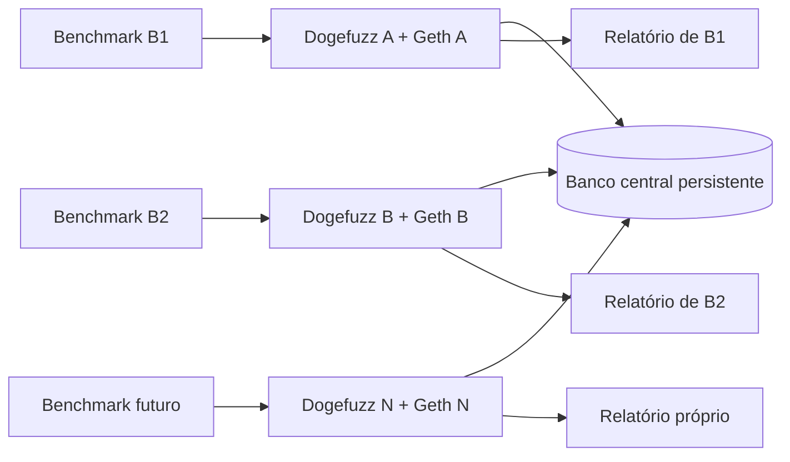

# Brainstorm — banco centralizado e seeds compartilhadas

Criado em: 2026-10-06. Revisado em: 2026-10-08.

Status: decisões de escopo consolidadas; detalhes de persistência e compatibilidade
ainda em definição. Nenhuma implementação ou medição de desempenho realizada.

## 1. Objetivo e referência

Compartilhar seeds entre chamadas independentes do benchmark, preservando o fluxo
atual de execução, seleção, mutação e relatório do Dogefuzz. A cooperação deve
funcionar tanto em paralelo quanto em sequência. O acervo permanece disponível
para chamadas futuras, sem limpeza automática ao encerrar uma chamada ou repetição.

O objetivo experimental é investigar cobertura e descoberta de vulnerabilidades.
O estudo anterior é a referência; aumento de transações por segundo não é
pressuposto nem consequência garantida do compartilhamento.

O usuário identificou [B2_parted](dogefuzz-benchmark/dataset/B2_parted) como dataset
de contratos com vulnerabilidades conhecidas utilizado no experimento anterior.
A inspeção encontrou sete listas `contracts.csv`, com 71 registros e todos os
arquivos citados presentes. Ainda falta vincular configuração, seleção exata,
versões e relatórios históricos. Os rótulos precisam ser mapeados aos detectores.

Exemplo: executar cinco vezes o benchmark sobre o mesmo conjunto de contratos,
com `greybox` e uma hora por contrato. Cada chamada gera seu relatório. As cinco
podem usar entradas descobertas pelas demais; uma sexta chamada futura também pode
aproveitar o acervo existente. Cinco chamadas independentes são diferentes de
uma chamada com cinco repetições internas, embora ambos os casos possam reutilizar seeds.

## 2. Decisões acordadas

- Manter comandos, laços sequenciais e relatórios próprios do benchmark.
- Preservar taskId e os demais UUIDs locais; não exigir novos IDs de campanha,
  repetição ou execução somente para compartilhar seeds.
- Compartilhar pontos de partida para mutação. O consumidor executa a entrada
  modificada e calcula seu resultado no próprio contexto.
- Manter seleção e mutadores atuais nas três variantes greybox; não acrescentar
  filtro obrigatório de publicação apenas por ganho.
- Preservar o complemento atual quando os candidatos forem insuficientes.
- Manter Geths independentes. Argumentos compartilhados não reproduzem estado.
- Usar acervo persistente entre chamadas/repetições, incluindo benchmarks futuros.
- Permitir uso da mesma seed por várias execuções; o acervo não é fila exclusiva.
- Separar correções da seleção como dívida técnica, aplicando eventual correção
  bloqueadora igualmente aos modos usados no comparativo.
- Iniciar a nova persistência sem importar SQLite histórico.
- Deixar remapeamento de endereços, replay e campanha científica completa fora
  desta primeira entrega.

Coordenador único de quatro workers, início sincronizado e relatório conjunto
não são requisitos. Quatro ou cinco containers são exemplos, não limite fixo.

## 3. Identificação das seeds

A chave compartilhada da função será:

```text
(source_hash, contract_name, function_signature)
```

- `source_hash`: SHA-256 dos bytes UTF-8 exatos de `contractSource`, antes de
  compilação/instrumentação. É um padrão técnico registrado para concretizar
  a escolha de código-fonte feita pelo usuário.
- `contract_name`: declaração selecionada. Um mesmo arquivo pode conter vários
  contratos com funções de assinaturas iguais.
- `function_signature`: nome da função e tipos canônicos dos argumentos na ABI;
  não depende dos nomes dos parâmetros.

Calcular hash e assinatura uma vez no cadastro, armazená-los e consultar por
igualdade com índice composto. Não comparar fontes completas a cada seleção.

| Exemplo | Compartilhamento |
| --- | --- |
| Mesmo texto, mesma declaração, mesma assinatura em outro deployment | Mesma chave, embora os UUIDs e endereços sejam diferentes |
| Mesmo contrato, withdraw(uint256) e withdraw(address) | Chaves diferentes |
| Mesmo arquivo, declarações Token e Vault | Contratos diferentes |
| Alteração no código, inclusive espaços, comentários ou quebras de linha | Outro hash |

Não normalizar o fonte nesta etapa. Endereço, UUID, bytecode e configuração de
compilação não entram na identidade básica. A chave identifica a função; filtros
de compatibilidade de serialização, cenário, endereços locais e métricas dirigidas
ainda precisam ser fechados. Não confundir fonte igual com estados Geth iguais.

## 4. Persistência e fluxo

A proposta em avaliação é uma persistência central, inicialmente PostgreSQL,
reutilizando inputs de transações concluídas como acervo. Não há publicação em
segundo banco nem cópia adicional de payload somente para formar o corpus.



1. A cria e executa uma transação e conclui sua análise.
2. Após commit, sua entrada fica disponível se atender à compatibilidade suportada.
3. B consulta candidatos pela chave da função, incluindo históricos de outras chamadas.
4. O Dogefuzz seleciona e modifica a seed usando seu fluxo atual.
5. B grava uma nova transação e avalia o resultado no próprio Geth.
6. A entrada de B pode tornar-se outra candidata depois de concluída.

A nova transação é outro teste, não uma cópia da observação de A.
Delta de cobertura/distância da origem não é garantia de ganho no consumidor.

Em 2026-10-08, o usuário escolheu **tabelas comuns com um identificador técnico
de instância (`instance_id`)**. Leituras, escritas, jobs e callbacks normais só
podem operar registros da instância responsável; a leitura de seeds é a exceção
compartilhada. Não criar um schema operacional separado para cada chamada.

`instance_id` identifica propriedade operacional, não compatibilidade de seed.
A consulta shared usa a chave de fonte/contrato/função já acordada e pode ler
inputs concluídos de outras instâncias, sem modificar seus registros. A seleção
e mutação geram uma nova transação pertencente ao consumidor.

O usuário definiu que o próprio Dogefuzz gera um UUID uma única vez a cada
inicialização. O contexto fica constante durante a vida do processo, inclusive
entre tarefas; reiniciar o processo, mesmo no mesmo container, gera outro UUID.
Propagar internamente pelo contexto da aplicação, sem exigir mudança no pedido
do benchmark. A definição está registrada; geração e propagação não foram implementadas.

Registros e estados do contexto anterior permanecem no banco, sem retomada de
tarefas, reenvio de transações ou reclassificação automática pelo processo novo.
Transações concluídas continuam candidatas ao compartilhamento, mesmo quando a
tarefa que as gerou foi interrompida; transações incompletas ficam excluídas.
Uma tarefa antiga pode continuar marcada como em andamento: seu estado não
comprova que o processo esteja ativo. Não haverá detecção de instâncias inativas
nesta etapa; outro instance_id pode pertencer a um processo ainda ativo.
Não apagar histórico por encerrar processo.

Auxiliares terão UUID próprio por registro, instance_id e papel, com unicidade
em (instance_id, papel). Cada inicialização cria e implanta seus cinco auxiliares
no Geth local; os consumidores resolvem o papel somente na instância atual.
As constantes atuais passam a representar papéis, não IDs globais de registros.
No reinício, criar novos registros e deployments, preservando os antigos como
histórico sem reutilizar seus endereços. Um processo não recebe nem adota o
instance_id de outro; o contexto gerado no bootstrap é imutável.

A escolha exige adaptar setup, modelos, restrição de unicidade e consumidores.
Repete compilação/deploy e aumenta o histórico a cada inicialização, como custo
aceito para manter o escopo simples. Não exige mudança no fluxo do benchmark.
IDs fixos com chave composta ampliariam mudanças nas chaves e relações; reutilizar
deployments exigiria identificar e validar a cadeia e o estado anterior. Manter
auxiliares somente em memória exigiria reorganizar consumidores e reduziria o
histórico persistido. Essas alternativas não foram escolhidas nesta etapa.

Auxiliares com IDs fixos, buscas por hash blockchain e remoção do banco no
encerramento precisam ser adaptados. Centralizar apenas a conexão não resolve esses pontos.

Verificação do comportamento atual em 2026-10-08: não existe instance_id nem UUID
gerado em NewEnv. O banco usa o DatabaseName configurado; UUIDs são criados por
registro nos repositórios. Destroy/Clean possuem remoção do SQLite, mas o fluxo
normal de main/waitForInterrupt não chama Destroy. Um reinício do mesmo container
pode reabrir o arquivo existente; projetos Docker separados possuem arquivos
locais separados e sua remoção descarta o armazenamento sem volume persistente.
Logo, o isolamento atual é por armazenamento/ambiente, não por ID de inicialização.

### Impactos e motivo da escolha

Decisão de D03 em 2026-10-08: instance_id é obrigatório nas quatro entidades
principais atuais: tasks, contracts, functions e transactions. Registros auxiliares
estão incluídos em contracts. Se uma nova tabela for necessária, confirmar com o
usuário sua inclusão, finalidade e necessidade de instance_id antes de implementá-la;
a regra não se estende automaticamente a novas tabelas.
O campo recebe o UUID do contexto interno da instância
que cria o registro, sem valor nulo ou vazio e sem alteração posterior de propriedade.
A leitura compartilhada preserva o instance_id da origem; uma nova transação
gerada a partir da seed recebe o instance_id da instância consumidora.

O custo é repetir o contexto nos registros e adaptar criação, modelos e migração;
o benefício é filtrar cada tabela diretamente, incluindo auxiliares sem tarefa.
Guardar o contexto somente em tasks não foi escolhido porque exigiria descobrir
a instância pelas relações e tratar auxiliares separadamente. Campo obrigatório
sozinho não garante isolamento de consultas nem consistência entre tabelas.

Integridade das relações: validar na aplicação e restringir também no banco,
mantendo UUIDs como identificadores principais e incluindo instance_id nas chaves
estrangeiras de relações operacionais. Contrato analisado referencia tarefa da
mesma instância; função referencia contrato da mesma instância; transação referencia
tarefa e função da mesma instância, e a função deve pertencer ao contrato daquela
tarefa. Auxiliares podem existir sem tarefa, associados à instância e ao papel.
Reuso de seed externa cria relações locais, sem alterar registros de origem.

A aplicação permite detectar o erro antes da gravação; o banco deve rejeitar
relações inválidas mesmo quando a validação for omitida. Validar apenas na aplicação
foi descartado por depender de todos os caminhos executarem a mesma verificação.
O custo é adaptar validações e migração e manter as restrições nas escritas.
O desenho exato de chaves e da garantia função/contrato/tarefa, demais restrições
e índices permanece pendente; essas garantias não substituem filtros de consulta.

| Área | Impacto de tabelas comuns + instance_id |
| --- | --- |
| Modelo de dados | Registrar o contexto operacional e preservar relações entre tarefa, contrato, função e transação da mesma instância |
| Consultas | Revisar CRUD, listagens e SQL direto; operações normais precisam de filtro de instância |
| Jobs e callbacks | Impedir que um processo encontre, execute, analise ou finalize trabalho externo |
| Auxiliares | Resolver registros/endereço por instância e papel, evitando colisões dos IDs globais atuais |
| Hash blockchain | Considerar instância na busca; cadeias independentes podem produzir hashes coincidentes |
| Seeds | Uma consulta central pela chave compartilhada, com exceção explícita de leitura e sem escrita externa |
| Migrações e índices | Um conjunto comum de tabelas; definir restrições e índices de contexto e de consulta de seeds |
| Verificação | Testes negativos com IDs externos, hashes iguais e auxiliares distintos; comprovar ausência de processamento cruzado |

A escolha concentra mais trabalho inicial nos repositórios e serviços, mas
mantém simples o acervo persistente entre chamadas atuais e futuras. Há um
caminho de consulta, sem descobrir e combinar históricos de schemas distintos.

A alternativa de **schema por instância** poderia preservar mais consultas locais
sem filtros e permitir IDs auxiliares iguais em namespaces diferentes. Entretanto,
exigiria criar/preservar schemas, aplicar migrações em cada um e resolver a consulta
de seeds sobre históricos distribuídos. Uma view ou consulta gerada poderia reunir
esses históricos, acrescentando manutenção conforme os schemas surgem ou mudam.
Por isso não foi escolhida para esta etapa, cujo foco é o compartilhamento simples
e duradouro. Isso não significa que schemas sejam uma alternativa inválida.

O custo aceito é a revisão abrangente das operações: esquecer um filtro pode
misturar trabalho entre instâncias. Restrições de integridade e testes fazem parte
da implementação; filtros de aplicação não devem ser descritos como garantia
automática de isolamento. O detalhe dessas restrições ainda está em D03.

Não há medição que demonstre uma opção mais rápida no Dogefuzz. Schemas no mesmo
banco também compartilham recursos do servidor; a escolha não estabelece vantagem
de CPU, disco ou conexões. Referências:
[schemas PostgreSQL](https://www.postgresql.org/docs/current/ddl-schemas.html) e
[índices compostos](https://www.postgresql.org/docs/current/indexes-multicolumn.html).

## 5. Impacto mínimo no benchmark e no comparativo

Manter uma instância de benchmark associada ao próprio par Dogefuzz/Geth,
endpoint e receptor de relatórios. Ajustar acesso ao banco comum e contexto
operacional mínimo, preservando a criação de tarefas e correlação por taskId.

Validar encerramento/reinício de uma chamada sem apagar dados ou afetar outra.
Metadados mínimos de avaliação podem registrar configuração, versões, modo,
origem das seeds e condição inicial do acervo, sem exigir relatório conjunto.

O coletor atual descarta relatórios cujo taskId difere do aguardado. Isso foi
identificado como limitação, mas não justifica adicionar coleta concorrente em
um coordenador único que deixou de ser requisito. Registrar como dívida técnica;
se bloquear o fluxo preservado, tratar separadamente.

| Caso discutido | Uso |
| --- | --- |
| Estudo histórico com B2_parted | Referência dos resultados existentes |
| Novo modo local sobre a persistência central | Controle para separar mudança de banco do compartilhamento |
| Novo modo shared na mesma infraestrutura | Avaliar reuso de seeds entre chamadas |

O protocolo científico ainda não foi fechado. Registrar corpus inicialmente
vazio ou acumulado, ordem das chamadas, orçamento e recursos. Chamadas shared
que trocam seeds ou herdam corpus não são repetições independentes com a mesma
condição inicial. Não resetar automaticamente para forçar essa condição.

Preservar curvas e detecções individuais. União de cobertura e relatório conjunto
podem ser avaliados futuramente, sem fazer parte do fluxo obrigatório atual.

## 6. Pendências e limites

- Filtros e integridade do isolamento escolhido; políticas de auxiliares e preservação sem retomada já definidas.
- Versão/configuração do banco, migração única, preservação e comportamento de falha.
- Representação dos inputs e filtros adicionais à chave compartilhada.
- Fallback/receive, endereços locais e compatibilidade das variantes dirigidas.
- Janela/atualização de candidatos e tratamento de repetidos sem alterar seleção.
- Elegibilidade na finalização, origem da seed e métricas mínimas.
- Roteamento de relatórios próprios e configuração das chamadas independentes.
- Protocolo de avaliação usando B2_parted e vínculo com os resultados anteriores.
- Eventual script de reset: banco inteiro ou apenas acervo/elegibilidade. Apagar
  todo o banco também apaga histórico e proveniência. Escopo ainda não escolhido.

Nenhum script de limpeza foi implementado ou executado. Problemas de limite de
consulta, ordenação de cobertura e score dirigido continuam como dívida técnica.

## 7. Referências e histórico

- [Custos revisados](002-custo-banco-centralizado.md).
- [Acompanhamento e decisões](003-acompanhamento-banco-centralizado.md).
- [Vocabulário](GLOSSARY.md).
- [Seleção de seeds](dogefuzz/fuzz/power_schedule.go).
- [Mutação greybox](dogefuzz/fuzz/greybox.go).
- [Persistência atual](dogefuzz/data/connection.go).
- [Benchmark atual](dogefuzz-benchmark/benchmark/services/benchmark.py).
- [Plano anterior mais amplo](PLANO_ACERVO_COMPARTILHADO.md).
- [Alternativa de segundo banco](PROPOSTA_DOGEFUZZ_SEGUNDO_BANCO_SEEDS.md).

Em 2026-10-06, discutiu-se coordenação de quatro workers e separação por repetição.
Em 2026-10-07, o usuário refinou o escopo para chamadas independentes, acervo
persistente, fluxo atual preservado e identificação por código-fonte/assinatura.
Esta revisão substitui os requisitos anteriores; os documentos arquiteturais
anteriores não são etapas obrigatórias. A análise permanece estática.
Em 2026-10-08, foram escolhidas tabelas comuns com instance_id e registrados seus
impactos e o motivo de não adotar schemas separados nesta etapa.
Na mesma data, foram escolhidos auxiliares com UUID próprio, instância/papel e
novos deployments por inicialização, preservando registros anteriores sem retomada.
