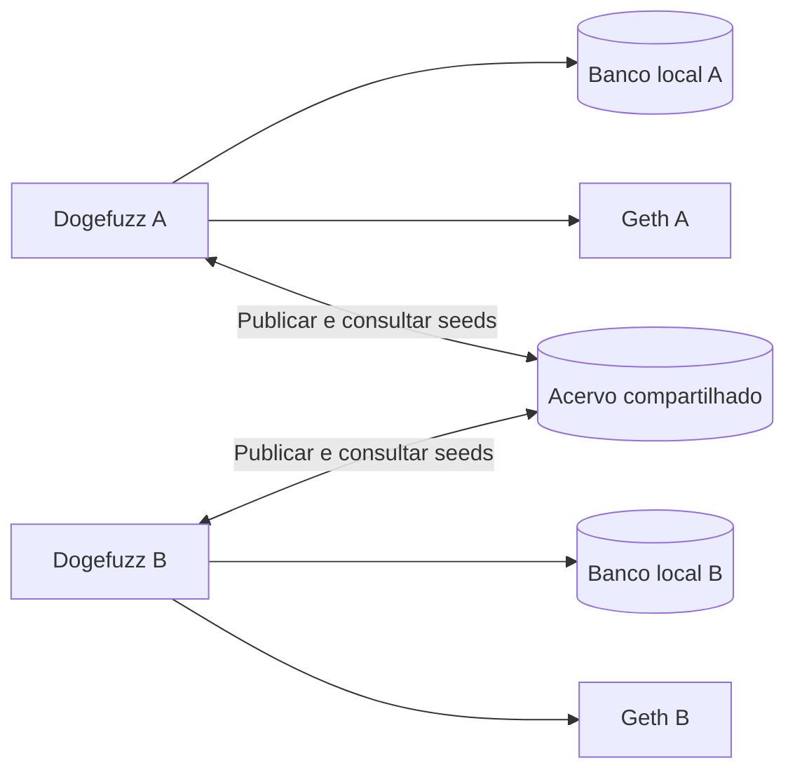

# Brainstorm — persistência local e acervo compartilhado de seeds

Criado em: 2026-10-06. Revisado em: 2026-10-09.

Status: arquitetura vigente reestruturada por decisão do usuário. Definição
documental; nenhuma implementação realizada nesta revisão.

## 1. Objetivo e decisão arquitetural

Compartilhar seeds entre chamadas independentes do benchmark, paralelas,
sequenciais e futuras, mantendo uma estrutura análoga à atual. Cada Dogefuzz
conserva seu banco operacional local e seu Geth. Um banco adicional, comum e
persistente, armazena o acervo de entradas reutilizáveis.

A centralização de tasks, contracts, functions e transactions foi substituída
por esta arquitetura para reduzir a complexidade. A separação operacional
continua sendo fornecida pelos ambientes e bancos locais, sem implantar isolamento
por instance_id em todas as consultas, jobs ou callbacks.



O acervo não executa tarefas nem distribui trabalho. Pode ser acessado diretamente
por um componente interno de cada Dogefuzz, sem exigir serviço HTTP adicional.

## 2. Decisões preservadas

- Chamadas do benchmark mantêm comando, execução sequencial interna, taskId,
  Geth, receptor de webhook e relatório próprio.
- Cooperação funciona em paralelo, em sequência e em chamadas futuras.
- O acervo permanece disponível, sem reset por repetição ou encerramento.
- UUIDs locais continuam identificando tarefas, contratos, funções e transações.
- Seeds compartilhadas continuam sujeitas à seleção, mutação e avaliação local.
- Consulta bem-sucedida com poucos candidatos usa o complemento atual; erro de consulta segue a propagação atual, sem novo fallback.
- Escopo de integração inclui greybox, directed_greybox e other_directed_greybox.
- Não há requisito de coordenador único nem novos IDs experimentais obrigatórios.
- Script de reset permanece uma possibilidade futura, sem escopo aprovado.

Não adotar automaticamente a política antiga de preservação de todos os registros
operacionais no banco central. Na arquitetura vigente, o acervo sobrevive às
chamadas; histórico operacional segue a persistência local atual. Esta revisão
não adiciona volume local, recuperação de tarefas nem retomada após reinício.

## 3. Identidade compartilhada e contexto local

Chave básica confirmada:
`(source_hash, contract_name, function_signature)`.

- source_hash: SHA-256 dos bytes UTF-8 do contractSource exato recebido, antes da
  compilação/instrumentação, sem normalização de espaços, comentários ou quebras.
- contract_name: declaração selecionada, distinguindo contratos na mesma fonte.
- function_signature: assinatura ABI completa com tipos canônicos dos argumentos.
- Calcular uma vez no cadastro e reutilizar; armazenamento/cache local será
  detalhado sem migração da persistência operacional para o banco comum.
- UUID, endereço, bytecode e configuração do compilador não integram a chave básica.

A chave reconhece o contrato/função para procurar entradas; não garante equivalência
de estado inicial, construtor, endereços ou instrumentação. Filtros adicionais,
formato dos inputs e compatibilidade das variantes dirigidas permanecem em D04/D05.

Exemplo: duas chamadas avaliam SimpleDAO. A tem tarefa T1, contrato C1 e função F1;
B tem T2, C2 e F2 em seu banco local. B lê a entrada de A pelo código/assinatura e
gera uma transação de T2/F2. Estado, cobertura e vulnerabilidades continuam locais.
Métricas de origem são heurísticas; não representam ganho obtido pelo consumidor.

## 4. Responsabilidades e fluxo

| Componente | Responsabilidade |
| --- | --- |
| Banco local | Histórico operacional, estados e resultados da própria execução |
| Geth local | Deploy e execução de contratos e auxiliares |
| Componente de seeds | Publicação, consulta, compatibilidade e adaptação de candidatos |
| Banco compartilhado | Entradas reutilizáveis e metadados suficientes para seleção |
| Benchmark | Configurar modo/acesso, executar contratos e gerar relatório próprio |

Fluxo de geração e execução no modo shared:

1. RequestSeeds() resolve a identidade e a ABI do contrato/função local.
2. Consulta candidatos somente no acervo compartilhado, com limite/timeout a definir.
3. Em erro de consulta, propaga o erro; o listener registra e encerra aquele evento.
4. Em sucesso, adapta candidatos à ordenação/seleção atual, sem deduplicar registros.
5. Se faltarem candidatos, completa com seeds configuradas; o fuzzer escolhe e muta.
6. Cria e executa a nova transação no banco/Geth locais.
7. Após analisar e salvar transação e tarefa, tenta publicar sincronamente o novo
   candidato. Falha de publicação é registrada sem desfazer os resultados locais.

Publicação e consulta são pontos separados: a execução pode começar com acervo
vazio, usando o complemento atual, e publicar suas primeiras entradas após a análise.

Decisão vigente revisada: no modo shared, RequestSeeds() consulta candidatos
apenas no acervo compartilhado, antes da seleção. Não buscar transações locais
como segunda fonte ou fallback nesse modo. Leituras locais de contrato/função
para identidade e ABI continuam necessárias; não são consultas de candidatos.
No modo local do comparativo, preservar o caminho atual de transações locais.

As regras de união local/shared e preferência por métricas locais foram
substituídas por esta decisão e ficam apenas no histórico. Não há combinação de
duas fontes de candidatos no modo shared. Decisão vigente: registrar publicações
repetidas no acervo sem tratamento especial. Cada publicação aceita cria registro
independente com seus inputs e métricas, sem deduplicar, substituir ou combinar
avaliações. Manter a primeira publicação não foi adotado.

Se uma publicação falhar, a entrada permanece no histórico operacional local,
mas não pode ser reutilizada pela seleção shared enquanto não estiver no acervo.
Consulta bem-sucedida com acervo vazio ou insuficiente usa o complemento atual de seeds configuradas.
Em erro de consulta, manter a tratativa atual: propagar erro até o listener, que
registra a falha e encerra aquele evento, sem consultar histórico local ou gerar
complemento configurado para mascarar o erro. Timeout de consulta ainda será definido.
Nenhum código alterado.

Incompletas não são publicadas. Não há filtro obrigatório por ganho positivo.
Frequência confirmada em 2026-10-09: publicar a cada transação concluída, após
análise e gravação local confirmada. Cada conclusão elegível dispara uma tentativa;
publicações com argumentos iguais são aceitas como registros distintos. A frequência
reduz a espera para compartilhar entradas, mas acrescenta trabalho por transação;
medir custo/latência.
Decisão de 2026-10-09: publicação inicialmente síncrona. Após salvar localmente,
o caminho de processamento espera sucesso, erro ou timeout da tentativa de
publicação, e então continua.
Ponto de integração confirmado: chamada explícita ao componente de seeds ao final
do listener de análise, logo após salvar com sucesso a transação concluída e a
atualização da tarefa. Se qualquer gravação local falhar, não tentar publicar
naquele evento. A transação e a tarefa são salvas separadamente no fluxo atual;
esta decisão não torna as duas gravações atômicas nem garante publicação posterior.
Falha remota não desfaz as gravações locais. Não publicar dentro do Update genérico.
Referência estática: [listener de análise](dogefuzz/listener/executation_analytics.go).
Publicação assíncrona fica como possibilidade futura, fora da implementação
inicial, para avaliar caso a latência medida prejudique o fuzzing. Exigiria definir
fila limitada, comportamento quando cheia, concorrência e encerramento; não
implica outbox ou garantia de entrega. Comparativo deve medir a espera síncrona.
Uma seed não é consumida exclusivamente: várias execuções podem usá-la.

A consulta deve ser limitada e ter timeout. Decisão do usuário: falha de consulta
segue a tratativa normal do projeto, propagando erro; falta de candidatos após
consulta bem-sucedida usa complemento configurado. Não confundir essa regra com
falha de publicação, que é aceita e permite continuar após conclusão local.
Limites e timeout de consulta permanecem pendentes.

## 5. Esquema mínimo e dupla persistência

Objeto aprovado para publicação/consulta, a adaptar aos DTOs e à seleção
existentes. A compatibilidade efetiva será validada em S02/S08:

```go
type SeedCandidate struct {
    // SHA-256 da fonte UTF-8 exata recebida, antes de compilar/instrumentar.
    // Compõe a identidade compartilhada com contrato e assinatura da função.
    SourceHash string

    // Nome da declaração selecionada; distingue contratos na mesma fonte.
    ContractName string

    // Assinatura ABI completa com tipos canônicos, como "withdraw(uint256)".
    // Distingue funções sobrecarregadas; não é o UUID local da função.
    FunctionSignature string

    // Argumentos serializados na ordem dos parâmetros da ABI.
    // O formato deve preservar os tipos suportados e permitir desserialização.
    Inputs []string

    // Instruções executadas na avaliação produtora, no formato do TransactionDTO.
    // A estratégia distance_coverage_based usa o tamanho desta lista para cobertura.
    // Preservar a lista; não substituir informação ausente por uma lista vazia.
    ExecutedInstructions []string

    // Ganho de cobertura observado em relação ao acumulado da tarefa produtora.
    // No cálculo atual, conta novos pontos de cobertura; não é porcentagem
    // nem garantia de ganho na execução consumidora.
    DeltaCoverage uint64

    // Métrica produzida pelo cálculo atual de variação da distância aos alvos,
    // considerando o acumulado da tarefa produtora. Usada na seleção dirigida;
    // preservar a semântica atual, inclusive seus casos especiais.
    DeltaMinDistance uint64

    // Contagem de ocorrências de instruções classificadas como críticas
    // na execução avaliada, usada pelas estratégias dirigidas.
    // Não representa uma quantidade de vulnerabilidades confirmadas.
    CriticalInstructionsHits uint64
}
```

Não incluir origem, IDs operacionais ou endereço do deployment. O registro no
acervo pode ter ID próprio; ele não integra o objeto de candidato aprovado.
O adapter deve converter dados para a estrutura esperada sem alterar seleção
ou mutadores. Tipos e compatibilidade serão verificados em S02; hash e assinatura em S03.

Decisão de S02 (2026-10-10): manter a representação atual com separador `;`
entre argumentos, usando Join/Split sem adicionar escape ou converter para JSON.
Inputs permanece []string no objeto; o adapter faz a conversão na persistência.
O gerador e os mutadores de string atuais usam somente letras, e as seeds padrão
são "foo" e "bar". Entretanto, Deserialize aceita strings contendo `;`; esses
valores tornam a separação ambígua e não têm round-trip garantido. Esta limitação
fica registrada, sem introduzir tratamento novo nesta decisão.

Decisão de S02 (2026-10-10): remover o campo de versão do SeedCandidate.
Não exigir versionamento, filtro por versão ou conversão entre versões nesta entrega.
A compatibilidade permanece baseada na identidade da função e nos handlers atuais.

Decisão de S02 (2026-10-10): reutilizar os valores dos argumentos como estão,
inclusive endereços, sem excluir candidatos por dependência do ambiente e sem
remapear contas ou contratos auxiliares. Após a recuperação, aplicar normalmente
as avaliações e mutações existentes; não exigir reprodução do resultado original.
Um endereço pode não ter código ou saldo na execução consumidora, e o estado do
contrato pode ser diferente. Esses efeitos de contexto são aceitos nesta entrega.
A verificação técnica de serialização/desserialização dos tipos já suportados
continua necessária; esta decisão não adiciona suporte a tipos nem uma política
nova para dados inválidos ou falhas de desserialização.

Decisão de S02 (2026-10-10): manter o comportamento atual para erros detectados
na desserialização. RequestSeeds() retorna o erro, GenerateInput() o propaga e o
listener registra a falha e encerra o processamento daquele evento. Não descartar
individualmente candidatos, corrigir valores, excluir/marcar registros no acervo
ou adicionar fallback para essa falha. Um candidato selecionado inválido pode
impedir o aproveitamento dos demais naquela chamada. O complemento com seeds
configuradas continua reservado à consulta/desserialização bem-sucedida com
candidatos insuficientes; não garantir detecção de toda ambiguidade do separador.

Requisito confirmado em S02 (2026-10-10): SeedCandidate deve ser totalmente
compatível com o sistema atual de seeds e permitir reutilização entre execuções
de contratos iguais, pela fonte exata, declaração e assinatura ABI já definidas.
Para atender às três estratégias greybox, o objeto inclui ExecutedInstructions
com o mesmo tipo do TransactionDTO atual. A análise estática dos orderers confirma:
coverage_based usa DeltaCoverage; distance_based usa CriticalInstructionsHits e
DeltaMinDistance; distance_coverage_based usa também ExecutedInstructions.
O adapter preserva esses campos e Inputs sem substituir dados ausentes por zeros.
CFG, DistanceMap e TargetInstructionsFreq continuam vindo do contrato consumidor,
como no fluxo atual; IDs locais não identificam o contrato compartilhado.
Preservar handlers, seleção e mutação atuais. Compatibilidade aqui significa
preservar a representação e os dados utilizados pelos algoritmos, não garantir
estado blockchain ou resultado de execução iguais. Verificação funcional do
adapter e dos tipos em S02/S08 continua pendente; análise estática não conclui
essas tarefas. Critérios de consulta e ordenação temporal permanecem em D05/D03.

Proposta para decisão em D03: uma estrutura de seeds com chave da função,
inputs com separador `;` e metadados necessários à seleção. Cada registro terá ID próprio,
sem unicidade por combinação de função e argumentos.
Nome e criação das novas tabelas exigem confirmação
prévia do usuário; não criar automaticamente corpora, observations ou outbox.

Se a opção futura de origem for adotada, ela será uma referência, não uma chave
estrangeira para SQLite remoto. O histórico local pode desaparecer ao remover seu container. Se algum
metadado precisar sobreviver para seleção ou auditoria, deve acompanhar a seed.
Rastrear cada descendente e múltiplas observações é uma decisão separada.

Decisão do usuário: referência de origem fica registrada como opção futura e não
será usada na implementação inicial. Não incluir campos de tarefa/transação/instância
produtora no candidato ou esquema ativo para essa finalidade, nem coletar linhagem.
Uma futura referência à transação produtora poderia ajudar diagnóstico e auditoria,
mas exigiria nova decisão e não garantiria acesso ao histórico local já removido.
Sem origem registrada, não é possível identificar qual execução produziu cada seed
ou atribuir ganho a um produtor. Ainda é possível medir consultas/publicações e
uso do acervo como fonte, sem afirmar que toda seed consultada veio de outra instância.
Essa escolha não remove metadados necessários à seleção, a definir em D05, nem
define campos temporais de ordenação/retenção do acervo.

Há duas persistências: um resultado local e uma cópia de argumentos no acervo.
Não existe commit conjunto assumido entre elas. A escolha vigente é publicação
simples; a alternativa com recuperação permanece fora da entrega inicial:

| Política | Consequência |
| --- | --- |
| Publicação simples após commit local | Menor implementação; falha ou encerramento pode deixar uma entrada apenas local, sem compartilhamento |
| Publicação com recuperação persistente | Reduz perdas de publicação; exige estado pendente, rotina de reenvio e política de retenção, possivelmente nova tabela local |

Decisão confirmada em 2026-10-09: aceitar falha de publicação e adotar a primeira
opção. Após salvar o resultado local, tentar publicar com tempo de espera limitado;
em falha, registrar o erro e continuar o fuzzing, sem desfazer o resultado local,
sem outbox e sem garantia de publicação posterior. Timeout configurável confirmado
em 2026-10-09, com valor inicial de 500 ms para a tentativa inteira, incluindo espera
por conexão e gravação/confirmação, sem reiniciar o limite em cada etapa.
Quantidade de tentativas configurável confirmada em 2026-10-09, inicialmente 1.
O número conta o total de tentativas, incluindo a primeira, não o número de retries.
Com valor 1, tentar uma vez; em erro ou timeout, registrar falha e continuar localmente.
Não há reenvio posterior garantido nem recuperação persistente. Na implementação,
documentar e validar inteiro positivo. Se configurado acima de 1, repetir somente
a publicação da mesma entrada, nunca a execução no Geth. Cada tentativa possui
o timeout configurado; mais tentativas podem aumentar a espera acumulada. Critérios
de erro elegível e eventual intervalo entre tentativas exigem detalhamento antes
de usar valores maiores que 1; repetições podem inserir registros adicionais.

Documentar junto ao parâmetro as opções ilustrativas de ajuste:

| Valor | Comentário de configuração |
| --- | --- |
| 100 ms | Menor espera; maior chance de falha durante oscilações de latência |
| 500 ms (inicial) | Valor inicial escolhido; medir latência e falhas antes de ajustar |
| 1 segundo | Tolera respostas mais lentas; maior custo de espera no processamento |

São referências para ajuste, não limites de valores permitidos nem resultados
medidos. O parâmetro controla publicação; timeout de consulta continua separado
e pendente. Definir nome/unidade e validar valor positivo na implementação.
A segunda opção fica fora do escopo vigente. Não exigir idempotência de publicação
na entrega inicial: timeout remoto pode ocorrer após commit e uma nova tentativa
pode inserir outro registro, o que é aceito. Nunca reenviar a transação ao Geth.
Registros repetidos podem ocupar posições no conjunto selecionado e aumentar o
volume do acervo; comportamento análogo ao histórico atual de transações locais.

## 6. Consequências e alternativas

| Área | Arquitetura vigente |
| --- | --- |
| Entidades operacionais | Permanecem locais; sem migração completa para PostgreSQL |
| Jobs e callbacks | Mantêm a fronteira local; integração pontual na conclusão/publicação |
| Auxiliares | Mantêm criação, IDs e resolução atuais no próprio ambiente |
| instance_id nas quatro entidades | Não é requisito ativo; era necessário à alternativa de centralização operacional |
| Compartilhamento | Exige publicar e consultar um segundo acervo |
| Falha do acervo | Publicação: registrar e continuar após gravações locais. Consulta: propagar erro e encerrar o evento; startup/conexão ainda pendentes |
| Benchmark | Acrescenta acesso/modo do acervo e infraestrutura persistente independente |
| Relatórios | Mantêm resultados locais; métricas mínimas de compartilhamento serão definidas |

A centralização completa evita a cópia/publicação entre bancos e concentra o
histórico, mas exige revisar isolamento de relações, consultas, SQL direto, jobs,
auxiliares e callbacks. Foi substituída porque o objetivo prioritário é compartilhar
seeds com menor impacto. Bancos locais reduzem esse trabalho, aceitando duplicação
de entradas e necessidade de definir consistência da publicação.

Não foi medida superioridade de performance. Consultas remotas, serialização e
publicação podem reduzir o tempo efetivo de fuzzing; o comparativo deverá medir
custos e resultados, sem presumir benefício.

## 7. Avaliação e pendências

Referência: dogefuzz-benchmark/dataset/B2_parted, indicado pelo usuário como dataset
do experimento anterior. Verificação estática anterior encontrou sete catálogos
e 71 registros com arquivos existentes; configuração histórica e interpretação
dos rótulos ainda precisam ser conferidas.

Exemplo: cinco comandos para o mesmo grupo, greybox e uma hora por contrato.
Cada comando mantém ambiente e relatório. Documentar recursos, orçamento e se o
acervo começou vazio ou acumulado; execuções cooperativas não são repetições
independentes presumidas. Teste funcional curto não substitui campanha científica.

S01 está concluída documentalmente. Próxima tarefa: S02 — formato e compatibilidade
dos inputs, com decisões discutidas uma por vez.

| Definição | Pendências vigentes |
| --- | --- |
| D02 | Tecnologia/versão, conexão/pool, startup, migração e acesso dos containers |
| D03 | Aprovar novas tabelas, campos de armazenamento, índices e limites; detalhar repetições se tentativas acima de 1 |
| D04 | Tipos suportados, round-trip e erros de representação; separador `;` mantido, sem campo de versão |
| D05 | Compatibilidade dirigida, cenário, fallback/receive, limites e timeout da consulta; armazenamento/cache da identidade |
| D06 | Configuração, publicação no modo local, infraestrutura e encerramento |
| D07 | Métricas, protocolo anterior, orçamento e condição inicial do corpus |
| D08 | Impacto das dívidas atuais na integração e no comparativo |

Origem, publicação assíncrona e reset são possibilidades futuras, sem implementação
aprovada. Reset e criação de novas tabelas exigem decisão prévia.

## 8. Histórico e referências

Em 2026-10-09, o usuário escolheu bancos operacionais locais e acervo compartilhado.
As decisões de 2026-10-08 sobre instance_id, auxiliares com UUID por instância e
restrições entre instâncias são históricas, não tarefas obrigatórias vigentes.
A identificação de origem foi adiada como opção futura; não exige propagar
instance_id pelas quatro entidades locais e não integra a entrega inicial.

As versões anteriores foram preservadas integralmente em
[histórico da arquitetura operacional](docs/historico/2026-10-09-centralizacao-operacional/README.md).

- [Custos e novo backlog](002-custo-centralizacao-seeds.md).
- [Acompanhamento](003-acompanhamento-centralizacao-seeds.md).
- [Vocabulário](GLOSSARY.md).
- [Proposta anterior de segundo banco](PROPOSTA_DOGEFUZZ_SEGUNDO_BANCO_SEEDS.md): referência, não requisito automático; outbox e esquema ampliado precisam de nova decisão.
- [Seleção atual](dogefuzz/fuzz/power_schedule.go).
- [Mutação greybox](dogefuzz/fuzz/greybox.go).
- [Conclusão/análise](dogefuzz/listener/executation_analytics.go).
- [Persistência atual](dogefuzz/data/connection.go).
